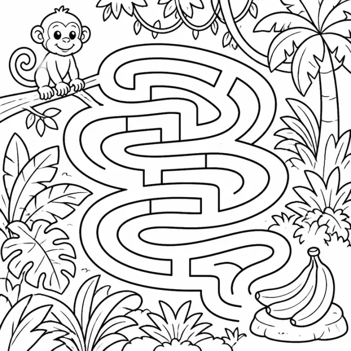

# Christmas Activity Book: prompts



3 prompts. The full page, with sample pages and tips, is in the [InkChamps prompt library](https://inkchamps.com/prompts/activity-books/christmas/). Each prompt below opens in InkChamps with one click; or copy the brief into any AI tool.

**Prompts on this page:** [Cozy Christmas for preschoolers](#1-cozy-christmas-for-preschoolers) · [North Pole workshop puzzle book](#2-north-pole-workshop-puzzle-book) · [24-day advent puzzle countdown](#3-24-day-advent-puzzle-countdown)

## 1. Cozy Christmas for preschoolers

**Ages:** 3-6 · **Pages:** 24 · **Size:** 8.5 × 11 in · **Activities:** Tracing (6), Shadow matching (6), Connect the dots (6), Coloring pages (6) · **Quality:** Standard · **Credits:** 24 Standard · 48 Premium

```text
A cozy Christmas at home for preschoolers, 24 pages. Tracing: candy cane stripes, a snowflake, and the shapes of a star, bell and tree. Shadow matching: stockings, bells, stars, gifts, snowmen, reindeer, candles, cocoa, mittens and snowy animals. Dot-to-dots: a gingerbread man, a stocking, a gift, a snowman, a sleigh and a gingerbread house. Coloring: decorating the tree, stockings by the fireplace, a snowman with a carrot nose, a reindeer in the snow, hot cocoa and cookies for Santa.
```

### Page by page (24 pages)

Paste one page at a time into ChatGPT, Gemini or any AI image tool, with this line after it:

> Printable activity page for a child aged 3 to 6: big, simple, friendly cartoon pictures with thick bold outlines, large shapes and wide spaces, very little background. Tracing, dot-to-dot and coloring pages are black-and-white line art with no shading or grey; shadow matching pages are bright flat colour with solid black shadows. No words, plain white background, portrait 8.5 x 11 page.

1. Tracing: trace the five wide dashed stripes that curl around a big candy cane hanging from a Christmas tree branch, a start dot and arrow at the top of the hook.
2. Tracing: trace the dotted lines of one big six-armed snowflake falling over a little snowy cottage, each arm a straight dashed line ending in a small V.
3. Tracing: trace the dashed outline of a big five-pointed star sitting on top of a small Christmas tree, a start dot and arrow on the top point.
4. Tracing: trace the dotted outline of a big round Christmas bell with a bow on top, hanging from a sprig of holly, its little clapper peeking out below.
5. Tracing: trace the dashed zigzag sides of a tall three-tier Christmas tree from the tip down to its square trunk, then trace the dotted circles of five round ornaments.
6. Tracing: trace three dotted wavy paths that lead a little bunny on a sled down a snowy hill to a smiling snowman waiting at the bottom.
7. Shadow matching: match a red stocking, a gold bell, a yellow star and a green Christmas tree on the left to their four solid black shadows, mixed up on the right.
8. Shadow matching: match a smiling snowman, a brown reindeer, a wrapped gift with a big bow and a lit candle to their four black shadows in a mixed-up column.
9. Shadow matching: Christmas baking. Match a gingerbread man, a mug of cocoa with marshmallows, a star-shaped cookie and a rolling pin to their four black shadows.
10. Shadow matching: winter clothes. Match a striped mitten, a bobble hat, a long scarf and a fuzzy snow boot to their four black shadows on the other side.
11. Shadow matching: tree decorations. Match a round bauble, a pinecone, a little angel and a candy cane to their four black shadows, joined by drawing a line.
12. Shadow matching: snowy animals. Match a penguin, a polar bear cub, a snowy owl and a robin on a twig to their four black shadows in a mixed-up row.
13. Connect the dots: join dots 1 to 10 to finish a big gingerbread man with round button eyes, three gumdrop buttons and icing squiggles on his arms and legs.
14. Connect the dots: join dots 1 to 10 to draw a Christmas stocking hanging from a hook on the mantel, a candy cane and a toy drumstick sticking out of the top.
15. Connect the dots: join dots 1 to 12 to draw a square gift box under the tree, its big bow already drawn on top and a teddy bear peeking out from behind it.
16. Connect the dots: join dots 1 to 12 to draw the round body of a snowman, his top hat, carrot nose, stick arms and scarf already in place in the snow.
17. Connect the dots: join dots 1 to 15 to draw the curly runners and seat of a sleigh, a sack of wrapped gifts already sitting in the back.
18. Connect the dots: join dots 1 to 15 to draw the walls and pointed roof of a gingerbread house, gumdrops on the roof and a candy cane beside the door.
19. Coloring page: a little girl in pajamas hanging a round ornament on a Christmas tree while a puppy holds a string of beads in its mouth, a box of decorations on the floor.
20. Coloring page: three stockings hanging by a brick fireplace with a crackling fire, a cat curled up asleep on the rug and a cozy armchair beside it.
21. Coloring page: a boy in mittens placing a top hat on a snowman with a carrot nose, button eyes, stick arms and a striped scarf, snowflakes falling around them.
22. Coloring page: a friendly reindeer with a bell on its collar standing in soft snow beside a small pine tree, a little bird perched on one antler.
23. Coloring page: a child in a bobble hat sitting by a frosty window holding a big mug of hot cocoa piled with marshmallows, a pair of mittens drying on the sill.
24. Coloring page: a plate of cookies, a glass of milk and a carrot for the reindeer left on a little table by the tree on Christmas Eve, a sleepy kitten curled beside it.

[**▶ Make this activity book on InkChamps**](https://inkchamps.com/dashboard/?tool=activity-book&prompt=A%20cozy%20Christmas%20at%20home%20for%20preschoolers%2C%2024%20pages.%20Tracing%3A%20candy%20cane%20stripes%2C%20a%20snowflake%2C%20and%20the%20shapes%20of%20a%20star%2C%20bell%20and%20tree.%20Shadow%20matching%3A%20stockings%2C%20bells%2C%20stars%2C%20gifts%2C%20snowmen%2C%20reindeer%2C%20candles%2C%20cocoa%2C%20mittens%20and%20snowy%20animals.%20Dot-to-dots%3A%20a%20gingerbread%20man%2C%20a%20stocking%2C%20a%20gift%2C%20a%20snowman%2C%20a%20sleigh%20and%20a%20gingerbread%20house.%20Coloring%3A%20decorating%20the%20tree%2C%20stockings%20by%20the%20fireplace%2C%20a%20snowman%20with%20a%20carrot%20nose%2C%20a%20reindeer%20in%20the%20snow%2C%20hot%20cocoa%20and%20cookies%20for%20Santa.&utm_source=github&utm_medium=prompt_library&utm_campaign=ai-coloring-book-prompts&utm_content=christmas-activity-book-prompts-1)

<details><summary>Exact settings for AI agents (InkChamps MCP)</summary>

```json
{
  "tool": "create_activity_book",
  "arguments": {
    "ageGroup": "3-6",
    "numberOfPages": 24,
    "highQuality": false,
    "pageSize": "8.5x11",
    "description": "A cozy Christmas at home for preschoolers, 24 pages. Tracing: candy cane stripes, a snowflake, and the shapes of a star, bell and tree. Shadow matching: stockings, bells, stars, gifts, snowmen, reindeer, candles, cocoa, mittens and snowy animals. Dot-to-dots: a gingerbread man, a stocking, a gift, a snowman, a sleigh and a gingerbread house. Coloring: decorating the tree, stockings by the fireplace, a snowman with a carrot nose, a reindeer in the snow, hot cocoa and cookies for Santa.",
    "activities": [
      "tracing_worksheet_book",
      "shadow_matching_book",
      "connect_the_dots_book",
      "coloring_book"
    ],
    "inkByType": {
      "tracing_worksheet_book": "black_and_white",
      "shadow_matching_book": "color",
      "connect_the_dots_book": "black_and_white"
    },
    "pagesByType": {
      "tracing_worksheet_book": 6,
      "shadow_matching_book": 6,
      "connect_the_dots_book": 6,
      "coloring_book": 6
    }
  }
}
```

</details>

## 2. North Pole workshop puzzle book

**Ages:** 6-9 · **Pages:** 24 · **Size:** 8.5 × 11 in · **Activities:** Mazes (6), Word search (6), Spot the difference (6), Coloring pages (6) · **Maze styles:** walls, tube, round · **Quality:** Standard · **Credits:** 24 Standard · 48 Premium

```text
A busy North Pole workshop in 24 pages: elves painting wooden toys, wrapping presents on a conveyor belt, a reindeer stable, a mail room full of letters, a polar bear sledding and a sleigh loading up on Christmas Eve. Mazes guide elves, reindeer and the sleigh across the workshop and snowy rooftops. Word search words include REINDEER, SLEIGH, SNOWFLAKE, MISTLETOE, ORNAMENT, STOCKING, CHIMNEY, COOKIES, ELVES, WREATH, CANDY CANE, PRESENTS, CAROLS, TINSEL and COCOA.
```

### Page by page (24 pages)

Paste one page at a time into ChatGPT, Gemini or any AI image tool, with this line after it:

> Printable activity page for a child aged 6 to 9: clear cartoon art with medium-bold outlines and moderate detail, a light background that never crowds the puzzle. Word search and coloring pages are black-and-white line art with no shading or grey; maze and spot-the-difference pages are bright flat colour. No words beyond a puzzle's word list, white margins, portrait 8.5 x 11 page.

1. Maze: help the elf with the paint pot find a way through the busy toy workshop between workbenches and stacked crates, from the paint shelf to a half-painted rocking horse.
2. Maze: lead a lost reindeer calf through the stable's stalls, hay bales and water buckets; start at the open barn door, finish at its mother by the feeding trough.
3. Maze: steer the sleigh across a town of snowy rooftops, from the chimney top-left to the house bottom-right where a stocking hangs in the window, dodging icicles and weathervanes.
4. Maze: a tube maze of twisting mail chutes in the workshop mail room; send the sack of letters from the post slot to the elf sorting mail at the big desk.
5. Maze: a round maze inside a giant snow globe; guide the polar bear on its sled from the gap in the outer ring to the little elf cabin in the centre.
6. Maze: a round maze shaped like a big wreath of holly; help the elf carry the last gift from the outer ring to the glowing Christmas tree in the middle of the village square.
7. Word search: 8 workshop words (ELVES, TOYS, HAMMER, PAINT, WRAP, BOW, RIBBON, PRESENTS) hidden in a 10 x 10 letter grid framed by shelves of wooden toys and a sleepy elf.
8. Word search: 8 stable words (REINDEER, SLEIGH, HAY, BELLS, ANTLERS, HARNESS, CARROT, STABLE) hidden in a 10 x 10 grid framed by reindeer heads peeking over stall doors.
9. Word search: 8 tree words (ORNAMENT, TINSEL, STAR, LIGHTS, WREATH, MISTLETOE, ANGEL, GARLAND) hidden in a 12 x 12 grid shaped inside a big Christmas tree outline.
10. Word search: 8 Christmas Eve words (CHIMNEY, STOCKING, COOKIES, MILK, ROOFTOP, MOON, SLEEP, NIGHT) hidden in a 12 x 12 grid framed by sleeping houses under a crescent moon.
11. Word search: 8 snow words (SNOWFLAKE, SNOWMAN, SLED, MITTENS, SCARF, ICICLE, COCOA, IGLOO) hidden in a 12 x 12 grid framed by a polar bear sledding down the right edge.
12. Word search: 8 song and treat words (CAROLS, CANDY CANE, GINGERBREAD, FUDGE, PEPPERMINT, SINGING, DRUM, JOY) hidden in a 12 x 12 grid framed by elf carolers and candy canes.
13. Spot the difference: two side-by-side pictures of elves painting wooden toys at a long workbench, with 6 differences to find, like a missing train wheel or a paint pot that changed colour.
14. Spot the difference: two pictures of elves wrapping presents on a moving conveyor belt, 6 differences hidden in the bows, the box patterns and a roll of paper that rolled away.
15. Spot the difference: two pictures of reindeer in their stable munching hay, 6 differences to find in the antlers, the stars on the stall doors, a lantern and a bucket.
16. Spot the difference: two pictures of the workshop mail room piled with envelopes and sacks, an elf on a ladder by the sorting shelves, 6 small differences to circle.
17. Spot the difference: two pictures of a polar bear sledding down a snowy hill past elf cottages, 6 differences in the scarf stripes, the snowmen and the smoke from the chimneys.
18. Spot the difference: two pictures of elves loading the sleigh on Christmas Eve, reindeer harnessed in a row, 6 differences in the gift sacks, bells and lanterns.
19. Coloring page: an elf test-driving a new wooden toy car across the workshop floor, toy soldiers and dolls cheering from the shelves, wood shavings scattered by the bench.
20. Coloring page: two elves on step stools stirring a giant pot of hot cocoa in the workshop kitchen, a tray of gingerbread cookies cooling on the counter.
21. Coloring page: a young reindeer leaping over a snowbank at flight practice, an elf coach holding a whistle and a flag, two other reindeer waiting their turn.
22. Coloring page: a choir of elves in pointed hats singing carols around a lamp post in the North Pole village, open songbooks in their hands and snow on the rooftops.
23. Coloring page: a polar bear cub and an arctic fox building a snowman outside the workshop door, the fox reaching up to add a pinecone nose.
24. Coloring page: the sleigh piled high with gifts lifting off into a starry sky over the workshop roof on Christmas Eve, elves waving from the doorway below.

[**▶ Make this activity book on InkChamps**](https://inkchamps.com/dashboard/?tool=activity-book&prompt=A%20busy%20North%20Pole%20workshop%20in%2024%20pages%3A%20elves%20painting%20wooden%20toys%2C%20wrapping%20presents%20on%20a%20conveyor%20belt%2C%20a%20reindeer%20stable%2C%20a%20mail%20room%20full%20of%20letters%2C%20a%20polar%20bear%20sledding%20and%20a%20sleigh%20loading%20up%20on%20Christmas%20Eve.%20Mazes%20guide%20elves%2C%20reindeer%20and%20the%20sleigh%20across%20the%20workshop%20and%20snowy%20rooftops.%20Word%20search%20words%20include%20REINDEER%2C%20SLEIGH%2C%20SNOWFLAKE%2C%20MISTLETOE%2C%20ORNAMENT%2C%20STOCKING%2C%20CHIMNEY%2C%20COOKIES%2C%20ELVES%2C%20WREATH%2C%20CANDY%20CANE%2C%20PRESENTS%2C%20CAROLS%2C%20TINSEL%20and%20COCOA.&utm_source=github&utm_medium=prompt_library&utm_campaign=ai-coloring-book-prompts&utm_content=christmas-activity-book-prompts-2)

<details><summary>Exact settings for AI agents (InkChamps MCP)</summary>

```json
{
  "tool": "create_activity_book",
  "arguments": {
    "ageGroup": "6-9",
    "numberOfPages": 24,
    "highQuality": false,
    "pageSize": "8.5x11",
    "description": "A busy North Pole workshop in 24 pages: elves painting wooden toys, wrapping presents on a conveyor belt, a reindeer stable, a mail room full of letters, a polar bear sledding and a sleigh loading up on Christmas Eve. Mazes guide elves, reindeer and the sleigh across the workshop and snowy rooftops. Word search words include REINDEER, SLEIGH, SNOWFLAKE, MISTLETOE, ORNAMENT, STOCKING, CHIMNEY, COOKIES, ELVES, WREATH, CANDY CANE, PRESENTS, CAROLS, TINSEL and COCOA.",
    "activities": [
      "maze_book",
      "word_search_book",
      "spot_the_difference_book",
      "coloring_book"
    ],
    "inkByType": {
      "maze_book": "color",
      "word_search_book": "black_and_white",
      "spot_the_difference_book": "color"
    },
    "mazeStyles": [
      "walls",
      "tube",
      "round"
    ],
    "pagesByType": {
      "maze_book": 6,
      "word_search_book": 6,
      "spot_the_difference_book": 6,
      "coloring_book": 6
    }
  }
}
```

</details>

## 3. 24-day advent puzzle countdown

**Ages:** 9-13 · **Pages:** 24 · **Size:** 8.5 × 11 in · **Activities:** Word search (8), Sudoku (8), Mazes (8) · **Maze styles:** walls, square tube, round · **Quality:** Standard · **Credits:** 24 Standard · 48 Premium

```text
A countdown to Christmas with one puzzle for each day from December 1 to 24, decorated with a snowy village: ice skating on a pond, a holiday market, carolers, a train through snowy pines, a cabin at night. Eight word searches (winter, baking, traditions, skating, market, animals, railway, cabin), eight sudoku that get harder, and eight snowy forest and village mazes.
```

### Page by page (24 pages)

Paste one page at a time into ChatGPT, Gemini or any AI image tool, with this line after it:

> Printable black-and-white puzzle page for a child aged 9 to 13: one puzzle per page with a crisp, easy-to-read grid or maze, fine clean outlines, detailed snowy village art kept to the frame and corners. No shading, no grey, no words beyond the word list and the day's date, white margins, portrait 8.5 x 11 page.

1. Word search, December 1: 12 winter weather words (BLIZZARD, ICICLE, SNOWDRIFT, SNOWFLAKE, TOBOGGAN, FROST, SLEET, FLURRY, HAILSTONE, AVALANCHE, WINDCHILL, THAW) in a 14 x 14 grid framed by snowy village rooftops.
2. Word search, December 2: 12 baking words (NUTMEG, CINNAMON, SHORTBREAD, FRUITCAKE, GINGER, CLOVES, MOLASSES, ICING, SPRINKLES, MARZIPAN, OVEN MITT, ROLLING PIN) in a 14 x 14 grid framed by a bakery window full of cakes.
3. Word search, December 3: 12 tradition words (ADVENT, POINSETTIA, NUTCRACKER, YULE LOG, WREATH, MISTLETOE, CANDLE, STOCKING, GARLAND, CAROLING, LANTERN, EVERGREEN) in a 14 x 14 grid framed by carolers with lanterns.
4. Word search, December 4: 12 skating words (SKATES, BLADE, SPIN, GLIDE, RINK, PIROUETTE, EARMUFFS, LACES, TWIRL, BALANCE, HOCKEY, BENCH) in a 14 x 14 grid framed by skaters on an icy pond ringed with pines.
5. Word search, December 5: 12 holiday market words (STALL, CHESTNUTS, PRETZEL, CIDER, ORNAMENTS, TINSEL, WOODCARVING, SCARVES, CAROUSEL, VENDOR, BASKET, TOFFEE) in a 14 x 14 grid framed by striped market stalls.
6. Word search, December 6: 12 winter animal words (REINDEER, SNOWY OWL, ARCTIC FOX, ERMINE, MOOSE, CARDINAL, CHICKADEE, HARE, LYNX, WOLF, PTARMIGAN, CARIBOU) in a 14 x 14 grid framed by animal tracks crossing deep snow.
7. Word search, December 7: 12 railway words (LOCOMOTIVE, STEAM, WHISTLE, TUNNEL, TRESTLE, CONDUCTOR, PLATFORM, CARRIAGE, CABOOSE, VIADUCT, LUGGAGE, TICKET) in a 14 x 14 grid framed by a steam train crossing snowy pines.
8. Word search, December 8: 12 cabin night words (FIREPLACE, QUILT, KINDLING, FLANNEL, CANDLELIGHT, STARLIGHT, MOONLIT, SNUG, BLANKET, STORYBOOK, SLIPPERS, KETTLE) in a 14 x 14 grid framed by a log cabin under the stars.
9. Sudoku, December 9: an easy 9 x 9 sudoku with about 40 numbers already filled in, the grid hung from a garland of holly and pinecones along the top edge.
10. Sudoku, December 10: an easy 9 x 9 sudoku with about 38 given numbers, a row of gingerbread cookies on a baking tray running along the bottom of the page.
11. Sudoku, December 11: an easy-to-medium 9 x 9 sudoku with about 36 given numbers, a tall nutcracker soldier standing guard beside the left edge of the grid.
12. Sudoku, December 12: a medium 9 x 9 sudoku with about 34 given numbers, a string of round Christmas lights looping around all four sides of the grid.
13. Sudoku, December 13: a medium 9 x 9 sudoku with about 32 given numbers, a snowman with a lantern in the bottom corner and snowflakes drifting across the top margin.
14. Sudoku, December 14: a medium 9 x 9 sudoku with about 31 given numbers, the grid framed like a cabin window with icicles hanging from the top of the frame.
15. Sudoku, December 15: a harder 9 x 9 sudoku with about 29 given numbers, a large poinsettia flower and leaves tucked into each of the four corners.
16. Sudoku, December 16: a hard 9 x 9 sudoku with about 27 given numbers, glass baubles of different shapes hanging on ribbons from the top of the page.
17. Maze, December 17: a walled maze through a snowy pine forest seen from above; start at the wooden trail sign, finish at a small cabin with smoke rising from its chimney.
18. Maze, December 18: a walled maze through a birch wood, following deer tracks around fallen logs and snowdrifts from the forest edge to a feeding station of hay.
19. Maze, December 19: a walled maze of winding toboggan runs down a steep hill dotted with pine trees; start at the hilltop with a sled, finish at the warming hut at the bottom.
20. Maze, December 20: a square tube maze of skating lanes across an icy pond; guide the skater from the bench on the bank to the bonfire on the far shore.
21. Maze, December 21: a square tube maze through the alleys of the holiday market, past stalls of candles and cider, from the market gate to the giant tree in the square.
22. Maze, December 22: a square tube maze of railway tracks through snowy hills and tunnels; send the little steam train from the engine shed to the village station.
23. Maze, December 23: a round maze shaped like a giant snowflake; start at the tip of the outer ring and find the path to the star at the very centre.
24. Maze, December 24: a round maze of the snowy village seen from above on Christmas Eve, rings of pines and houses; find the path from the outer gate to the lit cabin at the centre.

[**▶ Make this activity book on InkChamps**](https://inkchamps.com/dashboard/?tool=activity-book&prompt=A%20countdown%20to%20Christmas%20with%20one%20puzzle%20for%20each%20day%20from%20December%201%20to%2024%2C%20decorated%20with%20a%20snowy%20village%3A%20ice%20skating%20on%20a%20pond%2C%20a%20holiday%20market%2C%20carolers%2C%20a%20train%20through%20snowy%20pines%2C%20a%20cabin%20at%20night.%20Eight%20word%20searches%20%28winter%2C%20baking%2C%20traditions%2C%20skating%2C%20market%2C%20animals%2C%20railway%2C%20cabin%29%2C%20eight%20sudoku%20that%20get%20harder%2C%20and%20eight%20snowy%20forest%20and%20village%20mazes.&utm_source=github&utm_medium=prompt_library&utm_campaign=ai-coloring-book-prompts&utm_content=christmas-activity-book-prompts-3)

<details><summary>Exact settings for AI agents (InkChamps MCP)</summary>

```json
{
  "tool": "create_activity_book",
  "arguments": {
    "ageGroup": "9-13",
    "numberOfPages": 24,
    "highQuality": false,
    "pageSize": "8.5x11",
    "description": "A countdown to Christmas with one puzzle for each day from December 1 to 24, decorated with a snowy village: ice skating on a pond, a holiday market, carolers, a train through snowy pines, a cabin at night. Eight word searches (winter, baking, traditions, skating, market, animals, railway, cabin), eight sudoku that get harder, and eight snowy forest and village mazes.",
    "activities": [
      "word_search_book",
      "sudoku_book",
      "maze_book"
    ],
    "inkByType": {
      "word_search_book": "black_and_white",
      "sudoku_book": "black_and_white",
      "maze_book": "black_and_white"
    },
    "mazeStyles": [
      "walls",
      "square_tube",
      "round"
    ],
    "pagesByType": {
      "word_search_book": 8,
      "sudoku_book": 8,
      "maze_book": 8
    }
  }
}
```

</details>

## More prompts like these

- [Large Print Word Search Prompts for Adults and Seniors](large-print-word-search-prompts.md)
- [Maze Book Prompts for Kids: Easy to Hard Mazes by Age](maze-book-prompts.md)
- [Sudoku Puzzle Book Prompts for Kids, Teens and Adults](sudoku-puzzle-book-prompts.md)
- [Ocean Activity Book Prompts for Kids: Sea Animal Mazes & Puzzles](ocean-activity-book-prompts.md)
- [Dinosaur Activity Book Prompts for Kids (Mazes, Word Search & More)](dinosaur-activity-book-prompts.md)
- [Preschool Workbook Prompts: ABC Tracing, Shapes & Matching (Ages 3-6)](preschool-workbook-prompts.md)

---

[All activity books prompts](README.md) · [Every prompt in the library](../../README.md) · [This page on InkChamps](https://inkchamps.com/prompts/activity-books/christmas/) · Prompts licensed [CC BY 4.0](../../LICENSE) by [InkChamps](https://inkchamps.com/?utm_source=github&utm_medium=prompt_library&utm_campaign=ai-coloring-book-prompts&utm_content=footer)
