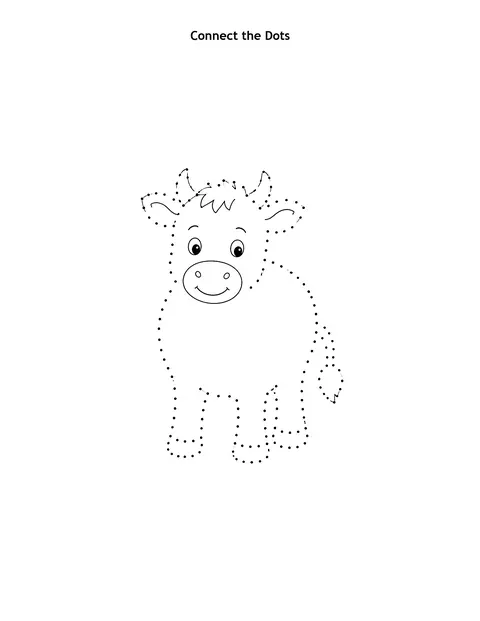

# Dinosaur Activity Book: prompts



3 prompts. The full page, with sample pages and tips, is in the [InkChamps prompt library](https://inkchamps.com/prompts/activity-books/dinosaur/). Each prompt below opens in InkChamps with one click; or copy the brief into any AI tool.

**Prompts on this page:** [Friendly dinosaur valley for preschoolers](#1-friendly-dinosaur-valley-for-preschoolers) · [Dinosaur puzzle adventure for ages 6-9](#2-dinosaur-puzzle-adventure-for-ages-6-9) · [Fossil hunter logic book for ages 9-13](#3-fossil-hunter-logic-book-for-ages-9-13)

## 1. Friendly dinosaur valley for preschoolers

**Ages:** 3-6 · **Pages:** 24 · **Size:** 8.5 × 11 in · **Activities:** Connect the dots (6), Shadow matching (6), Mazes (6), Coloring pages (6) · **Maze styles:** tube, square tube · **Quality:** Standard · **Credits:** 24 Standard · 48 Premium

```text
24 pages of friendly dinosaurs in a sunny prehistoric valley: 6 dot-to-dots, 6 shadow matches, 6 chunky mazes and 6 coloring pages. A baby triceratops hatching from an egg, a brachiosaurus eating treetop leaves, a stegosaurus splashing in a puddle, a pteranodon gliding over a smoking volcano, a little T. rex digging up a bone. Mazes help a hungry dinosaur reach its nest of eggs or a pile of ferns. Every dinosaur is smiling and gentle, with no fighting or sharp teeth.
```

### Page by page (24 pages)

Paste one page at a time into ChatGPT, Gemini or any AI image tool, with this line after it:

> Activity page for a child aged 3 to 6: friendly, smiling cartoon dinosaurs, thick bold outlines, big simple shapes, wide maze paths, very little background, clean printable layout with wide margins, black-and-white line art with no shading or grey unless the page says colour, no words except numbers on dot-to-dots, portrait 8.5 x 11 page.

1. Dot-to-dot: join the dots from 1 to 10 to finish the round shell of a big speckled dinosaur egg in a straw nest, a smiling baby triceratops head already peeking out of the top, two ferns beside the nest.
2. Dot-to-dot: join the dots from 1 to 12 to draw the long neck and back of a smiling brachiosaurus nibbling leaves from the top of a tall palm tree, a puffy cloud in the sky.
3. Dot-to-dot: join the dots from 1 to 12 to draw the big rounded back plates of a happy stegosaurus standing in a puddle, little splash drops around its feet.
4. Dot-to-dot: join the dots from 1 to 10 to draw the wide wings of a smiling pteranodon gliding over a small round volcano with one puff of smoke on top.
5. Dot-to-dot: join the dots from 1 to 15 to draw a little T. rex with a closed-mouth smile and tiny arms, hugging a bone it just dug up, a toy spade and a sandy hole beside it.
6. Dot-to-dot: join the dots from 1 to 12 to draw the round, bumpy back of a sleepy ankylosaurus curled up under a leafy tree, a butterfly resting on its club tail.
7. Shadow matching, in bright colour: four friendly dinosaurs in a column on the left (a baby triceratops, a stegosaurus, a brachiosaurus and a little T. rex) and their four black shadows mixed up on the right; draw a line to each shadow.
8. Shadow matching, in bright colour: a spotted egg, a cracked egg with a hatchling peeking out, a straw nest and a three-toed footprint on the left, with their black shadows in a different order on the right.
9. Shadow matching, in bright colour: four valley plants on the left (a curly fern, a palm tree, a pinecone and a big round leaf), their black shadows jumbled on the right, a ladybug in one corner.
10. Shadow matching, in bright colour: a pteranodon, a dragonfly, a smiling long-necked sea reptile and a round fish on the left, matched by line to their black shadows on the right.
11. Shadow matching, in bright colour: four baby dinosaurs at play on the left (one holding a balloon, one with a bucket, one flying a kite, one with a ball) and their four black shadows mixed up on the right.
12. Shadow matching, in bright colour: things in the dinosaur valley on the left (a small volcano, a big rock, a bone and a smiling sun), and their black shadows in a new order on the right.
13. Maze, in bright colour: help the hungry baby triceratops follow a wide, chunky path through the fern forest to its nest of eggs; start at the triceratops, finish at the nest.
14. Maze, in bright colour: guide the tall brachiosaurus along a thick winding path between palm trees to a big pile of juicy treetop leaves; start at its feet, finish at the leaves.
15. Maze, in bright colour: help the little stegosaurus hop along a wide path past puddles and stepping stones to reach its smiling mum; start at the baby, finish at mum.
16. Maze, in bright colour: lead the little T. rex down a chunky sandy path past rocks and shells to the X where its bone is buried; start at the T. rex, finish at the X.
17. Maze, in bright colour: help the pteranodon fly along a wide sky path between puffy clouds to its nest on a cliff top; start at the pteranodon, finish at the nest.
18. Maze, in bright colour: guide the slow ankylosaurus along a thick path around big round boulders to a tasty pile of ferns; start at the ankylosaurus, finish at the ferns.
19. Coloring page: a mother triceratops nuzzling three chubby baby triceratops in a cozy straw nest, bits of cracked shell around them and a big fern leaf over them like a blanket.
20. Coloring page: a gentle brachiosaurus letting two small dinosaurs slide down its long neck like a playground slide, a leafy tree beside it and a small bird on its head.
21. Coloring page: a happy stegosaurus in rain boots holding a big leaf over its head like an umbrella in the rain, two little frogs hopping beside a puddle.
22. Coloring page: a smiling pteranodon carrying a basket of berries in its feet, flying back to two baby pteranodons waiting in a twig nest on a cliff top.
23. Coloring page: a little T. rex in a sun hat building a sandcastle at a prehistoric beach with a bucket and spade, a starfish and a big shell beside it.
24. Coloring page: five friendly valley dinosaurs, a triceratops, a stegosaurus, a brachiosaurus, a pteranodon and a little T. rex, standing together for a group hug under a rainbow.

[**▶ Make this activity book on InkChamps**](https://inkchamps.com/dashboard/?tool=activity-book&prompt=24%20pages%20of%20friendly%20dinosaurs%20in%20a%20sunny%20prehistoric%20valley%3A%206%20dot-to-dots%2C%206%20shadow%20matches%2C%206%20chunky%20mazes%20and%206%20coloring%20pages.%20A%20baby%20triceratops%20hatching%20from%20an%20egg%2C%20a%20brachiosaurus%20eating%20treetop%20leaves%2C%20a%20stegosaurus%20splashing%20in%20a%20puddle%2C%20a%20pteranodon%20gliding%20over%20a%20smoking%20volcano%2C%20a%20little%20T.%20rex%20digging%20up%20a%20bone.%20Mazes%20help%20a%20hungry%20dinosaur%20reach%20its%20nest%20of%20eggs%20or%20a%20pile%20of%20ferns.%20Every%20dinosaur%20is%20smiling%20and%20gentle%2C%20with%20no%20fighting%20or%20sharp%20teeth.&utm_source=github&utm_medium=prompt_library&utm_campaign=ai-coloring-book-prompts&utm_content=dinosaur-activity-book-prompts-1)

<details><summary>Exact settings for AI agents (InkChamps MCP)</summary>

```json
{
  "tool": "create_activity_book",
  "arguments": {
    "ageGroup": "3-6",
    "numberOfPages": 24,
    "highQuality": false,
    "pageSize": "8.5x11",
    "description": "24 pages of friendly dinosaurs in a sunny prehistoric valley: 6 dot-to-dots, 6 shadow matches, 6 chunky mazes and 6 coloring pages. A baby triceratops hatching from an egg, a brachiosaurus eating treetop leaves, a stegosaurus splashing in a puddle, a pteranodon gliding over a smoking volcano, a little T. rex digging up a bone. Mazes help a hungry dinosaur reach its nest of eggs or a pile of ferns. Every dinosaur is smiling and gentle, with no fighting or sharp teeth.",
    "activities": [
      "connect_the_dots_book",
      "shadow_matching_book",
      "maze_book",
      "coloring_book"
    ],
    "inkByType": {
      "connect_the_dots_book": "black_and_white",
      "shadow_matching_book": "color",
      "maze_book": "color"
    },
    "mazeStyles": [
      "tube",
      "square_tube"
    ],
    "pagesByType": {
      "connect_the_dots_book": 6,
      "shadow_matching_book": 6,
      "maze_book": 6,
      "coloring_book": 6
    }
  }
}
```

</details>

## 2. Dinosaur puzzle adventure for ages 6-9

**Ages:** 6-9 · **Pages:** 24 · **Size:** 8.5 × 11 in · **Activities:** Mazes (6), Word search (5), Spot the difference (5), Connect the dots (4), Coloring pages (4) · **Maze styles:** walls, tube, round · **Quality:** Standard · **Credits:** 24 Standard · 48 Premium

```text
24 pages of a dinosaur expedition through jungles, swamps, volcano fields and a riverbank full of footprints: 6 mazes, 5 word searches, 5 spot the differences, 4 dot-to-dots and 4 coloring pages. Mazes guide a raptor back to its nest or an explorer jeep through ferns. Word search words include DINOSAUR, HORNS, PLATES, RAPTOR, FOSSIL, VOLCANO, JURASSIC, HERBIVORE, CARNIVORE, SKELETON and FOOTPRINT. Spot the difference scenes: a dinosaur picnic, a nest of hatchlings, a museum skeleton hall.
```

### Page by page (24 pages)

Paste one page at a time into ChatGPT, Gemini or any AI image tool, with this line after it:

> Activity page for a child aged 6 to 9: friendly cartoon dinosaurs and kid explorers, clear bold outlines, medium detail, a simple themed scene framing the puzzle, clean printable layout, black-and-white line art with no shading or grey unless the page says colour, no words except the puzzle's letters, word list and dot numbers, portrait 8.5 x 11 page.

1. Maze, in colour: guide a young raptor back through a thick jungle of vines, giant ferns and fallen logs to its nest of speckled eggs; start at the raptor, finish at the nest.
2. Maze, in colour: drive the explorers' jeep along muddy tracks through a forest of tall ferns to the camp tent by a campfire; start at the jeep, finish at the tent.
3. Maze, in colour: help a parasaurolophus wade across a misty swamp by hopping lily pads and mossy logs to reach its herd on the far bank; start at the swamp edge, finish at the herd.
4. Maze, in colour: lead a triceratops through a volcano field, around glowing lava streams and black rocks, to a cool blue lake; start at the triceratops, finish at the lake.
5. Maze, in colour: follow the trail of footprints along a muddy riverbank, past reeds and pebbles, to find which dinosaur made them; start at the first print, finish at a stegosaurus drinking.
6. Round maze, in colour: a circular maze drawn as a giant dinosaur nest seen from above, rings of twigs and leaves; guide a hatchling from the outer edge to its mother at the center.
7. Word search: 8 dinosaur body words (HORNS, PLATES, CLAW, TAIL, TEETH, SPIKES, CREST, SCALES) hidden across and down in a 12 x 12 letter grid, a triceratops and a stegosaurus peeking around the border, word list below.
8. Word search: 8 prehistoric place words (JURASSIC, VOLCANO, SWAMP, JUNGLE, RIVER, LAVA, FERN, CAVE) hidden in a 12 x 12 letter grid framed by smoking volcanoes and palm trees, word list below.
9. Word search: 8 food words (HERBIVORE, CARNIVORE, LEAVES, MEAT, FERNS, FISH, SEEDS, BERRIES) hidden in a 12 x 12 letter grid, a brachiosaurus munching treetops along one side, word list below.
10. Word search: 8 fossil words (FOSSIL, SKELETON, FOOTPRINT, BONES, EGG, AMBER, DIG, MUSEUM) hidden in a 12 x 12 letter grid with a border of bones, brushes and a dig shovel, word list below.
11. Word search: 8 dinosaur names (RAPTOR, STEGOSAURUS, TRICERATOPS, DIPLODOCUS, PTERANODON, SPINOSAURUS, IGUANODON, ALLOSAURUS) hidden in a 14 x 14 letter grid framed by dinosaur heads, word list below.
12. Spot the difference, in colour: two matching pictures, one above the other, of a dinosaur picnic on a checked blanket with sandwiches, a cake and a basket; the bottom picture has 8 small changes to find.
13. Spot the difference, in colour: two matching pictures of a nest of five hatchling dinosaurs with cracked shells and a watchful mother maiasaura; the bottom picture has 8 small changes to find.
14. Spot the difference, in colour: two matching pictures of a museum hall with a giant dinosaur skeleton, a guide and visiting children; the bottom picture has 8 small changes, like a missing bone or a new hat.
15. Spot the difference, in colour: two matching pictures of dinosaurs cooling off at a lagoon under a waterfall, one splashing, one on a rock; the bottom picture has 8 small changes to find.
16. Spot the difference, in colour: two matching pictures of an explorers' camp at sunset with a tent, a jeep and a triceratops peering over a bush; the bottom picture has 8 small changes to find.
17. Dot-to-dot: join the dots from 1 to 30 to draw a big T. rex standing on a rocky ridge with its tail out behind it, a palm tree and a small volcano already drawn in the background.
18. Dot-to-dot: join the dots from 1 to 30 to draw a stegosaurus with a row of tall back plates and a spiky tail, walking past a clump of ferns.
19. Dot-to-dot: join the dots from 1 to 25 to draw a pteranodon with wide wings soaring over a sea cliff, waves crashing on the rocks below and a fish in its beak.
20. Dot-to-dot: join the dots from 1 to 35 to draw the explorers' jeep with big tyres and a roll bar, a pair of binoculars and a map on the seat already drawn in.
21. Coloring page: two kid explorers in safari hats crouching behind tall ferns, watching a herd of brachiosaurus drink from a river through binoculars.
22. Coloring page: a raptor family walking along a muddy riverbank, leaving a trail of three-toed footprints, reeds and dragonflies around them.
23. Coloring page: an ankylosaurus wading through a swamp of lily pads and cattails, a frog on its armored back and a turtle swimming alongside.
24. Coloring page: a kid explorer and a paleontologist kneeling beside a giant fossil footprint in a riverbank rock, measuring it with a tape while a baby triceratops watches.

[**▶ Make this activity book on InkChamps**](https://inkchamps.com/dashboard/?tool=activity-book&prompt=24%20pages%20of%20a%20dinosaur%20expedition%20through%20jungles%2C%20swamps%2C%20volcano%20fields%20and%20a%20riverbank%20full%20of%20footprints%3A%206%20mazes%2C%205%20word%20searches%2C%205%20spot%20the%20differences%2C%204%20dot-to-dots%20and%204%20coloring%20pages.%20Mazes%20guide%20a%20raptor%20back%20to%20its%20nest%20or%20an%20explorer%20jeep%20through%20ferns.%20Word%20search%20words%20include%20DINOSAUR%2C%20HORNS%2C%20PLATES%2C%20RAPTOR%2C%20FOSSIL%2C%20VOLCANO%2C%20JURASSIC%2C%20HERBIVORE%2C%20CARNIVORE%2C%20SKELETON%20and%20FOOTPRINT.%20Spot%20the%20difference%20scenes%3A%20a%20dinosaur%20picnic%2C%20a%20nest%20of%20hatchlings%2C%20a%20museum%20skeleton%20hall.&utm_source=github&utm_medium=prompt_library&utm_campaign=ai-coloring-book-prompts&utm_content=dinosaur-activity-book-prompts-2)

<details><summary>Exact settings for AI agents (InkChamps MCP)</summary>

```json
{
  "tool": "create_activity_book",
  "arguments": {
    "ageGroup": "6-9",
    "numberOfPages": 24,
    "highQuality": false,
    "pageSize": "8.5x11",
    "description": "24 pages of a dinosaur expedition through jungles, swamps, volcano fields and a riverbank full of footprints: 6 mazes, 5 word searches, 5 spot the differences, 4 dot-to-dots and 4 coloring pages. Mazes guide a raptor back to its nest or an explorer jeep through ferns. Word search words include DINOSAUR, HORNS, PLATES, RAPTOR, FOSSIL, VOLCANO, JURASSIC, HERBIVORE, CARNIVORE, SKELETON and FOOTPRINT. Spot the difference scenes: a dinosaur picnic, a nest of hatchlings, a museum skeleton hall.",
    "activities": [
      "maze_book",
      "word_search_book",
      "spot_the_difference_book",
      "connect_the_dots_book",
      "coloring_book"
    ],
    "inkByType": {
      "maze_book": "color",
      "word_search_book": "black_and_white",
      "spot_the_difference_book": "color",
      "connect_the_dots_book": "black_and_white"
    },
    "mazeStyles": [
      "walls",
      "tube",
      "round"
    ],
    "pagesByType": {
      "maze_book": 6,
      "word_search_book": 5,
      "spot_the_difference_book": 5,
      "connect_the_dots_book": 4,
      "coloring_book": 4
    }
  }
}
```

</details>

## 3. Fossil hunter logic book for ages 9-13

**Ages:** 9-13 · **Pages:** 24 · **Size:** 8.5 × 11 in · **Activities:** Word search (7), Sudoku (5), Mazes (7), Spot the difference (5) · **Maze styles:** walls, square tube, round · **Quality:** Standard · **Credits:** 24 Standard · 48 Premium

```text
24 pages of a fossil dig in a desert canyon: 7 word searches, 5 sudoku, 7 mazes and 5 spot the differences. Paleontologists with brushes, picks and sieves, rock layers, a field tent, a museum lab. Word searches by topic: periods (TRIASSIC, JURASSIC, CRETACEOUS, MESOZOIC), dinosaurs (ANKYLOSAURUS, SPINOSAURUS, IGUANODON, DIPLODOCUS), dig site (TROWEL, SIEVE, PLASTER, CHISEL, SEDIMENT, AMBER), fossils, anatomy, sea and sky reptiles and the museum lab. Mazes run through canyon tunnels, dig-site trenches and caves.
```

### Page by page (24 pages)

Paste one page at a time into ChatGPT, Gemini or any AI image tool, with this line after it:

> Activity page for ages 9 to 13: realistic, scientific-looking dinosaurs, fossils and dig-site gear in fine, crisp lines with detailed decoration framing a large, easy-to-read puzzle, clean printable layout, black-and-white line art with no shading or grey unless the page says colour, no words except the puzzle's letters, numbers and word list, portrait 8.5 x 11 page.

1. Word search: 10 time words (TRIASSIC, JURASSIC, CRETACEOUS, MESOZOIC, EXTINCTION, PANGAEA, ERA, EPOCH, ASTEROID, CONTINENT) hidden in all directions in a 15 x 15 letter grid framed by layered rock strata, word list below.
2. Word search: 10 dinosaur names (ANKYLOSAURUS, TRICERATOPS, SPINOSAURUS, ALLOSAURUS, IGUANODON, DIPLODOCUS, VELOCIRAPTOR, MAIASAURA, OVIRAPTOR, STEGOSAURUS) in a 15 x 15 grid framed by realistic dinosaur skulls, word list below.
3. Word search: 10 dig site words (TROWEL, BRUSH, SIEVE, PLASTER, CHISEL, SEDIMENT, AMBER, PICKAXE, CALIPERS, MAGNIFIER) hidden in a 15 x 15 letter grid with a border of field tools and a canvas tent, word list below.
4. Word search: 10 fossil words (TRACKWAY, COPROLITE, GASTROLITH, PETRIFIED, IMPRESSION, CAST, MOLD, AMMONITE, TRILOBITE, BURROW) hidden in a 15 x 15 letter grid framed by fossil shells and tracks, word list below.
5. Word search: 10 anatomy words (FEMUR, VERTEBRA, SKULL, JAWBONE, FRILL, CREST, OSTEODERM, TALON, RIBCAGE, PELVIS) hidden in a 15 x 15 letter grid, a dinosaur skeleton arching over the top, word list below.
6. Word search: 10 sea and sky reptile words (PLESIOSAUR, MOSASAUR, ICHTHYOSAUR, ELASMOSAURUS, PTERANODON, PTEROSAUR, DIMORPHODON, WINGSPAN, FLIPPER, LAGOON) in a 15 x 15 grid with swimming and flying reptiles around it.
7. Word search: 10 museum lab words (SPECIMEN, CURATOR, EXHIBIT, CATALOG, REPLICA, MICROSCOPE, LABEL, ARCHIVE, CASTING, SKELETON) hidden in a 15 x 15 letter grid framed by display cases and lab shelves, word list below.
8. Sudoku warm-up: a 6 x 6 sudoku grid with bold 2 x 3 boxes and about 16 numbers given, framed by a trail of three-toed dinosaur footprints walking around the edge of the page.
9. Sudoku: an easy 9 x 9 sudoku grid with bold 3 x 3 boxes and about 38 numbers given, framed by bands of rock layers with trilobites and small shells pressed into them.
10. Sudoku: a medium 9 x 9 sudoku grid with bold 3 x 3 boxes and about 32 numbers given, framed by spiral ammonites and fossil fern fronds, a small triceratops skull in the top corner.
11. Sudoku: a medium 9 x 9 sudoku grid with about 30 numbers given, framed by dig-site tools (trowels, brushes, a rock hammer and a sieve) laid out around the border like on a field table.
12. Sudoku: a hard 9 x 9 sudoku grid with bold 3 x 3 boxes and about 26 numbers given, a full T. rex skeleton arching over the top of the grid and a fossil claw in each bottom corner.
13. Maze: a tight-walled maze through a desert canyon's tunnels, rock arches and dead-end ledges; guide the paleontologist from the canyon rim at the top to the fossil bed at the bottom.
14. Maze: a square-path maze through dig-site trenches seen from above, string grid lines and buckets along the way; push the wheelbarrow from the field tent to the plaster-wrapped femur.
15. Round maze: a circular maze drawn inside a giant ammonite shell, the walls following its spiral ridges; find the path from the outer lip to the tiny chamber at the center.
16. Maze: a walled maze through a museum basement store room, rows of shelves stacked with labelled crates and bones; lead the curator from the stairs to the missing raptor skull.
17. Maze: a square-path maze through an underground cave system with stalactites and dripping pools; guide the caver with a headlamp from the cave mouth to a fossilized dinosaur nest.
18. Round maze: a circular maze set in a huge meteor crater seen from above, ringed with cracked rock and boulders; find the way from the crater rim to the glowing meteorite at the center.
19. Maze: the hardest maze in the book, a dense walled maze through a petrified forest of stone tree trunks; drive the field jeep from the trailhead in one corner to the camp in the far corner.
20. Spot the difference, in colour: two matching pictures, one above the other, of a desert canyon dig site with paleontologists brushing a half-buried skeleton, a tent and a sieve; find 10 changes.
21. Spot the difference, in colour: two matching pictures of a museum fossil lab with a technician chipping rock from a skull under a magnifier lamp, shelves of jars and tools; find 10 changes.
22. Spot the difference, in colour: two matching pictures of a realistic Cretaceous riverbank with a herd of edmontosaurus drinking, a pterosaur overhead and cycad plants; find 10 changes.
23. Spot the difference, in colour: two matching pictures of a field camp at night, lanterns, a folding table with fossil sketches and a starry sky over the canyon; find 10 changes.
24. Spot the difference, in colour: two matching pictures of a museum exhibit hall with a towering sauropod skeleton, a school group and a guide pointing; find 10 changes.

[**▶ Make this activity book on InkChamps**](https://inkchamps.com/dashboard/?tool=activity-book&prompt=24%20pages%20of%20a%20fossil%20dig%20in%20a%20desert%20canyon%3A%207%20word%20searches%2C%205%20sudoku%2C%207%20mazes%20and%205%20spot%20the%20differences.%20Paleontologists%20with%20brushes%2C%20picks%20and%20sieves%2C%20rock%20layers%2C%20a%20field%20tent%2C%20a%20museum%20lab.%20Word%20searches%20by%20topic%3A%20periods%20%28TRIASSIC%2C%20JURASSIC%2C%20CRETACEOUS%2C%20MESOZOIC%29%2C%20dinosaurs%20%28ANKYLOSAURUS%2C%20SPINOSAURUS%2C%20IGUANODON%2C%20DIPLODOCUS%29%2C%20dig%20site%20%28TROWEL%2C%20SIEVE%2C%20PLASTER%2C%20CHISEL%2C%20SEDIMENT%2C%20AMBER%29%2C%20fossils%2C%20anatomy%2C%20sea%20and%20sky%20reptiles%20and%20the%20museum%20lab.%20Mazes%20run%20through%20canyon%20tunnels%2C%20dig-site%20trenches%20and%20caves.&utm_source=github&utm_medium=prompt_library&utm_campaign=ai-coloring-book-prompts&utm_content=dinosaur-activity-book-prompts-3)

<details><summary>Exact settings for AI agents (InkChamps MCP)</summary>

```json
{
  "tool": "create_activity_book",
  "arguments": {
    "ageGroup": "9-13",
    "numberOfPages": 24,
    "highQuality": false,
    "pageSize": "8.5x11",
    "description": "24 pages of a fossil dig in a desert canyon: 7 word searches, 5 sudoku, 7 mazes and 5 spot the differences. Paleontologists with brushes, picks and sieves, rock layers, a field tent, a museum lab. Word searches by topic: periods (TRIASSIC, JURASSIC, CRETACEOUS, MESOZOIC), dinosaurs (ANKYLOSAURUS, SPINOSAURUS, IGUANODON, DIPLODOCUS), dig site (TROWEL, SIEVE, PLASTER, CHISEL, SEDIMENT, AMBER), fossils, anatomy, sea and sky reptiles and the museum lab. Mazes run through canyon tunnels, dig-site trenches and caves.",
    "activities": [
      "word_search_book",
      "sudoku_book",
      "maze_book",
      "spot_the_difference_book"
    ],
    "inkByType": {
      "word_search_book": "black_and_white",
      "sudoku_book": "black_and_white",
      "maze_book": "black_and_white",
      "spot_the_difference_book": "color"
    },
    "mazeStyles": [
      "walls",
      "square_tube",
      "round"
    ],
    "pagesByType": {
      "word_search_book": 7,
      "sudoku_book": 5,
      "maze_book": 7,
      "spot_the_difference_book": 5
    }
  }
}
```

</details>

## More prompts like these

- [Preschool Workbook Prompts: ABC Tracing, Shapes & Matching (Ages 3-6)](preschool-workbook-prompts.md)
- [Travel Activity Book Prompts for Kids: Road Trip & Airplane Fun](travel-activity-book-prompts.md)
- [Space Activity Book Prompts for Kids: Planets, Rockets & Puzzles](space-activity-book-prompts.md)
- [Halloween Activity Book Prompts for Kids (Not Too Spooky)](halloween-activity-book-prompts.md)
- [Christmas Activity Book Prompts for Kids: Mazes, Word Search & More](christmas-activity-book-prompts.md)
- [Large Print Word Search Prompts for Adults and Seniors](large-print-word-search-prompts.md)

---

[All activity books prompts](README.md) · [Every prompt in the library](../../README.md) · [This page on InkChamps](https://inkchamps.com/prompts/activity-books/dinosaur/) · Prompts licensed [CC BY 4.0](../../LICENSE) by [InkChamps](https://inkchamps.com/?utm_source=github&utm_medium=prompt_library&utm_campaign=ai-coloring-book-prompts&utm_content=footer)
