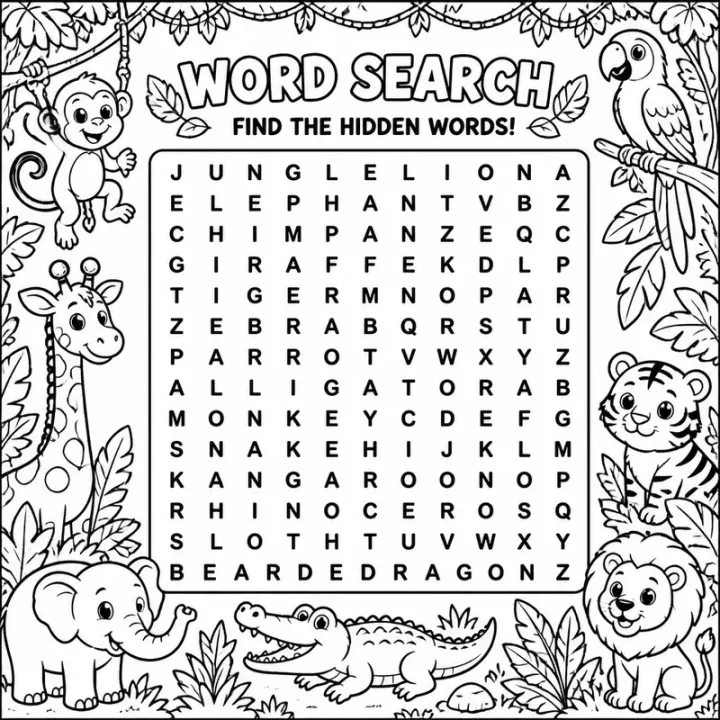

# Large Print Word Search: prompts



3 prompts. The full page, with sample pages and tips, is in the [InkChamps prompt library](https://inkchamps.com/prompts/activity-books/large-print-word-search/). Each prompt below opens in InkChamps with one click; or copy the brief into any AI tool.

**Prompts on this page:** [Gardener's large print word search](#1-gardeners-large-print-word-search) · [Travel the world large print word search](#2-travel-the-world-large-print-word-search) · [1960s nostalgia large print word search](#3-1960s-nostalgia-large-print-word-search)

## 1. Gardener's large print word search

**Ages:** 13+ · **Pages:** 24 · **Size:** 8.5 × 11 in · **Activities:** Word search (24) · **Quality:** Standard · **Credits:** 24 Standard · 48 Premium

```text
A 24-page large print gardening word search for adults and seniors, one puzzle of 12 words per page, each framed by garden line art. It follows the garden year: spring bulbs, seed sowing, tools, flowers, roses, vegetables, herbs, fruit, garden birds, bees and butterflies, the pond, weather, the greenhouse, compost, trees, wildflowers, houseplants, the flower show, a garden party, gardening jobs, the harvest kitchen, autumn, winter, and paths and gates.
```

### Page by page (24 pages)

Paste one page at a time into ChatGPT, Gemini or any AI image tool, with this line after it:

> Large print word search page for adults and seniors, black ink on white: big bold capital letters evenly spaced in a square grid, a short puzzle title at the top, the word list in large clear type below the grid, two-word answers run together in the grid, a simple line-art border, no shading, no grey, no answer key, portrait 8.5 x 11 page.

1. Word search: 12 spring bulb words (CROCUS, DAFFODIL, TULIP, HYACINTH, SNOWDROP, BLUEBELL, IRIS, ALLIUM, SQUILL, ANEMONE, NARCISSUS, BULB) hidden in a 13 x 13 large print letter grid, framed by daffodils and crocuses pushing up through the soil beside a garden gate, with a trowel and a paper bag of bulbs.
2. Word search: 12 seed sowing words (SEED, TRAY, LABEL, SOIL, SPROUT, SEEDLING, DIBBER, SUNLIGHT, PACKET, PROPAGATOR, ROW, GERMINATE) hidden in a 13 x 13 large print letter grid, framed by a wooden potting bench lined with seed trays, tiny seedlings, plant labels and a small watering can.
3. Word search: 12 garden tool words (TROWEL, RAKE, SHEARS, HOSE, SPADE, HOE, FORK, GLOVES, BUCKET, WHEELBARROW, PRUNERS, TWINE) hidden in a 14 x 14 large print letter grid, framed by tools hanging on a pegboard inside a wooden shed, a coiled hose and a wheelbarrow at the bottom corners.
4. Word search: 12 garden flower words (ROSE, DAISY, LILAC, PEONY, DAHLIA, PANSY, POPPY, ASTER, LILY, ZINNIA, MARIGOLD, COSMOS) hidden in a 12 x 12 large print letter grid, framed by a cottage flower border along a white picket fence, with two watering cans at the bottom corners.
5. Word search: 12 rose garden words (CLIMBER, RAMBLER, THORN, PETAL, BUD, HIP, BLOOM, ARCH, TRELLIS, FRAGRANCE, SCENT, CANE) hidden in a 13 x 13 large print letter grid, framed by a climbing rose arch over a brick path, a wooden bench beneath it and a pair of pruning shears.
6. Word search: 12 vegetable words (TOMATO, CARROT, RADISH, SPINACH, PUMPKIN, ONION, BEAN, PEA, LEEK, CORN, BEET, KALE) hidden in a 12 x 12 large print letter grid, framed by raised vegetable beds with bean poles, a friendly scarecrow in a straw hat and a trug of carrots.
7. Word search: 12 herb words (BASIL, THYME, MINT, PARSLEY, ROSEMARY, SAGE, DILL, CHIVES, OREGANO, FENNEL, LAVENDER, BAY) hidden in a 12 x 12 large print letter grid, framed by clay pots of herbs on a sunny kitchen windowsill, a pair of snips and a mortar and pestle.
8. Word search: 12 fruit and berry words (APPLE, PEAR, PLUM, CHERRY, STRAWBERRY, RASPBERRY, GOOSEBERRY, CURRANT, BLACKBERRY, RHUBARB, GRAPE, FIG) hidden in a 13 x 13 large print letter grid, framed by an apple tree branch heavy with fruit, a wooden ladder against the trunk and a picking basket on the grass.
9. Word search: 12 garden bird words (ROBIN, FINCH, WREN, CARDINAL, BLUEBIRD, SPARROW, DOVE, JAY, THRUSH, STARLING, CHICKADEE, NUTHATCH) hidden in a 13 x 13 large print letter grid, framed by a hanging bird feeder and a stone birdbath, with small birds perched along a curving branch.
10. Word search: 12 bee and butterfly words (BUTTERFLY, BUMBLEBEE, MOTH, LADYBUG, DRAGONFLY, CATERPILLAR, NECTAR, POLLEN, HIVE, WINGS, HONEY, CLOVER) hidden in a 14 x 14 large print letter grid, framed by butterflies drifting over a lavender bush, a white wooden beehive and a honey jar with a dipper.
11. Word search: 12 garden pond words (LILY PAD, FROG, TADPOLE, NEWT, REEDS, POND, GOLDFISH, FOUNTAIN, RIPPLE, PEBBLE, HERON, CATTAIL) hidden in a 12 x 12 large print letter grid, framed by a round lily pond with stepping stones, a frog on a lily pad and tall cattails at the edges.
12. Word search: 12 garden weather words (SUNSHINE, RAIN, BREEZE, HAIL, DEW, CLOUD, RAINBOW, DRIZZLE, THUNDER, MIST, WARMTH, SHOWER) hidden in a 12 x 12 large print letter grid, framed by a rooster weather vane on a shed roof, a rain gauge on a post and puffy clouds with a rainbow.
13. Word search: 12 greenhouse words (GREENHOUSE, CUCUMBER, PEPPER, CHILI, MELON, ORCHID, GERANIUM, FUCHSIA, HEATER, VENT, SHELF, GLASS) hidden in a 13 x 13 large print letter grid, framed by a glass greenhouse with slatted shelves of potted plants, a hanging thermometer and a cucumber vine.
14. Word search: 12 compost and soil words (COMPOST, WORM, MULCH, SCRAPS, PEELINGS, LOAM, CLAY, SAND, MANURE, HUMUS, BIN, HEAP) hidden in a 12 x 12 large print letter grid, framed by three wooden compost bins, a garden fork stuck in a heap and a few earthworms curling along the bottom.
15. Word search: 12 tree words (OAK, MAPLE, BIRCH, WILLOW, ELM, ASH, BEECH, PINE, CEDAR, SYCAMORE, MAGNOLIA, CHESTNUT) hidden in a 12 x 12 large print letter grid, framed by a ring of different leaves and seed pods, with a tall oak tree and a rope swing in one corner.
16. Word search: 12 wildflower words (BUTTERCUP, CORNFLOWER, FOXGLOVE, PRIMROSE, VIOLET, YARROW, THISTLE, DANDELION, COWSLIP, HEATHER, LUPIN, CAMPION) hidden in a 13 x 13 large print letter grid, framed by a meadow of wildflowers and tall grasses along the bottom, with a dandelion clock blowing seeds across the top.
17. Word search: 12 houseplant words (FERN, IVY, SPIDER PLANT, PEACE LILY, ALOE, JADE, PALM, BEGONIA, CACTUS, POTHOS, CYCLAMEN, AMARYLLIS) hidden in a 14 x 14 large print letter grid, framed by houseplants on a bright windowsill, a hanging plant in a knotted rope holder and a small misting bottle.
18. Word search: 12 flower show words (RIBBON, ROSETTE, JUDGE, TROPHY, MARQUEE, VASE, PRIZE, ENTRY, EXHIBIT, MEDAL, BOUQUET, SHOW) hidden in a 12 x 12 large print letter grid, framed by a striped show tent with a table of prize dahlias in vases and a big rosette pinned to the winning bloom.
19. Word search: 12 garden party words (PATIO, PARASOL, DECKCHAIR, LANTERN, LEMONADE, PICNIC, HAMMOCK, BARBECUE, BUNTING, TABLE, CUSHION, TEAPOT) hidden in a 13 x 13 large print letter grid, framed by a garden table set for tea under a parasol, bunting strung between two trees and a hammock.
20. Word search: 12 gardening job words (DIGGING, PLANTING, WEEDING, PRUNING, MOWING, SOWING, HOEING, DEADHEADING, STAKING, EDGING, POTTING, WATERING) hidden in a 14 x 14 large print letter grid, framed by a push lawn mower, a straw sun hat, gardening gloves and a cup of tea resting on a garden bench.
21. Word search: 12 harvest kitchen words (JAM, CHUTNEY, PICKLE, PRESERVE, JAR, PIE, CRUMBLE, SOUP, BASKET, LADLE, PANTRY, RECIPE) hidden in a 12 x 12 large print letter grid, framed by a pantry shelf of jam jars with gingham cloth lids, a rolling pin and a fresh fruit pie.
22. Word search: 12 autumn garden words (ACORN, GOURD, SQUASH, HARVEST, RUSSET, RAKING, CHRYSANTHEMUM, SCARECROW, HAYBALE, PINECONE, CIDER, AUTUMN) hidden in a 15 x 15 large print letter grid, framed by a wheelbarrow full of pumpkins and gourds under falling leaves, with a leaf rake leaning on a hay bale.
23. Word search: 12 winter garden words (SNOW, ICICLE, HOLLY, MISTLETOE, EVERGREEN, FROST, BERRY, WREATH, SNOWMAN, SLEDGE, CATALOGUE, CANDLE) hidden in a 13 x 13 large print letter grid, framed by a snowy garden shed with icicles on the roof, a robin perched on a spade handle and holly sprigs.
24. Word search: 12 garden path and gate words (GATE, FENCE, HEDGE, PATH, PERGOLA, GAZEBO, SUNDIAL, BIRDHOUSE, STATUE, STEPPING STONE, LAWN, BENCH) hidden in a 15 x 15 large print letter grid, framed by a winding gravel path leading through a wooden gate to a stone sundial, with a hedge and a birdhouse.

[**▶ Make this activity book on InkChamps**](https://inkchamps.com/dashboard/?tool=activity-book&prompt=A%2024-page%20large%20print%20gardening%20word%20search%20for%20adults%20and%20seniors%2C%20one%20puzzle%20of%2012%20words%20per%20page%2C%20each%20framed%20by%20garden%20line%20art.%20It%20follows%20the%20garden%20year%3A%20spring%20bulbs%2C%20seed%20sowing%2C%20tools%2C%20flowers%2C%20roses%2C%20vegetables%2C%20herbs%2C%20fruit%2C%20garden%20birds%2C%20bees%20and%20butterflies%2C%20the%20pond%2C%20weather%2C%20the%20greenhouse%2C%20compost%2C%20trees%2C%20wildflowers%2C%20houseplants%2C%20the%20flower%20show%2C%20a%20garden%20party%2C%20gardening%20jobs%2C%20the%20harvest%20kitchen%2C%20autumn%2C%20winter%2C%20and%20paths%20and%20gates.&utm_source=github&utm_medium=prompt_library&utm_campaign=ai-coloring-book-prompts&utm_content=large-print-word-search-prompts-1)

<details><summary>Exact settings for AI agents (InkChamps MCP)</summary>

```json
{
  "tool": "create_activity_book",
  "arguments": {
    "ageGroup": "13+",
    "numberOfPages": 24,
    "highQuality": false,
    "pageSize": "8.5x11",
    "description": "A 24-page large print gardening word search for adults and seniors, one puzzle of 12 words per page, each framed by garden line art. It follows the garden year: spring bulbs, seed sowing, tools, flowers, roses, vegetables, herbs, fruit, garden birds, bees and butterflies, the pond, weather, the greenhouse, compost, trees, wildflowers, houseplants, the flower show, a garden party, gardening jobs, the harvest kitchen, autumn, winter, and paths and gates.",
    "activities": [
      "word_search_book"
    ],
    "inkByType": {
      "word_search_book": "black_and_white"
    },
    "pagesByType": {
      "word_search_book": 24
    }
  }
}
```

</details>

## 2. Travel the world large print word search

**Ages:** 13+ · **Pages:** 24 · **Size:** 8.5 × 11 in · **Activities:** Word search (24) · **Quality:** Standard · **Credits:** 24 Standard · 48 Premium

```text
A 24-page large print armchair-travel word search for adults and seniors, one puzzle of 12 words per page, each framed with postcards, maps or a scene from the trip. It starts with packing, ways to travel, the airport, a train, a cruise, a road trip and a hotel, then visits European cities, castles, museums, food abroad, hellos, markets, islands, the seaside, Asian cities, Australia and New Zealand, the Americas, rivers, mountains, national parks, deserts and a safari, and ends coming home.
```

### Page by page (24 pages)

Paste one page at a time into ChatGPT, Gemini or any AI image tool, with this line after it:

> Large print word search page for adults and seniors, black ink on white: big bold capital letters evenly spaced in a square grid, a short puzzle title at the top, the word list in large clear type below the grid, two-word answers run together in the grid, a simple line-art border, no shading, no grey, no answer key, portrait 8.5 x 11 page.

1. Word search: 12 packing words (PASSPORT, CAMERA, SUNHAT, SUITCASE, MAP, TICKET, SCARF, SNACKS, BOOK, PILLOW, SOCKS, TOOTHBRUSH) hidden in a 13 x 13 large print letter grid, framed by an open vintage suitcase with folded clothes, a sun hat, a camera and a luggage tag on the handle.
2. Word search: 12 ways to travel words (CRUISE, RAILWAY, FERRY, CARAVAN, AIRPLANE, BUS, TAXI, BIKE, TRAM, BOAT, COACH, CANOE) hidden in a 12 x 12 large print letter grid, framed by a vintage map with little drawings of a ferry, a tram, a bus and a small plane along dotted routes.
3. Word search: 12 airport words (RUNWAY, GATE, BOARDING, PILOT, LUGGAGE, TERMINAL, DEPARTURES, TAKEOFF, WINDOW, AISLE, SEATBELT, ARRIVALS) hidden in a 13 x 13 large print letter grid, framed by a passenger jet taking off over a runway, a control tower and a luggage trolley piled with bags.
4. Word search: 12 train journey words (STATION, PLATFORM, CARRIAGE, SLEEPER, WHISTLE, TUNNEL, VIADUCT, CONDUCTOR, DINING CAR, TIMETABLE, LOCOMOTIVE, PORTER) hidden in a 13 x 13 large print letter grid, framed by a steam train crossing a stone viaduct between hills, puffs of smoke curling along the top edge.
5. Word search: 12 cruise ship words (DECK, CABIN, PORTHOLE, CAPTAIN, ANCHOR, LIFEBOAT, BUFFET, PORT, STARBOARD, BRIDGE, COMPASS, HORIZON) hidden in a 13 x 13 large print letter grid, framed by a ship's wheel, a life ring, an anchor and round portholes, with an ocean liner on gentle waves.
6. Word search: 12 road trip words (HIGHWAY, MOTEL, ROUTE, ROADMAP, PICNIC, SCENIC, DETOUR, MILEAGE, CAMPER, SIGNPOST, OVERLOOK, CONVERTIBLE) hidden in a 14 x 14 large print letter grid, framed by a winding country road through rolling hills, a wooden signpost and a little camper van parked at a lookout.
7. Word search: 12 hotel stay words (LOBBY, SUITE, BALCONY, CONCIERGE, ROOM KEY, BELLHOP, ELEVATOR, BREAKFAST, VIEW, POOL, CHECK IN, RECEPTION) hidden in a 13 x 13 large print letter grid, framed by a grand old hotel front with striped awnings and balconies, a brass luggage cart and a desk bell.
8. Word search: 12 European city words (PARIS, VENICE, LISBON, VIENNA, DUBLIN, ATHENS, ROME, PRAGUE, OSLO, MADRID, BERLIN, NICE) hidden in a 12 x 12 large print letter grid, framed by postcards of a canal with a gondola, a cobbled street cafe and a hilltop of tiled roofs.
9. Word search: 12 castle and palace words (CASTLE, PALACE, TOWER, MOAT, DRAWBRIDGE, TURRET, BALLROOM, THRONE, GARDENS, FOUNTAIN, GATEHOUSE, BANQUET) hidden in a 13 x 13 large print letter grid, framed by a stone castle on a hill with turrets and pennant flags, a moat and a lowered drawbridge.
10. Word search: 12 museum words (MUSEUM, GALLERY, STATUE, PAINTING, MOSAIC, FOSSIL, MUMMY, VASE, EXHIBIT, GUIDE, TAPESTRY, SCULPTURE) hidden in a 13 x 13 large print letter grid, framed by a columned museum entrance, a marble bust on a plinth, an ancient vase and a framed landscape painting.
11. Word search: 12 food abroad words (PASTA, PAELLA, CROISSANT, SUSHI, CURRY, TAPAS, GELATO, BAKLAVA, NOODLES, PRETZEL, CREPE, DUMPLING) hidden in a 13 x 13 large print letter grid, framed by a cafe table with a checked cloth, a plate of pasta, a croissant, a cup of coffee and a bowl of noodles.
12. Word search: 12 hello around the world words (HOLA, BONJOUR, CIAO, HALLO, ALOHA, NAMASTE, SHALOM, JAMBO, HEJ, KONNICHIWA, NIHAO, SALUT) hidden in a 13 x 13 large print letter grid, framed by a globe on a wooden stand surrounded by luggage tags, paper airplanes and little blank pennant flags.
13. Word search: 12 market and souvenir words (BAZAAR, SPICES, POTTERY, MAGNET, SNOW GLOBE, BASKET, CARPET, BRACELET, POSTCARD, LANTERN, STALL, BARGAIN) hidden in a 13 x 13 large print letter grid, framed by striped market stall awnings over baskets of spices, hanging lanterns and stacked pottery bowls.
14. Word search: 12 island words (HAWAII, BALI, SICILY, TAHITI, ICELAND, MALTA, CRETE, FIJI, CUBA, JAVA, CAPRI, SAMOA) hidden in a 12 x 12 large print letter grid, framed by palm trees, a hammock strung between them, a wooden outrigger canoe and a small island on the horizon.
15. Word search: 12 seaside words (SAND, SHELL, WAVE, TIDE, PIER, LIGHTHOUSE, COVE, BOARDWALK, SEAGULL, SUNSET, ICE CREAM, PROMENADE) hidden in a 13 x 13 large print letter grid, framed by a row of beach huts, a striped lighthouse, seagulls overhead and seashells scattered along the bottom.
16. Word search: 12 Asian city words (TOKYO, KYOTO, SEOUL, BANGKOK, HANOI, DELHI, MUMBAI, BEIJING, MANILA, TAIPEI, SINGAPORE, KATHMANDU) hidden in a 13 x 13 large print letter grid, framed by curved pagoda roofs, strings of paper lanterns, a rickshaw and cherry blossom branches.
17. Word search: 12 Australia and New Zealand words (SYDNEY, PERTH, OUTBACK, KANGAROO, KOALA, REEF, WOMBAT, EMU, BOOMERANG, AUCKLAND, KIWI, WELLINGTON) hidden in a 13 x 13 large print letter grid, framed by a kangaroo and a koala beside a gum tree, a red rock rising from the outback and a kiwi bird.
18. Word search: 12 Americas words (QUEBEC, TORONTO, BOSTON, CHICAGO, MEMPHIS, SANTA FE, HAVANA, CANCUN, LIMA, CUSCO, RIO, BUENOS AIRES) hidden in a 14 x 14 large print letter grid, framed by an old map of North and South America with a compass rose, a sailing ship and sea waves in the corners.
19. Word search: 12 river words (NILE, DANUBE, THAMES, SEINE, RHINE, GANGES, VOLGA, YANGTZE, MEKONG, CONGO, ZAMBEZI, MISSISSIPPI) hidden in a 14 x 14 large print letter grid, framed by a paddle-wheel riverboat on a winding river, with stone bridges and reeds along the banks.
20. Word search: 12 mountain words (ALPS, ANDES, ROCKIES, HIMALAYAS, PYRENEES, ATLAS, URALS, EVEREST, FUJI, KILIMANJARO, DOLOMITES, MATTERHORN) hidden in a 14 x 14 large print letter grid, framed by snowy mountain peaks, a cable car on its wire, a wooden chalet and a pair of hiking boots.
21. Word search: 12 national park words (CANYON, GEYSER, REDWOODS, GLACIER, MESA, LAKE, FALLS, TRAIL, CAMP, RIDGE, ARCHES, MEADOW) hidden in a 12 x 12 large print letter grid, framed by a tall waterfall into a lake, pine trees, a canvas tent and a deer standing at the water's edge.
22. Word search: 12 desert words (SAHARA, GOBI, MOJAVE, KALAHARI, OASIS, CAMEL, CACTUS, DUNE, MIRAGE, PYRAMID, NOMAD, SANDSTORM) hidden in a 13 x 13 large print letter grid, framed by a line of camels crossing sand dunes past three pyramids, with a palm-ringed oasis and a low sun.
23. Word search: 12 safari words (LION, ZEBRA, GIRAFFE, ELEPHANT, HIPPO, RHINO, CHEETAH, LEOPARD, BUFFALO, GAZELLE, SAVANNA, BINOCULARS) hidden in a 13 x 13 large print letter grid, framed by a flat-topped acacia tree with two giraffes, an elephant at a watering hole and tall savanna grass.
24. Word search: 12 coming home words (PHOTOS, ALBUM, JOURNAL, MEMORIES, STORIES, FRIENDS, UNPACK, SLIDESHOW, KEEPSAKE, SCRAPBOOK, HOMECOMING, WELCOME) hidden in a 13 x 13 large print letter grid, framed by a cozy armchair by a window with an open photo album, a cup of tea and a suitcase covered in travel stickers.

[**▶ Make this activity book on InkChamps**](https://inkchamps.com/dashboard/?tool=activity-book&prompt=A%2024-page%20large%20print%20armchair-travel%20word%20search%20for%20adults%20and%20seniors%2C%20one%20puzzle%20of%2012%20words%20per%20page%2C%20each%20framed%20with%20postcards%2C%20maps%20or%20a%20scene%20from%20the%20trip.%20It%20starts%20with%20packing%2C%20ways%20to%20travel%2C%20the%20airport%2C%20a%20train%2C%20a%20cruise%2C%20a%20road%20trip%20and%20a%20hotel%2C%20then%20visits%20European%20cities%2C%20castles%2C%20museums%2C%20food%20abroad%2C%20hellos%2C%20markets%2C%20islands%2C%20the%20seaside%2C%20Asian%20cities%2C%20Australia%20and%20New%20Zealand%2C%20the%20Americas%2C%20rivers%2C%20mountains%2C%20national%20parks%2C%20deserts%20and%20a%20safari%2C%20and%20ends%20coming%20home.&utm_source=github&utm_medium=prompt_library&utm_campaign=ai-coloring-book-prompts&utm_content=large-print-word-search-prompts-2)

<details><summary>Exact settings for AI agents (InkChamps MCP)</summary>

```json
{
  "tool": "create_activity_book",
  "arguments": {
    "ageGroup": "13+",
    "numberOfPages": 24,
    "highQuality": false,
    "pageSize": "8.5x11",
    "description": "A 24-page large print armchair-travel word search for adults and seniors, one puzzle of 12 words per page, each framed with postcards, maps or a scene from the trip. It starts with packing, ways to travel, the airport, a train, a cruise, a road trip and a hotel, then visits European cities, castles, museums, food abroad, hellos, markets, islands, the seaside, Asian cities, Australia and New Zealand, the Americas, rivers, mountains, national parks, deserts and a safari, and ends coming home.",
    "activities": [
      "word_search_book"
    ],
    "inkByType": {
      "word_search_book": "black_and_white"
    },
    "pagesByType": {
      "word_search_book": 24
    }
  }
}
```

</details>

## 3. 1960s nostalgia large print word search

**Ages:** 13+ · **Pages:** 24 · **Size:** 8.5 × 11 in · **Activities:** Word search (24) · **Quality:** Standard · **Credits:** 24 Standard · 48 Premium

```text
A 24-page large print 1960s word search for adults and seniors, one puzzle of 12 words per page, each framed by a 60s scene such as a jukebox, a diner counter or a drive-in screen. Topics: fashion, hairstyles, dances, music, slang, flower power, colors and patterns, at home, the kitchen, TV night, telephones and mail, the holidays, the diner, the sweet shop, classic cars, the drive-in, the neighborhood, toys, school days, summer camp, beach and surf, a backyard party, jet age travel and the space race.
```

### Page by page (24 pages)

Paste one page at a time into ChatGPT, Gemini or any AI image tool, with this line after it:

> Large print word search page for adults and seniors, black ink on white: big bold capital letters evenly spaced in a square grid, a short puzzle title at the top, the word list in large clear type below the grid, two-word answers run together in the grid, a simple line-art border, no shading, no grey, no answer key, portrait 8.5 x 11 page.

1. Word search: 12 1960s fashion words (MINISKIRT, GOGO BOOTS, TIE DYE, BELL BOTTOMS, BEADS, FRINGE, SANDALS, POLKA DOT, HEADBAND, SHIFT DRESS, CAPRIS, PONCHO) hidden in a 14 x 14 large print letter grid, framed by a dress shop window with two mannequins in a polka dot shift dress and a fringed poncho.
2. Word search: 12 hairstyle words (BEEHIVE, BOUFFANT, PIXIE CUT, FLIP, MOP TOP, SIDEBURNS, CREW CUT, POMPADOUR, CURLERS, HAIRSPRAY, BOB, PONYTAIL) hidden in a 13 x 13 large print letter grid, framed by a beauty salon with hood hair dryers, a barber's chair, a hand mirror and a basket of curlers.
3. Word search: 12 dance words (TWIST, LIMBO, STROLL, SWIM, FRUG, MONKEY, PONY, JERK, HUSTLE, SHIMMY, LOCOMOTION, SHAKE) hidden in a 13 x 13 large print letter grid, framed by a checkered dance floor with dancing shoes, musical notes and a mirror ball hanging at the top.
4. Word search: 12 music words (JUKEBOX, VINYL, SINGLE, ALBUM, TURNTABLE, GUITAR, DRUMS, DOO WOP, SOUL, FOLK, BALLAD, HIT PARADE) hidden in a 13 x 13 large print letter grid, framed by a glowing jukebox with vinyl records fanned around it, an electric guitar and a drum kit.
5. Word search: 12 groovy slang words (GROOVY, FAR OUT, FAB, OUTTA SIGHT, BOSS, DIG IT, PAD, BREAD, BUMMER, SQUARE, HIP, NIFTY) hidden in a 13 x 13 large print letter grid, framed by two teenagers chatting on a front porch swing with a transistor radio and two bottles of soda.
6. Word search: 12 flower power words (PEACE SIGN, FLOWER POWER, LOVE BEADS, FESTIVAL, CAMPER VAN, DAISY CHAIN, RAINBOW, HARMONY, SUNFLOWER, BUTTERFLY, MURAL, KAFTAN) hidden in a 14 x 14 large print letter grid, framed by a camper van painted with big daisies and peace signs, parked in a field of sunflowers.
7. Word search: 12 colors and patterns words (AVOCADO, HARVEST GOLD, TANGERINE, TURQUOISE, MUSTARD, PAISLEY, PSYCHEDELIC, CHECKERED, STRIPES, OP ART, HOUNDSTOOTH, PINK) hidden in a 14 x 14 large print letter grid, framed by swirling paisley, bold op art circles and big flower shapes running all the way around the page.
8. Word search: 12 at home words (TV DINNER, PERCOLATOR, FONDUE, GELATIN, TRANSISTOR, SHAG RUG, CONSOLE, BEAD CURTAIN, STARBURST, SPLIT LEVEL, HI FI, RECORDS) hidden in a 14 x 14 large print letter grid, framed by a living room with a starburst wall clock, a shag rug, a bead curtain and a fondue pot on a coffee table.
9. Word search: 12 kitchen words (TOASTER, MIXER, BLENDER, CASSEROLE, MEATLOAF, APRON, OVEN MITT, LAZY SUSAN, RECIPE CARD, ICEBOX, CAKE STAND, TEA TOWEL) hidden in a 13 x 13 large print letter grid, framed by a pastel kitchen with a checkered floor, a rounded fridge, a stand mixer and a gelatin mold on the counter.
10. Word search: 12 TV night words (ANTENNA, RABBIT EARS, SITCOM, QUIZ SHOW, VARIETY, WESTERN, COMMERCIAL, TEST PATTERN, CHANNEL, DIAL, TV TRAY, LATE SHOW) hidden in a 14 x 14 large print letter grid, framed by a family sofa facing a wooden console television with rabbit-ear antennas, and folding TV trays with snacks.
11. Word search: 12 telephone and mail words (ROTARY DIAL, PARTY LINE, OPERATOR, PHONE BOOTH, TELEGRAM, PEN PAL, AIR MAIL, STAMP, LETTER, CORD, RECEIVER, PHONEBOOK) hidden in a 13 x 13 large print letter grid, framed by a wall telephone with a long curly cord, a stack of air mail envelopes and a red street mailbox.
12. Word search: 12 holiday words (TINSEL, ALUMINUM TREE, BUBBLE LIGHTS, FRUITCAKE, EGGNOG, CAROLS, STOCKING, ORNAMENT, WREATH, SNOWMAN, SLEIGH, GIFT WRAP) hidden in a 14 x 14 large print letter grid, framed by a silver tinsel tree with round ornaments, stockings hung on a brick fireplace and wrapped gifts below.
13. Word search: 12 diner words (MILKSHAKE, MALT, SUNDAE, ROOT BEER, FLOAT, BURGER, FRIES, HOT DOG, BOOTH, STOOL, CHERRY, STRAW) hidden in a 13 x 13 large print letter grid, framed by a chrome diner counter with round stools, a tall milkshake with two straws and a cherry on top.
14. Word search: 12 sweet shop words (GUMBALL, LICORICE, CANDY APPLE, TOFFEE, TAFFY, BUBBLEGUM, LOLLIPOP, FUDGE, JELLY BEANS, PEANUT BRITTLE, MARSHMALLOW, CANDY CANE) hidden in a 15 x 15 large print letter grid, framed by a corner shop counter lined with big glass candy jars, a gumball machine and a striped paper bag.
15. Word search: 12 classic car words (CONVERTIBLE, STATION WAGON, TAIL FINS, CHROME, HUBCAP, WHITEWALLS, BENCH SEAT, ROAD TRIP, GAS PUMP, ROUTE, MOTEL, CRUISING) hidden in a 14 x 14 large print letter grid, framed by a rounded convertible with tail fins parked beside an old-fashioned gas pump on a quiet roadside.
16. Word search: 12 drive-in movie words (DRIVE IN, SCREEN, SPEAKER, POPCORN, DOUBLE FEATURE, TICKET, SNACK BAR, INTERMISSION, CARTOON, MONSTER, HEADLIGHTS, STARS) hidden in a 15 x 15 large print letter grid, framed by a big outdoor movie screen under a starry sky, rows of parked cars and a striped popcorn box.
17. Word search: 12 neighborhood words (PAPERBOY, MILKMAN, BARBERSHOP, FIVE AND DIME, SODA SHOP, MAILBOX, PICKET FENCE, PARADE, BLOCK PARTY, BICYCLE, CORNER STORE, PORCH) hidden in a 14 x 14 large print letter grid, framed by a tree-lined main street with a striped barber pole, a milk truck and a paperboy on a bicycle.
18. Word search: 12 toy and game words (YO YO, JACKS, MARBLES, KITE, HOOP, SPINNING TOP, JUMP ROPE, ROLLER SKATES, HOPSCOTCH, TIN ROBOT, PEDAL CAR, BOARD GAME) hidden in a 14 x 14 large print letter grid, framed by an open wooden toy chest with a tin robot, a spinning top, a kite and a pair of roller skates.
19. Word search: 12 school words (SATCHEL, CHALKBOARD, LUNCHBOX, RECESS, SPELLING BEE, HOMEROOM, DESK, YEARBOOK, PENCIL, TEACHER, FIELD TRIP, SCHOOL BUS) hidden in a 14 x 14 large print letter grid, framed by a classroom with a blank chalkboard, a wooden desk with an apple and a school bus outside the window.
20. Word search: 12 summer camp words (CANOE, CAMPFIRE, BUNK BED, CABIN, LANYARD, SMORES, ARCHERY, HIKING, MESS HALL, FLASHLIGHT, COUNSELOR, BUGLE) hidden in a 13 x 13 large print letter grid, framed by log cabins beside a lake, a campfire with marshmallows on sticks and a canoe pulled up on the shore.
21. Word search: 12 beach and surf words (SURFBOARD, BIKINI, BEACH PARTY, WOODIE, TAN, LIFEGUARD, BONFIRE, WAVES, SANDCASTLE, SUNGLASSES, BEACH BALL, SURF MUSIC) hidden in a 13 x 13 large print letter grid, framed by a wood-paneled station wagon with surfboards on the roof, parked by a lifeguard tower and rolling waves.
22. Word search: 12 backyard party words (BARBECUE, PATIO, LAWN CHAIR, TIKI TORCH, HAMMOCK, PICNIC, LEMONADE, SPRINKLER, POTLUCK, DEVILED EGGS, CHEESE BALL, PUNCH BOWL) hidden in a 14 x 14 large print letter grid, framed by paper lanterns strung over a backyard grill, folding lawn chairs and a punch bowl on a picnic table.
23. Word search: 12 jet age travel words (JET SET, JETLINER, STEWARDESS, AIRPORT, PASSPORT, SUITCASE, MONORAIL, WORLDS FAIR, TRAVEL BAG, LAYOVER, HOLIDAY, SOUVENIR) hidden in a 13 x 13 large print letter grid, framed by a sleek jetliner climbing over a futuristic airport with a monorail and a hard-shell suitcase.
24. Word search: 12 space race words (MOON LANDING, SPACE RACE, ASTRONAUT, ROCKET, LAUNCH, ORBIT, CAPSULE, COUNTDOWN, SATELLITE, LUNAR, CRATER, SPLASHDOWN) hidden in a 14 x 14 large print letter grid, framed by a rocket on its launch pad, an astronaut's footprint on the moon, a crescent moon and twinkling stars.

[**▶ Make this activity book on InkChamps**](https://inkchamps.com/dashboard/?tool=activity-book&prompt=A%2024-page%20large%20print%201960s%20word%20search%20for%20adults%20and%20seniors%2C%20one%20puzzle%20of%2012%20words%20per%20page%2C%20each%20framed%20by%20a%2060s%20scene%20such%20as%20a%20jukebox%2C%20a%20diner%20counter%20or%20a%20drive-in%20screen.%20Topics%3A%20fashion%2C%20hairstyles%2C%20dances%2C%20music%2C%20slang%2C%20flower%20power%2C%20colors%20and%20patterns%2C%20at%20home%2C%20the%20kitchen%2C%20TV%20night%2C%20telephones%20and%20mail%2C%20the%20holidays%2C%20the%20diner%2C%20the%20sweet%20shop%2C%20classic%20cars%2C%20the%20drive-in%2C%20the%20neighborhood%2C%20toys%2C%20school%20days%2C%20summer%20camp%2C%20beach%20and%20surf%2C%20a%20backyard%20party%2C%20jet%20age%20travel%20and%20the%20space%20race.&utm_source=github&utm_medium=prompt_library&utm_campaign=ai-coloring-book-prompts&utm_content=large-print-word-search-prompts-3)

<details><summary>Exact settings for AI agents (InkChamps MCP)</summary>

```json
{
  "tool": "create_activity_book",
  "arguments": {
    "ageGroup": "13+",
    "numberOfPages": 24,
    "highQuality": false,
    "pageSize": "8.5x11",
    "description": "A 24-page large print 1960s word search for adults and seniors, one puzzle of 12 words per page, each framed by a 60s scene such as a jukebox, a diner counter or a drive-in screen. Topics: fashion, hairstyles, dances, music, slang, flower power, colors and patterns, at home, the kitchen, TV night, telephones and mail, the holidays, the diner, the sweet shop, classic cars, the drive-in, the neighborhood, toys, school days, summer camp, beach and surf, a backyard party, jet age travel and the space race.",
    "activities": [
      "word_search_book"
    ],
    "inkByType": {
      "word_search_book": "black_and_white"
    },
    "pagesByType": {
      "word_search_book": 24
    }
  }
}
```

</details>

## More prompts like these

- [Maze Book Prompts for Kids: Easy to Hard Mazes by Age](maze-book-prompts.md)
- [Sudoku Puzzle Book Prompts for Kids, Teens and Adults](sudoku-puzzle-book-prompts.md)
- [Ocean Activity Book Prompts for Kids: Sea Animal Mazes & Puzzles](ocean-activity-book-prompts.md)
- [Dinosaur Activity Book Prompts for Kids (Mazes, Word Search & More)](dinosaur-activity-book-prompts.md)
- [Preschool Workbook Prompts: ABC Tracing, Shapes & Matching (Ages 3-6)](preschool-workbook-prompts.md)
- [Travel Activity Book Prompts for Kids: Road Trip & Airplane Fun](travel-activity-book-prompts.md)

---

[All activity books prompts](README.md) · [Every prompt in the library](../../README.md) · [This page on InkChamps](https://inkchamps.com/prompts/activity-books/large-print-word-search/) · Prompts licensed [CC BY 4.0](../../LICENSE) by [InkChamps](https://inkchamps.com/?utm_source=github&utm_medium=prompt_library&utm_campaign=ai-coloring-book-prompts&utm_content=footer)
