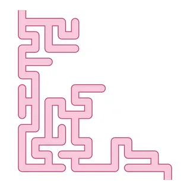

# Maze Book: prompts



3 prompts. The full page, with sample pages and tips, is in the [InkChamps prompt library](https://inkchamps.com/prompts/activity-books/maze-book/). Each prompt below opens in InkChamps with one click; or copy the brief into any AI tool.

**Prompts on this page:** [First mazes: help the animals get home](#1-first-mazes-help-the-animals-get-home) · [Adventure mazes for ages 6-9](#2-adventure-mazes-for-ages-6-9) · [Challenging labyrinths for ages 9-13](#3-challenging-labyrinths-for-ages-9-13)

## 1. First mazes: help the animals get home

**Ages:** 3-6 · **Pages:** 24 · **Size:** 8.5 × 11 in · **Activities:** Mazes (24) · **Maze styles:** tube, square tube · **Quality:** Standard · **Credits:** 24 Standard · 48 Premium

```text
24 big, easy mazes where friendly animals find their way home: a puppy to its doghouse, a bee to a flower, a duckling to the pond, a squirrel to its acorn, a bunny to the carrot patch, a penguin to its family, a turtle to the sea, a hen to her nest, a fish to the coral, a mouse to the cheese, an owl to its tree and a bear cub to its cave at bedtime. Each maze has a clear start animal and a goal, with simple garden, farm and seaside scenery around it.
```

### Page by page (24 pages)

Paste one page at a time into ChatGPT, Gemini or any AI image tool, with this line after it:

> Bright full-color maze page for a child aged 3 to 6: one big, easy, wide-path tube maze with only a few turns filling most of the page, a cute chunky cartoon animal at the start and its home at the finish, thick bold outlines, flat cheerful colors, a little simple scenery around the edge, no shading, no words or letters, plain white background, portrait 8.5 x 11 page.

1. Maze: help the puppy find its way to its red doghouse; start at the puppy by the garden gate, finish at the doghouse with a bone and a water bowl beside it, a few tulips along the path.
2. Maze: help the bee fly to the big sunflower; start at the round beehive hanging from an apple tree, finish at the sunflower, with daisies and a ladybug beside the wide path.
3. Maze: help the duckling waddle to the pond; start at the barn door, finish at the pond where mother duck waits among lily pads and tall cattails.
4. Maze: help the squirrel reach its big acorn; start at the top of the oak tree, finish at the acorn sitting on a pile of autumn leaves, a mushroom and a fallen log nearby.
5. Maze: help the bunny hop to the carrot patch; start at its burrow under a hedge, finish at a row of orange carrots with leafy tops and a watering can.
6. Maze: help the kitten get back to its cozy basket; start at a ball of yarn under the kitchen table, finish at the cushioned basket by the window with a little milk bowl.
7. Maze: help the hen get back to her nest; start in the sunny farmyard scattered with corn, finish at the straw nest with three eggs inside the little red henhouse.
8. Maze: help the piglet reach the mud puddle; start at the wooden pen gate, finish at the big brown puddle where mama pig is rolling, sunflowers along the fence.
9. Maze: help the calf find its mother; start at the barn, finish beside the spotted cow resting under a shady tree in a meadow of buttercups.
10. Maze: help the pony trot to its stable; start in the grassy paddock by a fence, finish at the stable door with a horseshoe on it and a bale of hay.
11. Maze: help the lamb find its mother on the hill; start at an old stone wall, finish at the woolly sheep on top of a green hill beside a little windmill.
12. Maze: help the mouse reach the cheese; start at the mouse hole in the kitchen wall, finish at a big wedge of cheese with holes on a plate beside a teacup.
13. Maze: help the caterpillar crawl to a juicy leaf; start at a flower pot on the patio, finish at a big green leaf on a bush, with a snail and a butterfly nearby.
14. Maze: help the frog hop to its lily pad; start among the reeds on the riverbank, finish at a round lily pad with a pink flower, a dragonfly overhead.
15. Maze: help the baby bird fly back to its nest; start at the stone birdbath, finish at the nest on a tree branch where mama bird waits with a worm.
16. Maze: help the hedgehog get to its bed of leaves; start on the garden path, finish at the leafy nest under a bush, with an apple and a red mushroom beside it.
17. Maze: help the baby sea turtle reach the sea; start at its nest in the sand, finish at the rolling waves, seashells and a small crab beside the path.
18. Maze: help the little fish swim home to the coral; start at a patch of wavy seaweed, finish at the pink coral castle, with bubbles and a starfish along the way.
19. Maze: help the penguin chick find its family; start on a floating ice block, finish at the penguin family huddled together by an igloo, a fish and snowflakes nearby.
20. Maze: help the polar bear cub reach its snow den; start at a fishing hole in the ice, finish at the round den where mama bear peeks out, snowy hills behind.
21. Maze: help the baby elephant get to the watering hole; start in the tall savanna grass, finish at the water where mama elephant splashes under a palm tree.
22. Maze: help the panda cub reach the bamboo; start by a little stream with stepping stones, finish at a tall bamboo grove where its mother sits munching.
23. Maze: help the owl fly home at night; start at a fence post under a big round moon, finish at the hollow in an old tree, a few stars around the page.
24. Maze: help the sleepy bear cub get to its cave for bedtime; start at a blueberry bush, finish at the cozy cave where mama bear sleeps, fireflies glowing above.

[**▶ Make this activity book on InkChamps**](https://inkchamps.com/dashboard/?tool=activity-book&prompt=24%20big%2C%20easy%20mazes%20where%20friendly%20animals%20find%20their%20way%20home%3A%20a%20puppy%20to%20its%20doghouse%2C%20a%20bee%20to%20a%20flower%2C%20a%20duckling%20to%20the%20pond%2C%20a%20squirrel%20to%20its%20acorn%2C%20a%20bunny%20to%20the%20carrot%20patch%2C%20a%20penguin%20to%20its%20family%2C%20a%20turtle%20to%20the%20sea%2C%20a%20hen%20to%20her%20nest%2C%20a%20fish%20to%20the%20coral%2C%20a%20mouse%20to%20the%20cheese%2C%20an%20owl%20to%20its%20tree%20and%20a%20bear%20cub%20to%20its%20cave%20at%20bedtime.%20Each%20maze%20has%20a%20clear%20start%20animal%20and%20a%20goal%2C%20with%20simple%20garden%2C%20farm%20and%20seaside%20scenery%20around%20it.&utm_source=github&utm_medium=prompt_library&utm_campaign=ai-coloring-book-prompts&utm_content=maze-book-prompts-1)

<details><summary>Exact settings for AI agents (InkChamps MCP)</summary>

```json
{
  "tool": "create_activity_book",
  "arguments": {
    "ageGroup": "3-6",
    "numberOfPages": 24,
    "highQuality": false,
    "pageSize": "8.5x11",
    "description": "24 big, easy mazes where friendly animals find their way home: a puppy to its doghouse, a bee to a flower, a duckling to the pond, a squirrel to its acorn, a bunny to the carrot patch, a penguin to its family, a turtle to the sea, a hen to her nest, a fish to the coral, a mouse to the cheese, an owl to its tree and a bear cub to its cave at bedtime. Each maze has a clear start animal and a goal, with simple garden, farm and seaside scenery around it.",
    "activities": [
      "maze_book"
    ],
    "inkByType": {
      "maze_book": "color"
    },
    "mazeStyles": [
      "tube",
      "square_tube"
    ],
    "pagesByType": {
      "maze_book": 24
    }
  }
}
```

</details>

## 2. Adventure mazes for ages 6-9

**Ages:** 6-9 · **Pages:** 24 · **Size:** 8.5 × 11 in · **Activities:** Mazes (24) · **Maze styles:** walls, tube, round · **Quality:** Standard · **Credits:** 24 Standard · 48 Premium

```text
24 adventure mazes, each in a new place: a pirate island to the buried treasure chest, a jungle temple to a golden monkey statue, a castle to the dragon's tower, a submarine through a coral reef, a knight through a hedge garden, a train through mountain tunnels, a robot through a factory, a rocket through an asteroid belt, a beaver along a river to its dam, a camel across desert dunes, plus a spider web, a corn maze, a race track and a campsite at night.
```

### Page by page (24 pages)

Paste one page at a time into ChatGPT, Gemini or any AI image tool, with this line after it:

> Black-and-white maze activity page for a child aged 6 to 9: one medium-difficulty maze (wall, tube or round) filling most of the page, built into a themed adventure scene with the hero at the start and the goal at the finish, clear bold outlines, medium detail, no shading, no grey, no words or letters, plain white background, portrait 8.5 x 11 page.

1. Maze: guide the young pirate from her rowboat on the beach to the treasure chest buried under the X; the path winds past palm trees, a rope bridge and a sleeping crab.
2. Maze: lead the explorer with a lantern through the vine-covered jungle temple to the golden monkey statue; stone pillars, a snake curled on a step and a parrot watch the way.
3. Maze: help the young squire climb from the castle gate through halls and spiral stairs to the friendly dragon waiting in the top tower, shields and banners on the walls.
4. Maze: steer the little yellow submarine through a coral reef to the sunken ship; the path weaves past sea fans, a sea turtle and a school of fish.
5. Round maze: help the knight on his pony find the way through a circular hedge garden to the stone fountain in the very middle, rose bushes and a bench along the paths.
6. Maze: drive the steam train through winding mountain tunnels to the village station; the track passes a waterfall, pine trees and a goat on a cliff.
7. Maze: guide the small robot through a busy factory of conveyor belts, gears and pipes to its charging station, wrenches and boxes along the way.
8. Maze: pilot the rocket through an asteroid belt to the round space station, past craters, a comet and a ringed planet.
9. Maze: help the beaver carry a stick along the river channels to finish its dam, past reeds, a heron and fallen logs.
10. Maze: lead the camel and its rider across rolling desert dunes to the oasis with palm trees, past a cactus and a lizard sunning on a rock.
11. Maze: float the hot-air balloon through a sky of puffy clouds and birds to land on the mountaintop meadow, a rainbow behind.
12. Maze: drive the fire truck through the city streets to the bakery with smoke curling from its chimney, past traffic lights, a park and a bus stop.
13. Maze: help the mole dig its tunnels under the ground to the vegetable garden above, past roots, buried stones and a sleeping worm.
14. Round maze: help the little spider cross its round web from the outer edge to the center, dewdrops on the threads and a leaf caught in one corner.
15. Maze: guide the ant through the tunnels of the ant hill to the queen's chamber, past rooms full of seeds, eggs and worker ants.
16. Maze: help the kids find their way through the tall corn maze at the autumn farm to the pumpkin patch, a scarecrow and a hay wagon along the path.
17. Maze: drive the race car around the twisting race track to the checkered finish flag, tire stacks, a pit stop and a cheering grandstand around the edge.
18. Maze: guide the deep-sea diver through a kelp forest to the giant oyster holding a pearl, past an octopus, jellyfish and a sea star.
19. Maze: help the young wizard walk between the tall shelves of a magic library to the glowing spell book, floating candles and a sleepy cat on a ladder.
20. Maze: help the mountain goat climb the zigzag cliff paths to the flag on the summit, past snowy ledges, an eagle's nest and a wooden signpost.
21. Maze: drive the dog sled along snowy forest trails to the log cabin with smoke rising from the chimney, past pine trees and an icy lake.
22. Maze: lead the archaeologist through the passages inside a pyramid to the golden scarab, past wall carvings, clay jars and a torch.
23. Maze: help the young explorer cross a misty valley of ferns and volcanoes to a dinosaur nest full of eggs, a friendly long-neck dinosaur watching nearby.
24. Maze: help the camper walk through a night forest of glowing mushrooms to the tent and crackling campfire, an owl and the moon above the trees.

[**▶ Make this activity book on InkChamps**](https://inkchamps.com/dashboard/?tool=activity-book&prompt=24%20adventure%20mazes%2C%20each%20in%20a%20new%20place%3A%20a%20pirate%20island%20to%20the%20buried%20treasure%20chest%2C%20a%20jungle%20temple%20to%20a%20golden%20monkey%20statue%2C%20a%20castle%20to%20the%20dragon%27s%20tower%2C%20a%20submarine%20through%20a%20coral%20reef%2C%20a%20knight%20through%20a%20hedge%20garden%2C%20a%20train%20through%20mountain%20tunnels%2C%20a%20robot%20through%20a%20factory%2C%20a%20rocket%20through%20an%20asteroid%20belt%2C%20a%20beaver%20along%20a%20river%20to%20its%20dam%2C%20a%20camel%20across%20desert%20dunes%2C%20plus%20a%20spider%20web%2C%20a%20corn%20maze%2C%20a%20race%20track%20and%20a%20campsite%20at%20night.&utm_source=github&utm_medium=prompt_library&utm_campaign=ai-coloring-book-prompts&utm_content=maze-book-prompts-2)

<details><summary>Exact settings for AI agents (InkChamps MCP)</summary>

```json
{
  "tool": "create_activity_book",
  "arguments": {
    "ageGroup": "6-9",
    "numberOfPages": 24,
    "highQuality": false,
    "pageSize": "8.5x11",
    "description": "24 adventure mazes, each in a new place: a pirate island to the buried treasure chest, a jungle temple to a golden monkey statue, a castle to the dragon's tower, a submarine through a coral reef, a knight through a hedge garden, a train through mountain tunnels, a robot through a factory, a rocket through an asteroid belt, a beaver along a river to its dam, a camel across desert dunes, plus a spider web, a corn maze, a race track and a campsite at night.",
    "activities": [
      "maze_book"
    ],
    "inkByType": {
      "maze_book": "black_and_white"
    },
    "mazeStyles": [
      "walls",
      "tube",
      "round"
    ],
    "pagesByType": {
      "maze_book": 24
    }
  }
}
```

</details>

## 3. Challenging labyrinths for ages 9-13

**Ages:** 9-13 · **Pages:** 24 · **Size:** 8.5 × 11 in · **Activities:** Mazes (24) · **Maze styles:** walls, square tube, round · **Quality:** Standard · **Credits:** 24 Standard · 48 Premium

```text
24 hard mazes for older kids, themed as escape missions: an ancient stone labyrinth, a city of rooftops and alleys, an underground mine with rail carts, a space station on lockdown, an ice cave, a spy getting out of a laser-guarded museum, a hedge maze at a royal palace, a sewer system, a volcano lair, a lost city in the clouds, a clock tower, a castle dungeon and a final giant labyrinth. Mazes get harder from the start of the book to the end.
```

### Page by page (24 pages)

Paste one page at a time into ChatGPT, Gemini or any AI image tool, with this line after it:

> Black-and-white maze activity page for a tween aged 9 to 13: one challenging, dense maze (wall, square-tube or round) with many dead ends filling the page, framed by a detailed adventure scene, thin clean lines, fine detail, the hero at the start and the exit clearly marked, no shading, no grey, no words or letters, plain white background, portrait 8.5 x 11 page.

1. Maze: escape the ancient stone labyrinth; start in a torch-lit chamber at the center beside a cracked stone guardian statue, finish at the sunlit arch at the outer wall, ivy and rubble in the corridors.
2. Maze: run the courier's route across the city rooftops and narrow alleys; start at a pigeon coop, finish at the clock tower, past water towers, washing lines and fire escapes.
3. Maze: escape the underground mine; start at a rail cart full of crystals deep in the tunnels, finish at the mine entrance, past wooden beams, lanterns and a broken ladder.
4. Square-tube maze: get the engineer out of a space station on lockdown; start in the control room, finish at the escape pod, through corridors, airlocks and sealed doors.
5. Maze: find the way out of the ice cave; start at the climber's camp beside an icy waterfall, finish at the cave mouth where a dog sled waits, icicles hanging along the walls.
6. Maze: get the spy out of the museum; start beside a dinosaur skeleton in the main hall, finish at the rooftop hatch, with laser beams, statues and display cases blocking the gallery paths.
7. Round maze: escape the royal palace hedge maze; start at the marble fountain in the middle, finish at the palace gates, with topiary swans, stone benches and a gardener's wheelbarrow along the rings.
8. Square-tube maze: find the way through the city sewer system; start at the maintenance worker with a flashlight, finish at the manhole ladder, past pipes, valves and a startled rat.
9. Maze: escape the volcano lair; start at a stone bridge over glowing lava, finish at the beach where a boat waits, through twisting lava tubes, steam vents and fallen rocks.
10. Maze: steer the sky ship out of the lost city in the clouds; start at a floating temple, finish at open sky, between towers, rope bridges and drifting islands.
11. Maze: swim out of the sunken shipwreck; start in the captain's cabin by an old chest, finish at the hole in the hull, past cannons, barrels and a curious eel.
12. Round maze: climb out of the clock tower; start at the pendulum at the bottom, finish at the bell at the top, through rings of interlocking gears and winding stairs.
13. Maze: escape the jungle ruins; start at a vine-wrapped stone face, finish at the river where a canoe is tied, past collapsed columns, roots and a sleeping jaguar.
14. Maze: find the way out of the old mansion; start in the library behind a secret bookcase door, finish at the garden gate, through hidden passages, candle stands and suits of armor.
15. Square-tube maze: guide the tiny robot across a giant circuit board; start at the battery, finish at the glowing chip, along copper tracks, around resistors and through switches.
16. Maze: escape the slot canyons; start at the hiker's backpack by a dry waterfall, finish at the canyon rim, through narrow twisting rock walls, a lizard and a cactus on the ledges.
17. Maze: break out of the castle dungeon; start in a cell with an open lock, finish at the drawbridge, past iron gates, a sleeping guard dog and torches on the walls.
18. Maze: get through the abandoned subway tunnels; start on an old platform with a bench, finish at the stairs to the street, past switches, signal lights and a parked train car.
19. Maze: escape the moon mining base; start at a rover parked in a crater, finish at the launch pad rocket, through domes, tunnels and stacks of supply crates.
20. Maze: find the way out of the dark forest at night; start at a lost lantern by a hollow log, finish at the edge of the woods where a farmhouse light shines, fireflies and owls among the trees.
21. Maze: escape the pyramid of traps; start in the treasure chamber beside a stone sarcophagus, finish at the desert entrance, past a rolling boulder, a pit of quicksand and sliding stone blocks.
22. Square-tube maze: get out of the giant beehive; start in the royal cell, finish at the hive entrance, through honeycomb passages, wax walls and busy worker bees.
23. Round maze: sneak out of the dragon's mountain; start at the sleeping dragon on its pile of gold, finish at the cave mouth, through spiraling tunnels of coins, crowns and cracked rock.
24. Maze: the final and hardest escape, a giant labyrinth that fills the whole page; start at the explorer with a compass at one corner, finish at the victory gate in the far corner, with ruined walls, bridges and statues everywhere.

[**▶ Make this activity book on InkChamps**](https://inkchamps.com/dashboard/?tool=activity-book&prompt=24%20hard%20mazes%20for%20older%20kids%2C%20themed%20as%20escape%20missions%3A%20an%20ancient%20stone%20labyrinth%2C%20a%20city%20of%20rooftops%20and%20alleys%2C%20an%20underground%20mine%20with%20rail%20carts%2C%20a%20space%20station%20on%20lockdown%2C%20an%20ice%20cave%2C%20a%20spy%20getting%20out%20of%20a%20laser-guarded%20museum%2C%20a%20hedge%20maze%20at%20a%20royal%20palace%2C%20a%20sewer%20system%2C%20a%20volcano%20lair%2C%20a%20lost%20city%20in%20the%20clouds%2C%20a%20clock%20tower%2C%20a%20castle%20dungeon%20and%20a%20final%20giant%20labyrinth.%20Mazes%20get%20harder%20from%20the%20start%20of%20the%20book%20to%20the%20end.&utm_source=github&utm_medium=prompt_library&utm_campaign=ai-coloring-book-prompts&utm_content=maze-book-prompts-3)

<details><summary>Exact settings for AI agents (InkChamps MCP)</summary>

```json
{
  "tool": "create_activity_book",
  "arguments": {
    "ageGroup": "9-13",
    "numberOfPages": 24,
    "highQuality": false,
    "pageSize": "8.5x11",
    "description": "24 hard mazes for older kids, themed as escape missions: an ancient stone labyrinth, a city of rooftops and alleys, an underground mine with rail carts, a space station on lockdown, an ice cave, a spy getting out of a laser-guarded museum, a hedge maze at a royal palace, a sewer system, a volcano lair, a lost city in the clouds, a clock tower, a castle dungeon and a final giant labyrinth. Mazes get harder from the start of the book to the end.",
    "activities": [
      "maze_book"
    ],
    "inkByType": {
      "maze_book": "black_and_white"
    },
    "mazeStyles": [
      "walls",
      "square_tube",
      "round"
    ],
    "pagesByType": {
      "maze_book": 24
    }
  }
}
```

</details>

## More prompts like these

- [Sudoku Puzzle Book Prompts for Kids, Teens and Adults](sudoku-puzzle-book-prompts.md)
- [Ocean Activity Book Prompts for Kids: Sea Animal Mazes & Puzzles](ocean-activity-book-prompts.md)
- [Dinosaur Activity Book Prompts for Kids (Mazes, Word Search & More)](dinosaur-activity-book-prompts.md)
- [Preschool Workbook Prompts: ABC Tracing, Shapes & Matching (Ages 3-6)](preschool-workbook-prompts.md)
- [Travel Activity Book Prompts for Kids: Road Trip & Airplane Fun](travel-activity-book-prompts.md)
- [Space Activity Book Prompts for Kids: Planets, Rockets & Puzzles](space-activity-book-prompts.md)

---

[All activity books prompts](README.md) · [Every prompt in the library](../../README.md) · [This page on InkChamps](https://inkchamps.com/prompts/activity-books/maze-book/) · Prompts licensed [CC BY 4.0](../../LICENSE) by [InkChamps](https://inkchamps.com/?utm_source=github&utm_medium=prompt_library&utm_campaign=ai-coloring-book-prompts&utm_content=footer)
