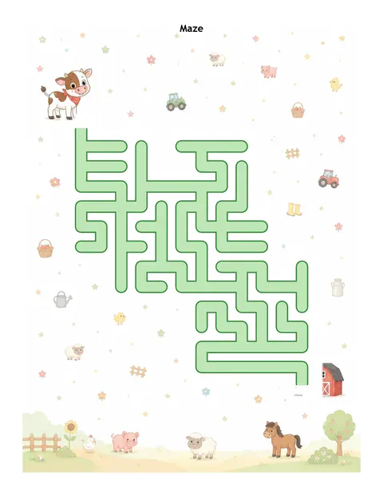

# Ocean Activity Book: prompts



3 prompts. The full page, with sample pages and tips, is in the [InkChamps prompt library](https://inkchamps.com/prompts/activity-books/ocean/). Each prompt below opens in InkChamps with one click; or copy the brief into any AI tool.

**Prompts on this page:** [Friendly sea animals for preschoolers](#1-friendly-sea-animals-for-preschoolers) · [Under the sea puzzle book for ages 6-9](#2-under-the-sea-puzzle-book-for-ages-6-9) · [Coral reef science puzzles for ages 9-13](#3-coral-reef-science-puzzles-for-ages-9-13)

## 1. Friendly sea animals for preschoolers

**Ages:** 3-6 · **Pages:** 24 · **Size:** 8.5 × 11 in · **Activities:** Shadow matching (6), Connect the dots (6), Mazes (6), Coloring pages (6) · **Maze styles:** tube, square tube · **Quality:** Standard · **Credits:** 24 Standard · 48 Premium

```text
24 pages of friendly sea animals in a bright underwater world: 6 shadow matches, 6 dot-to-dots, 6 easy mazes and 6 coloring pages. A smiling octopus, a sea turtle over coral, a crab on the sand, a pufferfish puffing up, a seahorse holding seagrass, a whale spouting water, a starfish and a family of jumping dolphins. Mazes help a little fish find its friends or a turtle reach the sea. Shadows to match: shell, crab, whale, starfish, seahorse, octopus, boat, anchor.
```

### Page by page (24 pages)

Paste one page at a time into ChatGPT, Gemini or any AI image tool, with this line after it:

> Activity page for a child aged 3 to 6: friendly, smiling cartoon sea animals, thick bold outlines, big simple shapes, wide maze paths, very little background, clean printable layout with wide margins, black-and-white line art with no shading or grey unless the page says colour, no words except numbers on dot-to-dots, portrait 8.5 x 11 page.

1. Shadow matching, in colour: a smiling orange octopus, a crab, a seahorse and a starfish in a row on the left; their four plain dark shadows in a mixed-up row on the right, for drawing a line to each match.
2. Shadow matching, in colour: a spotted sea turtle, a round pufferfish, a curly seashell and a small sailboat on the left; four dark shadows of the same shapes in a different order on the right, on a sandy blue frame.
3. Shadow matching, in colour: a big blue whale spouting water, a pink jellyfish, a striped clownfish and a red anchor on the left; their shadows mixed up on the right, with a few bubbles in the corners.
4. Shadow matching, in colour: a little beach scene with a bucket, a spade, a sandcastle and a beach ball on the left; four dark shadows of them on the right for little hands to match.
5. Shadow matching, in colour: a jumping dolphin, a lobster, a sand dollar and a smiling stingray on the left; their four shadows shuffled on the right, framed by wavy seaweed.
6. Shadow matching, in colour: a lighthouse, a seagull, a walrus with tusks and a puffin on the left; four plain shadows on the right, for a seaside matching game.
7. Dot-to-dot: join the dots from 1 to 10 to draw the round body of a happy pufferfish puffed up like a ball, little spikes all around, two bubbles floating above it.
8. Dot-to-dot: join the dots from 1 to 12 to draw the shell of a smiling sea turtle swimming over a low coral bump, its flippers already drawn and a tiny fish beside it.
9. Dot-to-dot: join the dots from 1 to 10 to draw a five-pointed starfish with a big smile, lying on the sand next to a shell and a pebble.
10. Dot-to-dot: join the dots from 1 to 12 to draw the curved body of a whale spouting a fountain of water, a little wave beneath it and the sun in the corner.
11. Dot-to-dot: join the dots from 1 to 15 to draw the curly tail and long snout of a seahorse holding on to a strand of seagrass with its tail.
12. Dot-to-dot: join the dots from 1 to 12 to draw the hull and sail of a little sailboat bobbing on gentle waves, a seagull flying overhead.
13. Maze, in colour: help a little yellow fish swim through a wide tube maze of coral to find its three fish friends; start at the little fish, finish at its friends by a big pink coral.
14. Maze, in colour: guide a baby sea turtle from its nest in the sand down a wide path to the sea; start at the cracked egg, finish at the first wave.
15. Maze, in colour: help a red crab scuttle along a sandy path between rocks and shells to its cozy home in a tide pool; start at the crab, finish at the tide pool.
16. Maze, in colour: lead a mother dolphin through a wide tube of waves to her baby dolphin waiting by a floating buoy; start at the mother, finish at the baby.
17. Maze, in colour: help a hungry octopus swim through a square tube maze of rocks to a treasure chest full of shiny shells; start at the octopus, finish at the chest.
18. Maze, in colour: guide a little submarine with a round window through a wide square path of seaweed to a smiling whale; start at the submarine, finish at the whale.
19. Coloring page: a big smiling octopus sitting on the sea floor, waving all eight arms, each holding something: a shell, a starfish, a pearl and a little bucket.
20. Coloring page: a family of three dolphins jumping over a big curling wave, a round sun and two puffy clouds in the sky above them.
21. Coloring page: a seahorse mom and her tiny babies swimming among tall strands of seagrass, small bubbles rising around them.
22. Coloring page: a crab building a sandcastle with a little spade, a flag on the top tower and a bucket of sand beside it.
23. Coloring page: a sea turtle swimming over a coral reef, a clownfish peeking out of an anemone and a starfish on a rock below.
24. Coloring page: a sleepy whale floating at the surface under a crescent moon and stars, a little fish curled up asleep on its back.

[**▶ Make this activity book on InkChamps**](https://inkchamps.com/dashboard/?tool=activity-book&prompt=24%20pages%20of%20friendly%20sea%20animals%20in%20a%20bright%20underwater%20world%3A%206%20shadow%20matches%2C%206%20dot-to-dots%2C%206%20easy%20mazes%20and%206%20coloring%20pages.%20A%20smiling%20octopus%2C%20a%20sea%20turtle%20over%20coral%2C%20a%20crab%20on%20the%20sand%2C%20a%20pufferfish%20puffing%20up%2C%20a%20seahorse%20holding%20seagrass%2C%20a%20whale%20spouting%20water%2C%20a%20starfish%20and%20a%20family%20of%20jumping%20dolphins.%20Mazes%20help%20a%20little%20fish%20find%20its%20friends%20or%20a%20turtle%20reach%20the%20sea.%20Shadows%20to%20match%3A%20shell%2C%20crab%2C%20whale%2C%20starfish%2C%20seahorse%2C%20octopus%2C%20boat%2C%20anchor.&utm_source=github&utm_medium=prompt_library&utm_campaign=ai-coloring-book-prompts&utm_content=ocean-activity-book-prompts-1)

<details><summary>Exact settings for AI agents (InkChamps MCP)</summary>

```json
{
  "tool": "create_activity_book",
  "arguments": {
    "ageGroup": "3-6",
    "numberOfPages": 24,
    "highQuality": false,
    "pageSize": "8.5x11",
    "description": "24 pages of friendly sea animals in a bright underwater world: 6 shadow matches, 6 dot-to-dots, 6 easy mazes and 6 coloring pages. A smiling octopus, a sea turtle over coral, a crab on the sand, a pufferfish puffing up, a seahorse holding seagrass, a whale spouting water, a starfish and a family of jumping dolphins. Mazes help a little fish find its friends or a turtle reach the sea. Shadows to match: shell, crab, whale, starfish, seahorse, octopus, boat, anchor.",
    "activities": [
      "shadow_matching_book",
      "connect_the_dots_book",
      "maze_book",
      "coloring_book"
    ],
    "inkByType": {
      "shadow_matching_book": "color",
      "connect_the_dots_book": "black_and_white",
      "maze_book": "color"
    },
    "mazeStyles": [
      "tube",
      "square_tube"
    ],
    "pagesByType": {
      "shadow_matching_book": 6,
      "connect_the_dots_book": 6,
      "maze_book": 6,
      "coloring_book": 6
    }
  }
}
```

</details>

## 2. Under the sea puzzle book for ages 6-9

**Ages:** 6-9 · **Pages:** 24 · **Size:** 8.5 × 11 in · **Activities:** Mazes (6), Word search (6), Spot the difference (6), Connect the dots (6) · **Maze styles:** walls, tube, round · **Quality:** Standard · **Credits:** 24 Standard · 48 Premium

```text
24 pages diving from a sunny beach to the deep sea: 6 mazes, 6 word searches, 6 spot the differences and 6 dot-to-dots. Tide pools, a kelp forest with sea otters, a shipwreck with a treasure chest, a coral reef, a manta ray gliding and a submarine with bright lights in the dark deep. Word search words include OCTOPUS, DOLPHIN, SEAHORSE, JELLYFISH, CORAL, SHARK, WHALE, SEA TURTLE, LOBSTER, KELP and SHIPWRECK. Mazes swim through reefs and caves.
```

### Page by page (24 pages)

Paste one page at a time into ChatGPT, Gemini or any AI image tool, with this line after it:

> Activity page for a child aged 6 to 9: friendly cartoon sea animals and kid divers, clear bold outlines, medium detail, a simple ocean scene framing the puzzle, clean printable layout, black-and-white line art with no shading or grey unless the page says colour, no words except the puzzle's letters, word list and dot numbers, portrait 8.5 x 11 page.

1. Maze, in colour: help a hermit crab cross a rocky tide pool, past sea anemones, snails and a starfish, to an empty shell just its size; start at the crab, finish at the shell.
2. Maze, in colour: guide a sea otter through a tall kelp forest, around swaying kelp stalks and sea urchins, to its pup floating on its back; start at the otter, finish at the pup.
3. Maze, in colour: lead a diver through the broken rooms of a sunken pirate shipwreck, past barrels and a ship's wheel, to a treasure chest; start at the diver, finish at the chest.
4. Round maze, in colour: a circular maze drawn as a giant coral reef seen from above, rings of brain coral and sea fans; guide a clownfish from the outer edge to its anemone home at the center.
5. Maze, in colour: help a manta ray glide through an underwater canyon of tall rocks and drifting jellyfish to the open blue sea; start at the manta ray, finish at the canyon mouth.
6. Maze, in colour: steer a little submarine with bright headlights through dark deep-sea caves, past glowing jellyfish and an anglerfish, to a hidden pearl; start at the submarine, finish at the pearl.
7. Word search: 8 sea animal words (OCTOPUS, DOLPHIN, SEAHORSE, JELLYFISH, STARFISH, SHARK, WHALE, LOBSTER) hidden in a 10 x 10 letter grid framed by waves and bubbles, word list below.
8. Word search: 8 beach and tide pool words (CRAB, SHELL, SAND, TIDE POOL, SNAIL, STARFISH, WAVE, SEAGULL) hidden in a 10 x 10 letter grid framed by a sandy beach with a bucket and spade.
9. Word search: 8 coral reef words (CORAL, CLOWNFISH, SEA TURTLE, STINGRAY, ANEMONE, REEF, SPONGE, EEL) hidden in a 10 x 10 letter grid framed by branching coral and small fish.
10. Word search: 8 kelp forest words (KELP, SEA OTTER, URCHIN, SEAL, ROCKFISH, ABALONE, FOREST, CURRENT) hidden in a 10 x 10 letter grid framed by tall kelp stalks and an otter floating at the top.
11. Word search: 8 shipwreck words (SHIPWRECK, ANCHOR, TREASURE, CHEST, DIVER, MAST, CANNON, COMPASS) hidden in a 10 x 10 letter grid framed like a ship's porthole with ropes around it.
12. Word search: 8 deep sea words (SUBMARINE, ANGLERFISH, SQUID, DEEP, DARK, GLOW, TRENCH, SONAR) hidden in a 10 x 10 letter grid framed by a submarine's lights and drifting jellyfish.
13. Spot the difference, in colour: two pictures side by side of a busy tide pool with crabs, snails, a starfish and an anemone; 6 small changes to find, like a missing snail or a crab with one claw.
14. Spot the difference, in colour: two pictures of a sea otter family floating in the kelp forest, one cracking a clam on its tummy; 6 changes to find, like an extra sea urchin or a different shell.
15. Spot the difference, in colour: two pictures of a sunken shipwreck with a treasure chest, an octopus on the mast and fish swimming through portholes; 7 changes to find.
16. Spot the difference, in colour: two pictures of a coral reef with a sea turtle, clownfish, a moray eel peeking from a hole and a parrotfish; 7 small changes to find.
17. Spot the difference, in colour: two pictures of a sunny beach with a sandcastle, a lifeguard tower, a beach umbrella and a dolphin jumping offshore; 7 changes to find.
18. Spot the difference, in colour: two pictures of a submarine exploring the deep sea, an anglerfish glowing and a giant squid's tentacles in the dark; 8 changes to find.
19. Dot-to-dot: join the dots from 1 to 30 to draw a great white shark swimming over the reef, its fin and tail sharp against the water, a school of small fish darting away.
20. Dot-to-dot: join the dots from 1 to 25 to draw the wide wings of a manta ray gliding through the open sea, two remora fish swimming underneath it.
21. Dot-to-dot: join the dots from 1 to 30 to draw a humpback whale leaping out of the water, long flippers out wide and a big splash below it.
22. Dot-to-dot: join the dots from 1 to 25 to draw the hull and periscope of a little submarine, a diver waving from beside it and bubbles rising.
23. Dot-to-dot: join the dots from 1 to 30 to draw the bell and long trailing tentacles of a jellyfish drifting past a sea turtle in the kelp.
24. Dot-to-dot: join the dots from 1 to 35 to draw a pirate shipwreck lying tilted on the sea floor, broken mast, anchor in the sand and a crab on the deck.

[**▶ Make this activity book on InkChamps**](https://inkchamps.com/dashboard/?tool=activity-book&prompt=24%20pages%20diving%20from%20a%20sunny%20beach%20to%20the%20deep%20sea%3A%206%20mazes%2C%206%20word%20searches%2C%206%20spot%20the%20differences%20and%206%20dot-to-dots.%20Tide%20pools%2C%20a%20kelp%20forest%20with%20sea%20otters%2C%20a%20shipwreck%20with%20a%20treasure%20chest%2C%20a%20coral%20reef%2C%20a%20manta%20ray%20gliding%20and%20a%20submarine%20with%20bright%20lights%20in%20the%20dark%20deep.%20Word%20search%20words%20include%20OCTOPUS%2C%20DOLPHIN%2C%20SEAHORSE%2C%20JELLYFISH%2C%20CORAL%2C%20SHARK%2C%20WHALE%2C%20SEA%20TURTLE%2C%20LOBSTER%2C%20KELP%20and%20SHIPWRECK.%20Mazes%20swim%20through%20reefs%20and%20caves.&utm_source=github&utm_medium=prompt_library&utm_campaign=ai-coloring-book-prompts&utm_content=ocean-activity-book-prompts-2)

<details><summary>Exact settings for AI agents (InkChamps MCP)</summary>

```json
{
  "tool": "create_activity_book",
  "arguments": {
    "ageGroup": "6-9",
    "numberOfPages": 24,
    "highQuality": false,
    "pageSize": "8.5x11",
    "description": "24 pages diving from a sunny beach to the deep sea: 6 mazes, 6 word searches, 6 spot the differences and 6 dot-to-dots. Tide pools, a kelp forest with sea otters, a shipwreck with a treasure chest, a coral reef, a manta ray gliding and a submarine with bright lights in the dark deep. Word search words include OCTOPUS, DOLPHIN, SEAHORSE, JELLYFISH, CORAL, SHARK, WHALE, SEA TURTLE, LOBSTER, KELP and SHIPWRECK. Mazes swim through reefs and caves.",
    "activities": [
      "maze_book",
      "word_search_book",
      "spot_the_difference_book",
      "connect_the_dots_book"
    ],
    "inkByType": {
      "maze_book": "color",
      "word_search_book": "black_and_white",
      "spot_the_difference_book": "color",
      "connect_the_dots_book": "black_and_white"
    },
    "mazeStyles": [
      "walls",
      "tube",
      "round"
    ],
    "pagesByType": {
      "maze_book": 6,
      "word_search_book": 6,
      "spot_the_difference_book": 6,
      "connect_the_dots_book": 6
    }
  }
}
```

</details>

## 3. Coral reef science puzzles for ages 9-13

**Ages:** 9-13 · **Pages:** 24 · **Size:** 8.5 × 11 in · **Activities:** Word search (8), Sudoku (8), Mazes (8) · **Maze styles:** walls, round, square tube · **Quality:** Standard · **Credits:** 24 Standard · 48 Premium

```text
A 24-page marine science puzzle book set on a research boat and a coral reef: 8 word searches, 8 sudoku and 8 mazes. Divers with clipboards, a diving bell, an anglerfish glowing in the dark, a giant squid, a hammerhead shark, a parrotfish nibbling coral. Word lists cover the reef (POLYP, ANEMONE, PARROTFISH, SPONGE, LAGOON), the deep sea (ANGLERFISH, TRENCH, ABYSS, GULPER EEL) and ocean science (PLANKTON, SALINITY, CURRENT, TIDE, SONAR).
```

### Page by page (24 pages)

Paste one page at a time into ChatGPT, Gemini or any AI image tool, with this line after it:

> Black-and-white activity page for a child aged 9 to 13: realistic marine animals, research divers and boats, fine clean outlines, detailed themed frame around a large, clear puzzle area, narrow maze walls, no shading or grey, no words except the grid's letters or numbers and the word list, clean printable layout, portrait 8.5 x 11 page.

1. Word search: 12 reef words (POLYP, ANEMONE, PARROTFISH, SPONGE, LAGOON, ATOLL, BRAIN CORAL, SEA FAN, GROUPER, MORAY EEL, CLEANER WRASSE, ZOOXANTHELLAE) in a 15 x 15 letter grid framed by a coral reef.
2. Word search: 12 deep sea words (ANGLERFISH, TRENCH, ABYSS, GULPER EEL, VIPERFISH, HAGFISH, GIANT SQUID, ISOPOD, VENT, PRESSURE, MIDNIGHT ZONE, BIOLUMINESCENCE) in a 15 x 15 grid framed by dark water and glowing lures.
3. Word search: 12 ocean science words (PLANKTON, SALINITY, CURRENT, TIDE, SONAR, UPWELLING, THERMOCLINE, ESTUARY, KRILL, ALGAE, OXYGEN, SEDIMENT) in a 15 x 15 grid framed by a research boat and a sonar screen.
4. Word search: 12 shark and ray words (HAMMERHEAD, WHALE SHARK, NURSE SHARK, MAKO, TIGER SHARK, STINGRAY, MANTA, SAWFISH, DORSAL FIN, GILLS, CARTILAGE, PREDATOR) in a 15 x 15 grid framed by a hammerhead swimming.
5. Word search: 12 marine mammal words (ORCA, BELUGA, NARWHAL, MANATEE, DUGONG, SEA LION, WALRUS, BLUBBER, BALEEN, BLOWHOLE, POD, ECHOLOCATION) in a 15 x 15 grid framed by an orca and a beluga.
6. Word search: 12 diving and research words (SCUBA, SNORKEL, WETSUIT, FLIPPERS, DIVING BELL, CLIPBOARD, SAMPLE, QUADRAT, TAG, SURVEY, BUOY, DEPTH GAUGE) in a 15 x 15 grid framed by divers counting fish.
7. Word search: 12 ocean zone and feature words (SUNLIGHT ZONE, TWILIGHT ZONE, SHELF, SEAMOUNT, RIDGE, CANYON, KELP FOREST, SEAGRASS, MANGROVE, TIDE POOL, REEF CREST, DROP OFF) in a 15 x 15 grid with a cross-section of the sea.
8. Word search: 12 reef protection words (BLEACHING, RESTORATION, NURSERY, FRAGMENT, MARINE RESERVE, CLEANUP, MICROPLASTIC, OVERFISHING, ACIDITY, WARMING, RECOVERY, HABITAT) in a 15 x 15 grid framed by coral frames on a reef nursery.
9. Sudoku: an easy 6 x 6 number sudoku with plenty of starting numbers, the grid drawn as a porthole window of a research boat, a parrotfish nibbling coral below it.
10. Sudoku: an easy 6 x 6 number sudoku, the grid set into the deck of a research boat, a diver with a clipboard sitting on the rail and a coiled rope beside the grid.
11. Sudoku: a 6 x 6 picture sudoku using six sea creature symbols (shark, octopus, starfish, crab, turtle, jellyfish), the grid framed by seaweed and bubbles.
12. Sudoku: a medium 9 x 9 number sudoku, the grid shown on the screen of a sonar station, a hammerhead shark outline swimming across the top of the page.
13. Sudoku: a medium 9 x 9 number sudoku, the grid framed by a giant squid's tentacles curling around all four sides, a diving bell hanging at the top.
14. Sudoku: a medium 9 x 9 number sudoku, the grid drawn on a dive slate held by a diver, a school of fish and a sea fan coral behind.
15. Sudoku: a hard 9 x 9 number sudoku with few starting numbers, the grid framed by the dark deep sea, an anglerfish lure glowing at one corner.
16. Sudoku: a hard 9 x 9 number sudoku, the grid laid over a map of a coral atoll seen from above, a research boat anchored in the lagoon beside it.
17. Maze: guide a diver with a sample jar through a dense brain coral reef, around sea fans and sponges, to the research boat's ladder; start at the diver, finish at the ladder.
18. Maze: lower the diving bell down a narrow walled path through a dark underwater canyon to the sea floor; start at the boat at the top, finish at the sand far below.
19. Round maze: a circular maze drawn as a coral atoll seen from above, rings of reef and channels; guide a small research boat from the open ocean to the lagoon at the center.
20. Maze: help a parrotfish swim through a reef full of hiding moray eels and spiny urchins to a patch of algae-covered coral; start at the parrotfish, finish at the coral.
21. Maze: steer a submersible down through the twilight zone into a deep trench, past an anglerfish, a gulper eel and a hydrothermal vent; start at the surface, finish at the trench floor.
22. Maze: lead a sea turtle out of a tangle of old fishing nets and floating plastic to clear open water; start at the turtle, finish at the open sea.
23. Round maze: a circular maze drawn as the spiral of a giant nautilus shell; guide a little shrimp from the shell opening to the innermost chamber.
24. Maze: follow the sonar ping through a walled maze of underwater ridges and seamounts to find a whale pod singing deep below; start at the research boat, finish at the whales.

[**▶ Make this activity book on InkChamps**](https://inkchamps.com/dashboard/?tool=activity-book&prompt=A%2024-page%20marine%20science%20puzzle%20book%20set%20on%20a%20research%20boat%20and%20a%20coral%20reef%3A%208%20word%20searches%2C%208%20sudoku%20and%208%20mazes.%20Divers%20with%20clipboards%2C%20a%20diving%20bell%2C%20an%20anglerfish%20glowing%20in%20the%20dark%2C%20a%20giant%20squid%2C%20a%20hammerhead%20shark%2C%20a%20parrotfish%20nibbling%20coral.%20Word%20lists%20cover%20the%20reef%20%28POLYP%2C%20ANEMONE%2C%20PARROTFISH%2C%20SPONGE%2C%20LAGOON%29%2C%20the%20deep%20sea%20%28ANGLERFISH%2C%20TRENCH%2C%20ABYSS%2C%20GULPER%20EEL%29%20and%20ocean%20science%20%28PLANKTON%2C%20SALINITY%2C%20CURRENT%2C%20TIDE%2C%20SONAR%29.&utm_source=github&utm_medium=prompt_library&utm_campaign=ai-coloring-book-prompts&utm_content=ocean-activity-book-prompts-3)

<details><summary>Exact settings for AI agents (InkChamps MCP)</summary>

```json
{
  "tool": "create_activity_book",
  "arguments": {
    "ageGroup": "9-13",
    "numberOfPages": 24,
    "highQuality": false,
    "pageSize": "8.5x11",
    "description": "A 24-page marine science puzzle book set on a research boat and a coral reef: 8 word searches, 8 sudoku and 8 mazes. Divers with clipboards, a diving bell, an anglerfish glowing in the dark, a giant squid, a hammerhead shark, a parrotfish nibbling coral. Word lists cover the reef (POLYP, ANEMONE, PARROTFISH, SPONGE, LAGOON), the deep sea (ANGLERFISH, TRENCH, ABYSS, GULPER EEL) and ocean science (PLANKTON, SALINITY, CURRENT, TIDE, SONAR).",
    "activities": [
      "word_search_book",
      "sudoku_book",
      "maze_book"
    ],
    "inkByType": {
      "word_search_book": "black_and_white",
      "sudoku_book": "black_and_white",
      "maze_book": "black_and_white"
    },
    "mazeStyles": [
      "walls",
      "round",
      "square_tube"
    ],
    "pagesByType": {
      "word_search_book": 8,
      "sudoku_book": 8,
      "maze_book": 8
    }
  }
}
```

</details>

## More prompts like these

- [Dinosaur Activity Book Prompts for Kids (Mazes, Word Search & More)](dinosaur-activity-book-prompts.md)
- [Preschool Workbook Prompts: ABC Tracing, Shapes & Matching (Ages 3-6)](preschool-workbook-prompts.md)
- [Travel Activity Book Prompts for Kids: Road Trip & Airplane Fun](travel-activity-book-prompts.md)
- [Space Activity Book Prompts for Kids: Planets, Rockets & Puzzles](space-activity-book-prompts.md)
- [Halloween Activity Book Prompts for Kids (Not Too Spooky)](halloween-activity-book-prompts.md)
- [Christmas Activity Book Prompts for Kids: Mazes, Word Search & More](christmas-activity-book-prompts.md)

---

[All activity books prompts](README.md) · [Every prompt in the library](../../README.md) · [This page on InkChamps](https://inkchamps.com/prompts/activity-books/ocean/) · Prompts licensed [CC BY 4.0](../../LICENSE) by [InkChamps](https://inkchamps.com/?utm_source=github&utm_medium=prompt_library&utm_campaign=ai-coloring-book-prompts&utm_content=footer)
