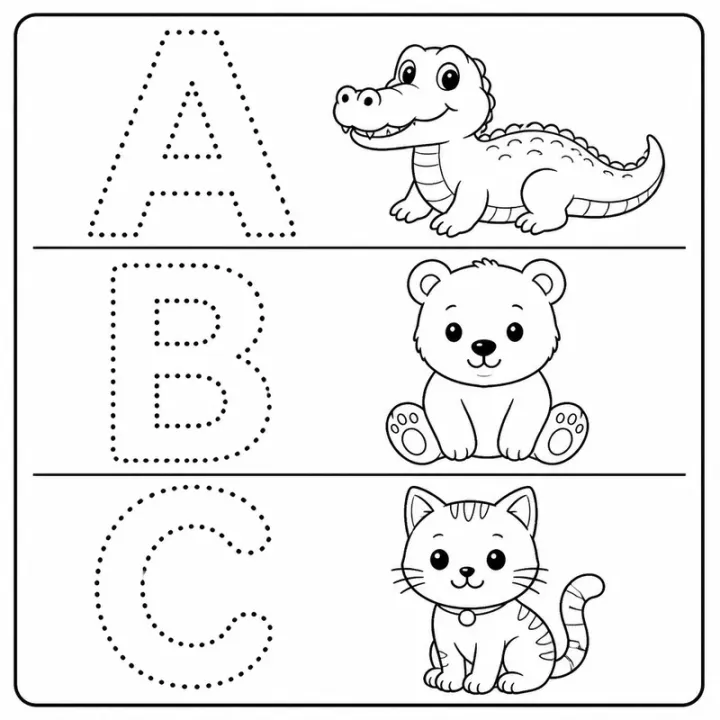

# Preschool Workbook: prompts



3 prompts. The full page, with sample pages and tips, is in the [InkChamps prompt library](https://inkchamps.com/prompts/activity-books/preschool-workbook/). Each prompt below opens in InkChamps with one click; or copy the brief into any AI tool.

**Prompts on this page:** [A to Z alphabet tracing workbook](#1-a-to-z-alphabet-tracing-workbook) · [Pre-writing lines and shapes book](#2-pre-writing-lines-and-shapes-book) · [Kindergarten readiness big workbook](#3-kindergarten-readiness-big-workbook)

## 1. A to Z alphabet tracing workbook

**Ages:** 3-6 · **Pages:** 24 · **Size:** 8.5 × 11 in · **Activities:** Tracing (4), ABC letters (13), Shadow matching (7) · **Quality:** Standard · **Credits:** 24 Standard · 48 Premium

```text
A cheerful 24-page first alphabet workbook for ages 3 to 6. Four tracing pages warm up with straight lines, zigzags, waves and circles. Then 13 ABC pages, two letters each, with a picture to say each sound: Apple, Ball, Cat, Duck, Egg, Fish, Goat, Hat, Igloo, Jellyfish, Kite, Lion, Moon, Nest, Owl, Pig, Queen, Rabbit, Sun, Turtle, Umbrella, Van, Whale, Box (x at the end), Yo-yo, Zebra. Seven shadow matching pages reuse the same alphabet pictures.
```

### Page by page (24 pages)

Paste one page at a time into ChatGPT, Gemini or any AI image tool, with this line after it:

> Printable preschool workbook page for a child aged 3 to 6: thick bold outlines, big simple pictures, chunky dotted lines to trace, lots of white space, almost no background, no shading or grey, no words other than the letters being learned, portrait 8.5 x 11 page. Black-and-white line art, except shadow matching pages: bright colour pictures beside solid black shadows.

1. Tracing: four dotted straight lines run across the page, each one leading a little caterpillar from a leaf on the left to a big round apple on the right; start at the dot, finish at the apple.
2. Tracing: three rows of dotted zigzag lines that bounce a kite string up and down, from a child's hand on the left to a diamond kite with a bow tail flying on the right.
3. Tracing: three wavy dotted lines across the sea, one for each little fish swimming from the left to a smiling whale on the right, small bubbles floating above each wave.
4. Tracing: rows of dotted circles to trace, big at the top and smaller below, shaped like a round sun, three eggs in a nest and the two wheels of a little van.
5. ABC page: big bold A a and B b with dotted lines inside to trace, a shiny apple with one leaf beside the A and a striped bouncy ball beside the B.
6. ABC page: big bold C c and D d, a sitting cat with a curly tail beside the C and a smiling duck paddling in a little puddle beside the D.
7. ABC page: big bold E e and F f, a cracked egg with a baby chick peeking out beside the E and a round fish blowing bubbles beside the F.
8. ABC page: big bold G g and H h, a goat with little horns chewing a tuft of grass beside the G and a floppy sun hat with a ribbon beside the H.
9. ABC page: big bold I i and J j, a snowy igloo with a round doorway beside the I and a floating jellyfish with long wavy legs beside the J.
10. ABC page: big bold K k and L l, a diamond kite with a bow tail beside the K and a friendly lion with a big fluffy mane beside the L.
11. ABC page: big bold M m and N n, a smiling crescent moon with two stars beside the M and a twig nest holding three eggs beside the N.
12. ABC page: big bold O o and P p, a round-eyed owl sitting on a branch beside the O and a chubby pig with a curly tail beside the P.
13. ABC page: big bold Q q and R r, a kind queen in a crown and long gown beside the Q and a rabbit with tall ears nibbling a carrot beside the R.
14. ABC page: big bold S s and T t, a big smiling sun with chunky rays beside the S and a turtle with a patterned shell beside the T.
15. ABC page: big bold U u and V v, an open umbrella with three raindrops beside the U and a little delivery van with round wheels beside the V.
16. ABC page: big bold W w and X x, a whale spouting water beside the W and a gift box tied with a bow beside the X, for the x sound at the end of box.
17. ABC page: big bold Y y and Z z, a yo-yo hanging on its string beside the Y and a striped zebra standing in short grass beside the Z.
18. Shadow matching: a colourful apple, ball, cat and duck down the left side and their four solid black shadows in mixed-up order on the right; draw a line from each picture to its shadow.
19. Shadow matching: an egg, a fish, a goat and a hat in bright colours on the left, their black shadows jumbled on the right, a dot beside each to start and end the line.
20. Shadow matching: an igloo, a jellyfish, a kite and a lion in colour along the top of the page and their black shadows in a different order along the bottom; join each pair.
21. Shadow matching: a moon, a nest, an owl and a pig in colour in a left column, their four black shadows scattered on the right inside dotted boxes; draw a line to each match.
22. Shadow matching: a queen, a rabbit, a sun and a turtle in colour on the left and their black shadows mixed up on the right, the rabbit's shadow showing its tall ears.
23. Shadow matching: an umbrella, a van, a whale and a box in colour on the left, their four black shadows in a new order on the right, a small star at each start dot.
24. Shadow matching: a colourful yo-yo and zebra at the top, and four black shadows below, two that match and two that do not (a horse and a spinning top); circle the right two.

[**▶ Make this activity book on InkChamps**](https://inkchamps.com/dashboard/?tool=activity-book&prompt=A%20cheerful%2024-page%20first%20alphabet%20workbook%20for%20ages%203%20to%206.%20Four%20tracing%20pages%20warm%20up%20with%20straight%20lines%2C%20zigzags%2C%20waves%20and%20circles.%20Then%2013%20ABC%20pages%2C%20two%20letters%20each%2C%20with%20a%20picture%20to%20say%20each%20sound%3A%20Apple%2C%20Ball%2C%20Cat%2C%20Duck%2C%20Egg%2C%20Fish%2C%20Goat%2C%20Hat%2C%20Igloo%2C%20Jellyfish%2C%20Kite%2C%20Lion%2C%20Moon%2C%20Nest%2C%20Owl%2C%20Pig%2C%20Queen%2C%20Rabbit%2C%20Sun%2C%20Turtle%2C%20Umbrella%2C%20Van%2C%20Whale%2C%20Box%20%28x%20at%20the%20end%29%2C%20Yo-yo%2C%20Zebra.%20Seven%20shadow%20matching%20pages%20reuse%20the%20same%20alphabet%20pictures.&utm_source=github&utm_medium=prompt_library&utm_campaign=ai-coloring-book-prompts&utm_content=preschool-workbook-prompts-1)

<details><summary>Exact settings for AI agents (InkChamps MCP)</summary>

```json
{
  "tool": "create_activity_book",
  "arguments": {
    "ageGroup": "3-6",
    "numberOfPages": 24,
    "highQuality": false,
    "pageSize": "8.5x11",
    "description": "A cheerful 24-page first alphabet workbook for ages 3 to 6. Four tracing pages warm up with straight lines, zigzags, waves and circles. Then 13 ABC pages, two letters each, with a picture to say each sound: Apple, Ball, Cat, Duck, Egg, Fish, Goat, Hat, Igloo, Jellyfish, Kite, Lion, Moon, Nest, Owl, Pig, Queen, Rabbit, Sun, Turtle, Umbrella, Van, Whale, Box (x at the end), Yo-yo, Zebra. Seven shadow matching pages reuse the same alphabet pictures.",
    "activities": [
      "tracing_worksheet_book",
      "abc_book",
      "shadow_matching_book"
    ],
    "inkByType": {
      "tracing_worksheet_book": "black_and_white",
      "shadow_matching_book": "color"
    },
    "pagesByType": {
      "tracing_worksheet_book": 4,
      "abc_book": 13,
      "shadow_matching_book": 7
    }
  }
}
```

</details>

## 2. Pre-writing lines and shapes book

**Ages:** 3-6 · **Pages:** 24 · **Size:** 8.5 × 11 in · **Activities:** Tracing (13), Shadow matching (6), Connect the dots (5) · **Quality:** Standard · **Credits:** 24 Standard · 48 Premium

```text
A 24-page farm pre-writing book for little hands aged 3 to 6. Thirteen tracing pages: straight lines from a bee to a flower, rain falling on carrots, zigzags down a hill, waves across a pond, loops like a pig's curly tail, then circles, squares, triangles, rectangles, hearts and stars. Six shadow matching pages pair farm animals and objects: cow, hen, horse, sheep, tractor, barn, pumpkin, watering can and more. Five short dot-to-dots (8 to 15 dots) make an apple, a barn, a pumpkin, a hen and a tractor.
```

### Page by page (24 pages)

Paste one page at a time into ChatGPT, Gemini or any AI image tool, with this line after it:

> Printable pre-writing workbook page for a child aged 3 to 6, set on a friendly farm: thick bold outlines, big simple shapes, chunky dotted lines to trace, lots of white space, very little background, no shading or grey, no words (only dot numbers), portrait 8.5 x 11 page. Black-and-white line art, except shadow matching pages: bright colour pictures beside solid black shadows.

1. Tracing: four dotted straight lines across the page, each one leading a buzzing bee from its hive on the left to a big daisy on the right.
2. Tracing: dotted straight lines falling from a fluffy rain cloud down to a row of carrots in the vegetable patch, one line for each raindrop.
3. Tracing: slanted dotted lines that slide from the barn's hayloft door down to three round haystacks below, the farm cat sitting at the top.
4. Tracing: a dotted zigzag path that a little goat follows down a bumpy hill, from the gate at the top to a patch of clover at the bottom.
5. Tracing: three wavy dotted lines across a pond, one for each duckling paddling from the reeds on the left to the mother duck on the right.
6. Tracing: a row of dotted loops like a pig's curly tail, running from a smiling pig on the left to a muddy puddle on the right.
7. Tracing: dotted arches that show a frisky lamb jumping from one tuft of grass to the next across a sunny meadow, a fence at the far end.
8. Tracing: dotted circles to trace: four eggs in a hen's straw nest, the big round back wheel of a tractor and a round sun in the corner.
9. Tracing: dotted squares to trace on a stack of hay bales beside the barn, a little mouse peeking out from behind the bottom bale.
10. Tracing: dotted triangles to trace as the pointed roofs of three chicken coops in a row, a hen standing in each little doorway.
11. Tracing: dotted rectangles to trace: the tall barn doors, a long water trough and a wooden gate with a cow looking over it.
12. Tracing: dotted hearts to trace on a patchwork quilt hanging on the farmhouse washing line, a calf nuzzling one corner of the quilt.
13. Tracing: dotted stars to trace in the night sky above the sleeping farm, with the barn, a crescent moon and an owl on a fence post.
14. Shadow matching: a colourful cow, hen, horse and sheep down the left side and their solid black shadows mixed up on the right; draw a line from each animal to its shadow.
15. Shadow matching: a red tractor, a barn, a pumpkin and a watering can in colour on the left, their four black shadows jumbled on the right, a dot beside each.
16. Shadow matching: a pig, a duck, a goat and a rooster in colour along the top of the page and their black shadows in a different order along the bottom; join each pair.
17. Shadow matching: a wheelbarrow, a scarecrow, a milk bucket and a hay bale in colour on the left, their black shadows on the right inside dotted boxes.
18. Shadow matching: farm foods in colour on the left (a carrot, an apple, an ear of corn and a sunflower) and their four black shadows mixed up on the right.
19. Shadow matching: one big colourful pony in the middle of the page and three black shadows below it, a pony, a cow and a dog; circle the shadow that matches.
20. Dot-to-dot: join the dots 1 to 8 to make a big round apple with a stem and leaf, a little worm smiling from the grass beside it.
21. Dot-to-dot: join the dots 1 to 10 to draw the outline of a barn with a pointed roof, a hen and two chicks already drawn by the door.
22. Dot-to-dot: join the dots 1 to 10 to make a fat pumpkin with a curly vine, sitting in a pumpkin patch with two leaves drawn beside it.
23. Dot-to-dot: join the dots 1 to 12 to draw a plump hen sitting on her nest, a few pieces of straw and one egg already drawn below.
24. Dot-to-dot: join the dots 1 to 15 to finish a little tractor with a big back wheel, the farmer's cap and the field already drawn around it.

[**▶ Make this activity book on InkChamps**](https://inkchamps.com/dashboard/?tool=activity-book&prompt=A%2024-page%20farm%20pre-writing%20book%20for%20little%20hands%20aged%203%20to%206.%20Thirteen%20tracing%20pages%3A%20straight%20lines%20from%20a%20bee%20to%20a%20flower%2C%20rain%20falling%20on%20carrots%2C%20zigzags%20down%20a%20hill%2C%20waves%20across%20a%20pond%2C%20loops%20like%20a%20pig%27s%20curly%20tail%2C%20then%20circles%2C%20squares%2C%20triangles%2C%20rectangles%2C%20hearts%20and%20stars.%20Six%20shadow%20matching%20pages%20pair%20farm%20animals%20and%20objects%3A%20cow%2C%20hen%2C%20horse%2C%20sheep%2C%20tractor%2C%20barn%2C%20pumpkin%2C%20watering%20can%20and%20more.%20Five%20short%20dot-to-dots%20%288%20to%2015%20dots%29%20make%20an%20apple%2C%20a%20barn%2C%20a%20pumpkin%2C%20a%20hen%20and%20a%20tractor.&utm_source=github&utm_medium=prompt_library&utm_campaign=ai-coloring-book-prompts&utm_content=preschool-workbook-prompts-2)

<details><summary>Exact settings for AI agents (InkChamps MCP)</summary>

```json
{
  "tool": "create_activity_book",
  "arguments": {
    "ageGroup": "3-6",
    "numberOfPages": 24,
    "highQuality": false,
    "pageSize": "8.5x11",
    "description": "A 24-page farm pre-writing book for little hands aged 3 to 6. Thirteen tracing pages: straight lines from a bee to a flower, rain falling on carrots, zigzags down a hill, waves across a pond, loops like a pig's curly tail, then circles, squares, triangles, rectangles, hearts and stars. Six shadow matching pages pair farm animals and objects: cow, hen, horse, sheep, tractor, barn, pumpkin, watering can and more. Five short dot-to-dots (8 to 15 dots) make an apple, a barn, a pumpkin, a hen and a tractor.",
    "activities": [
      "tracing_worksheet_book",
      "shadow_matching_book",
      "connect_the_dots_book"
    ],
    "inkByType": {
      "tracing_worksheet_book": "black_and_white",
      "shadow_matching_book": "color",
      "connect_the_dots_book": "black_and_white"
    },
    "pagesByType": {
      "tracing_worksheet_book": 13,
      "shadow_matching_book": 6,
      "connect_the_dots_book": 5
    }
  }
}
```

</details>

## 3. Kindergarten readiness big workbook

**Ages:** 3-6 · **Pages:** 24 · **Size:** 8.5 × 11 in · **Activities:** Tracing (4), ABC letters (13), Shadow matching (3), Mazes (2), Coloring pages (2) · **Maze styles:** tube, square tube · **Quality:** Standard · **Credits:** 24 Standard · 48 Premium

```text
A 24-page get-ready-for-school workbook for ages 3 to 6, set in a friendly classroom and playground: backpacks, crayons, a school bus, a reading corner, a sandbox. Four tracing pages cover lines, shapes and numbers 1 to 10. Thirteen ABC pages, two letters each: Ant, Bus, Crayon, Dog, Elephant, Frog, Glue, House, Insect, Jar, Key, Leaf, Map, Notebook, Orange, Pencil, Quilt, Ruler, Scissors, Tree, Umbrella, Violin, Window, Box (x at the end), Yarn, Zipper. Then three shadow matching pages, two easy mazes to the school door and two coloring pages.
```

### Page by page (24 pages)

Paste one page at a time into ChatGPT, Gemini or any AI image tool, with this line after it:

> Printable kindergarten-readiness workbook page for a child aged 3 to 6, school theme: thick bold outlines, big simple pictures, chunky dotted lines to trace, wide maze paths, lots of white space, no shading or grey, no words other than the letters and numbers being learned, portrait 8.5 x 11 page. Shadow matching and maze pages in bright colour, the rest black-and-white line art.

1. Tracing: dotted lines that lead a smiling child from the bus stop to the school door, a crayon from its box to a sheet of paper, and a ball into a basket.
2. Tracing: dotted shapes around the classroom to trace: a round wall clock, a square window, a row of triangle bunting flags and a rectangle chalkboard.
3. Tracing: numbers 1 to 5 in big dotted outlines, each beside things to count: 1 school bus, 2 backpacks, 3 crayons, 4 apples and 5 pencils.
4. Tracing: numbers 6 to 10 in big dotted outlines, each beside things to count: 6 blocks, 7 buttons, 8 leaves, 9 stars and 10 balloons.
5. ABC page: big bold A a and B b, a little ant carrying a crumb beside the A and a smiling school bus with round windows beside the B.
6. ABC page: big bold C c and D d, a fat crayon in its paper wrapper beside the C and a happy dog holding a lunchbox handle in its mouth beside the D.
7. ABC page: big bold E e and F f, an elephant lifting its trunk to say hello beside the E and a frog sitting on a lily pad beside the F.
8. ABC page: big bold G g and H h, a glue bottle with a pointed cap beside the G and a little house with a door, two windows and a chimney beside the H.
9. ABC page: big bold I i and J j, a smiling beetle (an insect) with six legs beside the I and a glass jar full of buttons beside the J.
10. ABC page: big bold K k and L l, a big old key on a ring beside the K and an oak leaf with clear veins beside the L.
11. ABC page: big bold M m and N n, a folded map with a dotted path and an X beside the M and a spiral notebook with a pencil beside the N.
12. ABC page: big bold O o and P p, a round orange with a leaf on top beside the O and a sharpened pencil with an eraser beside the P.
13. ABC page: big bold Q q and R r, a patchwork quilt folded over a chair beside the Q and a long ruler with clear marks beside the R.
14. ABC page: big bold S s and T t, a pair of round-tipped child's scissors beside the S and a tree with a round leafy top beside the T.
15. ABC page: big bold U u and V v, an open umbrella over a puddle beside the U and a violin with its bow beside the V.
16. ABC page: big bold W w and X x, a classroom window with four panes and a plant on the sill beside the W and an open toy box beside the X, for the x at the end of box.
17. ABC page: big bold Y y and Z z, a ball of yarn with a loose strand beside the Y and a jacket with a big zipper beside the Z.
18. Shadow matching: a backpack, a crayon, a glue stick and round-tipped scissors in bright colours on the left, their black shadows mixed up on the right; draw a line to each.
19. Shadow matching: playground things in colour along the top (a slide, a swing, a sand bucket with spade and a ball) and their black shadows jumbled along the bottom; join each pair.
20. Shadow matching: a lunchbox, an apple, a water bottle and a school bus in colour on the left, their black shadows on the right inside dotted boxes; draw a line to each match.
21. Maze: help the child with a big backpack walk from the school bus to the classroom door along a wide path with two dead ends; start at the bus, finish at the door.
22. Maze: help a child get from the sandbox across the playground to the school door when the bell rings, passing the slide and the swings; start at the sandbox, finish at the door.
23. Coloring page: children sitting on a rug at circle time while their teacher reads a big picture book, a reading corner with beanbags and a shelf of books behind them.
24. Coloring page: a smiling child wearing a backpack waving goodbye at the school gate on the first day, a parent waving back and the school bus parked by the curb.

[**▶ Make this activity book on InkChamps**](https://inkchamps.com/dashboard/?tool=activity-book&prompt=A%2024-page%20get-ready-for-school%20workbook%20for%20ages%203%20to%206%2C%20set%20in%20a%20friendly%20classroom%20and%20playground%3A%20backpacks%2C%20crayons%2C%20a%20school%20bus%2C%20a%20reading%20corner%2C%20a%20sandbox.%20Four%20tracing%20pages%20cover%20lines%2C%20shapes%20and%20numbers%201%20to%2010.%20Thirteen%20ABC%20pages%2C%20two%20letters%20each%3A%20Ant%2C%20Bus%2C%20Crayon%2C%20Dog%2C%20Elephant%2C%20Frog%2C%20Glue%2C%20House%2C%20Insect%2C%20Jar%2C%20Key%2C%20Leaf%2C%20Map%2C%20Notebook%2C%20Orange%2C%20Pencil%2C%20Quilt%2C%20Ruler%2C%20Scissors%2C%20Tree%2C%20Umbrella%2C%20Violin%2C%20Window%2C%20Box%20%28x%20at%20the%20end%29%2C%20Yarn%2C%20Zipper.%20Then%20three%20shadow%20matching%20pages%2C%20two%20easy%20mazes%20to%20the%20school%20door%20and%20two%20coloring%20pages.&utm_source=github&utm_medium=prompt_library&utm_campaign=ai-coloring-book-prompts&utm_content=preschool-workbook-prompts-3)

<details><summary>Exact settings for AI agents (InkChamps MCP)</summary>

```json
{
  "tool": "create_activity_book",
  "arguments": {
    "ageGroup": "3-6",
    "numberOfPages": 24,
    "highQuality": false,
    "pageSize": "8.5x11",
    "description": "A 24-page get-ready-for-school workbook for ages 3 to 6, set in a friendly classroom and playground: backpacks, crayons, a school bus, a reading corner, a sandbox. Four tracing pages cover lines, shapes and numbers 1 to 10. Thirteen ABC pages, two letters each: Ant, Bus, Crayon, Dog, Elephant, Frog, Glue, House, Insect, Jar, Key, Leaf, Map, Notebook, Orange, Pencil, Quilt, Ruler, Scissors, Tree, Umbrella, Violin, Window, Box (x at the end), Yarn, Zipper. Then three shadow matching pages, two easy mazes to the school door and two coloring pages.",
    "activities": [
      "tracing_worksheet_book",
      "abc_book",
      "shadow_matching_book",
      "maze_book",
      "coloring_book"
    ],
    "inkByType": {
      "tracing_worksheet_book": "black_and_white",
      "shadow_matching_book": "color",
      "maze_book": "color"
    },
    "mazeStyles": [
      "tube",
      "square_tube"
    ],
    "pagesByType": {
      "tracing_worksheet_book": 4,
      "abc_book": 13,
      "shadow_matching_book": 3,
      "maze_book": 2,
      "coloring_book": 2
    }
  }
}
```

</details>

## More prompts like these

- [Travel Activity Book Prompts for Kids: Road Trip & Airplane Fun](travel-activity-book-prompts.md)
- [Space Activity Book Prompts for Kids: Planets, Rockets & Puzzles](space-activity-book-prompts.md)
- [Halloween Activity Book Prompts for Kids (Not Too Spooky)](halloween-activity-book-prompts.md)
- [Christmas Activity Book Prompts for Kids: Mazes, Word Search & More](christmas-activity-book-prompts.md)
- [Large Print Word Search Prompts for Adults and Seniors](large-print-word-search-prompts.md)
- [Maze Book Prompts for Kids: Easy to Hard Mazes by Age](maze-book-prompts.md)

---

[All activity books prompts](README.md) · [Every prompt in the library](../../README.md) · [This page on InkChamps](https://inkchamps.com/prompts/activity-books/preschool-workbook/) · Prompts licensed [CC BY 4.0](../../LICENSE) by [InkChamps](https://inkchamps.com/?utm_source=github&utm_medium=prompt_library&utm_campaign=ai-coloring-book-prompts&utm_content=footer)
