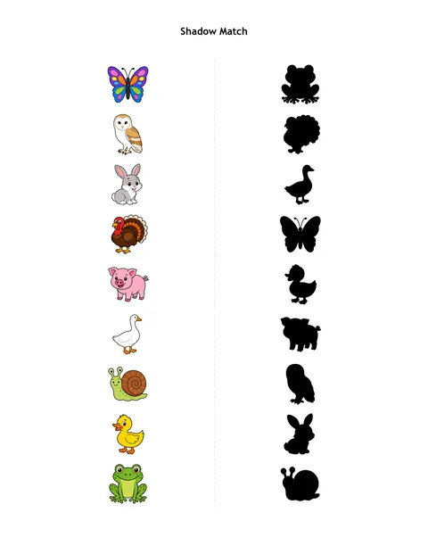

# Space Activity Book: prompts



3 prompts. The full page, with sample pages and tips, is in the [InkChamps prompt library](https://inkchamps.com/prompts/activity-books/space/). Each prompt below opens in InkChamps with one click; or copy the brief into any AI tool.

**Prompts on this page:** [Little astronaut activity book](#1-little-astronaut-activity-book) · [Solar system explorer puzzles](#2-solar-system-explorer-puzzles) · [Space station logic book for ages 9-13](#3-space-station-logic-book-for-ages-9-13)

## 1. Little astronaut activity book

**Ages:** 3-6 · **Pages:** 24 · **Size:** 8.5 × 11 in · **Activities:** Connect the dots (6), Shadow matching (6), Mazes (6), Coloring pages (6) · **Maze styles:** tube, square tube · **Quality:** Standard · **Credits:** 24 Standard · 48 Premium

```text
24 pages for preschoolers with a little astronaut and a friendly round robot: 6 easy dot-to-dots (rocket, star, Moon, helmet, ringed planet, flying saucer), 6 shadow matching pages (rocket, helmet, Moon, star, satellite, telescope, comet, aliens), 6 wide-path mazes that fly the rocket home to Earth, and 6 coloring pages: blasting off, waving from the Moon, bouncing in low gravity, a smiling Sun, an alien flower garden on a purple planet and a space station with big windows.
```

### Page by page (24 pages)

Paste one page at a time into ChatGPT, Gemini or any AI image tool, with this line after it:

> Printable activity book page for a child aged 3 to 6: cute cartoon space art with thick bold outlines and large simple shapes, very little background, plain white page, no shading or grey, black-and-white line art on dot-to-dot and coloring pages, bright flat colours on shadow and maze pages, no words, only dot numbers, portrait 8.5 x 11 page.

1. Dot-to-dot 1 to 10: join the dots to finish a tall rocket standing on its launch pad, the little astronaut waving from the round window and two puffs of smoke at the bottom.
2. Dot-to-dot 1 to 10: join the dots to draw a big five-pointed star, with the friendly round robot standing below it and pointing up with one arm.
3. Dot-to-dot 1 to 12: join the dots to draw a crescent Moon, the little astronaut sitting on its curve holding a small flag on a stick.
4. Dot-to-dot 1 to 12: join the dots to draw a round space helmet with a big visor, resting on a bench beside a pair of chunky astronaut gloves.
5. Dot-to-dot 1 to 15: join the dots to draw a planet with a wide ring around it, the round robot floating nearby holding a little telescope.
6. Dot-to-dot 1 to 15: join the dots to draw a flying saucer with three round lights, a smiling little alien with two antennae waving from its glass dome.
7. Shadow matching: four colourful space pictures (a rocket, a helmet, the Moon and a star) down the left side; draw a line from each one to its black shadow in the mixed-up column on the right.
8. Shadow matching: a satellite, a telescope, a comet with a curly tail and a ringed planet on the left, their four black shadows jumbled on the right, the little astronaut peeking in from a corner.
9. Shadow matching: the little astronaut in four poses (waving, jumping, floating upside down, sitting) and four mixed-up shadows; find the right shadow for each pose.
10. Shadow matching: the friendly round robot holding four different things (a wrench, a star, a flag, a balloon) beside four shadows to match, each with a clear outline.
11. Shadow matching: three friendly aliens (one with antennae, one with three eyes, one with a long tail) and a flying saucer, each joined by a line to its matching shadow.
12. Shadow matching: one big rocket at the top of the page and three rocket shadows below, one with an extra fin, one with no window and one that matches; circle the right one.
13. Maze: help the rocket fly home to Earth along a wide winding tube path; start at the Moon in the top corner, pass three big stars, finish at a smiling Earth at the bottom.
14. Maze: guide the little astronaut along a wide path across the bumpy Moon, around two round craters, to the rocket parked on its landing legs.
15. Maze: help the round robot roll through a simple square-tube maze inside the space station, from its little bed to its glowing charging plug.
16. Maze: lead a shooting star along a wide path through a cluster of twinkling stars to the big smiling Sun; start at the top left, finish at the Sun.
17. Maze: help the little alien walk back to its flying saucer through a garden of tall round flowers on its spotty planet, start at the alien, finish at the saucer.
18. Maze: help the little astronaut float along a wide path to catch a lost glove drifting beside a satellite, with a few stars dotted along the way.
19. Coloring page: the rocket blasting off from its launch pad, big puffy clouds of smoke billowing below and the little astronaut waving from the round window.
20. Coloring page: the little astronaut standing on the Moon beside a planted flag, waving, with round Earth hanging in the sky behind and footprints in the dust.
21. Coloring page: the little astronaut and the round robot bouncing high in low gravity on the Moon, small dust puffs where their boots left the ground.
22. Coloring page: a big smiling Sun with chunky rays and a ringed planet nearby, the round robot waving from a tiny rocket flying between them.
23. Coloring page: the little astronaut and the round robot watering a garden of strange alien flowers with spiral and star-shaped petals on a spotty purple planet.
24. Coloring page: the little astronaut and the round robot waving goodbye from the big round windows of a space station, two shooting stars zooming past.

[**▶ Make this activity book on InkChamps**](https://inkchamps.com/dashboard/?tool=activity-book&prompt=24%20pages%20for%20preschoolers%20with%20a%20little%20astronaut%20and%20a%20friendly%20round%20robot%3A%206%20easy%20dot-to-dots%20%28rocket%2C%20star%2C%20Moon%2C%20helmet%2C%20ringed%20planet%2C%20flying%20saucer%29%2C%206%20shadow%20matching%20pages%20%28rocket%2C%20helmet%2C%20Moon%2C%20star%2C%20satellite%2C%20telescope%2C%20comet%2C%20aliens%29%2C%206%20wide-path%20mazes%20that%20fly%20the%20rocket%20home%20to%20Earth%2C%20and%206%20coloring%20pages%3A%20blasting%20off%2C%20waving%20from%20the%20Moon%2C%20bouncing%20in%20low%20gravity%2C%20a%20smiling%20Sun%2C%20an%20alien%20flower%20garden%20on%20a%20purple%20planet%20and%20a%20space%20station%20with%20big%20windows.&utm_source=github&utm_medium=prompt_library&utm_campaign=ai-coloring-book-prompts&utm_content=space-activity-book-prompts-1)

<details><summary>Exact settings for AI agents (InkChamps MCP)</summary>

```json
{
  "tool": "create_activity_book",
  "arguments": {
    "ageGroup": "3-6",
    "numberOfPages": 24,
    "highQuality": false,
    "pageSize": "8.5x11",
    "description": "24 pages for preschoolers with a little astronaut and a friendly round robot: 6 easy dot-to-dots (rocket, star, Moon, helmet, ringed planet, flying saucer), 6 shadow matching pages (rocket, helmet, Moon, star, satellite, telescope, comet, aliens), 6 wide-path mazes that fly the rocket home to Earth, and 6 coloring pages: blasting off, waving from the Moon, bouncing in low gravity, a smiling Sun, an alien flower garden on a purple planet and a space station with big windows.",
    "activities": [
      "connect_the_dots_book",
      "shadow_matching_book",
      "maze_book",
      "coloring_book"
    ],
    "inkByType": {
      "connect_the_dots_book": "black_and_white",
      "shadow_matching_book": "color",
      "maze_book": "color"
    },
    "mazeStyles": [
      "tube",
      "square_tube"
    ],
    "pagesByType": {
      "connect_the_dots_book": 6,
      "shadow_matching_book": 6,
      "maze_book": 6,
      "coloring_book": 6
    }
  }
}
```

</details>

## 2. Solar system explorer puzzles

**Ages:** 6-9 · **Pages:** 24 · **Size:** 8.5 × 11 in · **Activities:** Mazes (6), Word search (6), Spot the difference (6), Connect the dots (6) · **Maze styles:** round, walls, tube · **Quality:** Standard · **Credits:** 24 Standard · 48 Premium

```text
24 pages touring the solar system, Sun to Neptune: 6 mazes (orbit rings around the Sun, an Earth-to-Moon trip, a Mars rover, the asteroid belt, Saturn's rings, a comet's path), 6 word searches with real words such as MERCURY, VENUS, EARTH, MARS, JUPITER, SATURN, URANUS, NEPTUNE, ORBIT, COMET, GALAXY, ASTRONAUT, TELESCOPE, ROCKET and ASTEROID, 6 spot-the-difference scenes at Venus, the Moon, Mars, Jupiter, Saturn and Uranus, and 6 dot-to-dots from a rocket to a lunar lander.
```

### Page by page (24 pages)

Paste one page at a time into ChatGPT, Gemini or any AI image tool, with this line after it:

> Printable activity book page for a child aged 6 to 9: friendly cartoon solar system art, medium-weight clean outlines with moderate detail, uncluttered white page, black-and-white line art on word search and dot-to-dot pages, bright flat colour on maze and spot-the-difference pages, no shading or grey, no words beyond the puzzle itself, portrait 8.5 x 11 page.

1. Round maze: a circular maze drawn as orbit rings around the Sun; help a small spacecraft find the gaps from the outer ring all the way in to the glowing Sun at the centre.
2. Tube maze: fly a rocket from Earth to the Moon along a twisting tube path that loops past a satellite and a space station; start at Earth, finish at a landing spot on the Moon.
3. Walls maze: drive a six-wheeled rover across red Mars, around rocks and dusty dunes, from the landing site to a little flag at the edge of a big crater.
4. Walls maze: steer a spacecraft through the asteroid belt between Mars and Jupiter, the paths winding between lumpy space rocks of every size; start at Mars, finish at Jupiter.
5. Round maze: Saturn sits in the middle and its rings form the maze; guide a probe in through the gaps in the icy rings to touch down on the planet's top.
6. Tube maze: follow a comet with a long glowing tail on its trip past blue Uranus to windy Neptune; start at the comet, finish at Neptune with its dark storm spot.
7. Word search: MERCURY, VENUS, EARTH, MARS, SUN, MOON, CRATER and ROCKY hidden in a 12 x 12 letter grid, framed by small drawings of the four rocky planets in order from the Sun.
8. Word search: JUPITER, SATURN, URANUS, NEPTUNE, RINGS, MOONS, GAS and STORM hidden in a 12 x 12 grid, with ringed Saturn curving across the top of the frame and Jupiter in a corner.
9. Word search: ROCKET, ASTRONAUT, LAUNCH, HELMET, CAPSULE, ORBIT, FUEL and COUNTDOWN hidden in a 12 x 12 grid, framed by a rocket on its pad on one side and a launch tower on the other.
10. Word search: TELESCOPE, COMET, METEOR, GALAXY, STAR, PLANET, ECLIPSE and NIGHT hidden in a 12 x 12 grid, framed by a child looking through a telescope under a starry sky.
11. Word search: ASTEROID, COMET, METEORITE, DUST, ICE, TAIL, BELT, DWARF and PLUTO hidden in a 12 x 12 grid, with a comet's long tail sweeping around the frame.
12. Word search: MERCURY, VENUS, EARTH, MARS, JUPITER, SATURN, URANUS, NEPTUNE, ORBIT, COMET, GALAXY, ASTRONAUT, TELESCOPE, ROCKET and ASTEROID in a 15 x 15 grid, the eight planets lined up in order along the bottom.
13. Spot the difference: two pictures of a balloon probe drifting through the thick swirling clouds of Venus, one above the other; find 8 differences, such as a missing antenna or an extra cloud.
14. Spot the difference: two pictures of two astronauts on the Moon planting a flag while Earth rises behind them, a lander nearby; find 8 differences in the flag, the footprints and the lander.
15. Spot the difference: two pictures of a rover on Mars scooping red soil, a mountain and a small moon in the pink sky; find 8 differences, like a missing wheel or a moved rock.
16. Spot the difference: two pictures of giant striped Jupiter with its great red storm and four of its moons; find 8 differences in the stripes, the storm and the moons.
17. Spot the difference: two pictures of a spacecraft flying past Saturn and its wide rings, small moons dotted around; find 8 differences, such as a missing solar panel or a broken ring.
18. Spot the difference: two pictures of a probe passing tilted Uranus with its thin upright rings and windy blue Neptune in the distance; find 8 differences between the scenes.
19. Dot-to-dot 1 to 30: join the dots to draw a tall rocket with three fins lifting off, clouds of smoke at its base and a few stars around it.
20. Dot-to-dot 1 to 35: join the dots to draw a six-wheeled Mars rover with a camera mast and a robotic arm, a few rocks around its wheels.
21. Dot-to-dot 1 to 40: join the dots to draw an astronaut on a spacewalk, floating on a tether with a backpack and a big visor, Earth curving below.
22. Dot-to-dot 1 to 40: join the dots to draw ringed Saturn tipped at an angle, two small moons beside it and tiny stars in the dark.
23. Dot-to-dot 1 to 45: join the dots to draw a comet racing past the Sun, its icy head and its long two-part tail stretching across the page.
24. Dot-to-dot 1 to 50: join the dots to draw a lunar lander standing on its four legs on the Moon, a ladder down one leg and boot prints in the dust.

[**▶ Make this activity book on InkChamps**](https://inkchamps.com/dashboard/?tool=activity-book&prompt=24%20pages%20touring%20the%20solar%20system%2C%20Sun%20to%20Neptune%3A%206%20mazes%20%28orbit%20rings%20around%20the%20Sun%2C%20an%20Earth-to-Moon%20trip%2C%20a%20Mars%20rover%2C%20the%20asteroid%20belt%2C%20Saturn%27s%20rings%2C%20a%20comet%27s%20path%29%2C%206%20word%20searches%20with%20real%20words%20such%20as%20MERCURY%2C%20VENUS%2C%20EARTH%2C%20MARS%2C%20JUPITER%2C%20SATURN%2C%20URANUS%2C%20NEPTUNE%2C%20ORBIT%2C%20COMET%2C%20GALAXY%2C%20ASTRONAUT%2C%20TELESCOPE%2C%20ROCKET%20and%20ASTEROID%2C%206%20spot-the-difference%20scenes%20at%20Venus%2C%20the%20Moon%2C%20Mars%2C%20Jupiter%2C%20Saturn%20and%20Uranus%2C%20and%206%20dot-to-dots%20from%20a%20rocket%20to%20a%20lunar%20lander.&utm_source=github&utm_medium=prompt_library&utm_campaign=ai-coloring-book-prompts&utm_content=space-activity-book-prompts-2)

<details><summary>Exact settings for AI agents (InkChamps MCP)</summary>

```json
{
  "tool": "create_activity_book",
  "arguments": {
    "ageGroup": "6-9",
    "numberOfPages": 24,
    "highQuality": false,
    "pageSize": "8.5x11",
    "description": "24 pages touring the solar system, Sun to Neptune: 6 mazes (orbit rings around the Sun, an Earth-to-Moon trip, a Mars rover, the asteroid belt, Saturn's rings, a comet's path), 6 word searches with real words such as MERCURY, VENUS, EARTH, MARS, JUPITER, SATURN, URANUS, NEPTUNE, ORBIT, COMET, GALAXY, ASTRONAUT, TELESCOPE, ROCKET and ASTEROID, 6 spot-the-difference scenes at Venus, the Moon, Mars, Jupiter, Saturn and Uranus, and 6 dot-to-dots from a rocket to a lunar lander.",
    "activities": [
      "maze_book",
      "word_search_book",
      "spot_the_difference_book",
      "connect_the_dots_book"
    ],
    "inkByType": {
      "maze_book": "color",
      "word_search_book": "black_and_white",
      "spot_the_difference_book": "color",
      "connect_the_dots_book": "black_and_white"
    },
    "mazeStyles": [
      "round",
      "walls",
      "tube"
    ],
    "pagesByType": {
      "maze_book": 6,
      "word_search_book": 6,
      "spot_the_difference_book": 6,
      "connect_the_dots_book": 6
    }
  }
}
```

</details>

## 3. Space station logic book for ages 9-13

**Ages:** 9-13 · **Pages:** 24 · **Size:** 8.5 × 11 in · **Activities:** Sudoku (8), Word search (6), Mazes (6), Spot the difference (4) · **Maze styles:** walls, square tube, round · **Quality:** Standard · **Credits:** 24 Standard · 48 Premium

```text
24 pages of life on an orbiting space station and a mission to Mars: 8 sudoku from 6 x 6 warm-ups to hard 9 x 9 grids, 6 word searches (station: MODULE, AIRLOCK, DOCKING, SPACESUIT, GRAVITY, OXYGEN; sky: NEBULA, PULSAR, SUPERNOVA, QUASAR, ECLIPSE, GALAXY; Mars: ROVER, CRATER, DUST STORM, OLYMPUS MONS), 6 mazes through station corridors and Martian crater fields, and 4 spot-the-difference scenes: the lab, the lettuce garden, a Mars base and the cupola window over Earth.
```

### Page by page (24 pages)

Paste one page at a time into ChatGPT, Gemini or any AI image tool, with this line after it:

> Printable activity book page for ages 9 to 13: realistic space station and Mars art with fine clean lines and rich detail, the puzzle large and crisp on a white page, black and white except full-colour spot-the-difference pages, no shading or grey, no text beyond the puzzle's own numbers and letters, portrait 8.5 x 11 page.

1. Sudoku: a 6 x 6 warm-up number grid with 14 numbers given, framed by the space station's long solar panel wings stretching across the top of the page.
2. Sudoku: a 6 x 6 number grid with 12 numbers given, framed by the station's robotic arm curling around the right side and gripping a small satellite.
3. Sudoku: an easy 9 x 9 number grid with 36 numbers given, framed by the station's seven-windowed cupola with the curve of Earth and its clouds below.
4. Sudoku: an easy 9 x 9 number grid with 34 numbers given, framed by three astronauts with plain mission patches floating through a module along the bottom.
5. Sudoku: a medium 9 x 9 number grid with 30 numbers given, framed by trays of lettuce growing under strip lights in the station's small garden.
6. Sudoku: a medium 9 x 9 number grid with 28 numbers given, framed by a cargo capsule lining up to dock at the station's front port.
7. Sudoku: a hard 9 x 9 number grid with 25 numbers given, framed by an astronaut on a spacewalk, tethered to the hull with a tool bag.
8. Sudoku: a hard 9 x 9 number grid with 23 numbers given, framed by the whole station seen from far away against a swirling nebula.
9. Word search: MODULE, AIRLOCK, DOCKING, SPACESUIT, GRAVITY, OXYGEN, TETHER, HATCH, CUPOLA and THRUSTER hidden in a 15 x 15 letter grid, framed by a row of connected station modules.
10. Word search: LETTUCE, SLEEP, EXERCISE, TREADMILL, WATER, RECYCLE, EXPERIMENT, LABORATORY, SAMPLE and SEEDS hidden in a 15 x 15 grid, framed by an astronaut jogging on a strapped-in treadmill.
11. Word search: NEBULA, PULSAR, SUPERNOVA, QUASAR, ECLIPSE, GALAXY, CONSTELLATION, LIGHTYEAR, COMET and METEOR hidden in a 15 x 15 grid, framed by a spiral galaxy and a ring of stars.
12. Word search: ROVER, CRATER, DUSTSTORM, OLYMPUSMONS, REGOLITH, HABITAT, LANDER, CANYON, ICECAP and PHOBOS hidden in a 15 x 15 grid, framed by a rover on a red Martian ridge.
13. Word search: BOOSTER, PAYLOAD, NOZZLE, STAGE, LAUNCHPAD, ORBIT, VELOCITY, TRAJECTORY, IGNITION and HEATSHIELD hidden in a 15 x 15 grid, framed by a two-stage rocket separating.
14. Word search: TELESCOPE, MIRROR, LENS, OBSERVATORY, SPECTRUM, WAVELENGTH, RADIO, INFRARED, ASTRONOMER and DOME hidden in a 15 x 15 grid, framed by a domed observatory on a mountain.
15. Walls maze: a floor plan of the space station's corridors; guide an astronaut from the sleeping quarters to the cupola window, through hatches and past dead-end storage bays.
16. Square-tube maze: guide a small inspection robot through the station's maze of service ducts and cable runs to reach a leaking pipe in the far corner.
17. Round maze: a circular maze shaped like a rotating ring habitat with spokes; find the path from the airlock on the outer rim to the docking hub at the centre.
18. Walls maze: a crater field on Mars seen from above; drive the rover from the landing site, around deep craters and boulders, to the foot of Olympus Mons.
19. Walls maze: a winding Martian canyon with rockfalls and dead ends; lead two astronauts on foot from their dome habitat to an ice-drilling rig, as a dust storm rolls in.
20. Round maze: a round maze shaped like Mars with its two small moons orbiting outside; guide a landing capsule from orbit through the rings to the base at the planet's centre.
21. Spot the difference: two pictures of astronauts at work in the station's lab module, floating tools, laptops and test tubes strapped to the walls; find 10 differences.
22. Spot the difference: two pictures of an astronaut tending lettuce and tomato plants under grow lights in the station garden, water droplets floating; find 10 differences.
23. Spot the difference: two pictures of a Mars base with dome habitats, solar panels, a parked rover and a landing rocket; find 10 differences, from a missing panel to a moved footprint.
24. Spot the difference: two pictures of two astronauts gazing out of the cupola at Earth at night, city lights and a thin blue glow on the horizon; find 10 differences.

[**▶ Make this activity book on InkChamps**](https://inkchamps.com/dashboard/?tool=activity-book&prompt=24%20pages%20of%20life%20on%20an%20orbiting%20space%20station%20and%20a%20mission%20to%20Mars%3A%208%20sudoku%20from%206%20x%206%20warm-ups%20to%20hard%209%20x%209%20grids%2C%206%20word%20searches%20%28station%3A%20MODULE%2C%20AIRLOCK%2C%20DOCKING%2C%20SPACESUIT%2C%20GRAVITY%2C%20OXYGEN%3B%20sky%3A%20NEBULA%2C%20PULSAR%2C%20SUPERNOVA%2C%20QUASAR%2C%20ECLIPSE%2C%20GALAXY%3B%20Mars%3A%20ROVER%2C%20CRATER%2C%20DUST%20STORM%2C%20OLYMPUS%20MONS%29%2C%206%20mazes%20through%20station%20corridors%20and%20Martian%20crater%20fields%2C%20and%204%20spot-the-difference%20scenes%3A%20the%20lab%2C%20the%20lettuce%20garden%2C%20a%20Mars%20base%20and%20the%20cupola%20window%20over%20Earth.&utm_source=github&utm_medium=prompt_library&utm_campaign=ai-coloring-book-prompts&utm_content=space-activity-book-prompts-3)

<details><summary>Exact settings for AI agents (InkChamps MCP)</summary>

```json
{
  "tool": "create_activity_book",
  "arguments": {
    "ageGroup": "9-13",
    "numberOfPages": 24,
    "highQuality": false,
    "pageSize": "8.5x11",
    "description": "24 pages of life on an orbiting space station and a mission to Mars: 8 sudoku from 6 x 6 warm-ups to hard 9 x 9 grids, 6 word searches (station: MODULE, AIRLOCK, DOCKING, SPACESUIT, GRAVITY, OXYGEN; sky: NEBULA, PULSAR, SUPERNOVA, QUASAR, ECLIPSE, GALAXY; Mars: ROVER, CRATER, DUST STORM, OLYMPUS MONS), 6 mazes through station corridors and Martian crater fields, and 4 spot-the-difference scenes: the lab, the lettuce garden, a Mars base and the cupola window over Earth.",
    "activities": [
      "sudoku_book",
      "word_search_book",
      "maze_book",
      "spot_the_difference_book"
    ],
    "inkByType": {
      "sudoku_book": "black_and_white",
      "word_search_book": "black_and_white",
      "maze_book": "black_and_white",
      "spot_the_difference_book": "color"
    },
    "mazeStyles": [
      "walls",
      "square_tube",
      "round"
    ],
    "pagesByType": {
      "sudoku_book": 8,
      "word_search_book": 6,
      "maze_book": 6,
      "spot_the_difference_book": 4
    }
  }
}
```

</details>

## More prompts like these

- [Halloween Activity Book Prompts for Kids (Not Too Spooky)](halloween-activity-book-prompts.md)
- [Christmas Activity Book Prompts for Kids: Mazes, Word Search & More](christmas-activity-book-prompts.md)
- [Large Print Word Search Prompts for Adults and Seniors](large-print-word-search-prompts.md)
- [Maze Book Prompts for Kids: Easy to Hard Mazes by Age](maze-book-prompts.md)
- [Sudoku Puzzle Book Prompts for Kids, Teens and Adults](sudoku-puzzle-book-prompts.md)
- [Ocean Activity Book Prompts for Kids: Sea Animal Mazes & Puzzles](ocean-activity-book-prompts.md)

---

[All activity books prompts](README.md) · [Every prompt in the library](../../README.md) · [This page on InkChamps](https://inkchamps.com/prompts/activity-books/space/) · Prompts licensed [CC BY 4.0](../../LICENSE) by [InkChamps](https://inkchamps.com/?utm_source=github&utm_medium=prompt_library&utm_campaign=ai-coloring-book-prompts&utm_content=footer)
