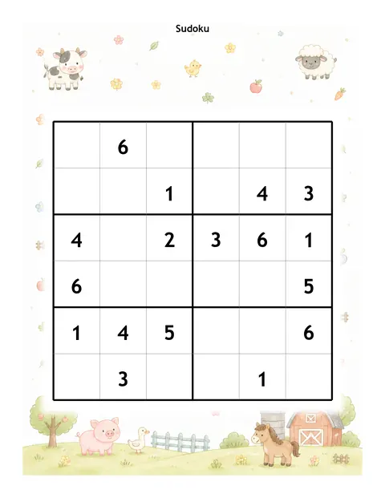

# Sudoku Puzzle Book: prompts



3 prompts. The full page, with sample pages and tips, is in the [InkChamps prompt library](https://inkchamps.com/prompts/activity-books/sudoku-puzzle-book/). Each prompt below opens in InkChamps with one click; or copy the brief into any AI tool.

**Prompts on this page:** [Fruit garden sudoku for ages 6-9](#1-fruit-garden-sudoku-for-ages-6-9) · [Detective agency sudoku for tweens](#2-detective-agency-sudoku-for-tweens) · [Calm coffee-break sudoku for adults](#3-calm-coffee-break-sudoku-for-adults)

## 1. Fruit garden sudoku for ages 6-9

**Ages:** 6-9 · **Pages:** 24 · **Size:** 8.5 × 11 in · **Activities:** Sudoku (19), Coloring pages (5) · **Quality:** Standard · **Credits:** 24 Standard · 48 Premium

```text
A 24-page beginner sudoku book for ages 6 to 9, set in a sunny fruit garden. Nineteen colour number puzzles start with small 4 x 4 grids and move up to 6 x 6, each framed by smiling strawberries, pears, cherries, bananas, lemons and watermelon slices, with a ladybug, a snail and a bee as puzzle helpers. Grids appear on a lemonade stand, a fruit market stall, a picnic blanket and an apple tree at picking time. Five coloring pages show the garden friends picking apples, selling lemonade, shopping at the market and sharing a picnic.
```

### Page by page (24 pages)

Paste one page at a time into ChatGPT, Gemini or any AI image tool, with this line after it:

> Printable activity page for a child aged 6 to 9: friendly cartoon fruit-garden art with smiling fruit characters, clean bold outlines, large sudoku squares with room for big handwritten numbers, lots of white space, no shading, bright full colour on sudoku pages and black-and-white line art on coloring pages, no words except the puzzle numbers, portrait 8.5 x 11 page.

1. Sudoku: a 4 x 4 starter grid using the numbers 1 to 4, about 10 given, framed by a ring of smiling strawberries with leafy green caps, the ladybug helper pointing at the first empty square.
2. Sudoku: a 4 x 4 grid using the numbers 1 to 4, about 9 given, hanging like a sign from a pear tree branch, two grinning pears dangling beside it and the bee buzzing over the top.
3. Sudoku: a 4 x 4 grid using the numbers 1 to 4, about 9 given, with pairs of red cherries on stems lined along the top and bottom and the snail resting on the bottom corner.
4. Sudoku: a 4 x 4 grid using the numbers 1 to 4, about 8 given, painted on the side of a wooden banana crate, bunches of cheerful bananas stacked high on each side.
5. Sudoku: a 4 x 4 grid using the numbers 1 to 4, about 8 given, a lemon slice in each corner and a tall pitcher of lemonade with a striped straw standing below the grid.
6. Sudoku: a 4 x 4 grid using the numbers 1 to 4, about 7 given, set on a giant watermelon slice with black seeds along the rind and the ladybug sliding down its curved edge.
7. Sudoku: a 4 x 4 grid using the numbers 1 to 4, about 7 given, under a leafy apple tree at picking time, a ladder leaning on the trunk and a basket of shiny apples below.
8. Sudoku: the last 4 x 4 grid, numbers 1 to 4, about 6 given, drawn as the board of a little fruit stand by the garden gate, crates of plums and peaches underneath.
9. Sudoku: the first 6 x 6 grid using the numbers 1 to 6 in 2 x 3 boxes, about 20 given, framed by a garden fence with climbing grapevines, the bee showing the way to the first gap.
10. Sudoku: a 6 x 6 grid using the numbers 1 to 6, about 19 given, as the menu board of a lemonade stand, a smiling lemon behind the counter and a stack of paper cups.
11. Sudoku: a 6 x 6 grid using the numbers 1 to 6, about 18 given, hung under the striped awning of a fruit market stall, baskets of oranges and kiwis lined up below.
12. Sudoku: a 6 x 6 grid using the numbers 1 to 6, about 18 given, drawn on a checkered picnic blanket, sandwiches and a fruit bowl at the edges and the snail and ladybug sitting at the corners.
13. Sudoku: a 6 x 6 grid using the numbers 1 to 6, about 17 given, with blueberries and raspberries tumbling down one side into a smoothie blender beside the grid.
14. Sudoku: a 6 x 6 grid using the numbers 1 to 6, about 16 given, painted on a wheelbarrow piled with round melons, the snail riding along on one handle.
15. Sudoku: a 6 x 6 grid using the numbers 1 to 6, about 16 given, held up like a sign by a pineapple in sunglasses, a mango and a coconut cheering beside it.
16. Sudoku: a 6 x 6 grid using the numbers 1 to 6, about 15 given, framed by honeycomb shapes and apple blossoms, the bee flying out of a hive at the top corner.
17. Sudoku: a 6 x 6 grid using the numbers 1 to 6, about 15 given, in the garden at dusk, a crescent moon over the orchard and sleepy fruit friends tucked into a basket below.
18. Sudoku: a 6 x 6 grid using the numbers 1 to 6, about 14 given, on a harvest festival banner held up by a strawberry and a banana, bunting flags strung across the top.
19. Sudoku: the final 6 x 6 grid, numbers 1 to 6, about 14 given, an apple-shaped trophy beside it and the ladybug, the snail and the bee cheering in a shower of confetti.
20. Coloring page: the ladybug, the snail and the bee waving hello from a big strawberry patch, a watering can and a blank wooden garden sign beside them.
21. Coloring page: a smiling strawberry on a ladder picking apples from a tree and dropping one into a woven basket held up by a pear friend below.
22. Coloring page: a lemon and a watermelon slice running a lemonade stand together, a pitcher with ice cubes, a stack of cups and a jar for coins on the counter.
23. Coloring page: a busy fruit market morning, a banana carrying a crate of cherries past stalls piled with grapes and plums, a hanging scale above one stall.
24. Coloring page: the whole garden gang sharing a picnic on a checkered blanket under a shady tree, a big bowl of fruit salad in the middle and a kite flying overhead.

[**▶ Make this activity book on InkChamps**](https://inkchamps.com/dashboard/?tool=activity-book&prompt=A%2024-page%20beginner%20sudoku%20book%20for%20ages%206%20to%209%2C%20set%20in%20a%20sunny%20fruit%20garden.%20Nineteen%20colour%20number%20puzzles%20start%20with%20small%204%20x%204%20grids%20and%20move%20up%20to%206%20x%206%2C%20each%20framed%20by%20smiling%20strawberries%2C%20pears%2C%20cherries%2C%20bananas%2C%20lemons%20and%20watermelon%20slices%2C%20with%20a%20ladybug%2C%20a%20snail%20and%20a%20bee%20as%20puzzle%20helpers.%20Grids%20appear%20on%20a%20lemonade%20stand%2C%20a%20fruit%20market%20stall%2C%20a%20picnic%20blanket%20and%20an%20apple%20tree%20at%20picking%20time.%20Five%20coloring%20pages%20show%20the%20garden%20friends%20picking%20apples%2C%20selling%20lemonade%2C%20shopping%20at%20the%20market%20and%20sharing%20a%20picnic.&utm_source=github&utm_medium=prompt_library&utm_campaign=ai-coloring-book-prompts&utm_content=sudoku-puzzle-book-prompts-1)

<details><summary>Exact settings for AI agents (InkChamps MCP)</summary>

```json
{
  "tool": "create_activity_book",
  "arguments": {
    "ageGroup": "6-9",
    "numberOfPages": 24,
    "highQuality": false,
    "pageSize": "8.5x11",
    "description": "A 24-page beginner sudoku book for ages 6 to 9, set in a sunny fruit garden. Nineteen colour number puzzles start with small 4 x 4 grids and move up to 6 x 6, each framed by smiling strawberries, pears, cherries, bananas, lemons and watermelon slices, with a ladybug, a snail and a bee as puzzle helpers. Grids appear on a lemonade stand, a fruit market stall, a picnic blanket and an apple tree at picking time. Five coloring pages show the garden friends picking apples, selling lemonade, shopping at the market and sharing a picnic.",
    "activities": [
      "sudoku_book",
      "coloring_book"
    ],
    "inkByType": {
      "sudoku_book": "color"
    },
    "pagesByType": {
      "sudoku_book": 19,
      "coloring_book": 5
    }
  }
}
```

</details>

## 2. Detective agency sudoku for tweens

**Ages:** 9-13 · **Pages:** 24 · **Size:** 6 × 9 in · **Activities:** Sudoku (24) · **Quality:** Standard · **Credits:** 24 Standard · 48 Premium

```text
A 24-page sudoku book for ages 9 to 13, themed as a young detective agency solving cases. Each page is a new case: a missing key, muddy paw prints, a fingerprint card, a locked safe, a night train station, a museum with a missing gem, a lighthouse signal, a secret map, a bakery cake thief and a hidden passage. A detective kid and a clever dog sidekick appear around the grids. Four 6 x 6 warm-ups lead into 9 x 9 puzzles that get harder case by case, ending with the gem found and the case closed.
```

### Page by page (24 pages)

Paste one page at a time into ChatGPT, Gemini or any AI image tool, with this line after it:

> Printable puzzle page for a reader aged 9 to 13: black-and-white detective-story line art in a clean graphic style, crisp medium-fine outlines and moderate detail kept to the frame around a large, clearly ruled sudoku grid with bold box lines, white space inside the grid, no shading or grey, no words except the puzzle numbers, portrait 6 x 9 page.

1. Sudoku: case one, the missing house key; a 6 x 6 warm-up grid using the numbers 1 to 6, about 16 given, drawn on a detective's notebook page, a magnifying glass and a doormat below.
2. Sudoku: case two, the muddy paw prints; a 6 x 6 grid using the numbers 1 to 6, about 15 given, a trail of prints looping around the grid and the dog sidekick sniffing along it.
3. Sudoku: case three, the swapped lunchbox; a 6 x 6 grid using the numbers 1 to 6, about 14 given, set on a school locker door between rows of lockers, two matching lunchboxes on the floor.
4. Sudoku: case four, the coded postcard; a 6 x 6 grid using the numbers 1 to 6, about 13 given, drawn on the back of a postcard with a stamp in the corner and a street mailbox beside it.
5. Sudoku: case five, the fingerprint card; an easy 9 x 9 grid with about 38 numbers given, set on a fingerprint card, an ink pad and a magnifying glass showing a swirling print.
6. Sudoku: case six, the locked safe; an easy 9 x 9 grid with about 37 numbers given, drawn on the heavy door of an old safe, a round combination dial and a brass handle at the side.
7. Sudoku: case seven, the midnight train; a 9 x 9 grid with about 36 numbers given, framed like a departure board at a night train station, a big clock at midnight and steam drifting past.
8. Sudoku: case eight, the lost parcel; a 9 x 9 grid with about 35 numbers given, at a post office sorting room, parcels stacked on shelves and the dog peeking out of a sack.
9. Sudoku: case nine, the missing gem; a 9 x 9 grid with about 34 numbers given, beside an empty museum display case with a velvet cushion and rope barriers on brass posts.
10. Sudoku: case ten, the night guard's cameras; a 9 x 9 grid with about 33 numbers given, set inside a security monitor, a guard's cap, a flashlight and a ring of keys on the desk below.
11. Sudoku: case eleven, the lighthouse signal; a 9 x 9 grid with about 32 numbers given, a striped lighthouse rising beside it, its beam sweeping over choppy waves.
12. Sudoku: case twelve, the secret map; a 9 x 9 grid with about 32 numbers given, drawn on a torn old map with a compass rose, dotted paths and an X in one corner.
13. Sudoku: case thirteen, the vanished bicycle; a 9 x 9 grid with about 31 numbers given, in a city park, an empty bike rack, a snipped lock and tire tracks leading off the page.
14. Sudoku: case fourteen, the cake thief; a 9 x 9 grid with about 31 numbers given, on a bakery counter, a cake stand with one slice gone and a trail of crumbs to the back door.
15. Sudoku: case fifteen, the rooftop chase; a 9 x 9 grid with about 30 numbers given, above moonlit rooftops with chimneys and a water tower, the detective peering over a ledge.
16. Sudoku: case sixteen, the ferry ticket; a 9 x 9 grid with about 30 numbers given, at a harbor dock, a ferry pulling away, gulls on the posts and a life ring on the rail.
17. Sudoku: case seventeen, the stopped clock; a 9 x 9 grid with about 29 numbers given, set below a clock tower face, big gears turning behind it and the dog on the stair.
18. Sudoku: case eighteen, the hidden note; a 9 x 9 grid with about 28 numbers given, in a library aisle, a note sticking out of one book and a rolling ladder against the shelves.
19. Sudoku: case nineteen, the broken greenhouse pane; a 9 x 9 grid with about 28 numbers given, framed by plant pots and vines, one cracked glass pane and footprints in the soil.
20. Sudoku: case twenty, the carnival switch; a 9 x 9 grid with about 27 numbers given, beside a Ferris wheel and a ticket booth, two identical top hats on the counter.
21. Sudoku: case twenty-one, the snowy cabin; a 9 x 9 grid with about 26 numbers given, by a log cabin in the woods, a lantern in the window and boot tracks in the snow.
22. Sudoku: case twenty-two, the secret passage; a hard 9 x 9 grid with about 25 numbers given, a bookcase swinging open beside it, a flashlight beam lighting a stone stairway.
23. Sudoku: case twenty-three, the big reveal; a hard 9 x 9 grid with about 24 numbers given, the detective and the dog pointing at the gem back on its museum cushion.
24. Sudoku: case closed; the hardest 9 x 9 grid with about 23 numbers given, framed by the agency office wall with a pinned case board and string, the dog asleep under the desk wearing a medal.

[**▶ Make this activity book on InkChamps**](https://inkchamps.com/dashboard/?tool=activity-book&prompt=A%2024-page%20sudoku%20book%20for%20ages%209%20to%2013%2C%20themed%20as%20a%20young%20detective%20agency%20solving%20cases.%20Each%20page%20is%20a%20new%20case%3A%20a%20missing%20key%2C%20muddy%20paw%20prints%2C%20a%20fingerprint%20card%2C%20a%20locked%20safe%2C%20a%20night%20train%20station%2C%20a%20museum%20with%20a%20missing%20gem%2C%20a%20lighthouse%20signal%2C%20a%20secret%20map%2C%20a%20bakery%20cake%20thief%20and%20a%20hidden%20passage.%20A%20detective%20kid%20and%20a%20clever%20dog%20sidekick%20appear%20around%20the%20grids.%20Four%206%20x%206%20warm-ups%20lead%20into%209%20x%209%20puzzles%20that%20get%20harder%20case%20by%20case%2C%20ending%20with%20the%20gem%20found%20and%20the%20case%20closed.&utm_source=github&utm_medium=prompt_library&utm_campaign=ai-coloring-book-prompts&utm_content=sudoku-puzzle-book-prompts-2)

<details><summary>Exact settings for AI agents (InkChamps MCP)</summary>

```json
{
  "tool": "create_activity_book",
  "arguments": {
    "ageGroup": "9-13",
    "numberOfPages": 24,
    "highQuality": false,
    "pageSize": "6x9",
    "description": "A 24-page sudoku book for ages 9 to 13, themed as a young detective agency solving cases. Each page is a new case: a missing key, muddy paw prints, a fingerprint card, a locked safe, a night train station, a museum with a missing gem, a lighthouse signal, a secret map, a bakery cake thief and a hidden passage. A detective kid and a clever dog sidekick appear around the grids. Four 6 x 6 warm-ups lead into 9 x 9 puzzles that get harder case by case, ending with the gem found and the case closed.",
    "activities": [
      "sudoku_book"
    ],
    "inkByType": {
      "sudoku_book": "black_and_white"
    },
    "pagesByType": {
      "sudoku_book": 24
    }
  }
}
```

</details>

## 3. Calm coffee-break sudoku for adults

**Ages:** 13+ · **Pages:** 24 · **Size:** 8.5 × 11 in · **Activities:** Sudoku (24) · **Quality:** Standard · **Credits:** 24 Standard · 48 Premium

```text
A 24-page relaxing sudoku book for teens and adults, with quiet botanical decoration around each 9 x 9 grid: eucalyptus sprigs, ferns, olive branches, lavender, ginkgo and lemon blossom, plus still-life touches like a coffee cup with steam, a teapot, reading glasses, a cat asleep on a windowsill and a rainy window. The first half runs from easy warm-ups to medium puzzles and the second half is hard, for a calm morning coffee or an evening wind-down.
```

### Page by page (24 pages)

Paste one page at a time into ChatGPT, Gemini or any AI image tool, with this line after it:

> Printable sudoku page for teens and adults: black-and-white botanical and still-life line art in fine, elegant outlines with delicate detail kept to the margins around a large, crisp 9 x 9 sudoku grid with bold 3 x 3 box lines, calm and uncluttered, generous white space, no shading or grey, no words except the puzzle numbers, portrait 8.5 x 11 page.

1. Sudoku: an easy warm-up 9 x 9 grid with about 40 numbers given, eucalyptus sprigs curving around the top corners and a single long sprig laid along the bottom edge.
2. Sudoku: an easy 9 x 9 grid with about 39 numbers given, a steaming coffee cup on a saucer at the bottom right, its steam curling up the side, fern fronds in the top left corner.
3. Sudoku: an easy 9 x 9 grid with about 38 numbers given, olive branches with small olives framing the left and right sides like an open wreath.
4. Sudoku: an easy 9 x 9 grid with about 38 numbers given, a round teapot and two cups set below the grid, chamomile flowers scattered between them.
5. Sudoku: an easy 9 x 9 grid with about 37 numbers given, reading glasses resting on the top edge of the grid, an open book and a pencil in the lower corner.
6. Sudoku: an easy 9 x 9 grid with about 36 numbers given, a cat asleep on a windowsill above the grid, curled tail hanging down, a potted geranium beside it.
7. Sudoku: a medium 9 x 9 grid with about 35 numbers given, set in a rainy window, raindrops running down the panes around it and a candle on the sill below.
8. Sudoku: a medium 9 x 9 grid with about 34 numbers given, a tall glass jar of lavender stems on one side, a few loose buds fallen along the bottom.
9. Sudoku: a medium 9 x 9 grid with about 33 numbers given, a French press and a croissant on a small plate at the bottom, a sprig of rosemary beside them.
10. Sudoku: a medium 9 x 9 grid with about 32 numbers given, monstera leaves at one corner and trailing pothos vines spilling from a hanging pot above.
11. Sudoku: a medium 9 x 9 grid with about 32 numbers given, a stack of hardback books with a mug on top in one corner, ivy winding up the opposite side.
12. Sudoku: a medium 9 x 9 grid with about 31 numbers given, a jar of honey with a wooden dipper at the bottom, clover blossoms along the lower edge.
13. Sudoku: a hard 9 x 9 grid with about 28 numbers given, fan-shaped ginkgo leaves drifting down the margins and gathering in a small pile at the foot of the grid.
14. Sudoku: a hard 9 x 9 grid with about 28 numbers given, a wicker armchair with a knitted blanket over its arm and a ball of yarn with needles beside it.
15. Sudoku: a hard 9 x 9 grid with about 27 numbers given, a lemon tree branch with white blossoms and two ripe lemons arching across the top of the page.
16. Sudoku: a hard 9 x 9 grid with about 27 numbers given, a stoneware vase of wildflowers at the side, cornflowers, poppies and daisies leaning toward the grid.
17. Sudoku: a hard 9 x 9 grid with about 26 numbers given, a misty sunrise through a tall window, a shelf of small succulents in pots along the sill.
18. Sudoku: a hard 9 x 9 grid with about 26 numbers given, oak leaves, acorns and pinecones gathered along the bottom edge as an autumn border.
19. Sudoku: a hard 9 x 9 grid with about 25 numbers given, a potting bench below with a watering can, a trowel and a row of seedling pots.
20. Sudoku: a hard 9 x 9 grid with about 25 numbers given, a cat curled on a round cushion beside a cup of tea, a fern trailing over the top corner.
21. Sudoku: a hard 9 x 9 grid with about 24 numbers given, a moonlit window with a crescent moon, night-blooming jasmine climbing around the frame.
22. Sudoku: a hard 9 x 9 grid with about 24 numbers given, a writing desk corner with a fountain pen, a sealed envelope and a magnolia branch in bloom.
23. Sudoku: a very hard 9 x 9 grid with about 23 numbers given, slender birch branches along one side with a small songbird perched near the top.
24. Sudoku: the hardest 9 x 9 grid with about 22 numbers given, an evening wind-down with a mug of cocoa, a lit candle and reading glasses folded on a closed book, eucalyptus behind.

[**▶ Make this activity book on InkChamps**](https://inkchamps.com/dashboard/?tool=activity-book&prompt=A%2024-page%20relaxing%20sudoku%20book%20for%20teens%20and%20adults%2C%20with%20quiet%20botanical%20decoration%20around%20each%209%20x%209%20grid%3A%20eucalyptus%20sprigs%2C%20ferns%2C%20olive%20branches%2C%20lavender%2C%20ginkgo%20and%20lemon%20blossom%2C%20plus%20still-life%20touches%20like%20a%20coffee%20cup%20with%20steam%2C%20a%20teapot%2C%20reading%20glasses%2C%20a%20cat%20asleep%20on%20a%20windowsill%20and%20a%20rainy%20window.%20The%20first%20half%20runs%20from%20easy%20warm-ups%20to%20medium%20puzzles%20and%20the%20second%20half%20is%20hard%2C%20for%20a%20calm%20morning%20coffee%20or%20an%20evening%20wind-down.&utm_source=github&utm_medium=prompt_library&utm_campaign=ai-coloring-book-prompts&utm_content=sudoku-puzzle-book-prompts-3)

<details><summary>Exact settings for AI agents (InkChamps MCP)</summary>

```json
{
  "tool": "create_activity_book",
  "arguments": {
    "ageGroup": "13+",
    "numberOfPages": 24,
    "highQuality": false,
    "pageSize": "8.5x11",
    "description": "A 24-page relaxing sudoku book for teens and adults, with quiet botanical decoration around each 9 x 9 grid: eucalyptus sprigs, ferns, olive branches, lavender, ginkgo and lemon blossom, plus still-life touches like a coffee cup with steam, a teapot, reading glasses, a cat asleep on a windowsill and a rainy window. The first half runs from easy warm-ups to medium puzzles and the second half is hard, for a calm morning coffee or an evening wind-down.",
    "activities": [
      "sudoku_book"
    ],
    "inkByType": {
      "sudoku_book": "black_and_white"
    },
    "pagesByType": {
      "sudoku_book": 24
    }
  }
}
```

</details>

## More prompts like these

- [Ocean Activity Book Prompts for Kids: Sea Animal Mazes & Puzzles](ocean-activity-book-prompts.md)
- [Dinosaur Activity Book Prompts for Kids (Mazes, Word Search & More)](dinosaur-activity-book-prompts.md)
- [Preschool Workbook Prompts: ABC Tracing, Shapes & Matching (Ages 3-6)](preschool-workbook-prompts.md)
- [Travel Activity Book Prompts for Kids: Road Trip & Airplane Fun](travel-activity-book-prompts.md)
- [Space Activity Book Prompts for Kids: Planets, Rockets & Puzzles](space-activity-book-prompts.md)
- [Halloween Activity Book Prompts for Kids (Not Too Spooky)](halloween-activity-book-prompts.md)

---

[All activity books prompts](README.md) · [Every prompt in the library](../../README.md) · [This page on InkChamps](https://inkchamps.com/prompts/activity-books/sudoku-puzzle-book/) · Prompts licensed [CC BY 4.0](../../LICENSE) by [InkChamps](https://inkchamps.com/?utm_source=github&utm_medium=prompt_library&utm_campaign=ai-coloring-book-prompts&utm_content=footer)
