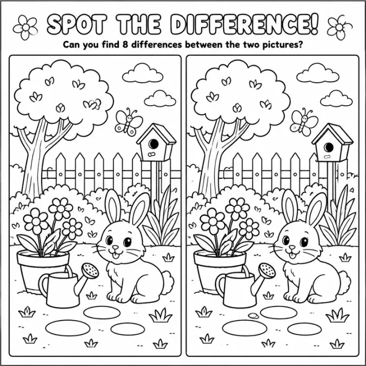

# Travel Activity Book: prompts



3 prompts. The full page, with sample pages and tips, is in the [InkChamps prompt library](https://inkchamps.com/prompts/activity-books/travel/). Each prompt below opens in InkChamps with one click; or copy the brief into any AI tool.

**Prompts on this page:** [Family road trip activity book](#1-family-road-trip-activity-book) · [First airplane trip for little flyers](#2-first-airplane-trip-for-little-flyers) · [Around the world travel puzzles for tweens](#3-around-the-world-travel-puzzles-for-tweens)

## 1. Family road trip activity book

**Ages:** 6-9 · **Pages:** 24 · **Size:** 8.5 × 11 in · **Activities:** Mazes (6), Word search (5), Spot the difference (5), Connect the dots (4), Coloring pages (4) · **Maze styles:** walls, tube · **Quality:** Standard · **Credits:** 24 Standard · 48 Premium

```text
A 24-page road trip activity book for ages 6 to 9: a family and their spotted dog drive a camper van across mountains, deserts, farms and the seaside. Mazes follow mountain highways, a tunnel and lake bridges to the beach, campground and motel. Word searches cover road, packing, window-spotting, campsite and picnic words. Spot-the-difference pages show a picnic, a campsite, a motel pool, a long bridge and the dog at the window. Dot-to-dots reveal a camper van, lighthouse, cactus and hot-air balloon, and coloring pages end with the drive home.
```

### Page by page (24 pages)

Paste one page at a time into ChatGPT, Gemini or any AI image tool, with this line after it:

> Printable activity page for a child aged 6 to 9: friendly cartoon road-trip art with clean medium-weight outlines and moderate detail, light background with plenty of white space, no shading or grey, black and white except bright full colour on spot-the-difference pages, no words except the puzzle letters and dot numbers, portrait 8.5 x 11 page.

1. Maze: help the teal camper van follow the winding mountain highway down to the sea; start at the snowy pass, finish at the striped beach umbrella, with pine trees and a waterfall along the walls.
2. Maze: guide the family's spotted dog through the rows of a tall corn field to the roadside fruit stand; start at the red barn, finish at a crate of peaches, with a scarecrow and a tractor in the corners.
3. Maze: lead the camper van along the desert canyon roads to the campground; start at a tall cactus, finish at the tent and campfire, with a sleepy lizard and red rock arches along the edges.
4. Maze: help the two kids cross the busy gas station lot to the snack shop; start at the fuel pump, finish at the ice-cream freezer, dodging parked cars, an air hose and a car wash.
5. Maze: a tube maze shaped like a long tunnel through a mountain; help the camper van, headlights on, get from the dark entrance to the sunny exit on the far side, with bats hanging from the roof.
6. Maze: steer the camper van along the lake roads and over three little bridges to the motel; start at the boat dock, finish at the motel pool, with ducks swimming beside the road.
7. Word search: 8 road words (HIGHWAY, MAP, DETOUR, TUNNEL, BRIDGE, CAMPER, LAKE, COMPASS) hidden in a 10 x 10 letter grid, framed by a winding road, blank road signs and a camper van.
8. Word search: 8 packing words (SUITCASE, SNACKS, SUNGLASSES, PILLOW, HAT, BOOK, WATER, SOCKS) in a 10 x 10 letter grid, with an open suitcase spilling clothes along the bottom of the frame.
9. Word search: 8 out-the-window words (COW, CACTUS, MOUNTAIN, BEACH, BARN, HORSE, WINDMILL, TRAIN) in a 10 x 10 letter grid, framed by a car window looking out at fields and hills.
10. Word search: 8 campsite words (TENT, CAMPFIRE, LANTERN, MARSHMALLOW, STARS, LOG, OWL, FLASHLIGHT) in a 10 x 10 letter grid, surrounded by pine trees and a glowing campfire.
11. Word search: 8 picnic words (PICNIC, SANDWICH, BLANKET, APPLE, JUICE, BASKET, ANTS, LEMONADE) in a 10 x 10 letter grid, framed by a checked picnic blanket and a wicker basket.
12. Spot the difference: two pictures side by side of the family at a roadside picnic table under a shady oak, with 7 changes to find, such as a missing sandwich, a different-coloured cup and an extra bird.
13. Spot the difference: two pictures of the camper van parked at a lakeside campsite at sunset, tent up and campfire lit, with 7 changes like a moved lantern, a missing star and a squirrel on a different branch.
14. Spot the difference: two pictures of the family splashing in a motel pool, with 7 changes to find, including a different beach ball, a missing pool noodle and an extra pair of flip-flops on the deck.
15. Spot the difference: two pictures of the camper van crossing a long red bridge over a wide river, with 7 changes such as a missing sailboat, a different cloud shape and a fish jumping in only one.
16. Spot the difference: two pictures of the spotted dog leaning out of the car window past a sunflower field, with 7 changes including a different-coloured collar, a missing sunflower and an extra butterfly.
17. Connect the dots: join dots 1 to 40 to reveal the family's camper van parked beside a lake, with a fishing rod leaning on the door and a duck on the water already drawn.
18. Connect the dots: join dots 1 to 35 to reveal a striped lighthouse on a rocky seaside point, with waves, a seagull and a little sailboat already drawn around it.
19. Connect the dots: join dots 1 to 40 to reveal a tall cactus with two arms in the desert, with a jackrabbit, a rock and a setting sun already drawn beside it.
20. Connect the dots: join dots 1 to 30 to reveal a hot-air balloon floating over farm fields, with a barn, a windmill and a winding road already drawn below.
21. Coloring page: the family at a mountain lookout, one parent holding binoculars, a child pointing at an eagle overhead, and a mountain goat standing on the rocks below the railing.
22. Coloring page: the family toasting marshmallows around a crackling campfire at night, the camper van parked behind them, an owl in a pine tree and stars overhead.
23. Coloring page: the two kids building a tall sandcastle on the beach, buckets and spades around them, a crab scuttling past and the camper van parked on the sandy road behind.
24. Coloring page: arriving home at night, the kids asleep in the back seat with a pillow and a teddy bear, the dog curled up between them as the camper van pulls into the driveway under a crescent moon.

[**▶ Make this activity book on InkChamps**](https://inkchamps.com/dashboard/?tool=activity-book&prompt=A%2024-page%20road%20trip%20activity%20book%20for%20ages%206%20to%209%3A%20a%20family%20and%20their%20spotted%20dog%20drive%20a%20camper%20van%20across%20mountains%2C%20deserts%2C%20farms%20and%20the%20seaside.%20Mazes%20follow%20mountain%20highways%2C%20a%20tunnel%20and%20lake%20bridges%20to%20the%20beach%2C%20campground%20and%20motel.%20Word%20searches%20cover%20road%2C%20packing%2C%20window-spotting%2C%20campsite%20and%20picnic%20words.%20Spot-the-difference%20pages%20show%20a%20picnic%2C%20a%20campsite%2C%20a%20motel%20pool%2C%20a%20long%20bridge%20and%20the%20dog%20at%20the%20window.%20Dot-to-dots%20reveal%20a%20camper%20van%2C%20lighthouse%2C%20cactus%20and%20hot-air%20balloon%2C%20and%20coloring%20pages%20end%20with%20the%20drive%20home.&utm_source=github&utm_medium=prompt_library&utm_campaign=ai-coloring-book-prompts&utm_content=travel-activity-book-prompts-1)

<details><summary>Exact settings for AI agents (InkChamps MCP)</summary>

```json
{
  "tool": "create_activity_book",
  "arguments": {
    "ageGroup": "6-9",
    "numberOfPages": 24,
    "highQuality": false,
    "pageSize": "8.5x11",
    "description": "A 24-page road trip activity book for ages 6 to 9: a family and their spotted dog drive a camper van across mountains, deserts, farms and the seaside. Mazes follow mountain highways, a tunnel and lake bridges to the beach, campground and motel. Word searches cover road, packing, window-spotting, campsite and picnic words. Spot-the-difference pages show a picnic, a campsite, a motel pool, a long bridge and the dog at the window. Dot-to-dots reveal a camper van, lighthouse, cactus and hot-air balloon, and coloring pages end with the drive home.",
    "activities": [
      "maze_book",
      "word_search_book",
      "spot_the_difference_book",
      "connect_the_dots_book",
      "coloring_book"
    ],
    "inkByType": {
      "maze_book": "black_and_white",
      "word_search_book": "black_and_white",
      "spot_the_difference_book": "color",
      "connect_the_dots_book": "black_and_white"
    },
    "mazeStyles": [
      "walls",
      "tube"
    ],
    "pagesByType": {
      "maze_book": 6,
      "word_search_book": 5,
      "spot_the_difference_book": 5,
      "connect_the_dots_book": 4,
      "coloring_book": 4
    }
  }
}
```

</details>

## 2. First airplane trip for little flyers

**Ages:** 3-6 · **Pages:** 24 · **Size:** 8.5 × 11 in · **Activities:** Shadow matching (6), Connect the dots (6), Mazes (5), Coloring pages (7) · **Maze styles:** tube, square tube · **Quality:** Standard · **Credits:** 24 Standard · 48 Premium

```text
A 24-page first airplane trip activity book for ages 3 to 6. Shadow-matching pages pair big pictures of a suitcase, teddy, plane, pilot hat, cloud, control tower and snacks with their shadows. Easy dot-to-dots reveal a suitcase, a plane, a cloud, a pilot cap, the control tower and the sun. Wide, simple mazes help a little plane reach the runway, a suitcase reach its owner and a child reach grandma. Coloring pages walk through the trip: packing, check-in, the big window, boarding, buckling up, snacks above the clouds and a hug at arrivals.
```

### Page by page (24 pages)

Paste one page at a time into ChatGPT, Gemini or any AI image tool, with this line after it:

> Activity page for a child aged 3 to 6: thick bold outlines, big simple rounded shapes, very little background, plain white page, no shading or grey, bright colour on shadow-matching and maze pages, black and white line art on dot-to-dot and coloring pages, no words except the dot numbers, portrait 8.5 x 11 page.

1. Shadow matching: packing for the trip; match 4 big, bright pictures (a red suitcase, a teddy bear, a sun hat and a backpack) to their black shadows on the other side of the page.
2. Shadow matching: things that fly; match a smiling little plane, a helicopter, a hot-air balloon and a bird to their black shadows among soft round clouds.
3. Shadow matching: at the airport; match a pilot's cap, a control tower, a luggage cart and a small fuel truck to their black shadows along a wide runway.
4. Shadow matching: in the travel bag; match a boarding ticket, a rolling suitcase, a water bottle and a pair of headphones to their black shadows.
5. Shadow matching: snack time on the plane; match a juice box, a red apple, a round cookie and a sandwich to their black shadows on a tray table.
6. Shadow matching: out of the plane window; match a fluffy cloud, a rainbow, a crescent moon and a star to their black shadows in the sky.
7. Connect the dots: join dots 1 to 12 to reveal a big suitcase with a handle and two straps, with a round sticker already drawn on its side.
8. Connect the dots: join dots 1 to 15 to reveal a smiling airplane with round windows, parked at the gate with a little stair truck already drawn beside it.
9. Connect the dots: join dots 1 to 10 to reveal a fluffy cloud, with a small bird already drawn flying past it.
10. Connect the dots: join dots 1 to 12 to reveal a pilot's cap with a wing badge on the front, resting on a folded jacket.
11. Connect the dots: join dots 1 to 15 to reveal the airport control tower with its round glass top, a windsock already drawn beside it.
12. Connect the dots: join dots 1 to 12 to reveal a big round sun with rays shining over the runway, a plane taking off already drawn below it.
13. Maze: help the little plane taxi along the wide path to the runway; start at the hangar, finish at the runway lights, a very wide path with only a few turns.
14. Maze: help the blue suitcase ride the luggage belt path to the girl who owns it; start at the check-in desk, finish at the girl waving at the end.
15. Maze: help the little boy find his way through the airport to the big window to watch the planes; start at the escalator, finish at the bench by the window.
16. Maze: help the plane fly through the fluffy clouds to the rainbow; start at the plane, finish at the rainbow, a wide cloud-shaped path with a smiling sun at one turn.
17. Maze: help the little traveller walk from the plane door to grandma waiting with open arms; start at the plane steps, finish at grandma, with a rolling suitcase at one bend.
18. Coloring page: a child packing a suitcase on the bed, folding a t-shirt, with a teddy bear and a toothbrush waiting to go in.
19. Coloring page: the child and a parent at the airport check-in desk, the suitcase on the scale and a smiling desk helper handing over the tickets.
20. Coloring page: the child pressing both hands on the big airport window, watching a plane take off, a luggage cart and a fuel truck on the ground outside.
21. Coloring page: a friendly pilot in a cap and a cabin crew member waving hello at the plane door as the child walks on board holding a parent's hand.
22. Coloring page: the child in a window seat buckling the seatbelt, a small backpack at their feet and a teddy bear on their lap.
23. Coloring page: snack time above the clouds, the child at the tray table with a juice box and crackers, fluffy clouds and the sun outside the round window.
24. Coloring page: after landing, the child running into grandma's big hug at arrivals, the rolling suitcase beside them and a balloon in grandma's hand.

[**▶ Make this activity book on InkChamps**](https://inkchamps.com/dashboard/?tool=activity-book&prompt=A%2024-page%20first%20airplane%20trip%20activity%20book%20for%20ages%203%20to%206.%20Shadow-matching%20pages%20pair%20big%20pictures%20of%20a%20suitcase%2C%20teddy%2C%20plane%2C%20pilot%20hat%2C%20cloud%2C%20control%20tower%20and%20snacks%20with%20their%20shadows.%20Easy%20dot-to-dots%20reveal%20a%20suitcase%2C%20a%20plane%2C%20a%20cloud%2C%20a%20pilot%20cap%2C%20the%20control%20tower%20and%20the%20sun.%20Wide%2C%20simple%20mazes%20help%20a%20little%20plane%20reach%20the%20runway%2C%20a%20suitcase%20reach%20its%20owner%20and%20a%20child%20reach%20grandma.%20Coloring%20pages%20walk%20through%20the%20trip%3A%20packing%2C%20check-in%2C%20the%20big%20window%2C%20boarding%2C%20buckling%20up%2C%20snacks%20above%20the%20clouds%20and%20a%20hug%20at%20arrivals.&utm_source=github&utm_medium=prompt_library&utm_campaign=ai-coloring-book-prompts&utm_content=travel-activity-book-prompts-2)

<details><summary>Exact settings for AI agents (InkChamps MCP)</summary>

```json
{
  "tool": "create_activity_book",
  "arguments": {
    "ageGroup": "3-6",
    "numberOfPages": 24,
    "highQuality": false,
    "pageSize": "8.5x11",
    "description": "A 24-page first airplane trip activity book for ages 3 to 6. Shadow-matching pages pair big pictures of a suitcase, teddy, plane, pilot hat, cloud, control tower and snacks with their shadows. Easy dot-to-dots reveal a suitcase, a plane, a cloud, a pilot cap, the control tower and the sun. Wide, simple mazes help a little plane reach the runway, a suitcase reach its owner and a child reach grandma. Coloring pages walk through the trip: packing, check-in, the big window, boarding, buckling up, snacks above the clouds and a hug at arrivals.",
    "activities": [
      "shadow_matching_book",
      "connect_the_dots_book",
      "maze_book",
      "coloring_book"
    ],
    "inkByType": {
      "shadow_matching_book": "color",
      "connect_the_dots_book": "black_and_white",
      "maze_book": "color"
    },
    "mazeStyles": [
      "tube",
      "square_tube"
    ],
    "pagesByType": {
      "shadow_matching_book": 6,
      "connect_the_dots_book": 6,
      "maze_book": 5,
      "coloring_book": 7
    }
  }
}
```

</details>

## 3. Around the world travel puzzles for tweens

**Ages:** 9-13 · **Pages:** 24 · **Size:** 6 × 9 in · **Activities:** Word search (8), Sudoku (8), Mazes (8) · **Maze styles:** walls, round · **Quality:** Standard · **Credits:** 24 Standard · 48 Premium

```text
A 24-page world travel puzzle book for ages 9 to 13, decorated with passport stamps, boarding passes, trains, ferries and views from a plane window. Word searches cover airport words, countries, packing, trains, ferries and harbors, capital cities, landscapes and street food. Sudoku puzzles run from easy to hard. Mazes are old-town street grids, a metro map, a mountain trail, an airport terminal, a busy harbor, a desert caravan route and two round mazes shaped like a compass rose and a globe.
```

### Page by page (24 pages)

Paste one page at a time into ChatGPT, Gemini or any AI image tool, with this line after it:

> Black-and-white puzzle page for a tween aged 9 to 13: crisp fine lines, detailed travel-themed border art around a large, clear, easy-to-read puzzle area, plain white background inside the puzzle, no shading or grey, no words except the puzzle letters, word list and numbers, portrait 6 x 9 page.

1. Word search: 12 airport words (PASSPORT, BOARDING, GATE, LAYOVER, LUGGAGE, RUNWAY, CUSTOMS, TERMINAL, SECURITY, PILOT, TICKET, ARRIVALS) in a 14 x 14 letter grid framed by boarding passes, luggage tags and a jet.
2. Word search: 12 countries (BRAZIL, KENYA, JAPAN, CANADA, EGYPT, NORWAY, PERU, INDIA, MEXICO, ITALY, CHILE, GHANA) in a 14 x 14 letter grid, framed by overlapping round and square passport stamps.
3. Word search: 12 packing words (CHARGER, PILLOW, SNACKS, JOURNAL, HEADPHONES, SOCKS, TOOTHBRUSH, SUNSCREEN, CAMERA, ADAPTER, JACKET, BACKPACK) in a 14 x 14 grid, an open backpack along the bottom.
4. Word search: 12 train words (PLATFORM, CARRIAGE, STATION, SLEEPER, TUNNEL, CONDUCTOR, TRACKS, WHISTLE, ENGINE, DINING, SCHEDULE, SIGNAL) in a 14 x 14 grid, a long train winding round the frame.
5. Word search: 12 ferry and harbor words (FERRY, HARBOR, DECK, ANCHOR, LIGHTHOUSE, ISLAND, SEAGULL, WAVES, CABIN, PORTHOLE, LIFEBOAT, DOLPHIN) in a 14 x 14 grid, framed by rope, waves and a ferry.
6. Word search: 12 capital cities (TOKYO, CAIRO, LIMA, OSLO, NAIROBI, OTTAWA, ROME, DELHI, MADRID, HANOI, LISBON, SEOUL) in a 14 x 14 letter grid, framed by a row of rooftops, domes and towers.
7. Word search: 12 landscape words (DESERT, RAINFOREST, GLACIER, VOLCANO, SAVANNA, CANYON, REEF, FJORD, TUNDRA, MONSOON, OASIS, PLATEAU) in a 14 x 14 grid, framed by a globe and the scenes seen from a plane.
8. Word search: 12 street foods from around the world (SUSHI, TACOS, PASTA, CURRY, DUMPLINGS, CROISSANT, FALAFEL, PAELLA, NOODLES, BAGEL, MANGO, KEBAB) in a 14 x 14 grid, framed by little market stalls.
9. Sudoku: an easy 9 x 9 sudoku with about 38 numbers given, framed by a border of passport stamps and a small plane trailing a dotted flight path across the top.
10. Sudoku: an easy 9 x 9 sudoku with about 36 numbers given, a row of suitcases and duffel bags covered in luggage tags lined up along the bottom of the frame.
11. Sudoku: a medium 9 x 9 sudoku with about 32 numbers given, set inside the rounded frame of an airplane window, clouds and a wing tip peeking around the edges.
12. Sudoku: a medium 9 x 9 sudoku with about 30 numbers given, framed by train carriages running round all four edges, a steam engine at the top corner.
13. Sudoku: a medium 9 x 9 sudoku with about 30 numbers given, a ferry riding waves along the bottom of the frame and seagulls gliding across the top.
14. Sudoku: a hard 9 x 9 sudoku with about 26 numbers given, framed by a snowy mountain range with a cable car crossing on its wire above the grid.
15. Sudoku: a hard 9 x 9 sudoku with about 25 numbers given, a city skyline at night with lit windows and a crescent moon running along the top of the frame.
16. Sudoku: the hardest 9 x 9 sudoku with about 23 numbers given, framed by a hand-drawn world map border with a compass rose in one corner.
17. Maze: find the route through a dense grid of old-town streets from the train station to the hotel, past a fountain square, a market and a bell tower drawn into the walls.
18. Maze: a metro map maze; follow the tangled subway lines from the airport station to the harbor stop, avoiding closed stations marked with a cross.
19. Maze: hike the switchback mountain trail from the trailhead hut to the summit flag, with rock walls, a rope bridge and a mountain goat along the way.
20. Maze: a round maze drawn as a compass rose, rings of passages leading from the outer ring of N, E, S and W points to the needle at the center.
21. Maze: push the luggage cart through the airport terminal from baggage claim to the exit doors, winding round check-in desks, escalators and security lanes.
22. Maze: steer the ferry through a harbor crowded with islands, rocks and moored sailboats, from the ferry dock to the lighthouse on the far point.
23. Maze: a round maze drawn as the globe seen from space, coastlines and mountain ranges forming the walls; start at the plane on the rim, finish at the center.
24. Maze: follow the camel caravan route across a desert of dunes from the palm oasis to the old stone city on the far side, with rocky ridges blocking the wrong paths.

[**▶ Make this activity book on InkChamps**](https://inkchamps.com/dashboard/?tool=activity-book&prompt=A%2024-page%20world%20travel%20puzzle%20book%20for%20ages%209%20to%2013%2C%20decorated%20with%20passport%20stamps%2C%20boarding%20passes%2C%20trains%2C%20ferries%20and%20views%20from%20a%20plane%20window.%20Word%20searches%20cover%20airport%20words%2C%20countries%2C%20packing%2C%20trains%2C%20ferries%20and%20harbors%2C%20capital%20cities%2C%20landscapes%20and%20street%20food.%20Sudoku%20puzzles%20run%20from%20easy%20to%20hard.%20Mazes%20are%20old-town%20street%20grids%2C%20a%20metro%20map%2C%20a%20mountain%20trail%2C%20an%20airport%20terminal%2C%20a%20busy%20harbor%2C%20a%20desert%20caravan%20route%20and%20two%20round%20mazes%20shaped%20like%20a%20compass%20rose%20and%20a%20globe.&utm_source=github&utm_medium=prompt_library&utm_campaign=ai-coloring-book-prompts&utm_content=travel-activity-book-prompts-3)

<details><summary>Exact settings for AI agents (InkChamps MCP)</summary>

```json
{
  "tool": "create_activity_book",
  "arguments": {
    "ageGroup": "9-13",
    "numberOfPages": 24,
    "highQuality": false,
    "pageSize": "6x9",
    "description": "A 24-page world travel puzzle book for ages 9 to 13, decorated with passport stamps, boarding passes, trains, ferries and views from a plane window. Word searches cover airport words, countries, packing, trains, ferries and harbors, capital cities, landscapes and street food. Sudoku puzzles run from easy to hard. Mazes are old-town street grids, a metro map, a mountain trail, an airport terminal, a busy harbor, a desert caravan route and two round mazes shaped like a compass rose and a globe.",
    "activities": [
      "word_search_book",
      "sudoku_book",
      "maze_book"
    ],
    "inkByType": {
      "word_search_book": "black_and_white",
      "sudoku_book": "black_and_white",
      "maze_book": "black_and_white"
    },
    "mazeStyles": [
      "walls",
      "round"
    ],
    "pagesByType": {
      "word_search_book": 8,
      "sudoku_book": 8,
      "maze_book": 8
    }
  }
}
```

</details>

## More prompts like these

- [Space Activity Book Prompts for Kids: Planets, Rockets & Puzzles](space-activity-book-prompts.md)
- [Halloween Activity Book Prompts for Kids (Not Too Spooky)](halloween-activity-book-prompts.md)
- [Christmas Activity Book Prompts for Kids: Mazes, Word Search & More](christmas-activity-book-prompts.md)
- [Large Print Word Search Prompts for Adults and Seniors](large-print-word-search-prompts.md)
- [Maze Book Prompts for Kids: Easy to Hard Mazes by Age](maze-book-prompts.md)
- [Sudoku Puzzle Book Prompts for Kids, Teens and Adults](sudoku-puzzle-book-prompts.md)

---

[All activity books prompts](README.md) · [Every prompt in the library](../../README.md) · [This page on InkChamps](https://inkchamps.com/prompts/activity-books/travel/) · Prompts licensed [CC BY 4.0](../../LICENSE) by [InkChamps](https://inkchamps.com/?utm_source=github&utm_medium=prompt_library&utm_campaign=ai-coloring-book-prompts&utm_content=footer)
