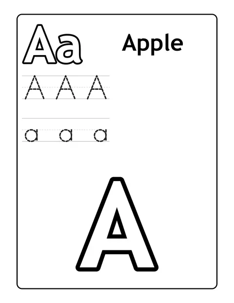

# Alphabet ABC Coloring Book: prompts



5 prompts. The full page, with sample pages and tips, is in the [InkChamps prompt library](https://inkchamps.com/prompts/coloring-books/alphabet-abc/). Each prompt below opens in InkChamps with one click; or copy the brief into any AI tool.

**Prompts on this page:** [ABC animals and an alphabet parade](#1-abc-animals-and-an-alphabet-parade) · [First-words picture dictionary](#2-first-words-picture-dictionary) · [Phonics: letter sounds, vowels and letter teams](#3-phonics-letter-sounds-vowels-and-letter-teams) · [A to Z jobs and where people work](#4-a-to-z-jobs-and-where-people-work) · [Floral alphabet, numbers and symbols for adults](#5-floral-alphabet-numbers-and-symbols-for-adults)

## 1. ABC animals and an alphabet parade

**Ages:** 3-6 · **Pages:** 40 · **Size:** 8.5 × 11 in · **Style:** Cute animals · **Detail:** Easy · **Layout:** One item per page, with its caption · **Quality:** Standard · **Credits:** 40 Standard · 120 Premium

```text
An alphabet book of animals, one item per page with its caption. Pages 1-26, each big uppercase letter with its animal: A alligator, B bear, C cat, D duck, E elephant, F fox, G giraffe, H hippo, I iguana, J jellyfish, K koala, L lion, M monkey, N narwhal, O owl, P penguin, Q quail, R rabbit, S sloth, T turtle, U umbrellabird, V vole, W walrus, X x-ray fish, Y yak, Z zebra. Pages 27-39, the alphabet parade, two letters' animals marching together: A and B, C and D, E and F, G and H, I and J, K and L, M and N, O and P, Q and R, S and T, U and V, W and X, Y and Z.
```

**Extra direction:** Page 40: all 26 animals marching in one long parade.

[**▶ Make this coloring book on InkChamps**](https://inkchamps.com/dashboard/?tool=coloring-book&prompt=An%20alphabet%20book%20of%20animals%2C%20one%20item%20per%20page%20with%20its%20caption.%20Pages%201-26%2C%20each%20big%20uppercase%20letter%20with%20its%20animal%3A%20A%20alligator%2C%20B%20bear%2C%20C%20cat%2C%20D%20duck%2C%20E%20elephant%2C%20F%20fox%2C%20G%20giraffe%2C%20H%20hippo%2C%20I%20iguana%2C%20J%20jellyfish%2C%20K%20koala%2C%20L%20lion%2C%20M%20monkey%2C%20N%20narwhal%2C%20O%20owl%2C%20P%20penguin%2C%20Q%20quail%2C%20R%20rabbit%2C%20S%20sloth%2C%20T%20turtle%2C%20U%20umbrellabird%2C%20V%20vole%2C%20W%20walrus%2C%20X%20x-ray%20fish%2C%20Y%20yak%2C%20Z%20zebra.%20Pages%2027-39%2C%20the%20alphabet%20parade%2C%20two%20letters%27%20animals%20marching%20together%3A%20A%20and%20B%2C%20C%20and%20D%2C%20E%20and%20F%2C%20G%20and%20H%2C%20I%20and%20J%2C%20K%20and%20L%2C%20M%20and%20N%2C%20O%20and%20P%2C%20Q%20and%20R%2C%20S%20and%20T%2C%20U%20and%20V%2C%20W%20and%20X%2C%20Y%20and%20Z.&utm_source=github&utm_medium=prompt_library&utm_campaign=ai-coloring-book-prompts&utm_content=alphabet-abc-coloring-book-prompts-1)

<details><summary>Exact settings for AI agents (InkChamps MCP)</summary>

```json
{
  "tool": "create_coloring_book",
  "arguments": {
    "ageGroup": "3-6",
    "numberOfPages": 40,
    "highQuality": false,
    "pageSize": "8.5x11",
    "description": "An alphabet book of animals, one item per page with its caption. Pages 1-26, each big uppercase letter with its animal: A alligator, B bear, C cat, D duck, E elephant, F fox, G giraffe, H hippo, I iguana, J jellyfish, K koala, L lion, M monkey, N narwhal, O owl, P penguin, Q quail, R rabbit, S sloth, T turtle, U umbrellabird, V vole, W walrus, X x-ray fish, Y yak, Z zebra. Pages 27-39, the alphabet parade, two letters' animals marching together: A and B, C and D, E and F, G and H, I and J, K and L, M and N, O and P, Q and R, S and T, U and V, W and X, Y and Z.",
    "additionalInstructions": "Page 40: all 26 animals marching in one long parade.",
    "style": "cute_animals",
    "complexity": "easy",
    "title": "ABC Animal Parade",
    "pageCategory": "concept"
  }
}
```

</details>

## 2. First-words picture dictionary

**Ages:** 3-6 · **Pages:** 40 · **Size:** 8.5 × 11 in · **Style:** General coloring · **Detail:** Easy · **Layout:** One item per page, with its caption · **Quality:** Standard · **Credits:** 40 Standard · 120 Premium

```text
An ABC picture dictionary of everyday things at home and outdoors, in alphabetical order, one word per page with its letter and the word as the caption. Pages 1-40: A acorn, A airplane, B ball, B boat, C car, C cup, D door, D drum, E envelope, F flower, F fork, G gate, G guitar, H hat, H house, I igloo, J jar, K kite, L lamp, L leaf, M mitten, M moon, N nest, O oven, P pail, P pillow, Q quilt, R rocket, R rug, S sock, S sun, T tent, T train, U umbrella, V violin, W wagon, W window, X xylophone, Y yo-yo, Z zipper.
```

[**▶ Make this coloring book on InkChamps**](https://inkchamps.com/dashboard/?tool=coloring-book&prompt=An%20ABC%20picture%20dictionary%20of%20everyday%20things%20at%20home%20and%20outdoors%2C%20in%20alphabetical%20order%2C%20one%20word%20per%20page%20with%20its%20letter%20and%20the%20word%20as%20the%20caption.%20Pages%201-40%3A%20A%20acorn%2C%20A%20airplane%2C%20B%20ball%2C%20B%20boat%2C%20C%20car%2C%20C%20cup%2C%20D%20door%2C%20D%20drum%2C%20E%20envelope%2C%20F%20flower%2C%20F%20fork%2C%20G%20gate%2C%20G%20guitar%2C%20H%20hat%2C%20H%20house%2C%20I%20igloo%2C%20J%20jar%2C%20K%20kite%2C%20L%20lamp%2C%20L%20leaf%2C%20M%20mitten%2C%20M%20moon%2C%20N%20nest%2C%20O%20oven%2C%20P%20pail%2C%20P%20pillow%2C%20Q%20quilt%2C%20R%20rocket%2C%20R%20rug%2C%20S%20sock%2C%20S%20sun%2C%20T%20tent%2C%20T%20train%2C%20U%20umbrella%2C%20V%20violin%2C%20W%20wagon%2C%20W%20window%2C%20X%20xylophone%2C%20Y%20yo-yo%2C%20Z%20zipper.&utm_source=github&utm_medium=prompt_library&utm_campaign=ai-coloring-book-prompts&utm_content=alphabet-abc-coloring-book-prompts-2)

<details><summary>Exact settings for AI agents (InkChamps MCP)</summary>

```json
{
  "tool": "create_coloring_book",
  "arguments": {
    "ageGroup": "3-6",
    "numberOfPages": 40,
    "highQuality": false,
    "pageSize": "8.5x11",
    "description": "An ABC picture dictionary of everyday things at home and outdoors, in alphabetical order, one word per page with its letter and the word as the caption. Pages 1-40: A acorn, A airplane, B ball, B boat, C car, C cup, D door, D drum, E envelope, F flower, F fork, G gate, G guitar, H hat, H house, I igloo, J jar, K kite, L lamp, L leaf, M mitten, M moon, N nest, O oven, P pail, P pillow, Q quilt, R rocket, R rug, S sock, S sun, T tent, T train, U umbrella, V violin, W wagon, W window, X xylophone, Y yo-yo, Z zipper.",
    "style": "general_coloring",
    "complexity": "easy",
    "title": "My First ABC Picture Dictionary",
    "pageCategory": "concept"
  }
}
```

</details>

## 3. Phonics: letter sounds, vowels and letter teams

**Ages:** 6-9 · **Pages:** 40 · **Size:** 8.5 × 11 in · **Style:** General coloring · **Detail:** Medium · **Layout:** One item per page, with its caption · **Quality:** Standard · **Credits:** 40 Standard · 120 Premium

```text
A phonics book, one item per page with its caption. Pages 1-21, each letter in a scene of things that start with its sound: A astronaut with an apple, B boy with a ball and bucket, C cat in a car, D dragon with a drum, E elf with an egg, F fairy with a flower, G goat with a guitar, H horse in a hat, I iguana by an igloo, J juggler with jam jars, K king with a kite, L lemon on a ladder, M monkey on the moon, N nurse with a net, O octopus with an olive, P pirate with a pizza, Q queen with a quilt, R robot with a rose, S sailor with a seal, T tiger with a teapot, U umbrella upside down.
```

**Extra direction:** Pages 22-26, each letter in a scene of things that start with its sound: V van of vegetables, W wizard with a wand, X fox in a box, Y yak with a yo-yo, Z zebra with a zipper. Pages 27-36, vowel sounds: short a: cat, hat, map; short e: bed, hen, jet; short i: pig, fish, six; short o: dog, pot, sock; short u: bug, cup, sun; long a: cake, rain, snail; long e: bee, leaf, tree; long i: kite, pie, bike; long o: boat, rope, snow; long u: cube, flute, mule. Pages 37-40, letter teams: sh: ship, shell, sheep; ch: chair, cheese, chick; th: thumb, three, throne; wh: whale, wheel, whistle.

[**▶ Make this coloring book on InkChamps**](https://inkchamps.com/dashboard/?tool=coloring-book&prompt=A%20phonics%20book%2C%20one%20item%20per%20page%20with%20its%20caption.%20Pages%201-21%2C%20each%20letter%20in%20a%20scene%20of%20things%20that%20start%20with%20its%20sound%3A%20A%20astronaut%20with%20an%20apple%2C%20B%20boy%20with%20a%20ball%20and%20bucket%2C%20C%20cat%20in%20a%20car%2C%20D%20dragon%20with%20a%20drum%2C%20E%20elf%20with%20an%20egg%2C%20F%20fairy%20with%20a%20flower%2C%20G%20goat%20with%20a%20guitar%2C%20H%20horse%20in%20a%20hat%2C%20I%20iguana%20by%20an%20igloo%2C%20J%20juggler%20with%20jam%20jars%2C%20K%20king%20with%20a%20kite%2C%20L%20lemon%20on%20a%20ladder%2C%20M%20monkey%20on%20the%20moon%2C%20N%20nurse%20with%20a%20net%2C%20O%20octopus%20with%20an%20olive%2C%20P%20pirate%20with%20a%20pizza%2C%20Q%20queen%20with%20a%20quilt%2C%20R%20robot%20with%20a%20rose%2C%20S%20sailor%20with%20a%20seal%2C%20T%20tiger%20with%20a%20teapot%2C%20U%20umbrella%20upside%20down.&utm_source=github&utm_medium=prompt_library&utm_campaign=ai-coloring-book-prompts&utm_content=alphabet-abc-coloring-book-prompts-3)

<details><summary>Exact settings for AI agents (InkChamps MCP)</summary>

```json
{
  "tool": "create_coloring_book",
  "arguments": {
    "ageGroup": "6-9",
    "numberOfPages": 40,
    "highQuality": false,
    "pageSize": "8.5x11",
    "description": "A phonics book, one item per page with its caption. Pages 1-21, each letter in a scene of things that start with its sound: A astronaut with an apple, B boy with a ball and bucket, C cat in a car, D dragon with a drum, E elf with an egg, F fairy with a flower, G goat with a guitar, H horse in a hat, I iguana by an igloo, J juggler with jam jars, K king with a kite, L lemon on a ladder, M monkey on the moon, N nurse with a net, O octopus with an olive, P pirate with a pizza, Q queen with a quilt, R robot with a rose, S sailor with a seal, T tiger with a teapot, U umbrella upside down.",
    "additionalInstructions": "Pages 22-26, each letter in a scene of things that start with its sound: V van of vegetables, W wizard with a wand, X fox in a box, Y yak with a yo-yo, Z zebra with a zipper. Pages 27-36, vowel sounds: short a: cat, hat, map; short e: bed, hen, jet; short i: pig, fish, six; short o: dog, pot, sock; short u: bug, cup, sun; long a: cake, rain, snail; long e: bee, leaf, tree; long i: kite, pie, bike; long o: boat, rope, snow; long u: cube, flute, mule. Pages 37-40, letter teams: sh: ship, shell, sheep; ch: chair, cheese, chick; th: thumb, three, throne; wh: whale, wheel, whistle.",
    "style": "general_coloring",
    "complexity": "medium",
    "title": "Phonics Fun: Letter Sounds A to Z",
    "pageCategory": "concept"
  }
}
```

</details>

## 4. A to Z jobs and where people work

**Ages:** 6-9 · **Pages:** 40 · **Size:** 8.5 × 11 in · **Style:** General coloring · **Detail:** Medium · **Layout:** One item per page, with its caption · **Quality:** Standard · **Credits:** 40 Standard · 120 Premium

```text
An alphabet of jobs, each page showing a worker at the job with the letter and job name as the caption, then the places in town where people work. Pages 1-26, jobs: A architect, B baker, C carpenter, D dentist, E electrician, F firefighter, G gardener, H hairdresser, I illustrator, J janitor, K kindergarten teacher, L librarian, M mail carrier, N nurse, O optician, P pilot, Q quilter, R recycling collector, S scientist, T tailor, U umpire, V vet, W window washer, X x-ray technician, Y yoga teacher, Z zookeeper. Pages 27-31, workplaces: airport, bakery, building site, dentist's office, farm.
```

**Extra direction:** Pages 32-40, workplaces: fire station, hospital, library, post office, school, science lab, train station, vet clinic, zoo.

[**▶ Make this coloring book on InkChamps**](https://inkchamps.com/dashboard/?tool=coloring-book&prompt=An%20alphabet%20of%20jobs%2C%20each%20page%20showing%20a%20worker%20at%20the%20job%20with%20the%20letter%20and%20job%20name%20as%20the%20caption%2C%20then%20the%20places%20in%20town%20where%20people%20work.%20Pages%201-26%2C%20jobs%3A%20A%20architect%2C%20B%20baker%2C%20C%20carpenter%2C%20D%20dentist%2C%20E%20electrician%2C%20F%20firefighter%2C%20G%20gardener%2C%20H%20hairdresser%2C%20I%20illustrator%2C%20J%20janitor%2C%20K%20kindergarten%20teacher%2C%20L%20librarian%2C%20M%20mail%20carrier%2C%20N%20nurse%2C%20O%20optician%2C%20P%20pilot%2C%20Q%20quilter%2C%20R%20recycling%20collector%2C%20S%20scientist%2C%20T%20tailor%2C%20U%20umpire%2C%20V%20vet%2C%20W%20window%20washer%2C%20X%20x-ray%20technician%2C%20Y%20yoga%20teacher%2C%20Z%20zookeeper.%20Pages%2027-31%2C%20workplaces%3A%20airport%2C%20bakery%2C%20building%20site%2C%20dentist%27s%20office%2C%20farm.&utm_source=github&utm_medium=prompt_library&utm_campaign=ai-coloring-book-prompts&utm_content=alphabet-abc-coloring-book-prompts-4)

<details><summary>Exact settings for AI agents (InkChamps MCP)</summary>

```json
{
  "tool": "create_coloring_book",
  "arguments": {
    "ageGroup": "6-9",
    "numberOfPages": 40,
    "highQuality": false,
    "pageSize": "8.5x11",
    "description": "An alphabet of jobs, each page showing a worker at the job with the letter and job name as the caption, then the places in town where people work. Pages 1-26, jobs: A architect, B baker, C carpenter, D dentist, E electrician, F firefighter, G gardener, H hairdresser, I illustrator, J janitor, K kindergarten teacher, L librarian, M mail carrier, N nurse, O optician, P pilot, Q quilter, R recycling collector, S scientist, T tailor, U umpire, V vet, W window washer, X x-ray technician, Y yoga teacher, Z zookeeper. Pages 27-31, workplaces: airport, bakery, building site, dentist's office, farm.",
    "additionalInstructions": "Pages 32-40, workplaces: fire station, hospital, library, post office, school, science lab, train station, vet clinic, zoo.",
    "style": "general_coloring",
    "complexity": "medium",
    "title": "ABC Jobs: People at Work",
    "pageCategory": "concept"
  }
}
```

</details>

## 5. Floral alphabet, numbers and symbols for adults

**Ages:** 13+ · **Pages:** 40 · **Size:** 8.5 × 11 in · **Style:** General coloring · **Detail:** Hard · **Layout:** One item per page, with its caption · **Quality:** Standard · **Credits:** 40 Standard · 120 Premium

```text
A decorative lettering book for adult colorists, one character per page with its caption: each big letter woven with a flower that starts with that letter, then numbers and symbols wreathed in leaves and vines. Pages 1-26, letters: A anemone, B bluebell, C camellia, D daffodil, E echinacea, F foxglove, G gardenia, H hibiscus, I iris, J jasmine, K king protea, L lily, M magnolia, N narcissus, O orchid, P peony, Q Queen Anne's lace, R rose, S sunflower, T tulip, U ursinia, V violet, W wisteria, X xeranthemum, Y yarrow, Z zinnia. Pages 27-36, numbers: 0, 1, 2, 3, 4, 5, 6, 7, 8, 9.
```

**Extra direction:** Pages 37-39, symbols: ampersand, exclamation mark, question mark. Page 40: the whole alphabet together as a sampler.

[**▶ Make this coloring book on InkChamps**](https://inkchamps.com/dashboard/?tool=coloring-book&prompt=A%20decorative%20lettering%20book%20for%20adult%20colorists%2C%20one%20character%20per%20page%20with%20its%20caption%3A%20each%20big%20letter%20woven%20with%20a%20flower%20that%20starts%20with%20that%20letter%2C%20then%20numbers%20and%20symbols%20wreathed%20in%20leaves%20and%20vines.%20Pages%201-26%2C%20letters%3A%20A%20anemone%2C%20B%20bluebell%2C%20C%20camellia%2C%20D%20daffodil%2C%20E%20echinacea%2C%20F%20foxglove%2C%20G%20gardenia%2C%20H%20hibiscus%2C%20I%20iris%2C%20J%20jasmine%2C%20K%20king%20protea%2C%20L%20lily%2C%20M%20magnolia%2C%20N%20narcissus%2C%20O%20orchid%2C%20P%20peony%2C%20Q%20Queen%20Anne%27s%20lace%2C%20R%20rose%2C%20S%20sunflower%2C%20T%20tulip%2C%20U%20ursinia%2C%20V%20violet%2C%20W%20wisteria%2C%20X%20xeranthemum%2C%20Y%20yarrow%2C%20Z%20zinnia.%20Pages%2027-36%2C%20numbers%3A%200%2C%201%2C%202%2C%203%2C%204%2C%205%2C%206%2C%207%2C%208%2C%209.&utm_source=github&utm_medium=prompt_library&utm_campaign=ai-coloring-book-prompts&utm_content=alphabet-abc-coloring-book-prompts-5)

<details><summary>Exact settings for AI agents (InkChamps MCP)</summary>

```json
{
  "tool": "create_coloring_book",
  "arguments": {
    "ageGroup": "13+",
    "numberOfPages": 40,
    "highQuality": false,
    "pageSize": "8.5x11",
    "description": "A decorative lettering book for adult colorists, one character per page with its caption: each big letter woven with a flower that starts with that letter, then numbers and symbols wreathed in leaves and vines. Pages 1-26, letters: A anemone, B bluebell, C camellia, D daffodil, E echinacea, F foxglove, G gardenia, H hibiscus, I iris, J jasmine, K king protea, L lily, M magnolia, N narcissus, O orchid, P peony, Q Queen Anne's lace, R rose, S sunflower, T tulip, U ursinia, V violet, W wisteria, X xeranthemum, Y yarrow, Z zinnia. Pages 27-36, numbers: 0, 1, 2, 3, 4, 5, 6, 7, 8, 9.",
    "additionalInstructions": "Pages 37-39, symbols: ampersand, exclamation mark, question mark. Page 40: the whole alphabet together as a sampler.",
    "style": "general_coloring",
    "complexity": "hard",
    "title": "Blooming Letters: A Floral Alphabet",
    "pageCategory": "concept"
  }
}
```

</details>

## More prompts like these

- [Numbers & Counting Coloring Book Prompts for Kids](numbers-counting-coloring-book-prompts.md)
- [Shapes and Colors Coloring Book Prompts for Preschool](shapes-and-colors-coloring-book-prompts.md)
- [Good Habits & Manners Coloring Book Prompts for Kids](good-habits-manners-coloring-book-prompts.md)
- [Feelings & Emotions Coloring Book Prompts for Kids](feelings-emotions-coloring-book-prompts.md)
- [Greek Mythology Coloring Book Prompts](greek-mythology-coloring-book-prompts.md)
- [Bible Story Coloring Book Prompts for Kids & Adults](bible-story-coloring-book-prompts.md)

---

[All coloring books prompts](README.md) · [Every prompt in the library](../../README.md) · [This page on InkChamps](https://inkchamps.com/prompts/coloring-books/alphabet-abc/) · Prompts licensed [CC BY 4.0](../../LICENSE) by [InkChamps](https://inkchamps.com/?utm_source=github&utm_medium=prompt_library&utm_campaign=ai-coloring-book-prompts&utm_content=footer)
