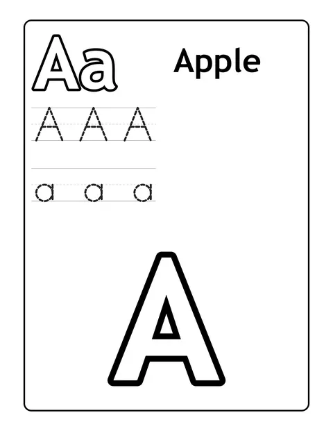

# Alphabet ABC Coloring Book: prompts



5 prompts. The full page, with sample pages and tips, is in the [InkChamps prompt library](https://inkchamps.com/prompts/coloring-books/alphabet-abc/). Each prompt below opens in InkChamps with one click; or copy the brief into any AI tool.

**Prompts on this page:** [ABC animals and an alphabet parade](#1-abc-animals-and-an-alphabet-parade) · [First-words picture dictionary](#2-first-words-picture-dictionary) · [Phonics: letter sounds, vowels and letter teams](#3-phonics-letter-sounds-vowels-and-letter-teams) · [A to Z jobs and where people work](#4-a-to-z-jobs-and-where-people-work) · [Floral alphabet, numbers and symbols for adults](#5-floral-alphabet-numbers-and-symbols-for-adults)

## 1. ABC animals and an alphabet parade

**Ages:** 3-6 · **Pages:** 26 · **Size:** 8.5 × 11 in · **Style:** Cute animals · **Detail:** Easy · **Layout:** One item per page, with its caption · **Quality:** Standard · **Credits:** 26 Standard · 78 Premium

```text
An alphabet book of 26 pages, one letter per page: each big uppercase and lowercase letter with its animal marching in an alphabet parade, with the caption 'A is for alligator'. A alligator, B bear, C cat, D duck, E elephant, F fox, G giraffe, H hippo, I iguana, J jellyfish, K koala, L lion, M monkey, N narwhal, O owl, P penguin, Q quail, R rabbit, S sloth, T turtle, U umbrellabird, V vole, W walrus, X x-ray fish, Y yak, Z zebra. Each animal carries a parade prop: a flag, a drum, a trumpet, balloons, a tuba.
```

### Page by page (26 pages)

Paste one page at a time into ChatGPT, Gemini or any AI image tool, with this line after it:

> Black-and-white coloring page for a child aged 3 to 6: one big cute cartoon animal and one giant outlined letter filling most of the page, thick bold outlines, large simple shapes with wide spaces to color, very little background, no shading, no grey, plain white background, the letter and the caption are the only words on the page, portrait 8.5 x 11 page.

1. A big friendly alligator leading the alphabet parade beside a giant outlined letter Aa, wearing a tall marching hat and holding a little flag on a stick high in the air, with the caption "A is for alligator" in big outlined letters at the bottom.
2. A round cuddly bear marching in the parade beside a giant outlined letter Bb, banging a big drum hung from a strap around its neck, two drumsticks in its paws, with the caption "B is for bear" in big outlined letters at the bottom.
3. A smiling cat marching on its back legs beside a giant outlined letter Cc, blowing a little trumpet, its tail curled up behind it and a bow around its neck, with the caption "C is for cat" in big outlined letters at the bottom.
4. A happy duck waddling along the parade route beside a giant outlined letter Dd, holding the strings of three round balloons in its beak, with the caption "D is for duck" in big outlined letters at the bottom.
5. A baby elephant marching beside a giant outlined letter Ee, holding up a long parade streamer with its trunk and wearing a little party hat, with the caption "E is for elephant" in big outlined letters at the bottom.
6. A bushy-tailed fox skipping in the parade beside a giant outlined letter Ff, shaking a tambourine over its head, with the caption "F is for fox" in big outlined letters at the bottom.
7. A tall spotted giraffe marching beside a giant outlined letter Gg, a ribbon tied in a bow around its long neck and a little bird riding on its head, with the caption "G is for giraffe" in big outlined letters at the bottom.
8. A chubby hippo in the parade beside a giant outlined letter Hh, pushing a small wagon full of round flowers, with the caption "H is for hippo" in big outlined letters at the bottom.
9. A smiling iguana marching on its back legs beside a giant outlined letter Ii, shaking a maraca in each hand, its long striped tail swishing behind, with the caption "I is for iguana" in big outlined letters at the bottom.
10. A smiling round jellyfish floating along the parade like a balloon beside a giant outlined letter Jj, curly ribbon tentacles trailing below and a tiny crown on top, with the caption "J is for jellyfish" in big outlined letters at the bottom.
11. A fluffy koala riding a little scooter in the parade beside a giant outlined letter Kk, a eucalyptus leaf tucked behind one ear, with the caption "K is for koala" in big outlined letters at the bottom.
12. A proud lion with a big round mane marching beside a giant outlined letter Ll, wearing a crown and waving one paw at the crowd, with the caption "L is for lion" in big outlined letters at the bottom.
13. A cheeky monkey hopping along in the parade beside a giant outlined letter Mm, juggling three big balls, its curly tail held high, with the caption "M is for monkey" in big outlined letters at the bottom.
14. A smiling narwhal splashing in a round tub on wheels as it rolls along the parade beside a giant outlined letter Nn, a little flag tied to its long spiral tusk, with the caption "N is for narwhal" in big outlined letters at the bottom.
15. A wide-eyed owl perched on a parade sign post beside a giant outlined letter Oo, waving a conductor's baton with one wing, with the caption "O is for owl" in big outlined letters at the bottom.
16. A little penguin in a bow tie waddling in the parade beside a giant outlined letter Pp, crashing two round cymbals together, with the caption "P is for penguin" in big outlined letters at the bottom.
17. A plump quail with a curly feather on its head marching beside a giant outlined letter Qq, blowing a whistle, with the caption "Q is for quail" in big outlined letters at the bottom.
18. A bouncy rabbit hopping in the parade beside a giant outlined letter Rr, carrying a basket of carrots on one arm, with the caption "R is for rabbit" in big outlined letters at the bottom.
19. A sleepy smiling sloth riding a tricycle very slowly in the parade beside a giant outlined letter Ss, a little bell on the handlebar, with the caption "S is for sloth" in big outlined letters at the bottom.
20. A slow and steady turtle crawling along the parade route beside a giant outlined letter Tt, a little flag standing up from the top of its shell, with the caption "T is for turtle" in big outlined letters at the bottom.
21. An umbrellabird with its tall fluffy crest marching in the parade beside a giant outlined letter Uu, holding an open umbrella over its head, with the caption "U is for umbrellabird" in big outlined letters at the bottom.
22. A tiny round vole standing on a little box in the parade beside a giant outlined letter Vv, playing a small violin with a bow, with the caption "V is for vole" in big outlined letters at the bottom.
23. A big whiskery walrus marching beside a giant outlined letter Ww, puffing out its cheeks as it plays a curly tuba, with the caption "W is for walrus" in big outlined letters at the bottom.
24. A see-through x-ray fish with its simple bones showing, swimming in a round fishbowl on a little cart in the parade beside a giant outlined letter Xx, with the caption "X is for x-ray fish" in big outlined letters at the bottom.
25. A shaggy yak with curved horns marching beside a giant outlined letter Yy, a big bell swinging from a ribbon around its neck, with the caption "Y is for yak" in big outlined letters at the bottom.
26. A striped zebra at the very end of the parade beside a giant outlined letter Zz, waving goodbye with a bunch of balloons tied to its tail and confetti falling, with the caption "Z is for zebra" in big outlined letters at the bottom.

[**▶ Make this coloring book on InkChamps**](https://inkchamps.com/dashboard/?tool=coloring-book&prompt=An%20alphabet%20book%20of%2026%20pages%2C%20one%20letter%20per%20page%3A%20each%20big%20uppercase%20and%20lowercase%20letter%20with%20its%20animal%20marching%20in%20an%20alphabet%20parade%2C%20with%20the%20caption%20%27A%20is%20for%20alligator%27.%20A%20alligator%2C%20B%20bear%2C%20C%20cat%2C%20D%20duck%2C%20E%20elephant%2C%20F%20fox%2C%20G%20giraffe%2C%20H%20hippo%2C%20I%20iguana%2C%20J%20jellyfish%2C%20K%20koala%2C%20L%20lion%2C%20M%20monkey%2C%20N%20narwhal%2C%20O%20owl%2C%20P%20penguin%2C%20Q%20quail%2C%20R%20rabbit%2C%20S%20sloth%2C%20T%20turtle%2C%20U%20umbrellabird%2C%20V%20vole%2C%20W%20walrus%2C%20X%20x-ray%20fish%2C%20Y%20yak%2C%20Z%20zebra.%20Each%20animal%20carries%20a%20parade%20prop%3A%20a%20flag%2C%20a%20drum%2C%20a%20trumpet%2C%20balloons%2C%20a%20tuba.&utm_source=github&utm_medium=prompt_library&utm_campaign=ai-coloring-book-prompts&utm_content=alphabet-abc-coloring-book-prompts-1)

<details><summary>Exact settings for AI agents (InkChamps MCP)</summary>

```json
{
  "tool": "create_coloring_book",
  "arguments": {
    "ageGroup": "3-6",
    "numberOfPages": 26,
    "highQuality": false,
    "pageSize": "8.5x11",
    "description": "An alphabet book of 26 pages, one letter per page: each big uppercase and lowercase letter with its animal marching in an alphabet parade, with the caption 'A is for alligator'. A alligator, B bear, C cat, D duck, E elephant, F fox, G giraffe, H hippo, I iguana, J jellyfish, K koala, L lion, M monkey, N narwhal, O owl, P penguin, Q quail, R rabbit, S sloth, T turtle, U umbrellabird, V vole, W walrus, X x-ray fish, Y yak, Z zebra. Each animal carries a parade prop: a flag, a drum, a trumpet, balloons, a tuba.",
    "style": "cute_animals",
    "complexity": "easy",
    "title": "ABC Animal Parade",
    "pageCategory": "concept"
  }
}
```

</details>

## 2. First-words picture dictionary

**Ages:** 3-6 · **Pages:** 26 · **Size:** 8.5 × 11 in · **Style:** General coloring · **Detail:** Easy · **Layout:** One item per page, with its caption · **Quality:** Standard · **Credits:** 26 Standard · 78 Premium

```text
An ABC picture dictionary of everyday things at home and outdoors, 26 pages in alphabetical order, one word per page with its big letter and the word as the caption: A airplane, B ball, C cup, D drum, E envelope, F flower, G guitar, H house, I igloo, J jar, K kite, L lamp, M moon, N nest, O oven, P pillow, Q quilt, R rocket, S sock, T train, U umbrella, V violin, W wagon, X xylophone, Y yo-yo, Z zipper.
```

### Page by page (26 pages)

Paste one page at a time into ChatGPT, Gemini or any AI image tool, with this line after it:

> Black-and-white coloring page for a child aged 3 to 6: one big simple everyday object drawn in the middle of the page, thick bold outlines, large shapes with wide spaces to color, almost no background, no shading, no grey, plain white background, the big letter and the one-word caption are the only words on the page, portrait 8.5 x 11 page.

1. A big friendly propeller airplane flying over two puffy clouds, a round sun in the corner, with a big outlined letter A at the top and the caption "airplane" in big outlined letters at the bottom.
2. A big striped ball bouncing on the grass, three little motion lines under it and a small flower beside it, with a big outlined letter B at the top and the caption "ball" in big outlined letters at the bottom.
3. A big cup of warm milk on a saucer, a spoon resting beside it and two curly lines of steam rising, with a big outlined letter C at the top and the caption "cup" in big outlined letters at the bottom.
4. A round toy drum with zigzag stripes around its side, two drumsticks crossed on top, with a big outlined letter D at the top and the caption "drum" in big outlined letters at the bottom.
5. A big envelope with a heart-shaped sticker on the flap, a stamp in the corner and a little letter peeking out, with a big outlined letter E at the top and the caption "envelope" in big outlined letters at the bottom.
6. A big daisy-like flower with round petals growing from a flowerpot, two leaves on its stem and a ladybug on one leaf, with a big outlined letter F at the top and the caption "flower" in big outlined letters at the bottom.
7. A small guitar standing upright with a round sound hole and six strings, a music note floating beside it, with a big outlined letter G at the top and the caption "guitar" in big outlined letters at the bottom.
8. A simple house with a pointed roof, a chimney, a front door, two square windows and a path leading to the door, with a big outlined letter H at the top and the caption "house" in big outlined letters at the bottom.
9. A round snow igloo made of big ice blocks with an arched doorway, a few snowflakes falling around it, with a big outlined letter I at the top and the caption "igloo" in big outlined letters at the bottom.
10. A big glass jar of jam with a checked cloth tied over the lid with string, a strawberry beside it, with a big outlined letter J at the top and the caption "jar" in big outlined letters at the bottom.
11. A diamond kite flying high with a long tail of bows, its string trailing down to the bottom of the page, with a big outlined letter K at the top and the caption "kite" in big outlined letters at the bottom.
12. A table lamp with a round shade and a pull cord, standing on a small table next to a picture book, with a big outlined letter L at the top and the caption "lamp" in big outlined letters at the bottom.
13. A big smiling crescent moon with sleepy eyes, three stars around it and a little cloud, with a big outlined letter M at the top and the caption "moon" in big outlined letters at the bottom.
14. A round twig nest on a branch holding three speckled eggs, one leaf hanging beside it, with a big outlined letter N at the top and the caption "nest" in big outlined letters at the bottom.
15. A kitchen oven with four round knobs and a window in the door, a tray of round cookies baking inside, with a big outlined letter O at the top and the caption "oven" in big outlined letters at the bottom.
16. A big soft square pillow with a ruffled edge and a star pattern, resting on the end of a bed, with a big outlined letter P at the top and the caption "pillow" in big outlined letters at the bottom.
17. A patchwork quilt spread out flat with squares of hearts, stars and stripes, its corner folded back, with a big outlined letter Q at the top and the caption "quilt" in big outlined letters at the bottom.
18. A tall rocket with round windows and three fins blasting off, puffy clouds of smoke below and stars above, with a big outlined letter R at the top and the caption "rocket" in big outlined letters at the bottom.
19. A long striped sock with a heel and toe patch hanging on a washing line with two clothes pegs, with a big outlined letter S at the top and the caption "sock" in big outlined letters at the bottom.
20. A little steam train engine with big round wheels and a tall chimney puffing smoke along a short track, with a big outlined letter T at the top and the caption "train" in big outlined letters at the bottom.
21. An open umbrella with a curved handle and scalloped edges, big raindrops falling on top of it, with a big outlined letter U at the top and the caption "umbrella" in big outlined letters at the bottom.
22. A violin lying next to its bow, four strings and curly sound holes on its body, a music note floating above, with a big outlined letter V at the top and the caption "violin" in big outlined letters at the bottom.
23. A little pull wagon with four round wheels and a long handle, a teddy bear and a ball riding inside, with a big outlined letter W at the top and the caption "wagon" in big outlined letters at the bottom.
24. A rainbow-shaped toy xylophone with eight bars from big to small, two mallets with round tips lying on top, with a big outlined letter X at the top and the caption "xylophone" in big outlined letters at the bottom.
25. A round yo-yo spinning at the end of its string, a hand at the top of the page holding the loop, with a big outlined letter Y at the top and the caption "yo-yo" in big outlined letters at the bottom.
26. A big zipper on a puffy winter jacket, the pull tab halfway down and the teeth drawn large and clear, with a big outlined letter Z at the top and the caption "zipper" in big outlined letters at the bottom.

[**▶ Make this coloring book on InkChamps**](https://inkchamps.com/dashboard/?tool=coloring-book&prompt=An%20ABC%20picture%20dictionary%20of%20everyday%20things%20at%20home%20and%20outdoors%2C%2026%20pages%20in%20alphabetical%20order%2C%20one%20word%20per%20page%20with%20its%20big%20letter%20and%20the%20word%20as%20the%20caption%3A%20A%20airplane%2C%20B%20ball%2C%20C%20cup%2C%20D%20drum%2C%20E%20envelope%2C%20F%20flower%2C%20G%20guitar%2C%20H%20house%2C%20I%20igloo%2C%20J%20jar%2C%20K%20kite%2C%20L%20lamp%2C%20M%20moon%2C%20N%20nest%2C%20O%20oven%2C%20P%20pillow%2C%20Q%20quilt%2C%20R%20rocket%2C%20S%20sock%2C%20T%20train%2C%20U%20umbrella%2C%20V%20violin%2C%20W%20wagon%2C%20X%20xylophone%2C%20Y%20yo-yo%2C%20Z%20zipper.&utm_source=github&utm_medium=prompt_library&utm_campaign=ai-coloring-book-prompts&utm_content=alphabet-abc-coloring-book-prompts-2)

<details><summary>Exact settings for AI agents (InkChamps MCP)</summary>

```json
{
  "tool": "create_coloring_book",
  "arguments": {
    "ageGroup": "3-6",
    "numberOfPages": 26,
    "highQuality": false,
    "pageSize": "8.5x11",
    "description": "An ABC picture dictionary of everyday things at home and outdoors, 26 pages in alphabetical order, one word per page with its big letter and the word as the caption: A airplane, B ball, C cup, D drum, E envelope, F flower, G guitar, H house, I igloo, J jar, K kite, L lamp, M moon, N nest, O oven, P pillow, Q quilt, R rocket, S sock, T train, U umbrella, V violin, W wagon, X xylophone, Y yo-yo, Z zipper.",
    "style": "general_coloring",
    "complexity": "easy",
    "title": "My First ABC Picture Dictionary",
    "pageCategory": "concept"
  }
}
```

</details>

## 3. Phonics: letter sounds, vowels and letter teams

**Ages:** 6-9 · **Pages:** 26 · **Size:** 8.5 × 11 in · **Style:** General coloring · **Detail:** Medium · **Layout:** One item per page, with its caption · **Quality:** Standard · **Credits:** 26 Standard · 78 Premium

```text
A phonics book of 26 pages, one letter per page, each letter in a scene of things that start with its sound, captioned with the sound: A astronaut with an apple, B boy with a ball, C cat in a car, D dragon with a drum, through to Z zebra with a zipper. The vowel pages show the short and long sound (apple and acorn, egg and eagle, igloo and ice cream, octopus and ocean, umbrella and unicorn), and the C, S, T and W pages add the letter teams ch, sh, th and wh (chick, ship, three, whale).
```

### Page by page (26 pages)

Paste one page at a time into ChatGPT, Gemini or any AI image tool, with this line after it:

> Black-and-white coloring page for a child aged 6 to 9: a giant outlined letter with one or two friendly cartoon characters and the objects that start with its sound, clear bold outlines, medium detail, a simple background, no shading, no grey, plain white background, the letter and the caption are the only words on the page, portrait 8.5 x 11 page.

1. An astronaut sitting on a moon rock beside a giant letter Aa, holding up a shiny apple in one hand and an acorn in the other, a rocket parked behind, with the caption "a as in apple, a as in acorn" in big outlined letters at the bottom.
2. A boy bouncing a ball beside a giant letter Bb, a bucket and a little toy boat at his feet on the sand, with the caption "b as in ball" in big outlined letters at the bottom.
3. A cat driving a little open car beside a giant letter Cc, with a fluffy chick sitting in the passenger seat, with the caption "c as in cat, ch as in chick" in big outlined letters at the bottom.
4. A friendly dragon playing a big drum beside a giant letter Dd, a small dog dancing to the beat, with the caption "d as in drum" in big outlined letters at the bottom.
5. An elf carefully carrying a big egg in a basket beside a giant letter Ee, an eagle perched on a branch watching, with the caption "e as in egg, e as in eagle" in big outlined letters at the bottom.
6. A fairy with see-through wings sniffing a big flower beside a giant letter Ff, a fish leaping from a pond behind, with the caption "f as in flower" in big outlined letters at the bottom.
7. A goat strumming a guitar on a grassy hill beside a giant letter Gg, a goose honking along, with the caption "g as in goat" in big outlined letters at the bottom.
8. A horse wearing a tall hat and standing beside a giant letter Hh, a little house and a hen behind it, with the caption "h as in horse" in big outlined letters at the bottom.
9. An iguana sitting outside an igloo beside a giant letter Ii, licking a tall ice cream cone, snow on the ground, with the caption "i as in igloo, i as in ice cream" in big outlined letters at the bottom.
10. A juggler on a stage tossing three jam jars in the air beside a giant letter Jj, a jug of juice on a stool, with the caption "j as in jam" in big outlined letters at the bottom.
11. A king in a crown and robe flying a diamond kite beside a giant letter Kk, a key hanging from his belt, with the caption "k as in kite" in big outlined letters at the bottom.
12. A smiling lemon climbing a ladder beside a giant letter Ll, a leaf and a ladybug on the top rung, with the caption "l as in lemon" in big outlined letters at the bottom.
13. A monkey standing on the moon beside a giant letter Mm, waving a little flag, a mouse peeking from a crater, with the caption "m as in moon" in big outlined letters at the bottom.
14. A nurse holding a butterfly net beside a giant letter Nn, a bird's nest with eggs on a branch nearby, with the caption "n as in nest" in big outlined letters at the bottom.
15. An octopus sitting on a rock in the ocean beside a giant letter Oo, holding an olive in each of its tentacles, waves behind, with the caption "o as in octopus, o as in ocean" in big outlined letters at the bottom.
16. A pirate with a parrot on his shoulder eating a slice of pizza beside a giant letter Pp, a pig on the deck, with the caption "p as in pizza" in big outlined letters at the bottom.
17. A queen wrapped in a patchwork quilt beside a giant letter Qq, a duck going quack at her feet, with the caption "q as in queen" in big outlined letters at the bottom.
18. A robot watering a rose in a pot beside a giant letter Rr, a rabbit and a rainbow behind, with the caption "r as in robot" in big outlined letters at the bottom.
19. A sailor waving from a ship beside a giant letter Ss, a seal balancing a ball on its nose in the waves, with the caption "s as in seal, sh as in ship" in big outlined letters at the bottom.
20. A tiger pouring tea from a teapot into three cups lined up beside a giant letter Tt, with the caption "t as in tiger, th as in three" in big outlined letters at the bottom.
21. An open umbrella turned upside down and floating like a boat beside a giant letter Uu, a unicorn standing on the shore, with the caption "u as in umbrella, u as in unicorn" in big outlined letters at the bottom.
22. A van piled high with vegetables beside a giant letter Vv, carrots, peas and a vase of violets in the back, with the caption "v as in van" in big outlined letters at the bottom.
23. A wizard waving a wand beside a giant letter Ww, a whale spouting water from the sea behind, with the caption "w as in wizard, wh as in whale" in big outlined letters at the bottom.
24. A fox curled up inside a big cardboard box beside a giant letter Xx, a little box of six crayons and a toy saxophone nearby, with the caption "x as in fox" in big outlined letters at the bottom.
25. A shaggy yak playing with a yo-yo beside a giant letter Yy, a yellow-striped scarf around its neck, with the caption "y as in yak" in big outlined letters at the bottom.
26. A zebra pulling up the zipper on its jacket beside a giant letter Zz, a zigzag fence behind it, with the caption "z as in zebra" in big outlined letters at the bottom.

[**▶ Make this coloring book on InkChamps**](https://inkchamps.com/dashboard/?tool=coloring-book&prompt=A%20phonics%20book%20of%2026%20pages%2C%20one%20letter%20per%20page%2C%20each%20letter%20in%20a%20scene%20of%20things%20that%20start%20with%20its%20sound%2C%20captioned%20with%20the%20sound%3A%20A%20astronaut%20with%20an%20apple%2C%20B%20boy%20with%20a%20ball%2C%20C%20cat%20in%20a%20car%2C%20D%20dragon%20with%20a%20drum%2C%20through%20to%20Z%20zebra%20with%20a%20zipper.%20The%20vowel%20pages%20show%20the%20short%20and%20long%20sound%20%28apple%20and%20acorn%2C%20egg%20and%20eagle%2C%20igloo%20and%20ice%20cream%2C%20octopus%20and%20ocean%2C%20umbrella%20and%20unicorn%29%2C%20and%20the%20C%2C%20S%2C%20T%20and%20W%20pages%20add%20the%20letter%20teams%20ch%2C%20sh%2C%20th%20and%20wh%20%28chick%2C%20ship%2C%20three%2C%20whale%29.&utm_source=github&utm_medium=prompt_library&utm_campaign=ai-coloring-book-prompts&utm_content=alphabet-abc-coloring-book-prompts-3)

<details><summary>Exact settings for AI agents (InkChamps MCP)</summary>

```json
{
  "tool": "create_coloring_book",
  "arguments": {
    "ageGroup": "6-9",
    "numberOfPages": 26,
    "highQuality": false,
    "pageSize": "8.5x11",
    "description": "A phonics book of 26 pages, one letter per page, each letter in a scene of things that start with its sound, captioned with the sound: A astronaut with an apple, B boy with a ball, C cat in a car, D dragon with a drum, through to Z zebra with a zipper. The vowel pages show the short and long sound (apple and acorn, egg and eagle, igloo and ice cream, octopus and ocean, umbrella and unicorn), and the C, S, T and W pages add the letter teams ch, sh, th and wh (chick, ship, three, whale).",
    "style": "general_coloring",
    "complexity": "medium",
    "title": "Phonics Fun: Letter Sounds A to Z",
    "pageCategory": "concept"
  }
}
```

</details>

## 4. A to Z jobs and where people work

**Ages:** 6-9 · **Pages:** 26 · **Size:** 8.5 × 11 in · **Style:** General coloring · **Detail:** Medium · **Layout:** One item per page, with its caption · **Quality:** Standard · **Credits:** 26 Standard · 78 Premium

```text
An alphabet of jobs, 26 pages, one job per page, each worker busy where they work, captioned with the letter and job: A architect, B baker, C carpenter on a building site, D dentist, E electrician, F firefighter, G gardener, H hairdresser, I illustrator, J janitor at the train station, K kindergarten teacher, L librarian, M mail carrier, N nurse in the hospital, O optician, P pilot at the airport, Q quilter, R recycling collector, S scientist in a lab, T tailor, U umpire, V vet, W window washer, X x-ray technician, Y yoga teacher, Z zookeeper.
```

### Page by page (26 pages)

Paste one page at a time into ChatGPT, Gemini or any AI image tool, with this line after it:

> Black-and-white coloring page for a child aged 6 to 9: one friendly cartoon worker doing their job in their workplace, clear bold outlines, medium detail with a simple background that shows where they work, no shading, no grey, plain white background, the caption is the only words on the page, portrait 8.5 x 11 page.

1. An architect at a drawing table in a bright office, sketching the plan of a house with a ruler, a model of a tall building on the shelf, with the caption "A is for architect" in big outlined letters at the bottom.
2. A baker in an apron and a tall hat pulling a tray of fresh loaves out of a big oven at the bakery, cakes in the glass counter, with the caption "B is for baker" in big outlined letters at the bottom.
3. A carpenter at a building site measuring a wooden plank with a tape measure, a hammer in her tool belt and a half-built wooden frame behind, with the caption "C is for carpenter" in big outlined letters at the bottom.
4. A dentist in a mask checking a smiling child's teeth with a little mirror, the child lying back in the big dentist's chair, a giant toothbrush poster on the wall, with the caption "D is for dentist" in big outlined letters at the bottom.
5. An electrician on a stepladder fitting a new light bulb into a ceiling lamp, a toolbox of wires and pliers on the floor, with the caption "E is for electrician" in big outlined letters at the bottom.
6. A firefighter in a helmet and boots polishing the big fire truck at the fire station, a coiled hose and a ladder on the truck, with the caption "F is for firefighter" in big outlined letters at the bottom.
7. A gardener in a sun hat planting tulip bulbs in a park flowerbed, a wheelbarrow of soil and a watering can beside him, with the caption "G is for gardener" in big outlined letters at the bottom.
8. A hairdresser snipping a girl's hair with scissors in a salon, the girl sitting in a big chair with a cape around her and a mirror in front, with the caption "H is for hairdresser" in big outlined letters at the bottom.
9. An illustrator at a desk drawing a dragon for a picture book, jars of brushes and pencils beside her and pictures pinned to the wall, with the caption "I is for illustrator" in big outlined letters at the bottom.
10. A janitor mopping the shiny floor of a busy train station, a wet-floor sign and a bucket on wheels beside him, a train at the platform behind, with the caption "J is for janitor" in big outlined letters at the bottom.
11. A kindergarten teacher sitting in a circle on the classroom rug reading a picture book to four children, an alphabet chart on the wall, with the caption "K is for kindergarten teacher" in big outlined letters at the bottom.
12. A librarian pushing a cart of books between tall library shelves, putting a book back in place, a reading corner with beanbags behind, with the caption "L is for librarian" in big outlined letters at the bottom.
13. A mail carrier with a bag on his shoulder sorting letters into a wall of pigeonholes at the post office, parcels stacked on the counter, with the caption "M is for mail carrier" in big outlined letters at the bottom.
14. A nurse at a hospital bed taking a smiling boy's temperature, a teddy bear on the pillow and a get-well balloon tied to the bed, with the caption "N is for nurse" in big outlined letters at the bottom.
15. An optician holding up a pair of glasses for a woman to try on, an eye chart of letters on the wall and frames lined up on a shelf, with the caption "O is for optician" in big outlined letters at the bottom.
16. A pilot in a cap waving from the cockpit window of a big airplane at the airport, a luggage cart and a control tower behind, with the caption "P is for pilot" in big outlined letters at the bottom.
17. A quilter at a sewing machine stitching patchwork squares together, a finished quilt folded on a chair and a basket of fabric scraps, with the caption "Q is for quilter" in big outlined letters at the bottom.
18. A recycling collector lifting a bin of bottles and cans into the back of a recycling truck on a neighborhood street, with the caption "R is for recycling collector" in big outlined letters at the bottom.
19. A scientist in goggles and a lab coat pouring a bubbling liquid between two flasks in the science lab, a microscope on the bench, with the caption "S is for scientist" in big outlined letters at the bottom.
20. A tailor with a tape measure around his neck pinning the hem of a jacket on a dress form, spools of thread on the shelf, with the caption "T is for tailor" in big outlined letters at the bottom.
21. An umpire in a cap and mask crouching behind home plate at a baseball game, stretching out one arm to call the play, with the caption "U is for umpire" in big outlined letters at the bottom.
22. A vet at the vet clinic listening to a puppy's heartbeat with a stethoscope on the exam table, a cat waiting in a carrier, with the caption "V is for vet" in big outlined letters at the bottom.
23. A window washer on a hanging platform high up a tall office building, cleaning a big window with a squeegee, a bucket clipped beside him, with the caption "W is for window washer" in big outlined letters at the bottom.
24. An x-ray technician at the hospital showing a girl the x-ray picture of her arm on a light box, a cast on the girl's arm, with the caption "X is for x-ray technician" in big outlined letters at the bottom.
25. A yoga teacher on a mat in a sunny studio doing a tree pose while three children copy her on their own mats, with the caption "Y is for yoga teacher" in big outlined letters at the bottom.
26. A zookeeper at the zoo holding a bucket of fish and feeding a sea lion that is balancing on a rock, a penguin waiting its turn, with the caption "Z is for zookeeper" in big outlined letters at the bottom.

[**▶ Make this coloring book on InkChamps**](https://inkchamps.com/dashboard/?tool=coloring-book&prompt=An%20alphabet%20of%20jobs%2C%2026%20pages%2C%20one%20job%20per%20page%2C%20each%20worker%20busy%20where%20they%20work%2C%20captioned%20with%20the%20letter%20and%20job%3A%20A%20architect%2C%20B%20baker%2C%20C%20carpenter%20on%20a%20building%20site%2C%20D%20dentist%2C%20E%20electrician%2C%20F%20firefighter%2C%20G%20gardener%2C%20H%20hairdresser%2C%20I%20illustrator%2C%20J%20janitor%20at%20the%20train%20station%2C%20K%20kindergarten%20teacher%2C%20L%20librarian%2C%20M%20mail%20carrier%2C%20N%20nurse%20in%20the%20hospital%2C%20O%20optician%2C%20P%20pilot%20at%20the%20airport%2C%20Q%20quilter%2C%20R%20recycling%20collector%2C%20S%20scientist%20in%20a%20lab%2C%20T%20tailor%2C%20U%20umpire%2C%20V%20vet%2C%20W%20window%20washer%2C%20X%20x-ray%20technician%2C%20Y%20yoga%20teacher%2C%20Z%20zookeeper.&utm_source=github&utm_medium=prompt_library&utm_campaign=ai-coloring-book-prompts&utm_content=alphabet-abc-coloring-book-prompts-4)

<details><summary>Exact settings for AI agents (InkChamps MCP)</summary>

```json
{
  "tool": "create_coloring_book",
  "arguments": {
    "ageGroup": "6-9",
    "numberOfPages": 26,
    "highQuality": false,
    "pageSize": "8.5x11",
    "description": "An alphabet of jobs, 26 pages, one job per page, each worker busy where they work, captioned with the letter and job: A architect, B baker, C carpenter on a building site, D dentist, E electrician, F firefighter, G gardener, H hairdresser, I illustrator, J janitor at the train station, K kindergarten teacher, L librarian, M mail carrier, N nurse in the hospital, O optician, P pilot at the airport, Q quilter, R recycling collector, S scientist in a lab, T tailor, U umpire, V vet, W window washer, X x-ray technician, Y yoga teacher, Z zookeeper.",
    "style": "general_coloring",
    "complexity": "medium",
    "title": "ABC Jobs: People at Work",
    "pageCategory": "concept"
  }
}
```

</details>

## 5. Floral alphabet, numbers and symbols for adults

**Ages:** 13+ · **Pages:** 24 · **Size:** 8.5 × 11 in · **Style:** General coloring · **Detail:** Hard · **Layout:** One item per page, with its caption · **Quality:** Standard · **Credits:** 24 Standard · 72 Premium

```text
A decorative lettering book for adult colorists, 24 pages: big hollow letters woven with a flower that starts with each letter, two letters to a page (A anemone and B bluebell, C camellia and D daffodil, through to Y yarrow and Z zinnia), then the numbers 0 to 9 one per page, each wreathed in its own plant (olive, ivy, sweet pea, fern, clover, wild rose, eucalyptus, morning glory, honeysuckle, lavender), and a last page of an ampersand, exclamation mark and question mark on a flowering trellis.
```

### Page by page (24 pages)

Paste one page at a time into ChatGPT, Gemini or any AI image tool, with this line after it:

> Black-and-white coloring page for adults: big decorative hollow letters or numbers woven with detailed botanical flowers and leaves, fine clean lines, intricate detail with many small spaces to color, the flowers filling the space around the characters, no shading, no grey, plain white background, the characters and the small caption are the only words on the page, portrait 8.5 x 11 page.

1. Two tall decorative capitals, A and B, side by side as hollow outlines to color, the A wrapped in open anemones with dark centers, the B hung with nodding bluebell stems, small leaves filling the space around them, with the caption "Anemone & Bluebell" in small outlined letters at the bottom.
2. Two tall decorative capitals, C and D, side by side as hollow outlines to color, the C filled with layered camellia blooms and glossy leaves, the D crowned with trumpet daffodils, small leaves filling the space around them, with the caption "Camellia & Daffodil" in small outlined letters at the bottom.
3. Two tall decorative capitals, E and F, side by side as hollow outlines to color, the E threaded with cone-centered echinacea, the F climbed by tall spires of spotted foxglove bells, small leaves filling the space around them, with the caption "Echinacea & Foxglove" in small outlined letters at the bottom.
4. Two tall decorative capitals, G and H, side by side as hollow outlines to color, the G cradling waxy gardenia blossoms, the H wound with large hibiscus flowers and their long stamens, small leaves filling the space around them, with the caption "Gardenia & Hibiscus" in small outlined letters at the bottom.
5. Two tall decorative capitals, I and J, side by side as hollow outlines to color, the I standing among bearded irises with ruffled petals, the J twined with starry jasmine vines, small leaves filling the space around them, with the caption "Iris & Jasmine" in small outlined letters at the bottom.
6. Two tall decorative capitals, K and L, side by side as hollow outlines to color, the K built around a big spiky king protea, the L draped with open lilies and curling buds, small leaves filling the space around them, with the caption "King protea & Lily" in small outlined letters at the bottom.
7. Two tall decorative capitals, M and N, side by side as hollow outlines to color, the M branching with magnolia cups on bare twigs, the N edged with clusters of small narcissus, small leaves filling the space around them, with the caption "Magnolia & Narcissus" in small outlined letters at the bottom.
8. Two tall decorative capitals, O and P, side by side as hollow outlines to color, the O ringed by a spray of moth orchids, the P overflowing with full, ruffled peony heads, small leaves filling the space around them, with the caption "Orchid & Peony" in small outlined letters at the bottom.
9. Two tall decorative capitals, Q and R, side by side as hollow outlines to color, the Q dotted with lacy umbrella heads of Queen Anne's lace, the R wound with climbing roses and thorny stems, small leaves filling the space around them, with the caption "Queen Anne's lace & Rose" in small outlined letters at the bottom.
10. Two tall decorative capitals, S and T, side by side as hollow outlines to color, the S curving around big seed-faced sunflowers, the T sprouting a row of cupped tulips, small leaves filling the space around them, with the caption "Sunflower & Tulip" in small outlined letters at the bottom.
11. Two tall decorative capitals, U and V, side by side as hollow outlines to color, the U filled with daisy-like ursinia blooms, the V edged with heart-leaved violets, small leaves filling the space around them, with the caption "Ursinia & Violet" in small outlined letters at the bottom.
12. Two tall decorative capitals, W and X, side by side as hollow outlines to color, the W hung with long trailing wisteria clusters, the X crossed with papery xeranthemum flowers, small leaves filling the space around them, with the caption "Wisteria & Xeranthemum" in small outlined letters at the bottom.
13. Two tall decorative capitals, Y and Z, side by side as hollow outlines to color, the Y topped with flat yarrow flower heads and feathery leaves, the Z zigzagging through layered zinnias, small leaves filling the space around them, with the caption "Yarrow & Zinnia" in small outlined letters at the bottom.
14. A big decorative number 0 drawn as a hollow outlined shape to color, filled and wrapped with a perfect oval wreath of olive branches with small olives, a thin ribbon woven through the leaves, with the caption "Zero" in small outlined letters at the bottom.
15. A big decorative number 1 drawn as a hollow outlined shape to color, filled and wrapped with climbing ivy spiralling up the tall stem, a single ladybug resting on one leaf near the top, with the caption "One" in small outlined letters at the bottom.
16. A big decorative number 2 drawn as a hollow outlined shape to color, filled and wrapped with sweet pea tendrils curling along the curve and base, ruffled sweet pea blooms in pairs, with the caption "Two" in small outlined letters at the bottom.
17. A big decorative number 3 drawn as a hollow outlined shape to color, filled and wrapped with unfurling fern fronds tucked into both curves, tiny fiddleheads coiled at the tips, with the caption "Three" in small outlined letters at the bottom.
18. A big decorative number 4 drawn as a hollow outlined shape to color, filled and wrapped with four-leaf clovers and white clover flowers along each stroke, a bee hovering near the crossbar, with the caption "Four" in small outlined letters at the bottom.
19. A big decorative number 5 drawn as a hollow outlined shape to color, filled and wrapped with five-petal wild roses and their hips along the strokes, thorny briar stems curling outward, with the caption "Five" in small outlined letters at the bottom.
20. A big decorative number 6 drawn as a hollow outlined shape to color, filled and wrapped with round eucalyptus leaves cascading down the loop, a few seed pods hanging from thin stems, with the caption "Six" in small outlined letters at the bottom.
21. A big decorative number 7 drawn as a hollow outlined shape to color, filled and wrapped with morning glory vines winding up the stroke, trumpet flowers and heart-shaped leaves at the top bar, with the caption "Seven" in small outlined letters at the bottom.
22. A big decorative number 8 drawn as a hollow outlined shape to color, filled and wrapped with honeysuckle twining in a figure eight through both loops, long tubular blossoms at each crossing, with the caption "Eight" in small outlined letters at the bottom.
23. A big decorative number 9 drawn as a hollow outlined shape to color, filled and wrapped with sprigs of lavender filling the loop and tail, small bees and a butterfly around the tips, with the caption "Nine" in small outlined letters at the bottom.
24. An ampersand, an exclamation mark and a question mark drawn as big hollow outlined shapes on a garden trellis, wound with clematis, forget-me-nots and trailing ivy, a small bird perched on the curl of the question mark, with the caption "Ampersand, exclamation, question" in small outlined letters at the bottom.

[**▶ Make this coloring book on InkChamps**](https://inkchamps.com/dashboard/?tool=coloring-book&prompt=A%20decorative%20lettering%20book%20for%20adult%20colorists%2C%2024%20pages%3A%20big%20hollow%20letters%20woven%20with%20a%20flower%20that%20starts%20with%20each%20letter%2C%20two%20letters%20to%20a%20page%20%28A%20anemone%20and%20B%20bluebell%2C%20C%20camellia%20and%20D%20daffodil%2C%20through%20to%20Y%20yarrow%20and%20Z%20zinnia%29%2C%20then%20the%20numbers%200%20to%209%20one%20per%20page%2C%20each%20wreathed%20in%20its%20own%20plant%20%28olive%2C%20ivy%2C%20sweet%20pea%2C%20fern%2C%20clover%2C%20wild%20rose%2C%20eucalyptus%2C%20morning%20glory%2C%20honeysuckle%2C%20lavender%29%2C%20and%20a%20last%20page%20of%20an%20ampersand%2C%20exclamation%20mark%20and%20question%20mark%20on%20a%20flowering%20trellis.&utm_source=github&utm_medium=prompt_library&utm_campaign=ai-coloring-book-prompts&utm_content=alphabet-abc-coloring-book-prompts-5)

<details><summary>Exact settings for AI agents (InkChamps MCP)</summary>

```json
{
  "tool": "create_coloring_book",
  "arguments": {
    "ageGroup": "13+",
    "numberOfPages": 24,
    "highQuality": false,
    "pageSize": "8.5x11",
    "description": "A decorative lettering book for adult colorists, 24 pages: big hollow letters woven with a flower that starts with each letter, two letters to a page (A anemone and B bluebell, C camellia and D daffodil, through to Y yarrow and Z zinnia), then the numbers 0 to 9 one per page, each wreathed in its own plant (olive, ivy, sweet pea, fern, clover, wild rose, eucalyptus, morning glory, honeysuckle, lavender), and a last page of an ampersand, exclamation mark and question mark on a flowering trellis.",
    "style": "general_coloring",
    "complexity": "hard",
    "title": "Blooming Letters: A Floral Alphabet",
    "pageCategory": "concept"
  }
}
```

</details>

## More prompts like these

- [Numbers & Counting Coloring Book Prompts for Kids](numbers-counting-coloring-book-prompts.md)
- [Shapes and Colors Coloring Book Prompts for Preschool](shapes-and-colors-coloring-book-prompts.md)
- [Good Habits & Manners Coloring Book Prompts for Kids](good-habits-manners-coloring-book-prompts.md)
- [Feelings & Emotions Coloring Book Prompts for Kids](feelings-emotions-coloring-book-prompts.md)
- [Greek Mythology Coloring Book Prompts](greek-mythology-coloring-book-prompts.md)
- [Bible Story Coloring Book Prompts for Kids & Adults](bible-story-coloring-book-prompts.md)

---

[All coloring books prompts](README.md) · [Every prompt in the library](../../README.md) · [This page on InkChamps](https://inkchamps.com/prompts/coloring-books/alphabet-abc/) · Prompts licensed [CC BY 4.0](../../LICENSE) by [InkChamps](https://inkchamps.com/?utm_source=github&utm_medium=prompt_library&utm_campaign=ai-coloring-book-prompts&utm_content=footer)
