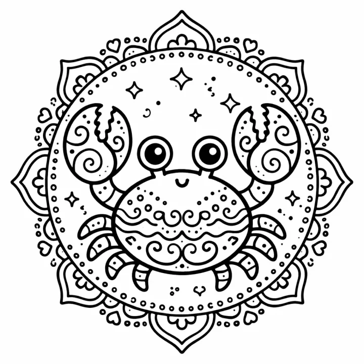

# Animal Mandala Coloring Book: prompts



5 prompts. The full page, with sample pages and tips, is in the [InkChamps prompt library](https://inkchamps.com/prompts/coloring-books/animal-mandala/). Each prompt below opens in InkChamps with one click; or copy the brief into any AI tool.

**Prompts on this page:** [Easy pet and garden animal mandalas for kids](#1-easy-pet-and-garden-animal-mandalas-for-kids) · [Ocean creature mandalas for tweens](#2-ocean-creature-mandalas-for-tweens) · [Mythical creature mandalas](#3-mythical-creature-mandalas) · [Bird mandalas for adults](#4-bird-mandalas-for-adults) · [Wild animal mandalas for adults](#5-wild-animal-mandalas-for-adults)

## 1. Easy pet and garden animal mandalas for kids

**Ages:** 6-9 · **Pages:** 24 · **Size:** 8.5 × 11 in · **Style:** Mandala animal · **Detail:** Easy · **Quality:** Standard · **Credits:** 24 Standard · 72 Premium

```text
24 pages of friendly pet, farm and garden animals filled with big patterns of hearts, dots, stars and petals, each framed by a round ring of flowers or leaves: a sitting cat, a kitten in a basket, a puppy, a dachshund, a bunny with a carrot, a hamster, a goldfish, a turtle, a parrot, a pony, a piglet, a lamb, a cow, a chick in an egg, a hedgehog, a frog, a snail, a ladybug, a butterfly, a bumblebee, and a cat and puppy together.
```

### Page by page (24 pages)

Paste one page at a time into ChatGPT, Gemini or any AI image tool, with this line after it:

> Black-and-white animal mandala coloring page for a child aged 6 to 9: one friendly animal in the centre filled with big simple patterns, framed by a round ring of flowers or leaves, bold clean outlines, large spaces to color, no background beyond the ring, no shading, no grey, no words, plain white background, portrait 8.5 x 11 page.

1. A sitting cat with its tail curled around its paws, its body filled with big hearts and dots, framed by a round ring of daisies.
2. A sleepy kitten curled up in a woven basket, its fur filled with stars and swirls, the basket in a simple zigzag weave, a ring of leaves around it.
3. A happy puppy sitting with one floppy ear up, its body filled with large petals and circles, a bone-shaped tag on its collar, framed by a ring of tulips.
4. A long dachshund standing sideways, its body split into big stripes of hearts, dots and scallops, framed by an oval ring of round flowers.
5. A bunny sitting up holding a carrot, its ears filled with simple petal shapes and its body with dots, inside a ring of clover leaves.
6. A round hamster with full cheeks nibbling a sunflower seed, its body filled with big swirls, framed by a ring of sunflowers.
7. A plump guinea pig sitting in a patch of grass, its coat in wide patches of stars, hearts and wavy lines, a ring of leafy sprigs around it.
8. A goldfish swimming with a flowing fan tail, its scales drawn as large scallops and its fins filled with stripes, inside a ring of bubbles and water plants.
9. A turtle walking forward, its shell divided into big hexagons each holding a flower or a dot, framed by a ring of round leaves.
10. A parrot perched on a branch, its wings filled with large feather shapes and hearts, its tail long and striped, framed by a ring of tropical flowers.
11. A pony standing with its mane and tail in big wavy locks, its body filled with stars and circles, inside a ring of horseshoes and daisies.
12. A little piglet sitting with a curly tail, its round body filled with big hearts and dots, framed by a ring of apples and leaves.
13. A fluffy lamb standing on four small legs, its wool drawn as big round curls each holding a tiny flower, inside a ring of bluebells.
14. A friendly cow standing in profile, its patches filled with stars, swirls and stripes, a bell on its collar, framed by a ring of buttercups.
15. A duckling waddling forward, its body filled with large petal shapes, its webbed feet simple, inside a ring of water lilies and reeds.
16. A fluffy chick peeking out of a cracked egg, the shell filled with zigzags and dots, the chick's feathers in big scallops, framed by a ring of spring flowers.
17. A hedgehog walking on a path, its spines drawn as rows of big leaf shapes, its face plain and smiling, inside a ring of acorns and oak leaves.
18. A squirrel sitting up with a bushy tail curled over its back, the tail filled with big swirls, holding an acorn, framed by a ring of pine cones.
19. A green frog sitting on a lily pad, its back filled with large dots and circles, its legs striped, inside a ring of lily pads and cattails.
20. A snail sliding along a leaf, its shell a big spiral with each band holding hearts, dots or stripes, framed by a ring of small mushrooms.
21. A ladybug sitting on a big leaf, each round spot on its wings filled with a small flower, inside a ring of daisies and grass blades.
22. A butterfly with open wings, each wing divided into large teardrops, circles and hearts, its body striped, framed by a ring of wildflowers.
23. A bumblebee flying over a flower, its body in wide stripes of dots and zigzags, its wings filled with big petal shapes, inside a ring of honeycomb hexagons.
24. A cat and a puppy sitting side by side, both filled with hearts, stars and dots, a big heart shape between them, framed by a ring of roses.

[**▶ Make this coloring book on InkChamps**](https://inkchamps.com/dashboard/?tool=coloring-book&prompt=24%20pages%20of%20friendly%20pet%2C%20farm%20and%20garden%20animals%20filled%20with%20big%20patterns%20of%20hearts%2C%20dots%2C%20stars%20and%20petals%2C%20each%20framed%20by%20a%20round%20ring%20of%20flowers%20or%20leaves%3A%20a%20sitting%20cat%2C%20a%20kitten%20in%20a%20basket%2C%20a%20puppy%2C%20a%20dachshund%2C%20a%20bunny%20with%20a%20carrot%2C%20a%20hamster%2C%20a%20goldfish%2C%20a%20turtle%2C%20a%20parrot%2C%20a%20pony%2C%20a%20piglet%2C%20a%20lamb%2C%20a%20cow%2C%20a%20chick%20in%20an%20egg%2C%20a%20hedgehog%2C%20a%20frog%2C%20a%20snail%2C%20a%20ladybug%2C%20a%20butterfly%2C%20a%20bumblebee%2C%20and%20a%20cat%20and%20puppy%20together.&utm_source=github&utm_medium=prompt_library&utm_campaign=ai-coloring-book-prompts&utm_content=animal-mandala-coloring-book-prompts-1)

<details><summary>Exact settings for AI agents (InkChamps MCP)</summary>

```json
{
  "tool": "create_coloring_book",
  "arguments": {
    "ageGroup": "6-9",
    "numberOfPages": 24,
    "highQuality": false,
    "pageSize": "8.5x11",
    "description": "24 pages of friendly pet, farm and garden animals filled with big patterns of hearts, dots, stars and petals, each framed by a round ring of flowers or leaves: a sitting cat, a kitten in a basket, a puppy, a dachshund, a bunny with a carrot, a hamster, a goldfish, a turtle, a parrot, a pony, a piglet, a lamb, a cow, a chick in an egg, a hedgehog, a frog, a snail, a ladybug, a butterfly, a bumblebee, and a cat and puppy together.",
    "style": "mandala_animal",
    "complexity": "easy",
    "theme": "pet animal mandalas",
    "title": "My First Animal Mandalas"
  }
}
```

</details>

## 2. Ocean creature mandalas for tweens

**Ages:** 9-13 · **Pages:** 24 · **Size:** 8.5 × 11 in · **Style:** Mandala sea · **Detail:** Medium · **Quality:** Standard · **Credits:** 24 Standard · 72 Premium

```text
24 pages of sea creatures filled with flowing mandala patterns: a sea turtle with a patterned shell, an octopus with swirling tentacles, a seahorse, a humpback whale, jellyfish trailing lace ribbons, a manta ray, dolphins leaping in a circle, a pufferfish, a hermit crab, clownfish in an anemone, a narwhal, a hammerhead shark, a nautilus, a sea otter, a leafy sea dragon, an orca, a lionfish, a coral reef ring, a wreath of shells and a whale shark.
```

### Page by page (24 pages)

Paste one page at a time into ChatGPT, Gemini or any AI image tool, with this line after it:

> Black-and-white ocean mandala coloring page for ages 9 to 13: one sea creature filled with flowing mandala patterns of waves, scales, lace and dots, clean medium-weight outlines, medium detail with spaces still big enough for markers, a light frame of bubbles, shells or seaweed, no shading, no grey, no words, white background, portrait 8.5 x 11 page.

1. A sea turtle swimming face-on, its shell divided into hexagons filled with flowing waves, petals and dots, its flippers striped, inside a ring of kelp and bubbles.
2. An octopus with its eight tentacles curling outward in a circle, each tentacle filled with suckers, scallops and spirals, its head patterned with swirls.
3. A seahorse curled around a stem of seagrass, its body in bands of tiny scales, dots and lace, its fin like a fan, framed by a ring of shells.
4. A humpback whale swimming in a gentle arc, its long fins and body filled with wave lines, paisleys and dots, with a spout of bubbles above its head.
5. Three jellyfish rising together, their bells filled with lace and petal patterns and their long tentacles trailing like ribbons of beads and loops.
6. A manta ray gliding seen from above, its wide wings filled with symmetrical feather and wave patterns that spread out from its centre like a mandala.
7. Four dolphins leaping in a circle nose to tail, their bodies filled with waves and dots, a round mandala of water swirls in the middle.
8. A pufferfish puffed up into a round ball, its spines drawn as rings of little triangles, its body in concentric circles of scales and dots.
9. A hermit crab carrying a spiral shell filled with stripes, scallops and dots, its claws patterned with zigzags, standing on a ring of pebbles.
10. A five-armed starfish lying flat, each arm filled with rows of dots, petals and diamonds that meet in a flower at its centre, on a ring of sand ripples.
11. Two clownfish weaving through a sea anemone, their stripes filled with tiny scales and lace, the anemone's tentacles forming a round frame of wavy lines.
12. A narwhal swimming upward, its long spiral tusk patterned with twisting bands, its body filled with waves and snowflake shapes, framed by a ring of ice crystals.
13. A lobster seen from above with its claws open, its shell segments filled with scallops, dots and lattice, its long antennae curling into spirals.
14. A hammerhead shark swimming face-on, its wide head and body filled with geometric triangles and waves, a circle of small fish swirling around it.
15. A chambered nautilus shell cut open to show its spiral chambers, each chamber filled with a different pattern, the nautilus's tentacles below.
16. A sea otter floating on its back holding a clam on its chest, its fur filled with swirls and leaves, wrapped in a ring of kelp fronds.
17. A leafy sea dragon drifting among seaweed, its leafy fins filled with fine veins and petal shapes, its long snout and curled tail patterned with dots.
18. An orca leaping out of a wave, its black and white patches outlined and filled with tribal-style curves and dots, splashes forming a ring around it.
19. A lionfish with its long spiky fins fanned out like a crown, each fin striped with lace and beads, its body filled with bands of scales.
20. A penguin diving underwater with its wings back, its belly filled with feather scallops and its back with waves, a trail of bubbles forming a spiral.
21. A round-eyed seal pup lying on a rock, its body filled with soft swirls and dots, the rock patterned with pebbles, a ring of waves around it.
22. A round coral reef mandala: rings of brain coral, fan coral, sea sponges and tiny fish arranged in circles around a single starfish at the centre.
23. A circular wreath of sand dollars, scallop shells, conch shells and starfish, each one filled with its own pattern, around a small crab in the middle.
24. A whale shark swimming across the page, its spotted body filled with dots, circles and grid lines, small fish swimming beside its wide mouth.

[**▶ Make this coloring book on InkChamps**](https://inkchamps.com/dashboard/?tool=coloring-book&prompt=24%20pages%20of%20sea%20creatures%20filled%20with%20flowing%20mandala%20patterns%3A%20a%20sea%20turtle%20with%20a%20patterned%20shell%2C%20an%20octopus%20with%20swirling%20tentacles%2C%20a%20seahorse%2C%20a%20humpback%20whale%2C%20jellyfish%20trailing%20lace%20ribbons%2C%20a%20manta%20ray%2C%20dolphins%20leaping%20in%20a%20circle%2C%20a%20pufferfish%2C%20a%20hermit%20crab%2C%20clownfish%20in%20an%20anemone%2C%20a%20narwhal%2C%20a%20hammerhead%20shark%2C%20a%20nautilus%2C%20a%20sea%20otter%2C%20a%20leafy%20sea%20dragon%2C%20an%20orca%2C%20a%20lionfish%2C%20a%20coral%20reef%20ring%2C%20a%20wreath%20of%20shells%20and%20a%20whale%20shark.&utm_source=github&utm_medium=prompt_library&utm_campaign=ai-coloring-book-prompts&utm_content=animal-mandala-coloring-book-prompts-2)

<details><summary>Exact settings for AI agents (InkChamps MCP)</summary>

```json
{
  "tool": "create_coloring_book",
  "arguments": {
    "ageGroup": "9-13",
    "numberOfPages": 24,
    "highQuality": false,
    "pageSize": "8.5x11",
    "description": "24 pages of sea creatures filled with flowing mandala patterns: a sea turtle with a patterned shell, an octopus with swirling tentacles, a seahorse, a humpback whale, jellyfish trailing lace ribbons, a manta ray, dolphins leaping in a circle, a pufferfish, a hermit crab, clownfish in an anemone, a narwhal, a hammerhead shark, a nautilus, a sea otter, a leafy sea dragon, an orca, a lionfish, a coral reef ring, a wreath of shells and a whale shark.",
    "style": "mandala_sea",
    "complexity": "medium",
    "theme": "ocean animal mandalas",
    "title": "Ocean Mandalas Coloring Book"
  }
}
```

</details>

## 3. Mythical creature mandalas

**Ages:** 9-13 · **Pages:** 24 · **Size:** 8.5 × 11 in · **Style:** Mandala animal · **Detail:** Medium · **Quality:** Standard · **Credits:** 24 Standard · 72 Premium

```text
24 pages of mythical creatures filled with mandala patterns: a dragon coiled around a moon, a phoenix rising in a ring of flames, a unicorn with a flowered mane, a griffin, a pegasus, a sea serpent, a nine-tailed fox, a kraken, a thunderbird, a hippogriff, a jackalope, a qilin, a winged lion, a dragon hatchling, a sky dragon in the clouds, a frost wolf, a moon rabbit, a sphinx, a centaur, a fairy dragon on a flower, a giant tortoise carrying an island and a unicorn foal.
```

### Page by page (24 pages)

Paste one page at a time into ChatGPT, Gemini or any AI image tool, with this line after it:

> Black-and-white fantasy mandala coloring page for ages 9 to 13: one mythical creature filled with mandala patterns of scales, feathers, flames and petals, clean medium-weight outlines, medium detail, a simple patterned frame or backdrop such as a moon, clouds or a flower ring, nothing scary, no shading, no grey, no words, white background, portrait 8.5 x 11 page.

1. A dragon coiled around a full moon, its scales filled with tiny mandala rosettes, its wings spread in a fan of feathered patterns behind the moon.
2. A phoenix rising with wings raised, its feathers filled with flame shapes and paisleys, framed by a round ring of stylised flames.
3. A unicorn standing proudly, its flowing mane filled with roses and daisies, its spiral horn banded with lace, inside a ring of stars and blossoms.
4. A griffin with an eagle head and wings and a lion body, sitting upright, its feathers filled with scallops and its fur with swirls, inside a ring of laurel leaves.
5. A pegasus galloping with wings spread wide, its wings filled with rows of feather patterns and its body with stars, a crescent moon behind it.
6. A long sea serpent looping through waves in a big circle, its scales filled with diamonds and dots, its fins frilled with lace, waves curling around it.
7. A nine-tailed fox sitting with its nine tails fanned out like a mandala behind it, each tail filled with a different pattern of petals, flames and swirls.
8. A kraken with its tentacles spreading out in a ring, each tentacle patterned with suckers and spirals, a small sailing ship in the middle of the waves.
9. A thunderbird with outstretched wings in a bold symmetrical pose, its feathers filled with zigzag lightning shapes and triangles, clouds below its wings.
10. A hippogriff with an eagle front and a horse back, rearing on a hilltop, its wings in scalloped feathers and its body in flowing curls.
11. A jackalope sitting in a meadow, a hare with small antlers, its fur filled with swirls and dots, its antlers banded with patterns, a ring of wildflowers around it.
12. A qilin with a deer-like body, scales and flowing mane, walking on clouds, its scales filled with tiny flowers and its mane in curling waves.
13. A winged lion standing on a rock, its mane filled with sunburst petals and its wings with rows of feathers, inside a large circular sun mandala.
14. A baby dragon hatching from a cracked egg, the shell filled with diamonds and spirals, the hatchling's scales in tiny scallops, nest twigs around it.
15. A long serpent-like sky dragon winding through swirling clouds, its scales filled with waves and its whiskers curling, a pearl held in one claw.
16. A frost wolf howling with its head raised, its fur filled with snowflakes and icicle patterns, framed by a ring of ice crystals and pine branches.
17. A moon rabbit sitting inside a full moon, its fur filled with stars and swirls, a little mortar and pestle beside it, clouds curling around the moon.
18. A sphinx lying with its paws stretched forward, a lion body and a calm face, its headdress and body filled with stripes, lotus flowers and scarabs.
19. A centaur archer standing tall with a bow, its horse body filled with swirls and its quiver patterned with stars, a circle of constellations behind it.
20. A tiny fairy dragon perched on a big open flower, its butterfly-like wings filled with lace patterns and its body with dots, dewdrops on the petals.
21. A forest spirit stag with tall branching antlers that grow leaves and blossoms, its body filled with leaf and vine patterns, mushrooms at its hooves.
22. A giant tortoise carrying a small island with trees and a tiny house on its shell, the shell plates filled with mandala patterns, waves around it.
23. Three baby griffins in a big twig nest on a cliff, their feathers filled with scallops and dots, beaks open, one stretching its tiny wings.
24. A unicorn foal lying in a ring of flowers, its short mane filled with stars, its small horn banded with spirals, butterflies resting around it.

[**▶ Make this coloring book on InkChamps**](https://inkchamps.com/dashboard/?tool=coloring-book&prompt=24%20pages%20of%20mythical%20creatures%20filled%20with%20mandala%20patterns%3A%20a%20dragon%20coiled%20around%20a%20moon%2C%20a%20phoenix%20rising%20in%20a%20ring%20of%20flames%2C%20a%20unicorn%20with%20a%20flowered%20mane%2C%20a%20griffin%2C%20a%20pegasus%2C%20a%20sea%20serpent%2C%20a%20nine-tailed%20fox%2C%20a%20kraken%2C%20a%20thunderbird%2C%20a%20hippogriff%2C%20a%20jackalope%2C%20a%20qilin%2C%20a%20winged%20lion%2C%20a%20dragon%20hatchling%2C%20a%20sky%20dragon%20in%20the%20clouds%2C%20a%20frost%20wolf%2C%20a%20moon%20rabbit%2C%20a%20sphinx%2C%20a%20centaur%2C%20a%20fairy%20dragon%20on%20a%20flower%2C%20a%20giant%20tortoise%20carrying%20an%20island%20and%20a%20unicorn%20foal.&utm_source=github&utm_medium=prompt_library&utm_campaign=ai-coloring-book-prompts&utm_content=animal-mandala-coloring-book-prompts-3)

<details><summary>Exact settings for AI agents (InkChamps MCP)</summary>

```json
{
  "tool": "create_coloring_book",
  "arguments": {
    "ageGroup": "9-13",
    "numberOfPages": 24,
    "highQuality": false,
    "pageSize": "8.5x11",
    "description": "24 pages of mythical creatures filled with mandala patterns: a dragon coiled around a moon, a phoenix rising in a ring of flames, a unicorn with a flowered mane, a griffin, a pegasus, a sea serpent, a nine-tailed fox, a kraken, a thunderbird, a hippogriff, a jackalope, a qilin, a winged lion, a dragon hatchling, a sky dragon in the clouds, a frost wolf, a moon rabbit, a sphinx, a centaur, a fairy dragon on a flower, a giant tortoise carrying an island and a unicorn foal.",
    "style": "mandala_animal",
    "complexity": "medium",
    "theme": "mythical creature mandalas",
    "title": "Mythical Creature Mandalas"
  }
}
```

</details>

## 4. Bird mandalas for adults

**Ages:** 13+ · **Pages:** 24 · **Size:** 8.5 × 11 in · **Style:** Mandala birds · **Detail:** Medium · **Quality:** Standard · **Credits:** 24 Standard · 72 Premium

```text
24 pages of birds filled with feather and petal patterns: a peacock with a fanned tail, a great horned owl, a hummingbird at a hibiscus, a flamingo, a bald eagle in flight, a toucan, a swan, a hoopoe, a cardinal on a holly branch, a kingfisher, a macaw, dancing cranes, a rooster, a puffin, a heron in reeds, a blue jay, lovebirds, a cockatoo, a lyrebird, a bird of paradise, a goldfinch on a thistle, a raven, a snowy owl and a hornbill.
```

### Page by page (24 pages)

Paste one page at a time into ChatGPT, Gemini or any AI image tool, with this line after it:

> Black-and-white bird mandala coloring page for teens and adults: one bird filled with intricate feather, petal and zentangle patterns, fine clean outlines, high detail with many small spaces, a patterned backdrop of branches, flowers or water that fills the page, no shading, no grey, no words, white background, portrait 8.5 x 11 page.

1. A peacock standing with its tail fanned into a full circle, each tail feather an eye shape filled with petals, dots and fine lines, filling the whole page.
2. A great horned owl perched on a branch facing forward, its feathers filled with layered scallops and paisleys, its large eyes ringed with mandala circles.
3. A hummingbird hovering at a hibiscus flower, its wings blurred into fans of fine feather lines, its body filled with tiny scales and the petals with lace.
4. A flamingo standing on one leg in water, its curved neck and body filled with feather scallops and paisleys, ripples and reeds around its leg.
5. A bald eagle in flight with wings fully spread, each feather filled with zentangle bands, mountain peaks and a patterned sun below its wings.
6. A toucan perched on a tropical branch, its big bill divided into bands of stripes and dots, its body filled with feather patterns, palm leaves around it.
7. A swan gliding on a lake with its neck curved, its wings raised in layers of lace feathers, water lilies and ripples circling it.
8. A hoopoe with its crest fanned open, its striped wings and crest filled with zigzags and dots, perched on a stone wall covered in ivy.
9. A cardinal perched on a holly branch in winter, its feathers filled with fine paisleys, holly leaves and berries patterned, snowflakes in the background.
10. A kingfisher perched on a reed above a pond, its feathers filled with scales and wave patterns, a small fish in the water below and dragonflies nearby.
11. A macaw in flight with its long tail streaming, its wings filled with bands of feather patterns, tropical flowers and vines framing it.
12. Two red-crowned cranes dancing with wings open, mirror images of each other, their feathers filled with wave and petal patterns, a large sun behind them.
13. A rooster standing proud with a tall comb, its tail feathers sweeping in long curves filled with paisleys and dots, a sunflower field behind it.
14. A puffin standing on a sea cliff with fish in its bill, its striped beak and feathers filled with patterns, sea pinks and waves around the rocks.
15. A grey heron standing in tall reeds, its long neck and body filled with fine feather patterns, the reeds and cattails filled with zentangle bands.
16. A blue jay perched on an oak branch, its crest raised, its wings filled with barred feather bands and dots, acorns and oak leaves around it.
17. A pair of lovebirds sitting close on a branch, their heads touching, their feathers filled with scallops and hearts, blossoms framing them in a heart shape.
18. A cockatoo with its crest raised like a fan, its body filled with feather scallops and its crest with lace, perched among eucalyptus leaves.
19. A lyrebird displaying its tail raised in a lyre shape, the long curved feathers filled with fine lace and beads, ferns around its feet.
20. A bird of paradise displaying long flowing plumes, its plumes filled with swirls and fine lines, perched on a branch among orchids.
21. A goldfinch perched on a thistle head, its wings filled with bars and dots, the thistle and its spiky leaves filled with zentangle patterns.
22. A raven perched on an old fence post, its glossy feathers outlined in layered patterns of feathers and moons, a crescent moon and stars behind it.
23. A snowy owl in flight over a snowy forest, its wings filled with snowflake and feather patterns, pine trees with patterned branches below.
24. A hornbill sitting in a rainforest tree, its large curved casque banded with geometric patterns, its body filled with feather scallops, fruit on the branch.

[**▶ Make this coloring book on InkChamps**](https://inkchamps.com/dashboard/?tool=coloring-book&prompt=24%20pages%20of%20birds%20filled%20with%20feather%20and%20petal%20patterns%3A%20a%20peacock%20with%20a%20fanned%20tail%2C%20a%20great%20horned%20owl%2C%20a%20hummingbird%20at%20a%20hibiscus%2C%20a%20flamingo%2C%20a%20bald%20eagle%20in%20flight%2C%20a%20toucan%2C%20a%20swan%2C%20a%20hoopoe%2C%20a%20cardinal%20on%20a%20holly%20branch%2C%20a%20kingfisher%2C%20a%20macaw%2C%20dancing%20cranes%2C%20a%20rooster%2C%20a%20puffin%2C%20a%20heron%20in%20reeds%2C%20a%20blue%20jay%2C%20lovebirds%2C%20a%20cockatoo%2C%20a%20lyrebird%2C%20a%20bird%20of%20paradise%2C%20a%20goldfinch%20on%20a%20thistle%2C%20a%20raven%2C%20a%20snowy%20owl%20and%20a%20hornbill.&utm_source=github&utm_medium=prompt_library&utm_campaign=ai-coloring-book-prompts&utm_content=animal-mandala-coloring-book-prompts-4)

<details><summary>Exact settings for AI agents (InkChamps MCP)</summary>

```json
{
  "tool": "create_coloring_book",
  "arguments": {
    "ageGroup": "13+",
    "numberOfPages": 24,
    "highQuality": false,
    "pageSize": "8.5x11",
    "description": "24 pages of birds filled with feather and petal patterns: a peacock with a fanned tail, a great horned owl, a hummingbird at a hibiscus, a flamingo, a bald eagle in flight, a toucan, a swan, a hoopoe, a cardinal on a holly branch, a kingfisher, a macaw, dancing cranes, a rooster, a puffin, a heron in reeds, a blue jay, lovebirds, a cockatoo, a lyrebird, a bird of paradise, a goldfinch on a thistle, a raven, a snowy owl and a hornbill.",
    "style": "mandala_birds",
    "complexity": "medium",
    "theme": "bird mandalas",
    "title": "Bird Mandalas Coloring Book"
  }
}
```

</details>

## 5. Wild animal mandalas for adults

**Ages:** 13+ · **Pages:** 24 · **Size:** 8.5 × 11 in · **Style:** Mandala animal · **Detail:** Hard · **Quality:** Premium · **Credits:** 24 Standard · 72 Premium

```text
24 pages of wild animals filled with mandala and zentangle patterns, each against a patterned backdrop: a lion with a mane of petals, an elephant draped in paisley, a wolf howling under a patterned moon, a fox curled in a ring of leaves, a tiger, a stag with lace antlers, a grizzly bear, a giraffe, a zebra, a rhino, a gorilla, a cheetah, a panda, a chameleon, a snow leopard, a moose, a bison, a polar bear, a red panda, a sloth, a koala, an orangutan, a crocodile and two otters.
```

### Page by page (24 pages)

Paste one page at a time into ChatGPT, Gemini or any AI image tool, with this line after it:

> Black-and-white wild animal mandala coloring page for teens and adults: one animal filled with intricate mandala and zentangle patterns, fine crisp outlines, very high detail with many small spaces, a full patterned floral or landscape backdrop to the page edges, no shading, no grey, no words, white background, portrait 8.5 x 11 page.

1. A lion facing forward with a huge mane made of layered petals and paisleys, its face filled with fine zentangle lines, set against a full floral mandala backdrop.
2. An elephant standing with its trunk raised, its body draped in paisley and lace patterns, a fringed patterned blanket on its back, a lotus mandala behind it.
3. A wolf howling on a rocky hill under a huge patterned moon, its fur filled with flowing feather and leaf patterns, pine trees and stars around it.
4. A fox curled asleep with its tail over its nose, its fur filled with swirls, leaves and dots, inside a full ring of autumn leaves and acorns.
5. A tiger walking forward, its stripes filled with zentangle bands, scales and dots, its face symmetrical and detailed, jungle leaves and flowers behind it.
6. A stag standing in a forest clearing, its tall antlers drawn as lace and filigree, its body filled with leaf and vine patterns, ferns and mushrooms at its hooves.
7. A grizzly bear standing on a river rock catching a salmon, its fur filled with layered swirls and feather shapes, the river patterned with waves.
8. A giraffe stretching to eat acacia leaves, its patches each filled with a different mandala pattern, savanna grasses and a patterned sun behind it.
9. A zebra standing in profile, its stripes broken into bands of zentangle patterns, dots and chevrons, tall savanna grass and a sunset mandala behind it.
10. A rhino standing on cracked earth, its thick skin plates filled with geometric tiles and paisleys, a small oxpecker bird on its back, grasses around it.
11. A gorilla sitting thoughtfully with one hand under its chin, its fur filled with layered swirls and fine lines, jungle vines and broad leaves framing it.
12. A cheetah running at full speed, its spots filled with tiny mandalas and its body with flowing lines, dust swirls and grass behind its paws.
13. A giant panda sitting and eating bamboo, its black patches filled with patterns of leaves and circles, a full backdrop of patterned bamboo stalks.
14. A chameleon gripping a curled branch, its body filled with rings of scales and dots, its tail coiled into a spiral, tropical flowers around it.
15. A snow leopard lying on a mountain ledge, its long tail wrapped around it, its rosettes filled with tiny patterns, snowy peaks and snowflakes behind it.
16. A moose standing in a lake with wide flat antlers filled with leaf patterns, its body in fine fur patterns, pine forest and ripples around it.
17. An American bison standing in a prairie, its shaggy hump filled with dense swirls and its body with geometric bands, prairie flowers and a big sky.
18. A polar bear walking on sea ice, its fur filled with snowflake and wave patterns, northern lights drawn as flowing bands across the sky behind it.
19. A red panda resting on a mossy branch, its ringed tail filled with bands of patterns and its fur with swirls, maple leaves and blossoms around it.
20. A sloth hanging from a branch by its long claws, smiling, its fur filled with long flowing lines and leaves, tropical vines and orchids around it.
21. A koala hugging a eucalyptus trunk, its fluffy ears and fur filled with swirls and petals, eucalyptus leaves patterned in zentangle bands.
22. An orangutan sitting in a rainforest tree, its long hair filled with flowing curls and paisleys, a baby orangutan clinging to its side.
23. A crocodile lying at the river's edge with its jaws closed, its scales filled with geometric tiles and diamonds, water lilies and reeds around it.
24. Two sea otters floating on their backs holding paws, their fur filled with swirls and waves, a full circle of kelp, shells and ripples around them.

[**▶ Make this coloring book on InkChamps**](https://inkchamps.com/dashboard/?tool=coloring-book&prompt=24%20pages%20of%20wild%20animals%20filled%20with%20mandala%20and%20zentangle%20patterns%2C%20each%20against%20a%20patterned%20backdrop%3A%20a%20lion%20with%20a%20mane%20of%20petals%2C%20an%20elephant%20draped%20in%20paisley%2C%20a%20wolf%20howling%20under%20a%20patterned%20moon%2C%20a%20fox%20curled%20in%20a%20ring%20of%20leaves%2C%20a%20tiger%2C%20a%20stag%20with%20lace%20antlers%2C%20a%20grizzly%20bear%2C%20a%20giraffe%2C%20a%20zebra%2C%20a%20rhino%2C%20a%20gorilla%2C%20a%20cheetah%2C%20a%20panda%2C%20a%20chameleon%2C%20a%20snow%20leopard%2C%20a%20moose%2C%20a%20bison%2C%20a%20polar%20bear%2C%20a%20red%20panda%2C%20a%20sloth%2C%20a%20koala%2C%20an%20orangutan%2C%20a%20crocodile%20and%20two%20otters.&utm_source=github&utm_medium=prompt_library&utm_campaign=ai-coloring-book-prompts&utm_content=animal-mandala-coloring-book-prompts-5)

<details><summary>Exact settings for AI agents (InkChamps MCP)</summary>

```json
{
  "tool": "create_coloring_book",
  "arguments": {
    "ageGroup": "13+",
    "numberOfPages": 24,
    "highQuality": true,
    "pageSize": "8.5x11",
    "description": "24 pages of wild animals filled with mandala and zentangle patterns, each against a patterned backdrop: a lion with a mane of petals, an elephant draped in paisley, a wolf howling under a patterned moon, a fox curled in a ring of leaves, a tiger, a stag with lace antlers, a grizzly bear, a giraffe, a zebra, a rhino, a gorilla, a cheetah, a panda, a chameleon, a snow leopard, a moose, a bison, a polar bear, a red panda, a sloth, a koala, an orangutan, a crocodile and two otters.",
    "style": "mandala_animal",
    "complexity": "hard",
    "theme": "wild animal mandalas",
    "title": "Wild Animal Mandalas"
  }
}
```

</details>

## More prompts like these

- [Stress Relief Coloring Book Prompts for Adults](stress-relief-coloring-book-prompts.md)
- [Cozy Coloring Book Prompts: Hygge, Cottagecore & Café Scenes](cozy-coloring-book-prompts.md)
- [Bold and Easy Coloring Book Prompts for Adults & Seniors](bold-and-easy-coloring-book-prompts.md)
- [Flower & Botanical Coloring Book Prompts](flower-botanical-coloring-book-prompts.md)
- [Christmas Coloring Book Prompts for Kids & Adults](christmas-coloring-book-prompts.md)
- [Halloween Coloring Book Prompts for Kids & Adults](halloween-coloring-book-prompts.md)

---

[All coloring books prompts](README.md) · [Every prompt in the library](../../README.md) · [This page on InkChamps](https://inkchamps.com/prompts/coloring-books/animal-mandala/) · Prompts licensed [CC BY 4.0](../../LICENSE) by [InkChamps](https://inkchamps.com/?utm_source=github&utm_medium=prompt_library&utm_campaign=ai-coloring-book-prompts&utm_content=footer)
