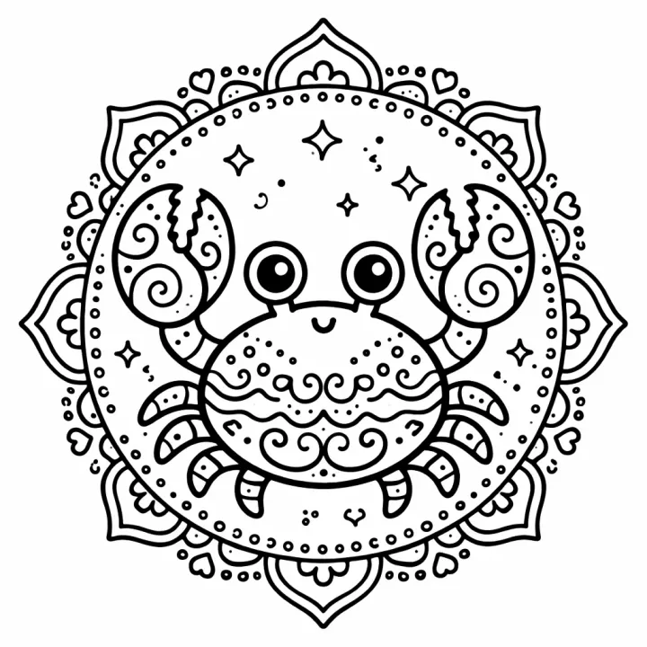

# Animal Mandala Coloring Book: prompts



5 prompts. The full page, with sample pages and tips, is in the [InkChamps prompt library](https://inkchamps.com/prompts/coloring-books/animal-mandala/). Each prompt below opens in InkChamps with one click; or copy the brief into any AI tool.

**Prompts on this page:** [Easy pet and garden animal mandalas for kids](#1-easy-pet-and-garden-animal-mandalas-for-kids) · [Ocean creature mandalas for tweens](#2-ocean-creature-mandalas-for-tweens) · [Mythical creature mandalas](#3-mythical-creature-mandalas) · [Bird mandalas for adults](#4-bird-mandalas-for-adults) · [Wild animal mandalas for adults](#5-wild-animal-mandalas-for-adults)

## 1. Easy pet and garden animal mandalas for kids

**Ages:** 6-9 · **Pages:** 40 · **Size:** 8.5 × 11 in · **Style:** Mandala animal · **Detail:** Easy · **Quality:** Standard · **Credits:** 40 Standard · 120 Premium

```text
Forty friendly animals filled with patterns of hearts, dots, stars and petals, each framed by a round ring of flowers or leaves: a sitting cat, a puppy, a bunny, a hamster, a goldfish, a turtle, a parrot, a guinea pig, a pony, a ladybug, a snail, a hedgehog, a frog, and a duckling.
```

**Extra direction:** More pages: a kitten in a basket, a dachshund, a bunny with a carrot, a rooster, a piglet, a lamb, a cow, a goat, a chick in an egg, a mouse, a squirrel, a robin, a butterfly, a bee, a caterpillar, a tortoise, a canary, a foal, a fluffy chicken, a calf, a goldfinch, a gecko, a ferret, a bunny family, and a cat and puppy together.

[**▶ Make this coloring book on InkChamps**](https://inkchamps.com/dashboard/?tool=coloring-book&prompt=Forty%20friendly%20animals%20filled%20with%20patterns%20of%20hearts%2C%20dots%2C%20stars%20and%20petals%2C%20each%20framed%20by%20a%20round%20ring%20of%20flowers%20or%20leaves%3A%20a%20sitting%20cat%2C%20a%20puppy%2C%20a%20bunny%2C%20a%20hamster%2C%20a%20goldfish%2C%20a%20turtle%2C%20a%20parrot%2C%20a%20guinea%20pig%2C%20a%20pony%2C%20a%20ladybug%2C%20a%20snail%2C%20a%20hedgehog%2C%20a%20frog%2C%20and%20a%20duckling.&utm_source=github&utm_medium=prompt_library&utm_campaign=ai-coloring-book-prompts&utm_content=animal-mandala-coloring-book-prompts-1)

<details><summary>Exact settings for AI agents (InkChamps MCP)</summary>

```json
{
  "tool": "create_coloring_book",
  "arguments": {
    "ageGroup": "6-9",
    "numberOfPages": 40,
    "highQuality": false,
    "pageSize": "8.5x11",
    "description": "Forty friendly animals filled with patterns of hearts, dots, stars and petals, each framed by a round ring of flowers or leaves: a sitting cat, a puppy, a bunny, a hamster, a goldfish, a turtle, a parrot, a guinea pig, a pony, a ladybug, a snail, a hedgehog, a frog, and a duckling.",
    "style": "mandala_animal",
    "complexity": "easy",
    "theme": "pet animal mandalas",
    "title": "My First Animal Mandalas",
    "additionalInstructions": "More pages: a kitten in a basket, a dachshund, a bunny with a carrot, a rooster, a piglet, a lamb, a cow, a goat, a chick in an egg, a mouse, a squirrel, a robin, a butterfly, a bee, a caterpillar, a tortoise, a canary, a foal, a fluffy chicken, a calf, a goldfinch, a gecko, a ferret, a bunny family, and a cat and puppy together."
  }
}
```

</details>

## 2. Ocean creature mandalas for tweens

**Ages:** 9-13 · **Pages:** 40 · **Size:** 8.5 × 11 in · **Style:** Mandala sea · **Detail:** Medium · **Quality:** Standard · **Credits:** 40 Standard · 120 Premium

```text
Forty sea creatures filled with flowing mandala patterns: a sea turtle with a patterned shell, an octopus with swirling tentacles, a seahorse, a humpback whale, jellyfish trailing lace ribbons, a manta ray, dolphins leaping in a circle, a pufferfish, a hermit crab, a starfish, clownfish in an anemone, a narwhal, a lobster, a hammerhead shark, and a nautilus.
```

**Extra direction:** More pages: a floating sea otter, a walrus, a seal pup, a penguin, a lionfish, a moray eel, a leafy sea dragon, an angelfish, a cuttlefish, a blue whale, an orca, a coral reef ring, a wreath of sand dollars and shells, a stingray, a beluga, an ocean sunfish, a crab family, a diving pelican, a squid, a turtle hatchling on the sand, a swordfish, a sea urchin, a parrotfish, a dugong, and a whale shark.

[**▶ Make this coloring book on InkChamps**](https://inkchamps.com/dashboard/?tool=coloring-book&prompt=Forty%20sea%20creatures%20filled%20with%20flowing%20mandala%20patterns%3A%20a%20sea%20turtle%20with%20a%20patterned%20shell%2C%20an%20octopus%20with%20swirling%20tentacles%2C%20a%20seahorse%2C%20a%20humpback%20whale%2C%20jellyfish%20trailing%20lace%20ribbons%2C%20a%20manta%20ray%2C%20dolphins%20leaping%20in%20a%20circle%2C%20a%20pufferfish%2C%20a%20hermit%20crab%2C%20a%20starfish%2C%20clownfish%20in%20an%20anemone%2C%20a%20narwhal%2C%20a%20lobster%2C%20a%20hammerhead%20shark%2C%20and%20a%20nautilus.&utm_source=github&utm_medium=prompt_library&utm_campaign=ai-coloring-book-prompts&utm_content=animal-mandala-coloring-book-prompts-2)

<details><summary>Exact settings for AI agents (InkChamps MCP)</summary>

```json
{
  "tool": "create_coloring_book",
  "arguments": {
    "ageGroup": "9-13",
    "numberOfPages": 40,
    "highQuality": false,
    "pageSize": "8.5x11",
    "description": "Forty sea creatures filled with flowing mandala patterns: a sea turtle with a patterned shell, an octopus with swirling tentacles, a seahorse, a humpback whale, jellyfish trailing lace ribbons, a manta ray, dolphins leaping in a circle, a pufferfish, a hermit crab, a starfish, clownfish in an anemone, a narwhal, a lobster, a hammerhead shark, and a nautilus.",
    "style": "mandala_sea",
    "complexity": "medium",
    "theme": "ocean animal mandalas",
    "title": "Ocean Mandalas Coloring Book",
    "additionalInstructions": "More pages: a floating sea otter, a walrus, a seal pup, a penguin, a lionfish, a moray eel, a leafy sea dragon, an angelfish, a cuttlefish, a blue whale, an orca, a coral reef ring, a wreath of sand dollars and shells, a stingray, a beluga, an ocean sunfish, a crab family, a diving pelican, a squid, a turtle hatchling on the sand, a swordfish, a sea urchin, a parrotfish, a dugong, and a whale shark."
  }
}
```

</details>

## 3. Mythical creature mandalas

**Ages:** 9-13 · **Pages:** 40 · **Size:** 8.5 × 11 in · **Style:** Mandala animal · **Detail:** Medium · **Quality:** Standard · **Credits:** 40 Standard · 120 Premium

```text
Forty mythical creatures filled with mandala patterns: a dragon coiled around a moon, a phoenix rising in a ring of flames, a unicorn with a flowered mane, a griffin, a pegasus, a sea serpent, a nine-tailed fox, a kraken, a thunderbird, a hippogriff, a jackalope, a qilin, a winged lion, and a basilisk.
```

**Extra direction:** More pages: a centaur, a hydra, a cockatrice, a yeti, a sphinx, a dragon hatchling in its egg, a long dragon among clouds, a fire salamander, a frost wolf, a moon rabbit, a three-headed guard dog, a herd of winged horses, a fairy dragon on a flower, a forest spirit stag, a manticore, a leviathan, a firebird, a giant tortoise carrying an island, a baby griffin nest, a sea horse with a fish tail, a wolpertinger, a roc, a dragon turtle, a unicorn foal, and a two-headed eagle.

[**▶ Make this coloring book on InkChamps**](https://inkchamps.com/dashboard/?tool=coloring-book&prompt=Forty%20mythical%20creatures%20filled%20with%20mandala%20patterns%3A%20a%20dragon%20coiled%20around%20a%20moon%2C%20a%20phoenix%20rising%20in%20a%20ring%20of%20flames%2C%20a%20unicorn%20with%20a%20flowered%20mane%2C%20a%20griffin%2C%20a%20pegasus%2C%20a%20sea%20serpent%2C%20a%20nine-tailed%20fox%2C%20a%20kraken%2C%20a%20thunderbird%2C%20a%20hippogriff%2C%20a%20jackalope%2C%20a%20qilin%2C%20a%20winged%20lion%2C%20and%20a%20basilisk.&utm_source=github&utm_medium=prompt_library&utm_campaign=ai-coloring-book-prompts&utm_content=animal-mandala-coloring-book-prompts-3)

<details><summary>Exact settings for AI agents (InkChamps MCP)</summary>

```json
{
  "tool": "create_coloring_book",
  "arguments": {
    "ageGroup": "9-13",
    "numberOfPages": 40,
    "highQuality": false,
    "pageSize": "8.5x11",
    "description": "Forty mythical creatures filled with mandala patterns: a dragon coiled around a moon, a phoenix rising in a ring of flames, a unicorn with a flowered mane, a griffin, a pegasus, a sea serpent, a nine-tailed fox, a kraken, a thunderbird, a hippogriff, a jackalope, a qilin, a winged lion, and a basilisk.",
    "style": "mandala_animal",
    "complexity": "medium",
    "theme": "mythical creature mandalas",
    "title": "Mythical Creature Mandalas",
    "additionalInstructions": "More pages: a centaur, a hydra, a cockatrice, a yeti, a sphinx, a dragon hatchling in its egg, a long dragon among clouds, a fire salamander, a frost wolf, a moon rabbit, a three-headed guard dog, a herd of winged horses, a fairy dragon on a flower, a forest spirit stag, a manticore, a leviathan, a firebird, a giant tortoise carrying an island, a baby griffin nest, a sea horse with a fish tail, a wolpertinger, a roc, a dragon turtle, a unicorn foal, and a two-headed eagle."
  }
}
```

</details>

## 4. Bird mandalas for adults

**Ages:** 13+ · **Pages:** 40 · **Size:** 8.5 × 11 in · **Style:** Mandala birds · **Detail:** Medium · **Quality:** Standard · **Credits:** 40 Standard · 120 Premium

```text
Forty birds filled with feather and petal patterns: a peacock with a fanned tail, a great horned owl, a hummingbird at a hibiscus, a flamingo, a bald eagle in flight, a toucan, a swan, a hoopoe, a cardinal on a holly branch, a kingfisher, a macaw, a barn owl, a dancing crane, and a rooster.
```

**Extra direction:** More pages: a puffin, a pelican, a heron in reeds, a robin, a blue jay, a pair of parrots, a cockatoo, a pheasant, a lyrebird, a bird of paradise, a goldfinch on a thistle, a raven, a penguin, an ostrich, a falcon, a quail family, a woodpecker, a pair of lovebirds, a roadrunner, a wren in a nest, a hornbill, a snowy owl, a magpie, a lorikeet, and a stork.

[**▶ Make this coloring book on InkChamps**](https://inkchamps.com/dashboard/?tool=coloring-book&prompt=Forty%20birds%20filled%20with%20feather%20and%20petal%20patterns%3A%20a%20peacock%20with%20a%20fanned%20tail%2C%20a%20great%20horned%20owl%2C%20a%20hummingbird%20at%20a%20hibiscus%2C%20a%20flamingo%2C%20a%20bald%20eagle%20in%20flight%2C%20a%20toucan%2C%20a%20swan%2C%20a%20hoopoe%2C%20a%20cardinal%20on%20a%20holly%20branch%2C%20a%20kingfisher%2C%20a%20macaw%2C%20a%20barn%20owl%2C%20a%20dancing%20crane%2C%20and%20a%20rooster.&utm_source=github&utm_medium=prompt_library&utm_campaign=ai-coloring-book-prompts&utm_content=animal-mandala-coloring-book-prompts-4)

<details><summary>Exact settings for AI agents (InkChamps MCP)</summary>

```json
{
  "tool": "create_coloring_book",
  "arguments": {
    "ageGroup": "13+",
    "numberOfPages": 40,
    "highQuality": false,
    "pageSize": "8.5x11",
    "description": "Forty birds filled with feather and petal patterns: a peacock with a fanned tail, a great horned owl, a hummingbird at a hibiscus, a flamingo, a bald eagle in flight, a toucan, a swan, a hoopoe, a cardinal on a holly branch, a kingfisher, a macaw, a barn owl, a dancing crane, and a rooster.",
    "style": "mandala_birds",
    "complexity": "medium",
    "theme": "bird mandalas",
    "title": "Bird Mandalas Coloring Book",
    "additionalInstructions": "More pages: a puffin, a pelican, a heron in reeds, a robin, a blue jay, a pair of parrots, a cockatoo, a pheasant, a lyrebird, a bird of paradise, a goldfinch on a thistle, a raven, a penguin, an ostrich, a falcon, a quail family, a woodpecker, a pair of lovebirds, a roadrunner, a wren in a nest, a hornbill, a snowy owl, a magpie, a lorikeet, and a stork."
  }
}
```

</details>

## 5. Wild animal mandalas for adults

**Ages:** 13+ · **Pages:** 40 · **Size:** 8.5 × 11 in · **Style:** Mandala animal · **Detail:** Hard · **Quality:** Premium · **Credits:** 40 Standard · 120 Premium

```text
Forty wild animals filled with mandala and zentangle patterns, each against a floral mandala backdrop: a lion with a mane of petals, an elephant draped in paisley, a wolf howling under a patterned moon, a fox curled in a ring of leaves, a tiger, a stag with lace antlers, a grizzly bear, a giraffe, a zebra, a rhino, a gorilla, a cheetah, a panda, and a chameleon.
```

**Extra direction:** More pages: a snow leopard, a moose, a bison, a hippo, a kangaroo, a koala, a sloth, a red panda, a polar bear, a raccoon, a lynx, a camel, a jaguar, a meerkat family, an orangutan, a hare, a mountain goat, a crocodile, a water buffalo, a lemur, an armadillo, an otter, a badger, a wild boar, and an elephant mother and calf.

[**▶ Make this coloring book on InkChamps**](https://inkchamps.com/dashboard/?tool=coloring-book&prompt=Forty%20wild%20animals%20filled%20with%20mandala%20and%20zentangle%20patterns%2C%20each%20against%20a%20floral%20mandala%20backdrop%3A%20a%20lion%20with%20a%20mane%20of%20petals%2C%20an%20elephant%20draped%20in%20paisley%2C%20a%20wolf%20howling%20under%20a%20patterned%20moon%2C%20a%20fox%20curled%20in%20a%20ring%20of%20leaves%2C%20a%20tiger%2C%20a%20stag%20with%20lace%20antlers%2C%20a%20grizzly%20bear%2C%20a%20giraffe%2C%20a%20zebra%2C%20a%20rhino%2C%20a%20gorilla%2C%20a%20cheetah%2C%20a%20panda%2C%20and%20a%20chameleon.&utm_source=github&utm_medium=prompt_library&utm_campaign=ai-coloring-book-prompts&utm_content=animal-mandala-coloring-book-prompts-5)

<details><summary>Exact settings for AI agents (InkChamps MCP)</summary>

```json
{
  "tool": "create_coloring_book",
  "arguments": {
    "ageGroup": "13+",
    "numberOfPages": 40,
    "highQuality": true,
    "pageSize": "8.5x11",
    "description": "Forty wild animals filled with mandala and zentangle patterns, each against a floral mandala backdrop: a lion with a mane of petals, an elephant draped in paisley, a wolf howling under a patterned moon, a fox curled in a ring of leaves, a tiger, a stag with lace antlers, a grizzly bear, a giraffe, a zebra, a rhino, a gorilla, a cheetah, a panda, and a chameleon.",
    "style": "mandala_animal",
    "complexity": "hard",
    "theme": "wild animal mandalas",
    "title": "Wild Animal Mandalas",
    "additionalInstructions": "More pages: a snow leopard, a moose, a bison, a hippo, a kangaroo, a koala, a sloth, a red panda, a polar bear, a raccoon, a lynx, a camel, a jaguar, a meerkat family, an orangutan, a hare, a mountain goat, a crocodile, a water buffalo, a lemur, an armadillo, an otter, a badger, a wild boar, and an elephant mother and calf."
  }
}
```

</details>

## More prompts like these

- [Stress Relief Coloring Book Prompts for Adults](stress-relief-coloring-book-prompts.md)
- [Cozy Coloring Book Prompts: Hygge, Cottagecore & Café Scenes](cozy-coloring-book-prompts.md)
- [Bold and Easy Coloring Book Prompts for Adults & Seniors](bold-and-easy-coloring-book-prompts.md)
- [Flower & Botanical Coloring Book Prompts](flower-botanical-coloring-book-prompts.md)
- [Christmas Coloring Book Prompts for Kids & Adults](christmas-coloring-book-prompts.md)
- [Halloween Coloring Book Prompts for Kids & Adults](halloween-coloring-book-prompts.md)

---

[All coloring books prompts](README.md) · [Every prompt in the library](../../README.md) · [This page on InkChamps](https://inkchamps.com/prompts/coloring-books/animal-mandala/) · Prompts licensed [CC BY 4.0](../../LICENSE) by [InkChamps](https://inkchamps.com/?utm_source=github&utm_medium=prompt_library&utm_campaign=ai-coloring-book-prompts&utm_content=footer)
