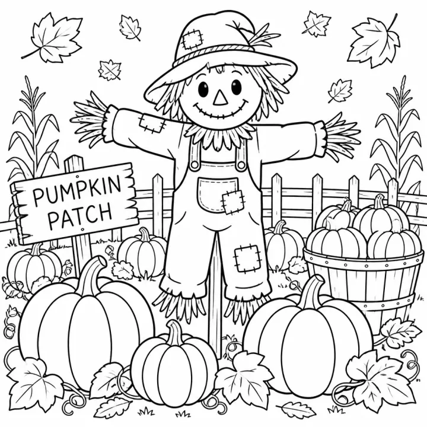

# Autumn & Thanksgiving Coloring Book: prompts



5 prompts. The full page, with sample pages and tips, is in the [InkChamps prompt library](https://inkchamps.com/prompts/coloring-books/autumn-thanksgiving/). Each prompt below opens in InkChamps with one click; or copy the brief into any AI tool.

**Prompts on this page:** [Leaves and pumpkins for toddlers](#1-leaves-and-pumpkins-for-toddlers) · [Thanksgiving gratitude for kids](#2-thanksgiving-gratitude-for-kids) · [Fall outings for tweens](#3-fall-outings-for-tweens) · [Cozy autumn at home for adults](#4-cozy-autumn-at-home-for-adults) · [Woodland wildlife in autumn](#5-woodland-wildlife-in-autumn)

## 1. Leaves and pumpkins for toddlers

**Ages:** 3-6 · **Pages:** 40 · **Size:** 8.5 × 11 in · **Style:** General coloring · **Detail:** Easy · **Quality:** Standard · **Credits:** 40 Standard · 120 Premium

```text
Forty autumn pictures: a maple leaf, an acorn with a cap, a pumpkin with a curly vine, a scarecrow, a basket of apples, a sunflower, a corn cob, rain boots, a mug of cider, a wheelbarrow of gourds, an apple with a worm, a pile of leaves, a pinecone, a mushroom, a rake, a pie, a pear, a hay bale, an umbrella in falling leaves, a little turkey, a hat and scarf, a tractor, an oak tree dropping leaves and a caramel apple on a stick.
```

**Extra direction:** More pages: a squirrel with a nut, a hedgehog, a pumpkin cart, a bowl of soup, a kite in the wind, a crow on a fence, a leaf crown, a pumpkin with a smile, a sweater on a hanger, a basket of corn, a birdhouse in an autumn tree.

[**▶ Make this coloring book on InkChamps**](https://inkchamps.com/dashboard/?tool=coloring-book&prompt=Forty%20autumn%20pictures%3A%20a%20maple%20leaf%2C%20an%20acorn%20with%20a%20cap%2C%20a%20pumpkin%20with%20a%20curly%20vine%2C%20a%20scarecrow%2C%20a%20basket%20of%20apples%2C%20a%20sunflower%2C%20a%20corn%20cob%2C%20rain%20boots%2C%20a%20mug%20of%20cider%2C%20a%20wheelbarrow%20of%20gourds%2C%20an%20apple%20with%20a%20worm%2C%20a%20pile%20of%20leaves%2C%20a%20pinecone%2C%20a%20mushroom%2C%20a%20rake%2C%20a%20pie%2C%20a%20pear%2C%20a%20hay%20bale%2C%20an%20umbrella%20in%20falling%20leaves%2C%20a%20little%20turkey%2C%20a%20hat%20and%20scarf%2C%20a%20tractor%2C%20an%20oak%20tree%20dropping%20leaves%20and%20a%20caramel%20apple%20on%20a%20stick.&utm_source=github&utm_medium=prompt_library&utm_campaign=ai-coloring-book-prompts&utm_content=autumn-thanksgiving-coloring-book-prompts-1)

<details><summary>Exact settings for AI agents (InkChamps MCP)</summary>

```json
{
  "tool": "create_coloring_book",
  "arguments": {
    "ageGroup": "3-6",
    "numberOfPages": 40,
    "highQuality": false,
    "pageSize": "8.5x11",
    "description": "Forty autumn pictures: a maple leaf, an acorn with a cap, a pumpkin with a curly vine, a scarecrow, a basket of apples, a sunflower, a corn cob, rain boots, a mug of cider, a wheelbarrow of gourds, an apple with a worm, a pile of leaves, a pinecone, a mushroom, a rake, a pie, a pear, a hay bale, an umbrella in falling leaves, a little turkey, a hat and scarf, a tractor, an oak tree dropping leaves and a caramel apple on a stick.",
    "theme": "Autumn",
    "style": "general_coloring",
    "complexity": "easy",
    "title": "My First Fall Coloring Book",
    "additionalInstructions": "More pages: a squirrel with a nut, a hedgehog, a pumpkin cart, a bowl of soup, a kite in the wind, a crow on a fence, a leaf crown, a pumpkin with a smile, a sweater on a hanger, a basket of corn, a birdhouse in an autumn tree."
  }
}
```

</details>

## 2. Thanksgiving gratitude for kids

**Ages:** 6-9 · **Pages:** 40 · **Size:** 8.5 × 11 in · **Style:** General coloring · **Detail:** Medium · **Quality:** Standard · **Credits:** 40 Standard · 120 Premium

```text
Forty Thanksgiving pages for kids: a family around a long table with a roast turkey, a kid kneading dough for rolls, grandparents arriving at the door, setting the table with leaf place mats, a big parade with balloon floats, a pumpkin pie coming out of the oven, cousins playing football in the yard, a kid helping at a community kitchen, a cornucopia, a hand-print turkey craft, a kids' table with crayons, a pie-baking contest and a family walk after dinner.
```

**Extra direction:** More pages: peeling potatoes with a grandparent, a gratitude tree with paper leaves, a dog waiting under the table, washing dishes together, a basket of food for a neighbor, cranberries in a bowl, a family photo on the porch, a cousins' sleepover, leftovers in sandwiches.

[**▶ Make this coloring book on InkChamps**](https://inkchamps.com/dashboard/?tool=coloring-book&prompt=Forty%20Thanksgiving%20pages%20for%20kids%3A%20a%20family%20around%20a%20long%20table%20with%20a%20roast%20turkey%2C%20a%20kid%20kneading%20dough%20for%20rolls%2C%20grandparents%20arriving%20at%20the%20door%2C%20setting%20the%20table%20with%20leaf%20place%20mats%2C%20a%20big%20parade%20with%20balloon%20floats%2C%20a%20pumpkin%20pie%20coming%20out%20of%20the%20oven%2C%20cousins%20playing%20football%20in%20the%20yard%2C%20a%20kid%20helping%20at%20a%20community%20kitchen%2C%20a%20cornucopia%2C%20a%20hand-print%20turkey%20craft%2C%20a%20kids%27%20table%20with%20crayons%2C%20a%20pie-baking%20contest%20and%20a%20family%20walk%20after%20dinner.&utm_source=github&utm_medium=prompt_library&utm_campaign=ai-coloring-book-prompts&utm_content=autumn-thanksgiving-coloring-book-prompts-2)

<details><summary>Exact settings for AI agents (InkChamps MCP)</summary>

```json
{
  "tool": "create_coloring_book",
  "arguments": {
    "ageGroup": "6-9",
    "numberOfPages": 40,
    "highQuality": false,
    "pageSize": "8.5x11",
    "description": "Forty Thanksgiving pages for kids: a family around a long table with a roast turkey, a kid kneading dough for rolls, grandparents arriving at the door, setting the table with leaf place mats, a big parade with balloon floats, a pumpkin pie coming out of the oven, cousins playing football in the yard, a kid helping at a community kitchen, a cornucopia, a hand-print turkey craft, a kids' table with crayons, a pie-baking contest and a family walk after dinner.",
    "theme": "Thanksgiving",
    "style": "general_coloring",
    "complexity": "medium",
    "title": "Thankful Hearts: A Thanksgiving Coloring Book",
    "additionalInstructions": "More pages: peeling potatoes with a grandparent, a gratitude tree with paper leaves, a dog waiting under the table, washing dishes together, a basket of food for a neighbor, cranberries in a bowl, a family photo on the porch, a cousins' sleepover, leftovers in sandwiches."
  }
}
```

</details>

## 3. Fall outings for tweens

**Ages:** 9-13 · **Pages:** 40 · **Size:** 8.5 × 11 in · **Style:** General coloring · **Detail:** Medium · **Quality:** Standard · **Credits:** 40 Standard · 120 Premium

```text
Forty fall outing scenes: apple picking from a ladder in an orchard, a hayride to a pumpkin patch, getting lost in a corn maze, jumping into a pile of leaves, a campfire with toasted marshmallows, a bike trail under gold trees, a fall fair with a Ferris wheel, a cider-press stand, a football game under the lights, a hike to a waterfall, a canoe on a lake of reflected trees, a pumpkin-carving night, a treehouse in autumn, a cross-country race and a farm stand of squash.
```

**Extra direction:** More pages: a scarecrow-building contest, a sunrise fishing trip, a rainy-day bike ride, a goat petting barn at a farm, a giant pumpkin weigh-in, raking leaves for a neighbor, a bonfire night, a trail camera spotting a deer, a soccer game in falling leaves.

[**▶ Make this coloring book on InkChamps**](https://inkchamps.com/dashboard/?tool=coloring-book&prompt=Forty%20fall%20outing%20scenes%3A%20apple%20picking%20from%20a%20ladder%20in%20an%20orchard%2C%20a%20hayride%20to%20a%20pumpkin%20patch%2C%20getting%20lost%20in%20a%20corn%20maze%2C%20jumping%20into%20a%20pile%20of%20leaves%2C%20a%20campfire%20with%20toasted%20marshmallows%2C%20a%20bike%20trail%20under%20gold%20trees%2C%20a%20fall%20fair%20with%20a%20Ferris%20wheel%2C%20a%20cider-press%20stand%2C%20a%20football%20game%20under%20the%20lights%2C%20a%20hike%20to%20a%20waterfall%2C%20a%20canoe%20on%20a%20lake%20of%20reflected%20trees%2C%20a%20pumpkin-carving%20night%2C%20a%20treehouse%20in%20autumn%2C%20a%20cross-country%20race%20and%20a%20farm%20stand%20of%20squash.&utm_source=github&utm_medium=prompt_library&utm_campaign=ai-coloring-book-prompts&utm_content=autumn-thanksgiving-coloring-book-prompts-3)

<details><summary>Exact settings for AI agents (InkChamps MCP)</summary>

```json
{
  "tool": "create_coloring_book",
  "arguments": {
    "ageGroup": "9-13",
    "numberOfPages": 40,
    "highQuality": false,
    "pageSize": "8.5x11",
    "description": "Forty fall outing scenes: apple picking from a ladder in an orchard, a hayride to a pumpkin patch, getting lost in a corn maze, jumping into a pile of leaves, a campfire with toasted marshmallows, a bike trail under gold trees, a fall fair with a Ferris wheel, a cider-press stand, a football game under the lights, a hike to a waterfall, a canoe on a lake of reflected trees, a pumpkin-carving night, a treehouse in autumn, a cross-country race and a farm stand of squash.",
    "theme": "fall outings",
    "style": "general_coloring",
    "complexity": "medium",
    "title": "Fall Adventures: Orchard, Corn Maze and More",
    "additionalInstructions": "More pages: a scarecrow-building contest, a sunrise fishing trip, a rainy-day bike ride, a goat petting barn at a farm, a giant pumpkin weigh-in, raking leaves for a neighbor, a bonfire night, a trail camera spotting a deer, a soccer game in falling leaves."
  }
}
```

</details>

## 4. Cozy autumn at home for adults

**Ages:** 13+ · **Pages:** 40 · **Size:** 8.5 × 11 in · **Style:** General coloring · **Detail:** Medium · **Quality:** Standard · **Credits:** 40 Standard · 120 Premium

```text
Forty cozy autumn pages for adults: a porch with pumpkins, mums and a rocking chair, a kitchen with apple pies cooling, a reading nook with a plaid blanket and leaves falling outside, a village street in fall colors, a farmhouse with a red barn and a harvest wagon, a candlelit table with squash and wheat, a cat in a basket of yarn, a fireplace with knitted socks, a market stall of gourds and honey jars, a covered bridge over a river, scones by a rainy window and an oak-leaf wreath on a door.
```

**Extra direction:** More pages: a pantry of canned preserves, a bakery window of pumpkin bread, a garden shed with drying seed heads, a lane of maple trees, a mug of mulled cider by a window, a bookshop with an autumn display, a harvest supper in a barn, a soup pot on a stove, a bike with a basket of apples.

[**▶ Make this coloring book on InkChamps**](https://inkchamps.com/dashboard/?tool=coloring-book&prompt=Forty%20cozy%20autumn%20pages%20for%20adults%3A%20a%20porch%20with%20pumpkins%2C%20mums%20and%20a%20rocking%20chair%2C%20a%20kitchen%20with%20apple%20pies%20cooling%2C%20a%20reading%20nook%20with%20a%20plaid%20blanket%20and%20leaves%20falling%20outside%2C%20a%20village%20street%20in%20fall%20colors%2C%20a%20farmhouse%20with%20a%20red%20barn%20and%20a%20harvest%20wagon%2C%20a%20candlelit%20table%20with%20squash%20and%20wheat%2C%20a%20cat%20in%20a%20basket%20of%20yarn%2C%20a%20fireplace%20with%20knitted%20socks%2C%20a%20market%20stall%20of%20gourds%20and%20honey%20jars%2C%20a%20covered%20bridge%20over%20a%20river%2C%20scones%20by%20a%20rainy%20window%20and%20an%20oak-leaf%20wreath%20on%20a%20door.&utm_source=github&utm_medium=prompt_library&utm_campaign=ai-coloring-book-prompts&utm_content=autumn-thanksgiving-coloring-book-prompts-4)

<details><summary>Exact settings for AI agents (InkChamps MCP)</summary>

```json
{
  "tool": "create_coloring_book",
  "arguments": {
    "ageGroup": "13+",
    "numberOfPages": 40,
    "highQuality": false,
    "pageSize": "8.5x11",
    "description": "Forty cozy autumn pages for adults: a porch with pumpkins, mums and a rocking chair, a kitchen with apple pies cooling, a reading nook with a plaid blanket and leaves falling outside, a village street in fall colors, a farmhouse with a red barn and a harvest wagon, a candlelit table with squash and wheat, a cat in a basket of yarn, a fireplace with knitted socks, a market stall of gourds and honey jars, a covered bridge over a river, scones by a rainy window and an oak-leaf wreath on a door.",
    "theme": "cozy autumn",
    "style": "general_coloring",
    "complexity": "medium",
    "title": "Autumn at Home: A Cozy Fall Coloring Book",
    "additionalInstructions": "More pages: a pantry of canned preserves, a bakery window of pumpkin bread, a garden shed with drying seed heads, a lane of maple trees, a mug of mulled cider by a window, a bookshop with an autumn display, a harvest supper in a barn, a soup pot on a stove, a bike with a basket of apples."
  }
}
```

</details>

## 5. Woodland wildlife in autumn

**Ages:** 13+ · **Pages:** 40 · **Size:** 8.5 × 11 in · **Style:** General coloring · **Detail:** Hard · **Quality:** Premium · **Credits:** 40 Standard · 120 Premium

```text
Forty woodland wildlife pages: a fox among ferns and fallen leaves, a stag in morning mist, a black bear fishing for salmon, a raccoon on a mossy log, a barn owl in an oak hollow, a chipmunk stuffing acorns, wild turkeys in a clearing, geese flying in a V over a lake, a heron at a pond's edge, a red squirrel on a pine branch, a badger by a mushroom ring, a beaver building a dam, a woodpecker on a birch, a moose wading through a marsh and a wolf on a ridge at dusk.
```

**Extra direction:** More pages: an elk bugling in a meadow, a pine marten on a branch, a skunk under a fallen tree, a pair of cardinals on a hawthorn, a lynx in tall grass, a porcupine eating apples, a salmon leaping a waterfall, a great horned owl at dusk, a mink by a creek.

[**▶ Make this coloring book on InkChamps**](https://inkchamps.com/dashboard/?tool=coloring-book&prompt=Forty%20woodland%20wildlife%20pages%3A%20a%20fox%20among%20ferns%20and%20fallen%20leaves%2C%20a%20stag%20in%20morning%20mist%2C%20a%20black%20bear%20fishing%20for%20salmon%2C%20a%20raccoon%20on%20a%20mossy%20log%2C%20a%20barn%20owl%20in%20an%20oak%20hollow%2C%20a%20chipmunk%20stuffing%20acorns%2C%20wild%20turkeys%20in%20a%20clearing%2C%20geese%20flying%20in%20a%20V%20over%20a%20lake%2C%20a%20heron%20at%20a%20pond%27s%20edge%2C%20a%20red%20squirrel%20on%20a%20pine%20branch%2C%20a%20badger%20by%20a%20mushroom%20ring%2C%20a%20beaver%20building%20a%20dam%2C%20a%20woodpecker%20on%20a%20birch%2C%20a%20moose%20wading%20through%20a%20marsh%20and%20a%20wolf%20on%20a%20ridge%20at%20dusk.&utm_source=github&utm_medium=prompt_library&utm_campaign=ai-coloring-book-prompts&utm_content=autumn-thanksgiving-coloring-book-prompts-5)

<details><summary>Exact settings for AI agents (InkChamps MCP)</summary>

```json
{
  "tool": "create_coloring_book",
  "arguments": {
    "ageGroup": "13+",
    "numberOfPages": 40,
    "highQuality": true,
    "pageSize": "8.5x11",
    "description": "Forty woodland wildlife pages: a fox among ferns and fallen leaves, a stag in morning mist, a black bear fishing for salmon, a raccoon on a mossy log, a barn owl in an oak hollow, a chipmunk stuffing acorns, wild turkeys in a clearing, geese flying in a V over a lake, a heron at a pond's edge, a red squirrel on a pine branch, a badger by a mushroom ring, a beaver building a dam, a woodpecker on a birch, a moose wading through a marsh and a wolf on a ridge at dusk.",
    "theme": "autumn wildlife",
    "style": "general_coloring",
    "complexity": "hard",
    "title": "Autumn Woods: Wildlife in Detail",
    "additionalInstructions": "More pages: an elk bugling in a meadow, a pine marten on a branch, a skunk under a fallen tree, a pair of cardinals on a hawthorn, a lynx in tall grass, a porcupine eating apples, a salmon leaping a waterfall, a great horned owl at dusk, a mink by a creek."
  }
}
```

</details>

## More prompts like these

- [Alphabet ABC Coloring Book Prompts for Toddlers & Preschool](alphabet-abc-coloring-book-prompts.md)
- [Numbers & Counting Coloring Book Prompts for Kids](numbers-counting-coloring-book-prompts.md)
- [Shapes and Colors Coloring Book Prompts for Preschool](shapes-and-colors-coloring-book-prompts.md)
- [Good Habits & Manners Coloring Book Prompts for Kids](good-habits-manners-coloring-book-prompts.md)
- [Feelings & Emotions Coloring Book Prompts for Kids](feelings-emotions-coloring-book-prompts.md)
- [Greek Mythology Coloring Book Prompts](greek-mythology-coloring-book-prompts.md)

---

[All coloring books prompts](README.md) · [Every prompt in the library](../../README.md) · [This page on InkChamps](https://inkchamps.com/prompts/coloring-books/autumn-thanksgiving/) · Prompts licensed [CC BY 4.0](../../LICENSE) by [InkChamps](https://inkchamps.com/?utm_source=github&utm_medium=prompt_library&utm_campaign=ai-coloring-book-prompts&utm_content=footer)
