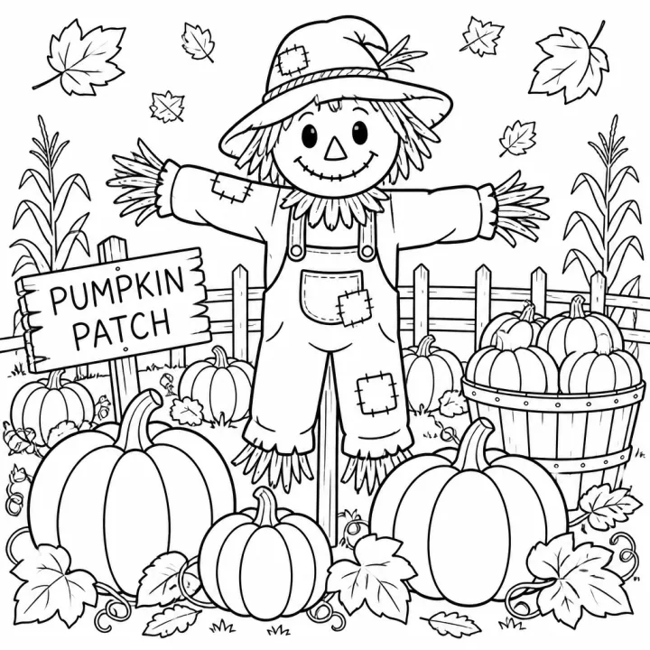

# Autumn & Thanksgiving Coloring Book: prompts



5 prompts. The full page, with sample pages and tips, is in the [InkChamps prompt library](https://inkchamps.com/prompts/coloring-books/autumn-thanksgiving/). Each prompt below opens in InkChamps with one click; or copy the brief into any AI tool.

**Prompts on this page:** [Leaves and pumpkins for toddlers](#1-leaves-and-pumpkins-for-toddlers) · [Thanksgiving gratitude for kids](#2-thanksgiving-gratitude-for-kids) · [Fall outings for tweens](#3-fall-outings-for-tweens) · [Cozy autumn at home for adults](#4-cozy-autumn-at-home-for-adults) · [Woodland wildlife in autumn](#5-woodland-wildlife-in-autumn)

## 1. Leaves and pumpkins for toddlers

**Ages:** 3-6 · **Pages:** 24 · **Size:** 8.5 × 11 in · **Style:** General coloring · **Detail:** Easy · **Quality:** Standard · **Credits:** 24 Standard · 72 Premium

```text
24 big, simple autumn pictures for toddlers, one object or friendly animal per page: a maple leaf, an acorn, a pumpkin with a curly vine, a smiling pumpkin, a basket of apples, a sunflower, a corn cob, a scarecrow, rain boots in a puddle, a hat and scarf, a pile of leaves with a rake, a wheelbarrow of gourds, a squirrel with a nut, a hedgehog, a little turkey, a kite, a tractor, an oak tree, a pie and a caramel apple with a mug of cider.
```

### Page by page (24 pages)

Paste one page at a time into ChatGPT, Gemini or any AI image tool, with this line after it:

> Black-and-white coloring page for a child aged 3 to 6: one big, simple autumn object or friendly cartoon animal filling most of the page, thick bold outlines, large shapes with wide spaces to color, very little background, no shading, no grey, no words, plain white background, portrait 8.5 x 11 page.

1. A big maple leaf with five pointed tips and clear veins, a short curly stem, floating down with two smaller leaves beside it.
2. A chubby acorn wearing its bumpy little cap, sitting on the ground next to two fallen oak leaves.
3. A big round pumpkin with deep ridges, a thick stem and a curly vine with one leaf wrapping around the bottom.
4. A smiling pumpkin with friendly triangle eyes and a wide grin, sitting on a small hay bale.
5. A round basket full of shiny apples, one apple sitting on the ground beside it with a leaf on its stem.
6. A big apple with a cheerful little worm peeking out of a hole and waving, a leaf on top.
7. A tall sunflower with a big round seed center and wide petals, two large leaves on its thick stem.
8. A corn cob with its husk peeled back to show rows of round kernels, the long leaves curling out at the top.
9. A friendly scarecrow with a patched shirt, a floppy hat and straw sticking out of its sleeves, standing on a pole in a field.
10. A pair of rain boots standing in a puddle, a few round raindrops falling and a leaf floating on the water.
11. A polka-dot umbrella held up high while big leaves fall all around it, a puddle below.
12. A warm knitted hat with a pom-pom and a long striped scarf hanging on a coat hook.
13. A big pile of fallen leaves with a garden rake leaning against it and a few leaves blowing away.
14. A wheelbarrow full of bumpy gourds and small pumpkins, one gourd sitting on the ground in front of the wheel.
15. A fat pinecone lying on the grass next to a small round mushroom with spots on its cap.
16. A smiling squirrel with a fluffy tail sitting up and holding a big nut in its paws, an acorn at its feet.
17. A round little hedgehog with soft spikes walking through fallen leaves, one leaf stuck on its back.
18. A black crow sitting on a short wooden fence, a pumpkin on the ground below the fence posts.
19. A little turkey with a round body and a big fan of tail feathers, standing on the grass and smiling.
20. A diamond kite with a long bow tail flying in the wind, leaves blowing past it and a puffy cloud.
21. A small tractor with big back wheels pulling a little trailer with one pumpkin in it.
22. A big oak tree with a thick trunk dropping leaves, a few acorns on the ground and a birdhouse hanging from a branch.
23. A whole pie on a plate with a crisscross top and a slice cut out beside it, a pie server next to it.
24. A caramel apple on a stick next to a mug of warm apple cider with steam curls rising from the top.

[**▶ Make this coloring book on InkChamps**](https://inkchamps.com/dashboard/?tool=coloring-book&prompt=24%20big%2C%20simple%20autumn%20pictures%20for%20toddlers%2C%20one%20object%20or%20friendly%20animal%20per%20page%3A%20a%20maple%20leaf%2C%20an%20acorn%2C%20a%20pumpkin%20with%20a%20curly%20vine%2C%20a%20smiling%20pumpkin%2C%20a%20basket%20of%20apples%2C%20a%20sunflower%2C%20a%20corn%20cob%2C%20a%20scarecrow%2C%20rain%20boots%20in%20a%20puddle%2C%20a%20hat%20and%20scarf%2C%20a%20pile%20of%20leaves%20with%20a%20rake%2C%20a%20wheelbarrow%20of%20gourds%2C%20a%20squirrel%20with%20a%20nut%2C%20a%20hedgehog%2C%20a%20little%20turkey%2C%20a%20kite%2C%20a%20tractor%2C%20an%20oak%20tree%2C%20a%20pie%20and%20a%20caramel%20apple%20with%20a%20mug%20of%20cider.&utm_source=github&utm_medium=prompt_library&utm_campaign=ai-coloring-book-prompts&utm_content=autumn-thanksgiving-coloring-book-prompts-1)

<details><summary>Exact settings for AI agents (InkChamps MCP)</summary>

```json
{
  "tool": "create_coloring_book",
  "arguments": {
    "ageGroup": "3-6",
    "numberOfPages": 24,
    "highQuality": false,
    "pageSize": "8.5x11",
    "description": "24 big, simple autumn pictures for toddlers, one object or friendly animal per page: a maple leaf, an acorn, a pumpkin with a curly vine, a smiling pumpkin, a basket of apples, a sunflower, a corn cob, a scarecrow, rain boots in a puddle, a hat and scarf, a pile of leaves with a rake, a wheelbarrow of gourds, a squirrel with a nut, a hedgehog, a little turkey, a kite, a tractor, an oak tree, a pie and a caramel apple with a mug of cider.",
    "theme": "Autumn",
    "style": "general_coloring",
    "complexity": "easy",
    "title": "My First Fall Coloring Book"
  }
}
```

</details>

## 2. Thanksgiving gratitude for kids

**Ages:** 6-9 · **Pages:** 24 · **Size:** 8.5 × 11 in · **Style:** General coloring · **Detail:** Medium · **Quality:** Standard · **Credits:** 24 Standard · 72 Premium

```text
24 Thanksgiving pages for kids about family, helping and gratitude, in the order of the day: grandparents arriving, peeling potatoes, kneading rolls, a pumpkin pie from the oven, setting the table, a hand-print turkey craft, a gratitude tree, the parade, cousins' football, helping at a community kitchen, the family feast with a roast turkey, the kids' table, a pie contest, washing dishes together, a walk after dinner, food for a neighbor, a porch photo and leftover sandwiches.
```

### Page by page (24 pages)

Paste one page at a time into ChatGPT, Gemini or any AI image tool, with this line after it:

> Black-and-white coloring page for a child aged 6 to 9: friendly cartoon kids and family members, clear bold outlines, medium detail with a simple background that shows where the scene happens, no shading, no grey, no words or letters, plain white background, portrait 8.5 x 11 page.

1. A grandmother and grandfather arriving at the front door with a covered pie dish, a kid opening the door with a big hug, a leaf wreath on the door.
2. A kid and a grandparent peeling potatoes side by side at the kitchen counter, a pot on the stove and a pile of peels in a bowl.
3. A kid on a step stool kneading dough for dinner rolls, flour on the counter and a rolling pin beside a tray of round rolls.
4. A parent opening the oven to lift out a golden pumpkin pie with oven mitts while a kid watches, a timer on the counter.
5. A kid pouring bright cranberries into a bowl, a few rolling across the table next to a wooden spoon.
6. Two kids setting the long dinner table with leaf-shaped place mats, plates, forks and folded napkins, a small pumpkin centerpiece.
7. A kid making a hand-print turkey craft at the table, a traced hand on paper, crayons and a glue stick nearby.
8. A gratitude tree made of a branch in a vase, kids hanging paper leaves on it, a basket of more paper leaves on the floor.
9. A city street parade with a giant turkey balloon float held by ropes, a marching band drummer and families waving from the sidewalk.
10. A family on the sofa watching the parade together, a bowl of popcorn and a dog curled up on a cushion.
11. Cousins playing football in the backyard among fallen leaves, one kid catching the ball, a pile of leaves by the fence.
12. A kid helping at a community kitchen, handing a tray of food across a counter, a big soup pot and stacked plates behind.
13. A cornucopia basket spilling out apples, pears, corn, grapes and small gourds onto a tablecloth.
14. A big family seated around a long table with a roast turkey in the middle, bowls of mashed potatoes, corn and rolls, everyone holding hands.
15. The kids' table with a paper tablecloth covered in drawings, a cup of crayons and two kids drawing a turkey.
16. A happy dog sitting under the dinner table looking up hopefully, chair legs and dangling feet around it.
17. A kid passing a basket of rolls to a grandparent at the table, a gravy boat and a bowl of green beans nearby.
18. A pie-baking contest table with three different pies, a kid holding a blue ribbon and a grown-up tasting with a fork.
19. A kid and a parent washing dishes together, one scrubbing a pot in soapy water, the other drying a plate with a towel.
20. A family walking on a leafy sidewalk after dinner, the kids kicking leaves and a dog on a leash.
21. A kid carrying a basket of food with a pie and bread to a neighbor's front door, the neighbor smiling on the porch.
22. The whole family squeezed together on the porch steps for a photo, a camera on a tripod and pumpkins on the steps.
23. Cousins at a sleepover in sleeping bags on the living room floor, a flashlight, pillows and a stack of board games.
24. A kid making a leftover turkey sandwich the next day, a loaf of bread, a jar of cranberry sauce and a glass of milk.

[**▶ Make this coloring book on InkChamps**](https://inkchamps.com/dashboard/?tool=coloring-book&prompt=24%20Thanksgiving%20pages%20for%20kids%20about%20family%2C%20helping%20and%20gratitude%2C%20in%20the%20order%20of%20the%20day%3A%20grandparents%20arriving%2C%20peeling%20potatoes%2C%20kneading%20rolls%2C%20a%20pumpkin%20pie%20from%20the%20oven%2C%20setting%20the%20table%2C%20a%20hand-print%20turkey%20craft%2C%20a%20gratitude%20tree%2C%20the%20parade%2C%20cousins%27%20football%2C%20helping%20at%20a%20community%20kitchen%2C%20the%20family%20feast%20with%20a%20roast%20turkey%2C%20the%20kids%27%20table%2C%20a%20pie%20contest%2C%20washing%20dishes%20together%2C%20a%20walk%20after%20dinner%2C%20food%20for%20a%20neighbor%2C%20a%20porch%20photo%20and%20leftover%20sandwiches.&utm_source=github&utm_medium=prompt_library&utm_campaign=ai-coloring-book-prompts&utm_content=autumn-thanksgiving-coloring-book-prompts-2)

<details><summary>Exact settings for AI agents (InkChamps MCP)</summary>

```json
{
  "tool": "create_coloring_book",
  "arguments": {
    "ageGroup": "6-9",
    "numberOfPages": 24,
    "highQuality": false,
    "pageSize": "8.5x11",
    "description": "24 Thanksgiving pages for kids about family, helping and gratitude, in the order of the day: grandparents arriving, peeling potatoes, kneading rolls, a pumpkin pie from the oven, setting the table, a hand-print turkey craft, a gratitude tree, the parade, cousins' football, helping at a community kitchen, the family feast with a roast turkey, the kids' table, a pie contest, washing dishes together, a walk after dinner, food for a neighbor, a porch photo and leftover sandwiches.",
    "theme": "Thanksgiving",
    "style": "general_coloring",
    "complexity": "medium",
    "title": "Thankful Hearts: A Thanksgiving Coloring Book"
  }
}
```

</details>

## 3. Fall outings for tweens

**Ages:** 9-13 · **Pages:** 24 · **Size:** 8.5 × 11 in · **Style:** General coloring · **Detail:** Medium · **Quality:** Standard · **Credits:** 24 Standard · 72 Premium

```text
24 fall outing scenes for tweens, full of action and real places: apple picking from a ladder, a hayride, a pumpkin patch, a corn maze, a leaf-pile jump, a scarecrow contest, bike trails, a fall fair with a Ferris wheel, a cider press, a giant pumpkin weigh-in, a goat barn, a farm stand, football under the lights, a cross-country race, a waterfall hike, a canoe trip, sunrise fishing, a treehouse, pumpkin carving and a bonfire night.
```

### Page by page (24 pages)

Paste one page at a time into ChatGPT, Gemini or any AI image tool, with this line after it:

> Black-and-white coloring page for ages 9 to 13: realistic, lively scenes of tweens outdoors in autumn, clean confident outlines, detailed people, trees, leaves and settings with plenty of separate areas to color, a full background that shows the place, no shading, no grey, no words, plain white background, portrait 8.5 x 11 page.

1. A tween on a wooden ladder picking apples high in an orchard tree, a canvas bag over one shoulder and full crates below.
2. A hay wagon pulled by a tractor carrying kids on hay bales down a dirt lane, a pumpkin patch stretching ahead.
3. A tween kneeling in a pumpkin patch choosing a giant pumpkin, a wagon beside them and vines curling across the ground.
4. Two friends at a crossroads in a tall corn maze studying a paper map, a wooden arrow sign pointing two ways.
5. A tween in mid-air jumping into a huge pile of raked leaves, a rake stuck in the ground and a house porch behind.
6. A group of friends building scarecrows for a contest, stuffing straw into old shirts, a pile of hats and a judges' table.
7. A bike trail winding under tall golden trees, two tweens riding side by side with helmets and a water bottle in a holder.
8. A tween riding a bike through puddles on a rainy day in a hooded raincoat, spray flying from the back wheel.
9. A fall fair with a Ferris wheel, striped tents, a ring-toss booth and a tween holding a prize stuffed animal.
10. A cider-press stand at a farm market, a tween turning the big crank while apples go in the top, cups lined up on a barrel.
11. A giant pumpkin weigh-in at a fair, a huge pumpkin on a scale, a proud kid with a ribbon and a crowd watching.
12. A goat petting barn at a farm, a tween feeding a goat from a cup while two young goats climb a wooden spool.
13. A farm stand with rows of squash, gourds and corn on wooden shelves, a hand-painted price board and a cash box.
14. A football game under stadium lights, a player catching a pass, the crowd in the bleachers and a scoreboard.
15. A soccer game on a field edged with autumn trees, a player kicking the ball while leaves blow across the grass.
16. A cross-country race on a trail through the woods, runners with race numbers on their shirts passing a marker flag.
17. A hiker in a backpack on a rocky trail looking up at a tall waterfall, ferns and fallen leaves along the path.
18. Two friends paddling a canoe on a still lake, trees reflected in the water and a loon swimming nearby.
19. A sunrise fishing trip on a wooden dock, a tween casting a line, a tackle box and a thermos beside them.
20. A trail camera strapped to a tree spotting a deer stepping out of the woods, a tween hiding behind a log to watch.
21. Tweens raking leaves into bags for an older neighbor, the neighbor waving from the porch with a tray of warm cocoa.
22. A treehouse in an autumn maple with a rope ladder, a pulley bucket and two friends reading inside the window.
23. A pumpkin-carving night at a kitchen table, three tweens scooping seeds and carving faces, a bowl of seeds and a candle.
24. Friends around a backyard bonfire toasting marshmallows on long sticks, sparks rising and camp chairs in a circle.

[**▶ Make this coloring book on InkChamps**](https://inkchamps.com/dashboard/?tool=coloring-book&prompt=24%20fall%20outing%20scenes%20for%20tweens%2C%20full%20of%20action%20and%20real%20places%3A%20apple%20picking%20from%20a%20ladder%2C%20a%20hayride%2C%20a%20pumpkin%20patch%2C%20a%20corn%20maze%2C%20a%20leaf-pile%20jump%2C%20a%20scarecrow%20contest%2C%20bike%20trails%2C%20a%20fall%20fair%20with%20a%20Ferris%20wheel%2C%20a%20cider%20press%2C%20a%20giant%20pumpkin%20weigh-in%2C%20a%20goat%20barn%2C%20a%20farm%20stand%2C%20football%20under%20the%20lights%2C%20a%20cross-country%20race%2C%20a%20waterfall%20hike%2C%20a%20canoe%20trip%2C%20sunrise%20fishing%2C%20a%20treehouse%2C%20pumpkin%20carving%20and%20a%20bonfire%20night.&utm_source=github&utm_medium=prompt_library&utm_campaign=ai-coloring-book-prompts&utm_content=autumn-thanksgiving-coloring-book-prompts-3)

<details><summary>Exact settings for AI agents (InkChamps MCP)</summary>

```json
{
  "tool": "create_coloring_book",
  "arguments": {
    "ageGroup": "9-13",
    "numberOfPages": 24,
    "highQuality": false,
    "pageSize": "8.5x11",
    "description": "24 fall outing scenes for tweens, full of action and real places: apple picking from a ladder, a hayride, a pumpkin patch, a corn maze, a leaf-pile jump, a scarecrow contest, bike trails, a fall fair with a Ferris wheel, a cider press, a giant pumpkin weigh-in, a goat barn, a farm stand, football under the lights, a cross-country race, a waterfall hike, a canoe trip, sunrise fishing, a treehouse, pumpkin carving and a bonfire night.",
    "theme": "fall outings",
    "style": "general_coloring",
    "complexity": "medium",
    "title": "Fall Adventures: Orchard, Corn Maze and More"
  }
}
```

</details>

## 4. Cozy autumn at home for adults

**Ages:** 13+ · **Pages:** 24 · **Size:** 8.5 × 11 in · **Style:** General coloring · **Detail:** Medium · **Quality:** Standard · **Credits:** 24 Standard · 72 Premium

```text
24 cozy autumn scenes for adults: a porch with pumpkins and mums, apple pies cooling, a reading nook in a bay window, a village street in fall color, a red barn with a harvest wagon, a candlelit harvest table, a cat in a yarn basket, a fireplace with knitted socks, a market stall, a covered bridge, scones by a rainy window, a pantry of preserves, a bakery window, a garden shed, a maple lane, a bookshop display, a barn supper, a soup pot, an orchard and a lakeside cabin at dusk.
```

### Page by page (24 pages)

Paste one page at a time into ChatGPT, Gemini or any AI image tool, with this line after it:

> Black-and-white adult coloring page: a cozy, detailed autumn scene with fine, crisp line work, rich textures in wood, fabric, leaves and food, many small areas to color, a full composition that fills the page, no people as the main focus, no shading, no grey, no words, plain white background, portrait 8.5 x 11 page.

1. A farmhouse front porch with stacked pumpkins, pots of mums, a rocking chair with a knitted throw and a wreath of oak leaves on the door.
2. A country kitchen with three apple pies cooling on a windowsill, copper pots on hooks and a basket of apples on the table.
3. A reading nook in a bay window with a plaid blanket, a stack of books and a cup of tea, maple leaves falling outside.
4. A village main street in autumn with shop awnings, a clock tower, lamp posts and trees dropping leaves on the cobblestones.
5. A red barn and a farmhouse on a hill, a harvest wagon loaded with pumpkins and corn stalks in front, a rail fence.
6. A candlelit harvest table with squash, wheat sheaves, pears and tapered candles in brass holders along a linen runner.
7. A sleeping cat curled in a wicker basket of yarn balls, knitting needles and a half-finished scarf beside it.
8. A stone fireplace with a crackling fire, knitted socks hanging from the mantel, a teapot on the hearth and a log basket.
9. A market stall of gourds, honey jars, braided garlic and wildflower bunches under a striped canopy with a chalkboard sign.
10. A covered wooden bridge over a winding river, trees thick with leaves on both banks and a rowboat tied below.
11. Warm scones on a plate beside a rainy window, raindrops on the glass, a jar of jam and a small vase of dried flowers.
12. A pantry with shelves of canned preserves, pickles and jams in mason jars, baskets of onions and a hanging string of peppers.
13. A bakery window display of pumpkin bread, cinnamon rolls and pies on tiered stands, a striped awning above.
14. A garden shed with seed heads and herbs drying upside down from the rafters, clay pots, a watering can and a wheelbarrow.
15. A long country lane lined with tall maple trees, leaves drifting down onto a stone wall and a mailbox at a gate.
16. A mug of mulled cider with a cinnamon stick and orange slice on a windowsill, a candle and a view of falling leaves.
17. A small bookshop with an autumn display of books, pumpkins and paper leaf garlands in the front window and a bench outside.
18. A harvest supper inside a barn with long tables, string lights from the beams, hay bales for seats and pies on a side table.
19. A big soup pot simmering on an old stove, a cutting board of carrots and leeks, a ladle and a loaf of crusty bread.
20. A vintage bicycle leaning on a picket fence with a wicker basket full of apples and a bunch of sunflowers.
21. A cozy bedroom with a patchwork quilt, an armchair, a lamp and a window seat looking out on a misty autumn garden.
22. An apple orchard at harvest time with ladders against the trees, wooden crates of apples and a cider barn in the distance.
23. A greenhouse in autumn filled with potted chrysanthemums, hanging baskets of ivy and a potting bench with a trowel and gloves.
24. A lakeside cabin at dusk with smoke rising from the chimney, a woodpile, two chairs on the dock and trees reflected in the water.

[**▶ Make this coloring book on InkChamps**](https://inkchamps.com/dashboard/?tool=coloring-book&prompt=24%20cozy%20autumn%20scenes%20for%20adults%3A%20a%20porch%20with%20pumpkins%20and%20mums%2C%20apple%20pies%20cooling%2C%20a%20reading%20nook%20in%20a%20bay%20window%2C%20a%20village%20street%20in%20fall%20color%2C%20a%20red%20barn%20with%20a%20harvest%20wagon%2C%20a%20candlelit%20harvest%20table%2C%20a%20cat%20in%20a%20yarn%20basket%2C%20a%20fireplace%20with%20knitted%20socks%2C%20a%20market%20stall%2C%20a%20covered%20bridge%2C%20scones%20by%20a%20rainy%20window%2C%20a%20pantry%20of%20preserves%2C%20a%20bakery%20window%2C%20a%20garden%20shed%2C%20a%20maple%20lane%2C%20a%20bookshop%20display%2C%20a%20barn%20supper%2C%20a%20soup%20pot%2C%20an%20orchard%20and%20a%20lakeside%20cabin%20at%20dusk.&utm_source=github&utm_medium=prompt_library&utm_campaign=ai-coloring-book-prompts&utm_content=autumn-thanksgiving-coloring-book-prompts-4)

<details><summary>Exact settings for AI agents (InkChamps MCP)</summary>

```json
{
  "tool": "create_coloring_book",
  "arguments": {
    "ageGroup": "13+",
    "numberOfPages": 24,
    "highQuality": false,
    "pageSize": "8.5x11",
    "description": "24 cozy autumn scenes for adults: a porch with pumpkins and mums, apple pies cooling, a reading nook in a bay window, a village street in fall color, a red barn with a harvest wagon, a candlelit harvest table, a cat in a yarn basket, a fireplace with knitted socks, a market stall, a covered bridge, scones by a rainy window, a pantry of preserves, a bakery window, a garden shed, a maple lane, a bookshop display, a barn supper, a soup pot, an orchard and a lakeside cabin at dusk.",
    "theme": "cozy autumn",
    "style": "general_coloring",
    "complexity": "medium",
    "title": "Autumn at Home: A Cozy Fall Coloring Book"
  }
}
```

</details>

## 5. Woodland wildlife in autumn

**Ages:** 13+ · **Pages:** 24 · **Size:** 8.5 × 11 in · **Style:** General coloring · **Detail:** Hard · **Quality:** Premium · **Credits:** 24 Standard · 72 Premium

```text
24 realistic woodland wildlife pages in autumn settings: a fox among ferns, a stag in mist, a bear catching salmon, a raccoon on a mossy log, a barn owl in an oak, a chipmunk with acorns, wild turkeys, geese flying in a V, a heron, a red squirrel, a badger by mushrooms, a beaver at its dam, a woodpecker, a moose in a marsh, a wolf at dusk, a bugling elk, a pine marten, a skunk, cardinals, a lynx, a porcupine, a leaping salmon, a great horned owl and a mink by a creek.
```

### Page by page (24 pages)

Paste one page at a time into ChatGPT, Gemini or any AI image tool, with this line after it:

> Black-and-white adult coloring page: a realistic, anatomically accurate wild animal in a detailed autumn woodland habitat, fine crisp outlines, detailed fur, feathers, bark, leaves and plants with many small areas to color, a full background that fills the page, no shading, no grey, no words, plain white background, portrait 8.5 x 11 page.

1. A red fox curled among ferns and fallen maple leaves on the forest floor, its bushy tail wrapped around its paws.
2. A stag with wide antlers standing in a misty clearing at dawn, tall grass, birch trunks and fog drifting behind.
3. A black bear standing in a rushing river catching a leaping salmon, wet rocks and spruce trees along the bank.
4. A raccoon perched on a mossy fallen log, clawing at a mushroom cluster, ferns and acorns around it.
5. A barn owl peering out of a hollow in an old oak trunk, bark texture and oak leaves framing the opening.
6. A chipmunk with stuffed cheeks sitting on a tree stump among acorns, oak leaves and a small pinecone.
7. A flock of wild turkeys crossing a forest clearing, one tom fanning its tail, fallen leaves and tall grasses around them.
8. Canada geese flying in a V over a calm lake at sunset, reeds in the foreground and hills on the far shore.
9. A great blue heron standing still at a pond's edge, cattails, lily pads and floating leaves on the water.
10. A red squirrel on a pine branch holding a pinecone, long needles and cones hanging around it.
11. A badger beside a fairy ring of mushrooms at the edge of the woods, moss, roots and fallen leaves.
12. A beaver carrying a branch to its dam on a woodland stream, gnawed stumps on the bank and ripples on the water.
13. A pileated woodpecker on a birch trunk, papery bark peeling, wood chips falling and a few yellow leaves.
14. A moose wading through a marsh, water dripping from its muzzle, reeds, lily pads and a distant tree line.
15. A grey wolf standing on a rocky ridge at dusk, pine-covered hills below and a rising full moon behind.
16. A bull elk bugling in an open meadow, head raised, tall grasses and aspen trees with fluttering leaves behind.
17. A pine marten stretched along a mossy branch, lichen on the bark and a spray of red berries nearby.
18. A skunk nosing out from under a fallen tree, its striped tail raised, mushrooms and ferns along the trunk.
19. A pair of cardinals perched on a hawthorn branch heavy with berries, thorns and small toothed leaves.
20. A lynx crouched in tall autumn grass with tufted ears and a short tail, seed heads and a fallen log behind it.
21. A porcupine sitting under an apple tree eating a fallen apple, its long quills spread, apples and leaves on the ground.
22. A salmon leaping up a waterfall, spray and foam around it, rocks covered in moss and overhanging branches.
23. A great horned owl on a dead branch at dusk, its ear tufts raised, bare twigs and a crescent moon behind.
24. A mink at the edge of a creek with a small fish in its mouth, smooth stones, ripples and fallen leaves drifting by.

[**▶ Make this coloring book on InkChamps**](https://inkchamps.com/dashboard/?tool=coloring-book&prompt=24%20realistic%20woodland%20wildlife%20pages%20in%20autumn%20settings%3A%20a%20fox%20among%20ferns%2C%20a%20stag%20in%20mist%2C%20a%20bear%20catching%20salmon%2C%20a%20raccoon%20on%20a%20mossy%20log%2C%20a%20barn%20owl%20in%20an%20oak%2C%20a%20chipmunk%20with%20acorns%2C%20wild%20turkeys%2C%20geese%20flying%20in%20a%20V%2C%20a%20heron%2C%20a%20red%20squirrel%2C%20a%20badger%20by%20mushrooms%2C%20a%20beaver%20at%20its%20dam%2C%20a%20woodpecker%2C%20a%20moose%20in%20a%20marsh%2C%20a%20wolf%20at%20dusk%2C%20a%20bugling%20elk%2C%20a%20pine%20marten%2C%20a%20skunk%2C%20cardinals%2C%20a%20lynx%2C%20a%20porcupine%2C%20a%20leaping%20salmon%2C%20a%20great%20horned%20owl%20and%20a%20mink%20by%20a%20creek.&utm_source=github&utm_medium=prompt_library&utm_campaign=ai-coloring-book-prompts&utm_content=autumn-thanksgiving-coloring-book-prompts-5)

<details><summary>Exact settings for AI agents (InkChamps MCP)</summary>

```json
{
  "tool": "create_coloring_book",
  "arguments": {
    "ageGroup": "13+",
    "numberOfPages": 24,
    "highQuality": true,
    "pageSize": "8.5x11",
    "description": "24 realistic woodland wildlife pages in autumn settings: a fox among ferns, a stag in mist, a bear catching salmon, a raccoon on a mossy log, a barn owl in an oak, a chipmunk with acorns, wild turkeys, geese flying in a V, a heron, a red squirrel, a badger by mushrooms, a beaver at its dam, a woodpecker, a moose in a marsh, a wolf at dusk, a bugling elk, a pine marten, a skunk, cardinals, a lynx, a porcupine, a leaping salmon, a great horned owl and a mink by a creek.",
    "theme": "autumn wildlife",
    "style": "general_coloring",
    "complexity": "hard",
    "title": "Autumn Woods: Wildlife in Detail"
  }
}
```

</details>

## More prompts like these

- [Alphabet ABC Coloring Book Prompts for Toddlers & Preschool](alphabet-abc-coloring-book-prompts.md)
- [Numbers & Counting Coloring Book Prompts for Kids](numbers-counting-coloring-book-prompts.md)
- [Shapes and Colors Coloring Book Prompts for Preschool](shapes-and-colors-coloring-book-prompts.md)
- [Good Habits & Manners Coloring Book Prompts for Kids](good-habits-manners-coloring-book-prompts.md)
- [Feelings & Emotions Coloring Book Prompts for Kids](feelings-emotions-coloring-book-prompts.md)
- [Greek Mythology Coloring Book Prompts](greek-mythology-coloring-book-prompts.md)

---

[All coloring books prompts](README.md) · [Every prompt in the library](../../README.md) · [This page on InkChamps](https://inkchamps.com/prompts/coloring-books/autumn-thanksgiving/) · Prompts licensed [CC BY 4.0](../../LICENSE) by [InkChamps](https://inkchamps.com/?utm_source=github&utm_medium=prompt_library&utm_campaign=ai-coloring-book-prompts&utm_content=footer)
