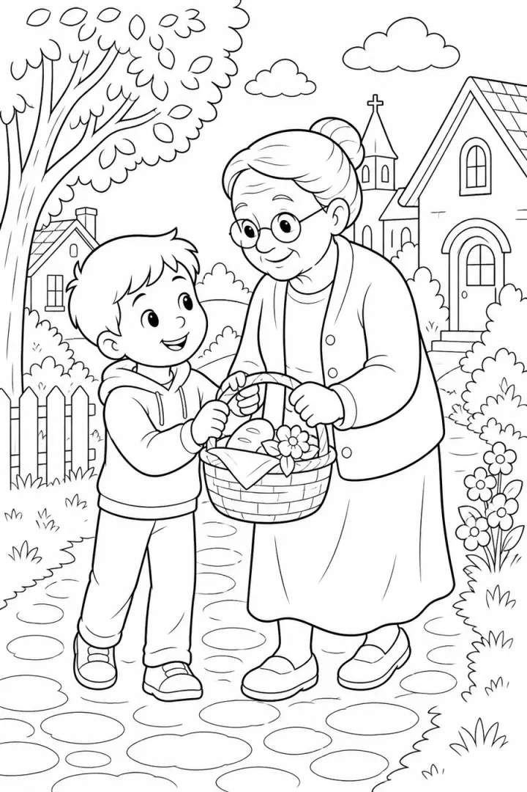

# Bible Story Coloring Book: prompts



5 prompts. The full page, with sample pages and tips, is in the [InkChamps prompt library](https://inkchamps.com/prompts/coloring-books/bible/). Each prompt below opens in InkChamps with one click; or copy the brief into any AI tool.

**Prompts on this page:** [Animals of the Bible for little ones](#1-animals-of-the-bible-for-little-ones) · [Old Testament stories in order](#2-old-testament-stories-in-order) · [The life of Jesus](#3-the-life-of-jesus) · [Twenty-four parables Jesus told](#4-twenty-four-parables-jesus-told) · [Scripture-inspired scenes for adults](#5-scripture-inspired-scenes-for-adults)

## 1. Animals of the Bible for little ones

**Ages:** 3-6 · **Pages:** 24 · **Size:** 8.5 × 11 in · **Style:** Cute animals · **Detail:** Easy · **Quality:** Standard · **Credits:** 24 Standard · 72 Premium

```text
24 animals from Bible stories, one big friendly animal per page, each in its story: creation fish and birds, giraffes and elephants boarding the ark, the lion and lamb asleep on the ark, the dove with an olive leaf, Rebekah's camels, the frogs of Egypt, Balaam's donkey, David's lamb, Daniel's calm lions, Jonah's big fish, the ox and donkey at the manger, the wise men's camels, five loaves and two fish, the lost sheep, the mother hen and the Palm Sunday donkey.
```

### Page by page (24 pages)

Paste one page at a time into ChatGPT, Gemini or any AI image tool, with this line after it:

> Black-and-white coloring page for a child aged 3 to 6: one big, cute, friendly cartoon animal filling most of the page, thick bold outlines, large simple shapes with wide spaces to color, very little background, nothing scary, no shading, no grey, no words, plain white background, portrait 8.5 x 11 page.

1. Shiny fish leaping out of brand-new ocean waves on the days of creation, three round-winged birds flying above them and a big smiling sun in the sky.
2. A tall giraffe and a big elephant walking up the wooden ramp into Noah's ark side by side, the ark's round window and door wide open above them.
3. A fluffy lion and a little curly-wool lamb curled up asleep together on the deck of the ark, a coil of rope and a bundle of hay beside them.
4. A white dove flying back to the ark window with an olive leaf in its beak, the ark resting on calm water with a few gentle waves.
5. A big curly-horned ram standing on a rocky hillside beside a leafy bush, a small stone altar and a bundle of sticks nearby.
6. Two tall camels with tasselled saddles drinking from a stone well, a clay water jar on the edge of the well and a palm tree behind.
7. Jacob's spotted and speckled goats standing together in a stick fence pen, one little goat climbing on a rock and another chewing a leaf.
8. Cheerful round frogs hopping everywhere in an Egyptian house: one sitting in a bread bowl, one on a pillow and one on a clay pot.
9. Plump little quail birds landing on the sand around a desert tent, a small boy holding out a basket to catch them.
10. Balaam's patient donkey sitting down in the middle of a narrow vineyard path and refusing to walk, a stone wall on each side and grapevines on top.
11. Young shepherd David carrying a soft little lamb across his shoulders, a wooden shepherd's crook in one hand and three sheep following behind.
12. Two black ravens flying down to a man sitting beside a little brook, each carrying a round loaf of bread in its beak, a clay cup by the water and a shady tree behind him.
13. Big gentle lions lying down calmly around Daniel in a stone den, one lion resting its head on its paws like a sleepy cat.
14. A giant friendly fish swimming through the waves with a wide smile, bubbles rising from its mouth and a little boat far away on the water.
15. A gentle ox and a small donkey standing beside a wooden manger filled with hay in the stable at Bethlehem, a star shining through the window.
16. Fluffy sheep resting on a grassy hill at night while a shepherd stands with his crook, one huge bright star shining above them.
17. Three camels with fringed saddles and bundles of gifts walking in a line across sand dunes, following one big star in the sky.
18. A dove with wings spread wide flying down over the Jordan River, gentle ripples in the water and tall reeds along the bank.
19. A fishing boat with a net so full of flapping fish it is nearly tipping over, more fish jumping out of the water around it.
20. A small boy holding up a woven basket with five round loaves of bread and two fish inside, a grassy hillside behind him.
21. A smiling shepherd hugging the little lost sheep he has just found among the rocks, the rest of his flock waiting on the hill.
22. A mother hen spreading her wings wide while her fluffy chicks run in underneath, a few pebbles and grass tufts around her feet.
23. A little donkey walking down a road covered with palm branches and cloaks, children waving more palm branches on each side.
24. Fish cooking over a small campfire on a pebbly beach at sunrise, a loaf of bread beside the fire and a fishing boat pulled up on the sand.

[**▶ Make this coloring book on InkChamps**](https://inkchamps.com/dashboard/?tool=coloring-book&prompt=24%20animals%20from%20Bible%20stories%2C%20one%20big%20friendly%20animal%20per%20page%2C%20each%20in%20its%20story%3A%20creation%20fish%20and%20birds%2C%20giraffes%20and%20elephants%20boarding%20the%20ark%2C%20the%20lion%20and%20lamb%20asleep%20on%20the%20ark%2C%20the%20dove%20with%20an%20olive%20leaf%2C%20Rebekah%27s%20camels%2C%20the%20frogs%20of%20Egypt%2C%20Balaam%27s%20donkey%2C%20David%27s%20lamb%2C%20Daniel%27s%20calm%20lions%2C%20Jonah%27s%20big%20fish%2C%20the%20ox%20and%20donkey%20at%20the%20manger%2C%20the%20wise%20men%27s%20camels%2C%20five%20loaves%20and%20two%20fish%2C%20the%20lost%20sheep%2C%20the%20mother%20hen%20and%20the%20Palm%20Sunday%20donkey.&utm_source=github&utm_medium=prompt_library&utm_campaign=ai-coloring-book-prompts&utm_content=bible-story-coloring-book-prompts-1)

<details><summary>Exact settings for AI agents (InkChamps MCP)</summary>

```json
{
  "tool": "create_coloring_book",
  "arguments": {
    "ageGroup": "3-6",
    "numberOfPages": 24,
    "highQuality": false,
    "pageSize": "8.5x11",
    "description": "24 animals from Bible stories, one big friendly animal per page, each in its story: creation fish and birds, giraffes and elephants boarding the ark, the lion and lamb asleep on the ark, the dove with an olive leaf, Rebekah's camels, the frogs of Egypt, Balaam's donkey, David's lamb, Daniel's calm lions, Jonah's big fish, the ox and donkey at the manger, the wise men's camels, five loaves and two fish, the lost sheep, the mother hen and the Palm Sunday donkey.",
    "style": "cute_animals",
    "complexity": "easy",
    "title": "Animals of the Bible"
  }
}
```

</details>

## 2. Old Testament stories in order

**Ages:** 6-9 · **Pages:** 24 · **Size:** 8.5 × 11 in · **Style:** General coloring · **Detail:** Medium · **Quality:** Standard · **Credits:** 24 Standard · 72 Premium

```text
24 Old Testament stories in Bible order, one scene per page: God creating light, the animals of creation, Noah building the ark, animals boarding two by two, the rainbow promise, the Tower of Babel, Abraham counting stars, Jacob's ladder, Joseph's coat, baby Moses in the reeds, the burning bush, crossing the Red Sea, Jericho's walls falling, Ruth in the barley field, young Samuel, David facing Goliath, fire on Mount Carmel, Jonah, the fiery furnace, Daniel and the lions, Queen Esther and Nehemiah rebuilding the walls.
```

### Page by page (24 pages)

Paste one page at a time into ChatGPT, Gemini or any AI image tool, with this line after it:

> Black-and-white coloring page for a child aged 6 to 9: a clear Bible story scene with friendly, simply drawn people in robes and sandals, clear bold outlines, medium detail with a simple background that shows where the story happens, no shading, no grey, no words or letters, plain white background, portrait 8.5 x 11 page.

1. The first day of creation: bright beams of light bursting through swirling dark clouds over an empty, rolling sea.
2. A brand-new green garden full of animals just made: a lion, an elephant, a rabbit, a deer and birds in the trees, with fruit trees and a winding river.
3. Noah on a ladder hammering planks onto the side of the huge wooden ark, his sons carrying beams and a saw and a bucket of pegs on the ground.
4. Animals walking up the ark's wooden ramp two by two: zebras, giraffes, bears and kangaroos, with Noah at the door counting them in.
5. Noah's family and the animals stepping out of the ark onto a grassy mountainside under a big rainbow, Noah kneeling beside a small stone altar.
6. People stacking mud bricks on the Tower of Babel, a tall spiral tower with ramps, ladders, baskets of bricks and workers on every level.
7. Old Abraham standing outside his tent at night with his arm raised, counting the countless stars, camels and a cooking fire beside the tent.
8. Jacob asleep on the ground with a stone for a pillow while angels walk up and down a shining stairway reaching into the clouds.
9. Young Joseph proudly wearing his long striped coat in a field, his eleven brothers watching from among their sheep and a water jug at his feet.
10. Joseph standing in Pharaoh's palace explaining the dreams, Pharaoh on his tall throne and a wall painting of seven fat cows and seven thin cows behind.
11. Baby Moses in a woven basket floating among tall reeds on the river, his big sister Miriam peeking out from behind the reeds to watch.
12. Moses barefoot on the rocky mountainside with his sandals beside him, kneeling before a bush full of flames that is not burning up, sheep nearby.
13. The Israelites walking across the dry seabed between two tall walls of water full of fish, Moses holding up his staff at the front.
14. Moses coming down the mountain carrying two large stone tablets with rounded tops, lightning clouds around the peak behind him.
15. Priests blowing long ram's horn trumpets as the walls of Jericho crumble, stones tumbling down and the people shouting behind them.
16. Ruth gathering barley stalks into a bundle in a golden field, Naomi waiting at the edge of the field with a basket and reapers working nearby.
17. Young Samuel sitting up in his bed in the temple at night, hearing his name called, a small oil lamp still glowing beside him.
18. Young shepherd David standing on a rock with his sling ready and five smooth stones in his bag, facing the giant Goliath in armour across the valley.
19. Fire falling from the sky onto Elijah's stone altar on Mount Carmel, water filling the trench around it and the crowd shielding their eyes.
20. The huge fish leaving Jonah on a sandy beach, Jonah sitting up surprised and dripping with seaweed, the walls of a big city far away.
21. Shadrach, Meshach and Abednego walking calmly inside a blazing furnace with a fourth shining figure beside them, the king staring in amazement.
22. Daniel standing calmly in the lions' den with an angel beside him, the lions lying down with their mouths shut and a stone over the opening above.
23. Queen Esther in a long robe and crown walking toward the king's throne, the king holding out his golden sceptre to welcome her.
24. Nehemiah directing workers rebuilding the walls of Jerusalem, people carrying stones, mixing mortar and fitting a big wooden gate.

[**▶ Make this coloring book on InkChamps**](https://inkchamps.com/dashboard/?tool=coloring-book&prompt=24%20Old%20Testament%20stories%20in%20Bible%20order%2C%20one%20scene%20per%20page%3A%20God%20creating%20light%2C%20the%20animals%20of%20creation%2C%20Noah%20building%20the%20ark%2C%20animals%20boarding%20two%20by%20two%2C%20the%20rainbow%20promise%2C%20the%20Tower%20of%20Babel%2C%20Abraham%20counting%20stars%2C%20Jacob%27s%20ladder%2C%20Joseph%27s%20coat%2C%20baby%20Moses%20in%20the%20reeds%2C%20the%20burning%20bush%2C%20crossing%20the%20Red%20Sea%2C%20Jericho%27s%20walls%20falling%2C%20Ruth%20in%20the%20barley%20field%2C%20young%20Samuel%2C%20David%20facing%20Goliath%2C%20fire%20on%20Mount%20Carmel%2C%20Jonah%2C%20the%20fiery%20furnace%2C%20Daniel%20and%20the%20lions%2C%20Queen%20Esther%20and%20Nehemiah%20rebuilding%20the%20walls.&utm_source=github&utm_medium=prompt_library&utm_campaign=ai-coloring-book-prompts&utm_content=bible-story-coloring-book-prompts-2)

<details><summary>Exact settings for AI agents (InkChamps MCP)</summary>

```json
{
  "tool": "create_coloring_book",
  "arguments": {
    "ageGroup": "6-9",
    "numberOfPages": 24,
    "highQuality": false,
    "pageSize": "8.5x11",
    "description": "24 Old Testament stories in Bible order, one scene per page: God creating light, the animals of creation, Noah building the ark, animals boarding two by two, the rainbow promise, the Tower of Babel, Abraham counting stars, Jacob's ladder, Joseph's coat, baby Moses in the reeds, the burning bush, crossing the Red Sea, Jericho's walls falling, Ruth in the barley field, young Samuel, David facing Goliath, fire on Mount Carmel, Jonah, the fiery furnace, Daniel and the lions, Queen Esther and Nehemiah rebuilding the walls.",
    "style": "general_coloring",
    "complexity": "medium",
    "title": "Old Testament Stories to Color"
  }
}
```

</details>

## 3. The life of Jesus

**Ages:** 6-9 · **Pages:** 24 · **Size:** 8.5 × 11 in · **Style:** General coloring · **Detail:** Medium · **Quality:** Standard · **Credits:** 24 Standard · 72 Premium

```text
24 scenes from the life of Jesus in Gospel order, one per page: the angel Gabriel visiting Mary, the journey to Bethlehem, the manger, shepherds and angels, the wise men, the boy Jesus in the temple, his baptism, calling the fishermen, water into wine, the woman at the well, the Sermon on the Mount, calming the storm, feeding the five thousand, walking on water, blessing the children, Zacchaeus, Palm Sunday, the Last Supper, Gethsemane, three empty crosses at sunset, the empty tomb and Pentecost.
```

### Page by page (24 pages)

Paste one page at a time into ChatGPT, Gemini or any AI image tool, with this line after it:

> Black-and-white coloring page for a child aged 6 to 9: a clear Gospel scene with gentle, simply drawn people in robes and sandals, clear bold outlines, medium detail with a simple background of hills, boats or village houses, no shading, no grey, no words or letters, plain white background, portrait 8.5 x 11 page.

1. The angel Gabriel with wide wings appearing to young Mary in her small stone house, Mary surprised beside a water jar and a little oil lamp.
2. Joseph leading a donkey along a dusty road to Bethlehem with Mary riding on it, a bundle of belongings and the little town on a hill ahead.
3. Baby Jesus asleep in a wooden manger filled with hay in the stable, Mary and Joseph kneeling beside him, an ox and a donkey looking on.
4. Shepherds on a hillside at night looking up in wonder at a sky full of angels, their sheep gathered around a small campfire.
5. Three wise men on camels riding across the desert at night, following one big bright star, each holding a decorated gift box.
6. The boy Jesus aged twelve sitting among the teachers in the temple, scrolls open on a low table and the teachers listening closely.
7. John the Baptist in a camel-hair coat baptizing Jesus in the Jordan River, a dove flying down from opening clouds above them.
8. Jesus standing on the shore of the Sea of Galilee calling to Peter and Andrew, who are pulling a fishing net out of their boat.
9. Servants pouring water into six large stone jars at a wedding feast in Cana, Jesus beside them and guests dancing in the courtyard.
10. Jesus sitting beside a stone well talking with a Samaritan woman holding a clay water jar, a small village and hills behind them.
11. Jesus teaching a big crowd sitting on a grassy hillside by the lake, families with children, baskets and wildflowers all around.
12. Four friends lowering a man on a mat through a hole in a flat roof, Jesus and a crowded room looking up from below.
13. Jesus standing in a small fishing boat holding up his hand to calm a wild storm, the frightened disciples clinging to the mast and the oars.
14. A boy offering his basket of five loaves and two fish to Jesus, with a huge crowd sitting on the grass waiting to be fed.
15. Jesus walking on the waves at night toward the disciples' boat, Peter stepping out of the boat onto the water with one foot.
16. Jesus sitting on a rock with small children climbing onto his lap and gathering around him, their parents smiling nearby.
17. Short Zacchaeus perched on a branch of a sycamore tree peering over the crowd, Jesus standing below and looking up at him.
18. Jesus riding a donkey into Jerusalem while a crowd waves palm branches and lays cloaks on the road, the city gate ahead.
19. Jesus kneeling with a towel and a basin of water, washing Peter's feet, the other disciples watching from around the room.
20. The Last Supper: Jesus and his twelve disciples gathered around a long low table, Jesus breaking a round loaf of bread beside a cup.
21. Jesus kneeling in prayer beside a large rock among twisted olive trees in the garden of Gethsemane at night, a crescent moon above.
22. Three empty wooden crosses standing on a quiet hill at sunset, the city of Jerusalem in the distance and rays of light from the setting sun.
23. The empty tomb at sunrise with its round stone rolled away, an angel sitting on the stone and women arriving with jars of spices.
24. Pentecost: the disciples gathered in an upper room with small flames above their heads, a rushing wind blowing the curtains through the window.

[**▶ Make this coloring book on InkChamps**](https://inkchamps.com/dashboard/?tool=coloring-book&prompt=24%20scenes%20from%20the%20life%20of%20Jesus%20in%20Gospel%20order%2C%20one%20per%20page%3A%20the%20angel%20Gabriel%20visiting%20Mary%2C%20the%20journey%20to%20Bethlehem%2C%20the%20manger%2C%20shepherds%20and%20angels%2C%20the%20wise%20men%2C%20the%20boy%20Jesus%20in%20the%20temple%2C%20his%20baptism%2C%20calling%20the%20fishermen%2C%20water%20into%20wine%2C%20the%20woman%20at%20the%20well%2C%20the%20Sermon%20on%20the%20Mount%2C%20calming%20the%20storm%2C%20feeding%20the%20five%20thousand%2C%20walking%20on%20water%2C%20blessing%20the%20children%2C%20Zacchaeus%2C%20Palm%20Sunday%2C%20the%20Last%20Supper%2C%20Gethsemane%2C%20three%20empty%20crosses%20at%20sunset%2C%20the%20empty%20tomb%20and%20Pentecost.&utm_source=github&utm_medium=prompt_library&utm_campaign=ai-coloring-book-prompts&utm_content=bible-story-coloring-book-prompts-3)

<details><summary>Exact settings for AI agents (InkChamps MCP)</summary>

```json
{
  "tool": "create_coloring_book",
  "arguments": {
    "ageGroup": "6-9",
    "numberOfPages": 24,
    "highQuality": false,
    "pageSize": "8.5x11",
    "description": "24 scenes from the life of Jesus in Gospel order, one per page: the angel Gabriel visiting Mary, the journey to Bethlehem, the manger, shepherds and angels, the wise men, the boy Jesus in the temple, his baptism, calling the fishermen, water into wine, the woman at the well, the Sermon on the Mount, calming the storm, feeding the five thousand, walking on water, blessing the children, Zacchaeus, Palm Sunday, the Last Supper, Gethsemane, three empty crosses at sunset, the empty tomb and Pentecost.",
    "style": "general_coloring",
    "complexity": "medium",
    "title": "The Life of Jesus to Color"
  }
}
```

</details>

## 4. Twenty-four parables Jesus told

**Ages:** 9-13 · **Pages:** 24 · **Size:** 8.5 × 11 in · **Style:** General coloring · **Detail:** Medium · **Quality:** Standard · **Credits:** 24 Standard · 72 Premium

```text
24 parables Jesus told, one scene per page: the sower, the mustard seed, the yeast, the hidden treasure, the pearl, the fishing net, the wheat and the weeds, the lost sheep, the lost coin, the prodigal son, the good Samaritan, the rich fool's barns, the wise and foolish builders, the ten bridesmaids, the talents, the unforgiving servant, the vineyard workers, the two sons, the great banquet, the persistent widow, the Pharisee and the tax collector, the friend at midnight, the fig tree and new wine in old wineskins.
```

### Page by page (24 pages)

Paste one page at a time into ChatGPT, Gemini or any AI image tool, with this line after it:

> Black-and-white coloring page for ages 9 to 13: a detailed scene from a parable set in first-century Galilee and Judea, realistic people in robes and headcloths, fine clean outlines, detailed houses, fields, plants and landscape with many separate areas to color, no shading, no grey, no words or letters, plain white background, portrait 8.5 x 11 page.

1. The sower: a farmer scattering seed from a shoulder bag across his field, birds pecking seeds on the path, rocks and thorn bushes at the edge and tall wheat growing in good soil.
2. The mustard seed: a huge mustard tree grown from a tiny seed, birds building nests in its spreading branches above a farmer resting in its shade.
3. The yeast in the dough: a woman kneading a big batch of dough in a wooden trough in her courtyard kitchen, a clay oven and bowls of flour beside her.
4. The hidden treasure: a farmer kneeling in a field, lifting the lid of a clay chest of coins he has just dug up, his shovel and ox plough nearby.
5. The pearl of great price: a merchant at a busy market stall holding up one large, perfect pearl in amazement, trays of jewels and baskets of shells around him.
6. The fishing net: fishermen on the shore sorting a full dragnet, putting good fish into baskets and throwing others back, their boat pulled onto the sand.
7. The wheat and the weeds: farmhands at harvest time pulling tall weeds from among the wheat and tying them in bundles, a barn and sheaves of wheat behind.
8. The lost sheep: a shepherd climbing down a rocky ravine to rescue one lamb caught in a thorn bush, the other ninety-nine sheep grazing on the hill above.
9. The lost coin: a woman sweeping the floor of her stone house by the light of an oil lamp, a small coin glinting in a corner under a stool.
10. The prodigal son: a father running down the road with open arms to hug his returning son in ragged clothes, the family house and fields behind them.
11. The good Samaritan: a traveler kneeling to bandage an injured man beside a rocky desert road, his donkey waiting and a priest walking away in the distance.
12. The rich fool: a wealthy farmer standing proudly in front of huge new barns overflowing with grain sacks, workers still building another barn beside them.
13. The wise and foolish builders: one house standing firm on a rock in a storm while a second house on the sand collapses into a rushing flood.
14. The ten bridesmaids: five young women holding brightly lit oil lamps at a wedding door at night, while five others run off looking for oil.
15. The talents: a servant proudly showing his master bags of coins he has earned, while another servant digs up a single buried coin under a tree.
16. The unforgiving servant: a servant on his knees before a king in a grand hall, begging for mercy, a royal accountant holding a long scroll of debts.
17. The workers in the vineyard: a landowner paying a line of workers one coin each at sunset, baskets of grapes and rows of vines behind them.
18. The two sons: a father in a vineyard speaking to two sons, one turning away with crossed arms and the other already carrying a grape basket to work.
19. The great banquet: servants leading poor, blind and lame guests from the streets into a long feast hall with tables full of bread, fruit and roast dishes.
20. The persistent widow: a widow knocking on the door of a judge's house again and again, the judge leaning out of the window with a frown.
21. The Pharisee and the tax collector: a proud man praying with his arms raised in the temple court, a humble tax collector at the back with his head bowed.
22. The friend at midnight: a man knocking on his neighbor's door under the stars, the neighbor opening the shutter with a sleepy face and three loaves in hand.
23. The fig tree with no fruit: a vineyard owner pointing at a bare fig tree while his gardener digs around its roots and spreads manure from a basket.
24. New wine in old wineskins: a wine seller pouring new wine into a fresh leather wineskin, an old cracked wineskin bursting and spilling beside him.

[**▶ Make this coloring book on InkChamps**](https://inkchamps.com/dashboard/?tool=coloring-book&prompt=24%20parables%20Jesus%20told%2C%20one%20scene%20per%20page%3A%20the%20sower%2C%20the%20mustard%20seed%2C%20the%20yeast%2C%20the%20hidden%20treasure%2C%20the%20pearl%2C%20the%20fishing%20net%2C%20the%20wheat%20and%20the%20weeds%2C%20the%20lost%20sheep%2C%20the%20lost%20coin%2C%20the%20prodigal%20son%2C%20the%20good%20Samaritan%2C%20the%20rich%20fool%27s%20barns%2C%20the%20wise%20and%20foolish%20builders%2C%20the%20ten%20bridesmaids%2C%20the%20talents%2C%20the%20unforgiving%20servant%2C%20the%20vineyard%20workers%2C%20the%20two%20sons%2C%20the%20great%20banquet%2C%20the%20persistent%20widow%2C%20the%20Pharisee%20and%20the%20tax%20collector%2C%20the%20friend%20at%20midnight%2C%20the%20fig%20tree%20and%20new%20wine%20in%20old%20wineskins.&utm_source=github&utm_medium=prompt_library&utm_campaign=ai-coloring-book-prompts&utm_content=bible-story-coloring-book-prompts-4)

<details><summary>Exact settings for AI agents (InkChamps MCP)</summary>

```json
{
  "tool": "create_coloring_book",
  "arguments": {
    "ageGroup": "9-13",
    "numberOfPages": 24,
    "highQuality": false,
    "pageSize": "8.5x11",
    "description": "24 parables Jesus told, one scene per page: the sower, the mustard seed, the yeast, the hidden treasure, the pearl, the fishing net, the wheat and the weeds, the lost sheep, the lost coin, the prodigal son, the good Samaritan, the rich fool's barns, the wise and foolish builders, the ten bridesmaids, the talents, the unforgiving servant, the vineyard workers, the two sons, the great banquet, the persistent widow, the Pharisee and the tax collector, the friend at midnight, the fig tree and new wine in old wineskins.",
    "style": "general_coloring",
    "complexity": "medium",
    "title": "The Parables of Jesus"
  }
}
```

</details>

## 5. Scripture-inspired scenes for adults

**Ages:** 13+ · **Pages:** 24 · **Size:** 8.5 × 11 in · **Style:** Inspirational · **Detail:** Hard · **Quality:** Premium · **Credits:** 24 Standard · 72 Premium

```text
24 detailed scenes drawn from scripture, one per page. Psalms: green pastures and still waters, a tree by streams, a sky full of stars, a deer at a brook, sparrows at the altar, sheltering wings, the sea creatures of Psalm 104, the hills of Psalm 121, instruments of praise. Prophets: eagles' wings, the wolf and the lamb, the desert in bloom, the potter's wheel, Ezekiel's river. Stories: Miriam's tambourine, Deborah's palm tree, Bethlehem's barley fields, the shepherds' fields, Galilee boats. Then lilies of the field, the vine, a cross at dawn, the empty tomb and the tree of life.
```

### Page by page (24 pages)

Paste one page at a time into ChatGPT, Gemini or any AI image tool, with this line after it:

> Black-and-white adult coloring page: an intricate devotional scene with fine, crisp line work, detailed nature and decorative patterned areas in leaves, feathers, waves and filigree, many small areas to color, a balanced composition that fills the page, no shading, no grey, no words or verse text, plain white background, portrait 8.5 x 11 page.

1. Psalm 23: a shepherd leading a flock through green pastures to still waters, a winding stream, willow trees and wildflowers filling the foreground.
2. Psalm 1: a tall leafy tree planted by streams of water, heavy with fruit, its roots spreading into the riverbank and ferns growing along the water.
3. Psalm 8: a hillside under a vast night sky crowded with stars, swirling galaxies and a crescent moon, a small figure gazing up beside a tent.
4. Psalm 42: a graceful deer drinking from a clear mountain brook that tumbles over rocks, pine trees and mossy stones all around.
5. Psalm 84: sparrows and swallows nesting in the carved stone niches of an ancient altar, a vine of leaves curling around the pillars.
6. Psalm 91: a great eagle spreading its sheltering wings over a nest of chicks, every feather drawn in fine layered detail against a rocky cliff.
7. Psalm 104: a teeming sea with whales, dolphins, octopus, fish shoals and sea turtles among waving seaweed and coral, a ship on the waves above.
8. Psalm 121: rolling hills and mountains at dawn, a winding path leading up toward them and a traveler with a staff looking toward the peaks.
9. Psalm 150: harps, lyres, trumpets, tambourines and cymbals arranged in a decorative circle with ribbons, olive branches and flowers.
10. Isaiah 40: a majestic eagle soaring on wide-spread wings over mountain peaks and clouds, rays of sunlight fanning out behind it.
11. Isaiah 11: a wolf lying beside a lamb and a leopard beside a young goat in a peaceful meadow, a lion and a calf resting under a tree.
12. Isaiah 35: a desert bursting into bloom, crocuses, lilies and wildflowers springing up among sand dunes and rocks, a stream running through.
13. Jeremiah 18: a potter's hands shaping a clay jar on a spinning wheel in a workshop, finished pots and jars lining wooden shelves around him.
14. Ezekiel 47: a river flowing from the temple doorway, lined on both banks with fruit trees, fish leaping in the water and fishermen casting nets.
15. Exodus 15: Miriam dancing with a tambourine on the seashore, women joining her with tambourines and the calm sea stretching behind them.
16. Judges 4: Deborah sitting under her tall palm tree in the hill country, people waiting to bring their questions, a clay jar and scrolls beside her.
17. Ruth 2: the barley fields of Bethlehem at harvest, reapers with sickles, sheaves stacked in rows and the little stone town on the hill behind.
18. Luke 2: shepherds' fields outside Bethlehem at night, sheep resting among stone walls, a lantern glowing and a sky full of stars and angels.
19. Mark 1: wooden fishing boats pulled up on the pebbly shore of the Sea of Galilee, nets drying on poles, baskets of fish and hills beyond the lake.
20. Matthew 6: lilies of the field growing in a lush meadow, birds of the air flying above them and a few wildflowers and grasses in fine detail.
21. John 15: a grapevine with heavy clusters of grapes and curling tendrils winding across a trellis, branches spreading out to fill the whole page.
22. A simple wooden cross standing on a hill at dawn, rays of light spreading behind it and a border of olive branches and wildflowers below.
23. The empty garden tomb at sunrise, its round stone rolled aside, lilies blooming at the entrance and the sun rising over olive trees.
24. Revelation 22: the tree of life growing on both banks of a crystal river through a heavenly city, its branches heavy with fruit and leaves.

[**▶ Make this coloring book on InkChamps**](https://inkchamps.com/dashboard/?tool=coloring-book&prompt=24%20detailed%20scenes%20drawn%20from%20scripture%2C%20one%20per%20page.%20Psalms%3A%20green%20pastures%20and%20still%20waters%2C%20a%20tree%20by%20streams%2C%20a%20sky%20full%20of%20stars%2C%20a%20deer%20at%20a%20brook%2C%20sparrows%20at%20the%20altar%2C%20sheltering%20wings%2C%20the%20sea%20creatures%20of%20Psalm%20104%2C%20the%20hills%20of%20Psalm%20121%2C%20instruments%20of%20praise.%20Prophets%3A%20eagles%27%20wings%2C%20the%20wolf%20and%20the%20lamb%2C%20the%20desert%20in%20bloom%2C%20the%20potter%27s%20wheel%2C%20Ezekiel%27s%20river.%20Stories%3A%20Miriam%27s%20tambourine%2C%20Deborah%27s%20palm%20tree%2C%20Bethlehem%27s%20barley%20fields%2C%20the%20shepherds%27%20fields%2C%20Galilee%20boats.%20Then%20lilies%20of%20the%20field%2C%20the%20vine%2C%20a%20cross%20at%20dawn%2C%20the%20empty%20tomb%20and%20the%20tree%20of%20life.&utm_source=github&utm_medium=prompt_library&utm_campaign=ai-coloring-book-prompts&utm_content=bible-story-coloring-book-prompts-5)

<details><summary>Exact settings for AI agents (InkChamps MCP)</summary>

```json
{
  "tool": "create_coloring_book",
  "arguments": {
    "ageGroup": "13+",
    "numberOfPages": 24,
    "highQuality": true,
    "pageSize": "8.5x11",
    "description": "24 detailed scenes drawn from scripture, one per page. Psalms: green pastures and still waters, a tree by streams, a sky full of stars, a deer at a brook, sparrows at the altar, sheltering wings, the sea creatures of Psalm 104, the hills of Psalm 121, instruments of praise. Prophets: eagles' wings, the wolf and the lamb, the desert in bloom, the potter's wheel, Ezekiel's river. Stories: Miriam's tambourine, Deborah's palm tree, Bethlehem's barley fields, the shepherds' fields, Galilee boats. Then lilies of the field, the vine, a cross at dawn, the empty tomb and the tree of life.",
    "style": "inspirational",
    "complexity": "hard",
    "title": "Scenes of Faith"
  }
}
```

</details>

## More prompts like these

- [Dinosaur Coloring Book Prompts for Kids & KDP](dinosaur-coloring-book-prompts.md)
- [Farm Animal Coloring Book Prompts: Cute Barnyard Pages](farm-animal-coloring-book-prompts.md)
- [Ocean Animal Coloring Book Prompts: Sea Creatures & Coral Reefs](ocean-animal-coloring-book-prompts.md)
- [Unicorn Coloring Book Prompts: Unicorns & Magical Creatures](unicorn-coloring-book-prompts.md)
- [Dragon Coloring Book Prompts for Kids, Teens & Adults](dragon-coloring-book-prompts.md)
- [Jungle & Safari Animal Coloring Book Prompts](jungle-safari-coloring-book-prompts.md)

---

[All coloring books prompts](README.md) · [Every prompt in the library](../../README.md) · [This page on InkChamps](https://inkchamps.com/prompts/coloring-books/bible/) · Prompts licensed [CC BY 4.0](../../LICENSE) by [InkChamps](https://inkchamps.com/?utm_source=github&utm_medium=prompt_library&utm_campaign=ai-coloring-book-prompts&utm_content=footer)
