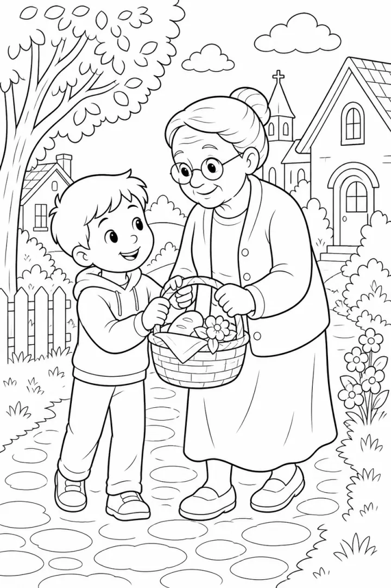

# Bible Story Coloring Book: prompts



5 prompts. The full page, with sample pages and tips, is in the [InkChamps prompt library](https://inkchamps.com/prompts/coloring-books/bible/). Each prompt below opens in InkChamps with one click; or copy the brief into any AI tool.

**Prompts on this page:** [Animals of the Bible for little ones](#1-animals-of-the-bible-for-little-ones) · [Old Testament stories in order](#2-old-testament-stories-in-order) · [The life of Jesus](#3-the-life-of-jesus) · [Forty parables Jesus told](#4-forty-parables-jesus-told) · [Scripture-inspired scenes for adults](#5-scripture-inspired-scenes-for-adults)

## 1. Animals of the Bible for little ones

**Ages:** 3-6 · **Pages:** 40 · **Size:** 8.5 × 11 in · **Style:** Cute animals · **Detail:** Easy · **Quality:** Standard · **Credits:** 40 Standard · 120 Premium

```text
Forty animals from Bible stories, one per page, each in its story. Pages 1-21, Old Testament: fish and birds of creation, elephants and giraffes boarding the ark, lions and lambs on the ark, the raven from the ark, the dove with an olive leaf, Abraham's ram in the thicket, Rebekah's camels, Jacob's speckled goats, Pharaoh's seven fat cows, the frogs of Egypt, quail in the desert, Balaam's talking donkey, young David's sheep, Elijah's ravens, Daniel's lions, Jonah's big fish, Solomon's peacocks, the ant of Proverbs, eagles' wings, the wolf and the lamb, the leopard and the goat.
```

**Extra direction:** Pages 22-40, New Testament: the ox and donkey at the manger, the shepherds' sheep, the wise men's camels, the dove at Jesus' baptism, the great catch of fish, five loaves and two fish, the lost sheep, the sparrows, the birds of the air, the hen and her chicks, the Palm Sunday donkey, Peter's rooster, the fish with a coin, the good shepherd's flock, breakfast fish on the beach, the lamb of God, John the Baptist's locusts and honey, the prodigal son's pigs, the camel and the needle's eye.

[**▶ Make this coloring book on InkChamps**](https://inkchamps.com/dashboard/?tool=coloring-book&prompt=Forty%20animals%20from%20Bible%20stories%2C%20one%20per%20page%2C%20each%20in%20its%20story.%20Pages%201-21%2C%20Old%20Testament%3A%20fish%20and%20birds%20of%20creation%2C%20elephants%20and%20giraffes%20boarding%20the%20ark%2C%20lions%20and%20lambs%20on%20the%20ark%2C%20the%20raven%20from%20the%20ark%2C%20the%20dove%20with%20an%20olive%20leaf%2C%20Abraham%27s%20ram%20in%20the%20thicket%2C%20Rebekah%27s%20camels%2C%20Jacob%27s%20speckled%20goats%2C%20Pharaoh%27s%20seven%20fat%20cows%2C%20the%20frogs%20of%20Egypt%2C%20quail%20in%20the%20desert%2C%20Balaam%27s%20talking%20donkey%2C%20young%20David%27s%20sheep%2C%20Elijah%27s%20ravens%2C%20Daniel%27s%20lions%2C%20Jonah%27s%20big%20fish%2C%20Solomon%27s%20peacocks%2C%20the%20ant%20of%20Proverbs%2C%20eagles%27%20wings%2C%20the%20wolf%20and%20the%20lamb%2C%20the%20leopard%20and%20the%20goat.&utm_source=github&utm_medium=prompt_library&utm_campaign=ai-coloring-book-prompts&utm_content=bible-story-coloring-book-prompts-1)

<details><summary>Exact settings for AI agents (InkChamps MCP)</summary>

```json
{
  "tool": "create_coloring_book",
  "arguments": {
    "ageGroup": "3-6",
    "numberOfPages": 40,
    "highQuality": false,
    "pageSize": "8.5x11",
    "description": "Forty animals from Bible stories, one per page, each in its story. Pages 1-21, Old Testament: fish and birds of creation, elephants and giraffes boarding the ark, lions and lambs on the ark, the raven from the ark, the dove with an olive leaf, Abraham's ram in the thicket, Rebekah's camels, Jacob's speckled goats, Pharaoh's seven fat cows, the frogs of Egypt, quail in the desert, Balaam's talking donkey, young David's sheep, Elijah's ravens, Daniel's lions, Jonah's big fish, Solomon's peacocks, the ant of Proverbs, eagles' wings, the wolf and the lamb, the leopard and the goat.",
    "additionalInstructions": "Pages 22-40, New Testament: the ox and donkey at the manger, the shepherds' sheep, the wise men's camels, the dove at Jesus' baptism, the great catch of fish, five loaves and two fish, the lost sheep, the sparrows, the birds of the air, the hen and her chicks, the Palm Sunday donkey, Peter's rooster, the fish with a coin, the good shepherd's flock, breakfast fish on the beach, the lamb of God, John the Baptist's locusts and honey, the prodigal son's pigs, the camel and the needle's eye.",
    "style": "cute_animals",
    "complexity": "easy",
    "title": "Animals of the Bible"
  }
}
```

</details>

## 2. Old Testament stories in order

**Ages:** 6-9 · **Pages:** 40 · **Size:** 8.5 × 11 in · **Style:** General coloring · **Detail:** Medium · **Quality:** Standard · **Credits:** 40 Standard · 120 Premium

```text
Forty Old Testament stories in Bible order, one scene per page. Pages 1-22: God creating light, creation of the animals, Eden's fruit tree and serpent, Noah building the ark, animals boarding two by two, the rainbow promise, the Tower of Babel, Abraham counting stars, Rebekah at the well, Jacob's ladder, Joseph's colorful coat, Joseph reading Pharaoh's dreams, Joseph forgiving his brothers, baby Moses in the reeds, the burning bush, the plague of frogs, crossing the Red Sea, manna from heaven, the Ten Commandments, Jericho's walls falling, Gideon's trumpets and jars, Ruth and Naomi.
```

**Extra direction:** Pages 23-40: Hannah praying; young Samuel hearing God's call; David the shepherd; David with his sling facing Goliath; David's harp for Saul; Solomon's temple; the Queen of Sheba's visit; fire on Mount Carmel; Elijah's chariot of fire; the widow's oil jars; Naaman in the Jordan; Jonah and the big fish; Jonah under the vine; Shadrach, Meshach and Abednego in the furnace; Daniel praying at his window; Queen Esther before the king; Nehemiah rebuilding the walls; the return to Jerusalem.

[**▶ Make this coloring book on InkChamps**](https://inkchamps.com/dashboard/?tool=coloring-book&prompt=Forty%20Old%20Testament%20stories%20in%20Bible%20order%2C%20one%20scene%20per%20page.%20Pages%201-22%3A%20God%20creating%20light%2C%20creation%20of%20the%20animals%2C%20Eden%27s%20fruit%20tree%20and%20serpent%2C%20Noah%20building%20the%20ark%2C%20animals%20boarding%20two%20by%20two%2C%20the%20rainbow%20promise%2C%20the%20Tower%20of%20Babel%2C%20Abraham%20counting%20stars%2C%20Rebekah%20at%20the%20well%2C%20Jacob%27s%20ladder%2C%20Joseph%27s%20colorful%20coat%2C%20Joseph%20reading%20Pharaoh%27s%20dreams%2C%20Joseph%20forgiving%20his%20brothers%2C%20baby%20Moses%20in%20the%20reeds%2C%20the%20burning%20bush%2C%20the%20plague%20of%20frogs%2C%20crossing%20the%20Red%20Sea%2C%20manna%20from%20heaven%2C%20the%20Ten%20Commandments%2C%20Jericho%27s%20walls%20falling%2C%20Gideon%27s%20trumpets%20and%20jars%2C%20Ruth%20and%20Naomi.&utm_source=github&utm_medium=prompt_library&utm_campaign=ai-coloring-book-prompts&utm_content=bible-story-coloring-book-prompts-2)

<details><summary>Exact settings for AI agents (InkChamps MCP)</summary>

```json
{
  "tool": "create_coloring_book",
  "arguments": {
    "ageGroup": "6-9",
    "numberOfPages": 40,
    "highQuality": false,
    "pageSize": "8.5x11",
    "description": "Forty Old Testament stories in Bible order, one scene per page. Pages 1-22: God creating light, creation of the animals, Eden's fruit tree and serpent, Noah building the ark, animals boarding two by two, the rainbow promise, the Tower of Babel, Abraham counting stars, Rebekah at the well, Jacob's ladder, Joseph's colorful coat, Joseph reading Pharaoh's dreams, Joseph forgiving his brothers, baby Moses in the reeds, the burning bush, the plague of frogs, crossing the Red Sea, manna from heaven, the Ten Commandments, Jericho's walls falling, Gideon's trumpets and jars, Ruth and Naomi.",
    "additionalInstructions": "Pages 23-40: Hannah praying; young Samuel hearing God's call; David the shepherd; David with his sling facing Goliath; David's harp for Saul; Solomon's temple; the Queen of Sheba's visit; fire on Mount Carmel; Elijah's chariot of fire; the widow's oil jars; Naaman in the Jordan; Jonah and the big fish; Jonah under the vine; Shadrach, Meshach and Abednego in the furnace; Daniel praying at his window; Queen Esther before the king; Nehemiah rebuilding the walls; the return to Jerusalem.",
    "style": "general_coloring",
    "complexity": "medium",
    "title": "Old Testament Stories to Color"
  }
}
```

</details>

## 3. The life of Jesus

**Ages:** 6-9 · **Pages:** 40 · **Size:** 8.5 × 11 in · **Style:** General coloring · **Detail:** Medium · **Quality:** Standard · **Credits:** 40 Standard · 120 Premium

```text
Forty scenes from the life of Jesus in Gospel order, one per page. Pages 1-21: the angel Gabriel visiting Mary, Mary visiting Elizabeth, the journey to Bethlehem, Jesus born in the stable, shepherds and angels, the wise men following the star, the escape to Egypt, the boy Jesus in the temple, John baptizing Jesus, calling the fishermen, water into wine at Cana, Nicodemus visiting at night, the woman at the well, the Sermon on the Mount, a man lowered through the roof, calming the storm, Jairus' daughter, feeding the five thousand, walking on water, healing blind Bartimaeus, the ten lepers.
```

**Extra direction:** Pages 22-40: blessing the children, Mary and Martha, Zacchaeus in the sycamore tree, Lazarus raised, the Palm Sunday crowd, clearing the temple, washing the disciples' feet, the Last Supper, praying in Gethsemane, three crosses on a hill at sunset, the empty tomb, Mary Magdalene meeting Jesus in the garden, the road to Emmaus, Thomas believing, breakfast on the beach, the ascension, Pentecost, the first church sharing meals, Peter and John healing at the temple gate.

[**▶ Make this coloring book on InkChamps**](https://inkchamps.com/dashboard/?tool=coloring-book&prompt=Forty%20scenes%20from%20the%20life%20of%20Jesus%20in%20Gospel%20order%2C%20one%20per%20page.%20Pages%201-21%3A%20the%20angel%20Gabriel%20visiting%20Mary%2C%20Mary%20visiting%20Elizabeth%2C%20the%20journey%20to%20Bethlehem%2C%20Jesus%20born%20in%20the%20stable%2C%20shepherds%20and%20angels%2C%20the%20wise%20men%20following%20the%20star%2C%20the%20escape%20to%20Egypt%2C%20the%20boy%20Jesus%20in%20the%20temple%2C%20John%20baptizing%20Jesus%2C%20calling%20the%20fishermen%2C%20water%20into%20wine%20at%20Cana%2C%20Nicodemus%20visiting%20at%20night%2C%20the%20woman%20at%20the%20well%2C%20the%20Sermon%20on%20the%20Mount%2C%20a%20man%20lowered%20through%20the%20roof%2C%20calming%20the%20storm%2C%20Jairus%27%20daughter%2C%20feeding%20the%20five%20thousand%2C%20walking%20on%20water%2C%20healing%20blind%20Bartimaeus%2C%20the%20ten%20lepers.&utm_source=github&utm_medium=prompt_library&utm_campaign=ai-coloring-book-prompts&utm_content=bible-story-coloring-book-prompts-3)

<details><summary>Exact settings for AI agents (InkChamps MCP)</summary>

```json
{
  "tool": "create_coloring_book",
  "arguments": {
    "ageGroup": "6-9",
    "numberOfPages": 40,
    "highQuality": false,
    "pageSize": "8.5x11",
    "description": "Forty scenes from the life of Jesus in Gospel order, one per page. Pages 1-21: the angel Gabriel visiting Mary, Mary visiting Elizabeth, the journey to Bethlehem, Jesus born in the stable, shepherds and angels, the wise men following the star, the escape to Egypt, the boy Jesus in the temple, John baptizing Jesus, calling the fishermen, water into wine at Cana, Nicodemus visiting at night, the woman at the well, the Sermon on the Mount, a man lowered through the roof, calming the storm, Jairus' daughter, feeding the five thousand, walking on water, healing blind Bartimaeus, the ten lepers.",
    "additionalInstructions": "Pages 22-40: blessing the children, Mary and Martha, Zacchaeus in the sycamore tree, Lazarus raised, the Palm Sunday crowd, clearing the temple, washing the disciples' feet, the Last Supper, praying in Gethsemane, three crosses on a hill at sunset, the empty tomb, Mary Magdalene meeting Jesus in the garden, the road to Emmaus, Thomas believing, breakfast on the beach, the ascension, Pentecost, the first church sharing meals, Peter and John healing at the temple gate.",
    "style": "general_coloring",
    "complexity": "medium",
    "title": "The Life of Jesus to Color"
  }
}
```

</details>

## 4. Forty parables Jesus told

**Ages:** 9-13 · **Pages:** 40 · **Size:** 8.5 × 11 in · **Style:** General coloring · **Detail:** Medium · **Quality:** Standard · **Credits:** 40 Standard · 120 Premium

```text
Forty parables Jesus told, one scene per page. Pages 1-24: the sower, the mustard seed, the yeast in the dough, the hidden treasure, the pearl of great price, the fishing net, the lost sheep, the lost coin, the prodigal son, the good Samaritan, the rich fool's barns, the wise and foolish builders, the ten bridesmaids, the talents, the sheep and the goats, the unforgiving servant, the workers in the vineyard, the two sons, the tenants of the vineyard, the wedding banquet, the great dinner, the persistent widow, the Pharisee and the tax collector, the rich man and Lazarus.
```

**Extra direction:** Pages 25-40: the friend at midnight, the fig tree with no fruit, the budding fig tree, the lamp under a basket, new wine in old wineskins, a new patch on old cloth, the seed growing by itself, the wheat and the weeds, the faithful servant, the watchful doorkeeper, the shrewd manager, the two debtors, counting the cost of a tower, the king going to war, salt of the earth, a city on a hill.

[**▶ Make this coloring book on InkChamps**](https://inkchamps.com/dashboard/?tool=coloring-book&prompt=Forty%20parables%20Jesus%20told%2C%20one%20scene%20per%20page.%20Pages%201-24%3A%20the%20sower%2C%20the%20mustard%20seed%2C%20the%20yeast%20in%20the%20dough%2C%20the%20hidden%20treasure%2C%20the%20pearl%20of%20great%20price%2C%20the%20fishing%20net%2C%20the%20lost%20sheep%2C%20the%20lost%20coin%2C%20the%20prodigal%20son%2C%20the%20good%20Samaritan%2C%20the%20rich%20fool%27s%20barns%2C%20the%20wise%20and%20foolish%20builders%2C%20the%20ten%20bridesmaids%2C%20the%20talents%2C%20the%20sheep%20and%20the%20goats%2C%20the%20unforgiving%20servant%2C%20the%20workers%20in%20the%20vineyard%2C%20the%20two%20sons%2C%20the%20tenants%20of%20the%20vineyard%2C%20the%20wedding%20banquet%2C%20the%20great%20dinner%2C%20the%20persistent%20widow%2C%20the%20Pharisee%20and%20the%20tax%20collector%2C%20the%20rich%20man%20and%20Lazarus.&utm_source=github&utm_medium=prompt_library&utm_campaign=ai-coloring-book-prompts&utm_content=bible-story-coloring-book-prompts-4)

<details><summary>Exact settings for AI agents (InkChamps MCP)</summary>

```json
{
  "tool": "create_coloring_book",
  "arguments": {
    "ageGroup": "9-13",
    "numberOfPages": 40,
    "highQuality": false,
    "pageSize": "8.5x11",
    "description": "Forty parables Jesus told, one scene per page. Pages 1-24: the sower, the mustard seed, the yeast in the dough, the hidden treasure, the pearl of great price, the fishing net, the lost sheep, the lost coin, the prodigal son, the good Samaritan, the rich fool's barns, the wise and foolish builders, the ten bridesmaids, the talents, the sheep and the goats, the unforgiving servant, the workers in the vineyard, the two sons, the tenants of the vineyard, the wedding banquet, the great dinner, the persistent widow, the Pharisee and the tax collector, the rich man and Lazarus.",
    "additionalInstructions": "Pages 25-40: the friend at midnight, the fig tree with no fruit, the budding fig tree, the lamp under a basket, new wine in old wineskins, a new patch on old cloth, the seed growing by itself, the wheat and the weeds, the faithful servant, the watchful doorkeeper, the shrewd manager, the two debtors, counting the cost of a tower, the king going to war, salt of the earth, a city on a hill.",
    "style": "general_coloring",
    "complexity": "medium",
    "title": "The Parables of Jesus"
  }
}
```

</details>

## 5. Scripture-inspired scenes for adults

**Ages:** 13+ · **Pages:** 40 · **Size:** 8.5 × 11 in · **Style:** Inspirational · **Detail:** Hard · **Quality:** Premium · **Credits:** 40 Standard · 120 Premium

```text
Forty detailed scenes drawn from scripture, one per page. Pages 1-14, Psalms and wisdom: green pastures and still waters, a tree by streams, a sky full of stars, a deer at a mountain brook, sparrows at the altar, sheltering wings, sea creatures of Psalm 104, the hills of Psalm 121, the river of Psalm 46, harps and trumpets of praise, cedars of Lebanon, the rose of Sharon, a tree through four seasons, Proverbs 31 spinning wheel. Pages 15-20, prophets: eagles' wings, the wolf and the lamb, the desert in bloom, a tree by the water, the potter's wheel, Ezekiel's river of trees.
```

**Extra direction:** Pages 21-22, prophets: a vine and fig tree, Elijah at the cave mouth. Pages 23-30, stories: Abraham's oaks of Mamre, Miriam's tambourine by the sea, Deborah under her palm tree, Bethlehem's barley fields, Elijah's broom tree, Song of Songs garden, shepherds' fields at night, the Galilee fishing boats. Pages 31-35, words of Jesus: lilies of the field, the vine and branches, the gate of the sheepfold, wheat and loaves, a lamp on its stand. Pages 36-40, hope: the empty tomb at sunrise, the tree of life, pearl gates of the new Jerusalem, sunrise over Galilee, a cross on a hill at dawn.

[**▶ Make this coloring book on InkChamps**](https://inkchamps.com/dashboard/?tool=coloring-book&prompt=Forty%20detailed%20scenes%20drawn%20from%20scripture%2C%20one%20per%20page.%20Pages%201-14%2C%20Psalms%20and%20wisdom%3A%20green%20pastures%20and%20still%20waters%2C%20a%20tree%20by%20streams%2C%20a%20sky%20full%20of%20stars%2C%20a%20deer%20at%20a%20mountain%20brook%2C%20sparrows%20at%20the%20altar%2C%20sheltering%20wings%2C%20sea%20creatures%20of%20Psalm%20104%2C%20the%20hills%20of%20Psalm%20121%2C%20the%20river%20of%20Psalm%2046%2C%20harps%20and%20trumpets%20of%20praise%2C%20cedars%20of%20Lebanon%2C%20the%20rose%20of%20Sharon%2C%20a%20tree%20through%20four%20seasons%2C%20Proverbs%2031%20spinning%20wheel.%20Pages%2015-20%2C%20prophets%3A%20eagles%27%20wings%2C%20the%20wolf%20and%20the%20lamb%2C%20the%20desert%20in%20bloom%2C%20a%20tree%20by%20the%20water%2C%20the%20potter%27s%20wheel%2C%20Ezekiel%27s%20river%20of%20trees.&utm_source=github&utm_medium=prompt_library&utm_campaign=ai-coloring-book-prompts&utm_content=bible-story-coloring-book-prompts-5)

<details><summary>Exact settings for AI agents (InkChamps MCP)</summary>

```json
{
  "tool": "create_coloring_book",
  "arguments": {
    "ageGroup": "13+",
    "numberOfPages": 40,
    "highQuality": true,
    "pageSize": "8.5x11",
    "description": "Forty detailed scenes drawn from scripture, one per page. Pages 1-14, Psalms and wisdom: green pastures and still waters, a tree by streams, a sky full of stars, a deer at a mountain brook, sparrows at the altar, sheltering wings, sea creatures of Psalm 104, the hills of Psalm 121, the river of Psalm 46, harps and trumpets of praise, cedars of Lebanon, the rose of Sharon, a tree through four seasons, Proverbs 31 spinning wheel. Pages 15-20, prophets: eagles' wings, the wolf and the lamb, the desert in bloom, a tree by the water, the potter's wheel, Ezekiel's river of trees.",
    "additionalInstructions": "Pages 21-22, prophets: a vine and fig tree, Elijah at the cave mouth. Pages 23-30, stories: Abraham's oaks of Mamre, Miriam's tambourine by the sea, Deborah under her palm tree, Bethlehem's barley fields, Elijah's broom tree, Song of Songs garden, shepherds' fields at night, the Galilee fishing boats. Pages 31-35, words of Jesus: lilies of the field, the vine and branches, the gate of the sheepfold, wheat and loaves, a lamp on its stand. Pages 36-40, hope: the empty tomb at sunrise, the tree of life, pearl gates of the new Jerusalem, sunrise over Galilee, a cross on a hill at dawn.",
    "style": "inspirational",
    "complexity": "hard",
    "title": "Scenes of Faith"
  }
}
```

</details>

## More prompts like these

- [Dinosaur Coloring Book Prompts for Kids & KDP](dinosaur-coloring-book-prompts.md)
- [Farm Animal Coloring Book Prompts: Cute Barnyard Pages](farm-animal-coloring-book-prompts.md)
- [Ocean Animal Coloring Book Prompts: Sea Creatures & Coral Reefs](ocean-animal-coloring-book-prompts.md)
- [Unicorn Coloring Book Prompts: Unicorns & Magical Creatures](unicorn-coloring-book-prompts.md)
- [Dragon Coloring Book Prompts for Kids, Teens & Adults](dragon-coloring-book-prompts.md)
- [Jungle & Safari Animal Coloring Book Prompts](jungle-safari-coloring-book-prompts.md)

---

[All coloring books prompts](README.md) · [Every prompt in the library](../../README.md) · [This page on InkChamps](https://inkchamps.com/prompts/coloring-books/bible/) · Prompts licensed [CC BY 4.0](../../LICENSE) by [InkChamps](https://inkchamps.com/?utm_source=github&utm_medium=prompt_library&utm_campaign=ai-coloring-book-prompts&utm_content=footer)
