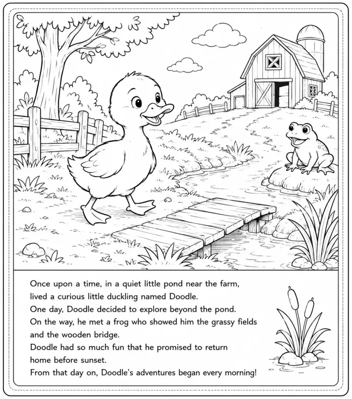

# Bird Coloring Book: prompts



5 prompts. The full page, with sample pages and tips, is in the [InkChamps prompt library](https://inkchamps.com/prompts/coloring-books/bird/). Each prompt below opens in InkChamps with one click; or copy the brief into any AI tool.

**Prompts on this page:** [Baby birds for toddlers](#1-baby-birds-for-toddlers) · [Backyard birds and feeders](#2-backyard-birds-and-feeders) · [40 birds of the world with names](#3-40-birds-of-the-world-with-names) · [Owls and birds of prey](#4-owls-and-birds-of-prey) · [Floral bird mandalas for adults](#5-floral-bird-mandalas-for-adults)

## 1. Baby birds for toddlers

**Ages:** 3-6 · **Pages:** 40 · **Size:** 8.5 × 8.5 in · **Style:** Cute birds · **Detail:** Easy · **Quality:** Standard · **Credits:** 40 Standard · 120 Premium

```text
Forty pages of one big baby bird each: a chick hatching from an egg, a fluffy owlet on a branch, a penguin chick on its parent's feet, a duckling in a puddle, three robin chicks in a nest with open beaks, a baby flamingo, a baby swan riding on its mother's back, a gosling, a baby parrot, a baby peacock, a puffin chick, a kiwi chick, a baby ostrich, a baby toucan, and a mother hen with chicks.
```

**Extra direction:** More pages: a baby woodpecker in a tree hole, a baby hummingbird in a tiny nest, an eaglet in a big nest, a cygnet in reeds, a baby pigeon, a baby cockatoo, a quail chick, a baby emu, a baby pelican, a turkey chick, a baby owl asleep, a bird's nest with blue eggs, a baby bird learning to fly, a baby bird in a birdhouse.

[**▶ Make this coloring book on InkChamps**](https://inkchamps.com/dashboard/?tool=coloring-book&prompt=Forty%20pages%20of%20one%20big%20baby%20bird%20each%3A%20a%20chick%20hatching%20from%20an%20egg%2C%20a%20fluffy%20owlet%20on%20a%20branch%2C%20a%20penguin%20chick%20on%20its%20parent%27s%20feet%2C%20a%20duckling%20in%20a%20puddle%2C%20three%20robin%20chicks%20in%20a%20nest%20with%20open%20beaks%2C%20a%20baby%20flamingo%2C%20a%20baby%20swan%20riding%20on%20its%20mother%27s%20back%2C%20a%20gosling%2C%20a%20baby%20parrot%2C%20a%20baby%20peacock%2C%20a%20puffin%20chick%2C%20a%20kiwi%20chick%2C%20a%20baby%20ostrich%2C%20a%20baby%20toucan%2C%20and%20a%20mother%20hen%20with%20chicks.&utm_source=github&utm_medium=prompt_library&utm_campaign=ai-coloring-book-prompts&utm_content=bird-coloring-book-prompts-1)

<details><summary>Exact settings for AI agents (InkChamps MCP)</summary>

```json
{
  "tool": "create_coloring_book",
  "arguments": {
    "ageGroup": "3-6",
    "numberOfPages": 40,
    "highQuality": false,
    "pageSize": "8.5x8.5",
    "description": "Forty pages of one big baby bird each: a chick hatching from an egg, a fluffy owlet on a branch, a penguin chick on its parent's feet, a duckling in a puddle, three robin chicks in a nest with open beaks, a baby flamingo, a baby swan riding on its mother's back, a gosling, a baby parrot, a baby peacock, a puffin chick, a kiwi chick, a baby ostrich, a baby toucan, and a mother hen with chicks.",
    "style": "cute_birds",
    "complexity": "easy",
    "theme": "baby birds",
    "title": "Baby Birds Coloring Book",
    "additionalInstructions": "More pages: a baby woodpecker in a tree hole, a baby hummingbird in a tiny nest, an eaglet in a big nest, a cygnet in reeds, a baby pigeon, a baby cockatoo, a quail chick, a baby emu, a baby pelican, a turkey chick, a baby owl asleep, a bird's nest with blue eggs, a baby bird learning to fly, a baby bird in a birdhouse."
  }
}
```

</details>

## 2. Backyard birds and feeders

**Ages:** 6-9 · **Pages:** 40 · **Size:** 8.5 × 11 in · **Style:** Cute birds · **Detail:** Medium · **Quality:** Standard · **Credits:** 40 Standard · 120 Premium

```text
Forty pages of birds you can see at home: a cardinal on a snowy branch, a robin pulling a worm, a blue jay at a feeder, chickadees on a sunflower head, a goldfinch on a thistle, a hummingbird at a sugar-water feeder, a downy woodpecker on a suet cake, a house sparrow in a birdbath, a mourning dove on a fence, a wren peeking from a birdhouse, and a kid with binoculars at a window.
```

**Extra direction:** More pages: a northern mockingbird singing, a nuthatch upside down on a trunk, a cedar waxwing with berries, a red-winged blackbird on a cattail, a bluebird at a nest box, an oriole with an orange, a crow with a shiny object, a starling flock, a junco in snow, a mallard on a pond, a grackle, a barn swallow under eaves, a kid building a birdhouse, a bird bath with three birds, a feeder in winter.

[**▶ Make this coloring book on InkChamps**](https://inkchamps.com/dashboard/?tool=coloring-book&prompt=Forty%20pages%20of%20birds%20you%20can%20see%20at%20home%3A%20a%20cardinal%20on%20a%20snowy%20branch%2C%20a%20robin%20pulling%20a%20worm%2C%20a%20blue%20jay%20at%20a%20feeder%2C%20chickadees%20on%20a%20sunflower%20head%2C%20a%20goldfinch%20on%20a%20thistle%2C%20a%20hummingbird%20at%20a%20sugar-water%20feeder%2C%20a%20downy%20woodpecker%20on%20a%20suet%20cake%2C%20a%20house%20sparrow%20in%20a%20birdbath%2C%20a%20mourning%20dove%20on%20a%20fence%2C%20a%20wren%20peeking%20from%20a%20birdhouse%2C%20and%20a%20kid%20with%20binoculars%20at%20a%20window.&utm_source=github&utm_medium=prompt_library&utm_campaign=ai-coloring-book-prompts&utm_content=bird-coloring-book-prompts-2)

<details><summary>Exact settings for AI agents (InkChamps MCP)</summary>

```json
{
  "tool": "create_coloring_book",
  "arguments": {
    "ageGroup": "6-9",
    "numberOfPages": 40,
    "highQuality": false,
    "pageSize": "8.5x11",
    "description": "Forty pages of birds you can see at home: a cardinal on a snowy branch, a robin pulling a worm, a blue jay at a feeder, chickadees on a sunflower head, a goldfinch on a thistle, a hummingbird at a sugar-water feeder, a downy woodpecker on a suet cake, a house sparrow in a birdbath, a mourning dove on a fence, a wren peeking from a birdhouse, and a kid with binoculars at a window.",
    "style": "cute_birds",
    "complexity": "medium",
    "theme": "backyard birds",
    "title": "Backyard Birds Coloring Book",
    "additionalInstructions": "More pages: a northern mockingbird singing, a nuthatch upside down on a trunk, a cedar waxwing with berries, a red-winged blackbird on a cattail, a bluebird at a nest box, an oriole with an orange, a crow with a shiny object, a starling flock, a junco in snow, a mallard on a pond, a grackle, a barn swallow under eaves, a kid building a birdhouse, a bird bath with three birds, a feeder in winter."
  }
}
```

</details>

## 3. 40 birds of the world with names

**Ages:** 9-13 · **Pages:** 40 · **Size:** 8.5 × 11 in · **Style:** Cute birds · **Detail:** Medium · **Layout:** One item per page, with its caption · **Quality:** Standard · **Credits:** 40 Standard · 120 Premium

```text
Forty birds of the world, one per page with its name: scarlet macaw, toucan, flamingo, emperor penguin, puffin, peacock, ostrich, emu, kiwi, kookaburra, cockatoo, lyrebird, cassowary, hoopoe, kingfisher, hornbill, bird of paradise, resplendent quetzal, roseate spoonbill, pelican, albatross, snowy egret, great blue heron, crowned crane, secretary bird, shoebill, marabou stork, mandarin duck, wood duck, black swan, ptarmigan, roadrunner, magpie, cardinal, blue-footed booby, frigatebird, lovebird, budgerigar, African grey parrot, golden pheasant.
```

[**▶ Make this coloring book on InkChamps**](https://inkchamps.com/dashboard/?tool=coloring-book&prompt=Forty%20birds%20of%20the%20world%2C%20one%20per%20page%20with%20its%20name%3A%20scarlet%20macaw%2C%20toucan%2C%20flamingo%2C%20emperor%20penguin%2C%20puffin%2C%20peacock%2C%20ostrich%2C%20emu%2C%20kiwi%2C%20kookaburra%2C%20cockatoo%2C%20lyrebird%2C%20cassowary%2C%20hoopoe%2C%20kingfisher%2C%20hornbill%2C%20bird%20of%20paradise%2C%20resplendent%20quetzal%2C%20roseate%20spoonbill%2C%20pelican%2C%20albatross%2C%20snowy%20egret%2C%20great%20blue%20heron%2C%20crowned%20crane%2C%20secretary%20bird%2C%20shoebill%2C%20marabou%20stork%2C%20mandarin%20duck%2C%20wood%20duck%2C%20black%20swan%2C%20ptarmigan%2C%20roadrunner%2C%20magpie%2C%20cardinal%2C%20blue-footed%20booby%2C%20frigatebird%2C%20lovebird%2C%20budgerigar%2C%20African%20grey%20parrot%2C%20golden%20pheasant.&utm_source=github&utm_medium=prompt_library&utm_campaign=ai-coloring-book-prompts&utm_content=bird-coloring-book-prompts-3)

<details><summary>Exact settings for AI agents (InkChamps MCP)</summary>

```json
{
  "tool": "create_coloring_book",
  "arguments": {
    "ageGroup": "9-13",
    "numberOfPages": 40,
    "highQuality": false,
    "pageSize": "8.5x11",
    "description": "Forty birds of the world, one per page with its name: scarlet macaw, toucan, flamingo, emperor penguin, puffin, peacock, ostrich, emu, kiwi, kookaburra, cockatoo, lyrebird, cassowary, hoopoe, kingfisher, hornbill, bird of paradise, resplendent quetzal, roseate spoonbill, pelican, albatross, snowy egret, great blue heron, crowned crane, secretary bird, shoebill, marabou stork, mandarin duck, wood duck, black swan, ptarmigan, roadrunner, magpie, cardinal, blue-footed booby, frigatebird, lovebird, budgerigar, African grey parrot, golden pheasant.",
    "style": "cute_birds",
    "complexity": "medium",
    "theme": "birds of the world with names",
    "title": "40 Birds of the World Coloring Book",
    "pageCategory": "concept"
  }
}
```

</details>

## 4. Owls and birds of prey

**Ages:** 9-13 · **Pages:** 40 · **Size:** 8.5 × 11 in · **Style:** General coloring · **Detail:** Hard · **Quality:** Standard · **Credits:** 40 Standard · 120 Premium

```text
Forty pages of owls and birds of prey: a barn owl in flight over a field, a snowy owl on an icy branch, a great horned owl at dusk, a burrowing owl at its burrow, an elf owl in a cactus, a bald eagle catching a fish, a golden eagle over mountains, a peregrine falcon diving, an osprey carrying a fish, a kestrel hovering, a harpy eagle in the rainforest, a red-tailed hawk on a fence post, and a falconer with a hawk.
```

**Extra direction:** More pages: a long-eared owl, a screech owl in a tree hole, a tawny owl, an owl family on a branch, an owlet learning to fly, a Eurasian eagle-owl, a condor on a cliff, a vulture, a secretary bird, a harrier over a marsh, a sparrowhawk, a Philippine eagle, a kite bird soaring, an eagle's nest with eaglets, an owl in a barn window at night.

[**▶ Make this coloring book on InkChamps**](https://inkchamps.com/dashboard/?tool=coloring-book&prompt=Forty%20pages%20of%20owls%20and%20birds%20of%20prey%3A%20a%20barn%20owl%20in%20flight%20over%20a%20field%2C%20a%20snowy%20owl%20on%20an%20icy%20branch%2C%20a%20great%20horned%20owl%20at%20dusk%2C%20a%20burrowing%20owl%20at%20its%20burrow%2C%20an%20elf%20owl%20in%20a%20cactus%2C%20a%20bald%20eagle%20catching%20a%20fish%2C%20a%20golden%20eagle%20over%20mountains%2C%20a%20peregrine%20falcon%20diving%2C%20an%20osprey%20carrying%20a%20fish%2C%20a%20kestrel%20hovering%2C%20a%20harpy%20eagle%20in%20the%20rainforest%2C%20a%20red-tailed%20hawk%20on%20a%20fence%20post%2C%20and%20a%20falconer%20with%20a%20hawk.&utm_source=github&utm_medium=prompt_library&utm_campaign=ai-coloring-book-prompts&utm_content=bird-coloring-book-prompts-4)

<details><summary>Exact settings for AI agents (InkChamps MCP)</summary>

```json
{
  "tool": "create_coloring_book",
  "arguments": {
    "ageGroup": "9-13",
    "numberOfPages": 40,
    "highQuality": false,
    "pageSize": "8.5x11",
    "description": "Forty pages of owls and birds of prey: a barn owl in flight over a field, a snowy owl on an icy branch, a great horned owl at dusk, a burrowing owl at its burrow, an elf owl in a cactus, a bald eagle catching a fish, a golden eagle over mountains, a peregrine falcon diving, an osprey carrying a fish, a kestrel hovering, a harpy eagle in the rainforest, a red-tailed hawk on a fence post, and a falconer with a hawk.",
    "style": "general_coloring",
    "complexity": "hard",
    "theme": "owls and birds of prey",
    "title": "Owls, Eagles and Falcons Coloring Book",
    "additionalInstructions": "More pages: a long-eared owl, a screech owl in a tree hole, a tawny owl, an owl family on a branch, an owlet learning to fly, a Eurasian eagle-owl, a condor on a cliff, a vulture, a secretary bird, a harrier over a marsh, a sparrowhawk, a Philippine eagle, a kite bird soaring, an eagle's nest with eaglets, an owl in a barn window at night."
  }
}
```

</details>

## 5. Floral bird mandalas for adults

**Ages:** 13+ · **Pages:** 40 · **Size:** 8.5 × 11 in · **Style:** Mandala birds · **Detail:** Hard · **Quality:** Premium · **Credits:** 40 Standard · 120 Premium

```text
Forty birds among flowers for adult colorists: a hummingbird at a hibiscus, a peacock with its tail fanned among roses, a heron in a lotus pond, a parrot pair in a magnolia tree, a crane under cherry blossoms, a hoopoe with tulips, a kingfisher on a branch of plum blossoms, a flamingo among water lilies, an owl in a wreath of peonies, a robin with apple blossoms, and a swan on a pond of lily pads.
```

**Extra direction:** More pages: a toucan with orchids, a cardinal with holly, a bluebird with morning glories, a pheasant with autumn leaves, a cockatoo with jasmine, a sparrow with sunflowers, a lovebird pair in a heart of roses, a quetzal with bromeliads, a goldfinch with thistles, a mandarin duck with irises, a bird of paradise flower and bird, a nest of eggs in a wildflower ring, a magpie with berries, a wren with ivy.

[**▶ Make this coloring book on InkChamps**](https://inkchamps.com/dashboard/?tool=coloring-book&prompt=Forty%20birds%20among%20flowers%20for%20adult%20colorists%3A%20a%20hummingbird%20at%20a%20hibiscus%2C%20a%20peacock%20with%20its%20tail%20fanned%20among%20roses%2C%20a%20heron%20in%20a%20lotus%20pond%2C%20a%20parrot%20pair%20in%20a%20magnolia%20tree%2C%20a%20crane%20under%20cherry%20blossoms%2C%20a%20hoopoe%20with%20tulips%2C%20a%20kingfisher%20on%20a%20branch%20of%20plum%20blossoms%2C%20a%20flamingo%20among%20water%20lilies%2C%20an%20owl%20in%20a%20wreath%20of%20peonies%2C%20a%20robin%20with%20apple%20blossoms%2C%20and%20a%20swan%20on%20a%20pond%20of%20lily%20pads.&utm_source=github&utm_medium=prompt_library&utm_campaign=ai-coloring-book-prompts&utm_content=bird-coloring-book-prompts-5)

<details><summary>Exact settings for AI agents (InkChamps MCP)</summary>

```json
{
  "tool": "create_coloring_book",
  "arguments": {
    "ageGroup": "13+",
    "numberOfPages": 40,
    "highQuality": true,
    "pageSize": "8.5x11",
    "description": "Forty birds among flowers for adult colorists: a hummingbird at a hibiscus, a peacock with its tail fanned among roses, a heron in a lotus pond, a parrot pair in a magnolia tree, a crane under cherry blossoms, a hoopoe with tulips, a kingfisher on a branch of plum blossoms, a flamingo among water lilies, an owl in a wreath of peonies, a robin with apple blossoms, and a swan on a pond of lily pads.",
    "style": "mandala_birds",
    "complexity": "hard",
    "theme": "birds with flowers for adults",
    "title": "Birds and Blossoms: Adult Coloring Book",
    "additionalInstructions": "More pages: a toucan with orchids, a cardinal with holly, a bluebird with morning glories, a pheasant with autumn leaves, a cockatoo with jasmine, a sparrow with sunflowers, a lovebird pair in a heart of roses, a quetzal with bromeliads, a goldfinch with thistles, a mandarin duck with irises, a bird of paradise flower and bird, a nest of eggs in a wildflower ring, a magpie with berries, a wren with ivy."
  }
}
```

</details>

## More prompts like these

- [Bug & Insect Coloring Book Prompts for Kids and Adults](bug-insect-coloring-book-prompts.md)
- [Space Coloring Book Prompts: Planets, Astronauts & Aliens](space-coloring-book-prompts.md)
- [Vehicle Coloring Book Prompts: Trucks, Diggers, Trains & Cars](vehicle-coloring-book-prompts.md)
- [Princess & Castle Coloring Book Prompts (Original Characters)](princess-castle-coloring-book-prompts.md)
- [Mermaid Coloring Book Prompts for Kids, Teens & Adults](mermaid-coloring-book-prompts.md)
- [Robot Coloring Book Prompts for Kids & Tweens](robot-coloring-book-prompts.md)

---

[All coloring books prompts](README.md) · [Every prompt in the library](../../README.md) · [This page on InkChamps](https://inkchamps.com/prompts/coloring-books/bird/) · Prompts licensed [CC BY 4.0](../../LICENSE) by [InkChamps](https://inkchamps.com/?utm_source=github&utm_medium=prompt_library&utm_campaign=ai-coloring-book-prompts&utm_content=footer)
