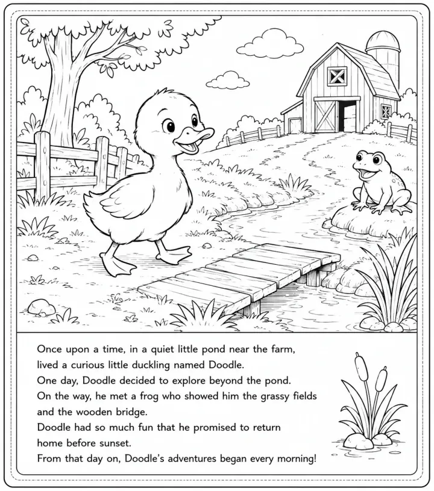

# Bird Coloring Book: prompts



5 prompts. The full page, with sample pages and tips, is in the [InkChamps prompt library](https://inkchamps.com/prompts/coloring-books/bird/). Each prompt below opens in InkChamps with one click; or copy the brief into any AI tool.

**Prompts on this page:** [Baby birds for toddlers](#1-baby-birds-for-toddlers) · [Backyard birds and feeders](#2-backyard-birds-and-feeders) · [24 birds of the world with names](#3-24-birds-of-the-world-with-names) · [Owls and birds of prey](#4-owls-and-birds-of-prey) · [Floral bird mandalas for adults](#5-floral-bird-mandalas-for-adults)

## 1. Baby birds for toddlers

**Ages:** 3-6 · **Pages:** 24 · **Size:** 8.5 × 8.5 in · **Style:** Cute birds · **Detail:** Easy · **Quality:** Standard · **Credits:** 24 Standard · 72 Premium

```text
24 pages of one big baby bird each, ending at bedtime: a chick hatching from an egg, robin chicks with open beaks, a fluffy owlet, a penguin chick on its parent's feet, a duckling in a puddle, a baby flamingo, a cygnet on its mother's back, a gosling, a baby parrot, a baby puffin, a kiwi chick, a baby ostrich, a baby toucan, a hen with chicks, a baby woodpecker, a baby hummingbird, an eaglet, a baby bird learning to fly and a baby owl asleep.
```

### Page by page (24 pages)

Paste one page at a time into ChatGPT, Gemini or any AI image tool, with this line after it:

> Black-and-white coloring page for a child aged 3 to 6: one big, cute, chubby cartoon baby bird filling most of the page, thick bold outlines, large simple shapes with wide spaces to color, very little background, no shading, no grey, no words, plain white background, square page.

1. A chubby baby chick hatching from a cracked egg in a cozy straw nest, half the shell still on its head like a hat, a big round sun behind.
2. Three baby robins in a round twig nest with their beaks wide open, a mother robin landing on the rim with a wiggly worm in her beak.
3. A fluffy baby owl with huge round eyes sitting on a tree branch, two big leaves beside it and a crescent moon above.
4. A round, fluffy penguin chick standing on its parent's big feet on the ice, snuggled against the parent's tummy, a small snowball nearby.
5. A little duckling splashing in a rain puddle, big drops falling around it and a leaf floating on the water.
6. A baby flamingo standing on one long leg in shallow water, its neck curled in an S shape, a lily pad and a flower beside it.
7. A baby swan riding on its mother's back across a pond, tucked between her wings, two reeds and a lily pad nearby.
8. A fuzzy baby goose waddling through tall grass, looking up at a butterfly flying just above its head.
9. A baby parrot sitting on a wooden perch, holding a slice of apple in one foot and taking a big bite.
10. A baby peacock standing proudly in a garden with its tiny tail fanned out, big round eye spots on the short feathers and two flowers beside it.
11. A baby puffin peeking out of its burrow on a grassy cliff top, a little fish in its colorful beak and the sea below.
12. A round, fuzzy kiwi chick sniffing the ground with its long thin beak beside a big curly fern.
13. A baby ostrich with long wobbly legs standing next to a giant egg, a few pebbles and a tuft of grass at its feet.
14. A baby toucan on a jungle branch holding a round berry in its huge beak, a big leaf hanging beside it.
15. A mother hen with three fluffy chicks pecking at corn on the ground beside a wooden fence, one chick riding on her back.
16. A baby woodpecker poking its head out of a round hole in a tree trunk, a small acorn on the branch below.
17. A tiny baby hummingbird sitting in a tiny cup-shaped nest on a twig, a big trumpet flower hanging beside it.
18. A fluffy baby eagle sitting in a huge nest of sticks at the top of a tree, a few soft feathers floating in the air.
19. A baby pelican sitting on a wooden dock post with its big pouch open, a small fish jumping out of the water toward it.
20. A baby cockatoo with a fluffy crest standing up on its head, sitting on a branch and holding a sunflower seed.
21. A fluffy turkey chick standing beside a big round pumpkin, a fallen leaf by its feet.
22. A baby bird learning to fly, flapping its little wings as it hops off a branch, its mother watching from the nest above.
23. A baby bird peeking out of the round door of a wooden birdhouse on a post, flowers growing around the bottom of the post.
24. A sleepy baby owl curled up asleep in a soft nest, its eyes closed, with a big moon and three stars above.

[**▶ Make this coloring book on InkChamps**](https://inkchamps.com/dashboard/?tool=coloring-book&prompt=24%20pages%20of%20one%20big%20baby%20bird%20each%2C%20ending%20at%20bedtime%3A%20a%20chick%20hatching%20from%20an%20egg%2C%20robin%20chicks%20with%20open%20beaks%2C%20a%20fluffy%20owlet%2C%20a%20penguin%20chick%20on%20its%20parent%27s%20feet%2C%20a%20duckling%20in%20a%20puddle%2C%20a%20baby%20flamingo%2C%20a%20cygnet%20on%20its%20mother%27s%20back%2C%20a%20gosling%2C%20a%20baby%20parrot%2C%20a%20baby%20puffin%2C%20a%20kiwi%20chick%2C%20a%20baby%20ostrich%2C%20a%20baby%20toucan%2C%20a%20hen%20with%20chicks%2C%20a%20baby%20woodpecker%2C%20a%20baby%20hummingbird%2C%20an%20eaglet%2C%20a%20baby%20bird%20learning%20to%20fly%20and%20a%20baby%20owl%20asleep.&utm_source=github&utm_medium=prompt_library&utm_campaign=ai-coloring-book-prompts&utm_content=bird-coloring-book-prompts-1)

<details><summary>Exact settings for AI agents (InkChamps MCP)</summary>

```json
{
  "tool": "create_coloring_book",
  "arguments": {
    "ageGroup": "3-6",
    "numberOfPages": 24,
    "highQuality": false,
    "pageSize": "8.5x8.5",
    "description": "24 pages of one big baby bird each, ending at bedtime: a chick hatching from an egg, robin chicks with open beaks, a fluffy owlet, a penguin chick on its parent's feet, a duckling in a puddle, a baby flamingo, a cygnet on its mother's back, a gosling, a baby parrot, a baby puffin, a kiwi chick, a baby ostrich, a baby toucan, a hen with chicks, a baby woodpecker, a baby hummingbird, an eaglet, a baby bird learning to fly and a baby owl asleep.",
    "style": "cute_birds",
    "complexity": "easy",
    "theme": "baby birds",
    "title": "Baby Birds Coloring Book"
  }
}
```

</details>

## 2. Backyard birds and feeders

**Ages:** 6-9 · **Pages:** 24 · **Size:** 8.5 × 11 in · **Style:** Cute birds · **Detail:** Medium · **Quality:** Standard · **Credits:** 24 Standard · 72 Premium

```text
24 pages of birds you can see at home: a kid with binoculars at a window, a cardinal on a snowy branch, a robin pulling a worm, a blue jay at a feeder, chickadees on a sunflower, a goldfinch on a thistle, a hummingbird at a feeder, a woodpecker at suet, sparrows in a birdbath, a wren at a birdhouse, a nuthatch upside down, waxwings with berries, a bluebird at a nest box, mallards with ducklings, swallows at a mud nest, building a birdhouse and a flock of starlings at sunset.
```

### Page by page (24 pages)

Paste one page at a time into ChatGPT, Gemini or any AI image tool, with this line after it:

> Black-and-white coloring page for a child aged 6 to 9: a friendly, recognisable backyard bird as the main subject, clear bold outlines, medium detail with a simple garden or yard background, no shading, no grey, no words or letters, plain white background, portrait 8.5 x 11 page.

1. A kid kneeling on a couch at a window with binoculars, watching a bird feeder hanging from a tree in the yard outside.
2. A cardinal with its pointed crest perched on a snowy branch, red berries hanging beside it and snowflakes falling.
3. A robin on a lawn tugging a long worm out of the ground, a garden rake and a flowerpot nearby.
4. A blue jay with its crest raised grabbing a peanut from a wooden platform feeder, a squirrel watching from the tree trunk.
5. Three chickadees clinging to a giant drooping sunflower head, pulling out seeds, a garden fence behind.
6. A goldfinch balancing on a tall purple thistle, picking out the fluffy seeds, more thistles around it.
7. A hummingbird hovering at a sugar-water feeder with flower-shaped ports, a hanging basket of petunias beside it.
8. A downy woodpecker clinging to a tree trunk and pecking at a suet cake in a wire cage, bark texture around it.
9. Two house sparrows splashing in a stone birdbath, water droplets flying, a garden gnome and flowers at its base.
10. A pair of mourning doves sitting side by side on a wooden fence, a climbing rose growing along the rails.
11. A wren peeking out of a small wooden birdhouse with a twig in its beak, the birdhouse hanging from an apple tree.
12. A mockingbird singing on top of a mailbox at the end of a driveway, its beak open and music notes drifting away.
13. A nuthatch walking head-first down a tree trunk, a seed in its beak and a mushroom growing at the base of the tree.
14. Two cedar waxwings on a branch full of berries, one passing a berry to the other's beak.
15. A red-winged blackbird calling from the top of a cattail at the edge of a pond, lily pads and reeds below.
16. An eastern bluebird sitting on top of a nest box mounted on a fence post in a meadow, wildflowers in the grass.
17. An oriole pecking at an orange half stuck on a feeder spike, a dish of grape jelly beside it.
18. A crow on a picnic table holding a shiny bottle cap in its beak, a paper cup and a sandwich crust beside it.
19. A mother mallard swimming on a park pond with a line of five ducklings behind her, a wooden bench on the bank.
20. Barn swallows under the eaves of a barn, one parent feeding three open-mouthed chicks in a cup-shaped mud nest.
21. A dark-eyed junco hopping in fresh snow under a feeder, picking up fallen seeds, a snowman in the yard behind.
22. A kid and a grown-up at a workbench building a birdhouse, one holding the roof while the other hammers a nail, a saw and a box of nails nearby.
23. A kid scooping seed into a tube feeder hanging from a branch while a chickadee waits on a twig just above.
24. A family sitting on a porch step at sunset, pointing at a big swirling flock of starlings over the treetops.

[**▶ Make this coloring book on InkChamps**](https://inkchamps.com/dashboard/?tool=coloring-book&prompt=24%20pages%20of%20birds%20you%20can%20see%20at%20home%3A%20a%20kid%20with%20binoculars%20at%20a%20window%2C%20a%20cardinal%20on%20a%20snowy%20branch%2C%20a%20robin%20pulling%20a%20worm%2C%20a%20blue%20jay%20at%20a%20feeder%2C%20chickadees%20on%20a%20sunflower%2C%20a%20goldfinch%20on%20a%20thistle%2C%20a%20hummingbird%20at%20a%20feeder%2C%20a%20woodpecker%20at%20suet%2C%20sparrows%20in%20a%20birdbath%2C%20a%20wren%20at%20a%20birdhouse%2C%20a%20nuthatch%20upside%20down%2C%20waxwings%20with%20berries%2C%20a%20bluebird%20at%20a%20nest%20box%2C%20mallards%20with%20ducklings%2C%20swallows%20at%20a%20mud%20nest%2C%20building%20a%20birdhouse%20and%20a%20flock%20of%20starlings%20at%20sunset.&utm_source=github&utm_medium=prompt_library&utm_campaign=ai-coloring-book-prompts&utm_content=bird-coloring-book-prompts-2)

<details><summary>Exact settings for AI agents (InkChamps MCP)</summary>

```json
{
  "tool": "create_coloring_book",
  "arguments": {
    "ageGroup": "6-9",
    "numberOfPages": 24,
    "highQuality": false,
    "pageSize": "8.5x11",
    "description": "24 pages of birds you can see at home: a kid with binoculars at a window, a cardinal on a snowy branch, a robin pulling a worm, a blue jay at a feeder, chickadees on a sunflower, a goldfinch on a thistle, a hummingbird at a feeder, a woodpecker at suet, sparrows in a birdbath, a wren at a birdhouse, a nuthatch upside down, waxwings with berries, a bluebird at a nest box, mallards with ducklings, swallows at a mud nest, building a birdhouse and a flock of starlings at sunset.",
    "style": "cute_birds",
    "complexity": "medium",
    "theme": "backyard birds",
    "title": "Backyard Birds Coloring Book"
  }
}
```

</details>

## 3. 24 birds of the world with names

**Ages:** 9-13 · **Pages:** 24 · **Size:** 8.5 × 11 in · **Style:** Cute birds · **Detail:** Medium · **Layout:** One item per page, with its caption · **Quality:** Standard · **Credits:** 24 Standard · 72 Premium

```text
24 birds of the world, one per page, each in its home habitat with its name as the caption: scarlet macaw, toucan, resplendent quetzal, roseate spoonbill, roadrunner, great blue heron, blue-footed booby, puffin, albatross, emperor penguin, ostrich, flamingo, crowned crane, shoebill, secretary bird, peacock, hornbill, mandarin duck, kingfisher, hoopoe, bird of paradise, kookaburra, cockatoo and kiwi.
```

### Page by page (24 pages)

Paste one page at a time into ChatGPT, Gemini or any AI image tool, with this line after it:

> Black-and-white coloring page for a child aged 9 to 13: one realistic, true-to-life bird as the main subject in its home habitat, fine clean outlines, detailed feathers with many separate areas to color, a light background, no shading, no grey, the caption in big outlined letters at the bottom is the only words on the page, plain white background, portrait 8.5 x 11 page.

1. A scarlet macaw perched on a rainforest branch, its long tail feathers hanging down and one wing half open, broad leaves around it, with the caption "Scarlet macaw" in big outlined letters at the bottom.
2. A toucan with its huge striped beak sitting on a mossy branch in the rainforest, reaching for a bunch of round fruit, with the caption "Toucan" in big outlined letters at the bottom.
3. A resplendent quetzal perched in a cloud forest tree, its very long tail streamers curling below the branch, ferns and vines around it, with the caption "Resplendent quetzal" in big outlined letters at the bottom.
4. A roseate spoonbill wading in a shallow marsh, sweeping its flat spoon-shaped bill through the water, mangrove roots behind, with the caption "Roseate spoonbill" in big outlined letters at the bottom.
5. A roadrunner racing across the desert with its tail straight out behind it, a tall saguaro cactus and a rock in the background, with the caption "Roadrunner" in big outlined letters at the bottom.
6. A great blue heron standing tall on long legs in a quiet lake, its neck curved and a fish in its sharp beak, cattails behind, with the caption "Great blue heron" in big outlined letters at the bottom.
7. A blue-footed booby on a rocky island shore lifting one big webbed foot in its funny dance, waves breaking behind, with the caption "Blue-footed booby" in big outlined letters at the bottom.
8. An Atlantic puffin standing on a grassy sea cliff with a row of small fish hanging from its striped beak, the ocean below, with the caption "Puffin" in big outlined letters at the bottom.
9. A wandering albatross gliding low over ocean waves with its enormous wings stretched straight out, a distant island on the horizon, with the caption "Albatross" in big outlined letters at the bottom.
10. An emperor penguin standing on Antarctic sea ice with a fluffy chick on its feet, icebergs in the background, with the caption "Emperor penguin" in big outlined letters at the bottom.
11. An ostrich striding across the African savanna on its strong legs, its fluffy wing feathers raised, an acacia tree behind, with the caption "Ostrich" in big outlined letters at the bottom.
12. A greater flamingo standing on one leg in a salt lake, its neck curved down toward the water, more flamingos far behind, with the caption "Flamingo" in big outlined letters at the bottom.
13. A grey crowned crane with its golden crest of stiff feathers, spreading its wings in a dance on a grassy wetland, with the caption "Crowned crane" in big outlined letters at the bottom.
14. A tall shoebill standing very still among papyrus reeds in an African swamp, its huge shoe-shaped bill pointed at the water, with the caption "Shoebill" in big outlined letters at the bottom.
15. A secretary bird with long crest feathers on its head, stamping its long legs through dry savanna grass hunting for snakes, with the caption "Secretary bird" in big outlined letters at the bottom.
16. An Indian peacock with its giant tail fanned out in a full circle of eye-spot feathers, standing on a garden wall, with the caption "Peacock" in big outlined letters at the bottom.
17. A great hornbill with a big curved casque on top of its beak, perched on a jungle branch holding a fig, with the caption "Hornbill" in big outlined letters at the bottom.
18. A male mandarin duck swimming on a calm pond, its orange sail feathers raised on its back, willow branches hanging over the water, with the caption "Mandarin duck" in big outlined letters at the bottom.
19. A common kingfisher diving into a stream with its wings folded back, a splash at the surface and a small fish below it, with the caption "Kingfisher" in big outlined letters at the bottom.
20. A hoopoe on a stone wall with its fan-shaped crest raised, its long curved beak probing the ground for insects, with the caption "Hoopoe" in big outlined letters at the bottom.
21. A bird of paradise displaying on a branch in a New Guinea forest, its long ribbon-like plumes and fan of feathers spread wide, with the caption "Bird of paradise" in big outlined letters at the bottom.
22. A laughing kookaburra perched on a gum tree branch with its beak wide open, eucalyptus leaves and a small lizard nearby, with the caption "Kookaburra" in big outlined letters at the bottom.
23. A sulphur-crested cockatoo hanging upside down from a eucalyptus branch, its tall crest raised, gum nuts on the twigs, with the caption "Cockatoo" in big outlined letters at the bottom.
24. A kiwi poking its long thin beak into the forest floor at night, giant tree ferns around it and a moon above the trees, with the caption "Kiwi" in big outlined letters at the bottom.

[**▶ Make this coloring book on InkChamps**](https://inkchamps.com/dashboard/?tool=coloring-book&prompt=24%20birds%20of%20the%20world%2C%20one%20per%20page%2C%20each%20in%20its%20home%20habitat%20with%20its%20name%20as%20the%20caption%3A%20scarlet%20macaw%2C%20toucan%2C%20resplendent%20quetzal%2C%20roseate%20spoonbill%2C%20roadrunner%2C%20great%20blue%20heron%2C%20blue-footed%20booby%2C%20puffin%2C%20albatross%2C%20emperor%20penguin%2C%20ostrich%2C%20flamingo%2C%20crowned%20crane%2C%20shoebill%2C%20secretary%20bird%2C%20peacock%2C%20hornbill%2C%20mandarin%20duck%2C%20kingfisher%2C%20hoopoe%2C%20bird%20of%20paradise%2C%20kookaburra%2C%20cockatoo%20and%20kiwi.&utm_source=github&utm_medium=prompt_library&utm_campaign=ai-coloring-book-prompts&utm_content=bird-coloring-book-prompts-3)

<details><summary>Exact settings for AI agents (InkChamps MCP)</summary>

```json
{
  "tool": "create_coloring_book",
  "arguments": {
    "ageGroup": "9-13",
    "numberOfPages": 24,
    "highQuality": false,
    "pageSize": "8.5x11",
    "description": "24 birds of the world, one per page, each in its home habitat with its name as the caption: scarlet macaw, toucan, resplendent quetzal, roseate spoonbill, roadrunner, great blue heron, blue-footed booby, puffin, albatross, emperor penguin, ostrich, flamingo, crowned crane, shoebill, secretary bird, peacock, hornbill, mandarin duck, kingfisher, hoopoe, bird of paradise, kookaburra, cockatoo and kiwi.",
    "style": "cute_birds",
    "complexity": "medium",
    "theme": "birds of the world with names",
    "title": "40 Birds of the World Coloring Book",
    "pageCategory": "concept"
  }
}
```

</details>

## 4. Owls and birds of prey

**Ages:** 9-13 · **Pages:** 24 · **Size:** 8.5 × 11 in · **Style:** General coloring · **Detail:** Hard · **Quality:** Standard · **Credits:** 24 Standard · 72 Premium

```text
24 pages of owls and birds of prey in their real habitats, ten owls then fourteen raptors: a barn owl over a field, a snowy owl, a great horned owl at dusk, burrowing owls, an elf owl in a cactus, an eagle-owl on a cliff, an owl family, a bald eagle catching a fish, a golden eagle over mountains, a diving peregrine falcon, an osprey, a hovering kestrel, a harpy eagle, a condor, vultures, a secretary bird, an eagle's nest with eaglets and a falconer with a hawk.
```

### Page by page (24 pages)

Paste one page at a time into ChatGPT, Gemini or any AI image tool, with this line after it:

> Black-and-white coloring page for ages 9 to 13: a realistic, true-to-life owl or bird of prey in its real habitat, fine clean outlines, detailed feathers, talons and landscape with many separate areas to color, no shading, no grey, no words, plain white background, portrait 8.5 x 11 page.

1. A barn owl in flight over a moonlit field with its heart-shaped face turned down, its wings spread wide above rolled hay bales.
2. A snowy owl perched on an icy branch in the Arctic tundra, its white feathers speckled with dark bars, snowdrifts and an icy pond behind.
3. A great horned owl with tall ear tufts perched on a dead tree at dusk, glaring with big round eyes, a forest silhouette and the rising moon behind.
4. A family of burrowing owls standing on long legs at the entrance to their burrow on a dry prairie, one adult on guard and three young beside it.
5. A tiny elf owl peeking out of a woodpecker hole in a tall saguaro cactus, desert flowers and a rocky hill behind.
6. A long-eared owl stretched tall and thin to hide among the branches of a pine tree, its ear tufts raised and pine cones beside it.
7. An eastern screech owl in the hollow of an old oak tree, its feathers blending with the bark, autumn leaves drifting past.
8. A tawny owl perched on a mossy branch in a woodland at night, a mouse running along the forest floor below and bluebells around the roots.
9. A Eurasian eagle-owl standing on a rocky cliff ledge with its huge orange eyes and ear tufts, a mountain valley spread out below.
10. An adult owl and three fluffy owlets lined up on one branch, the smallest owlet flapping its wings as it learns to balance.
11. A bald eagle swooping low over a lake with its talons stretched out, snatching a fish from the water in a big splash, pine trees on the shore.
12. A golden eagle soaring over jagged mountain peaks, every flight feather spread at its wingtips, clouds drifting below.
13. A peregrine falcon diving at full speed with its wings tucked back past a tall cliff face, a flock of pigeons scattering below.
14. An osprey flying over a river with a large fish gripped in its talons, its big stick nest on a tall wooden pole on the bank.
15. An American kestrel hovering in the air above a roadside meadow, tail fanned and eyes fixed on the tall grass below.
16. A harpy eagle perched high in the rainforest canopy with its double crest raised, thick vines, bromeliads and a sloth in a nearby tree.
17. A red-tailed hawk sitting on a wooden fence post at the edge of a farm field, a red barn and rows of corn in the distance.
18. An Andean condor standing on a rocky cliff with its enormous wings spread wide to dry in the sun, snowy mountains behind.
19. Three turkey vultures perched on a dead tree with their wings held open in the morning sun, a wide dry canyon behind them.
20. A secretary bird striding through tall savanna grass, raising one long leg to stamp, an acacia tree and distant hills behind.
21. A northern harrier gliding low over a marsh with its wings held in a shallow V, cattails and reeds just below its belly.
22. A Philippine eagle with a shaggy crest perched on a thick branch in a misty mountain jungle, ferns and hanging moss around it.
23. Two fluffy eaglets in a huge stick nest at the top of a tall pine, a parent eagle landing on the edge with its wings still open.
24. A falconer in a thick leather glove holding a hooded hawk on their arm in an open field, a wooden perch and a leather bag beside them.

[**▶ Make this coloring book on InkChamps**](https://inkchamps.com/dashboard/?tool=coloring-book&prompt=24%20pages%20of%20owls%20and%20birds%20of%20prey%20in%20their%20real%20habitats%2C%20ten%20owls%20then%20fourteen%20raptors%3A%20a%20barn%20owl%20over%20a%20field%2C%20a%20snowy%20owl%2C%20a%20great%20horned%20owl%20at%20dusk%2C%20burrowing%20owls%2C%20an%20elf%20owl%20in%20a%20cactus%2C%20an%20eagle-owl%20on%20a%20cliff%2C%20an%20owl%20family%2C%20a%20bald%20eagle%20catching%20a%20fish%2C%20a%20golden%20eagle%20over%20mountains%2C%20a%20diving%20peregrine%20falcon%2C%20an%20osprey%2C%20a%20hovering%20kestrel%2C%20a%20harpy%20eagle%2C%20a%20condor%2C%20vultures%2C%20a%20secretary%20bird%2C%20an%20eagle%27s%20nest%20with%20eaglets%20and%20a%20falconer%20with%20a%20hawk.&utm_source=github&utm_medium=prompt_library&utm_campaign=ai-coloring-book-prompts&utm_content=bird-coloring-book-prompts-4)

<details><summary>Exact settings for AI agents (InkChamps MCP)</summary>

```json
{
  "tool": "create_coloring_book",
  "arguments": {
    "ageGroup": "9-13",
    "numberOfPages": 24,
    "highQuality": false,
    "pageSize": "8.5x11",
    "description": "24 pages of owls and birds of prey in their real habitats, ten owls then fourteen raptors: a barn owl over a field, a snowy owl, a great horned owl at dusk, burrowing owls, an elf owl in a cactus, an eagle-owl on a cliff, an owl family, a bald eagle catching a fish, a golden eagle over mountains, a diving peregrine falcon, an osprey, a hovering kestrel, a harpy eagle, a condor, vultures, a secretary bird, an eagle's nest with eaglets and a falconer with a hawk.",
    "style": "general_coloring",
    "complexity": "hard",
    "theme": "owls and birds of prey",
    "title": "Owls, Eagles and Falcons Coloring Book"
  }
}
```

</details>

## 5. Floral bird mandalas for adults

**Ages:** 13+ · **Pages:** 24 · **Size:** 8.5 × 11 in · **Style:** Mandala birds · **Detail:** Hard · **Quality:** Premium · **Credits:** 24 Standard · 72 Premium

```text
24 birds among flowers for adult colorists, every feather and petal filled with fine patterns: a hummingbird at a hibiscus, a peacock among roses, a heron in a lotus pond, parrots in a magnolia, a crane under cherry blossoms, a flamingo among water lilies, an owl in a peony wreath, a toucan with orchids, a cardinal with holly, a pheasant in autumn leaves, lovebirds in a heart of roses, a mandarin duck with irises, a wren on a nest of eggs and a full-page bird mandala.
```

### Page by page (24 pages)

Paste one page at a time into ChatGPT, Gemini or any AI image tool, with this line after it:

> Black-and-white adult coloring page: an intricate design with fine, crisp line work, the bird and flowers filled with mandala, zentangle and floral patterns, many small areas to color, a balanced composition that fills the page, no shading, no grey, no words, plain white background, portrait 8.5 x 11 page.

1. A hummingbird hovering beside a large hibiscus flower, sipping nectar, its wings and the petals filled with fine feather and leaf patterns.
2. A peacock with its tail fanned out among climbing roses, every tail feather an ornate eye-spot design.
3. A heron standing in a lotus pond, its long neck curved, the lotus flowers, pads and ripples filled with intricate patterns.
4. A pair of parrots sitting together on a branch of a magnolia tree in full bloom, the large petals and their feathers patterned in fine detail.
5. A crane with its wings spread in a dance under a cherry blossom branch, the blossoms drifting down in patterned shapes.
6. A hoopoe with its crest raised standing among tall tulips, the striped wings and the tulip petals filled with zentangle designs.
7. A kingfisher perched on a bare branch of plum blossoms, its body divided into small feather patterns, a patterned moon behind.
8. A flamingo standing on one leg among water lilies, its curved neck and body filled with swirling paisley patterns.
9. An owl with large eyes sitting inside a round wreath of peonies, every feather and petal a small intricate design.
10. A robin on a branch of apple blossoms, its round breast filled with a mandala, small leaves and buds around it.
11. A swan gliding through a pond of lily pads with its wings slightly raised, each feather and pad filled with fine patterns, cattails framing the scene.
12. A toucan perched among hanging orchids, its huge beak and the orchid petals filled with geometric patterns.
13. A cardinal sitting in a winter sprig of holly and pine, the berries, needles and its feathers patterned in fine line work.
14. A bluebird among twining morning glories on a trellis, the trumpet flowers and its wings full of small decorative shapes.
15. A pheasant walking through a carpet of autumn leaves, its long tail and each leaf filled with ornate designs.
16. A cockatoo with its crest raised surrounded by sprays of jasmine, the tiny star-shaped flowers and its feathers patterned in detail.
17. A sparrow perched on the face of a huge sunflower, the seed spiral in the center drawn as a detailed mandala.
18. Two lovebirds facing each other inside a heart-shaped frame of roses and leaves, their feathers filled with delicate patterns.
19. A resplendent quetzal with its long tail streamers curling among bromeliads and tropical leaves, every part patterned.
20. A goldfinch balancing on a tall thistle stem, the spiky thistle heads and its wings filled with fine zentangle detail.
21. A mandarin duck swimming among tall irises, its crest, sail feathers and the iris petals filled with intricate patterns.
22. A magpie on a bramble branch heavy with berries, its long tail and wings divided into geometric and floral patterns.
23. A wren perched on the rim of a nest of speckled eggs, the nest set inside a ring of ivy and wildflowers, every leaf and egg patterned.
24. A full-page round mandala made of eight birds in a ring with their wings touching, layered with rings of petals, leaves and feathers.

[**▶ Make this coloring book on InkChamps**](https://inkchamps.com/dashboard/?tool=coloring-book&prompt=24%20birds%20among%20flowers%20for%20adult%20colorists%2C%20every%20feather%20and%20petal%20filled%20with%20fine%20patterns%3A%20a%20hummingbird%20at%20a%20hibiscus%2C%20a%20peacock%20among%20roses%2C%20a%20heron%20in%20a%20lotus%20pond%2C%20parrots%20in%20a%20magnolia%2C%20a%20crane%20under%20cherry%20blossoms%2C%20a%20flamingo%20among%20water%20lilies%2C%20an%20owl%20in%20a%20peony%20wreath%2C%20a%20toucan%20with%20orchids%2C%20a%20cardinal%20with%20holly%2C%20a%20pheasant%20in%20autumn%20leaves%2C%20lovebirds%20in%20a%20heart%20of%20roses%2C%20a%20mandarin%20duck%20with%20irises%2C%20a%20wren%20on%20a%20nest%20of%20eggs%20and%20a%20full-page%20bird%20mandala.&utm_source=github&utm_medium=prompt_library&utm_campaign=ai-coloring-book-prompts&utm_content=bird-coloring-book-prompts-5)

<details><summary>Exact settings for AI agents (InkChamps MCP)</summary>

```json
{
  "tool": "create_coloring_book",
  "arguments": {
    "ageGroup": "13+",
    "numberOfPages": 24,
    "highQuality": true,
    "pageSize": "8.5x11",
    "description": "24 birds among flowers for adult colorists, every feather and petal filled with fine patterns: a hummingbird at a hibiscus, a peacock among roses, a heron in a lotus pond, parrots in a magnolia, a crane under cherry blossoms, a flamingo among water lilies, an owl in a peony wreath, a toucan with orchids, a cardinal with holly, a pheasant in autumn leaves, lovebirds in a heart of roses, a mandarin duck with irises, a wren on a nest of eggs and a full-page bird mandala.",
    "style": "mandala_birds",
    "complexity": "hard",
    "theme": "birds with flowers for adults",
    "title": "Birds and Blossoms: Adult Coloring Book"
  }
}
```

</details>

## More prompts like these

- [Bug & Insect Coloring Book Prompts for Kids and Adults](bug-insect-coloring-book-prompts.md)
- [Space Coloring Book Prompts: Planets, Astronauts & Aliens](space-coloring-book-prompts.md)
- [Vehicle Coloring Book Prompts: Trucks, Diggers, Trains & Cars](vehicle-coloring-book-prompts.md)
- [Princess & Castle Coloring Book Prompts (Original Characters)](princess-castle-coloring-book-prompts.md)
- [Mermaid Coloring Book Prompts for Kids, Teens & Adults](mermaid-coloring-book-prompts.md)
- [Robot Coloring Book Prompts for Kids & Tweens](robot-coloring-book-prompts.md)

---

[All coloring books prompts](README.md) · [Every prompt in the library](../../README.md) · [This page on InkChamps](https://inkchamps.com/prompts/coloring-books/bird/) · Prompts licensed [CC BY 4.0](../../LICENSE) by [InkChamps](https://inkchamps.com/?utm_source=github&utm_medium=prompt_library&utm_campaign=ai-coloring-book-prompts&utm_content=footer)
