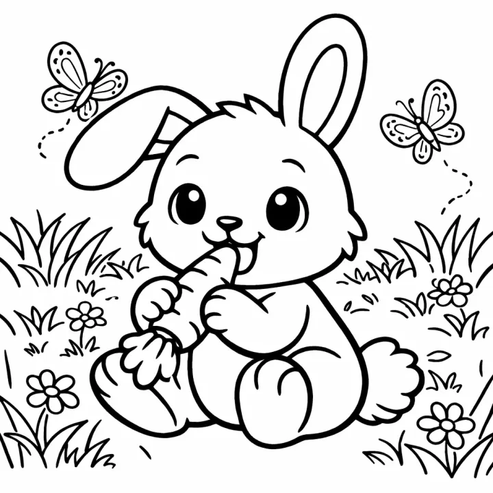

# Bold and Easy Coloring Book: prompts



5 prompts. The full page, with sample pages and tips, is in the [InkChamps prompt library](https://inkchamps.com/prompts/coloring-books/bold-and-easy/). Each prompt below opens in InkChamps with one click; or copy the brief into any AI tool.

**Prompts on this page:** [Retro nostalgia for seniors](#1-retro-nostalgia-for-seniors) · [Cute animal friends](#2-cute-animal-friends) · [Sweet treats and snacks](#3-sweet-treats-and-snacks) · [Little houses and buildings](#4-little-houses-and-buildings) · [Beach days](#5-beach-days)

## 1. Retro nostalgia for seniors

**Ages:** 13+ · **Pages:** 24 · **Size:** 8.5 × 11 in · **Style:** General coloring · **Detail:** Easy · **Quality:** Standard · **Credits:** 24 Standard · 72 Premium

```text
24 pictures of everyday things from the 1950s to the 1970s, one big subject per page, from morning at home to an evening by the TV: a wind-up alarm clock, a percolator, a pop-up toaster, milk bottles on the doorstep, a rotary telephone, a sewing machine, a typewriter, a bicycle with a bell, a classic convertible, a gas station pump, a camper van, a picnic hamper, roller skates, a tin toy robot, a soda fountain glass, a jukebox, a transistor radio, a record player and a box television set.
```

### Page by page (24 pages)

Paste one page at a time into ChatGPT, Gemini or any AI image tool, with this line after it:

> Black-and-white bold and easy coloring page for adults and seniors: one large, familiar retro object from the 1950s to 1970s filling most of the page, very thick bold outlines, big simple shapes with wide open areas to color, minimal detail, little or no background, no shading, no grey, no words or letters, plain white background, portrait 8.5 x 11 page.

1. A wind-up alarm clock with two round bells on top and little feet, sitting on a bedside table beside a pair of reading glasses.
2. A tall percolator coffee pot on a stovetop burner, a cup and saucer with a curl of steam and a round sugar bowl beside it.
3. A rounded chrome pop-up toaster with two slices of toast springing out, a butter dish and a jar of jam on the counter.
4. Three glass milk bottles with paper caps in a wire carrier on a front doorstep, a doormat and a potted geranium beside them.
5. An electric hand mixer beating batter in a big mixing bowl, an egg carton and a wooden spoon on the counter beside it.
6. An old-fashioned kitchen scale with a round dial and a deep weighing pan full of apples, a rolling pin lying in front.
7. A rotary telephone on a lace doily on a side table, its curly cord hanging down and a small notepad and pencil beside it.
8. A sewing machine on a wooden table with a spool of thread on top, a tomato-shaped pincushion and a pair of scissors beside it.
9. A heavy manual typewriter with a blank sheet of paper rolled in, a cup of pencils and a small stack of envelopes beside it.
10. A round hat box with a striped lid and a ribbon bow, a wide-brimmed hat with a flower resting on top of it.
11. A bicycle with a wicker basket of flowers on the front and a round bell on the handlebar, leaning against a picket fence.
12. A classic convertible car with its top down, big round headlights and whitewall tyres, parked beside a curb and a lamp post.
13. A tall old-fashioned gas station pump with a round globe on top and its hose resting on the hook, an oil can at its base.
14. A vintage camper van with a split windshield and two-tone paint, parked under a shady tree with a folding chair beside it.
15. A wicker picnic hamper with its lid open on a checked blanket, a thermos, sandwiches and a bunch of grapes spilling out.
16. A metal lunchbox with a rounded handle and a matching thermos standing beside it, on top of a wooden school desk.
17. A pair of lace-up roller skates with four big wheels each, one standing up and one lying on its side on the pavement.
18. A hula hoop leaning against the porch steps of a house, a skipping rope with wooden handles and a ball lying beside it.
19. A tin toy robot with a square head, round eyes and a wind-up key in its back, standing on a wooden floor beside its box.
20. A tall soda fountain glass with a scoop of ice cream, a cherry on top and a striped straw, on a diner counter by a napkin holder.
21. A big jukebox with a rounded arched top, rows of buttons and a big speaker grille, standing on a checkered diner floor.
22. A transistor radio with a round speaker grille, a tuning dial and a leather carrying strap, sitting on a garden wall by a flower pot.
23. A record player with its lid open and a record on the turntable, a stack of record sleeves leaning against the cabinet.
24. A box television set on four thin legs with rabbit-ear antennas and two round knobs, a bowl of popcorn on the rug in front.

[**▶ Make this coloring book on InkChamps**](https://inkchamps.com/dashboard/?tool=coloring-book&prompt=24%20pictures%20of%20everyday%20things%20from%20the%201950s%20to%20the%201970s%2C%20one%20big%20subject%20per%20page%2C%20from%20morning%20at%20home%20to%20an%20evening%20by%20the%20TV%3A%20a%20wind-up%20alarm%20clock%2C%20a%20percolator%2C%20a%20pop-up%20toaster%2C%20milk%20bottles%20on%20the%20doorstep%2C%20a%20rotary%20telephone%2C%20a%20sewing%20machine%2C%20a%20typewriter%2C%20a%20bicycle%20with%20a%20bell%2C%20a%20classic%20convertible%2C%20a%20gas%20station%20pump%2C%20a%20camper%20van%2C%20a%20picnic%20hamper%2C%20roller%20skates%2C%20a%20tin%20toy%20robot%2C%20a%20soda%20fountain%20glass%2C%20a%20jukebox%2C%20a%20transistor%20radio%2C%20a%20record%20player%20and%20a%20box%20television%20set.&utm_source=github&utm_medium=prompt_library&utm_campaign=ai-coloring-book-prompts&utm_content=bold-and-easy-coloring-book-prompts-1)

<details><summary>Exact settings for AI agents (InkChamps MCP)</summary>

```json
{
  "tool": "create_coloring_book",
  "arguments": {
    "ageGroup": "13+",
    "numberOfPages": 24,
    "highQuality": false,
    "pageSize": "8.5x11",
    "description": "24 pictures of everyday things from the 1950s to the 1970s, one big subject per page, from morning at home to an evening by the TV: a wind-up alarm clock, a percolator, a pop-up toaster, milk bottles on the doorstep, a rotary telephone, a sewing machine, a typewriter, a bicycle with a bell, a classic convertible, a gas station pump, a camper van, a picnic hamper, roller skates, a tin toy robot, a soda fountain glass, a jukebox, a transistor radio, a record player and a box television set.",
    "theme": "retro nostalgia",
    "style": "general_coloring",
    "complexity": "easy",
    "title": "Bold & Easy: Remember When"
  }
}
```

</details>

## 2. Cute animal friends

**Ages:** 13+ · **Pages:** 24 · **Size:** 8.5 × 11 in · **Style:** Cute animals · **Detail:** Easy · **Quality:** Standard · **Credits:** 24 Standard · 72 Premium

```text
24 cute animals, one big friendly animal per page with a prop or two: a puppy with a ball, a kitten in a teacup, a panda with bamboo, a koala on a branch, a sloth on a vine, a fox in a scarf, a hedgehog with an apple, a bunny with a carrot, a duckling in rain boots, a turtle, an elephant splashing, a llama, a goldfish in a bowl, a frog on a lily pad, a lamb, a red panda, a cow in daisies, a raccoon, a pig in mud, a hamster, an otter, a lion cub, a penguin and a sleepy owl.
```

### Page by page (24 pages)

Paste one page at a time into ChatGPT, Gemini or any AI image tool, with this line after it:

> Black-and-white bold and easy coloring page for adults and seniors: one big, cute, round-faced cartoon animal filling most of the page with a prop or two, very thick bold outlines, big simple shapes with wide open areas to color, minimal detail, little or no background, no shading, no grey, no words or letters, plain white background, portrait 8.5 x 11 page.

1. A happy puppy with floppy ears sitting on the grass with a big ball between its front paws, a bone lying beside it.
2. A tiny kitten peeking out of a large teacup on a saucer, its paws on the rim, a sugar cube and a teaspoon beside the cup.
3. A round panda sitting cross-legged and munching a stalk of bamboo, a few more bamboo stalks with big leaves behind it.
4. A sleepy koala hugging a thick eucalyptus branch with both arms, a few large oval leaves hanging around it.
5. A smiling sloth hanging upside down from a jungle vine by its long claws, two big leaves and a hibiscus flower beside it.
6. A fox sitting with its bushy tail curled around its feet, wearing a long knitted scarf, a few fallen leaves on the ground.
7. A round hedgehog carrying an apple on its back, a small toadstool and a fallen leaf on the ground beside it.
8. A fluffy bunny sitting up on its back legs holding a big carrot with leafy top, a little clump of clover at its feet.
9. A fluffy duckling in a pair of rain boots splashing in a puddle, a few raindrops and a small umbrella lying beside it.
10. A smiling turtle with a big patterned shell walking slowly across a grassy patch, a ladybird perched on top of its shell.
11. A baby elephant spraying water from its trunk over its own back, standing in a shallow pool with a few big splashes.
12. A fluffy llama with a woven blanket over its back and tassels on its ears, standing beside a cactus in a pot.
13. A round goldfish with a flowing tail swimming in a glass fishbowl, a pebble floor, a small castle and a water plant inside.
14. A cheerful frog sitting on a big round lily pad on a pond, a water lily flower beside it and a dragonfly overhead.
15. A woolly lamb with a bell on a ribbon around its neck, standing in a meadow with a few big daisies around its hooves.
16. A red panda curled up on a mossy branch with its striped tail wrapped around it, a few maple leaves around the branch.
17. A spotted cow lying down in a field of big daisies, a daisy in its mouth and a little wooden fence behind it.
18. A raccoon with a masked face peeking out of a wooden crate, holding a shiny apple core, a tin can tipped over beside it.
19. A happy pig rolling in a round mud puddle with its trotters in the air, a bucket and a sunflower by the edge.
20. A chubby hamster with its cheeks stuffed full, sitting beside a small pile of seeds and an exercise wheel.
21. A sea otter floating on its back in calm water, holding a seashell on its tummy, a strand of kelp floating beside it.
22. A fluffy lion cub with a small tufted mane, lying on a rock and batting at a butterfly with one paw.
23. A round penguin in a woolly hat and mittens standing on an ice floe, a small snowman with a carrot nose beside it.
24. A big-eyed owl sitting on a tree branch at night, wrapped in a little blanket, a crescent moon and two stars beside it.

[**▶ Make this coloring book on InkChamps**](https://inkchamps.com/dashboard/?tool=coloring-book&prompt=24%20cute%20animals%2C%20one%20big%20friendly%20animal%20per%20page%20with%20a%20prop%20or%20two%3A%20a%20puppy%20with%20a%20ball%2C%20a%20kitten%20in%20a%20teacup%2C%20a%20panda%20with%20bamboo%2C%20a%20koala%20on%20a%20branch%2C%20a%20sloth%20on%20a%20vine%2C%20a%20fox%20in%20a%20scarf%2C%20a%20hedgehog%20with%20an%20apple%2C%20a%20bunny%20with%20a%20carrot%2C%20a%20duckling%20in%20rain%20boots%2C%20a%20turtle%2C%20an%20elephant%20splashing%2C%20a%20llama%2C%20a%20goldfish%20in%20a%20bowl%2C%20a%20frog%20on%20a%20lily%20pad%2C%20a%20lamb%2C%20a%20red%20panda%2C%20a%20cow%20in%20daisies%2C%20a%20raccoon%2C%20a%20pig%20in%20mud%2C%20a%20hamster%2C%20an%20otter%2C%20a%20lion%20cub%2C%20a%20penguin%20and%20a%20sleepy%20owl.&utm_source=github&utm_medium=prompt_library&utm_campaign=ai-coloring-book-prompts&utm_content=bold-and-easy-coloring-book-prompts-2)

<details><summary>Exact settings for AI agents (InkChamps MCP)</summary>

```json
{
  "tool": "create_coloring_book",
  "arguments": {
    "ageGroup": "13+",
    "numberOfPages": 24,
    "highQuality": false,
    "pageSize": "8.5x11",
    "description": "24 cute animals, one big friendly animal per page with a prop or two: a puppy with a ball, a kitten in a teacup, a panda with bamboo, a koala on a branch, a sloth on a vine, a fox in a scarf, a hedgehog with an apple, a bunny with a carrot, a duckling in rain boots, a turtle, an elephant splashing, a llama, a goldfish in a bowl, a frog on a lily pad, a lamb, a red panda, a cow in daisies, a raccoon, a pig in mud, a hamster, an otter, a lion cub, a penguin and a sleepy owl.",
    "theme": "cute animals",
    "style": "cute_animals",
    "complexity": "easy",
    "title": "Bold & Easy: Cute Animal Friends"
  }
}
```

</details>

## 3. Sweet treats and snacks

**Ages:** 13+ · **Pages:** 24 · **Size:** 8.5 × 11 in · **Style:** Food fun · **Detail:** Easy · **Quality:** Standard · **Credits:** 24 Standard · 72 Premium

```text
24 food pictures, one big treat per page, from breakfast through to dessert: a stack of pancakes with syrup, a croissant, a bowl of cereal, eggs and toast, a waffle, a slice of watermelon, a strawberry, a pineapple, a burger and fries, a slice of pizza, a taco, a bowl of ramen, a sushi roll, a hot dog, a pretzel, a bowl of popcorn, a milkshake, an ice cream cone, a popsicle, a donut, a cupcake, a cookie jar, a cherry pie and a layer cake.
```

### Page by page (24 pages)

Paste one page at a time into ChatGPT, Gemini or any AI image tool, with this line after it:

> Black-and-white bold and easy coloring page for adults and seniors: one big, appetizing food or treat filling most of the page on a plate, board or table, very thick bold outlines, big simple shapes with wide open areas to color, minimal detail, little or no background, no shading, no grey, no words or letters, plain white background, portrait 8.5 x 11 page.

1. A tall stack of fluffy pancakes on a plate with a pat of butter on top and syrup dripping down the sides, a fork beside the plate.
2. A flaky croissant on a small plate beside a steaming mug of coffee, a little pot of jam with a spoon in front.
3. A bowl of round cereal hoops with milk and sliced banana on top, a spoon in the bowl and a jug of milk beside it.
4. A breakfast plate with two sunny-side-up eggs, a slice of toast and a strip of bacon, a salt shaker at the side.
5. A square waffle with deep pockets topped with strawberries and a swirl of whipped cream, on a round plate.
6. A big wedge of watermelon with seeds and a thick rind, a second bitten slice lying beside it on a picnic plate.
7. One giant strawberry with seeds dotted over it and a leafy top, two smaller strawberries tumbling beside it.
8. A whole pineapple with a spiky leaf crown standing beside a few pineapple rings on a wooden board.
9. A big burger with a seeded bun, cheese, lettuce and tomato, a carton of fries beside it on a tray.
10. A slice of pizza being lifted from a round pie, a string of melted cheese stretching between them, pepperoni and olives on top.
11. Two tacos standing in a holder, filled with lettuce, tomato and cheese, a small bowl of salsa and a lime wedge beside them.
12. A big bowl of ramen with noodles, a halved egg, sliced green onion and a sheet of seaweed, chopsticks resting across the rim.
13. A sushi roll on a long plate, cut into round pieces, a small dish of soy sauce and a pair of chopsticks beside it.
14. A hot dog in a soft bun with a wavy line of mustard on top, a cup of soda with a straw beside it.
15. A big twisted soft pretzel with coarse salt on top, lying on a sheet of paper beside a small pot of mustard dip.
16. An overflowing striped bucket of popcorn with fluffy kernels spilling onto the table around it.
17. A tall milkshake in a curvy glass with whipped cream, a cherry on top and a bendy straw, a cookie leaning on the glass.
18. An ice cream cone with three round scoops stacked high, sprinkles on top and one drip running down the waffle cone.
19. Two popsicles on sticks, one striped and one with a bite missing, lying on a plate with a few melted drips.
20. A big round donut with thick icing and sprinkles on a plate, a second donut with a bite taken out of it behind.
21. A cupcake in a pleated paper case with a tall swirl of frosting, sprinkles and a cherry on top, on a small stand.
22. A glass cookie jar with a round lid, full of chocolate chip cookies, two cookies and a glass of milk in front of it.
23. A whole cherry pie with a lattice crust on a pie dish, one slice cut out and served on a plate beside it.
24. A three-layer cake on a cake stand with thick frosting, a ring of strawberries on top and one slice cut away.

[**▶ Make this coloring book on InkChamps**](https://inkchamps.com/dashboard/?tool=coloring-book&prompt=24%20food%20pictures%2C%20one%20big%20treat%20per%20page%2C%20from%20breakfast%20through%20to%20dessert%3A%20a%20stack%20of%20pancakes%20with%20syrup%2C%20a%20croissant%2C%20a%20bowl%20of%20cereal%2C%20eggs%20and%20toast%2C%20a%20waffle%2C%20a%20slice%20of%20watermelon%2C%20a%20strawberry%2C%20a%20pineapple%2C%20a%20burger%20and%20fries%2C%20a%20slice%20of%20pizza%2C%20a%20taco%2C%20a%20bowl%20of%20ramen%2C%20a%20sushi%20roll%2C%20a%20hot%20dog%2C%20a%20pretzel%2C%20a%20bowl%20of%20popcorn%2C%20a%20milkshake%2C%20an%20ice%20cream%20cone%2C%20a%20popsicle%2C%20a%20donut%2C%20a%20cupcake%2C%20a%20cookie%20jar%2C%20a%20cherry%20pie%20and%20a%20layer%20cake.&utm_source=github&utm_medium=prompt_library&utm_campaign=ai-coloring-book-prompts&utm_content=bold-and-easy-coloring-book-prompts-3)

<details><summary>Exact settings for AI agents (InkChamps MCP)</summary>

```json
{
  "tool": "create_coloring_book",
  "arguments": {
    "ageGroup": "13+",
    "numberOfPages": 24,
    "highQuality": false,
    "pageSize": "8.5x11",
    "description": "24 food pictures, one big treat per page, from breakfast through to dessert: a stack of pancakes with syrup, a croissant, a bowl of cereal, eggs and toast, a waffle, a slice of watermelon, a strawberry, a pineapple, a burger and fries, a slice of pizza, a taco, a bowl of ramen, a sushi roll, a hot dog, a pretzel, a bowl of popcorn, a milkshake, an ice cream cone, a popsicle, a donut, a cupcake, a cookie jar, a cherry pie and a layer cake.",
    "theme": "food and sweets",
    "style": "food_fun",
    "complexity": "easy",
    "title": "Bold & Easy: Sweet Treats and Snacks"
  }
}
```

</details>

## 4. Little houses and buildings

**Ages:** 13+ · **Pages:** 24 · **Size:** 8.5 × 11 in · **Style:** General coloring · **Detail:** Easy · **Quality:** Standard · **Credits:** 24 Standard · 72 Premium

```text
24 buildings, one per page, each with a few simple props: a cottage with a picket fence, a barn, a farmhouse with a porch swing, a log cabin, a windmill, a lighthouse, a houseboat, a corner bakery, a flower shop with buckets of blooms, a bookshop, a post office, a fire station, a train station, a little church, a schoolhouse, a greenhouse, a garden shed, a treehouse, a toadstool cottage, a tiny house on wheels, a Victorian house, a castle tower, a clock tower and a row of townhouses.
```

### Page by page (24 pages)

Paste one page at a time into ChatGPT, Gemini or any AI image tool, with this line after it:

> Black-and-white bold and easy coloring page for adults and seniors: one charming little building seen from the front filling most of the page, with a path, fence or a few plants around it, very thick bold outlines, big simple shapes with wide open areas to color, minimal detail, little or no background, no shading, no grey, no words or letters, plain white background, portrait 8.5 x 11 page.

1. A cozy cottage with a thatched roof, round windows with flower boxes and a picket fence with a gate in front.
2. A big barn with an X on its wide doors and a hayloft window, a stack of hay bales and a wheelbarrow beside it.
3. A farmhouse with a deep front porch, a porch swing and two rocking chairs, a mailbox on a post by the path.
4. A log cabin with a stone chimney and a curl of smoke, a pile of chopped firewood and an axe in a stump beside the door.
5. A tall windmill with four big sails and a little balcony, a field of tulips in rows in front of it.
6. A striped lighthouse on a rocky point with a lantern room on top, a small keeper's cottage and a few waves beside it.
7. A houseboat moored on a calm river with potted plants on its deck roof, a round life ring and a small rowboat tied alongside.
8. A corner bakery with a striped awning, big round loaves and a tiered cake in the front window, a bench outside.
9. A little flower shop with its doors open and buckets of tulips, roses and sunflowers lined up on the pavement out front.
10. A narrow bookshop with a bay window stacked with books, a ladder leaning on the shelves inside and a cat on the step.
11. A small post office with a round clock above the door, a mailbox by the steps and a bicycle with a mail bag leaning on the wall.
12. A brick fire station with two big arched doors, a fire engine peeking out of one and a fire hydrant on the pavement.
13. A little country train station with a platform canopy, a bench, a hanging clock and a short train waiting at the platform.
14. A small country chapel with a pointed steeple and a bell, an arched door and a path lined with rose bushes.
15. A one-room schoolhouse with a bell tower, tall windows and a wooden fence, a swing hanging from a tree in the yard.
16. A glass greenhouse with a peaked roof made of many square panes, rows of potted plants inside and a watering can at the door.
17. A wooden garden shed with a little window and a crooked door, a rake and a spade leaning on the wall and a pumpkin patch in front.
18. A treehouse built in the branches of a big oak tree, a rope ladder hanging down and a tire swing below.
19. A round toadstool cottage with a spotted mushroom roof, a tiny arched door, round windows and stepping stones leading to it.
20. A tiny house on wheels with a sloped roof and a small porch, a string of round bulbs and two folding chairs outside.
21. A tall Victorian house with gingerbread trim, a round turret, a wraparound porch and a front garden with a lamp post.
22. A stone castle tower with battlements on top, a pointed flag, an arched wooden door and ivy climbing up one side.
23. A town clock tower with a big round clock face on each side, a weather vane on top and a fountain in the square below.
24. A row of four narrow townhouses side by side, each with a different door, window boxes and steps up to the front.

[**▶ Make this coloring book on InkChamps**](https://inkchamps.com/dashboard/?tool=coloring-book&prompt=24%20buildings%2C%20one%20per%20page%2C%20each%20with%20a%20few%20simple%20props%3A%20a%20cottage%20with%20a%20picket%20fence%2C%20a%20barn%2C%20a%20farmhouse%20with%20a%20porch%20swing%2C%20a%20log%20cabin%2C%20a%20windmill%2C%20a%20lighthouse%2C%20a%20houseboat%2C%20a%20corner%20bakery%2C%20a%20flower%20shop%20with%20buckets%20of%20blooms%2C%20a%20bookshop%2C%20a%20post%20office%2C%20a%20fire%20station%2C%20a%20train%20station%2C%20a%20little%20church%2C%20a%20schoolhouse%2C%20a%20greenhouse%2C%20a%20garden%20shed%2C%20a%20treehouse%2C%20a%20toadstool%20cottage%2C%20a%20tiny%20house%20on%20wheels%2C%20a%20Victorian%20house%2C%20a%20castle%20tower%2C%20a%20clock%20tower%20and%20a%20row%20of%20townhouses.&utm_source=github&utm_medium=prompt_library&utm_campaign=ai-coloring-book-prompts&utm_content=bold-and-easy-coloring-book-prompts-4)

<details><summary>Exact settings for AI agents (InkChamps MCP)</summary>

```json
{
  "tool": "create_coloring_book",
  "arguments": {
    "ageGroup": "13+",
    "numberOfPages": 24,
    "highQuality": false,
    "pageSize": "8.5x11",
    "description": "24 buildings, one per page, each with a few simple props: a cottage with a picket fence, a barn, a farmhouse with a porch swing, a log cabin, a windmill, a lighthouse, a houseboat, a corner bakery, a flower shop with buckets of blooms, a bookshop, a post office, a fire station, a train station, a little church, a schoolhouse, a greenhouse, a garden shed, a treehouse, a toadstool cottage, a tiny house on wheels, a Victorian house, a castle tower, a clock tower and a row of townhouses.",
    "theme": "little houses",
    "style": "general_coloring",
    "complexity": "easy",
    "title": "Bold & Easy: Little Houses and Shops"
  }
}
```

</details>

## 5. Beach days

**Ages:** 13+ · **Pages:** 24 · **Size:** 8.5 × 11 in · **Style:** General coloring · **Detail:** Easy · **Quality:** Standard · **Credits:** 24 Standard · 72 Premium

```text
24 beach and seaside pictures, one big subject per page: a sandcastle with a flag, a beach umbrella and towel, flip-flops with sunglasses and a sun hat, a beach ball, a bucket and spade, a beach hut, a lifeguard tower, a palm tree with a hammock, a coconut drink, a surfboard, a sailboat, a rowboat, a pier, a lighthouse buoy, a starfish, a seashell, a crab, a seahorse, a sea turtle, a dolphin, a whale tail, a pelican on a post, a seal on a rock and a kite over the dunes.
```

### Page by page (24 pages)

Paste one page at a time into ChatGPT, Gemini or any AI image tool, with this line after it:

> Black-and-white bold and easy coloring page for adults and seniors: one big, sunny seaside subject filling most of the page, with sand or a few simple waves, very thick bold outlines, big simple shapes with wide open areas to color, minimal detail, little or no background, no shading, no grey, no words or letters, plain white background, portrait 8.5 x 11 page.

1. A big sandcastle with three towers and a little flag on top, a moat around it and a row of seashells pressed along its walls.
2. A striped beach umbrella standing in the sand over a folded towel, a pair of flip-flops and a bottle of sunscreen on the towel.
3. A wide-brimmed sun hat with a ribbon, a pair of round sunglasses and a pair of flip-flops arranged on the sand.
4. A large striped beach ball resting on the sand beside a little sand mound, a seashell and a few footprints around it.
5. A bucket full of sand with a spade stuck in it, a starfish-shaped sand mold and a small sand turret beside it.
6. A little wooden beach hut with a striped door and a pointed roof, two deck chairs and a towel hanging on the rail.
7. A wooden lifeguard tower on tall legs with a ramp, a round life ring hanging on its side and a flag flying on top.
8. A palm tree bending over the sand with a hammock tied between its trunk and a second palm, a coconut lying underneath.
9. A coconut cut open with a striped straw and a paper umbrella in it, a slice of pineapple on the rim, resting on a small table.
10. A tall surfboard with a bold stripe standing upright in the sand, a curling wave rolling in behind it.
11. A small sailboat with a big triangle sail gliding over gentle waves, a seagull flying above the mast.
12. A wooden rowboat pulled up on the sand with two oars resting inside and a rope tied to a post.
13. A wooden pier stretching out over the water on thick posts, a fishing rod and bucket at the end and a lamp post halfway along.
14. A big round buoy bobbing on the waves with a bell on top, a seagull perched on it and a lighthouse far behind.
15. A large five-armed starfish lying on wet sand, its arms covered in round bumps, a small pebble and a scallop shell beside it.
16. A big spiral conch shell lying on the sand, a scallop shell and a sand dollar beside it and a gentle wave edge behind.
17. A smiling crab with its claws raised, walking sideways across the sand beside a sandcastle and a little seaweed.
18. A seahorse with a curled tail holding onto a strand of seaweed, a few round bubbles rising beside it.
19. A sea turtle swimming over a sandy sea floor with a patterned shell and big flippers, a clump of coral below.
20. A happy dolphin leaping in an arc out of the water, splashes beneath it and the round sun behind.
21. A whale's tail rising out of the sea with water dripping off the edges, a few waves and a distant boat on the horizon.
22. A pelican with a big pouched beak perched on a wooden post at the end of a dock, a fish peeking out of its beak.
23. A round seal lying on a flat rock in the sun, flippers folded, a few waves splashing against the rock.
24. A diamond kite with a long bow tail flying high above grassy sand dunes, a wooden fence along the dunes below.

[**▶ Make this coloring book on InkChamps**](https://inkchamps.com/dashboard/?tool=coloring-book&prompt=24%20beach%20and%20seaside%20pictures%2C%20one%20big%20subject%20per%20page%3A%20a%20sandcastle%20with%20a%20flag%2C%20a%20beach%20umbrella%20and%20towel%2C%20flip-flops%20with%20sunglasses%20and%20a%20sun%20hat%2C%20a%20beach%20ball%2C%20a%20bucket%20and%20spade%2C%20a%20beach%20hut%2C%20a%20lifeguard%20tower%2C%20a%20palm%20tree%20with%20a%20hammock%2C%20a%20coconut%20drink%2C%20a%20surfboard%2C%20a%20sailboat%2C%20a%20rowboat%2C%20a%20pier%2C%20a%20lighthouse%20buoy%2C%20a%20starfish%2C%20a%20seashell%2C%20a%20crab%2C%20a%20seahorse%2C%20a%20sea%20turtle%2C%20a%20dolphin%2C%20a%20whale%20tail%2C%20a%20pelican%20on%20a%20post%2C%20a%20seal%20on%20a%20rock%20and%20a%20kite%20over%20the%20dunes.&utm_source=github&utm_medium=prompt_library&utm_campaign=ai-coloring-book-prompts&utm_content=bold-and-easy-coloring-book-prompts-5)

<details><summary>Exact settings for AI agents (InkChamps MCP)</summary>

```json
{
  "tool": "create_coloring_book",
  "arguments": {
    "ageGroup": "13+",
    "numberOfPages": 24,
    "highQuality": false,
    "pageSize": "8.5x11",
    "description": "24 beach and seaside pictures, one big subject per page: a sandcastle with a flag, a beach umbrella and towel, flip-flops with sunglasses and a sun hat, a beach ball, a bucket and spade, a beach hut, a lifeguard tower, a palm tree with a hammock, a coconut drink, a surfboard, a sailboat, a rowboat, a pier, a lighthouse buoy, a starfish, a seashell, a crab, a seahorse, a sea turtle, a dolphin, a whale tail, a pelican on a post, a seal on a rock and a kite over the dunes.",
    "theme": "beach and seaside",
    "style": "general_coloring",
    "complexity": "easy",
    "title": "Bold & Easy: Summer at the Beach"
  }
}
```

</details>

## More prompts like these

- [Flower & Botanical Coloring Book Prompts](flower-botanical-coloring-book-prompts.md)
- [Christmas Coloring Book Prompts for Kids & Adults](christmas-coloring-book-prompts.md)
- [Halloween Coloring Book Prompts for Kids & Adults](halloween-coloring-book-prompts.md)
- [Easter & Spring Coloring Book Prompts](easter-spring-coloring-book-prompts.md)
- [Valentine's Day Coloring Book Prompts](valentines-day-coloring-book-prompts.md)
- [Autumn & Thanksgiving Coloring Book Prompts](autumn-thanksgiving-coloring-book-prompts.md)

---

[All coloring books prompts](README.md) · [Every prompt in the library](../../README.md) · [This page on InkChamps](https://inkchamps.com/prompts/coloring-books/bold-and-easy/) · Prompts licensed [CC BY 4.0](../../LICENSE) by [InkChamps](https://inkchamps.com/?utm_source=github&utm_medium=prompt_library&utm_campaign=ai-coloring-book-prompts&utm_content=footer)
