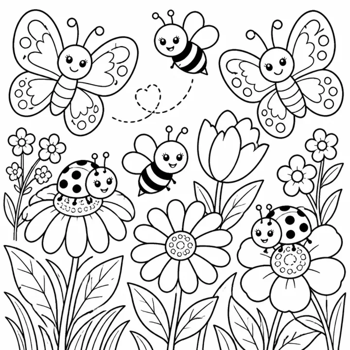

# Bug & Insect Coloring Book: prompts



5 prompts. The full page, with sample pages and tips, is in the [InkChamps prompt library](https://inkchamps.com/prompts/coloring-books/bug-insect/). Each prompt below opens in InkChamps with one click; or copy the brief into any AI tool.

**Prompts on this page:** [Smiling garden bugs for toddlers](#1-smiling-garden-bugs-for-toddlers) · [40 named bugs and minibeasts](#2-40-named-bugs-and-minibeasts) · [Bug habitats and life cycles](#3-bug-habitats-and-life-cycles) · [Cozy bug village for teens and adults](#4-cozy-bug-village-for-teens-and-adults) · [Butterflies and moths of the world for adults](#5-butterflies-and-moths-of-the-world-for-adults)

## 1. Smiling garden bugs for toddlers

**Ages:** 3-6 · **Pages:** 40 · **Size:** 8.5 × 8.5 in · **Style:** Cute insects · **Detail:** Easy · **Quality:** Standard · **Credits:** 40 Standard · 120 Premium

```text
Forty pages of smiling garden bugs: a ladybug on a strawberry, a bumblebee on a sunflower, a caterpillar munching a leaf, a snail on a mushroom, a butterfly on a daisy, an ant carrying a crumb, a firefly over the grass at night, a dragonfly on a lily pad, a grasshopper hopping, a spider waving from a dewy web, a worm peeking out of an apple, and a beetle pushing a tiny wheelbarrow.
```

**Extra direction:** More pages: a ladybug family on a leaf, a beehive dripping honey, a snail race, a bug picnic on a tree stump, a caterpillar in its chrysalis, a butterfly hatching, bees in a flower pot, ants carrying a strawberry, a ladybug under a mushroom in the rain, a cricket playing a leaf fiddle, a moth by a porch lamp, a bug sliding down a pumpkin vine, a bee on a watering can, a beetle splashing in a puddle, two snails sharing a leaf, a bug asleep in a tulip, and a garden full of bug friends.

[**▶ Make this coloring book on InkChamps**](https://inkchamps.com/dashboard/?tool=coloring-book&prompt=Forty%20pages%20of%20smiling%20garden%20bugs%3A%20a%20ladybug%20on%20a%20strawberry%2C%20a%20bumblebee%20on%20a%20sunflower%2C%20a%20caterpillar%20munching%20a%20leaf%2C%20a%20snail%20on%20a%20mushroom%2C%20a%20butterfly%20on%20a%20daisy%2C%20an%20ant%20carrying%20a%20crumb%2C%20a%20firefly%20over%20the%20grass%20at%20night%2C%20a%20dragonfly%20on%20a%20lily%20pad%2C%20a%20grasshopper%20hopping%2C%20a%20spider%20waving%20from%20a%20dewy%20web%2C%20a%20worm%20peeking%20out%20of%20an%20apple%2C%20and%20a%20beetle%20pushing%20a%20tiny%20wheelbarrow.&utm_source=github&utm_medium=prompt_library&utm_campaign=ai-coloring-book-prompts&utm_content=bug-insect-coloring-book-prompts-1)

<details><summary>Exact settings for AI agents (InkChamps MCP)</summary>

```json
{
  "tool": "create_coloring_book",
  "arguments": {
    "ageGroup": "3-6",
    "numberOfPages": 40,
    "highQuality": false,
    "pageSize": "8.5x8.5",
    "description": "Forty pages of smiling garden bugs: a ladybug on a strawberry, a bumblebee on a sunflower, a caterpillar munching a leaf, a snail on a mushroom, a butterfly on a daisy, an ant carrying a crumb, a firefly over the grass at night, a dragonfly on a lily pad, a grasshopper hopping, a spider waving from a dewy web, a worm peeking out of an apple, and a beetle pushing a tiny wheelbarrow.",
    "style": "cute_insects",
    "complexity": "easy",
    "theme": "garden bugs",
    "title": "Little Garden Bugs Coloring Book",
    "additionalInstructions": "More pages: a ladybug family on a leaf, a beehive dripping honey, a snail race, a bug picnic on a tree stump, a caterpillar in its chrysalis, a butterfly hatching, bees in a flower pot, ants carrying a strawberry, a ladybug under a mushroom in the rain, a cricket playing a leaf fiddle, a moth by a porch lamp, a bug sliding down a pumpkin vine, a bee on a watering can, a beetle splashing in a puddle, two snails sharing a leaf, a bug asleep in a tulip, and a garden full of bug friends."
  }
}
```

</details>

## 2. 40 named bugs and minibeasts

**Ages:** 6-9 · **Pages:** 40 · **Size:** 8.5 × 11 in · **Style:** Cute insects · **Detail:** Medium · **Layout:** One item per page, with its caption · **Quality:** Standard · **Credits:** 40 Standard · 120 Premium

```text
Forty bugs and minibeasts, one per page with its name: honeybee, bumblebee, carpenter bee, ladybug, monarch butterfly, swallowtail butterfly, luna moth, atlas moth, dragonfly, damselfly, grasshopper, cricket, katydid, praying mantis, stick insect, leaf insect, firefly, stag beetle, rhinoceros beetle, dung beetle, jewel beetle, weevil, ant, leafcutter ant, termite, cicada, water strider, earwig, wasp, caterpillar, silkworm moth, aphid, garden spider, jumping spider, tarantula, centipede, millipede, woodlouse, snail, earthworm.
```

[**▶ Make this coloring book on InkChamps**](https://inkchamps.com/dashboard/?tool=coloring-book&prompt=Forty%20bugs%20and%20minibeasts%2C%20one%20per%20page%20with%20its%20name%3A%20honeybee%2C%20bumblebee%2C%20carpenter%20bee%2C%20ladybug%2C%20monarch%20butterfly%2C%20swallowtail%20butterfly%2C%20luna%20moth%2C%20atlas%20moth%2C%20dragonfly%2C%20damselfly%2C%20grasshopper%2C%20cricket%2C%20katydid%2C%20praying%20mantis%2C%20stick%20insect%2C%20leaf%20insect%2C%20firefly%2C%20stag%20beetle%2C%20rhinoceros%20beetle%2C%20dung%20beetle%2C%20jewel%20beetle%2C%20weevil%2C%20ant%2C%20leafcutter%20ant%2C%20termite%2C%20cicada%2C%20water%20strider%2C%20earwig%2C%20wasp%2C%20caterpillar%2C%20silkworm%20moth%2C%20aphid%2C%20garden%20spider%2C%20jumping%20spider%2C%20tarantula%2C%20centipede%2C%20millipede%2C%20woodlouse%2C%20snail%2C%20earthworm.&utm_source=github&utm_medium=prompt_library&utm_campaign=ai-coloring-book-prompts&utm_content=bug-insect-coloring-book-prompts-2)

<details><summary>Exact settings for AI agents (InkChamps MCP)</summary>

```json
{
  "tool": "create_coloring_book",
  "arguments": {
    "ageGroup": "6-9",
    "numberOfPages": 40,
    "highQuality": false,
    "pageSize": "8.5x11",
    "description": "Forty bugs and minibeasts, one per page with its name: honeybee, bumblebee, carpenter bee, ladybug, monarch butterfly, swallowtail butterfly, luna moth, atlas moth, dragonfly, damselfly, grasshopper, cricket, katydid, praying mantis, stick insect, leaf insect, firefly, stag beetle, rhinoceros beetle, dung beetle, jewel beetle, weevil, ant, leafcutter ant, termite, cicada, water strider, earwig, wasp, caterpillar, silkworm moth, aphid, garden spider, jumping spider, tarantula, centipede, millipede, woodlouse, snail, earthworm.",
    "style": "cute_insects",
    "complexity": "medium",
    "theme": "bugs and minibeasts",
    "title": "Bugs and Minibeasts: 40 Creatures to Color",
    "pageCategory": "concept"
  }
}
```

</details>

## 3. Bug habitats and life cycles

**Ages:** 9-13 · **Pages:** 40 · **Size:** 8.5 × 11 in · **Style:** General coloring · **Detail:** Medium · **Quality:** Standard · **Credits:** 40 Standard · 120 Premium

```text
Forty pages of bugs in their real homes and life stages: a monarch egg, caterpillar, chrysalis and butterfly on milkweed, a cutaway ant colony with tunnels and a queen, a honeybee hive with comb and nursery cells, a termite mound on the savanna, leafcutter ants marching through a rainforest, a firefly meadow at dusk, a pond with water striders and dragonfly nymphs, beetles under a rotting log, cicadas climbing out of their shells, and a praying mantis on a rose stem.
```

**Extra direction:** More pages: a spider spinning an orb web, a dung beetle rolling a ball across sand, bees dancing on the comb, a stick insect hidden on a twig, ladybugs eating aphids on a rosebush, a caddisfly larva case in a stream, a mayfly swarm over a river, a weaver ant nest of folded leaves, a paper wasp nest under a roof, a mole cricket digging, a backyard bug hotel, a moth resting on bark, a silkworm cocoon on mulberry leaves, a desert beetle collecting fog, a bumblebee nest underground, and a kid with a magnifying glass at a garden bed.

[**▶ Make this coloring book on InkChamps**](https://inkchamps.com/dashboard/?tool=coloring-book&prompt=Forty%20pages%20of%20bugs%20in%20their%20real%20homes%20and%20life%20stages%3A%20a%20monarch%20egg%2C%20caterpillar%2C%20chrysalis%20and%20butterfly%20on%20milkweed%2C%20a%20cutaway%20ant%20colony%20with%20tunnels%20and%20a%20queen%2C%20a%20honeybee%20hive%20with%20comb%20and%20nursery%20cells%2C%20a%20termite%20mound%20on%20the%20savanna%2C%20leafcutter%20ants%20marching%20through%20a%20rainforest%2C%20a%20firefly%20meadow%20at%20dusk%2C%20a%20pond%20with%20water%20striders%20and%20dragonfly%20nymphs%2C%20beetles%20under%20a%20rotting%20log%2C%20cicadas%20climbing%20out%20of%20their%20shells%2C%20and%20a%20praying%20mantis%20on%20a%20rose%20stem.&utm_source=github&utm_medium=prompt_library&utm_campaign=ai-coloring-book-prompts&utm_content=bug-insect-coloring-book-prompts-3)

<details><summary>Exact settings for AI agents (InkChamps MCP)</summary>

```json
{
  "tool": "create_coloring_book",
  "arguments": {
    "ageGroup": "9-13",
    "numberOfPages": 40,
    "highQuality": false,
    "pageSize": "8.5x11",
    "description": "Forty pages of bugs in their real homes and life stages: a monarch egg, caterpillar, chrysalis and butterfly on milkweed, a cutaway ant colony with tunnels and a queen, a honeybee hive with comb and nursery cells, a termite mound on the savanna, leafcutter ants marching through a rainforest, a firefly meadow at dusk, a pond with water striders and dragonfly nymphs, beetles under a rotting log, cicadas climbing out of their shells, and a praying mantis on a rose stem.",
    "style": "general_coloring",
    "complexity": "medium",
    "theme": "bug habitats",
    "title": "Secret Lives of Bugs Coloring Book",
    "additionalInstructions": "More pages: a spider spinning an orb web, a dung beetle rolling a ball across sand, bees dancing on the comb, a stick insect hidden on a twig, ladybugs eating aphids on a rosebush, a caddisfly larva case in a stream, a mayfly swarm over a river, a weaver ant nest of folded leaves, a paper wasp nest under a roof, a mole cricket digging, a backyard bug hotel, a moth resting on bark, a silkworm cocoon on mulberry leaves, a desert beetle collecting fog, a bumblebee nest underground, and a kid with a magnifying glass at a garden bed."
  }
}
```

</details>

## 4. Cozy bug village for teens and adults

**Ages:** 13+ · **Pages:** 40 · **Size:** 8.5 × 11 in · **Style:** General coloring · **Detail:** Medium · **Quality:** Standard · **Credits:** 40 Standard · 120 Premium

```text
Forty pages of a tiny village where bugs live among mushrooms and flowers: a snail's shell cottage with a chimney, a beetle café inside a teapot, a ladybug knitting by a thimble fireplace, ants running an acorn bakery, a bee pouring honey tea, a caterpillar reading in a leaf hammock, a moth's lantern shop, a cricket band on a toadstool stage, a dragonfly ferry across a puddle, and a firefly-lit night market.
```

**Extra direction:** More pages: a spider weaving at a loom, a grasshopper gardener in a seed-packet greenhouse, a pillbug post office, a bumblebee florist, a butterfly tailor sewing petal dresses, a worm librarian in a root library, a beetle blacksmith, a snail mail carrier, a ladybug picnic under a dandelion, a mantis chef, ants moving house with a wheelbarrow of crumbs, a bug bathhouse in a teacup, a pumpkin-house harvest festival, a rainy day under a mushroom, a winter village of bugs in tiny scarves, and a bedtime scene in a matchbox bed.

[**▶ Make this coloring book on InkChamps**](https://inkchamps.com/dashboard/?tool=coloring-book&prompt=Forty%20pages%20of%20a%20tiny%20village%20where%20bugs%20live%20among%20mushrooms%20and%20flowers%3A%20a%20snail%27s%20shell%20cottage%20with%20a%20chimney%2C%20a%20beetle%20caf%C3%A9%20inside%20a%20teapot%2C%20a%20ladybug%20knitting%20by%20a%20thimble%20fireplace%2C%20ants%20running%20an%20acorn%20bakery%2C%20a%20bee%20pouring%20honey%20tea%2C%20a%20caterpillar%20reading%20in%20a%20leaf%20hammock%2C%20a%20moth%27s%20lantern%20shop%2C%20a%20cricket%20band%20on%20a%20toadstool%20stage%2C%20a%20dragonfly%20ferry%20across%20a%20puddle%2C%20and%20a%20firefly-lit%20night%20market.&utm_source=github&utm_medium=prompt_library&utm_campaign=ai-coloring-book-prompts&utm_content=bug-insect-coloring-book-prompts-4)

<details><summary>Exact settings for AI agents (InkChamps MCP)</summary>

```json
{
  "tool": "create_coloring_book",
  "arguments": {
    "ageGroup": "13+",
    "numberOfPages": 40,
    "highQuality": false,
    "pageSize": "8.5x11",
    "description": "Forty pages of a tiny village where bugs live among mushrooms and flowers: a snail's shell cottage with a chimney, a beetle café inside a teapot, a ladybug knitting by a thimble fireplace, ants running an acorn bakery, a bee pouring honey tea, a caterpillar reading in a leaf hammock, a moth's lantern shop, a cricket band on a toadstool stage, a dragonfly ferry across a puddle, and a firefly-lit night market.",
    "style": "general_coloring",
    "complexity": "medium",
    "theme": "bug village",
    "title": "Tiny Bug Village: A Cozy Coloring Book",
    "additionalInstructions": "More pages: a spider weaving at a loom, a grasshopper gardener in a seed-packet greenhouse, a pillbug post office, a bumblebee florist, a butterfly tailor sewing petal dresses, a worm librarian in a root library, a beetle blacksmith, a snail mail carrier, a ladybug picnic under a dandelion, a mantis chef, ants moving house with a wheelbarrow of crumbs, a bug bathhouse in a teacup, a pumpkin-house harvest festival, a rainy day under a mushroom, a winter village of bugs in tiny scarves, and a bedtime scene in a matchbox bed."
  }
}
```

</details>

## 5. Butterflies and moths of the world for adults

**Ages:** 13+ · **Pages:** 40 · **Size:** 8.5 × 11 in · **Style:** General coloring · **Detail:** Hard · **Quality:** Premium · **Credits:** 40 Standard · 120 Premium

```text
Forty butterflies and moths from around the world in garden and nature scenes: a monarch over milkweed, a blue morpho in a rainforest, a luna moth under a full moon, a swallowtail among foxgloves, an atlas moth on a branch, a peacock butterfly on lavender, a hummingbird hawk-moth at honeysuckle, a glasswing butterfly on a fern, a birdwing butterfly over orchids, and a rosy maple moth on maple leaves.
```

**Extra direction:** More pages: a wreath of roses and butterfly wings, a naturalist's display case of specimens, a moth with lace-patterned wings by a lantern, butterflies on a wisteria arbor, a painted lady migration over a field, butterflies drinking at a puddle, a moth on a birch trunk, a comet moth, a butterfly on a sunflower head, a chrysalis beside its butterfly, a butterfly mandala, butterflies around an open book, a zebra longwing on passionflower, a cecropia moth, a butterfly on a teacup, and a garden gate covered in roses and butterflies.

[**▶ Make this coloring book on InkChamps**](https://inkchamps.com/dashboard/?tool=coloring-book&prompt=Forty%20butterflies%20and%20moths%20from%20around%20the%20world%20in%20garden%20and%20nature%20scenes%3A%20a%20monarch%20over%20milkweed%2C%20a%20blue%20morpho%20in%20a%20rainforest%2C%20a%20luna%20moth%20under%20a%20full%20moon%2C%20a%20swallowtail%20among%20foxgloves%2C%20an%20atlas%20moth%20on%20a%20branch%2C%20a%20peacock%20butterfly%20on%20lavender%2C%20a%20hummingbird%20hawk-moth%20at%20honeysuckle%2C%20a%20glasswing%20butterfly%20on%20a%20fern%2C%20a%20birdwing%20butterfly%20over%20orchids%2C%20and%20a%20rosy%20maple%20moth%20on%20maple%20leaves.&utm_source=github&utm_medium=prompt_library&utm_campaign=ai-coloring-book-prompts&utm_content=bug-insect-coloring-book-prompts-5)

<details><summary>Exact settings for AI agents (InkChamps MCP)</summary>

```json
{
  "tool": "create_coloring_book",
  "arguments": {
    "ageGroup": "13+",
    "numberOfPages": 40,
    "highQuality": true,
    "pageSize": "8.5x11",
    "description": "Forty butterflies and moths from around the world in garden and nature scenes: a monarch over milkweed, a blue morpho in a rainforest, a luna moth under a full moon, a swallowtail among foxgloves, an atlas moth on a branch, a peacock butterfly on lavender, a hummingbird hawk-moth at honeysuckle, a glasswing butterfly on a fern, a birdwing butterfly over orchids, and a rosy maple moth on maple leaves.",
    "style": "general_coloring",
    "complexity": "hard",
    "theme": "butterflies and moths",
    "title": "Wings of the World: Butterflies and Moths",
    "additionalInstructions": "More pages: a wreath of roses and butterfly wings, a naturalist's display case of specimens, a moth with lace-patterned wings by a lantern, butterflies on a wisteria arbor, a painted lady migration over a field, butterflies drinking at a puddle, a moth on a birch trunk, a comet moth, a butterfly on a sunflower head, a chrysalis beside its butterfly, a butterfly mandala, butterflies around an open book, a zebra longwing on passionflower, a cecropia moth, a butterfly on a teacup, and a garden gate covered in roses and butterflies."
  }
}
```

</details>

## More prompts like these

- [Space Coloring Book Prompts: Planets, Astronauts & Aliens](space-coloring-book-prompts.md)
- [Vehicle Coloring Book Prompts: Trucks, Diggers, Trains & Cars](vehicle-coloring-book-prompts.md)
- [Princess & Castle Coloring Book Prompts (Original Characters)](princess-castle-coloring-book-prompts.md)
- [Mermaid Coloring Book Prompts for Kids, Teens & Adults](mermaid-coloring-book-prompts.md)
- [Robot Coloring Book Prompts for Kids & Tweens](robot-coloring-book-prompts.md)
- [Kawaii Food Coloring Book Prompts: Cute Desserts, Fruit & Snacks](kawaii-food-coloring-book-prompts.md)

---

[All coloring books prompts](README.md) · [Every prompt in the library](../../README.md) · [This page on InkChamps](https://inkchamps.com/prompts/coloring-books/bug-insect/) · Prompts licensed [CC BY 4.0](../../LICENSE) by [InkChamps](https://inkchamps.com/?utm_source=github&utm_medium=prompt_library&utm_campaign=ai-coloring-book-prompts&utm_content=footer)
