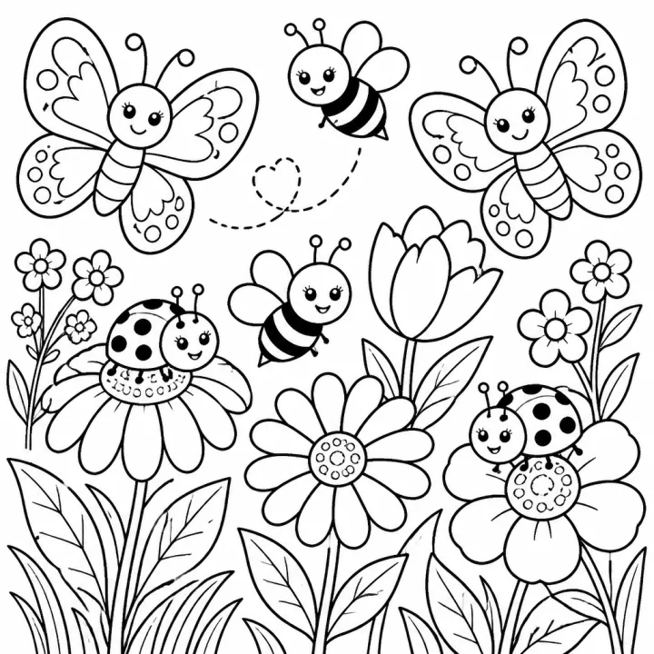

# Bug & Insect Coloring Book: prompts



5 prompts. The full page, with sample pages and tips, is in the [InkChamps prompt library](https://inkchamps.com/prompts/coloring-books/bug-insect/). Each prompt below opens in InkChamps with one click; or copy the brief into any AI tool.

**Prompts on this page:** [Smiling garden bugs for toddlers](#1-smiling-garden-bugs-for-toddlers) · [24 named bugs and minibeasts](#2-24-named-bugs-and-minibeasts) · [Bug habitats and life cycles](#3-bug-habitats-and-life-cycles) · [Cozy bug village for teens and adults](#4-cozy-bug-village-for-teens-and-adults) · [Butterflies and moths of the world for adults](#5-butterflies-and-moths-of-the-world-for-adults)

## 1. Smiling garden bugs for toddlers

**Ages:** 3-6 · **Pages:** 24 · **Size:** 8.5 × 8.5 in · **Style:** Cute insects · **Detail:** Easy · **Quality:** Standard · **Credits:** 24 Standard · 72 Premium

```text
24 pages of smiling garden bugs through one day, from morning sunshine to a firefly night: a ladybug on a strawberry, a bumblebee on a sunflower, a caterpillar munching a leaf, a snail on a mushroom, an ant carrying a crumb, a beehive dripping honey, a beetle with a wheelbarrow, a snail race, a bug picnic, a caterpillar becoming a butterfly, a ladybug under a mushroom in the rain, a dragonfly on a lily pad, a friendly spider web and a ladybug asleep in a tulip.
```

### Page by page (24 pages)

Paste one page at a time into ChatGPT, Gemini or any AI image tool, with this line after it:

> Black-and-white coloring page for a child aged 3 to 6: one big, cute, smiling cartoon bug filling most of the page, thick bold outlines, large simple shapes with wide spaces to color, very little background, no shading, no grey, no words, plain white background, square page.

1. A smiling ladybug sitting on top of a big round strawberry, its spotted wings open a little and two strawberry leaves curling beside it.
2. A chubby bumblebee hugging the middle of a giant sunflower, its little wings buzzing and a few big round petals around it.
3. A round, happy caterpillar munching a big leaf, its face poking through a bite-shaped hole in the leaf and a tiny twig below.
4. A snail with a big swirly shell resting on top of a spotted mushroom, both eye stalks up and a tuft of grass beside the stem.
5. A butterfly with big rounded wings sitting on a daisy in the sunshine, a second daisy and a small flower bud beside it.
6. A little ant carrying a big bread crumb over its head, walking along a pebble path toward a small sandy anthill.
7. A ladybug family on one wide leaf: a big mother ladybug with large spots and two tiny baby ladybugs lined up beside her.
8. Two bees flying around a round beehive hanging from a tree branch, a big drop of honey dripping from the bottom of the hive.
9. A smiling grasshopper in the middle of a big hop over a row of tall grass blades, a round pebble on the ground below.
10. A beetle pushing a tiny wheelbarrow full of seeds through the garden, a little flower pot standing beside the path.
11. A happy worm peeking out of a hole in a big apple, one leaf on the apple stem and a little apple seed on the ground.
12. Two ants carrying one giant strawberry together on their backs, walking past a fallen leaf.
13. A snail race: two smiling snails side by side on a garden path, a little checkered flag at the finish and a pebble along the way.
14. A bug picnic on a tree stump: a ladybug, a bee and a caterpillar sharing a tiny round pie, with acorn cups and a checked napkin.
15. A bee sitting on the spout of a watering can, big water drops falling from the spout onto a tulip.
16. A caterpillar hanging upside down from a twig as it wraps itself into a smooth chrysalis, one big leaf on the twig beside it.
17. A butterfly climbing out of its open chrysalis on a twig, its crumpled wings just starting to unfold.
18. A ladybug sitting dry under a big umbrella-shaped mushroom while round raindrops fall all around it.
19. A beetle in little rain boots jumping into a puddle, big splash drops flying up and a leaf floating on the water.
20. A dragonfly with long straight wings resting on a round lily pad in a pond, a water lily flower opening beside it.
21. A friendly spider waving one leg from the middle of a simple round web strung between two flower stems, big dew drops on the threads.
22. A glowing firefly flying over the grass at night, its tail shining with simple light rays, a crescent moon and two big stars above.
23. A ladybug fast asleep curled up inside an open tulip, a small leaf tucked over it like a blanket.
24. A ladybug, a bee, a snail and a butterfly standing together in a row and waving goodbye, a few big flowers behind them.

[**▶ Make this coloring book on InkChamps**](https://inkchamps.com/dashboard/?tool=coloring-book&prompt=24%20pages%20of%20smiling%20garden%20bugs%20through%20one%20day%2C%20from%20morning%20sunshine%20to%20a%20firefly%20night%3A%20a%20ladybug%20on%20a%20strawberry%2C%20a%20bumblebee%20on%20a%20sunflower%2C%20a%20caterpillar%20munching%20a%20leaf%2C%20a%20snail%20on%20a%20mushroom%2C%20an%20ant%20carrying%20a%20crumb%2C%20a%20beehive%20dripping%20honey%2C%20a%20beetle%20with%20a%20wheelbarrow%2C%20a%20snail%20race%2C%20a%20bug%20picnic%2C%20a%20caterpillar%20becoming%20a%20butterfly%2C%20a%20ladybug%20under%20a%20mushroom%20in%20the%20rain%2C%20a%20dragonfly%20on%20a%20lily%20pad%2C%20a%20friendly%20spider%20web%20and%20a%20ladybug%20asleep%20in%20a%20tulip.&utm_source=github&utm_medium=prompt_library&utm_campaign=ai-coloring-book-prompts&utm_content=bug-insect-coloring-book-prompts-1)

<details><summary>Exact settings for AI agents (InkChamps MCP)</summary>

```json
{
  "tool": "create_coloring_book",
  "arguments": {
    "ageGroup": "3-6",
    "numberOfPages": 24,
    "highQuality": false,
    "pageSize": "8.5x8.5",
    "description": "24 pages of smiling garden bugs through one day, from morning sunshine to a firefly night: a ladybug on a strawberry, a bumblebee on a sunflower, a caterpillar munching a leaf, a snail on a mushroom, an ant carrying a crumb, a beehive dripping honey, a beetle with a wheelbarrow, a snail race, a bug picnic, a caterpillar becoming a butterfly, a ladybug under a mushroom in the rain, a dragonfly on a lily pad, a friendly spider web and a ladybug asleep in a tulip.",
    "style": "cute_insects",
    "complexity": "easy",
    "theme": "garden bugs",
    "title": "Little Garden Bugs Coloring Book"
  }
}
```

</details>

## 2. 24 named bugs and minibeasts

**Ages:** 6-9 · **Pages:** 24 · **Size:** 8.5 × 11 in · **Style:** Cute insects · **Detail:** Medium · **Layout:** One item per page, with its caption · **Quality:** Standard · **Credits:** 24 Standard · 72 Premium

```text
24 bugs and minibeasts, one per page, each with its name as the caption: honeybee, bumblebee, ladybug, monarch butterfly, swallowtail butterfly, luna moth, dragonfly, grasshopper, cricket, praying mantis, stick insect, firefly, stag beetle, rhinoceros beetle, dung beetle, ant, cicada, water strider, caterpillar, garden spider, millipede, woodlouse, snail and earthworm, each shown doing something real in its own small habitat.
```

### Page by page (24 pages)

Paste one page at a time into ChatGPT, Gemini or any AI image tool, with this line after it:

> Black-and-white coloring page for a child aged 6 to 9: one friendly, true-to-life bug or minibeast as the main subject, clear bold outlines, medium detail with a simple natural background, no shading, no grey, the caption in big outlined letters at the bottom is the only words on the page, plain white background, portrait 8.5 x 11 page.

1. A honeybee with pollen baskets on its back legs landing on a clover flower, a few more clover heads in the grass, with the caption "Honeybee" in big outlined letters at the bottom.
2. A big fuzzy bumblebee buzzing over a foxglove, its striped body and furry legs dusted with pollen, with the caption "Bumblebee" in big outlined letters at the bottom.
3. A spotted ladybug crawling up a rose stem toward a cluster of tiny aphids, a rosebud at the top, with the caption "Ladybug" in big outlined letters at the bottom.
4. A monarch butterfly with veined, patterned wings drinking from a pink milkweed flower, a striped caterpillar on a leaf below, with the caption "Monarch butterfly" in big outlined letters at the bottom.
5. A swallowtail butterfly with long tail points on its back wings resting on a purple coneflower, with the caption "Swallowtail butterfly" in big outlined letters at the bottom.
6. A pale luna moth with long curving tails clinging to a tree branch at night, a round moon behind it, with the caption "Luna moth" in big outlined letters at the bottom.
7. A dragonfly with four long clear wings hovering over a pond, cattails and a lily pad below it, with the caption "Dragonfly" in big outlined letters at the bottom.
8. A grasshopper with strong folded back legs sitting on a tall blade of grass in a sunny meadow, with the caption "Grasshopper" in big outlined letters at the bottom.
9. A cricket rubbing its wings together on a flat stone at dusk, a few grass blades and a little rock beside it, with the caption "Cricket" in big outlined letters at the bottom.
10. A green praying mantis holding its folded front legs up as it stands on a leafy twig, with the caption "Praying mantis" in big outlined letters at the bottom.
11. A long, thin stick insect hiding along a twig, its body and legs looking just like the twigs around it, with the caption "Stick insect" in big outlined letters at the bottom.
12. A firefly with its tail glowing, flying over a meadow at night, a few stars in the sky, with the caption "Firefly" in big outlined letters at the bottom.
13. A stag beetle with huge antler-shaped jaws climbing a mossy log in the woods, with the caption "Stag beetle" in big outlined letters at the bottom.
14. A rhinoceros beetle with a big curved horn on its head walking across a fallen leaf on the forest floor, with the caption "Rhinoceros beetle" in big outlined letters at the bottom.
15. A dung beetle standing on its front legs and pushing a round ball backwards across the sand, with the caption "Dung beetle" in big outlined letters at the bottom.
16. A worker ant carrying a seed toward the entrance of an anthill, two more ants following in a line, with the caption "Ant" in big outlined letters at the bottom.
17. A cicada with big clear wings clinging to a tree trunk next to the empty shell it just climbed out of, with the caption "Cicada" in big outlined letters at the bottom.
18. A water strider skating on the surface of a calm pond on its long thin legs, little dimples in the water under each foot, with the caption "Water strider" in big outlined letters at the bottom.
19. A plump, striped caterpillar munching through the edge of a big leaf, a bitten hole beside it, with the caption "Caterpillar" in big outlined letters at the bottom.
20. A garden spider sitting in the middle of a large round web between two sunflower stems, dew drops on the threads, with the caption "Garden spider" in big outlined letters at the bottom.
21. A millipede with many tiny legs crawling over damp leaves and a small pebble on the forest floor, with the caption "Millipede" in big outlined letters at the bottom.
22. A woodlouse with its armored, banded back walking across a piece of bark, a second one rolled into a ball beside it, with the caption "Woodlouse" in big outlined letters at the bottom.
23. A garden snail with a spiral shell gliding along a wet leaf after the rain, a shiny slime trail behind it, with the caption "Snail" in big outlined letters at the bottom.
24. An earthworm stretching out of the soil in a vegetable garden, a sprouting seedling and a few crumbs of earth around it, with the caption "Earthworm" in big outlined letters at the bottom.

[**▶ Make this coloring book on InkChamps**](https://inkchamps.com/dashboard/?tool=coloring-book&prompt=24%20bugs%20and%20minibeasts%2C%20one%20per%20page%2C%20each%20with%20its%20name%20as%20the%20caption%3A%20honeybee%2C%20bumblebee%2C%20ladybug%2C%20monarch%20butterfly%2C%20swallowtail%20butterfly%2C%20luna%20moth%2C%20dragonfly%2C%20grasshopper%2C%20cricket%2C%20praying%20mantis%2C%20stick%20insect%2C%20firefly%2C%20stag%20beetle%2C%20rhinoceros%20beetle%2C%20dung%20beetle%2C%20ant%2C%20cicada%2C%20water%20strider%2C%20caterpillar%2C%20garden%20spider%2C%20millipede%2C%20woodlouse%2C%20snail%20and%20earthworm%2C%20each%20shown%20doing%20something%20real%20in%20its%20own%20small%20habitat.&utm_source=github&utm_medium=prompt_library&utm_campaign=ai-coloring-book-prompts&utm_content=bug-insect-coloring-book-prompts-2)

<details><summary>Exact settings for AI agents (InkChamps MCP)</summary>

```json
{
  "tool": "create_coloring_book",
  "arguments": {
    "ageGroup": "6-9",
    "numberOfPages": 24,
    "highQuality": false,
    "pageSize": "8.5x11",
    "description": "24 bugs and minibeasts, one per page, each with its name as the caption: honeybee, bumblebee, ladybug, monarch butterfly, swallowtail butterfly, luna moth, dragonfly, grasshopper, cricket, praying mantis, stick insect, firefly, stag beetle, rhinoceros beetle, dung beetle, ant, cicada, water strider, caterpillar, garden spider, millipede, woodlouse, snail and earthworm, each shown doing something real in its own small habitat.",
    "style": "cute_insects",
    "complexity": "medium",
    "theme": "bugs and minibeasts",
    "title": "Bugs and Minibeasts: 40 Creatures to Color",
    "pageCategory": "concept"
  }
}
```

</details>

## 3. Bug habitats and life cycles

**Ages:** 9-13 · **Pages:** 24 · **Size:** 8.5 × 11 in · **Style:** General coloring · **Detail:** Medium · **Quality:** Standard · **Credits:** 24 Standard · 72 Premium

```text
24 pages of bugs in their real homes and life stages: the monarch life cycle on milkweed, a cutaway ant colony, a honeybee hive and its waggle dance, a termite mound, leafcutter ants, a firefly meadow, a pond above and below the water, a dragonfly leaving its nymph skin, beetles in a rotting log, cicadas leaving their shells, an orb web, a dung beetle under the stars, caddisfly cases, weaver ants, a paper wasp nest, silkworms, a fog-drinking desert beetle and a backyard bug hotel.
```

### Page by page (24 pages)

Paste one page at a time into ChatGPT, Gemini or any AI image tool, with this line after it:

> Black-and-white coloring page for ages 9 to 13: realistic, scientifically accurate insects in their real habitat, fine clean outlines, detailed bodies, plants, soil and landscape with many separate areas to color, a full background, no shading, no grey, no words or labels, plain white background, portrait 8.5 x 11 page.

1. The monarch life cycle on one milkweed plant: a tiny egg under a leaf, a striped caterpillar eating, a green chrysalis hanging from a stem and a butterfly drying its wings.
2. A cutaway of an underground ant colony: branching tunnels and rooms, a large queen laying eggs, workers carrying larvae and a seed store.
3. Inside a honeybee hive: a close-up of hexagon wax comb with capped honey cells, open nursery cells with curled larvae, and worker bees tending them.
4. Worker bees crowding around one bee doing its figure-eight waggle dance on the honeycomb, their antennae reaching toward it as it turns.
5. A tall, chimneyed termite mound rising out of the dry savanna, an acacia tree and grasses behind and a cutaway showing tunnels inside.
6. A line of leafcutter ants marching across a rainforest branch, each carrying a cut piece of leaf above its head, giant leaves and vines around them.
7. A meadow at dusk full of flashing fireflies, tall grasses, wildflowers and a row of trees along the edge of the field.
8. A pond shown above and below the water: water striders skating on top, dragonfly nymphs and diving beetles among the weeds below.
9. A dragonfly that has just climbed out of its nymph skin on a cattail stem, its new wings unfolding and the empty skin still gripping the stalk.
10. A rotting log on the forest floor cut open to show beetles, beetle grubs, a centipede and fungi living inside the soft wood.
11. Cicadas climbing out of their old shells on a tree trunk at night, empty brown shells clinging to the bark around them.
12. A praying mantis on a rose stem holding perfectly still beside an open rose, waiting for a fly to land on a nearby petal.
13. An orb-weaver spider spinning the final spiral of its web between garden plants, the radial threads and frame lines all visible.
14. A dung beetle rolling a dung ball across desert sand at night, ridged dunes, a few dry shrubs and the Milky Way overhead.
15. A stick insect camouflaged on a bramble twig, its body and legs lined up with the thin stems and leaves around it.
16. Ladybugs and ladybug larvae eating aphids along the stem of a rosebush, with thorns, leaves and a half-open rose.
17. A shallow stream bed with caddisfly larvae in little tube cases built from pebbles and twig bits, smooth stones and flowing water.
18. A swarm of mayflies dancing over a river at sunset, a riverbank with reeds, trees on the far side and a trout rising below.
19. Weaver ants pulling leaves together in a tree to make a nest, some ants holding the leaf edges while others glue them with silk from larvae.
20. A paper wasp nest hanging under the eaves of a wooden shed, its open hexagon cells and wasps resting on the comb.
21. A mole cricket digging a tunnel in garden soil with its spade-shaped front legs, roots and pebbles in the cutaway earth.
22. Silkworms eating mulberry leaves on a branch, one spinning a cocoon and a finished white cocoon resting on a leaf.
23. A fog-basking desert beetle standing head-down on top of a sand dune at dawn, water drops collecting on its bumpy back.
24. A kid with a magnifying glass kneeling by a backyard bug hotel made of logs, hollow stems and pinecones, a bumblebee nest in the ground nearby.

[**▶ Make this coloring book on InkChamps**](https://inkchamps.com/dashboard/?tool=coloring-book&prompt=24%20pages%20of%20bugs%20in%20their%20real%20homes%20and%20life%20stages%3A%20the%20monarch%20life%20cycle%20on%20milkweed%2C%20a%20cutaway%20ant%20colony%2C%20a%20honeybee%20hive%20and%20its%20waggle%20dance%2C%20a%20termite%20mound%2C%20leafcutter%20ants%2C%20a%20firefly%20meadow%2C%20a%20pond%20above%20and%20below%20the%20water%2C%20a%20dragonfly%20leaving%20its%20nymph%20skin%2C%20beetles%20in%20a%20rotting%20log%2C%20cicadas%20leaving%20their%20shells%2C%20an%20orb%20web%2C%20a%20dung%20beetle%20under%20the%20stars%2C%20caddisfly%20cases%2C%20weaver%20ants%2C%20a%20paper%20wasp%20nest%2C%20silkworms%2C%20a%20fog-drinking%20desert%20beetle%20and%20a%20backyard%20bug%20hotel.&utm_source=github&utm_medium=prompt_library&utm_campaign=ai-coloring-book-prompts&utm_content=bug-insect-coloring-book-prompts-3)

<details><summary>Exact settings for AI agents (InkChamps MCP)</summary>

```json
{
  "tool": "create_coloring_book",
  "arguments": {
    "ageGroup": "9-13",
    "numberOfPages": 24,
    "highQuality": false,
    "pageSize": "8.5x11",
    "description": "24 pages of bugs in their real homes and life stages: the monarch life cycle on milkweed, a cutaway ant colony, a honeybee hive and its waggle dance, a termite mound, leafcutter ants, a firefly meadow, a pond above and below the water, a dragonfly leaving its nymph skin, beetles in a rotting log, cicadas leaving their shells, an orb web, a dung beetle under the stars, caddisfly cases, weaver ants, a paper wasp nest, silkworms, a fog-drinking desert beetle and a backyard bug hotel.",
    "style": "general_coloring",
    "complexity": "medium",
    "theme": "bug habitats",
    "title": "Secret Lives of Bugs Coloring Book"
  }
}
```

</details>

## 4. Cozy bug village for teens and adults

**Ages:** 13+ · **Pages:** 24 · **Size:** 8.5 × 11 in · **Style:** General coloring · **Detail:** Medium · **Quality:** Standard · **Credits:** 24 Standard · 72 Premium

```text
24 pages of a tiny village where bugs live among mushrooms and flowers: a snail-shell cottage, a beetle café in a teapot, a ladybug knitting by a thimble fireplace, an acorn bakery, honey tea, a moth's lantern shop, a cricket band, a dragonfly ferry, a spider at her loom, a pillbug post office, a bumblebee florist, a butterfly tailor, a root library, a teacup bathhouse, a harvest festival, a rainy day, a firefly night market, a snowy winter and a matchbox bed at bedtime.
```

### Page by page (24 pages)

Paste one page at a time into ChatGPT, Gemini or any AI image tool, with this line after it:

> Black-and-white coloring page for teens and adults: a cozy, whimsical miniature scene of cute bugs living among mushrooms and flowers, fine clean outlines, rich detail in tiny furniture, plants and textures, a full background that fills the page, no shading, no grey, no words or letters on signs, plain white background, portrait 8.5 x 11 page.

1. A snail's spiral shell turned into a cottage, with a round front door, a little window with curtains, a crooked chimney puffing smoke and a flower garden around it.
2. A beetle café inside a giant teapot, beetles sitting at thimble tables sipping from acorn cups, a doorway cut into the side and string lights on the spout.
3. A ladybug knitting a long scarf in a rocking chair beside a thimble fireplace, balls of yarn in a basket and a pet caterpillar asleep on the round rug.
4. Ants running a bakery inside a hollow acorn, trays of tiny loaves and seed buns on the shelves, one ant sliding bread out of a pebble oven.
5. A bee in an apron pouring honey tea from a little pot into teacups on a flower-petal tablecloth, a jar of honey and a plate of cakes.
6. A caterpillar in reading glasses curled up in a leaf hammock strung between two flower stems, reading a tiny book with a cup of tea nearby.
7. A moth's lantern shop in a hollow tree stump, shelves of glowing lanterns of every shape, more lanterns hanging from the ceiling and a moth behind the counter.
8. A cricket band playing on a toadstool stage: a cricket on a leaf fiddle, a beetle on a seed-pod drum, a grasshopper on a reed flute and a small bug crowd.
9. A dragonfly ferry carrying ladybug and ant passengers on a bark raft across a wide puddle, reeds and pebbles along the shore.
10. A spider weaving fine cloth at a wooden loom in a cozy attic room, spools of thread on the wall and a finished blanket folded on a stool.
11. A grasshopper gardener in a straw hat tending seedlings inside a little greenhouse made from seed packets, with clay pots and a tiny watering can.
12. A pillbug post office in a mossy stone hut, pillbugs sorting tiny letters into pigeonholes and a snail mail carrier with a full satchel at the door.
13. A bumblebee florist arranging bouquets in her flower shop, buckets of daisies, roses and bluebells on the shelves and a bow-tied bunch on the counter.
14. A butterfly tailor sewing a dress from rose petals on a tiny sewing machine, a dress form, pin cushion and rolls of petal fabric around her.
15. A worm librarian in a library among tree roots, shelves of tiny books built into the earth walls, a reading lamp and a ladder against the shelves.
16. A beetle blacksmith hammering a horseshoe for a grasshopper on an anvil, a glowing forge, tongs and tools hanging on the workshop wall.
17. A ladybug picnic under a big dandelion, a blanket spread on the moss, a basket of berries and seed sandwiches, and dandelion seeds floating down.
18. Ants moving house, pushing a wheelbarrow piled with crumbs, a tiny armchair and boxes down a garden path toward a new mushroom home.
19. A bug bathhouse inside a large china teacup, beetles and ladybugs relaxing in steaming water, towels on a hook and a sugar-cube stool.
20. A harvest festival in front of a pumpkin house, bugs carrying baskets of berries, strings of tiny lanterns and stacks of acorns and corn kernels.
21. A rainy day in the village, bugs sheltering under a row of mushrooms with leaf umbrellas, raindrops falling and puddles reflecting the toadstools.
22. A firefly-lit night market among the flowers, stalls selling honey, seeds and lanterns, glowing fireflies hanging above and bugs strolling between stalls.
23. The bug village in winter, snow on the mushroom rooftops, bugs in tiny knitted scarves and hats building a snow-bug and icicles on the eaves.
24. A ladybug tucked into a matchbox bed under a patchwork quilt, a thimble lamp glowing beside it and a window showing the moon over the village.

[**▶ Make this coloring book on InkChamps**](https://inkchamps.com/dashboard/?tool=coloring-book&prompt=24%20pages%20of%20a%20tiny%20village%20where%20bugs%20live%20among%20mushrooms%20and%20flowers%3A%20a%20snail-shell%20cottage%2C%20a%20beetle%20caf%C3%A9%20in%20a%20teapot%2C%20a%20ladybug%20knitting%20by%20a%20thimble%20fireplace%2C%20an%20acorn%20bakery%2C%20honey%20tea%2C%20a%20moth%27s%20lantern%20shop%2C%20a%20cricket%20band%2C%20a%20dragonfly%20ferry%2C%20a%20spider%20at%20her%20loom%2C%20a%20pillbug%20post%20office%2C%20a%20bumblebee%20florist%2C%20a%20butterfly%20tailor%2C%20a%20root%20library%2C%20a%20teacup%20bathhouse%2C%20a%20harvest%20festival%2C%20a%20rainy%20day%2C%20a%20firefly%20night%20market%2C%20a%20snowy%20winter%20and%20a%20matchbox%20bed%20at%20bedtime.&utm_source=github&utm_medium=prompt_library&utm_campaign=ai-coloring-book-prompts&utm_content=bug-insect-coloring-book-prompts-4)

<details><summary>Exact settings for AI agents (InkChamps MCP)</summary>

```json
{
  "tool": "create_coloring_book",
  "arguments": {
    "ageGroup": "13+",
    "numberOfPages": 24,
    "highQuality": false,
    "pageSize": "8.5x11",
    "description": "24 pages of a tiny village where bugs live among mushrooms and flowers: a snail-shell cottage, a beetle café in a teapot, a ladybug knitting by a thimble fireplace, an acorn bakery, honey tea, a moth's lantern shop, a cricket band, a dragonfly ferry, a spider at her loom, a pillbug post office, a bumblebee florist, a butterfly tailor, a root library, a teacup bathhouse, a harvest festival, a rainy day, a firefly night market, a snowy winter and a matchbox bed at bedtime.",
    "style": "general_coloring",
    "complexity": "medium",
    "theme": "bug village",
    "title": "Tiny Bug Village: A Cozy Coloring Book"
  }
}
```

</details>

## 5. Butterflies and moths of the world for adults

**Ages:** 13+ · **Pages:** 24 · **Size:** 8.5 × 11 in · **Style:** General coloring · **Detail:** Hard · **Quality:** Premium · **Credits:** 24 Standard · 72 Premium

```text
24 butterflies and moths from around the world in garden and nature scenes: a monarch over milkweed, a blue morpho in the rainforest, a luna moth under a full moon, a swallowtail among foxgloves, an atlas moth, a peacock butterfly on lavender, a hummingbird hawk-moth, a glasswing, a birdwing over orchids, a rosy maple moth, a comet moth, a painted lady migration, a wisteria arbor, a rose wreath of wings, a naturalist's specimen case, a butterfly mandala and a rose-covered garden gate.
```

### Page by page (24 pages)

Paste one page at a time into ChatGPT, Gemini or any AI image tool, with this line after it:

> Black-and-white adult coloring page: realistic butterflies or moths with true wing shapes, every wing filled with fine, crisp, intricate vein, scale and ornament patterns, detailed flowers and leaves around them, many small areas to color, a balanced composition that fills the page, no shading, no grey, no words, plain white background, portrait 8.5 x 11 page.

1. A monarch butterfly with wings spread wide over a stand of milkweed, round flower clusters, seed pods and a second monarch in the distance.
2. A blue morpho butterfly flying through a rainforest clearing, huge monstera leaves, hanging vines and bromeliads all around it.
3. A luna moth with long sweeping tails resting on an oak branch beneath a full moon, wispy clouds and leaves framing the scene.
4. A swallowtail butterfly feeding among tall foxgloves, their bell-shaped flowers spotted inside, with ferns at the base.
5. A giant atlas moth resting on a branch, its broad wings showing their snake-head tips and window-like patches, leaves around the branch.
6. A peacock butterfly with large eye spots on each wing perched on a sprig of lavender, more lavender stems fanning out behind it.
7. A hummingbird hawk-moth hovering at a honeysuckle vine with its long tongue reaching into a flower, the tubular blossoms twisting around it.
8. A glasswing butterfly on a fern frond, its clear see-through wings showing the fern leaflets behind them and fiddleheads curling below.
9. A birdwing butterfly gliding above a cascade of orchids on a mossy branch, large ornate wings and orchid blooms filling the page.
10. A fluffy rosy maple moth sitting on a cluster of maple leaves and winged seeds, its fuzzy body and soft wing bands drawn in detail.
11. A zebra longwing butterfly with long striped wings on a passionflower, the flower's fringed crown and curling tendrils around it.
12. A comet moth with very long ribbon-like tails hanging from a twig in a tropical forest, large leaves and ferns behind it.
13. A cecropia moth, North America's largest native moth, resting on a cherry branch, its banded wings and feathered antennae spread out.
14. A painted lady migration, dozens of butterflies flying over a wildflower field toward distant hills, poppies and grasses in the foreground.
15. A group of butterflies drinking at the edge of a muddy puddle on a forest track, pebbles and a few fallen leaves around them.
16. A camouflaged moth resting on a birch trunk, its wings matching the papery bark, with peeling bark curls and a small branch beside it.
17. A butterfly resting on the face of a huge sunflower, the spiral pattern of seeds in the center and the petals radiating outward.
18. A chrysalis hanging from a twig beside the newly hatched butterfly drying its wings, leaves and a dewdrop on the twig.
19. Butterflies fluttering through a wisteria arbor, long drooping flower clusters hanging over a stone path and a garden bench.
20. A round wreath of roses, leaves and rosebuds with butterflies and moths woven into it, their wings interlocking around the circle.
21. A naturalist's wooden display case of pinned butterfly and moth specimens in neat rows, a magnifying glass and pocket watch on the desk beside it.
22. A moth with lace-patterned wings circling an old iron lantern hung on a garden post at night, ivy climbing the post.
23. A symmetrical mandala made of butterfly wings radiating from a center flower, layered rings of wings, petals and dots.
24. An arched garden gate covered in climbing roses, butterflies resting on the blooms and a gravel path leading through the gate.

[**▶ Make this coloring book on InkChamps**](https://inkchamps.com/dashboard/?tool=coloring-book&prompt=24%20butterflies%20and%20moths%20from%20around%20the%20world%20in%20garden%20and%20nature%20scenes%3A%20a%20monarch%20over%20milkweed%2C%20a%20blue%20morpho%20in%20the%20rainforest%2C%20a%20luna%20moth%20under%20a%20full%20moon%2C%20a%20swallowtail%20among%20foxgloves%2C%20an%20atlas%20moth%2C%20a%20peacock%20butterfly%20on%20lavender%2C%20a%20hummingbird%20hawk-moth%2C%20a%20glasswing%2C%20a%20birdwing%20over%20orchids%2C%20a%20rosy%20maple%20moth%2C%20a%20comet%20moth%2C%20a%20painted%20lady%20migration%2C%20a%20wisteria%20arbor%2C%20a%20rose%20wreath%20of%20wings%2C%20a%20naturalist%27s%20specimen%20case%2C%20a%20butterfly%20mandala%20and%20a%20rose-covered%20garden%20gate.&utm_source=github&utm_medium=prompt_library&utm_campaign=ai-coloring-book-prompts&utm_content=bug-insect-coloring-book-prompts-5)

<details><summary>Exact settings for AI agents (InkChamps MCP)</summary>

```json
{
  "tool": "create_coloring_book",
  "arguments": {
    "ageGroup": "13+",
    "numberOfPages": 24,
    "highQuality": true,
    "pageSize": "8.5x11",
    "description": "24 butterflies and moths from around the world in garden and nature scenes: a monarch over milkweed, a blue morpho in the rainforest, a luna moth under a full moon, a swallowtail among foxgloves, an atlas moth, a peacock butterfly on lavender, a hummingbird hawk-moth, a glasswing, a birdwing over orchids, a rosy maple moth, a comet moth, a painted lady migration, a wisteria arbor, a rose wreath of wings, a naturalist's specimen case, a butterfly mandala and a rose-covered garden gate.",
    "style": "general_coloring",
    "complexity": "hard",
    "theme": "butterflies and moths",
    "title": "Wings of the World: Butterflies and Moths"
  }
}
```

</details>

## More prompts like these

- [Space Coloring Book Prompts: Planets, Astronauts & Aliens](space-coloring-book-prompts.md)
- [Vehicle Coloring Book Prompts: Trucks, Diggers, Trains & Cars](vehicle-coloring-book-prompts.md)
- [Princess & Castle Coloring Book Prompts (Original Characters)](princess-castle-coloring-book-prompts.md)
- [Mermaid Coloring Book Prompts for Kids, Teens & Adults](mermaid-coloring-book-prompts.md)
- [Robot Coloring Book Prompts for Kids & Tweens](robot-coloring-book-prompts.md)
- [Kawaii Food Coloring Book Prompts: Cute Desserts, Fruit & Snacks](kawaii-food-coloring-book-prompts.md)

---

[All coloring books prompts](README.md) · [Every prompt in the library](../../README.md) · [This page on InkChamps](https://inkchamps.com/prompts/coloring-books/bug-insect/) · Prompts licensed [CC BY 4.0](../../LICENSE) by [InkChamps](https://inkchamps.com/?utm_source=github&utm_medium=prompt_library&utm_campaign=ai-coloring-book-prompts&utm_content=footer)
