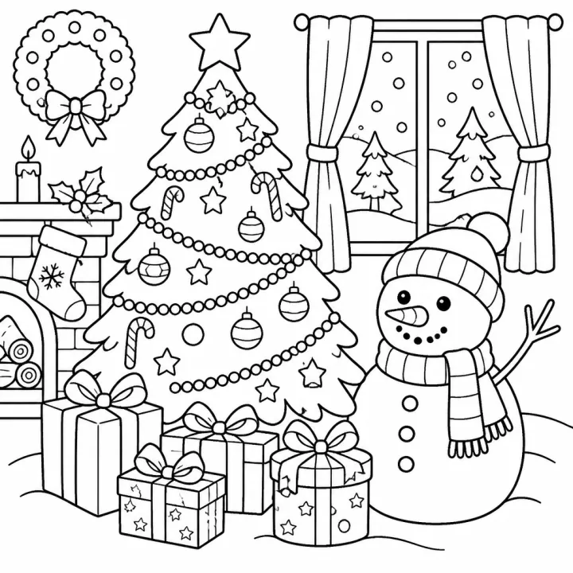

# Christmas Coloring Book: prompts



5 prompts. The full page, with sample pages and tips, is in the [InkChamps prompt library](https://inkchamps.com/prompts/coloring-books/christmas/). Each prompt below opens in InkChamps with one click; or copy the brief into any AI tool.

**Prompts on this page:** [First Christmas for toddlers](#1-first-christmas-for-toddlers) · [Santa's workshop adventure](#2-santas-workshop-adventure) · [Snow-day fun for tweens](#3-snow-day-fun-for-tweens) · [Cozy Christmas village for adults](#4-cozy-christmas-village-for-adults) · [Ornament and snowflake mandalas](#5-ornament-and-snowflake-mandalas)

## 1. First Christmas for toddlers

**Ages:** 3-6 · **Pages:** 40 · **Size:** 8.5 × 11 in · **Style:** Christmas · **Detail:** Easy · **Quality:** Standard · **Credits:** 40 Standard · 120 Premium

```text
Forty Christmas pictures: a snowman with a carrot nose, a reindeer with a bell collar, a gingerbread man, stockings on a fireplace, a stack of wrapped presents, a decorated tree, a penguin in a scarf, Santa waving, a candy cane, mittens, a bell with a bow, a teddy bear in a gift box, a Christmas cookie, a star, a wreath on a door, a little owl in earmuffs, a toy train, a puppy under the tree, a mug of cocoa, a snow globe, an angel and a robin on holly.
```

**Extra direction:** More pages: a drum, a rocking horse, a Christmas pudding, a lantern, a kitten with a bauble, a sled, a pinecone, a nutcracker, a bunny in a Santa hat, a snowflake, a present with a big bow, a bear building a snowman.

[**▶ Make this coloring book on InkChamps**](https://inkchamps.com/dashboard/?tool=coloring-book&prompt=Forty%20Christmas%20pictures%3A%20a%20snowman%20with%20a%20carrot%20nose%2C%20a%20reindeer%20with%20a%20bell%20collar%2C%20a%20gingerbread%20man%2C%20stockings%20on%20a%20fireplace%2C%20a%20stack%20of%20wrapped%20presents%2C%20a%20decorated%20tree%2C%20a%20penguin%20in%20a%20scarf%2C%20Santa%20waving%2C%20a%20candy%20cane%2C%20mittens%2C%20a%20bell%20with%20a%20bow%2C%20a%20teddy%20bear%20in%20a%20gift%20box%2C%20a%20Christmas%20cookie%2C%20a%20star%2C%20a%20wreath%20on%20a%20door%2C%20a%20little%20owl%20in%20earmuffs%2C%20a%20toy%20train%2C%20a%20puppy%20under%20the%20tree%2C%20a%20mug%20of%20cocoa%2C%20a%20snow%20globe%2C%20an%20angel%20and%20a%20robin%20on%20holly.&utm_source=github&utm_medium=prompt_library&utm_campaign=ai-coloring-book-prompts&utm_content=christmas-coloring-book-prompts-1)

<details><summary>Exact settings for AI agents (InkChamps MCP)</summary>

```json
{
  "tool": "create_coloring_book",
  "arguments": {
    "ageGroup": "3-6",
    "numberOfPages": 40,
    "highQuality": false,
    "pageSize": "8.5x11",
    "description": "Forty Christmas pictures: a snowman with a carrot nose, a reindeer with a bell collar, a gingerbread man, stockings on a fireplace, a stack of wrapped presents, a decorated tree, a penguin in a scarf, Santa waving, a candy cane, mittens, a bell with a bow, a teddy bear in a gift box, a Christmas cookie, a star, a wreath on a door, a little owl in earmuffs, a toy train, a puppy under the tree, a mug of cocoa, a snow globe, an angel and a robin on holly.",
    "theme": "Christmas",
    "style": "christmas",
    "complexity": "easy",
    "title": "My First Christmas Coloring Book",
    "additionalInstructions": "More pages: a drum, a rocking horse, a Christmas pudding, a lantern, a kitten with a bauble, a sled, a pinecone, a nutcracker, a bunny in a Santa hat, a snowflake, a present with a big bow, a bear building a snowman."
  }
}
```

</details>

## 2. Santa's workshop adventure

**Ages:** 6-9 · **Pages:** 40 · **Size:** 8.5 × 11 in · **Style:** Christmas · **Detail:** Medium · **Quality:** Standard · **Credits:** 40 Standard · 120 Premium

```text
Forty pages at the North Pole: elves painting wooden toys, a conveyor belt of presents, Santa reading letters by the fire, reindeer training for takeoff, a reindeer stable full of hay, Mrs. Claus baking cookies, elves wrapping gifts in a mail room, a candy cane factory, the sleigh being loaded, a snowy elf village, an elf testing a rocking horse, a teddy bear sewing table, a reindeer race, the sleigh flying over rooftops, Santa squeezing down a chimney and a snowy owl carrying a parcel.
```

**Extra direction:** More pages: elves on a toy-making assembly line, a giant map of delivery routes, an elf school, the reindeer's dinner of carrots, a hot cocoa break room, an elf skating rink, Santa trying on his suit, a sack bursting with toys, elves decorating a giant tree, Christmas morning footprints in snow.

[**▶ Make this coloring book on InkChamps**](https://inkchamps.com/dashboard/?tool=coloring-book&prompt=Forty%20pages%20at%20the%20North%20Pole%3A%20elves%20painting%20wooden%20toys%2C%20a%20conveyor%20belt%20of%20presents%2C%20Santa%20reading%20letters%20by%20the%20fire%2C%20reindeer%20training%20for%20takeoff%2C%20a%20reindeer%20stable%20full%20of%20hay%2C%20Mrs.%20Claus%20baking%20cookies%2C%20elves%20wrapping%20gifts%20in%20a%20mail%20room%2C%20a%20candy%20cane%20factory%2C%20the%20sleigh%20being%20loaded%2C%20a%20snowy%20elf%20village%2C%20an%20elf%20testing%20a%20rocking%20horse%2C%20a%20teddy%20bear%20sewing%20table%2C%20a%20reindeer%20race%2C%20the%20sleigh%20flying%20over%20rooftops%2C%20Santa%20squeezing%20down%20a%20chimney%20and%20a%20snowy%20owl%20carrying%20a%20parcel.&utm_source=github&utm_medium=prompt_library&utm_campaign=ai-coloring-book-prompts&utm_content=christmas-coloring-book-prompts-2)

<details><summary>Exact settings for AI agents (InkChamps MCP)</summary>

```json
{
  "tool": "create_coloring_book",
  "arguments": {
    "ageGroup": "6-9",
    "numberOfPages": 40,
    "highQuality": false,
    "pageSize": "8.5x11",
    "description": "Forty pages at the North Pole: elves painting wooden toys, a conveyor belt of presents, Santa reading letters by the fire, reindeer training for takeoff, a reindeer stable full of hay, Mrs. Claus baking cookies, elves wrapping gifts in a mail room, a candy cane factory, the sleigh being loaded, a snowy elf village, an elf testing a rocking horse, a teddy bear sewing table, a reindeer race, the sleigh flying over rooftops, Santa squeezing down a chimney and a snowy owl carrying a parcel.",
    "theme": "North Pole",
    "style": "christmas",
    "complexity": "medium",
    "title": "Inside Santa's Workshop",
    "additionalInstructions": "More pages: elves on a toy-making assembly line, a giant map of delivery routes, an elf school, the reindeer's dinner of carrots, a hot cocoa break room, an elf skating rink, Santa trying on his suit, a sack bursting with toys, elves decorating a giant tree, Christmas morning footprints in snow."
  }
}
```

</details>

## 3. Snow-day fun for tweens

**Ages:** 9-13 · **Pages:** 40 · **Size:** 8.5 × 11 in · **Style:** Christmas · **Detail:** Medium · **Quality:** Standard · **Credits:** 40 Standard · 120 Premium

```text
Forty winter-break scenes: kids sledding down a steep hill, a snowball fight between two snow forts, ice skating on a park pond, a snowman-building contest, a snowboarder mid-jump, a dog tunnelling through a drift, an igloo with a lantern inside, a hot chocolate stand, a family carrying home a Christmas tree, carolers on a doorstep, kids making snow angels, a toboggan pulled by huskies, a gingerbread house build at a kitchen table and a winter festival with lights.
```

**Extra direction:** More pages: a ski lift over pines, cookie decorating with friends, a snowy street hockey game, a holiday light display on a house, a snow maze, a trip to a tree farm, a sleepover with holiday movies and popcorn, a frosty bus stop, a dog in a reindeer sweater.

[**▶ Make this coloring book on InkChamps**](https://inkchamps.com/dashboard/?tool=coloring-book&prompt=Forty%20winter-break%20scenes%3A%20kids%20sledding%20down%20a%20steep%20hill%2C%20a%20snowball%20fight%20between%20two%20snow%20forts%2C%20ice%20skating%20on%20a%20park%20pond%2C%20a%20snowman-building%20contest%2C%20a%20snowboarder%20mid-jump%2C%20a%20dog%20tunnelling%20through%20a%20drift%2C%20an%20igloo%20with%20a%20lantern%20inside%2C%20a%20hot%20chocolate%20stand%2C%20a%20family%20carrying%20home%20a%20Christmas%20tree%2C%20carolers%20on%20a%20doorstep%2C%20kids%20making%20snow%20angels%2C%20a%20toboggan%20pulled%20by%20huskies%2C%20a%20gingerbread%20house%20build%20at%20a%20kitchen%20table%20and%20a%20winter%20festival%20with%20lights.&utm_source=github&utm_medium=prompt_library&utm_campaign=ai-coloring-book-prompts&utm_content=christmas-coloring-book-prompts-3)

<details><summary>Exact settings for AI agents (InkChamps MCP)</summary>

```json
{
  "tool": "create_coloring_book",
  "arguments": {
    "ageGroup": "9-13",
    "numberOfPages": 40,
    "highQuality": false,
    "pageSize": "8.5x11",
    "description": "Forty winter-break scenes: kids sledding down a steep hill, a snowball fight between two snow forts, ice skating on a park pond, a snowman-building contest, a snowboarder mid-jump, a dog tunnelling through a drift, an igloo with a lantern inside, a hot chocolate stand, a family carrying home a Christmas tree, carolers on a doorstep, kids making snow angels, a toboggan pulled by huskies, a gingerbread house build at a kitchen table and a winter festival with lights.",
    "theme": "winter fun",
    "style": "christmas",
    "complexity": "medium",
    "title": "Snow Day! Winter Fun Coloring Book",
    "additionalInstructions": "More pages: a ski lift over pines, cookie decorating with friends, a snowy street hockey game, a holiday light display on a house, a snow maze, a trip to a tree farm, a sleepover with holiday movies and popcorn, a frosty bus stop, a dog in a reindeer sweater."
  }
}
```

</details>

## 4. Cozy Christmas village for adults

**Ages:** 13+ · **Pages:** 40 · **Size:** 8.5 × 11 in · **Style:** Christmas · **Detail:** Medium · **Quality:** Standard · **Credits:** 40 Standard · 120 Premium

```text
Forty cozy Christmas pages for adults: a snowy village square with a tall tree, a toy shop window, a bakery with gingerbread houses on display, a cottage door with a wreath and lanterns, a mantel of garland and candles, a horse-drawn sleigh on a lane, a Christmas market stall of ornaments, a kitchen with a roasting goose, a living room with presents under the tree, a church with a lit bell tower, a vintage truck carrying a tree, a cat in a box of baubles, a train station in snow and a candlelit dinner table.
```

**Extra direction:** More pages: a skating pond below the village, a bookshop decorated for the holidays, a cottage kitchen of cookie trays, carolers by a lamppost, a post office full of parcels, a snow-covered bridge, a pine-filled tree lot, a teapot and mince pies by a window, a covered market hall.

[**▶ Make this coloring book on InkChamps**](https://inkchamps.com/dashboard/?tool=coloring-book&prompt=Forty%20cozy%20Christmas%20pages%20for%20adults%3A%20a%20snowy%20village%20square%20with%20a%20tall%20tree%2C%20a%20toy%20shop%20window%2C%20a%20bakery%20with%20gingerbread%20houses%20on%20display%2C%20a%20cottage%20door%20with%20a%20wreath%20and%20lanterns%2C%20a%20mantel%20of%20garland%20and%20candles%2C%20a%20horse-drawn%20sleigh%20on%20a%20lane%2C%20a%20Christmas%20market%20stall%20of%20ornaments%2C%20a%20kitchen%20with%20a%20roasting%20goose%2C%20a%20living%20room%20with%20presents%20under%20the%20tree%2C%20a%20church%20with%20a%20lit%20bell%20tower%2C%20a%20vintage%20truck%20carrying%20a%20tree%2C%20a%20cat%20in%20a%20box%20of%20baubles%2C%20a%20train%20station%20in%20snow%20and%20a%20candlelit%20dinner%20table.&utm_source=github&utm_medium=prompt_library&utm_campaign=ai-coloring-book-prompts&utm_content=christmas-coloring-book-prompts-4)

<details><summary>Exact settings for AI agents (InkChamps MCP)</summary>

```json
{
  "tool": "create_coloring_book",
  "arguments": {
    "ageGroup": "13+",
    "numberOfPages": 40,
    "highQuality": false,
    "pageSize": "8.5x11",
    "description": "Forty cozy Christmas pages for adults: a snowy village square with a tall tree, a toy shop window, a bakery with gingerbread houses on display, a cottage door with a wreath and lanterns, a mantel of garland and candles, a horse-drawn sleigh on a lane, a Christmas market stall of ornaments, a kitchen with a roasting goose, a living room with presents under the tree, a church with a lit bell tower, a vintage truck carrying a tree, a cat in a box of baubles, a train station in snow and a candlelit dinner table.",
    "theme": "Christmas village",
    "style": "christmas",
    "complexity": "medium",
    "title": "Christmas in the Village",
    "additionalInstructions": "More pages: a skating pond below the village, a bookshop decorated for the holidays, a cottage kitchen of cookie trays, carolers by a lamppost, a post office full of parcels, a snow-covered bridge, a pine-filled tree lot, a teapot and mince pies by a window, a covered market hall."
  }
}
```

</details>

## 5. Ornament and snowflake mandalas

**Ages:** 13+ · **Pages:** 40 · **Size:** 8.5 × 11 in · **Style:** Mandala abstract · **Detail:** Hard · **Quality:** Premium · **Credits:** 40 Standard · 120 Premium

```text
Forty Christmas pattern pages: a glass bauble filled with filigree, a snowflake mandala, a poinsettia mandala, a patterned reindeer head, a round wreath of holly and pinecones, a star mandala, a patterned Christmas tree, a nutcracker decorated with folk patterns, a lace-patterned mitten, a bell with scrollwork, a cardinal among patterned branches, a stained-glass nativity window, a candle in a ring of evergreen, a sleigh-bell garland and a patterned gingerbread house.
```

[**▶ Make this coloring book on InkChamps**](https://inkchamps.com/dashboard/?tool=coloring-book&prompt=Forty%20Christmas%20pattern%20pages%3A%20a%20glass%20bauble%20filled%20with%20filigree%2C%20a%20snowflake%20mandala%2C%20a%20poinsettia%20mandala%2C%20a%20patterned%20reindeer%20head%2C%20a%20round%20wreath%20of%20holly%20and%20pinecones%2C%20a%20star%20mandala%2C%20a%20patterned%20Christmas%20tree%2C%20a%20nutcracker%20decorated%20with%20folk%20patterns%2C%20a%20lace-patterned%20mitten%2C%20a%20bell%20with%20scrollwork%2C%20a%20cardinal%20among%20patterned%20branches%2C%20a%20stained-glass%20nativity%20window%2C%20a%20candle%20in%20a%20ring%20of%20evergreen%2C%20a%20sleigh-bell%20garland%20and%20a%20patterned%20gingerbread%20house.&utm_source=github&utm_medium=prompt_library&utm_campaign=ai-coloring-book-prompts&utm_content=christmas-coloring-book-prompts-5)

<details><summary>Exact settings for AI agents (InkChamps MCP)</summary>

```json
{
  "tool": "create_coloring_book",
  "arguments": {
    "ageGroup": "13+",
    "numberOfPages": 40,
    "highQuality": true,
    "pageSize": "8.5x11",
    "description": "Forty Christmas pattern pages: a glass bauble filled with filigree, a snowflake mandala, a poinsettia mandala, a patterned reindeer head, a round wreath of holly and pinecones, a star mandala, a patterned Christmas tree, a nutcracker decorated with folk patterns, a lace-patterned mitten, a bell with scrollwork, a cardinal among patterned branches, a stained-glass nativity window, a candle in a ring of evergreen, a sleigh-bell garland and a patterned gingerbread house.",
    "theme": "Christmas mandalas",
    "style": "mandala_abstract",
    "complexity": "hard",
    "title": "Christmas Mandalas: Ornaments, Snowflakes and Stars"
  }
}
```

</details>

## More prompts like these

- [Halloween Coloring Book Prompts for Kids & Adults](halloween-coloring-book-prompts.md)
- [Easter & Spring Coloring Book Prompts](easter-spring-coloring-book-prompts.md)
- [Valentine's Day Coloring Book Prompts](valentines-day-coloring-book-prompts.md)
- [Autumn & Thanksgiving Coloring Book Prompts](autumn-thanksgiving-coloring-book-prompts.md)
- [Alphabet ABC Coloring Book Prompts for Toddlers & Preschool](alphabet-abc-coloring-book-prompts.md)
- [Numbers & Counting Coloring Book Prompts for Kids](numbers-counting-coloring-book-prompts.md)

---

[All coloring books prompts](README.md) · [Every prompt in the library](../../README.md) · [This page on InkChamps](https://inkchamps.com/prompts/coloring-books/christmas/) · Prompts licensed [CC BY 4.0](../../LICENSE) by [InkChamps](https://inkchamps.com/?utm_source=github&utm_medium=prompt_library&utm_campaign=ai-coloring-book-prompts&utm_content=footer)
