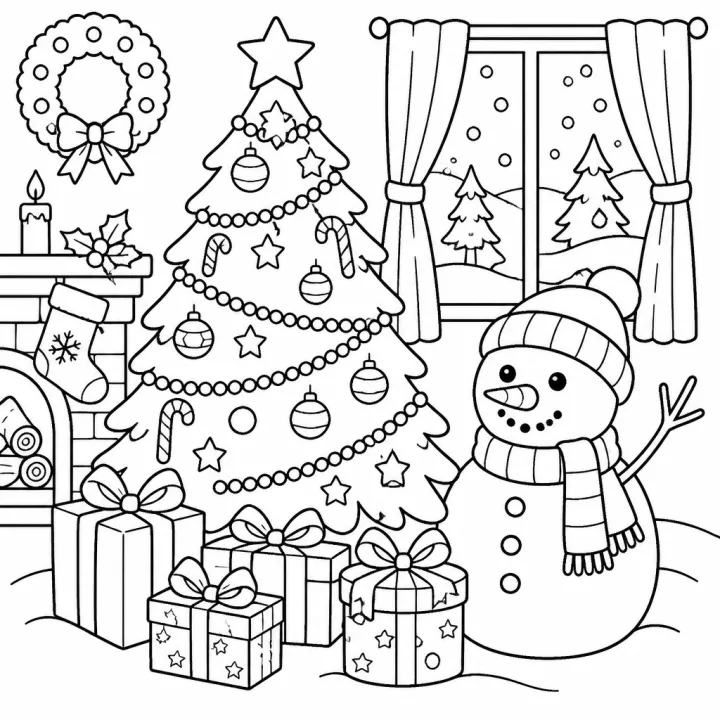

# Christmas Coloring Book: prompts



5 prompts. The full page, with sample pages and tips, is in the [InkChamps prompt library](https://inkchamps.com/prompts/coloring-books/christmas/). Each prompt below opens in InkChamps with one click; or copy the brief into any AI tool.

**Prompts on this page:** [First Christmas for toddlers](#1-first-christmas-for-toddlers) · [Santa's workshop adventure](#2-santas-workshop-adventure) · [Snow-day fun for tweens](#3-snow-day-fun-for-tweens) · [Cozy Christmas village for adults](#4-cozy-christmas-village-for-adults) · [Ornament and snowflake mandalas](#5-ornament-and-snowflake-mandalas)

## 1. First Christmas for toddlers

**Ages:** 3-6 · **Pages:** 24 · **Size:** 8.5 × 11 in · **Style:** Christmas · **Detail:** Easy · **Quality:** Standard · **Credits:** 24 Standard · 72 Premium

```text
24 big, simple Christmas pictures for little hands, one friendly thing per page: a snowman with a carrot nose, a reindeer with a bell collar, a gingerbread man, stockings on a fireplace, a stack of presents, a decorated tree, a penguin in a scarf, Santa waving, a teddy bear in a gift box, a puppy under the tree, a mug of cocoa, a snow globe, a robin on holly, a bunny with a sled, a rocking horse and a big snowflake.
```

### Page by page (24 pages)

Paste one page at a time into ChatGPT, Gemini or any AI image tool, with this line after it:

> Black-and-white coloring page for a child aged 3 to 6: one big, cute, friendly Christmas subject filling most of the page, thick bold outlines, large simple shapes with wide spaces to color, very little background, no shading, no grey, no words, plain white background, portrait 8.5 x 11 page.

1. A big round snowman with a carrot nose, coal-button eyes and a striped scarf, waving a stick arm, three small snowflakes falling around him.
2. A smiling baby reindeer with little antlers and a collar of round jingle bells, standing in soft snow with one hoof lifted.
3. A happy gingerbread man with icing buttons and a wide smile, standing on a cookie tray beside a rolling pin and a heart-shaped cookie cutter.
4. Three big Christmas stockings hanging from a simple fireplace mantel, one with a star, one with stripes and one with a candy cane poking out of the top.
5. A stack of three wrapped presents with big bows, the smallest on top, with ribbon tails curling onto the floor.
6. A tall decorated Christmas tree with a big star on top, round baubles on the branches and two gifts tucked underneath.
7. A chubby penguin in a knitted scarf and bobble hat sliding on its tummy across the ice, a little snowdrift behind it.
8. A jolly Santa with a fluffy white beard and a round belly waving hello, his big sack of toys on the ground beside him.
9. A big striped candy cane tied with a ribbon bow, a sprig of holly with three round berries beside it.
10. A pair of cozy mittens joined by a string, one with a snowflake and one with a heart, lying on a little pile of snow.
11. A teddy bear peeking out of an open gift box, holding the lid in its paws, a curly ribbon draped over the side.
12. A front door with a round wreath of leaves, berries and a big bow, a doormat and a small potted pine tree beside it.
13. A little owl in fluffy earmuffs perched on a snowy branch, its big round eyes looking at a falling snowflake.
14. A toy train with an engine and two carriages carrying a present and a little tree, chugging along a short curved track.
15. A floppy-eared puppy sleeping under the Christmas tree, curled on a round rug next to a present with a bow.
16. A big mug of hot cocoa topped with marshmallows and a candy cane stirrer, a plate with two round cookies beside it.
17. A round snow globe on a little base, with a tiny house and a pine tree inside and snowflakes floating around them.
18. A smiling angel with feathery wings and a halo, holding a star in both hands, a few small stars around her.
19. A fat little robin sitting on a sprig of holly with shiny leaves and round berries, a snowflake above its head.
20. A small kitten batting a big round bauble that hangs from a pine branch, its tail curled and its paw in the air.
21. A bunny in a Santa hat pulling a wooden sled with a present on it across the snow, its ears poking through the hat.
22. A big brown bear building a snowman, patting on its head while a bucket and a carrot wait in the snow beside it.
23. A smiling wooden rocking horse with a ribbon mane and a red bow, a drum and a pinecone on the floor next to it.
24. One big, simple snowflake with six wide arms filling the middle of the page, with a few tiny stars around it.

[**▶ Make this coloring book on InkChamps**](https://inkchamps.com/dashboard/?tool=coloring-book&prompt=24%20big%2C%20simple%20Christmas%20pictures%20for%20little%20hands%2C%20one%20friendly%20thing%20per%20page%3A%20a%20snowman%20with%20a%20carrot%20nose%2C%20a%20reindeer%20with%20a%20bell%20collar%2C%20a%20gingerbread%20man%2C%20stockings%20on%20a%20fireplace%2C%20a%20stack%20of%20presents%2C%20a%20decorated%20tree%2C%20a%20penguin%20in%20a%20scarf%2C%20Santa%20waving%2C%20a%20teddy%20bear%20in%20a%20gift%20box%2C%20a%20puppy%20under%20the%20tree%2C%20a%20mug%20of%20cocoa%2C%20a%20snow%20globe%2C%20a%20robin%20on%20holly%2C%20a%20bunny%20with%20a%20sled%2C%20a%20rocking%20horse%20and%20a%20big%20snowflake.&utm_source=github&utm_medium=prompt_library&utm_campaign=ai-coloring-book-prompts&utm_content=christmas-coloring-book-prompts-1)

<details><summary>Exact settings for AI agents (InkChamps MCP)</summary>

```json
{
  "tool": "create_coloring_book",
  "arguments": {
    "ageGroup": "3-6",
    "numberOfPages": 24,
    "highQuality": false,
    "pageSize": "8.5x11",
    "description": "24 big, simple Christmas pictures for little hands, one friendly thing per page: a snowman with a carrot nose, a reindeer with a bell collar, a gingerbread man, stockings on a fireplace, a stack of presents, a decorated tree, a penguin in a scarf, Santa waving, a teddy bear in a gift box, a puppy under the tree, a mug of cocoa, a snow globe, a robin on holly, a bunny with a sled, a rocking horse and a big snowflake.",
    "theme": "Christmas",
    "style": "christmas",
    "complexity": "easy",
    "title": "My First Christmas Coloring Book"
  }
}
```

</details>

## 2. Santa's workshop adventure

**Ages:** 6-9 · **Pages:** 24 · **Size:** 8.5 × 11 in · **Style:** Christmas · **Detail:** Medium · **Quality:** Standard · **Credits:** 24 Standard · 72 Premium

```text
24 pages at the North Pole, following the run-up to Christmas Eve: Santa reading letters by the fire, a map of delivery routes, elves painting toys and working an assembly line, a conveyor belt of presents, a candy cane factory, Mrs. Claus baking cookies, an elf school, the reindeer stable, reindeer training and racing, an elf skating rink, Santa trying on his suit, loading the sleigh, the sleigh flying over rooftops and Christmas morning footprints in the snow.
```

### Page by page (24 pages)

Paste one page at a time into ChatGPT, Gemini or any AI image tool, with this line after it:

> Black-and-white coloring page for a child aged 6 to 9: friendly cartoon elves, reindeer or Santa as the main characters, clear bold outlines, medium detail with a simple background that shows where the scene happens, no shading, no grey, no words or letters, plain white background, portrait 8.5 x 11 page.

1. Santa in his armchair by a crackling fire reading a long letter that unrolls onto the floor, a pile of envelopes in a basket and his reading glasses on his nose.
2. A giant map of the world pinned to the workshop wall with dotted delivery routes, an elf pointing at it with a long stick while two elves take notes.
3. Three elves in pointed hats painting wooden toys at a long workbench: a toy soldier, a little sailboat and a spinning top, with paint pots and brushes everywhere.
4. An elf assembly line where one elf hammers wheels onto toy cars, the next adds windows and the last ties a bow, the cars moving along a wooden table.
5. A conveyor belt carrying wrapped presents of every shape through the workshop, an elf on a ladder catching a box that wobbles off the end.
6. An elf sitting at a sewing table stitching a teddy bear, spools of thread, buttons and a finished bear lined up beside her.
7. A cheerful elf testing a rocking horse, rocking so hard his hat flies off, while another elf checks a clipboard.
8. A candy cane factory with a big striped twisting machine, elves carrying candy canes in baskets and a row of jars on a shelf.
9. Elves in the mail room wrapping gifts at a long table, rolls of paper, ribbons and tape everywhere, a mountain of parcels behind them.
10. Mrs. Claus in an apron pulling a tray of star-shaped cookies out of the oven, a mixing bowl, a rolling pin and an elf licking a spoon nearby.
11. A hot cocoa break room where elves sit on stools sipping from big mugs, a pot of cocoa steaming on the stove and a plate of cookies on the table.
12. An elf school classroom where a teacher elf points at a chalkboard drawing of a toy, little elves at desks with hammers and paintbrushes.
13. A reindeer stable with wooden stalls full of hay, each stall with a name plaque, a reindeer munching from a manger and a lantern on a hook.
14. Reindeer eating their dinner of carrots from a long wooden trough while an elf pours more carrots from a sack.
15. Reindeer training for takeoff on a snowy runway, one reindeer leaping into the air while an elf coach blows a whistle.
16. A reindeer race across the snowy field with three reindeer galloping toward a ribbon finish line, elves cheering from a snowbank.
17. Elves skating in a circle on an icy pond in the elf village, one elf spinning on one skate and another wobbling with arms out.
18. Elves on tall ladders decorating a giant Christmas tree in the village square, stringing lights and hanging baubles as big as their heads.
19. Santa standing in front of a mirror trying on his red suit, an elf tailor with a tape measure and pins helping with the belt.
20. Elves loading the sleigh in the courtyard, passing presents up a ladder to an elf on top of a huge bulging sack of toys.
21. Santa's sleigh pulled by a team of reindeer flying over snowy rooftops and chimneys, a big full moon and stars in the sky.
22. Santa squeezing down a brick chimney with only his boots and sack showing, snow on the roof and a cat watching from the window.
23. A snowy owl flying over a pine forest carrying a small parcel tied with string in its talons, snowflakes falling around it.
24. Christmas morning in a snowy front yard: boot prints and sleigh tracks in the snow leading to a door with a wreath, presents on the doorstep.

[**▶ Make this coloring book on InkChamps**](https://inkchamps.com/dashboard/?tool=coloring-book&prompt=24%20pages%20at%20the%20North%20Pole%2C%20following%20the%20run-up%20to%20Christmas%20Eve%3A%20Santa%20reading%20letters%20by%20the%20fire%2C%20a%20map%20of%20delivery%20routes%2C%20elves%20painting%20toys%20and%20working%20an%20assembly%20line%2C%20a%20conveyor%20belt%20of%20presents%2C%20a%20candy%20cane%20factory%2C%20Mrs.%20Claus%20baking%20cookies%2C%20an%20elf%20school%2C%20the%20reindeer%20stable%2C%20reindeer%20training%20and%20racing%2C%20an%20elf%20skating%20rink%2C%20Santa%20trying%20on%20his%20suit%2C%20loading%20the%20sleigh%2C%20the%20sleigh%20flying%20over%20rooftops%20and%20Christmas%20morning%20footprints%20in%20the%20snow.&utm_source=github&utm_medium=prompt_library&utm_campaign=ai-coloring-book-prompts&utm_content=christmas-coloring-book-prompts-2)

<details><summary>Exact settings for AI agents (InkChamps MCP)</summary>

```json
{
  "tool": "create_coloring_book",
  "arguments": {
    "ageGroup": "6-9",
    "numberOfPages": 24,
    "highQuality": false,
    "pageSize": "8.5x11",
    "description": "24 pages at the North Pole, following the run-up to Christmas Eve: Santa reading letters by the fire, a map of delivery routes, elves painting toys and working an assembly line, a conveyor belt of presents, a candy cane factory, Mrs. Claus baking cookies, an elf school, the reindeer stable, reindeer training and racing, an elf skating rink, Santa trying on his suit, loading the sleigh, the sleigh flying over rooftops and Christmas morning footprints in the snow.",
    "theme": "North Pole",
    "style": "christmas",
    "complexity": "medium",
    "title": "Inside Santa's Workshop"
  }
}
```

</details>

## 3. Snow-day fun for tweens

**Ages:** 9-13 · **Pages:** 24 · **Size:** 8.5 × 11 in · **Style:** Christmas · **Detail:** Medium · **Quality:** Standard · **Credits:** 24 Standard · 72 Premium

```text
24 winter-break scenes full of action: sledding down a steep hill, a snowball fight between snow forts, skating on a park pond, a snowman contest, a snowboard jump, a dog tunnelling through a drift, an igloo with a lantern, a hot chocolate stand, carrying home a tree, carolers, snow angels, a husky toboggan, a gingerbread house build, a ski lift, street hockey, a lit-up house, a snow maze, a sleepover and a winter festival at night.
```

### Page by page (24 pages)

Paste one page at a time into ChatGPT, Gemini or any AI image tool, with this line after it:

> Black-and-white coloring page for ages 9 to 13: realistic, lively kids and winter scenery drawn with clean fine outlines, detailed clothing, snow, trees and buildings with many separate areas to color, a full background that sets the scene, no shading, no grey, no words or letters, plain white background, portrait 8.5 x 11 page.

1. Two friends racing down a steep snowy hill on sleds, scarves flying behind them, a pine tree and a line of kids pulling sleds back up the slope.
2. A snowball fight between two snow forts with low brick-shaped walls, kids ducking behind them and snowballs flying through the air in arcs.
3. Kids ice skating on an iced-over park pond, one doing a spin, one holding a friend's hands, a wooden bench and bare trees on the bank.
4. A snowman-building contest in a park, three snowmen in a row with different hats and faces, kids adding a scarf and a judge holding a ribbon.
5. A snowboarder in a helmet and goggles caught mid-jump off a snowy ramp, a spray of snow behind the board and pine trees below.
6. A dog tunnelling through a big snowdrift with only its head and wagging tail poking out of each end, a kid laughing beside it.
7. A round igloo made of snow blocks with a glowing lantern inside and a kid crawling out of the entrance, a shovel stuck in the snow.
8. Two kids running a hot chocolate stand at the end of a snowy driveway, a big flask, a stack of paper cups and a blank wooden sign.
9. A family carrying a freshly cut Christmas tree home along a snowy street, the dad at the trunk, the kids holding the branches and a dog trotting alongside.
10. A group of carolers in coats and hats singing on a doorstep with songbooks, a lantern on a pole and the door opening with a warm glow.
11. Three kids lying in fresh snow making snow angels side by side, their boots and mittens visible and snowflakes drifting down.
12. A team of huskies pulling a long wooden toboggan of laughing kids across a snowy trail through pine trees.
13. Friends building a gingerbread house at the kitchen table, piping icing onto the roof, bowls of candies and a gingerbread wall propped up with a mug.
14. A ski lift chair carrying two kids high above snowy pine trees, their skis dangling and mountains behind them.
15. A cookie-decorating party with friends around a table, trays of star and tree cookies, icing bags and sprinkles scattered everywhere.
16. A street hockey game in the snow, kids with sticks chasing a puck toward a small net, snowbanks along the curb and a parked car.
17. A house covered in holiday lights, with light-up reindeer on the lawn, lights along the roof and kids pointing from the sidewalk.
18. A winter maze dug out of tall snow walls, kids peeking around corners and one kid waving from the center.
19. A family walking through rows of pine trees at a tree farm, a kid measuring a tree with outstretched arms and a wagon with a saw.
20. A cozy sleepover in a living room, kids in pajamas in sleeping bags with a big bowl of popcorn and a string of lights over the window.
21. Kids waiting at a frosty bus stop, breath puffing in the cold, a snowy shelter, icicles hanging off the roof and a dog in a reindeer sweater.
22. A winter festival at night with a big lit tree, stalls with string lights, a small carousel and kids holding paper lanterns.
23. A kid shoveling a snowy path to a neighbor's door while another kid builds a mini snowman on the porch steps, a snow shovel and a sled nearby.
24. Two friends by a window at night with mugs of hot chocolate, watching snow fall over the street, a sleeping cat on the windowsill.

[**▶ Make this coloring book on InkChamps**](https://inkchamps.com/dashboard/?tool=coloring-book&prompt=24%20winter-break%20scenes%20full%20of%20action%3A%20sledding%20down%20a%20steep%20hill%2C%20a%20snowball%20fight%20between%20snow%20forts%2C%20skating%20on%20a%20park%20pond%2C%20a%20snowman%20contest%2C%20a%20snowboard%20jump%2C%20a%20dog%20tunnelling%20through%20a%20drift%2C%20an%20igloo%20with%20a%20lantern%2C%20a%20hot%20chocolate%20stand%2C%20carrying%20home%20a%20tree%2C%20carolers%2C%20snow%20angels%2C%20a%20husky%20toboggan%2C%20a%20gingerbread%20house%20build%2C%20a%20ski%20lift%2C%20street%20hockey%2C%20a%20lit-up%20house%2C%20a%20snow%20maze%2C%20a%20sleepover%20and%20a%20winter%20festival%20at%20night.&utm_source=github&utm_medium=prompt_library&utm_campaign=ai-coloring-book-prompts&utm_content=christmas-coloring-book-prompts-3)

<details><summary>Exact settings for AI agents (InkChamps MCP)</summary>

```json
{
  "tool": "create_coloring_book",
  "arguments": {
    "ageGroup": "9-13",
    "numberOfPages": 24,
    "highQuality": false,
    "pageSize": "8.5x11",
    "description": "24 winter-break scenes full of action: sledding down a steep hill, a snowball fight between snow forts, skating on a park pond, a snowman contest, a snowboard jump, a dog tunnelling through a drift, an igloo with a lantern, a hot chocolate stand, carrying home a tree, carolers, snow angels, a husky toboggan, a gingerbread house build, a ski lift, street hockey, a lit-up house, a snow maze, a sleepover and a winter festival at night.",
    "theme": "winter fun",
    "style": "christmas",
    "complexity": "medium",
    "title": "Snow Day! Winter Fun Coloring Book"
  }
}
```

</details>

## 4. Cozy Christmas village for adults

**Ages:** 13+ · **Pages:** 24 · **Size:** 8.5 × 11 in · **Style:** Christmas · **Detail:** Medium · **Quality:** Standard · **Credits:** 24 Standard · 72 Premium

```text
24 cozy Christmas pages for adults, moving between the streets and the warm rooms of a snowy old village: the square with its tall tree, a toy shop window, a bakery, a wreathed cottage door, a garlanded mantel, a horse-drawn sleigh, a market stall of ornaments, a farmhouse kitchen, a living room on Christmas Eve, a church bell tower, a vintage truck with a tree, a cat in a box of baubles, a train station, a skating pond, a bookshop, carolers and the whole village by night.
```

### Page by page (24 pages)

Paste one page at a time into ChatGPT, Gemini or any AI image tool, with this line after it:

> Black-and-white adult coloring page: a cozy, detailed Christmas scene with fine, crisp line work, rich detail in brickwork, windows, decorations and snow, many small areas to color, a full background, no shading, no grey, no words or lettering on signs, plain white background, portrait 8.5 x 11 page.

1. A snowy village square with a tall decorated Christmas tree in the middle, cobblestones, half-timbered shops around it and people walking with parcels.
2. A toy shop window display with a rocking horse, a toy train circling a tiny village, wooden soldiers and dolls, snow piled on the window ledge.
3. A bakery front with gingerbread houses on display in the window, trays of stollen and tarts, a striped awning and a bicycle with a basket outside.
4. A cottage front door with a big evergreen wreath, two glowing lanterns on the steps, potted pines and boots by the doormat.
5. A fireplace mantel draped with pine garland, pinecones and candles, stockings hung below and a clock and framed pictures above.
6. A horse-drawn sleigh gliding along a snowy country lane lined with fences and birches, a couple wrapped in blankets and bells on the harness.
7. A Christmas market stall filled with hanging glass ornaments, wooden carved stars and candles, a vendor in a knitted hat and strings of lights overhead.
8. A farmhouse kitchen with a roasting goose on the table, copper pots hanging over the stove, a bowl of oranges and herbs drying from a beam.
9. A living room on Christmas Eve with a tall tree, presents stacked underneath, an armchair with a knitted throw and snow falling past the window.
10. A stone church with a lit bell tower at dusk, snow on the roof, a lantern-lined path and villagers walking up to the arched doorway.
11. A vintage pickup truck parked on a snowy street with a Christmas tree tied in its bed, a wreath on the grille and shopfronts behind.
12. A tabby cat sitting inside a cardboard box of glass baubles, one paw on a bauble, tinsel spilling out and a half-decorated tree beside it.
13. A small train station in the snow, a steam engine pulling in, travelers with suitcases and wrapped gifts, a station clock and garlands on the lamps.
14. A candlelit dinner table set for Christmas, a centerpiece of pine and candles, plates, crystal glasses and a roast on a platter.
15. An iced-over skating pond below the village, skaters gliding in scarves, a wooden bench with skates tied together and houses on the hill above.
16. A bookshop decorated for the holidays, shelves stacked to the ceiling, a rolling ladder, a garland over the counter and a cat asleep on a pile of books.
17. A cottage kitchen counter covered in cookie trays, cooling racks, a stand mixer, cookie cutters and a window looking onto snowy gardens.
18. Carolers in long coats and scarves singing by an old iron lamppost, holding songbooks, with snow falling and a row of lit cottages behind.
19. A busy village post office full of parcels, a clerk weighing a box on brass scales, pigeonhole shelves of letters and a queue at the counter.
20. An arched stone bridge covered in snow over an icy stream, lanterns on the railings and a pair of walkers with a dog crossing it.
21. A pine tree lot with trees leaning in rows, a wooden hut with a string of lights, a man netting a tree and a couple choosing one.
22. A teapot, cups and a plate of mince pies on a windowsill, a knitted tea cozy and a frosty window looking onto a snowy lane.
23. A covered market hall with iron arches and a glass roof, stalls of cheeses, pastries and wreaths, and shoppers carrying baskets.
24. A view of the whole village at night from a hillside, rooftops covered in snow, smoking chimneys, lit windows and a starry sky above.

[**▶ Make this coloring book on InkChamps**](https://inkchamps.com/dashboard/?tool=coloring-book&prompt=24%20cozy%20Christmas%20pages%20for%20adults%2C%20moving%20between%20the%20streets%20and%20the%20warm%20rooms%20of%20a%20snowy%20old%20village%3A%20the%20square%20with%20its%20tall%20tree%2C%20a%20toy%20shop%20window%2C%20a%20bakery%2C%20a%20wreathed%20cottage%20door%2C%20a%20garlanded%20mantel%2C%20a%20horse-drawn%20sleigh%2C%20a%20market%20stall%20of%20ornaments%2C%20a%20farmhouse%20kitchen%2C%20a%20living%20room%20on%20Christmas%20Eve%2C%20a%20church%20bell%20tower%2C%20a%20vintage%20truck%20with%20a%20tree%2C%20a%20cat%20in%20a%20box%20of%20baubles%2C%20a%20train%20station%2C%20a%20skating%20pond%2C%20a%20bookshop%2C%20carolers%20and%20the%20whole%20village%20by%20night.&utm_source=github&utm_medium=prompt_library&utm_campaign=ai-coloring-book-prompts&utm_content=christmas-coloring-book-prompts-4)

<details><summary>Exact settings for AI agents (InkChamps MCP)</summary>

```json
{
  "tool": "create_coloring_book",
  "arguments": {
    "ageGroup": "13+",
    "numberOfPages": 24,
    "highQuality": false,
    "pageSize": "8.5x11",
    "description": "24 cozy Christmas pages for adults, moving between the streets and the warm rooms of a snowy old village: the square with its tall tree, a toy shop window, a bakery, a wreathed cottage door, a garlanded mantel, a horse-drawn sleigh, a market stall of ornaments, a farmhouse kitchen, a living room on Christmas Eve, a church bell tower, a vintage truck with a tree, a cat in a box of baubles, a train station, a skating pond, a bookshop, carolers and the whole village by night.",
    "theme": "Christmas village",
    "style": "christmas",
    "complexity": "medium",
    "title": "Christmas in the Village"
  }
}
```

</details>

## 5. Ornament and snowflake mandalas

**Ages:** 13+ · **Pages:** 24 · **Size:** 8.5 × 11 in · **Style:** Mandala abstract · **Detail:** Hard · **Quality:** Premium · **Credits:** 24 Standard · 72 Premium

```text
24 intricate Christmas pattern pages: a filigree glass bauble, a snowflake mandala, a poinsettia mandala, a patterned reindeer head, a holly and pinecone wreath, a star mandala, a patterned tree, a folk-art nutcracker, a lace mitten, a scrollwork bell, a cardinal in patterned branches, a stained-glass nativity window, a candle in evergreen, a sleigh-bell garland, a gingerbread house, a patterned angel, a quilted stocking and a full ring mandala of Christmas symbols.
```

### Page by page (24 pages)

Paste one page at a time into ChatGPT, Gemini or any AI image tool, with this line after it:

> Black-and-white adult coloring page: an intricate Christmas design with fine, crisp line work, every shape filled with mandala, filigree, lace or zentangle patterns, many small areas to color, a balanced composition that fills the page, no shading, no grey, no words, plain white background, portrait 8.5 x 11 page.

1. A round glass bauble filled with swirling filigree and lace patterns, its cap and hook decorated with tiny scrolls, set in the center of the page.
2. A large six-pointed snowflake mandala with layered crystal arms, each arm split into smaller feathered branches and diamond patterns.
3. A poinsettia mandala with rings of pointed petals around a beaded center, each petal filled with veins, dots and paisley.
4. A reindeer head facing forward, its antlers branching into swirls, its face and neck filled with zentangle patterns and a holly collar.
5. A round wreath of holly leaves, berries and pinecones, every leaf and scale filled with tiny patterns, tied with a patterned ribbon bow.
6. An eight-pointed star mandala with layered rays, each ray filled with chevrons, dots and lace, inside a ring of small stars.
7. A tall Christmas tree made of layered pattern bands, each tier filled with a different design, with a star of filigree on top.
8. A nutcracker soldier standing tall, his coat, hat and boots covered in folk-art flowers, hearts and scrolls.
9. A mitten covered in lace and Nordic knit patterns, snowflakes, hearts and diamonds, with a patterned cuff and a hanging string.
10. A bell with a big bow, covered in scrollwork and floral patterns, with a holly sprig and tiny bells hanging below.
11. A cardinal perched among patterned pine branches and berries, its feathers drawn in fine layered scallops and swirls.
12. A stained-glass window with a pointed arch showing a stable, a manger, a star above and two kneeling figures, divided into many glass sections.
13. A pillar candle in a ring of evergreen sprigs, pinecones and berries, the candle wrapped in a lace pattern and its flame drawn in swirls.
14. A sleigh-bell garland draped across the page, each bell engraved with a different pattern, joined by a patterned leather strap and bows.
15. A gingerbread house with every wall, roof tile and window filled with candy-shaped patterns, icing scallops and tiny heart details.
16. A round mandala of mistletoe sprigs and berries radiating from a central star, with a lace border ring.
17. An angel with outspread wings, each feather filled with patterns, her gown flowing in folds of lace and her halo a ring of stars.
18. A stocking hanging from a hook, covered in patchwork panels of paisley, snowflakes and quilted diamonds, with a lace cuff.
19. A pinecone mandala made of many pinecones arranged in a circle around a central flower, each scale filled with tiny patterns.
20. A snow globe with a patterned base, holding a tiny village of houses whose walls and roofs are filled with patterns, snowflakes swirling around.
21. A pair of ornate ice skates with laces and blades, the boots covered in floral filigree and tied with a patterned ribbon.
22. A Christmas tree ornament shaped like a teardrop, divided into bands of lace, scales, flowers and tiny stars, hanging from a bow.
23. A wreath of interlocking snowflakes of every size forming a ring, with a lantern hanging in the center filled with patterns.
24. A large circular mandala combining baubles, stars, holly and candy canes in repeating rings around a central snowflake.

[**▶ Make this coloring book on InkChamps**](https://inkchamps.com/dashboard/?tool=coloring-book&prompt=24%20intricate%20Christmas%20pattern%20pages%3A%20a%20filigree%20glass%20bauble%2C%20a%20snowflake%20mandala%2C%20a%20poinsettia%20mandala%2C%20a%20patterned%20reindeer%20head%2C%20a%20holly%20and%20pinecone%20wreath%2C%20a%20star%20mandala%2C%20a%20patterned%20tree%2C%20a%20folk-art%20nutcracker%2C%20a%20lace%20mitten%2C%20a%20scrollwork%20bell%2C%20a%20cardinal%20in%20patterned%20branches%2C%20a%20stained-glass%20nativity%20window%2C%20a%20candle%20in%20evergreen%2C%20a%20sleigh-bell%20garland%2C%20a%20gingerbread%20house%2C%20a%20patterned%20angel%2C%20a%20quilted%20stocking%20and%20a%20full%20ring%20mandala%20of%20Christmas%20symbols.&utm_source=github&utm_medium=prompt_library&utm_campaign=ai-coloring-book-prompts&utm_content=christmas-coloring-book-prompts-5)

<details><summary>Exact settings for AI agents (InkChamps MCP)</summary>

```json
{
  "tool": "create_coloring_book",
  "arguments": {
    "ageGroup": "13+",
    "numberOfPages": 24,
    "highQuality": true,
    "pageSize": "8.5x11",
    "description": "24 intricate Christmas pattern pages: a filigree glass bauble, a snowflake mandala, a poinsettia mandala, a patterned reindeer head, a holly and pinecone wreath, a star mandala, a patterned tree, a folk-art nutcracker, a lace mitten, a scrollwork bell, a cardinal in patterned branches, a stained-glass nativity window, a candle in evergreen, a sleigh-bell garland, a gingerbread house, a patterned angel, a quilted stocking and a full ring mandala of Christmas symbols.",
    "theme": "Christmas mandalas",
    "style": "mandala_abstract",
    "complexity": "hard",
    "title": "Christmas Mandalas: Ornaments, Snowflakes and Stars"
  }
}
```

</details>

## More prompts like these

- [Halloween Coloring Book Prompts for Kids & Adults](halloween-coloring-book-prompts.md)
- [Easter & Spring Coloring Book Prompts](easter-spring-coloring-book-prompts.md)
- [Valentine's Day Coloring Book Prompts](valentines-day-coloring-book-prompts.md)
- [Autumn & Thanksgiving Coloring Book Prompts](autumn-thanksgiving-coloring-book-prompts.md)
- [Alphabet ABC Coloring Book Prompts for Toddlers & Preschool](alphabet-abc-coloring-book-prompts.md)
- [Numbers & Counting Coloring Book Prompts for Kids](numbers-counting-coloring-book-prompts.md)

---

[All coloring books prompts](README.md) · [Every prompt in the library](../../README.md) · [This page on InkChamps](https://inkchamps.com/prompts/coloring-books/christmas/) · Prompts licensed [CC BY 4.0](../../LICENSE) by [InkChamps](https://inkchamps.com/?utm_source=github&utm_medium=prompt_library&utm_campaign=ai-coloring-book-prompts&utm_content=footer)
