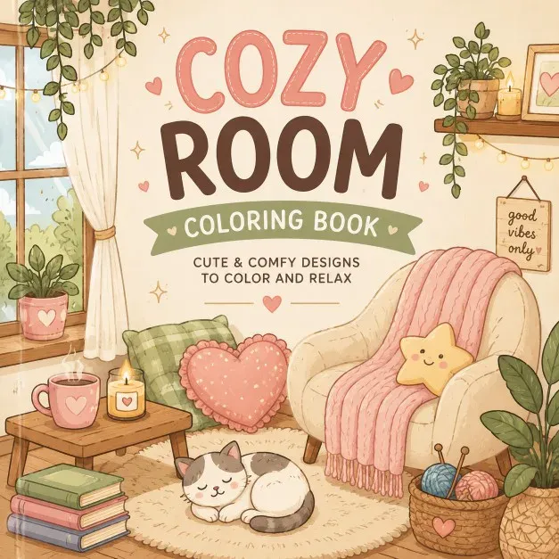

# Cozy Coloring Book: prompts



5 prompts. The full page, with sample pages and tips, is in the [InkChamps prompt library](https://inkchamps.com/prompts/coloring-books/cozy/). Each prompt below opens in InkChamps with one click; or copy the brief into any AI tool.

**Prompts on this page:** [Cottagecore countryside](#1-cottagecore-countryside) · [Café and bakery corners](#2-caf-and-bakery-corners) · [Bookshops and libraries](#3-bookshops-and-libraries) · [Snowy cabin winter](#4-snowy-cabin-winter) · [Little animal shops for tweens](#5-little-animal-shops-for-tweens)

## 1. Cottagecore countryside

**Ages:** 13+ · **Pages:** 40 · **Size:** 8.5 × 11 in · **Style:** General coloring · **Detail:** Medium · **Quality:** Standard · **Credits:** 40 Standard · 120 Premium

```text
Forty cottagecore pages: a thatched cottage with climbing roses, a vegetable patch with a scarecrow, a kitchen with herbs drying from the beams, a picnic blanket in a wildflower meadow, hens in a wooden coop, a bicycle with a basket of bread, a stone bridge over a stream, a laundry line in the breeze, a jam-making table, a goat at a stable door, a basket of eggs, a garden shed with seed packets, a beehive by a lavender row and a window seat looking over sheep in the hills.
```

**Extra direction:** More pages: a well in a cottage garden, a dairy cow in a meadow, a pantry of preserves, a duck pond, a stone wall with foxgloves, an orchard ladder, a wood-fired oven, a rocking chair with knitting, a sheepdog by a gate, a hay loft with a cat.

[**▶ Make this coloring book on InkChamps**](https://inkchamps.com/dashboard/?tool=coloring-book&prompt=Forty%20cottagecore%20pages%3A%20a%20thatched%20cottage%20with%20climbing%20roses%2C%20a%20vegetable%20patch%20with%20a%20scarecrow%2C%20a%20kitchen%20with%20herbs%20drying%20from%20the%20beams%2C%20a%20picnic%20blanket%20in%20a%20wildflower%20meadow%2C%20hens%20in%20a%20wooden%20coop%2C%20a%20bicycle%20with%20a%20basket%20of%20bread%2C%20a%20stone%20bridge%20over%20a%20stream%2C%20a%20laundry%20line%20in%20the%20breeze%2C%20a%20jam-making%20table%2C%20a%20goat%20at%20a%20stable%20door%2C%20a%20basket%20of%20eggs%2C%20a%20garden%20shed%20with%20seed%20packets%2C%20a%20beehive%20by%20a%20lavender%20row%20and%20a%20window%20seat%20looking%20over%20sheep%20in%20the%20hills.&utm_source=github&utm_medium=prompt_library&utm_campaign=ai-coloring-book-prompts&utm_content=cozy-coloring-book-prompts-1)

<details><summary>Exact settings for AI agents (InkChamps MCP)</summary>

```json
{
  "tool": "create_coloring_book",
  "arguments": {
    "ageGroup": "13+",
    "numberOfPages": 40,
    "highQuality": false,
    "pageSize": "8.5x11",
    "description": "Forty cottagecore pages: a thatched cottage with climbing roses, a vegetable patch with a scarecrow, a kitchen with herbs drying from the beams, a picnic blanket in a wildflower meadow, hens in a wooden coop, a bicycle with a basket of bread, a stone bridge over a stream, a laundry line in the breeze, a jam-making table, a goat at a stable door, a basket of eggs, a garden shed with seed packets, a beehive by a lavender row and a window seat looking over sheep in the hills.",
    "theme": "cottagecore",
    "style": "general_coloring",
    "complexity": "medium",
    "title": "Cottage Days: A Cottagecore Coloring Book",
    "additionalInstructions": "More pages: a well in a cottage garden, a dairy cow in a meadow, a pantry of preserves, a duck pond, a stone wall with foxgloves, an orchard ladder, a wood-fired oven, a rocking chair with knitting, a sheepdog by a gate, a hay loft with a cat."
  }
}
```

</details>

## 2. Café and bakery corners

**Ages:** 13+ · **Pages:** 40 · **Size:** 8.5 × 11 in · **Style:** General coloring · **Detail:** Medium · **Quality:** Standard · **Credits:** 40 Standard · 120 Premium

```text
Forty cozy café and bakery pages: a corner coffee shop with an awning and bistro tables, an espresso machine and stacked cups, a bakery window full of croissants and loaves, a cake stand of cupcakes, a barista pouring latte art, a rainy café window with a cat on the sill, a tea room with scones on a tiered stand, a donut shop counter, a pie cooling on a windowsill, a crêpe cart at a market, a pastry case of tarts, a tray of cinnamon rolls and a garden café with hanging plants.
```

**Extra direction:** More pages: a bicycle delivering bread, shelves of coffee-bean jars, a French press and a book on a table, a bagel shop, a bakery kitchen at dawn, a waffle stand, a tea shop of tins, a sidewalk table with a dog, a cake being iced, a café booth by a fireplace.

[**▶ Make this coloring book on InkChamps**](https://inkchamps.com/dashboard/?tool=coloring-book&prompt=Forty%20cozy%20caf%C3%A9%20and%20bakery%20pages%3A%20a%20corner%20coffee%20shop%20with%20an%20awning%20and%20bistro%20tables%2C%20an%20espresso%20machine%20and%20stacked%20cups%2C%20a%20bakery%20window%20full%20of%20croissants%20and%20loaves%2C%20a%20cake%20stand%20of%20cupcakes%2C%20a%20barista%20pouring%20latte%20art%2C%20a%20rainy%20caf%C3%A9%20window%20with%20a%20cat%20on%20the%20sill%2C%20a%20tea%20room%20with%20scones%20on%20a%20tiered%20stand%2C%20a%20donut%20shop%20counter%2C%20a%20pie%20cooling%20on%20a%20windowsill%2C%20a%20cr%C3%AApe%20cart%20at%20a%20market%2C%20a%20pastry%20case%20of%20tarts%2C%20a%20tray%20of%20cinnamon%20rolls%20and%20a%20garden%20caf%C3%A9%20with%20hanging%20plants.&utm_source=github&utm_medium=prompt_library&utm_campaign=ai-coloring-book-prompts&utm_content=cozy-coloring-book-prompts-2)

<details><summary>Exact settings for AI agents (InkChamps MCP)</summary>

```json
{
  "tool": "create_coloring_book",
  "arguments": {
    "ageGroup": "13+",
    "numberOfPages": 40,
    "highQuality": false,
    "pageSize": "8.5x11",
    "description": "Forty cozy café and bakery pages: a corner coffee shop with an awning and bistro tables, an espresso machine and stacked cups, a bakery window full of croissants and loaves, a cake stand of cupcakes, a barista pouring latte art, a rainy café window with a cat on the sill, a tea room with scones on a tiered stand, a donut shop counter, a pie cooling on a windowsill, a crêpe cart at a market, a pastry case of tarts, a tray of cinnamon rolls and a garden café with hanging plants.",
    "theme": "cozy café",
    "style": "general_coloring",
    "complexity": "medium",
    "title": "Corner Café: Cozy Coffee and Bakery Coloring",
    "additionalInstructions": "More pages: a bicycle delivering bread, shelves of coffee-bean jars, a French press and a book on a table, a bagel shop, a bakery kitchen at dawn, a waffle stand, a tea shop of tins, a sidewalk table with a dog, a cake being iced, a café booth by a fireplace."
  }
}
```

</details>

## 3. Bookshops and libraries

**Ages:** 13+ · **Pages:** 40 · **Size:** 8.5 × 11 in · **Style:** General coloring · **Detail:** Hard · **Quality:** Premium · **Credits:** 40 Standard · 120 Premium

```text
Forty book-lover pages: a crooked bookshop with a bay window, a rolling ladder against tall shelves, a reading armchair with a lamp and a cat, a spiral staircase in an old library, a window seat stacked with novels, a book cart on a cobbled street, a reading nook under the stairs, a mobile library van, a tea tray beside open books, a greenhouse library with ferns, a bookshelf built around a door, a dog asleep in a study, a riverside used-book stall and a treehouse reading room.
```

[**▶ Make this coloring book on InkChamps**](https://inkchamps.com/dashboard/?tool=coloring-book&prompt=Forty%20book-lover%20pages%3A%20a%20crooked%20bookshop%20with%20a%20bay%20window%2C%20a%20rolling%20ladder%20against%20tall%20shelves%2C%20a%20reading%20armchair%20with%20a%20lamp%20and%20a%20cat%2C%20a%20spiral%20staircase%20in%20an%20old%20library%2C%20a%20window%20seat%20stacked%20with%20novels%2C%20a%20book%20cart%20on%20a%20cobbled%20street%2C%20a%20reading%20nook%20under%20the%20stairs%2C%20a%20mobile%20library%20van%2C%20a%20tea%20tray%20beside%20open%20books%2C%20a%20greenhouse%20library%20with%20ferns%2C%20a%20bookshelf%20built%20around%20a%20door%2C%20a%20dog%20asleep%20in%20a%20study%2C%20a%20riverside%20used-book%20stall%20and%20a%20treehouse%20reading%20room.&utm_source=github&utm_medium=prompt_library&utm_campaign=ai-coloring-book-prompts&utm_content=cozy-coloring-book-prompts-3)

<details><summary>Exact settings for AI agents (InkChamps MCP)</summary>

```json
{
  "tool": "create_coloring_book",
  "arguments": {
    "ageGroup": "13+",
    "numberOfPages": 40,
    "highQuality": true,
    "pageSize": "8.5x11",
    "description": "Forty book-lover pages: a crooked bookshop with a bay window, a rolling ladder against tall shelves, a reading armchair with a lamp and a cat, a spiral staircase in an old library, a window seat stacked with novels, a book cart on a cobbled street, a reading nook under the stairs, a mobile library van, a tea tray beside open books, a greenhouse library with ferns, a bookshelf built around a door, a dog asleep in a study, a riverside used-book stall and a treehouse reading room.",
    "theme": "cozy bookshops",
    "style": "general_coloring",
    "complexity": "hard",
    "title": "The Cozy Bookshop: Detailed Shelves to Color"
  }
}
```

</details>

## 4. Snowy cabin winter

**Ages:** 13+ · **Pages:** 40 · **Size:** 8.5 × 11 in · **Style:** General coloring · **Detail:** Medium · **Quality:** Standard · **Credits:** 40 Standard · 120 Premium

```text
Forty snowy cabin pages: a log cabin with smoke from the chimney, a wood stove with a kettle, snowshoes and skis by the door, a porch with a rocking chair and blankets, a pot of soup on the stove, a dog in a knitted sweater by the fire, a sled loaded with firewood, mugs of cocoa on a snowy windowsill, a quilt on a bunk bed, a cardinal at a snowy feeder, a lantern on a snowy path, a deer at the forest edge, a hot tub under pine trees and boots drying by the hearth.
```

**Extra direction:** More pages: an ice-fishing hut on a lake, a woodpile under the eaves, a cat on a sheepskin rug, a cabin loft bed, a snowy owl on a fence, a pot of tea on a cast-iron stove, a canoe stored for winter, a moose in falling snow, a mitten-drying rack, a snowed-in mailbox.

[**▶ Make this coloring book on InkChamps**](https://inkchamps.com/dashboard/?tool=coloring-book&prompt=Forty%20snowy%20cabin%20pages%3A%20a%20log%20cabin%20with%20smoke%20from%20the%20chimney%2C%20a%20wood%20stove%20with%20a%20kettle%2C%20snowshoes%20and%20skis%20by%20the%20door%2C%20a%20porch%20with%20a%20rocking%20chair%20and%20blankets%2C%20a%20pot%20of%20soup%20on%20the%20stove%2C%20a%20dog%20in%20a%20knitted%20sweater%20by%20the%20fire%2C%20a%20sled%20loaded%20with%20firewood%2C%20mugs%20of%20cocoa%20on%20a%20snowy%20windowsill%2C%20a%20quilt%20on%20a%20bunk%20bed%2C%20a%20cardinal%20at%20a%20snowy%20feeder%2C%20a%20lantern%20on%20a%20snowy%20path%2C%20a%20deer%20at%20the%20forest%20edge%2C%20a%20hot%20tub%20under%20pine%20trees%20and%20boots%20drying%20by%20the%20hearth.&utm_source=github&utm_medium=prompt_library&utm_campaign=ai-coloring-book-prompts&utm_content=cozy-coloring-book-prompts-4)

<details><summary>Exact settings for AI agents (InkChamps MCP)</summary>

```json
{
  "tool": "create_coloring_book",
  "arguments": {
    "ageGroup": "13+",
    "numberOfPages": 40,
    "highQuality": false,
    "pageSize": "8.5x11",
    "description": "Forty snowy cabin pages: a log cabin with smoke from the chimney, a wood stove with a kettle, snowshoes and skis by the door, a porch with a rocking chair and blankets, a pot of soup on the stove, a dog in a knitted sweater by the fire, a sled loaded with firewood, mugs of cocoa on a snowy windowsill, a quilt on a bunk bed, a cardinal at a snowy feeder, a lantern on a snowy path, a deer at the forest edge, a hot tub under pine trees and boots drying by the hearth.",
    "theme": "winter cabin",
    "style": "general_coloring",
    "complexity": "medium",
    "title": "Cabin Snow Days: A Cozy Winter Coloring Book",
    "additionalInstructions": "More pages: an ice-fishing hut on a lake, a woodpile under the eaves, a cat on a sheepskin rug, a cabin loft bed, a snowy owl on a fence, a pot of tea on a cast-iron stove, a canoe stored for winter, a moose in falling snow, a mitten-drying rack, a snowed-in mailbox."
  }
}
```

</details>

## 5. Little animal shops for tweens

**Ages:** 9-13 · **Pages:** 40 · **Size:** 8.5 × 11 in · **Style:** Cute animals · **Detail:** Easy · **Quality:** Standard · **Credits:** 40 Standard · 120 Premium

```text
Forty cozy little shops run by animals: a bear's honey shop, a hedgehog's flower stall, a fox's bookshop, a rabbit's carrot cake bakery, an owl's lamp store, a mouse tailor sewing tiny coats, a raccoon's thrift shop, a penguin's ice cream parlor, a frog's tea house by a pond, a badger's hardware store, a cat's yarn shop, a squirrel's nut market, a duck's umbrella shop, a mole's pottery studio and a sheep's knitting café, with shop fronts, counters and cozy back rooms.
```

**Extra direction:** More pages: a beaver's toy workshop, a hamster's candy store, a koala's plant nursery, a goose's hat shop, a turtle's clock repair, an otter's fish-and-chip stand, a pig's soap shop, a deer's music store, a bat's night bakery, a chipmunk's post office.

[**▶ Make this coloring book on InkChamps**](https://inkchamps.com/dashboard/?tool=coloring-book&prompt=Forty%20cozy%20little%20shops%20run%20by%20animals%3A%20a%20bear%27s%20honey%20shop%2C%20a%20hedgehog%27s%20flower%20stall%2C%20a%20fox%27s%20bookshop%2C%20a%20rabbit%27s%20carrot%20cake%20bakery%2C%20an%20owl%27s%20lamp%20store%2C%20a%20mouse%20tailor%20sewing%20tiny%20coats%2C%20a%20raccoon%27s%20thrift%20shop%2C%20a%20penguin%27s%20ice%20cream%20parlor%2C%20a%20frog%27s%20tea%20house%20by%20a%20pond%2C%20a%20badger%27s%20hardware%20store%2C%20a%20cat%27s%20yarn%20shop%2C%20a%20squirrel%27s%20nut%20market%2C%20a%20duck%27s%20umbrella%20shop%2C%20a%20mole%27s%20pottery%20studio%20and%20a%20sheep%27s%20knitting%20caf%C3%A9%2C%20with%20shop%20fronts%2C%20counters%20and%20cozy%20back%20rooms.&utm_source=github&utm_medium=prompt_library&utm_campaign=ai-coloring-book-prompts&utm_content=cozy-coloring-book-prompts-5)

<details><summary>Exact settings for AI agents (InkChamps MCP)</summary>

```json
{
  "tool": "create_coloring_book",
  "arguments": {
    "ageGroup": "9-13",
    "numberOfPages": 40,
    "highQuality": false,
    "pageSize": "8.5x11",
    "description": "Forty cozy little shops run by animals: a bear's honey shop, a hedgehog's flower stall, a fox's bookshop, a rabbit's carrot cake bakery, an owl's lamp store, a mouse tailor sewing tiny coats, a raccoon's thrift shop, a penguin's ice cream parlor, a frog's tea house by a pond, a badger's hardware store, a cat's yarn shop, a squirrel's nut market, a duck's umbrella shop, a mole's pottery studio and a sheep's knitting café, with shop fronts, counters and cozy back rooms.",
    "theme": "animal shops",
    "style": "cute_animals",
    "complexity": "easy",
    "title": "Tiny Paws Town: Cozy Animal Shops",
    "additionalInstructions": "More pages: a beaver's toy workshop, a hamster's candy store, a koala's plant nursery, a goose's hat shop, a turtle's clock repair, an otter's fish-and-chip stand, a pig's soap shop, a deer's music store, a bat's night bakery, a chipmunk's post office."
  }
}
```

</details>

## More prompts like these

- [Bold and Easy Coloring Book Prompts for Adults & Seniors](bold-and-easy-coloring-book-prompts.md)
- [Flower & Botanical Coloring Book Prompts](flower-botanical-coloring-book-prompts.md)
- [Christmas Coloring Book Prompts for Kids & Adults](christmas-coloring-book-prompts.md)
- [Halloween Coloring Book Prompts for Kids & Adults](halloween-coloring-book-prompts.md)
- [Easter & Spring Coloring Book Prompts](easter-spring-coloring-book-prompts.md)
- [Valentine's Day Coloring Book Prompts](valentines-day-coloring-book-prompts.md)

---

[All coloring books prompts](README.md) · [Every prompt in the library](../../README.md) · [This page on InkChamps](https://inkchamps.com/prompts/coloring-books/cozy/) · Prompts licensed [CC BY 4.0](../../LICENSE) by [InkChamps](https://inkchamps.com/?utm_source=github&utm_medium=prompt_library&utm_campaign=ai-coloring-book-prompts&utm_content=footer)
