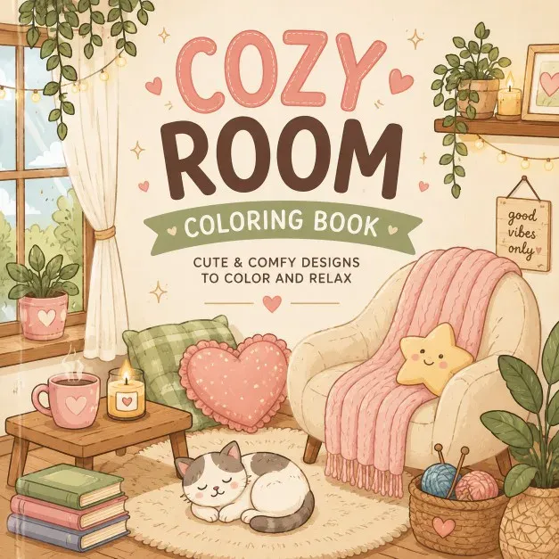

# Cozy Coloring Book: prompts



5 prompts. The full page, with sample pages and tips, is in the [InkChamps prompt library](https://inkchamps.com/prompts/coloring-books/cozy/). Each prompt below opens in InkChamps with one click; or copy the brief into any AI tool.

**Prompts on this page:** [Cottagecore countryside](#1-cottagecore-countryside) · [Café and bakery corners](#2-caf-and-bakery-corners) · [Bookshops and libraries](#3-bookshops-and-libraries) · [Snowy cabin winter](#4-snowy-cabin-winter) · [Little animal shops for tweens](#5-little-animal-shops-for-tweens)

## 1. Cottagecore countryside

**Ages:** 13+ · **Pages:** 24 · **Size:** 8.5 × 11 in · **Style:** General coloring · **Detail:** Medium · **Quality:** Standard · **Credits:** 24 Standard · 72 Premium

```text
24 cottagecore pages through a country day: a thatched cottage with climbing roses, a hen coop and a basket of eggs, a kitchen with herbs drying from the beams, a vegetable patch with a scarecrow, a goat at a stable door, a cow in a meadow, a garden well, a bicycle with bread, a laundry line, jam-making, a pantry of preserves, a beehive by lavender, a potting shed, a meadow picnic, a duck pond, a stone bridge, an orchard ladder, a bread oven, a sheepdog, a hay loft, a porch rocking chair and the cottage at dusk.
```

### Page by page (24 pages)

Paste one page at a time into ChatGPT, Gemini or any AI image tool, with this line after it:

> Black-and-white coloring page for teens and adults: a cozy, detailed cottagecore countryside scene, clean confident outlines of medium weight, plenty of flowers, objects and textures to color, a full garden, field or cottage-interior background, no shading, no grey, no words, plain white background, portrait 8.5 x 11 page.

1. A thatched stone cottage with climbing roses around an arched front door, a white picket gate, a path of round stepping stones and tall hollyhocks under the windows.
2. A wooden hen coop with a little ramp and nesting boxes, three hens pecking at scattered grain, and a woven basket of eggs on an upturned crate.
3. A cottage kitchen with bundles of herbs drying from the oak beams, a farmhouse table with a bowl of eggs, a kettle on the range and copper pans on hooks.
4. A vegetable patch in neat rows of cabbages and beans climbing bamboo canes, a scarecrow in a straw hat, a wheelbarrow and a watering can at the end of a row.
5. A goat looking over the half door of a stone stable, a hay rack on the wall, a tin bucket by the door and swallows nesting under the eaves.
6. A dairy cow grazing in a buttercup meadow beside a wooden fence, a metal milk churn and a three-legged stool by the gate.
7. An old stone well in the cottage garden with a little tiled roof, a wooden bucket on a rope and foxgloves and daisies around its base.
8. A bicycle with a wicker basket full of crusty loaves and a bunch of wildflowers, leaning against an ivy-covered stone wall.
9. A laundry line strung between two apple trees, with sheets, an embroidered apron and a patchwork quilt flapping in the breeze and a peg bag on the line.
10. A jam-making table by an open window: a copper pot, rows of jars with checked cloth lids, bowls of strawberries and a long wooden spoon.
11. A cottage pantry with shelves of preserves and pickles in tall jars, strings of onions, a round wheel of cheese and a flour sack on the floor.
12. White wooden beehives beside a long row of lavender, bees in flight between the flowers, and a jar of honey with a wooden dipper on a stool.
13. A garden potting shed with seed packets pinned to the wall, clay pots stacked on a bench, a trowel and gloves, and a cat asleep in a wooden crate.
14. A picnic blanket in a wildflower meadow with a wicker hamper, a teapot, a plate of sandwiches and a straw hat, poppies and cornflowers all around.
15. A duck pond with a mother duck leading five ducklings past bulrushes and lily pads, a little wooden duck house on a post at the water's edge.
16. An arched stone bridge over a clear stream, ferns along the banks, a line of stepping stones and a dragonfly hovering over the water.
17. An autumn orchard with a wooden ladder against an apple tree, baskets of apples on the grass and a few leaves drifting down.
18. A dry stone wall with tall foxgloves and a wooden stile, a rabbit sitting in the grass and sheep grazing in the field beyond.
19. A domed wood-fired bread oven in the cottage yard, a long wooden peel sliding in a round loaf and split logs stacked beside it.
20. A sheepdog lying by a five-bar gate with a shepherd's crook leaning on the post, rolling hills dotted with sheep behind it.
21. A hay loft with bales stacked to the rafters, a wooden ladder, a lantern hanging from a beam and a tabby cat curled in the straw.
22. A rocking chair on the cottage porch with a basket of yarn, a half-knitted scarf on needles, a cup of tea on a side table and pots of geraniums.
23. A window seat with cushions and a patchwork quilt, an open book and a jug of wildflowers on the sill, sheep grazing on the hills outside.
24. The cottage at dusk: lace curtains in a lamplit window, a lantern by the door, fireflies over the flower beds and a crescent moon above the thatch.

[**▶ Make this coloring book on InkChamps**](https://inkchamps.com/dashboard/?tool=coloring-book&prompt=24%20cottagecore%20pages%20through%20a%20country%20day%3A%20a%20thatched%20cottage%20with%20climbing%20roses%2C%20a%20hen%20coop%20and%20a%20basket%20of%20eggs%2C%20a%20kitchen%20with%20herbs%20drying%20from%20the%20beams%2C%20a%20vegetable%20patch%20with%20a%20scarecrow%2C%20a%20goat%20at%20a%20stable%20door%2C%20a%20cow%20in%20a%20meadow%2C%20a%20garden%20well%2C%20a%20bicycle%20with%20bread%2C%20a%20laundry%20line%2C%20jam-making%2C%20a%20pantry%20of%20preserves%2C%20a%20beehive%20by%20lavender%2C%20a%20potting%20shed%2C%20a%20meadow%20picnic%2C%20a%20duck%20pond%2C%20a%20stone%20bridge%2C%20an%20orchard%20ladder%2C%20a%20bread%20oven%2C%20a%20sheepdog%2C%20a%20hay%20loft%2C%20a%20porch%20rocking%20chair%20and%20the%20cottage%20at%20dusk.&utm_source=github&utm_medium=prompt_library&utm_campaign=ai-coloring-book-prompts&utm_content=cozy-coloring-book-prompts-1)

<details><summary>Exact settings for AI agents (InkChamps MCP)</summary>

```json
{
  "tool": "create_coloring_book",
  "arguments": {
    "ageGroup": "13+",
    "numberOfPages": 24,
    "highQuality": false,
    "pageSize": "8.5x11",
    "description": "24 cottagecore pages through a country day: a thatched cottage with climbing roses, a hen coop and a basket of eggs, a kitchen with herbs drying from the beams, a vegetable patch with a scarecrow, a goat at a stable door, a cow in a meadow, a garden well, a bicycle with bread, a laundry line, jam-making, a pantry of preserves, a beehive by lavender, a potting shed, a meadow picnic, a duck pond, a stone bridge, an orchard ladder, a bread oven, a sheepdog, a hay loft, a porch rocking chair and the cottage at dusk.",
    "theme": "cottagecore",
    "style": "general_coloring",
    "complexity": "medium",
    "title": "Cottage Days: A Cottagecore Coloring Book"
  }
}
```

</details>

## 2. Café and bakery corners

**Ages:** 13+ · **Pages:** 24 · **Size:** 8.5 × 11 in · **Style:** General coloring · **Detail:** Medium · **Quality:** Standard · **Credits:** 24 Standard · 72 Premium

```text
24 cozy café and bakery pages from dawn to closing: a corner coffee shop with an awning and bistro tables, a bakery kitchen at dawn, a bicycle delivering bread, a bakery window of croissants, an espresso machine, latte art, jars of coffee beans, cinnamon rolls, a pastry case, a cupcake stand, a cake being iced, a tea room with scones, a tea shop of tins, a rainy window with a cat, a donut counter, a bagel shop, a crêpe cart, a waffle stand, a sidewalk table with a dog, a garden café and a fireside booth.
```

### Page by page (24 pages)

Paste one page at a time into ChatGPT, Gemini or any AI image tool, with this line after it:

> Black-and-white coloring page for teens and adults: a cozy café or bakery scene with detailed pastries, cups, counters and shop fittings, clean outlines of medium weight, plenty of small areas to color, a full interior or street background, no shading, no grey, no words on signs, menus or labels, plain white background, portrait 8.5 x 11 page.

1. A corner coffee shop with a striped awning, two bistro tables and chairs on the pavement, a blank chalkboard easel by the door and potted bay trees either side.
2. A bakery kitchen at dawn: a long table dusted with flour, a rolling pin, trays of shaped dough rising and a big brick oven with its door open.
3. A bicycle with a front crate full of baguettes and round loaves parked outside a bakery door, a bell on the handlebars and a flower box under the window.
4. A bakery window display of croissants, braided loaves and pretzels on wicker trays, a lace half-curtain and a little bell hanging above the door.
5. A shiny espresso machine on a wooden counter with stacked cups and saucers, a steel milk jug, a tamper and a jar of coffee beans.
6. A barista's hands pouring a leaf of latte art into a wide cup, a saucer with a biscotti, a folded cloth and a plate with a pastry nearby.
7. Shelves of glass coffee-bean jars with scoops, a brass scale on the counter, burlap sacks of beans on the floor and a hand grinder with a crank.
8. A tray of swirled cinnamon rolls fresh from the oven, a bowl of icing with a spatula, a pair of oven mitts and a wire cooling rack.
9. A glass pastry case of fruit tarts, éclairs, macarons and slices of layered cake on doilies, with a pair of tongs resting on top.
10. A tall cake stand of frosted cupcakes topped with sprinkles and cherries, a piping bag and a bowl of buttercream beside it.
11. A round cake on a turntable being smoothed with a palette knife, piped roses along the top edge and a bowl of berries waiting to go on.
12. A tea room table set with scones, jam and cream on a three-tiered stand, a flowered teapot, two cups and a little vase of sweet peas.
13. A tea shop wall of tins and canisters, a counter with a brass scale, teapots in many shapes on a shelf and a small kettle letting off steam.
14. A rainy café window with raindrops running down the glass, a cat asleep on the sill, a steaming mug and a slice of pie on the table inside.
15. A French press, a mug and an open book on a small round table by a window, a potted plant and a folded pair of reading glasses.
16. A lattice-topped pie cooling on an open windowsill, gingham curtains blowing in, a pot of herbs and a wooden rolling pin beside it.
17. A donut shop counter with rows of glazed, sprinkled and filled donuts, a pot of coffee on a warmer and paper bags stacked by the till.
18. A bagel shop counter with bagels hanging on wooden pegs, a basket of seeded bagels, a tub of cream cheese and a butter knife.
19. A crêpe cart at an outdoor market with a round griddle, a crêpe folded around strawberries, jars of spread and a striped canopy overhead.
20. A waffle stand at a street fair with an open waffle iron, a plate of waffles topped with cream and berries, and bunting strung overhead.
21. A sidewalk café table with a dog lying under the chair beside a water bowl, a cup of coffee, a croissant on a plate and a newspaper folded on the seat.
22. A garden café with hanging ferns, wrought-iron chairs, string lights between the trees and a teapot on a mosaic-topped table.
23. A café booth beside a stone fireplace, two mugs of hot chocolate with marshmallows, a knitted throw on the bench and a plate of cookies.
24. The café after closing: chairs turned up on the tables, one lamp glowing over the counter, a broom leaning on the wall and the moon in the window.

[**▶ Make this coloring book on InkChamps**](https://inkchamps.com/dashboard/?tool=coloring-book&prompt=24%20cozy%20caf%C3%A9%20and%20bakery%20pages%20from%20dawn%20to%20closing%3A%20a%20corner%20coffee%20shop%20with%20an%20awning%20and%20bistro%20tables%2C%20a%20bakery%20kitchen%20at%20dawn%2C%20a%20bicycle%20delivering%20bread%2C%20a%20bakery%20window%20of%20croissants%2C%20an%20espresso%20machine%2C%20latte%20art%2C%20jars%20of%20coffee%20beans%2C%20cinnamon%20rolls%2C%20a%20pastry%20case%2C%20a%20cupcake%20stand%2C%20a%20cake%20being%20iced%2C%20a%20tea%20room%20with%20scones%2C%20a%20tea%20shop%20of%20tins%2C%20a%20rainy%20window%20with%20a%20cat%2C%20a%20donut%20counter%2C%20a%20bagel%20shop%2C%20a%20cr%C3%AApe%20cart%2C%20a%20waffle%20stand%2C%20a%20sidewalk%20table%20with%20a%20dog%2C%20a%20garden%20caf%C3%A9%20and%20a%20fireside%20booth.&utm_source=github&utm_medium=prompt_library&utm_campaign=ai-coloring-book-prompts&utm_content=cozy-coloring-book-prompts-2)

<details><summary>Exact settings for AI agents (InkChamps MCP)</summary>

```json
{
  "tool": "create_coloring_book",
  "arguments": {
    "ageGroup": "13+",
    "numberOfPages": 24,
    "highQuality": false,
    "pageSize": "8.5x11",
    "description": "24 cozy café and bakery pages from dawn to closing: a corner coffee shop with an awning and bistro tables, a bakery kitchen at dawn, a bicycle delivering bread, a bakery window of croissants, an espresso machine, latte art, jars of coffee beans, cinnamon rolls, a pastry case, a cupcake stand, a cake being iced, a tea room with scones, a tea shop of tins, a rainy window with a cat, a donut counter, a bagel shop, a crêpe cart, a waffle stand, a sidewalk table with a dog, a garden café and a fireside booth.",
    "theme": "cozy café",
    "style": "general_coloring",
    "complexity": "medium",
    "title": "Corner Café: Cozy Coffee and Bakery Coloring"
  }
}
```

</details>

## 3. Bookshops and libraries

**Ages:** 13+ · **Pages:** 24 · **Size:** 8.5 × 11 in · **Style:** General coloring · **Detail:** Hard · **Quality:** Premium · **Credits:** 24 Standard · 72 Premium

```text
24 detailed book-lover pages: a crooked bookshop with a bay window, a rolling ladder against tall shelves, a reading armchair with a lamp and a cat, a spiral staircase in an old library, a window seat stacked with novels, a nook under the stairs, a book cart on a cobbled street, a mobile library van, a greenhouse library, a bookshelf around a door, a dog asleep in a study, a riverside book stall, a treehouse reading room, a bookbinder's bench, a grand reading room, a secret bookcase door, an attic library and a bookshop at night.
```

### Page by page (24 pages)

Paste one page at a time into ChatGPT, Gemini or any AI image tool, with this line after it:

> Black-and-white coloring page for experienced adult colorists: an intricate, cozy bookshop or library interior, fine crisp outlines, dense detail with every book spine, shelf, rug pattern and plant drawn as separate areas to color, a full background that fills the page, no shading, no grey, no words or titles on the books, plain white background, portrait 8.5 x 11 page.

1. A crooked old bookshop with a bay window full of stacked books, a bell over the door, window boxes of trailing ivy and a wooden bench outside.
2. Floor-to-ceiling bookshelves with a rolling brass ladder on a rail, books of every size and thickness, and a potted fern on the top shelf.
3. A deep wingback reading armchair under a fringed lamp, a side table with a teacup, and a cat curled on a pile of books at its foot.
4. A spiral staircase winding up through an old library, carved banisters, shelves curving around the walls and a round skylight above.
5. A window seat stacked with novels and cushions, rain on the leaded window panes, a folded quilt and a mug on the sill.
6. A reading nook built into the space under the stairs, a cushioned mattress and pillows, string lights along the ceiling and little shelves in the steps.
7. A wooden book cart on a cobbled street outside a bookshop, crates of paperbacks, a striped umbrella over the cart and an old lamp post.
8. A mobile library van with its side opened to show shelves of books, a fold-out step, a bench beside it and a dog waiting patiently.
9. A writing desk with open books, a tea tray with a teapot, a stack of letters tied with ribbon, a magnifying glass and a pressed flower.
10. A greenhouse library under a glass roof, ferns and palms growing between bookshelves, a wicker chair and a brass watering can.
11. A bookshelf built around a doorway with books arching over the door frame, a small step ladder and a reading lamp beside it.
12. A dog asleep on a patterned rug in a wood-panelled study, a globe on a stand, a desk with an inkwell and quill, and shelves behind.
13. A riverside used-book stall of green wooden boxes on a stone wall, a barge moored on the river behind and pigeons perched along the wall.
14. A treehouse reading room with a round window, shelves set into the trunk, a rope ladder and lanterns hanging from the branches.
15. A bookshop counter with an old cash register, a brass bell, parcels wrapped in paper and string, and the shop cat sitting on the counter.
16. A children's corner in a bookshop with a round rug, beanbags, picture books on low shelves and a stuffed bear in a tiny armchair.
17. A bookbinder's workbench with a wooden press, needles and thread, leather covers, rolls of marbled paper and a desk lamp.
18. A grand reading room with long wooden tables, green-shaded lamps, tall arched windows and a high ceiling with carved details.
19. A bookcase swinging open like a secret door to show a small hidden room with a candle on a table and an armchair.
20. A bedroom with a whole wall of books, a bed with a patchwork quilt, a stack of books by the pillow and a reading light clipped to the headboard.
21. An attic library under sloping beams, a round window, old trunks full of books, a brass telescope on a tripod and a cat asleep on a cushion.
22. A bookshop in winter with snow on the roof and window sills, warm lamps in the window, a sled leaning by the door and footprints on the path.
23. A narrow bookshop aisle seen from one end, books piled on the floor, hanging lamps, maps pinned to the shelf ends and an armchair at the far end.
24. A bookshop at night from the street, a lamp glowing in the window, a cat sitting on the sill among the books and stars over the rooftops.

[**▶ Make this coloring book on InkChamps**](https://inkchamps.com/dashboard/?tool=coloring-book&prompt=24%20detailed%20book-lover%20pages%3A%20a%20crooked%20bookshop%20with%20a%20bay%20window%2C%20a%20rolling%20ladder%20against%20tall%20shelves%2C%20a%20reading%20armchair%20with%20a%20lamp%20and%20a%20cat%2C%20a%20spiral%20staircase%20in%20an%20old%20library%2C%20a%20window%20seat%20stacked%20with%20novels%2C%20a%20nook%20under%20the%20stairs%2C%20a%20book%20cart%20on%20a%20cobbled%20street%2C%20a%20mobile%20library%20van%2C%20a%20greenhouse%20library%2C%20a%20bookshelf%20around%20a%20door%2C%20a%20dog%20asleep%20in%20a%20study%2C%20a%20riverside%20book%20stall%2C%20a%20treehouse%20reading%20room%2C%20a%20bookbinder%27s%20bench%2C%20a%20grand%20reading%20room%2C%20a%20secret%20bookcase%20door%2C%20an%20attic%20library%20and%20a%20bookshop%20at%20night.&utm_source=github&utm_medium=prompt_library&utm_campaign=ai-coloring-book-prompts&utm_content=cozy-coloring-book-prompts-3)

<details><summary>Exact settings for AI agents (InkChamps MCP)</summary>

```json
{
  "tool": "create_coloring_book",
  "arguments": {
    "ageGroup": "13+",
    "numberOfPages": 24,
    "highQuality": true,
    "pageSize": "8.5x11",
    "description": "24 detailed book-lover pages: a crooked bookshop with a bay window, a rolling ladder against tall shelves, a reading armchair with a lamp and a cat, a spiral staircase in an old library, a window seat stacked with novels, a nook under the stairs, a book cart on a cobbled street, a mobile library van, a greenhouse library, a bookshelf around a door, a dog asleep in a study, a riverside book stall, a treehouse reading room, a bookbinder's bench, a grand reading room, a secret bookcase door, an attic library and a bookshop at night.",
    "theme": "cozy bookshops",
    "style": "general_coloring",
    "complexity": "hard",
    "title": "The Cozy Bookshop: Detailed Shelves to Color"
  }
}
```

</details>

## 4. Snowy cabin winter

**Ages:** 13+ · **Pages:** 24 · **Size:** 8.5 × 11 in · **Style:** General coloring · **Detail:** Medium · **Quality:** Standard · **Credits:** 24 Standard · 72 Premium

```text
24 snowy cabin pages: a log cabin with smoke from the chimney, a wood stove with a kettle, snowshoes and skis by the door, a porch rocking chair with blankets, soup on the stove, a dog in a knitted sweater by the fire, a sled of firewood, a woodpile, cocoa on a snowy windowsill, a bunk bed with quilts, a cardinal at a feeder, a cat on a sheepskin rug, a mitten rack, a loft bed, a lantern path, a deer, a moose, a snowy owl, an ice-fishing hut, a stored canoe, a snowed-in mailbox, a hot tub under pines and boots by the hearth.
```

### Page by page (24 pages)

Paste one page at a time into ChatGPT, Gemini or any AI image tool, with this line after it:

> Black-and-white coloring page for teens and adults: a cozy winter cabin scene, inside or out in the snow, clean outlines of medium weight, detailed wood grain, knits, pine needles and snowflakes to color, a full background, no shading, no grey, snow left as white areas, no words, plain white background, portrait 8.5 x 11 page.

1. A log cabin among snowy pine trees with smoke curling from the stone chimney, a shoveled path to the front door and a lantern on the steps.
2. A wood stove with a kettle on top, a basket of split logs beside it, a cast-iron pan on a hook and a pair of wool socks drying on the rail.
3. Snowshoes and a pair of skis propped by the cabin door, a wooden bench with boots underneath, a broom and icicles hanging from the eaves.
4. The front porch with a rocking chair, folded plaid blankets, a mug of cocoa on a stool and snowflakes falling past the railing.
5. A pot of soup simmering on the stove, a loaf of bread on a wooden board, a ladle and a row of bowls on the shelf above.
6. A dog in a cable-knit sweater curled up by the stone fireplace, a basket of pinecones, a set of fire irons and a fire screen.
7. A wooden sled loaded with firewood pulled along a snowy trail between pines, a rope handle trailing and paw prints beside the runners.
8. A woodpile stacked high under the cabin eaves, an axe resting in a chopping block and a chickadee perched on a log.
9. Mugs of cocoa topped with whipped cream on a snowy windowsill, frost patterns on the glass and a gingham curtain tied back.
10. A wooden bunk bed with patchwork quilts, a ladder up the side, a lantern on a hook and a knitted hat hanging on the bedpost.
11. A cardinal at a snowy bird feeder hanging from a pine branch, seeds scattered on the snow and a second bird flying in.
12. A cat curled on a sheepskin rug in front of the hearth, a stack of books and a teapot on a low wooden table nearby.
13. A wooden table set for a game night by the cabin window, a checkerboard mid-game, a bowl of popcorn, two mugs and a candle in a jar, snow falling outside.
14. A drying rack above the stove hung with mittens, scarves and hats, and snowy boots lined up on a mat below.
15. A loft bed tucked under the sloping cabin roof, a round window with snowflakes, string lights along the beam and a pile of blankets.
16. A lantern lighting a snowy path through birch trees, footprints in the snow and a wooden signpost with blank arrows.
17. A deer standing at the edge of a snowy forest, pines heavy with snow and a line of rabbit tracks in the foreground.
18. A moose walking through falling snow beside an iced-over creek, tall spruce trees behind it and snow on its antlers.
19. A snowy owl perched on a split-rail fence post, a snow-covered field stretching behind and a small cabin in the distance.
20. An ice-fishing hut on an iced-over lake, a round hole cut in the ice, a short fishing rod, a bucket and a thermos on a stool.
21. A canoe stored upside down on sawhorses under a wooden lean-to, snow piled on top and two paddles crossed against the wall.
22. A snowed-in mailbox on a post at the end of a lane, snow piled high on top, a small bird perched on it and a fence vanishing into drifts.
23. A wooden hot tub under snowy pine trees, steam rising from the water, towels folded on a bench and a lantern on a tree stump.
24. Boots drying by the hearth at night, the fire glowing, a rocking chair with a quilt, a sleeping dog and snowflakes at the window.

[**▶ Make this coloring book on InkChamps**](https://inkchamps.com/dashboard/?tool=coloring-book&prompt=24%20snowy%20cabin%20pages%3A%20a%20log%20cabin%20with%20smoke%20from%20the%20chimney%2C%20a%20wood%20stove%20with%20a%20kettle%2C%20snowshoes%20and%20skis%20by%20the%20door%2C%20a%20porch%20rocking%20chair%20with%20blankets%2C%20soup%20on%20the%20stove%2C%20a%20dog%20in%20a%20knitted%20sweater%20by%20the%20fire%2C%20a%20sled%20of%20firewood%2C%20a%20woodpile%2C%20cocoa%20on%20a%20snowy%20windowsill%2C%20a%20bunk%20bed%20with%20quilts%2C%20a%20cardinal%20at%20a%20feeder%2C%20a%20cat%20on%20a%20sheepskin%20rug%2C%20a%20mitten%20rack%2C%20a%20loft%20bed%2C%20a%20lantern%20path%2C%20a%20deer%2C%20a%20moose%2C%20a%20snowy%20owl%2C%20an%20ice-fishing%20hut%2C%20a%20stored%20canoe%2C%20a%20snowed-in%20mailbox%2C%20a%20hot%20tub%20under%20pines%20and%20boots%20by%20the%20hearth.&utm_source=github&utm_medium=prompt_library&utm_campaign=ai-coloring-book-prompts&utm_content=cozy-coloring-book-prompts-4)

<details><summary>Exact settings for AI agents (InkChamps MCP)</summary>

```json
{
  "tool": "create_coloring_book",
  "arguments": {
    "ageGroup": "13+",
    "numberOfPages": 24,
    "highQuality": false,
    "pageSize": "8.5x11",
    "description": "24 snowy cabin pages: a log cabin with smoke from the chimney, a wood stove with a kettle, snowshoes and skis by the door, a porch rocking chair with blankets, soup on the stove, a dog in a knitted sweater by the fire, a sled of firewood, a woodpile, cocoa on a snowy windowsill, a bunk bed with quilts, a cardinal at a feeder, a cat on a sheepskin rug, a mitten rack, a loft bed, a lantern path, a deer, a moose, a snowy owl, an ice-fishing hut, a stored canoe, a snowed-in mailbox, a hot tub under pines and boots by the hearth.",
    "theme": "winter cabin",
    "style": "general_coloring",
    "complexity": "medium",
    "title": "Cabin Snow Days: A Cozy Winter Coloring Book"
  }
}
```

</details>

## 5. Little animal shops for tweens

**Ages:** 9-13 · **Pages:** 24 · **Size:** 8.5 × 11 in · **Style:** Cute animals · **Detail:** Easy · **Quality:** Standard · **Credits:** 24 Standard · 72 Premium

```text
24 shops run by animals: a rabbit's carrot cake bakery, a squirrel's nut market, a hedgehog's flower stall, a chipmunk's post office, a bear's honey shop, a cat's yarn shop, a mouse tailor, a goose's hat shop, a duck's umbrella shop, a frog's tea house, a fox's bookshop, an owl's lamp store, a badger's hardware store, a beaver's toy workshop, a mole's pottery, a raccoon's thrift shop, a koala's plant nursery, a turtle's clock shop, a deer's music store, a hamster's candy store, a penguin's ice cream parlor, an otter's fish-and-chip stand, a sheep's knitting café and a bat's night bakery.
```

### Page by page (24 pages)

Paste one page at a time into ChatGPT, Gemini or any AI image tool, with this line after it:

> Black-and-white coloring page for ages 9 to 13: a cute cartoon animal shopkeeper in its own cozy little shop, clean bold outlines, medium detail with shelves, counters and goods to color, a simple shop background, no shading, no grey, no words on signs or labels, plain white background, portrait 8.5 x 11 page.

1. A rabbit in an apron sliding a carrot cake out of the oven in a little bakery, shelves of carrot muffins behind and a cake stand on the counter.
2. A squirrel weighing acorns on a brass scale at a nut market stall, sacks of hazelnuts and walnuts around it and a striped awning overhead.
3. A hedgehog arranging a bouquet at a flower stall, buckets of tulips, daisies and sunflowers, and a watering can by its feet.
4. A chipmunk behind a post office counter stamping a letter, a wall of tiny mail slots, a stack of parcels and a bag of mail.
5. A bear in a striped apron filling jars from a honey barrel in a wooden shop, honeycombs on the shelves and a bee buzzing by the window.
6. A cat knitting in an armchair inside a yarn shop, cubby shelves full of yarn balls, knitting needles in a jar and a kitten tangled in wool.
7. A mouse tailor sewing a tiny coat at a little sewing machine, a measuring tape around its neck, a pincushion and a dress form by the window.
8. A goose trying on a flowered hat in front of a round mirror in a hat shop, hat boxes stacked high and hats on stands.
9. A duck opening a polka-dot umbrella in an umbrella shop on a rainy day, umbrellas in a tall stand and rain boots lined up by the door.
10. A frog pouring tea at a lily-pad tea house beside a pond, teacups on a little table, cattails around it and a dragonfly overhead.
11. A fox reading behind the counter of a cozy bookshop, tall shelves of books, a rolling ladder and a lamp on the desk.
12. An owl hanging a new lantern in a lamp store, lamps of every shape on shelves and from the ceiling, and a spare bulb in its wing.
13. A badger on a step ladder in a hardware store, drawers of nails and screws, hammers and saws on the wall and a bucket of paint.
14. A beaver carving a wooden toy train at a workbench in a toy workshop, wood shavings on the floor, a rocking horse and a box of blocks.
15. A mole shaping a vase on a pottery wheel, shelves of bowls and jugs, a bag of clay and a little kiln in the corner.
16. A raccoon sorting treasures in a thrift shop, a rack of old coats, a lamp with a fringed shade, an old suitcase and a box of teacups.
17. A koala watering hanging plants in a plant nursery, pots of succulents and ferns on tiered shelves and a wheelbarrow of soil.
18. A turtle with a magnifying glass repairing a pocket watch at a clock shop bench, cuckoo clocks and a grandfather clock on the wall.
19. A deer tuning a guitar in a music store, a violin and a ukulele on the wall, a small drum set and a music stand.
20. A hamster scooping jelly beans from tall glass jars in a candy store, lollipops in a cup, a striped counter and a jar of gumdrops.
21. A penguin scooping ice cream into a waffle cone behind a parlor counter, tubs of flavors under the glass, sprinkles and a cherry jar.
22. An otter frying fish at a seaside fish-and-chip stand, paper cones of chips on the counter, a seagull waiting and the sea behind.
23. A sheep serving cocoa at a knitting café where customers knit at round tables, baskets of yarn, a cake stand and a fireplace.
24. A bat pulling a tray of moon-shaped cookies from the oven in a night bakery, a crescent moon in the window and lanterns over the counter.

[**▶ Make this coloring book on InkChamps**](https://inkchamps.com/dashboard/?tool=coloring-book&prompt=24%20shops%20run%20by%20animals%3A%20a%20rabbit%27s%20carrot%20cake%20bakery%2C%20a%20squirrel%27s%20nut%20market%2C%20a%20hedgehog%27s%20flower%20stall%2C%20a%20chipmunk%27s%20post%20office%2C%20a%20bear%27s%20honey%20shop%2C%20a%20cat%27s%20yarn%20shop%2C%20a%20mouse%20tailor%2C%20a%20goose%27s%20hat%20shop%2C%20a%20duck%27s%20umbrella%20shop%2C%20a%20frog%27s%20tea%20house%2C%20a%20fox%27s%20bookshop%2C%20an%20owl%27s%20lamp%20store%2C%20a%20badger%27s%20hardware%20store%2C%20a%20beaver%27s%20toy%20workshop%2C%20a%20mole%27s%20pottery%2C%20a%20raccoon%27s%20thrift%20shop%2C%20a%20koala%27s%20plant%20nursery%2C%20a%20turtle%27s%20clock%20shop%2C%20a%20deer%27s%20music%20store%2C%20a%20hamster%27s%20candy%20store%2C%20a%20penguin%27s%20ice%20cream%20parlor%2C%20an%20otter%27s%20fish-and-chip%20stand%2C%20a%20sheep%27s%20knitting%20caf%C3%A9%20and%20a%20bat%27s%20night%20bakery.&utm_source=github&utm_medium=prompt_library&utm_campaign=ai-coloring-book-prompts&utm_content=cozy-coloring-book-prompts-5)

<details><summary>Exact settings for AI agents (InkChamps MCP)</summary>

```json
{
  "tool": "create_coloring_book",
  "arguments": {
    "ageGroup": "9-13",
    "numberOfPages": 24,
    "highQuality": false,
    "pageSize": "8.5x11",
    "description": "24 shops run by animals: a rabbit's carrot cake bakery, a squirrel's nut market, a hedgehog's flower stall, a chipmunk's post office, a bear's honey shop, a cat's yarn shop, a mouse tailor, a goose's hat shop, a duck's umbrella shop, a frog's tea house, a fox's bookshop, an owl's lamp store, a badger's hardware store, a beaver's toy workshop, a mole's pottery, a raccoon's thrift shop, a koala's plant nursery, a turtle's clock shop, a deer's music store, a hamster's candy store, a penguin's ice cream parlor, an otter's fish-and-chip stand, a sheep's knitting café and a bat's night bakery.",
    "theme": "animal shops",
    "style": "cute_animals",
    "complexity": "easy",
    "title": "Tiny Paws Town: Cozy Animal Shops"
  }
}
```

</details>

## More prompts like these

- [Bold and Easy Coloring Book Prompts for Adults & Seniors](bold-and-easy-coloring-book-prompts.md)
- [Flower & Botanical Coloring Book Prompts](flower-botanical-coloring-book-prompts.md)
- [Christmas Coloring Book Prompts for Kids & Adults](christmas-coloring-book-prompts.md)
- [Halloween Coloring Book Prompts for Kids & Adults](halloween-coloring-book-prompts.md)
- [Easter & Spring Coloring Book Prompts](easter-spring-coloring-book-prompts.md)
- [Valentine's Day Coloring Book Prompts](valentines-day-coloring-book-prompts.md)

---

[All coloring books prompts](README.md) · [Every prompt in the library](../../README.md) · [This page on InkChamps](https://inkchamps.com/prompts/coloring-books/cozy/) · Prompts licensed [CC BY 4.0](../../LICENSE) by [InkChamps](https://inkchamps.com/?utm_source=github&utm_medium=prompt_library&utm_campaign=ai-coloring-book-prompts&utm_content=footer)
