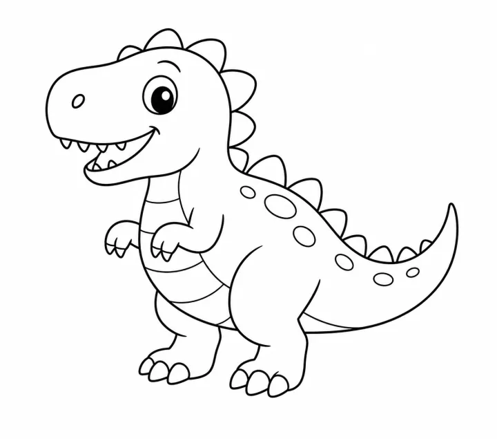

# Dinosaur Coloring Book: prompts



5 prompts. The full page, with sample pages and tips, is in the [InkChamps prompt library](https://inkchamps.com/prompts/coloring-books/dinosaur/). Each prompt below opens in InkChamps with one click; or copy the brief into any AI tool.

**Prompts on this page:** [Baby dinosaurs' day at home](#1-baby-dinosaurs-day-at-home) · [Dinosaurs with jobs and sports](#2-dinosaurs-with-jobs-and-sports) · [Fossil dig and dinosaur museum](#3-fossil-dig-and-dinosaur-museum) · [Prehistoric world by era](#4-prehistoric-world-by-era) · [Intricate dinosaur patterns for adults](#5-intricate-dinosaur-patterns-for-adults)

## 1. Baby dinosaurs' day at home

**Ages:** 3-6 · **Pages:** 40 · **Size:** 8.5 × 8.5 in · **Style:** Cute animals · **Detail:** Easy · **Quality:** Standard · **Credits:** 40 Standard · 120 Premium

```text
Forty pages of chubby baby dinosaurs living a little kid's day at home: a T-rex brushing its teeth, a triceratops eating a bowl of cereal, a stegosaurus in a bubble bath with a rubber duck, a baby dino hatching from a speckled egg, a brachiosaurus reading a bedtime story, a pterodactyl flying a kite in the yard, an ankylosaurus building a block tower, a diplodocus watering flowers, and a dinosaur hugging a teddy bear in bed.
```

**Extra direction:** More pages: a dino baking cupcakes, jumping in puddles in rain boots, getting dressed, eating spaghetti, a dino birthday party with balloons, a blanket fort sleepover, riding a tricycle, playing with a toy train, a backyard picnic, a paddling pool, helping wash the car, a dino and its pet puppy, one big smiling baby triceratops, one big sleepy baby T-rex on a pillow.

[**▶ Make this coloring book on InkChamps**](https://inkchamps.com/dashboard/?tool=coloring-book&prompt=Forty%20pages%20of%20chubby%20baby%20dinosaurs%20living%20a%20little%20kid%27s%20day%20at%20home%3A%20a%20T-rex%20brushing%20its%20teeth%2C%20a%20triceratops%20eating%20a%20bowl%20of%20cereal%2C%20a%20stegosaurus%20in%20a%20bubble%20bath%20with%20a%20rubber%20duck%2C%20a%20baby%20dino%20hatching%20from%20a%20speckled%20egg%2C%20a%20brachiosaurus%20reading%20a%20bedtime%20story%2C%20a%20pterodactyl%20flying%20a%20kite%20in%20the%20yard%2C%20an%20ankylosaurus%20building%20a%20block%20tower%2C%20a%20diplodocus%20watering%20flowers%2C%20and%20a%20dinosaur%20hugging%20a%20teddy%20bear%20in%20bed.&utm_source=github&utm_medium=prompt_library&utm_campaign=ai-coloring-book-prompts&utm_content=dinosaur-coloring-book-prompts-1)

<details><summary>Exact settings for AI agents (InkChamps MCP)</summary>

```json
{
  "tool": "create_coloring_book",
  "arguments": {
    "ageGroup": "3-6",
    "numberOfPages": 40,
    "highQuality": false,
    "pageSize": "8.5x8.5",
    "description": "Forty pages of chubby baby dinosaurs living a little kid's day at home: a T-rex brushing its teeth, a triceratops eating a bowl of cereal, a stegosaurus in a bubble bath with a rubber duck, a baby dino hatching from a speckled egg, a brachiosaurus reading a bedtime story, a pterodactyl flying a kite in the yard, an ankylosaurus building a block tower, a diplodocus watering flowers, and a dinosaur hugging a teddy bear in bed.",
    "style": "cute_animals",
    "complexity": "easy",
    "theme": "baby dinosaurs at home",
    "title": "Little Dinos All Day Long",
    "additionalInstructions": "More pages: a dino baking cupcakes, jumping in puddles in rain boots, getting dressed, eating spaghetti, a dino birthday party with balloons, a blanket fort sleepover, riding a tricycle, playing with a toy train, a backyard picnic, a paddling pool, helping wash the car, a dino and its pet puppy, one big smiling baby triceratops, one big sleepy baby T-rex on a pillow."
  }
}
```

</details>

## 2. Dinosaurs with jobs and sports

**Ages:** 6-9 · **Pages:** 40 · **Size:** 8.5 × 11 in · **Style:** Cute animals · **Detail:** Medium · **Quality:** Standard · **Credits:** 40 Standard · 120 Premium

```text
Forty pages of dinosaurs with grown-up jobs and favourite sports: a T-rex firefighter spraying a hose, a triceratops doctor with a stethoscope, a stegosaurus chef flipping pancakes, a brachiosaurus construction worker driving a crane, a velociraptor mail carrier, a pteranodon airline pilot, an astronaut dinosaur on the moon, a dinosaur police officer directing traffic, a parasaurolophus music teacher, and a dino farmer on a tractor.
```

**Extra direction:** Sports pages: a T-rex playing soccer, a stegosaurus skateboarding, a spinosaurus surfing, an ankylosaurus bowling, a triceratops basketball dunk, a diplodocus swimming laps, a raptor running a race, dinosaurs playing baseball, a pachycephalosaurus playing hockey, an ice-skating iguanodon, a dino karate class, a dino on a ski slope, a tennis match, a cycling race, a dinosaur gymnast on a balance beam, a dinosaur team holding a trophy.

[**▶ Make this coloring book on InkChamps**](https://inkchamps.com/dashboard/?tool=coloring-book&prompt=Forty%20pages%20of%20dinosaurs%20with%20grown-up%20jobs%20and%20favourite%20sports%3A%20a%20T-rex%20firefighter%20spraying%20a%20hose%2C%20a%20triceratops%20doctor%20with%20a%20stethoscope%2C%20a%20stegosaurus%20chef%20flipping%20pancakes%2C%20a%20brachiosaurus%20construction%20worker%20driving%20a%20crane%2C%20a%20velociraptor%20mail%20carrier%2C%20a%20pteranodon%20airline%20pilot%2C%20an%20astronaut%20dinosaur%20on%20the%20moon%2C%20a%20dinosaur%20police%20officer%20directing%20traffic%2C%20a%20parasaurolophus%20music%20teacher%2C%20and%20a%20dino%20farmer%20on%20a%20tractor.&utm_source=github&utm_medium=prompt_library&utm_campaign=ai-coloring-book-prompts&utm_content=dinosaur-coloring-book-prompts-2)

<details><summary>Exact settings for AI agents (InkChamps MCP)</summary>

```json
{
  "tool": "create_coloring_book",
  "arguments": {
    "ageGroup": "6-9",
    "numberOfPages": 40,
    "highQuality": false,
    "pageSize": "8.5x11",
    "description": "Forty pages of dinosaurs with grown-up jobs and favourite sports: a T-rex firefighter spraying a hose, a triceratops doctor with a stethoscope, a stegosaurus chef flipping pancakes, a brachiosaurus construction worker driving a crane, a velociraptor mail carrier, a pteranodon airline pilot, an astronaut dinosaur on the moon, a dinosaur police officer directing traffic, a parasaurolophus music teacher, and a dino farmer on a tractor.",
    "style": "cute_animals",
    "complexity": "medium",
    "theme": "dinosaurs with jobs and sports",
    "title": "Dinosaurs at Work and Play",
    "additionalInstructions": "Sports pages: a T-rex playing soccer, a stegosaurus skateboarding, a spinosaurus surfing, an ankylosaurus bowling, a triceratops basketball dunk, a diplodocus swimming laps, a raptor running a race, dinosaurs playing baseball, a pachycephalosaurus playing hockey, an ice-skating iguanodon, a dino karate class, a dino on a ski slope, a tennis match, a cycling race, a dinosaur gymnast on a balance beam, a dinosaur team holding a trophy."
  }
}
```

</details>

## 3. Fossil dig and dinosaur museum

**Ages:** 6-9 · **Pages:** 40 · **Size:** 8.5 × 11 in · **Style:** General coloring · **Detail:** Medium · **Quality:** Standard · **Credits:** 40 Standard · 120 Premium

```text
Forty pages about finding dinosaurs and showing them to the world: a kid paleontologist brushing a T-rex skull out of rock, a desert dig site with tents, sieves and buckets, a trail of dinosaur footprints, an ammonite fossil, a trilobite, a mosquito in amber, a jeep in the badlands, a team carrying a plaster-wrapped bone, cleaning bones in a lab, a fossil under a microscope, and a museum hall with a giant diplodocus skeleton.
```

**Extra direction:** More pages: a triceratops skeleton on display, a pterosaur skeleton hanging from the ceiling, a woolly mammoth skeleton, a fossil dinosaur egg nest, a fossil hunter on a beach cliff, a field notebook with a compass, hammer and map, a school trip group in front of a T-rex, a museum night with flashlights, a sabre-toothed cat skull, a fossil fern and leaf print, a megalodon tooth, a helicopter lifting a big bone, a kid sketching a skeleton, a fossil shop window, a sandbox dig at school.

[**▶ Make this coloring book on InkChamps**](https://inkchamps.com/dashboard/?tool=coloring-book&prompt=Forty%20pages%20about%20finding%20dinosaurs%20and%20showing%20them%20to%20the%20world%3A%20a%20kid%20paleontologist%20brushing%20a%20T-rex%20skull%20out%20of%20rock%2C%20a%20desert%20dig%20site%20with%20tents%2C%20sieves%20and%20buckets%2C%20a%20trail%20of%20dinosaur%20footprints%2C%20an%20ammonite%20fossil%2C%20a%20trilobite%2C%20a%20mosquito%20in%20amber%2C%20a%20jeep%20in%20the%20badlands%2C%20a%20team%20carrying%20a%20plaster-wrapped%20bone%2C%20cleaning%20bones%20in%20a%20lab%2C%20a%20fossil%20under%20a%20microscope%2C%20and%20a%20museum%20hall%20with%20a%20giant%20diplodocus%20skeleton.&utm_source=github&utm_medium=prompt_library&utm_campaign=ai-coloring-book-prompts&utm_content=dinosaur-coloring-book-prompts-3)

<details><summary>Exact settings for AI agents (InkChamps MCP)</summary>

```json
{
  "tool": "create_coloring_book",
  "arguments": {
    "ageGroup": "6-9",
    "numberOfPages": 40,
    "highQuality": false,
    "pageSize": "8.5x11",
    "description": "Forty pages about finding dinosaurs and showing them to the world: a kid paleontologist brushing a T-rex skull out of rock, a desert dig site with tents, sieves and buckets, a trail of dinosaur footprints, an ammonite fossil, a trilobite, a mosquito in amber, a jeep in the badlands, a team carrying a plaster-wrapped bone, cleaning bones in a lab, a fossil under a microscope, and a museum hall with a giant diplodocus skeleton.",
    "style": "general_coloring",
    "complexity": "medium",
    "theme": "fossil hunting and dinosaur museums",
    "title": "Junior Paleontologist Coloring Book",
    "additionalInstructions": "More pages: a triceratops skeleton on display, a pterosaur skeleton hanging from the ceiling, a woolly mammoth skeleton, a fossil dinosaur egg nest, a fossil hunter on a beach cliff, a field notebook with a compass, hammer and map, a school trip group in front of a T-rex, a museum night with flashlights, a sabre-toothed cat skull, a fossil fern and leaf print, a megalodon tooth, a helicopter lifting a big bone, a kid sketching a skeleton, a fossil shop window, a sandbox dig at school."
  }
}
```

</details>

## 4. Prehistoric world by era

**Ages:** 9-13 · **Pages:** 40 · **Size:** 8.5 × 11 in · **Style:** Jungle adventure · **Detail:** Hard · **Quality:** Standard · **Credits:** 40 Standard · 120 Premium

```text
Forty dinosaur scenes moving through time: Triassic coelophysis and plateosaurus at a dry riverbed, a Jurassic allosaurus stalking a stegosaurus among cycads, a diplodocus herd crossing a conifer forest, archaeopteryx on a branch, a brachiosaurus reaching the treetops, a Cretaceous spinosaurus fishing in a swamp, a velociraptor pack, a T-rex beside an erupting volcano, two triceratops facing off, and parasaurolophus at a lake.
```

**Extra direction:** More pages: an ankylosaurus in a fern forest, therizinosaurus with long claws, carnotaurus, pachycephalosaurus head-butting, an edmontosaurus herd fording a river, a maiasaura nest with hatchlings, giganotosaurus, iguanodon, dilophosaurus, a sauropod footprint mud flat, a Cretaceous flowering plain, dimetrodon in the Permian, early mammals hiding among roots, a meteor streaking across the Cretaceous sky.

[**▶ Make this coloring book on InkChamps**](https://inkchamps.com/dashboard/?tool=coloring-book&prompt=Forty%20dinosaur%20scenes%20moving%20through%20time%3A%20Triassic%20coelophysis%20and%20plateosaurus%20at%20a%20dry%20riverbed%2C%20a%20Jurassic%20allosaurus%20stalking%20a%20stegosaurus%20among%20cycads%2C%20a%20diplodocus%20herd%20crossing%20a%20conifer%20forest%2C%20archaeopteryx%20on%20a%20branch%2C%20a%20brachiosaurus%20reaching%20the%20treetops%2C%20a%20Cretaceous%20spinosaurus%20fishing%20in%20a%20swamp%2C%20a%20velociraptor%20pack%2C%20a%20T-rex%20beside%20an%20erupting%20volcano%2C%20two%20triceratops%20facing%20off%2C%20and%20parasaurolophus%20at%20a%20lake.&utm_source=github&utm_medium=prompt_library&utm_campaign=ai-coloring-book-prompts&utm_content=dinosaur-coloring-book-prompts-4)

<details><summary>Exact settings for AI agents (InkChamps MCP)</summary>

```json
{
  "tool": "create_coloring_book",
  "arguments": {
    "ageGroup": "9-13",
    "numberOfPages": 40,
    "highQuality": false,
    "pageSize": "8.5x11",
    "description": "Forty dinosaur scenes moving through time: Triassic coelophysis and plateosaurus at a dry riverbed, a Jurassic allosaurus stalking a stegosaurus among cycads, a diplodocus herd crossing a conifer forest, archaeopteryx on a branch, a brachiosaurus reaching the treetops, a Cretaceous spinosaurus fishing in a swamp, a velociraptor pack, a T-rex beside an erupting volcano, two triceratops facing off, and parasaurolophus at a lake.",
    "style": "jungle_adventure",
    "complexity": "hard",
    "theme": "realistic dinosaurs through the Mesozoic eras",
    "title": "Dinosaurs of the Triassic, Jurassic and Cretaceous",
    "additionalInstructions": "More pages: an ankylosaurus in a fern forest, therizinosaurus with long claws, carnotaurus, pachycephalosaurus head-butting, an edmontosaurus herd fording a river, a maiasaura nest with hatchlings, giganotosaurus, iguanodon, dilophosaurus, a sauropod footprint mud flat, a Cretaceous flowering plain, dimetrodon in the Permian, early mammals hiding among roots, a meteor streaking across the Cretaceous sky."
  }
}
```

</details>

## 5. Intricate dinosaur patterns for adults

**Ages:** 13+ · **Pages:** 40 · **Size:** 8.5 × 11 in · **Style:** Mandala animal · **Detail:** Hard · **Quality:** Premium · **Credits:** 40 Standard · 120 Premium

```text
Forty dinosaurs, prehistoric reptiles and fossils for adult colorists: a T-rex skull framed by ferns, a stegosaurus with mandala plates, a triceratops with a paisley frill, a coiled mosasaur among waves, a pteranodon with outstretched wings over a sunburst, a spinosaurus sail of geometric tiles, an ammonite spiral, a velociraptor among feathers, a dinosaur egg nest in a flower wreath, and an ankylosaurus with mosaic armour.
```

**Extra direction:** More pages: a brachiosaurus in a cycad jungle, a plesiosaurus with swirling water, a dimetrodon with a stained-glass sail, a parasaurolophus with a crest of leaves, a trilobite, a fossil fern, a dinosaur footprint in a floral frame, a quetzalcoatlus against a full moon, a velociraptor skeleton, an archaeopteryx in a branch, a T-rex in a volcanic landscape, a triceratops skull with blossoms.

[**▶ Make this coloring book on InkChamps**](https://inkchamps.com/dashboard/?tool=coloring-book&prompt=Forty%20dinosaurs%2C%20prehistoric%20reptiles%20and%20fossils%20for%20adult%20colorists%3A%20a%20T-rex%20skull%20framed%20by%20ferns%2C%20a%20stegosaurus%20with%20mandala%20plates%2C%20a%20triceratops%20with%20a%20paisley%20frill%2C%20a%20coiled%20mosasaur%20among%20waves%2C%20a%20pteranodon%20with%20outstretched%20wings%20over%20a%20sunburst%2C%20a%20spinosaurus%20sail%20of%20geometric%20tiles%2C%20an%20ammonite%20spiral%2C%20a%20velociraptor%20among%20feathers%2C%20a%20dinosaur%20egg%20nest%20in%20a%20flower%20wreath%2C%20and%20an%20ankylosaurus%20with%20mosaic%20armour.&utm_source=github&utm_medium=prompt_library&utm_campaign=ai-coloring-book-prompts&utm_content=dinosaur-coloring-book-prompts-5)

<details><summary>Exact settings for AI agents (InkChamps MCP)</summary>

```json
{
  "tool": "create_coloring_book",
  "arguments": {
    "ageGroup": "13+",
    "numberOfPages": 40,
    "highQuality": true,
    "pageSize": "8.5x11",
    "description": "Forty dinosaurs, prehistoric reptiles and fossils for adult colorists: a T-rex skull framed by ferns, a stegosaurus with mandala plates, a triceratops with a paisley frill, a coiled mosasaur among waves, a pteranodon with outstretched wings over a sunburst, a spinosaurus sail of geometric tiles, an ammonite spiral, a velociraptor among feathers, a dinosaur egg nest in a flower wreath, and an ankylosaurus with mosaic armour.",
    "style": "mandala_animal",
    "complexity": "hard",
    "theme": "patterned dinosaurs and fossils for adults",
    "title": "Prehistoric Patterns: Dinosaur Coloring Book for Adults",
    "additionalInstructions": "More pages: a brachiosaurus in a cycad jungle, a plesiosaurus with swirling water, a dimetrodon with a stained-glass sail, a parasaurolophus with a crest of leaves, a trilobite, a fossil fern, a dinosaur footprint in a floral frame, a quetzalcoatlus against a full moon, a velociraptor skeleton, an archaeopteryx in a branch, a T-rex in a volcanic landscape, a triceratops skull with blossoms."
  }
}
```

</details>

## More prompts like these

- [Farm Animal Coloring Book Prompts: Cute Barnyard Pages](farm-animal-coloring-book-prompts.md)
- [Ocean Animal Coloring Book Prompts: Sea Creatures & Coral Reefs](ocean-animal-coloring-book-prompts.md)
- [Unicorn Coloring Book Prompts: Unicorns & Magical Creatures](unicorn-coloring-book-prompts.md)
- [Dragon Coloring Book Prompts for Kids, Teens & Adults](dragon-coloring-book-prompts.md)
- [Jungle & Safari Animal Coloring Book Prompts](jungle-safari-coloring-book-prompts.md)
- [Cat Coloring Book Prompts: Kittens, Cozy Cats & Cat Mandalas](cat-coloring-book-prompts.md)

---

[All coloring books prompts](README.md) · [Every prompt in the library](../../README.md) · [This page on InkChamps](https://inkchamps.com/prompts/coloring-books/dinosaur/) · Prompts licensed [CC BY 4.0](../../LICENSE) by [InkChamps](https://inkchamps.com/?utm_source=github&utm_medium=prompt_library&utm_campaign=ai-coloring-book-prompts&utm_content=footer)
