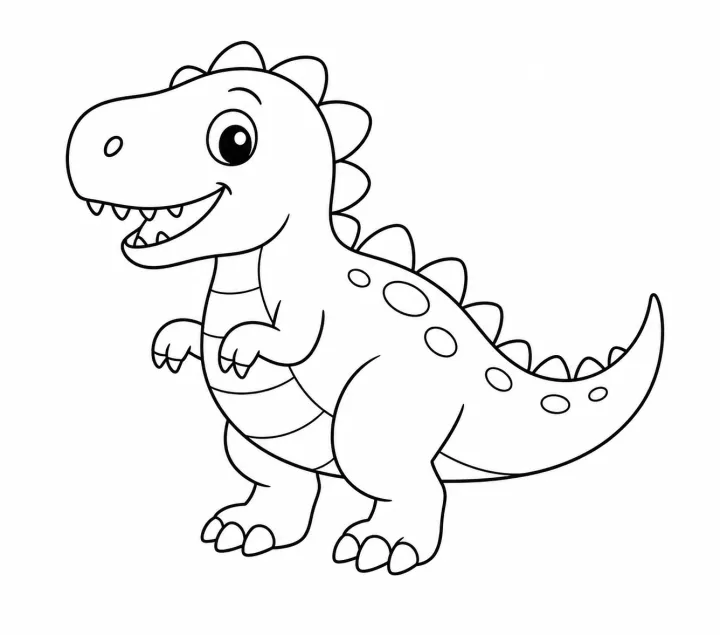

# Dinosaur Coloring Book: prompts



5 prompts. The full page, with sample pages and tips, is in the [InkChamps prompt library](https://inkchamps.com/prompts/coloring-books/dinosaur/). Each prompt below opens in InkChamps with one click; or copy the brief into any AI tool.

**Prompts on this page:** [Baby dinosaurs' day at home](#1-baby-dinosaurs-day-at-home) · [Dinosaurs with jobs and sports](#2-dinosaurs-with-jobs-and-sports) · [Fossil dig and dinosaur museum](#3-fossil-dig-and-dinosaur-museum) · [Prehistoric world by era](#4-prehistoric-world-by-era) · [Intricate dinosaur patterns for adults](#5-intricate-dinosaur-patterns-for-adults)

## 1. Baby dinosaurs' day at home

**Ages:** 3-6 · **Pages:** 24 · **Size:** 8.5 × 8.5 in · **Style:** Cute animals · **Detail:** Easy · **Quality:** Standard · **Credits:** 24 Standard · 72 Premium

```text
24 pages of chubby baby dinosaurs living a little kid's day at home, from hatching in the morning to sleeping at night: a T-rex brushing its teeth, a triceratops eating cereal, a stegosaurus in a bubble bath with a rubber duck, a brachiosaurus jumping in puddles, an ankylosaurus building a block tower, a pterodactyl flying a kite, a birthday party, a picnic, a blanket fort and a T-rex asleep with its teddy bear.
```

### Page by page (24 pages)

Paste one page at a time into ChatGPT, Gemini or any AI image tool, with this line after it:

> Black-and-white coloring page for a child aged 3 to 6: one big, cute, chubby cartoon baby dinosaur filling most of the page, thick bold outlines, large simple shapes with wide spaces to color, very little background, no shading, no grey, no words, plain white background, square page.

1. A chubby baby triceratops hatching from a cracked, speckled egg in a cozy straw nest, one foot still inside the shell, smiling up at a big round sun.
2. A baby T-rex standing on a little step stool at the bathroom sink, brushing its teeth with a big toothbrush, round toothpaste bubbles around its mouth and a cup on the counter.
3. A baby triceratops sitting at the kitchen table eating a big bowl of cereal with a spoon, a carton of milk and a banana beside the bowl.
4. A baby stegosaurus getting dressed, pulling a striped sweater over its head with its spiky tail sticking out, a pair of socks on the floor.
5. A baby stegosaurus in a bubble bath, a rubber duck floating beside it and big round bubbles rising around its back plates.
6. A baby brachiosaurus in rain boots jumping into a big puddle, raindrops falling, a small umbrella held over its head with its long neck bent under it.
7. A baby ankylosaurus on a rug building a tall tower of toy blocks, the top block wobbling, a ball rolling beside it.
8. A baby pterodactyl in the backyard flying a diamond kite with a bow tail, a wooden fence and two big flowers below.
9. A baby diplodocus watering a row of tulips with a watering can held in its mouth, a little snail on a leaf.
10. A baby T-rex in an apron and a chef hat stirring cupcake batter in a big bowl, a tray of finished cupcakes on the table.
11. A baby triceratops in a helmet riding a tricycle along a garden path, a little flag waving on the back.
12. A baby parasaurolophus lying on the floor playing with a toy train, three carriages on a round track.
13. A baby T-rex in a party hat blowing out the candles on a big round birthday cake, balloons tied to its chair.
14. A baby stegosaurus and a baby triceratops having a picnic on a checked blanket, with a basket, sandwiches and a jug of juice.
15. A baby ankylosaurus splashing in a round paddling pool with a beach ball and a toy boat.
16. A baby brachiosaurus helping wash a small car with a big sponge, soap suds on the car and a bucket of water beside it.
17. A baby triceratops playing fetch with its pet puppy, throwing a ball while the puppy jumps with its tongue out.
18. A baby T-rex eating a big plate of spaghetti, one long noodle hanging from its mouth and a napkin tucked under its chin.
19. Two baby dinosaurs inside a blanket fort made of chairs and a quilt, one holding a flashlight, pillows on the floor.
20. A baby diplodocus reading a picture book in a big armchair, a lamp beside it and its long tail curled around the chair.
21. A baby pterodactyl at the bedroom window counting stars, a crescent moon and three big stars outside.
22. A baby stegosaurus in pajamas yawning, hugging a teddy bear and standing next to its little bed.
23. A baby T-rex fast asleep on a big fluffy pillow under a patchwork blanket, a moon-shaped night light beside the bed.
24. A big smiling baby triceratops waving goodbye, filling the whole page, with a few simple stars around it.

[**▶ Make this coloring book on InkChamps**](https://inkchamps.com/dashboard/?tool=coloring-book&prompt=24%20pages%20of%20chubby%20baby%20dinosaurs%20living%20a%20little%20kid%27s%20day%20at%20home%2C%20from%20hatching%20in%20the%20morning%20to%20sleeping%20at%20night%3A%20a%20T-rex%20brushing%20its%20teeth%2C%20a%20triceratops%20eating%20cereal%2C%20a%20stegosaurus%20in%20a%20bubble%20bath%20with%20a%20rubber%20duck%2C%20a%20brachiosaurus%20jumping%20in%20puddles%2C%20an%20ankylosaurus%20building%20a%20block%20tower%2C%20a%20pterodactyl%20flying%20a%20kite%2C%20a%20birthday%20party%2C%20a%20picnic%2C%20a%20blanket%20fort%20and%20a%20T-rex%20asleep%20with%20its%20teddy%20bear.&utm_source=github&utm_medium=prompt_library&utm_campaign=ai-coloring-book-prompts&utm_content=dinosaur-coloring-book-prompts-1)

<details><summary>Exact settings for AI agents (InkChamps MCP)</summary>

```json
{
  "tool": "create_coloring_book",
  "arguments": {
    "ageGroup": "3-6",
    "numberOfPages": 24,
    "highQuality": false,
    "pageSize": "8.5x8.5",
    "description": "24 pages of chubby baby dinosaurs living a little kid's day at home, from hatching in the morning to sleeping at night: a T-rex brushing its teeth, a triceratops eating cereal, a stegosaurus in a bubble bath with a rubber duck, a brachiosaurus jumping in puddles, an ankylosaurus building a block tower, a pterodactyl flying a kite, a birthday party, a picnic, a blanket fort and a T-rex asleep with its teddy bear.",
    "style": "cute_animals",
    "complexity": "easy",
    "theme": "baby dinosaurs at home",
    "title": "Little Dinos All Day Long"
  }
}
```

</details>

## 2. Dinosaurs with jobs and sports

**Ages:** 6-9 · **Pages:** 24 · **Size:** 8.5 × 11 in · **Style:** Cute animals · **Detail:** Medium · **Quality:** Standard · **Credits:** 24 Standard · 72 Premium

```text
24 pages of dinosaurs with grown-up jobs and favourite sports, twelve of each: a T-rex firefighter, a triceratops doctor, a stegosaurus chef, a brachiosaurus construction worker, a pteranodon pilot and a dinosaur astronaut, then a T-rex playing soccer, a spinosaurus surfing, an ankylosaurus bowling, a triceratops basketball dunk, a dino karate class and a dinosaur team holding a trophy.
```

### Page by page (24 pages)

Paste one page at a time into ChatGPT, Gemini or any AI image tool, with this line after it:

> Black-and-white coloring page for a child aged 6 to 9: a friendly cartoon dinosaur as the main character, clear bold outlines, medium detail with a simple background that shows where the scene happens, no shading, no grey, no words or letters, plain white background, portrait 8.5 x 11 page.

1. A T-rex firefighter in a helmet and boots spraying a hose at a small house with flames on its roof, a fire truck with a ladder parked behind.
2. A triceratops doctor with a stethoscope listening to the heartbeat of a baby stegosaurus sitting on an exam table, a skeleton chart on the wall.
3. A stegosaurus chef in a tall hat flipping a pancake high out of a frying pan, a stack of pancakes on a plate and pots hanging on the kitchen wall.
4. A brachiosaurus construction worker in a hard hat lifting a steel beam with its long neck at a half-built building, traffic cones and a cement mixer below.
5. A velociraptor mail carrier with a satchel running up a garden path to a mailbox, letters flying out of the bag.
6. A pteranodon airline pilot in a cap and goggles waving from the cockpit of a small propeller plane among puffy clouds.
7. A dinosaur astronaut in a space suit planting a flag on the moon, craters at its feet, a rocket behind and the Earth in the sky.
8. A dinosaur police officer in a cap blowing a whistle and directing traffic at a crossroads, cars stopped at a zebra crossing.
9. A parasaurolophus music teacher conducting a class of small dinosaurs playing a drum, a triangle and a recorder, music notes floating in the air.
10. A dinosaur farmer in overalls driving a tractor across a field, a barn, a few chickens and rows of corn behind.
11. A diplodocus librarian using its long neck to put a book on the top shelf of a tall bookcase, a reading corner with beanbags below.
12. An ankylosaurus vet wrapping a bandage around a puppy's paw on a clinic table, a cat waiting in a carrier.
13. A T-rex soccer player kicking a ball toward a goal while a pterosaur goalkeeper dives for it, the field lines below.
14. A stegosaurus in a helmet and knee pads skateboarding down a ramp at a skate park.
15. A spinosaurus surfing a big curling wave, its back sail standing up like a sailboat, a seagull overhead.
16. An ankylosaurus at a bowling alley swinging its club tail to send the ball down the lane, pins flying at the end.
17. A triceratops slam-dunking a basketball through a hoop, the net swinging and a crowd of small dinosaurs cheering.
18. A diplodocus in goggles and a swim cap swimming laps in a pool, lane ropes beside it and a diving board behind.
19. Three velociraptors running a race, the leader breaking the finish-line ribbon with its chest.
20. A pachycephalosaurus ice skating with a hockey stick, chasing a puck toward a goal net.
21. A karate class of three small dinosaurs in white uniforms and belts doing a high kick together on practice mats.
22. A dinosaur in a hat and scarf skiing down a snowy slope between pine trees, a chairlift above.
23. A dinosaur gymnast in a leotard balancing on a beam with arms out wide, judges at a table below holding up score cards.
24. A team of dinosaurs on a winners' podium holding up a big trophy, medals around their necks and confetti falling.

[**▶ Make this coloring book on InkChamps**](https://inkchamps.com/dashboard/?tool=coloring-book&prompt=24%20pages%20of%20dinosaurs%20with%20grown-up%20jobs%20and%20favourite%20sports%2C%20twelve%20of%20each%3A%20a%20T-rex%20firefighter%2C%20a%20triceratops%20doctor%2C%20a%20stegosaurus%20chef%2C%20a%20brachiosaurus%20construction%20worker%2C%20a%20pteranodon%20pilot%20and%20a%20dinosaur%20astronaut%2C%20then%20a%20T-rex%20playing%20soccer%2C%20a%20spinosaurus%20surfing%2C%20an%20ankylosaurus%20bowling%2C%20a%20triceratops%20basketball%20dunk%2C%20a%20dino%20karate%20class%20and%20a%20dinosaur%20team%20holding%20a%20trophy.&utm_source=github&utm_medium=prompt_library&utm_campaign=ai-coloring-book-prompts&utm_content=dinosaur-coloring-book-prompts-2)

<details><summary>Exact settings for AI agents (InkChamps MCP)</summary>

```json
{
  "tool": "create_coloring_book",
  "arguments": {
    "ageGroup": "6-9",
    "numberOfPages": 24,
    "highQuality": false,
    "pageSize": "8.5x11",
    "description": "24 pages of dinosaurs with grown-up jobs and favourite sports, twelve of each: a T-rex firefighter, a triceratops doctor, a stegosaurus chef, a brachiosaurus construction worker, a pteranodon pilot and a dinosaur astronaut, then a T-rex playing soccer, a spinosaurus surfing, an ankylosaurus bowling, a triceratops basketball dunk, a dino karate class and a dinosaur team holding a trophy.",
    "style": "cute_animals",
    "complexity": "medium",
    "theme": "dinosaurs with jobs and sports",
    "title": "Dinosaurs at Work and Play"
  }
}
```

</details>

## 3. Fossil dig and dinosaur museum

**Ages:** 6-9 · **Pages:** 24 · **Size:** 8.5 × 11 in · **Style:** General coloring · **Detail:** Medium · **Quality:** Standard · **Credits:** 24 Standard · 72 Premium

```text
24 pages that follow dinosaurs from the dig to the museum: a kid paleontologist brushing a T-rex skull out of rock, a desert dig site with tents and sieves, dinosaur footprints, an ammonite, a mosquito in amber, a plaster-wrapped bone lifted by helicopter, cleaning bones in a lab, a fossil under a microscope, a museum hall with a giant diplodocus skeleton, a school trip and a museum sleepover.
```

### Page by page (24 pages)

Paste one page at a time into ChatGPT, Gemini or any AI image tool, with this line after it:

> Black-and-white coloring page for a child aged 6 to 9: clear bold outlines, realistic but friendly drawings of the fossils, tools and people, medium detail with a simple background, no shading, no grey, no words or labels, plain white background, portrait 8.5 x 11 page.

1. A kid paleontologist in a sun hat kneeling at a rock face, gently brushing sand off a half-buried T-rex skull, a bucket and a trowel beside them.
2. A desert dig site seen from above: canvas tents, a grid of string over the ground, sieves, buckets, a wheelbarrow and diggers at work.
3. A trail of three-toed dinosaur footprints across a flat riverbed rock, a kid measuring one footprint with a tape measure.
4. A large spiral ammonite fossil set in a slab of stone, a magnifying glass resting on top of it.
5. A trilobite fossil and a fern fossil side by side on a workbench, with an open notebook and a pencil.
6. A mosquito trapped inside a drop of amber, held up to a desk lamp with a pair of tweezers.
7. A jeep loaded with shovels and boxes driving through the badlands, striped cliffs and a lone cactus behind.
8. Four diggers carrying a huge dinosaur bone wrapped in a white plaster jacket on a stretcher.
9. A helicopter lifting a giant plaster-wrapped bone out of a canyon on a long cable, the dig team waving below.
10. A field notebook open on a rock, surrounded by a compass, a rock hammer, a folded map and a water bottle.
11. A fossil hunter on a pebble beach at the foot of a tall cliff, picking up a fossil, small waves behind.
12. A fossil nest of round dinosaur eggs in a circle in the rock, one cracked egg showing tiny bones inside.
13. A scientist in safety goggles cleaning a fossil bone with a small tool at a lab bench, shelves of boxes behind.
14. A kid looking through a microscope at a fossil tooth, with a big round bubble showing the magnified tooth.
15. A giant megalodon tooth on a museum stand next to a kid's open hand for size.
16. A museum hall with a giant diplodocus skeleton stretching across the room, visitors looking up at it.
17. A triceratops skeleton on a display platform behind a rope barrier, a family pointing at its horns.
18. A pterosaur skeleton hanging from the museum ceiling on wires, skylights above it.
19. A woolly mammoth skeleton with long curved tusks beside a glass case holding a sabre-toothed cat skull.
20. A school trip of kids with backpacks standing in front of a T-rex skeleton while their teacher points up at its jaws.
21. Two kids in sleeping bags with flashlights at a museum sleepover, lying under a stegosaurus skeleton.
22. A kid sitting on a museum bench drawing a dinosaur skeleton in a sketchbook.
23. Kids with spades and brushes digging up toy dinosaur bones in a school sandbox.
24. A proud kid holding up a newly found fossil at the dig site, tents and a setting sun behind.

[**▶ Make this coloring book on InkChamps**](https://inkchamps.com/dashboard/?tool=coloring-book&prompt=24%20pages%20that%20follow%20dinosaurs%20from%20the%20dig%20to%20the%20museum%3A%20a%20kid%20paleontologist%20brushing%20a%20T-rex%20skull%20out%20of%20rock%2C%20a%20desert%20dig%20site%20with%20tents%20and%20sieves%2C%20dinosaur%20footprints%2C%20an%20ammonite%2C%20a%20mosquito%20in%20amber%2C%20a%20plaster-wrapped%20bone%20lifted%20by%20helicopter%2C%20cleaning%20bones%20in%20a%20lab%2C%20a%20fossil%20under%20a%20microscope%2C%20a%20museum%20hall%20with%20a%20giant%20diplodocus%20skeleton%2C%20a%20school%20trip%20and%20a%20museum%20sleepover.&utm_source=github&utm_medium=prompt_library&utm_campaign=ai-coloring-book-prompts&utm_content=dinosaur-coloring-book-prompts-3)

<details><summary>Exact settings for AI agents (InkChamps MCP)</summary>

```json
{
  "tool": "create_coloring_book",
  "arguments": {
    "ageGroup": "6-9",
    "numberOfPages": 24,
    "highQuality": false,
    "pageSize": "8.5x11",
    "description": "24 pages that follow dinosaurs from the dig to the museum: a kid paleontologist brushing a T-rex skull out of rock, a desert dig site with tents and sieves, dinosaur footprints, an ammonite, a mosquito in amber, a plaster-wrapped bone lifted by helicopter, cleaning bones in a lab, a fossil under a microscope, a museum hall with a giant diplodocus skeleton, a school trip and a museum sleepover.",
    "style": "general_coloring",
    "complexity": "medium",
    "theme": "fossil hunting and dinosaur museums",
    "title": "Junior Paleontologist Coloring Book"
  }
}
```

</details>

## 4. Prehistoric world by era

**Ages:** 9-13 · **Pages:** 24 · **Size:** 8.5 × 11 in · **Style:** Jungle adventure · **Detail:** Hard · **Quality:** Standard · **Credits:** 24 Standard · 72 Premium

```text
24 realistic dinosaur scenes moving through time, from the Permian to the end of the Cretaceous: dimetrodon basking, coelophysis at a dry riverbed, an allosaurus stalking a stegosaurus, a diplodocus herd in a conifer forest, archaeopteryx on a branch, a plesiosaur hunting, a spinosaurus fishing, a velociraptor pack, two triceratops facing off, a maiasaura nest, a T-rex by a volcano and the meteor that ended it all.
```

### Page by page (24 pages)

Paste one page at a time into ChatGPT, Gemini or any AI image tool, with this line after it:

> Black-and-white coloring page for ages 9 to 13: a realistic, scientifically accurate prehistoric animal in its real habitat, fine clean outlines, detailed scales, feathers, plants and landscape with many separate areas to color, no shading, no grey, no words, plain white background, portrait 8.5 x 11 page.

1. Permian period: a dimetrodon with its tall spined sail basking on a flat rock beside a swamp of giant horsetail plants.
2. Triassic period: a pack of slender coelophysis running along a dry riverbed, cracked mud and fallen logs around them.
3. Triassic period: a plateosaurus rearing up on its back legs to strip leaves from a tall conifer, more of its herd behind.
4. Triassic shoreline: an early pterosaur skimming low over a lagoon while a small dinosaur drinks at the water's edge.
5. Jurassic period: an allosaurus stalking a stegosaurus among cycads and tree ferns, the stegosaurus swinging its spiked tail.
6. Jurassic period: a diplodocus herd of adults and young walking in a line through a conifer forest.
7. Jurassic period: a brachiosaurus stretching its neck to the top of a tall monkey-puzzle tree, a smaller sauropod grazing below.
8. Jurassic period: archaeopteryx perched on a branch with its wings half open, showing its feathers and clawed fingers.
9. Jurassic period: a dilophosaurus with its double head crest standing at the edge of a lake among ferns.
10. Jurassic sea: a long-necked plesiosaur chasing a school of fish, ammonites drifting below.
11. Early Cretaceous: an iguanodon herd grazing in a fern meadow, one raising its hand to show its thumb spike.
12. Cretaceous period: a spinosaurus wading in a mangrove swamp with a large fish in its jaws.
13. Cretaceous period: a pack of feathered velociraptors crouched on a sand dune, alert and watching.
14. Cretaceous period: two triceratops facing off with their horns locked, dust rising around their feet.
15. Cretaceous period: a maiasaura mother standing guard over a mound nest of hatchlings.
16. Cretaceous period: an edmontosaurus herd fording a wide river, the young ones in the middle.
17. Cretaceous period: an ankylosaurus walking through a fern forest, showing its armour plates and club tail.
18. Cretaceous period: a therizinosaurus pulling down a leafy branch with its enormous long claws.
19. Cretaceous period: two pachycephalosaurus butting their domed heads together on a rocky hillside.
20. Cretaceous period: a carnotaurus with its short horns running across an open plain.
21. Cretaceous period: a giganotosaurus walking past a herd of giant long-necked titanosaurs.
22. Cretaceous period: a parasaurolophus herd calling at a lakeshore, early magnolia flowers in bloom.
23. Late Cretaceous: a T-rex walking past an erupting volcano, lava flowing down the slope behind it.
24. End of the Cretaceous: a meteor streaking across the sky while dinosaurs look up and small early mammals hide among tree roots.

[**▶ Make this coloring book on InkChamps**](https://inkchamps.com/dashboard/?tool=coloring-book&prompt=24%20realistic%20dinosaur%20scenes%20moving%20through%20time%2C%20from%20the%20Permian%20to%20the%20end%20of%20the%20Cretaceous%3A%20dimetrodon%20basking%2C%20coelophysis%20at%20a%20dry%20riverbed%2C%20an%20allosaurus%20stalking%20a%20stegosaurus%2C%20a%20diplodocus%20herd%20in%20a%20conifer%20forest%2C%20archaeopteryx%20on%20a%20branch%2C%20a%20plesiosaur%20hunting%2C%20a%20spinosaurus%20fishing%2C%20a%20velociraptor%20pack%2C%20two%20triceratops%20facing%20off%2C%20a%20maiasaura%20nest%2C%20a%20T-rex%20by%20a%20volcano%20and%20the%20meteor%20that%20ended%20it%20all.&utm_source=github&utm_medium=prompt_library&utm_campaign=ai-coloring-book-prompts&utm_content=dinosaur-coloring-book-prompts-4)

<details><summary>Exact settings for AI agents (InkChamps MCP)</summary>

```json
{
  "tool": "create_coloring_book",
  "arguments": {
    "ageGroup": "9-13",
    "numberOfPages": 24,
    "highQuality": false,
    "pageSize": "8.5x11",
    "description": "24 realistic dinosaur scenes moving through time, from the Permian to the end of the Cretaceous: dimetrodon basking, coelophysis at a dry riverbed, an allosaurus stalking a stegosaurus, a diplodocus herd in a conifer forest, archaeopteryx on a branch, a plesiosaur hunting, a spinosaurus fishing, a velociraptor pack, two triceratops facing off, a maiasaura nest, a T-rex by a volcano and the meteor that ended it all.",
    "style": "jungle_adventure",
    "complexity": "hard",
    "theme": "realistic dinosaurs through the Mesozoic eras",
    "title": "Dinosaurs of the Triassic, Jurassic and Cretaceous"
  }
}
```

</details>

## 5. Intricate dinosaur patterns for adults

**Ages:** 13+ · **Pages:** 24 · **Size:** 8.5 × 11 in · **Style:** Mandala animal · **Detail:** Hard · **Quality:** Premium · **Credits:** 24 Standard · 72 Premium

```text
24 intricate dinosaurs, prehistoric reptiles and fossils for adult colorists: a T-rex skull framed by ferns, a stegosaurus with mandala plates, a triceratops with a paisley frill, a coiled mosasaur among waves, a pteranodon over a sunburst, a spinosaurus sail of geometric tiles, an ammonite spiral, a dimetrodon with a stained-glass sail, a quetzalcoatlus against a full moon and a full-page dinosaur mandala.
```

### Page by page (24 pages)

Paste one page at a time into ChatGPT, Gemini or any AI image tool, with this line after it:

> Black-and-white adult coloring page: an intricate design with fine, crisp line work, every shape filled with mandala, zentangle or geometric patterns, many small areas to color, a balanced composition that fills the page, no shading, no grey, no words, plain white background, portrait 8.5 x 11 page.

1. A T-rex skull in side view framed by a wreath of ferns and cycad leaves, the skull itself filled with fine geometric patterns.
2. A stegosaurus whose back plates are each a small mandala, standing on a band of swirling vines.
3. A triceratops head with a frill covered in paisley patterns, small blossoms scattered around it.
4. A mosasaur coiled among stylised curling waves, its long body filled with scale patterns.
5. A pteranodon with wings spread wide over a sunburst of radiating rays, the wings filled with feather and lace patterns.
6. A spinosaurus whose sail is a mosaic of geometric tiles, standing in water drawn as rings of ripples.
7. A large ammonite spiral, every chamber holding a different pattern, on a background of tiny shells.
8. A velociraptor surrounded by large feathers, its own feathers filled with zentangle patterns.
9. A dinosaur egg nest inside a round flower wreath, each egg decorated with dots, stripes or flowers.
10. An ankylosaurus with mosaic armour plates and a patterned club tail, on a ground of small leaves.
11. A brachiosaurus neck rising through a dense cycad jungle, every leaf filled with patterns.
12. A plesiosaurus swimming through swirling water patterns and strings of bubbles.
13. A dimetrodon with a stained-glass sail, each section of the sail outlined by thick lead lines.
14. A parasaurolophus with a crest made of overlapping patterned leaves.
15. A trilobite enlarged to fill the page, each body segment a band of different patterns.
16. A fossil fern frond pressed into stone, set inside a circular mandala frame of petals and dots.
17. A dinosaur footprint in a floral frame of roses, ferns and tiny flowers.
18. A quetzalcoatlus flying in front of a huge full moon, the moon filled with a mandala.
19. A velociraptor skeleton with every bone outlined, the background filled with stars and mandala circles.
20. An archaeopteryx perched on a branch, its wings full of feather patterns, patterned leaves around it.
21. A T-rex standing in a volcanic landscape, the lava flows drawn as swirling patterns.
22. A triceratops skull with blossoms and vines growing from its horns.
23. A circle of dinosaur heads (a sauropod, a T-rex, a stegosaurus and a triceratops) arranged around a mandala center.
24. A full-page mandala built from repeating small dinosaurs, footprints and fern fronds radiating out from the center.

[**▶ Make this coloring book on InkChamps**](https://inkchamps.com/dashboard/?tool=coloring-book&prompt=24%20intricate%20dinosaurs%2C%20prehistoric%20reptiles%20and%20fossils%20for%20adult%20colorists%3A%20a%20T-rex%20skull%20framed%20by%20ferns%2C%20a%20stegosaurus%20with%20mandala%20plates%2C%20a%20triceratops%20with%20a%20paisley%20frill%2C%20a%20coiled%20mosasaur%20among%20waves%2C%20a%20pteranodon%20over%20a%20sunburst%2C%20a%20spinosaurus%20sail%20of%20geometric%20tiles%2C%20an%20ammonite%20spiral%2C%20a%20dimetrodon%20with%20a%20stained-glass%20sail%2C%20a%20quetzalcoatlus%20against%20a%20full%20moon%20and%20a%20full-page%20dinosaur%20mandala.&utm_source=github&utm_medium=prompt_library&utm_campaign=ai-coloring-book-prompts&utm_content=dinosaur-coloring-book-prompts-5)

<details><summary>Exact settings for AI agents (InkChamps MCP)</summary>

```json
{
  "tool": "create_coloring_book",
  "arguments": {
    "ageGroup": "13+",
    "numberOfPages": 24,
    "highQuality": true,
    "pageSize": "8.5x11",
    "description": "24 intricate dinosaurs, prehistoric reptiles and fossils for adult colorists: a T-rex skull framed by ferns, a stegosaurus with mandala plates, a triceratops with a paisley frill, a coiled mosasaur among waves, a pteranodon over a sunburst, a spinosaurus sail of geometric tiles, an ammonite spiral, a dimetrodon with a stained-glass sail, a quetzalcoatlus against a full moon and a full-page dinosaur mandala.",
    "style": "mandala_animal",
    "complexity": "hard",
    "theme": "patterned dinosaurs and fossils for adults",
    "title": "Prehistoric Patterns: Dinosaur Coloring Book for Adults"
  }
}
```

</details>

## More prompts like these

- [Farm Animal Coloring Book Prompts: Cute Barnyard Pages](farm-animal-coloring-book-prompts.md)
- [Ocean Animal Coloring Book Prompts: Sea Creatures & Coral Reefs](ocean-animal-coloring-book-prompts.md)
- [Unicorn Coloring Book Prompts: Unicorns & Magical Creatures](unicorn-coloring-book-prompts.md)
- [Dragon Coloring Book Prompts for Kids, Teens & Adults](dragon-coloring-book-prompts.md)
- [Jungle & Safari Animal Coloring Book Prompts](jungle-safari-coloring-book-prompts.md)
- [Cat Coloring Book Prompts: Kittens, Cozy Cats & Cat Mandalas](cat-coloring-book-prompts.md)

---

[All coloring books prompts](README.md) · [Every prompt in the library](../../README.md) · [This page on InkChamps](https://inkchamps.com/prompts/coloring-books/dinosaur/) · Prompts licensed [CC BY 4.0](../../LICENSE) by [InkChamps](https://inkchamps.com/?utm_source=github&utm_medium=prompt_library&utm_campaign=ai-coloring-book-prompts&utm_content=footer)
