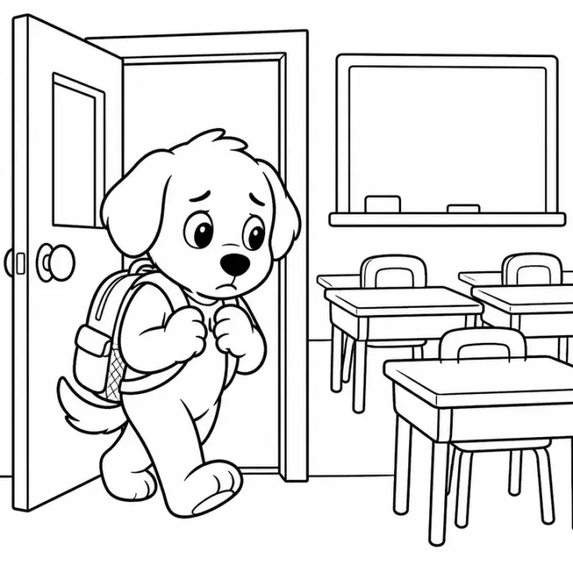

# Dog & Puppy Coloring Book: prompts



5 prompts. The full page, with sample pages and tips, is in the [InkChamps prompt library](https://inkchamps.com/prompts/coloring-books/dog-puppy/). Each prompt below opens in InkChamps with one click; or copy the brief into any AI tool.

**Prompts on this page:** [Playful puppies for toddlers](#1-playful-puppies-for-toddlers) · [Working and helper dogs](#2-working-and-helper-dogs) · [24 dog breeds with names](#3-24-dog-breeds-with-names) · [Dog park, groomer and dog show](#4-dog-park-groomer-and-dog-show) · [Patterned dog portraits for adults](#5-patterned-dog-portraits-for-adults)

## 1. Playful puppies for toddlers

**Ages:** 3-6 · **Pages:** 24 · **Size:** 8.5 × 8.5 in · **Style:** Cute animals · **Detail:** Easy · **Quality:** Standard · **Credits:** 24 Standard · 72 Premium

```text
24 pages of one playful puppy each, from waking up to bedtime: a puppy stretching in its dog bed, waiting by the door with a leash, leaping for a frisbee, digging in the garden, carrying a stick too big for it, splashing in a puddle in a raincoat, rolling in leaves, licking an ice cream, wearing a party hat, peeking out of a gift box, jumping in snow, in a bubble bath, hiding in the laundry basket, a mother dog with her puppies, and a puppy asleep with its kitten friend.
```

### Page by page (24 pages)

Paste one page at a time into ChatGPT, Gemini or any AI image tool, with this line after it:

> Black-and-white coloring page for a child aged 3 to 6: one big, cute, chubby cartoon puppy filling most of the page, thick bold outlines, large simple shapes with wide spaces to color, very little background, no shading, no grey, no words, plain white background, square page.

1. A chubby puppy waking up and stretching its front paws in a round dog bed, a small blanket sliding off the edge and a bone-shaped pillow behind it.
2. A puppy sitting beside a full food bowl licking its nose, a bone-shaped treat and a water bowl on the floor next to it.
3. A puppy waiting by the front door with a leash in its mouth, sitting on a doormat with a coat hook on the wall above.
4. A puppy leaping high to catch a round frisbee in its mouth, ears flapping, two tufts of grass below its paws.
5. A puppy running after a big bouncy ball across the lawn, its tongue out and a little flower beside the ball.
6. A puppy digging a hole in the garden, clumps of dirt flying out behind it, a carrot and a small trowel next to the hole.
7. A puppy proudly carrying a stick much longer than itself in its mouth, a round tree and a little bush behind it.
8. Two puppies playing tug of war with a knotted rope toy, each pulling one end with its paws dug into the rug.
9. A puppy lying on a rug chewing a big fluffy slipper, the other slipper tipped over beside it and a few bits of fluff on the floor.
10. A puppy sitting very still in a patch of daisies with a butterfly resting on the tip of its nose, its eyes crossed looking at it.
11. A puppy in a hooded raincoat and little boots splashing in a big puddle, raindrops falling from a round cloud.
12. A puppy rolling on its back in a pile of autumn leaves, a few big leaves floating around it and a rake leaning on a fence.
13. A puppy riding in a toy wagon with a teddy bear and a ball beside it, the long wagon handle sticking out in front.
14. A puppy at the beach sitting next to a sandcastle with a little flag, a bucket, a spade and a seashell in the sand.
15. A puppy sitting on a park bench licking a big ice cream cone with two round scoops, one drip running down the side of the cone.
16. A puppy in a pointy party hat sitting beside a bone-shaped birthday cake with one candle, two balloons tied to the table.
17. A puppy peeking out of an open gift box with a big ribbon bow on the lid, crumpled wrapping paper on the floor.
18. A puppy wearing a big bow on its collar, sitting on a round cushion and holding up one paw to shake, a ball resting beside the cushion.
19. A puppy jumping into a big pile of snow beside a snowman with a carrot nose, a few snowflakes in the air.
20. A puppy in a bubble bath in a round tub, a rubber duck floating by, big round bubbles on its head and a scrub brush on the edge.
21. A puppy wrapped in a fluffy towel after its bath, only its face and front paws peeking out, standing on a bath mat.
22. A puppy hiding in a basket of laundry with a sock on its head and a shirt hanging over the side of the basket.
23. A mother dog lying on a soft blanket in a basket with three tiny puppies snuggled against her tummy, one puppy licking her nose.
24. A puppy and its kitten friend fast asleep together in a dog bed under a blanket, a crescent moon in the window above.

[**▶ Make this coloring book on InkChamps**](https://inkchamps.com/dashboard/?tool=coloring-book&prompt=24%20pages%20of%20one%20playful%20puppy%20each%2C%20from%20waking%20up%20to%20bedtime%3A%20a%20puppy%20stretching%20in%20its%20dog%20bed%2C%20waiting%20by%20the%20door%20with%20a%20leash%2C%20leaping%20for%20a%20frisbee%2C%20digging%20in%20the%20garden%2C%20carrying%20a%20stick%20too%20big%20for%20it%2C%20splashing%20in%20a%20puddle%20in%20a%20raincoat%2C%20rolling%20in%20leaves%2C%20licking%20an%20ice%20cream%2C%20wearing%20a%20party%20hat%2C%20peeking%20out%20of%20a%20gift%20box%2C%20jumping%20in%20snow%2C%20in%20a%20bubble%20bath%2C%20hiding%20in%20the%20laundry%20basket%2C%20a%20mother%20dog%20with%20her%20puppies%2C%20and%20a%20puppy%20asleep%20with%20its%20kitten%20friend.&utm_source=github&utm_medium=prompt_library&utm_campaign=ai-coloring-book-prompts&utm_content=dog-puppy-coloring-book-prompts-1)

<details><summary>Exact settings for AI agents (InkChamps MCP)</summary>

```json
{
  "tool": "create_coloring_book",
  "arguments": {
    "ageGroup": "3-6",
    "numberOfPages": 24,
    "highQuality": false,
    "pageSize": "8.5x8.5",
    "description": "24 pages of one playful puppy each, from waking up to bedtime: a puppy stretching in its dog bed, waiting by the door with a leash, leaping for a frisbee, digging in the garden, carrying a stick too big for it, splashing in a puddle in a raincoat, rolling in leaves, licking an ice cream, wearing a party hat, peeking out of a gift box, jumping in snow, in a bubble bath, hiding in the laundry basket, a mother dog with her puppies, and a puppy asleep with its kitten friend.",
    "style": "cute_animals",
    "complexity": "easy",
    "theme": "playful puppies",
    "title": "Puppy Playtime Coloring Book"
  }
}
```

</details>

## 2. Working and helper dogs

**Ages:** 6-9 · **Pages:** 24 · **Size:** 8.5 × 11 in · **Style:** General coloring · **Detail:** Medium · **Quality:** Standard · **Credits:** 24 Standard · 72 Premium

```text
24 pages of dogs at work: a Dalmatian riding on a fire truck, a police German Shepherd, a guide dog leading a person across a street, a St Bernard rescuing a hiker in snow, a Border Collie herding sheep, a husky team pulling a sled, a therapy dog visiting a hospital, a Newfoundland swimming to a boat, a beagle sniffing bags at an airport, a farm dog guarding chickens, a search dog in rubble, a truffle-hunting dog, a hearing dog, a reading dog at a library, a ship's dog and a hero dog getting a medal.
```

### Page by page (24 pages)

Paste one page at a time into ChatGPT, Gemini or any AI image tool, with this line after it:

> Black-and-white coloring page for a child aged 6 to 9: a friendly, realistic-looking working dog as the main character, its people drawn kindly, clear bold outlines, medium detail with a simple background that shows where the job happens, no shading, no grey, no words or letters, plain white background, portrait 8.5 x 11 page.

1. A Dalmatian sitting proudly on the seat of a fire truck beside a firefighter in a helmet, a coiled hose and a long ladder on the truck behind them.
2. A police German Shepherd in a vest sitting alert beside its officer handler on a city sidewalk, a police car parked at the curb.
3. A guide dog in a harness leading a person in sunglasses across a zebra crossing, a traffic light and a row of shops behind.
4. A St Bernard with a little barrel on its collar bounding through deep snow toward a hiker sitting by a rock, snowy mountains behind.
5. A Border Collie crouched low, steering a flock of sheep through an open gate while a farmer with a crook watches from a hill.
6. A team of six huskies pulling a wooden sled and its musher across a snowy plain, pine trees and an icy lake in the distance.
7. A therapy dog in a vest resting its head on the bed of a smiling child in hospital, a vase of flowers and a balloon on the table.
8. A Newfoundland swimming through waves toward a small rowboat with a life ring in its mouth, a lighthouse on the shore.
9. A beagle sniffing a line of suitcases on an airport baggage belt, its handler beside it and a plane visible through a big window.
10. A farm dog standing guard in a chicken yard, hens pecking around its paws, a wooden henhouse and a fence behind.
11. A search dog climbing over broken bricks and boards to sniff for people, a rescuer in a hard hat holding a flashlight beside it.
12. A truffle-hunting dog digging at the roots of an oak tree in a forest, a forager kneeling with a basket and a small trowel.
13. A hearing dog nudging its owner on the sofa and pointing its nose toward the front door, where someone is pressing the doorbell.
14. A mobility helper dog picking up a set of dropped keys for a man in a wheelchair outside a shop, a bag of groceries on his lap.
15. A mountain rescue dog with a small backpack climbing a rocky trail beside a rescuer carrying a coil of rope, cliffs and clouds behind.
16. A water rescue dog towing a swimmer to the shore of a lake by a float, a lifeguard tower and a rowboat on the beach.
17. A cattle dog running alongside a herd of cows on a dusty ranch, a rancher on horseback and a windmill behind.
18. A big sturdy dog pulling a small wooden cart loaded with milk cans along a village lane, cottages and a stone wall beside it.
19. A ship's dog in a life jacket standing on the deck of a fishing boat, coils of rope, a net and seagulls above the waves.
20. A carriage dog trotting beside the wheels of a horse-drawn carriage down a cobbled street lined with old lamp posts.
21. A reading dog lying on a library rug while a child reads a picture book aloud to it, tall bookshelves and a beanbag behind.
22. A dog trotting up a garden path with a rolled-up newspaper in its mouth, a mailbox at the gate and a front porch ahead.
23. A police dog in training leaping over a wooden wall on a training field, its handler holding up a ball as a reward.
24. A hero dog with a medal on a ribbon around its neck standing on a stage, its family and a cheering crowd clapping below.

[**▶ Make this coloring book on InkChamps**](https://inkchamps.com/dashboard/?tool=coloring-book&prompt=24%20pages%20of%20dogs%20at%20work%3A%20a%20Dalmatian%20riding%20on%20a%20fire%20truck%2C%20a%20police%20German%20Shepherd%2C%20a%20guide%20dog%20leading%20a%20person%20across%20a%20street%2C%20a%20St%20Bernard%20rescuing%20a%20hiker%20in%20snow%2C%20a%20Border%20Collie%20herding%20sheep%2C%20a%20husky%20team%20pulling%20a%20sled%2C%20a%20therapy%20dog%20visiting%20a%20hospital%2C%20a%20Newfoundland%20swimming%20to%20a%20boat%2C%20a%20beagle%20sniffing%20bags%20at%20an%20airport%2C%20a%20farm%20dog%20guarding%20chickens%2C%20a%20search%20dog%20in%20rubble%2C%20a%20truffle-hunting%20dog%2C%20a%20hearing%20dog%2C%20a%20reading%20dog%20at%20a%20library%2C%20a%20ship%27s%20dog%20and%20a%20hero%20dog%20getting%20a%20medal.&utm_source=github&utm_medium=prompt_library&utm_campaign=ai-coloring-book-prompts&utm_content=dog-puppy-coloring-book-prompts-2)

<details><summary>Exact settings for AI agents (InkChamps MCP)</summary>

```json
{
  "tool": "create_coloring_book",
  "arguments": {
    "ageGroup": "6-9",
    "numberOfPages": 24,
    "highQuality": false,
    "pageSize": "8.5x11",
    "description": "24 pages of dogs at work: a Dalmatian riding on a fire truck, a police German Shepherd, a guide dog leading a person across a street, a St Bernard rescuing a hiker in snow, a Border Collie herding sheep, a husky team pulling a sled, a therapy dog visiting a hospital, a Newfoundland swimming to a boat, a beagle sniffing bags at an airport, a farm dog guarding chickens, a search dog in rubble, a truffle-hunting dog, a hearing dog, a reading dog at a library, a ship's dog and a hero dog getting a medal.",
    "style": "general_coloring",
    "complexity": "medium",
    "theme": "working and helper dogs",
    "title": "Hero Dogs Coloring Book"
  }
}
```

</details>

## 3. 24 dog breeds with names

**Ages:** 9-13 · **Pages:** 24 · **Size:** 8.5 × 11 in · **Style:** General coloring · **Detail:** Medium · **Layout:** One item per page, with its caption · **Quality:** Standard · **Credits:** 24 Standard · 72 Premium

```text
24 dog breeds, one per page with its name: Labrador Retriever, Golden Retriever, German Shepherd, Beagle, Dachshund, Poodle, Bulldog, French Bulldog, Corgi, Siberian Husky, Dalmatian, Chihuahua, Pug, Boxer, Border Collie, Shih Tzu, Great Dane, Bernese Mountain Dog, Cocker Spaniel, Yorkshire Terrier, Shiba Inu, Saint Bernard, Basset Hound, Samoyed.
```

### Page by page (24 pages)

Paste one page at a time into ChatGPT, Gemini or any AI image tool, with this line after it:

> Black-and-white coloring page for ages 9 to 13: one realistic, true-to-breed dog as the main subject, fine clean outlines with fur, ears and markings drawn as many separate areas to color, a light simple background, no shading, no grey, the breed name in big outlined letters at the bottom as the only words on the page, plain white background, portrait 8.5 x 11 page.

1. A Labrador Retriever standing at the edge of a lake with a tennis ball in its mouth, reeds and a wooden dock behind, with the caption "Labrador Retriever" in big outlined letters at the bottom.
2. A Golden Retriever lying in a meadow with its long feathery coat spread out, wildflowers around its paws, with the caption "Golden Retriever" in big outlined letters at the bottom.
3. A German Shepherd sitting tall with pointed ears on a hilltop, a few pine trees behind, with the caption "German Shepherd" in big outlined letters at the bottom.
4. A Beagle with its nose to the ground following a scent trail through grass, long ears hanging down, with the caption "Beagle" in big outlined letters at the bottom.
5. A Dachshund with its long low body trotting along a garden path past flowerpots, with the caption "Dachshund" in big outlined letters at the bottom.
6. A standard Poodle with a curly coat standing elegantly beside a park bench, a lamp post behind, with the caption "Poodle" in big outlined letters at the bottom.
7. A Bulldog with a wrinkled face and wide chest sitting on a doorstep, a chewed toy beside its paws, with the caption "Bulldog" in big outlined letters at the bottom.
8. A French Bulldog with big bat ears sitting on a cushion, head tilted to one side, with the caption "French Bulldog" in big outlined letters at the bottom.
9. A Corgi with short legs and big upright ears trotting across a lawn, a fluffy tail wagging, with the caption "Corgi" in big outlined letters at the bottom.
10. A Siberian Husky with a thick coat and mask-like face markings standing in snow, snowy pines behind, with the caption "Siberian Husky" in big outlined letters at the bottom.
11. A Dalmatian covered in round spots sitting beside an old fire hydrant, with the caption "Dalmatian" in big outlined letters at the bottom.
12. A tiny Chihuahua with huge ears peeking out of a woven basket, a small blanket inside, with the caption "Chihuahua" in big outlined letters at the bottom.
13. A Pug with a curled tail and wrinkled face sitting on a rug, looking up with big round eyes, with the caption "Pug" in big outlined letters at the bottom.
14. A Boxer standing in a playful bow in a backyard, a rope toy in front of it, with the caption "Boxer" in big outlined letters at the bottom.
15. A Border Collie running low across a grassy field with two sheep ahead of it, with the caption "Border Collie" in big outlined letters at the bottom.
16. A Shih Tzu with long silky fur and a little topknot bow sitting on a footstool, with the caption "Shih Tzu" in big outlined letters at the bottom.
17. A Great Dane standing tall beside a garden gate, much taller than the gate, with the caption "Great Dane" in big outlined letters at the bottom.
18. A Bernese Mountain Dog with its three-part coat markings sitting on an alpine slope, mountains and a cabin behind, with the caption "Bernese Mountain Dog" in big outlined letters at the bottom.
19. A Cocker Spaniel with long wavy ears sitting beside a stream in a woodland, ferns around it, with the caption "Cocker Spaniel" in big outlined letters at the bottom.
20. A Yorkshire Terrier with long silky fur and a small bow sitting on a velvet cushion, with the caption "Yorkshire Terrier" in big outlined letters at the bottom.
21. A Shiba Inu with a curled tail and fox-like face standing under a cherry blossom branch, with the caption "Shiba Inu" in big outlined letters at the bottom.
22. A Saint Bernard with a big gentle face lying in front of a stone cottage in the snow, with the caption "Saint Bernard" in big outlined letters at the bottom.
23. A Basset Hound with long droopy ears and a low body sniffing a fallen log in a forest, with the caption "Basset Hound" in big outlined letters at the bottom.
24. A Samoyed with a fluffy coat and a wide smile sitting in a snowy field, snowflakes drifting down, with the caption "Samoyed" in big outlined letters at the bottom.

[**▶ Make this coloring book on InkChamps**](https://inkchamps.com/dashboard/?tool=coloring-book&prompt=24%20dog%20breeds%2C%20one%20per%20page%20with%20its%20name%3A%20Labrador%20Retriever%2C%20Golden%20Retriever%2C%20German%20Shepherd%2C%20Beagle%2C%20Dachshund%2C%20Poodle%2C%20Bulldog%2C%20French%20Bulldog%2C%20Corgi%2C%20Siberian%20Husky%2C%20Dalmatian%2C%20Chihuahua%2C%20Pug%2C%20Boxer%2C%20Border%20Collie%2C%20Shih%20Tzu%2C%20Great%20Dane%2C%20Bernese%20Mountain%20Dog%2C%20Cocker%20Spaniel%2C%20Yorkshire%20Terrier%2C%20Shiba%20Inu%2C%20Saint%20Bernard%2C%20Basset%20Hound%2C%20Samoyed.&utm_source=github&utm_medium=prompt_library&utm_campaign=ai-coloring-book-prompts&utm_content=dog-puppy-coloring-book-prompts-3)

<details><summary>Exact settings for AI agents (InkChamps MCP)</summary>

```json
{
  "tool": "create_coloring_book",
  "arguments": {
    "ageGroup": "9-13",
    "numberOfPages": 24,
    "highQuality": false,
    "pageSize": "8.5x11",
    "description": "24 dog breeds, one per page with its name: Labrador Retriever, Golden Retriever, German Shepherd, Beagle, Dachshund, Poodle, Bulldog, French Bulldog, Corgi, Siberian Husky, Dalmatian, Chihuahua, Pug, Boxer, Border Collie, Shih Tzu, Great Dane, Bernese Mountain Dog, Cocker Spaniel, Yorkshire Terrier, Shiba Inu, Saint Bernard, Basset Hound, Samoyed.",
    "style": "general_coloring",
    "complexity": "medium",
    "theme": "dog breeds with names",
    "title": "40 Dog Breeds Coloring Book",
    "pageCategory": "concept"
  }
}
```

</details>

## 4. Dog park, groomer and dog show

**Ages:** 6-9 · **Pages:** 24 · **Size:** 8.5 × 11 in · **Style:** Cute animals · **Detail:** Medium · **Quality:** Standard · **Credits:** 24 Standard · 72 Premium

```text
24 pages of dogs out and about: a busy dog park with a water fountain, an agility course, a haircut at the groomer, a blow-dry, a vet check-up, a dog show with a judge and trophies, a dog cafe with puppy cupcakes, the beach, a hike, a camping trip, a daycare play room, a birthday party, a pet shop, a costume parade, a car trip, a canoe trip, a training class, adoption day, a bike basket ride, a frisbee contest, a snow day and a puppy sleepover.
```

### Page by page (24 pages)

Paste one page at a time into ChatGPT, Gemini or any AI image tool, with this line after it:

> Black-and-white coloring page for a child aged 6 to 9: friendly cartoon dogs as the main characters in a full, lively scene, clear bold outlines, medium detail with a simple background that shows where they are, no shading, no grey, no words or letters, plain white background, portrait 8.5 x 11 page.

1. A busy dog park with a dog drinking from a water fountain, two dogs chasing a ball across the grass, a bench and leafy trees behind.
2. A dog leaping over a striped hurdle on an agility course, a tunnel and a row of weave poles waiting behind it.
3. A shaggy puppy sitting on a grooming table getting a haircut, a groomer holding scissors and comb, a mirror on the wall.
4. A dog in a grooming salon with its fur puffed up by a blow-dryer, a towel around its shoulders and bottles of shampoo on a shelf.
5. A dog on an exam table at the vet, the vet listening with a stethoscope while the owner holds its paw, a weighing scale on the floor.
6. A dog show with a poodle standing on a judging table, a judge in a suit studying it and a table of trophies and ribbons behind.
7. A dog cafe with dogs sitting at little tables eating puppy cupcakes, a counter full of bone-shaped cookies and water bowls on the floor.
8. Dogs at the beach: one digging in the sand, one splashing in the waves, a beach umbrella and a bucket and spade nearby.
9. A dog wearing a little backpack hiking up a mountain trail with its owner, a wooden trail post, pine trees and peaks behind.
10. A dog sitting by a campfire outside a tent at night, its owner toasting a marshmallow, stars and a lantern hanging from a tree.
11. A dog daycare play room with puppies sliding down a ramp, jumping into a ball pit and tugging on rope toys.
12. A dog birthday party with dogs in party hats around a bone-shaped cake, balloons, streamers and a pile of wrapped presents.
13. A dog in a pet shop aisle choosing a squeaky toy from a low shelf, bags of treats and a basket of balls beside it.
14. A dog standing in a self-wash tub covered in soap suds, its owner rinsing it with a hose and bubbles floating in the air.
15. A dog costume parade down a street: a dog dressed as a pumpkin, one as a bee and one as a pirate with a hat and eye patch.
16. A dog on a car trip with its head out of the back window, ears flapping in the wind, suitcases strapped to the roof.
17. A dog in a life jacket sitting at the front of a canoe on a calm lake, its owner paddling and ducks swimming nearby.
18. A dog training class with a row of dogs sitting on mats while a trainer holds up a treat, a cone and a small hurdle beside them.
19. Adoption day at a shelter: a family kneeling to meet a happy puppy, more dogs waving their tails from pens behind.
20. A small dog riding in the front basket of a bicycle through town, its owner pedaling past shops and a flower stand.
21. A frisbee contest in a field with a dog flying through the air to catch a disc, a crowd of people and dogs watching.
22. A dog in a knitted sweater and scarf pulling a small sled with a teddy bear riding on it through the snow, a snowman and a snowy house behind.
23. A dog swimming pool with one dog jumping off a little dock into the water, another floating on an inflatable ring.
24. A puppy sleepover in a blanket fort with three puppies in sleeping bags, a flashlight, pillows and a bowl of treats.

[**▶ Make this coloring book on InkChamps**](https://inkchamps.com/dashboard/?tool=coloring-book&prompt=24%20pages%20of%20dogs%20out%20and%20about%3A%20a%20busy%20dog%20park%20with%20a%20water%20fountain%2C%20an%20agility%20course%2C%20a%20haircut%20at%20the%20groomer%2C%20a%20blow-dry%2C%20a%20vet%20check-up%2C%20a%20dog%20show%20with%20a%20judge%20and%20trophies%2C%20a%20dog%20cafe%20with%20puppy%20cupcakes%2C%20the%20beach%2C%20a%20hike%2C%20a%20camping%20trip%2C%20a%20daycare%20play%20room%2C%20a%20birthday%20party%2C%20a%20pet%20shop%2C%20a%20costume%20parade%2C%20a%20car%20trip%2C%20a%20canoe%20trip%2C%20a%20training%20class%2C%20adoption%20day%2C%20a%20bike%20basket%20ride%2C%20a%20frisbee%20contest%2C%20a%20snow%20day%20and%20a%20puppy%20sleepover.&utm_source=github&utm_medium=prompt_library&utm_campaign=ai-coloring-book-prompts&utm_content=dog-puppy-coloring-book-prompts-4)

<details><summary>Exact settings for AI agents (InkChamps MCP)</summary>

```json
{
  "tool": "create_coloring_book",
  "arguments": {
    "ageGroup": "6-9",
    "numberOfPages": 24,
    "highQuality": false,
    "pageSize": "8.5x11",
    "description": "24 pages of dogs out and about: a busy dog park with a water fountain, an agility course, a haircut at the groomer, a blow-dry, a vet check-up, a dog show with a judge and trophies, a dog cafe with puppy cupcakes, the beach, a hike, a camping trip, a daycare play room, a birthday party, a pet shop, a costume parade, a car trip, a canoe trip, a training class, adoption day, a bike basket ride, a frisbee contest, a snow day and a puppy sleepover.",
    "style": "cute_animals",
    "complexity": "medium",
    "theme": "a dog's day out",
    "title": "A Day Out for Dogs Coloring Book"
  }
}
```

</details>

## 5. Patterned dog portraits for adults

**Ages:** 13+ · **Pages:** 24 · **Size:** 8.5 × 11 in · **Style:** Mandala animal · **Detail:** Hard · **Quality:** Premium · **Credits:** 24 Standard · 72 Premium

```text
24 patterned dog portraits for adult dog lovers: a golden retriever with a floral collar, a French bulldog with paisley ears, a dachshund among roses, a husky with snowflake patterns, a German shepherd profile with leaves, a corgi in a mandala circle, a pug with a crown, a poodle with swirls, a beagle with feathers, a Labrador with sunflowers, a Dalmatian with geometric spots, a Border Collie in a wreath, a shiba inu with cherry blossoms, a puppy pile in a heart and a paw-print mandala.
```

### Page by page (24 pages)

Paste one page at a time into ChatGPT, Gemini or any AI image tool, with this line after it:

> Black-and-white adult coloring page: an intricate dog portrait with fine, crisp line work, the fur and background filled with mandala, zentangle, floral or geometric patterns, many small areas to color, a balanced composition that fills the page, no shading, no grey, no words, plain white background, portrait 8.5 x 11 page.

1. A golden retriever head and shoulders wearing a lush collar of roses, daisies and leaves, its flowing fur divided into feathered pattern bands.
2. A French bulldog face looking straight out, its big bat ears filled with paisley patterns and a mandala medallion on its chest.
3. A long dachshund stretched along a trellis of climbing roses, its body filled with fine zentangle stripes and dots.
4. A husky face with piercing eyes, its thick ruff filled with detailed snowflake patterns and tiny stars, icy crystal shapes fanning out behind it.
5. A German shepherd in side profile, its coat made of overlapping oak and maple leaves, a ring of vines framing the head.
6. A corgi sitting in the centre of a large circular mandala, its big upright ears echoing the mandala's petal shapes.
7. A pug wearing an ornate jeweled crown, its wrinkles drawn as flowing filigree lines, a scrolling frame around it.
8. A standard poodle in elegant profile, its curly coat drawn as clusters of spirals and swirls, a border of tiny pearls and ribbons framing it.
9. A beagle sitting among tall grasses, its long ears made of layered patterned feathers, a scatter of small feathers falling around it.
10. A Labrador head surrounded by tall sunflowers, each sunflower centre filled with a tiny seed spiral pattern.
11. A Dalmatian sitting upright, every spot replaced by a different small geometric shape filled with fine pattern.
12. A Border Collie face framed by a round wreath of wildflowers, wheat stalks and ribbons, its black-and-white coat marked out in two pattern styles.
13. A Bernese mountain dog lying among alpine flowers and edelweiss, its tri-colour coat marked out in three pattern styles.
14. A greyhound in full sprint across the page, its lean body filled with fine stripes, art deco fan shapes and sweeping motion lines streaming behind it.
15. A tiny chihuahua peeking out of a patterned teacup on a lace doily, a teapot with floral designs beside it.
16. A boxer wearing a bandana filled with tiny paisley and dot patterns, its strong face drawn in zentangle shapes.
17. A shiba inu sitting under a branch of cherry blossoms, petals falling, its curled tail filled with wave patterns.
18. A schnauzer sitting upright in a patterned bow tie, its bushy eyebrows and beard drawn as cascading swirls, a frame of small geometric tiles around it.
19. A Great Dane standing tall in a lace-patterned collar, its long legs and body filled with delicate lacework.
20. A cocker spaniel lying on a fringed cushion, its long wavy ears flowing down the page as ribbons of floral and paisley pattern.
21. A Samoyed with its fluffy coat blending into billowing patterned clouds, a crescent moon in one corner and tiny stars scattered between the clouds.
22. Three puppies curled up together inside a large heart frame of roses and leaves, each puppy filled with a different pattern.
23. A dog sitting on a hilltop gazing up at a huge full moon filled with mandala rings, patterned grass and stars around it.
24. A full-page paw-print mandala, a large paw at the centre ringed by smaller paw prints, bones and hearts in symmetrical bands.

[**▶ Make this coloring book on InkChamps**](https://inkchamps.com/dashboard/?tool=coloring-book&prompt=24%20patterned%20dog%20portraits%20for%20adult%20dog%20lovers%3A%20a%20golden%20retriever%20with%20a%20floral%20collar%2C%20a%20French%20bulldog%20with%20paisley%20ears%2C%20a%20dachshund%20among%20roses%2C%20a%20husky%20with%20snowflake%20patterns%2C%20a%20German%20shepherd%20profile%20with%20leaves%2C%20a%20corgi%20in%20a%20mandala%20circle%2C%20a%20pug%20with%20a%20crown%2C%20a%20poodle%20with%20swirls%2C%20a%20beagle%20with%20feathers%2C%20a%20Labrador%20with%20sunflowers%2C%20a%20Dalmatian%20with%20geometric%20spots%2C%20a%20Border%20Collie%20in%20a%20wreath%2C%20a%20shiba%20inu%20with%20cherry%20blossoms%2C%20a%20puppy%20pile%20in%20a%20heart%20and%20a%20paw-print%20mandala.&utm_source=github&utm_medium=prompt_library&utm_campaign=ai-coloring-book-prompts&utm_content=dog-puppy-coloring-book-prompts-5)

<details><summary>Exact settings for AI agents (InkChamps MCP)</summary>

```json
{
  "tool": "create_coloring_book",
  "arguments": {
    "ageGroup": "13+",
    "numberOfPages": 24,
    "highQuality": true,
    "pageSize": "8.5x11",
    "description": "24 patterned dog portraits for adult dog lovers: a golden retriever with a floral collar, a French bulldog with paisley ears, a dachshund among roses, a husky with snowflake patterns, a German shepherd profile with leaves, a corgi in a mandala circle, a pug with a crown, a poodle with swirls, a beagle with feathers, a Labrador with sunflowers, a Dalmatian with geometric spots, a Border Collie in a wreath, a shiba inu with cherry blossoms, a puppy pile in a heart and a paw-print mandala.",
    "style": "mandala_animal",
    "complexity": "hard",
    "theme": "patterned dog portraits",
    "title": "Dog Lover's Mandala Coloring Book"
  }
}
```

</details>

## More prompts like these

- [Bird Coloring Book Prompts: Cute Birds, Bird Names & Mandalas](bird-coloring-book-prompts.md)
- [Bug & Insect Coloring Book Prompts for Kids and Adults](bug-insect-coloring-book-prompts.md)
- [Space Coloring Book Prompts: Planets, Astronauts & Aliens](space-coloring-book-prompts.md)
- [Vehicle Coloring Book Prompts: Trucks, Diggers, Trains & Cars](vehicle-coloring-book-prompts.md)
- [Princess & Castle Coloring Book Prompts (Original Characters)](princess-castle-coloring-book-prompts.md)
- [Mermaid Coloring Book Prompts for Kids, Teens & Adults](mermaid-coloring-book-prompts.md)

---

[All coloring books prompts](README.md) · [Every prompt in the library](../../README.md) · [This page on InkChamps](https://inkchamps.com/prompts/coloring-books/dog-puppy/) · Prompts licensed [CC BY 4.0](../../LICENSE) by [InkChamps](https://inkchamps.com/?utm_source=github&utm_medium=prompt_library&utm_campaign=ai-coloring-book-prompts&utm_content=footer)
