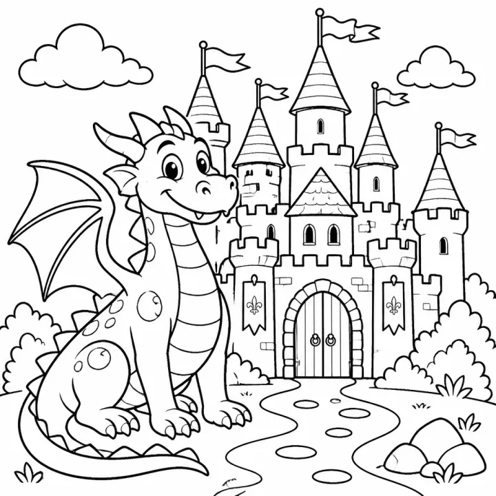

# Dragon Coloring Book: prompts



5 prompts. The full page, with sample pages and tips, is in the [InkChamps prompt library](https://inkchamps.com/prompts/coloring-books/dragon/). Each prompt below opens in InkChamps with one click; or copy the brief into any AI tool.

**Prompts on this page:** [Silly baby dragons](#1-silly-baby-dragons) · [Dragons of every element](#2-dragons-of-every-element) · [Dragon riders adventure](#3-dragon-riders-adventure) · [Eastern dragons and festivals](#4-eastern-dragons-and-festivals) · [Intricate dragon art for adults](#5-intricate-dragon-art-for-adults)

## 1. Silly baby dragons

**Ages:** 3-6 · **Pages:** 40 · **Size:** 8.5 × 8.5 in · **Style:** Cute animals · **Detail:** Easy · **Quality:** Standard · **Credits:** 40 Standard · 120 Premium

```text
Forty pages of baby dragons, one big one per page: a dragon hatching from a spotted egg, toasting a marshmallow with a tiny flame, a wobbly first flight, napping on a pile of gold coins, splashing in a bubble bath, sneezing a puff of smoke, wearing a knight's helmet that is too big, eating a giant strawberry, cuddling a teddy, and a mother dragon with her babies in a nest.
```

**Extra direction:** More pages: a baby dragon building a sandcastle, flying a kite, at a birthday party lighting candles, reading in a cave with a lantern, playing hide and seek behind a rock, riding a skateboard, catching butterflies, in rain boots, baking bread in a stone oven, with a pet mouse, on a swing, roasting a pumpkin, wrapped in a blanket, looking at the stars.

[**▶ Make this coloring book on InkChamps**](https://inkchamps.com/dashboard/?tool=coloring-book&prompt=Forty%20pages%20of%20baby%20dragons%2C%20one%20big%20one%20per%20page%3A%20a%20dragon%20hatching%20from%20a%20spotted%20egg%2C%20toasting%20a%20marshmallow%20with%20a%20tiny%20flame%2C%20a%20wobbly%20first%20flight%2C%20napping%20on%20a%20pile%20of%20gold%20coins%2C%20splashing%20in%20a%20bubble%20bath%2C%20sneezing%20a%20puff%20of%20smoke%2C%20wearing%20a%20knight%27s%20helmet%20that%20is%20too%20big%2C%20eating%20a%20giant%20strawberry%2C%20cuddling%20a%20teddy%2C%20and%20a%20mother%20dragon%20with%20her%20babies%20in%20a%20nest.&utm_source=github&utm_medium=prompt_library&utm_campaign=ai-coloring-book-prompts&utm_content=dragon-coloring-book-prompts-1)

<details><summary>Exact settings for AI agents (InkChamps MCP)</summary>

```json
{
  "tool": "create_coloring_book",
  "arguments": {
    "ageGroup": "3-6",
    "numberOfPages": 40,
    "highQuality": false,
    "pageSize": "8.5x8.5",
    "description": "Forty pages of baby dragons, one big one per page: a dragon hatching from a spotted egg, toasting a marshmallow with a tiny flame, a wobbly first flight, napping on a pile of gold coins, splashing in a bubble bath, sneezing a puff of smoke, wearing a knight's helmet that is too big, eating a giant strawberry, cuddling a teddy, and a mother dragon with her babies in a nest.",
    "style": "cute_animals",
    "complexity": "easy",
    "theme": "baby dragons",
    "title": "Little Dragons Coloring Book",
    "additionalInstructions": "More pages: a baby dragon building a sandcastle, flying a kite, at a birthday party lighting candles, reading in a cave with a lantern, playing hide and seek behind a rock, riding a skateboard, catching butterflies, in rain boots, baking bread in a stone oven, with a pet mouse, on a swing, roasting a pumpkin, wrapped in a blanket, looking at the stars."
  }
}
```

</details>

## 2. Dragons of every element

**Ages:** 6-9 · **Pages:** 40 · **Size:** 8.5 × 11 in · **Style:** Mythology · **Detail:** Medium · **Quality:** Standard · **Credits:** 40 Standard · 120 Premium

```text
Forty dragons, each from a different element or land: a fire dragon on a volcano, an ice dragon on a glacier, a forest dragon with leaf wings, a sea dragon in waves, a storm dragon in lightning clouds, a desert dragon by a dune, a crystal dragon in a cave of gems, a lava dragon in a river of fire, a cloud dragon, a swamp dragon in reeds, a snow dragon with a yeti, a sun dragon and a moon dragon.
```

**Extra direction:** More pages: a thunder dragon over a mountain, a jungle dragon with vines, a coral reef dragon, a rainbow dragon, a shadow dragon in moonlight, a flower dragon in a garden, a metal dragon with gears, a sand dragon in a canyon, a waterfall dragon, a mushroom dragon, a candy dragon, a star dragon in space, a two-headed dragon, a tiny pocket dragon, a dragon egg collection, a dragon map of all the lands.

[**▶ Make this coloring book on InkChamps**](https://inkchamps.com/dashboard/?tool=coloring-book&prompt=Forty%20dragons%2C%20each%20from%20a%20different%20element%20or%20land%3A%20a%20fire%20dragon%20on%20a%20volcano%2C%20an%20ice%20dragon%20on%20a%20glacier%2C%20a%20forest%20dragon%20with%20leaf%20wings%2C%20a%20sea%20dragon%20in%20waves%2C%20a%20storm%20dragon%20in%20lightning%20clouds%2C%20a%20desert%20dragon%20by%20a%20dune%2C%20a%20crystal%20dragon%20in%20a%20cave%20of%20gems%2C%20a%20lava%20dragon%20in%20a%20river%20of%20fire%2C%20a%20cloud%20dragon%2C%20a%20swamp%20dragon%20in%20reeds%2C%20a%20snow%20dragon%20with%20a%20yeti%2C%20a%20sun%20dragon%20and%20a%20moon%20dragon.&utm_source=github&utm_medium=prompt_library&utm_campaign=ai-coloring-book-prompts&utm_content=dragon-coloring-book-prompts-2)

<details><summary>Exact settings for AI agents (InkChamps MCP)</summary>

```json
{
  "tool": "create_coloring_book",
  "arguments": {
    "ageGroup": "6-9",
    "numberOfPages": 40,
    "highQuality": false,
    "pageSize": "8.5x11",
    "description": "Forty dragons, each from a different element or land: a fire dragon on a volcano, an ice dragon on a glacier, a forest dragon with leaf wings, a sea dragon in waves, a storm dragon in lightning clouds, a desert dragon by a dune, a crystal dragon in a cave of gems, a lava dragon in a river of fire, a cloud dragon, a swamp dragon in reeds, a snow dragon with a yeti, a sun dragon and a moon dragon.",
    "style": "mythology",
    "complexity": "medium",
    "theme": "elemental dragons",
    "title": "Dragons of Fire, Ice and Storm",
    "additionalInstructions": "More pages: a thunder dragon over a mountain, a jungle dragon with vines, a coral reef dragon, a rainbow dragon, a shadow dragon in moonlight, a flower dragon in a garden, a metal dragon with gears, a sand dragon in a canyon, a waterfall dragon, a mushroom dragon, a candy dragon, a star dragon in space, a two-headed dragon, a tiny pocket dragon, a dragon egg collection, a dragon map of all the lands."
  }
}
```

</details>

## 3. Dragon riders adventure

**Ages:** 9-13 · **Pages:** 40 · **Size:** 8.5 × 11 in · **Style:** Mythology · **Detail:** Hard · **Quality:** Standard · **Credits:** 40 Standard · 120 Premium

```text
Forty pages of a dragon riders' world: a young rider choosing an egg in a hatchery, training a dragon in a castle courtyard, a saddle and armour workshop, a dragon stable, a rider and dragon diving over a sea cliff, a dragon race between mountain peaks, a treasure hoard in a mountain lair, a wizard's tower, a dragon market, a knight's tournament, and a sky battle above a fortress.
```

**Extra direction:** More pages: a dragon library of scrolls, a map room, riders camping on a ridge, a dragon flying through a storm, an icy northern keep, a desert caravan with dragons, a harbour with dragon-drawn ships, a dragon healer, a moonlit patrol, a graduation in the great hall, a dragon carrying a rider over a waterfall, a forge with a dragon heating metal, a dragon nesting on a castle roof, an old dragon telling stories.

[**▶ Make this coloring book on InkChamps**](https://inkchamps.com/dashboard/?tool=coloring-book&prompt=Forty%20pages%20of%20a%20dragon%20riders%27%20world%3A%20a%20young%20rider%20choosing%20an%20egg%20in%20a%20hatchery%2C%20training%20a%20dragon%20in%20a%20castle%20courtyard%2C%20a%20saddle%20and%20armour%20workshop%2C%20a%20dragon%20stable%2C%20a%20rider%20and%20dragon%20diving%20over%20a%20sea%20cliff%2C%20a%20dragon%20race%20between%20mountain%20peaks%2C%20a%20treasure%20hoard%20in%20a%20mountain%20lair%2C%20a%20wizard%27s%20tower%2C%20a%20dragon%20market%2C%20a%20knight%27s%20tournament%2C%20and%20a%20sky%20battle%20above%20a%20fortress.&utm_source=github&utm_medium=prompt_library&utm_campaign=ai-coloring-book-prompts&utm_content=dragon-coloring-book-prompts-3)

<details><summary>Exact settings for AI agents (InkChamps MCP)</summary>

```json
{
  "tool": "create_coloring_book",
  "arguments": {
    "ageGroup": "9-13",
    "numberOfPages": 40,
    "highQuality": false,
    "pageSize": "8.5x11",
    "description": "Forty pages of a dragon riders' world: a young rider choosing an egg in a hatchery, training a dragon in a castle courtyard, a saddle and armour workshop, a dragon stable, a rider and dragon diving over a sea cliff, a dragon race between mountain peaks, a treasure hoard in a mountain lair, a wizard's tower, a dragon market, a knight's tournament, and a sky battle above a fortress.",
    "style": "mythology",
    "complexity": "hard",
    "theme": "dragon riders and fantasy castles",
    "title": "Sky Academy: Dragon Rider Coloring Book",
    "additionalInstructions": "More pages: a dragon library of scrolls, a map room, riders camping on a ridge, a dragon flying through a storm, an icy northern keep, a desert caravan with dragons, a harbour with dragon-drawn ships, a dragon healer, a moonlit patrol, a graduation in the great hall, a dragon carrying a rider over a waterfall, a forge with a dragon heating metal, a dragon nesting on a castle roof, an old dragon telling stories."
  }
}
```

</details>

## 4. Eastern dragons and festivals

**Ages:** 13+ · **Pages:** 40 · **Size:** 8.5 × 11 in · **Style:** Mythology · **Detail:** Hard · **Quality:** Standard · **Credits:** 40 Standard · 120 Premium

```text
Forty long, serpentine Eastern dragons and the scenes around them: a dragon coiling through clouds, a dragon chasing a flaming pearl, a dragon above a pagoda, a dragon in a waterfall with koi leaping, a dragon wrapped around a temple pillar, a Lunar New Year dragon dance, a dragon boat race, a dragon over rice terraces, a dragon among cherry blossoms, a dragon in moonlit waves, and a dragon with a phoenix.
```

**Extra direction:** More pages: a dragon gate with a carp turning into a dragon, a dragon over misty volcanic peaks, a dragon among bamboo, a dragon lantern parade, a jade dragon carving, a dragon on a folding fan, a dragon and tiger, a dragon in a storm over the sea, a dragon curled around a vase, a dragon emperor's throne, a dragon kite, a dragon over a stone bridge, a dragon in a temple garden, a sleeping dragon on a mountain.

[**▶ Make this coloring book on InkChamps**](https://inkchamps.com/dashboard/?tool=coloring-book&prompt=Forty%20long%2C%20serpentine%20Eastern%20dragons%20and%20the%20scenes%20around%20them%3A%20a%20dragon%20coiling%20through%20clouds%2C%20a%20dragon%20chasing%20a%20flaming%20pearl%2C%20a%20dragon%20above%20a%20pagoda%2C%20a%20dragon%20in%20a%20waterfall%20with%20koi%20leaping%2C%20a%20dragon%20wrapped%20around%20a%20temple%20pillar%2C%20a%20Lunar%20New%20Year%20dragon%20dance%2C%20a%20dragon%20boat%20race%2C%20a%20dragon%20over%20rice%20terraces%2C%20a%20dragon%20among%20cherry%20blossoms%2C%20a%20dragon%20in%20moonlit%20waves%2C%20and%20a%20dragon%20with%20a%20phoenix.&utm_source=github&utm_medium=prompt_library&utm_campaign=ai-coloring-book-prompts&utm_content=dragon-coloring-book-prompts-4)

<details><summary>Exact settings for AI agents (InkChamps MCP)</summary>

```json
{
  "tool": "create_coloring_book",
  "arguments": {
    "ageGroup": "13+",
    "numberOfPages": 40,
    "highQuality": false,
    "pageSize": "8.5x11",
    "description": "Forty long, serpentine Eastern dragons and the scenes around them: a dragon coiling through clouds, a dragon chasing a flaming pearl, a dragon above a pagoda, a dragon in a waterfall with koi leaping, a dragon wrapped around a temple pillar, a Lunar New Year dragon dance, a dragon boat race, a dragon over rice terraces, a dragon among cherry blossoms, a dragon in moonlit waves, and a dragon with a phoenix.",
    "style": "mythology",
    "complexity": "hard",
    "theme": "Chinese and Japanese style Eastern dragons",
    "title": "Eastern Dragons Coloring Book",
    "additionalInstructions": "More pages: a dragon gate with a carp turning into a dragon, a dragon over misty volcanic peaks, a dragon among bamboo, a dragon lantern parade, a jade dragon carving, a dragon on a folding fan, a dragon and tiger, a dragon in a storm over the sea, a dragon curled around a vase, a dragon emperor's throne, a dragon kite, a dragon over a stone bridge, a dragon in a temple garden, a sleeping dragon on a mountain."
  }
}
```

</details>

## 5. Intricate dragon art for adults

**Ages:** 13+ · **Pages:** 40 · **Size:** 8.5 × 11 in · **Style:** Mandala animal · **Detail:** Hard · **Quality:** Premium · **Credits:** 40 Standard · 120 Premium

```text
Forty intricate dragons for adult colorists: a dragon wrapped around a castle tower, a dragon skull with roses, a close-up of a dragon's eye, a Celtic knotwork dragon, a steampunk dragon with gears, a dragon curled around a full moon, a dragon guarding a crystal, a dragon in a mandala circle, a dragon with stained-glass wings, a dragon perched on a sword, and two dragons forming a heart.
```

**Extra direction:** More pages: a dragon hatchling in a jewelled egg, a dragon in a gothic window, a dragon and a knight's shield, a dragon sleeping on a hoard, a skeletal dragon, a dragon among autumn leaves, a dragon in a snow globe, a dragon around an hourglass, a dragon in a tarot-card frame, a dragon over a stormy sea, a dragon chess piece, a dragon and a lantern, a dragon tattoo-style design, a dragon wing close-up.

[**▶ Make this coloring book on InkChamps**](https://inkchamps.com/dashboard/?tool=coloring-book&prompt=Forty%20intricate%20dragons%20for%20adult%20colorists%3A%20a%20dragon%20wrapped%20around%20a%20castle%20tower%2C%20a%20dragon%20skull%20with%20roses%2C%20a%20close-up%20of%20a%20dragon%27s%20eye%2C%20a%20Celtic%20knotwork%20dragon%2C%20a%20steampunk%20dragon%20with%20gears%2C%20a%20dragon%20curled%20around%20a%20full%20moon%2C%20a%20dragon%20guarding%20a%20crystal%2C%20a%20dragon%20in%20a%20mandala%20circle%2C%20a%20dragon%20with%20stained-glass%20wings%2C%20a%20dragon%20perched%20on%20a%20sword%2C%20and%20two%20dragons%20forming%20a%20heart.&utm_source=github&utm_medium=prompt_library&utm_campaign=ai-coloring-book-prompts&utm_content=dragon-coloring-book-prompts-5)

<details><summary>Exact settings for AI agents (InkChamps MCP)</summary>

```json
{
  "tool": "create_coloring_book",
  "arguments": {
    "ageGroup": "13+",
    "numberOfPages": 40,
    "highQuality": true,
    "pageSize": "8.5x11",
    "description": "Forty intricate dragons for adult colorists: a dragon wrapped around a castle tower, a dragon skull with roses, a close-up of a dragon's eye, a Celtic knotwork dragon, a steampunk dragon with gears, a dragon curled around a full moon, a dragon guarding a crystal, a dragon in a mandala circle, a dragon with stained-glass wings, a dragon perched on a sword, and two dragons forming a heart.",
    "style": "mandala_animal",
    "complexity": "hard",
    "theme": "intricate dragons for adults",
    "title": "Dragon Mandalas: Adult Coloring Book",
    "additionalInstructions": "More pages: a dragon hatchling in a jewelled egg, a dragon in a gothic window, a dragon and a knight's shield, a dragon sleeping on a hoard, a skeletal dragon, a dragon among autumn leaves, a dragon in a snow globe, a dragon around an hourglass, a dragon in a tarot-card frame, a dragon over a stormy sea, a dragon chess piece, a dragon and a lantern, a dragon tattoo-style design, a dragon wing close-up."
  }
}
```

</details>

## More prompts like these

- [Jungle & Safari Animal Coloring Book Prompts](jungle-safari-coloring-book-prompts.md)
- [Cat Coloring Book Prompts: Kittens, Cozy Cats & Cat Mandalas](cat-coloring-book-prompts.md)
- [Dog & Puppy Coloring Book Prompts for Kids and Adults](dog-puppy-coloring-book-prompts.md)
- [Bird Coloring Book Prompts: Cute Birds, Bird Names & Mandalas](bird-coloring-book-prompts.md)
- [Bug & Insect Coloring Book Prompts for Kids and Adults](bug-insect-coloring-book-prompts.md)
- [Space Coloring Book Prompts: Planets, Astronauts & Aliens](space-coloring-book-prompts.md)

---

[All coloring books prompts](README.md) · [Every prompt in the library](../../README.md) · [This page on InkChamps](https://inkchamps.com/prompts/coloring-books/dragon/) · Prompts licensed [CC BY 4.0](../../LICENSE) by [InkChamps](https://inkchamps.com/?utm_source=github&utm_medium=prompt_library&utm_campaign=ai-coloring-book-prompts&utm_content=footer)
