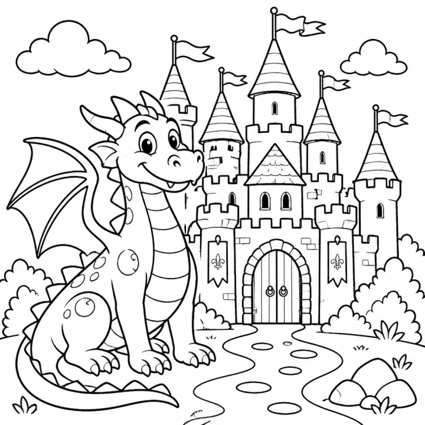

# Dragon Coloring Book: prompts



5 prompts. The full page, with sample pages and tips, is in the [InkChamps prompt library](https://inkchamps.com/prompts/coloring-books/dragon/). Each prompt below opens in InkChamps with one click; or copy the brief into any AI tool.

**Prompts on this page:** [Silly baby dragons](#1-silly-baby-dragons) · [Dragons of every element](#2-dragons-of-every-element) · [Dragon riders adventure](#3-dragon-riders-adventure) · [Eastern dragons and festivals](#4-eastern-dragons-and-festivals) · [Intricate dragon art for adults](#5-intricate-dragon-art-for-adults)

## 1. Silly baby dragons

**Ages:** 3-6 · **Pages:** 24 · **Size:** 8.5 × 8.5 in · **Style:** Cute animals · **Detail:** Easy · **Quality:** Standard · **Credits:** 24 Standard · 72 Premium

```text
24 pages of silly baby dragons, one big one per page, from hatching to bedtime: a dragon hatching from a spotted egg, a wobbly first flight, toasting a marshmallow with a tiny flame, sneezing a puff of smoke, splashing in a bubble bath, wearing a knight's helmet that is too big, eating a giant strawberry, building a sandcastle, flying a kite, lighting birthday candles, napping on a pile of gold coins, cuddling a teddy and a mother dragon with her babies in a nest.
```

### Page by page (24 pages)

Paste one page at a time into ChatGPT, Gemini or any AI image tool, with this line after it:

> Black-and-white coloring page for a child aged 3 to 6: one big, cute, chubby cartoon baby dragon filling most of the page, thick bold outlines, large simple shapes with wide spaces to color, very little background, no shading, no grey, no words, plain white background, square page.

1. A chubby baby dragon hatching from a big spotted egg in a straw nest, its head and two tiny wings poking out of the cracked shell, a smiling sun above.
2. A baby dragon on its very first flight, flapping its small wings hard just above a grassy hill, its feet dangling and a butterfly flying beside it.
3. A baby dragon at a campfire holding a long stick with a marshmallow on the end, toasting it with a tiny puff of flame from its mouth.
4. A baby dragon sneezing a big round puff of smoke, a dandelion in its paw and the seeds floating away in the air.
5. A baby dragon in a bubble bath in a round tub, a rubber duck floating beside it and big bubbles on its head and spiky tail.
6. A baby dragon wearing a shiny knight's helmet that is far too big, the visor slipping over its eyes, holding a small wooden sword.
7. A baby dragon hugging a giant strawberry almost as big as itself, taking a happy bite, two strawberry leaves on top.
8. A baby dragon at the beach patting the top of a sandcastle with a little spade, a bucket and a starfish beside it.
9. A baby dragon running across a meadow with a diamond kite on a string, the kite's bow tail flying high behind it.
10. A baby dragon at a birthday party lighting the candles on a big round cake with a careful little flame, balloons tied to its chair.
11. A baby dragon in rain boots splashing in a big puddle, raindrops falling and a small umbrella held over its head.
12. A baby dragon chasing butterflies through tall flowers with a butterfly net, two butterflies flying just out of reach.
13. A baby dragon riding a skateboard down a gentle path, wings spread out for balance and a big grin on its face.
14. A baby dragon peeking out from behind a big round rock playing hide and seek, its long tail sticking out the other side.
15. A baby dragon in an apron baking a round loaf of bread in a little stone oven, warming the oven with a tiny flame.
16. A baby dragon holding a big pumpkin and roasting it with a small flame, a pile of pumpkins and autumn leaves beside it.
17. A baby dragon sitting with its pet mouse on a cushion, sharing a big wedge of cheese, the mouse nibbling one corner.
18. A baby dragon swinging high on a rope swing hung from a tree branch, its wings and tail flying out behind it.
19. A baby dragon sitting in a cozy cave reading a picture book by the light of a round lantern, a pillow under it.
20. A baby dragon curled up asleep on a pile of round gold coins, a crown tipped sideways on its head.
21. A baby dragon wrapped in a fluffy blanket sipping a mug of warm cocoa, steam curling up from the mug.
22. A baby dragon lying on its back on a hill looking at the stars, a crescent moon and three big stars in the sky.
23. A baby dragon in pajamas hugging its teddy bear, yawning, standing beside a little bed with a round pillow.
24. A mother dragon curled around a nest with three sleepy baby dragons snuggled together, her wing tucked over them like a blanket.

[**▶ Make this coloring book on InkChamps**](https://inkchamps.com/dashboard/?tool=coloring-book&prompt=24%20pages%20of%20silly%20baby%20dragons%2C%20one%20big%20one%20per%20page%2C%20from%20hatching%20to%20bedtime%3A%20a%20dragon%20hatching%20from%20a%20spotted%20egg%2C%20a%20wobbly%20first%20flight%2C%20toasting%20a%20marshmallow%20with%20a%20tiny%20flame%2C%20sneezing%20a%20puff%20of%20smoke%2C%20splashing%20in%20a%20bubble%20bath%2C%20wearing%20a%20knight%27s%20helmet%20that%20is%20too%20big%2C%20eating%20a%20giant%20strawberry%2C%20building%20a%20sandcastle%2C%20flying%20a%20kite%2C%20lighting%20birthday%20candles%2C%20napping%20on%20a%20pile%20of%20gold%20coins%2C%20cuddling%20a%20teddy%20and%20a%20mother%20dragon%20with%20her%20babies%20in%20a%20nest.&utm_source=github&utm_medium=prompt_library&utm_campaign=ai-coloring-book-prompts&utm_content=dragon-coloring-book-prompts-1)

<details><summary>Exact settings for AI agents (InkChamps MCP)</summary>

```json
{
  "tool": "create_coloring_book",
  "arguments": {
    "ageGroup": "3-6",
    "numberOfPages": 24,
    "highQuality": false,
    "pageSize": "8.5x8.5",
    "description": "24 pages of silly baby dragons, one big one per page, from hatching to bedtime: a dragon hatching from a spotted egg, a wobbly first flight, toasting a marshmallow with a tiny flame, sneezing a puff of smoke, splashing in a bubble bath, wearing a knight's helmet that is too big, eating a giant strawberry, building a sandcastle, flying a kite, lighting birthday candles, napping on a pile of gold coins, cuddling a teddy and a mother dragon with her babies in a nest.",
    "style": "cute_animals",
    "complexity": "easy",
    "theme": "baby dragons",
    "title": "Little Dragons Coloring Book"
  }
}
```

</details>

## 2. Dragons of every element

**Ages:** 6-9 · **Pages:** 24 · **Size:** 8.5 × 11 in · **Style:** Mythology · **Detail:** Medium · **Quality:** Standard · **Credits:** 24 Standard · 72 Premium

```text
24 dragons, each from a different element or land: a fire dragon on a volcano, an ice dragon on a glacier, a forest dragon with leaf wings, a sea dragon in waves, a storm dragon in lightning clouds, a desert dragon by a dune, a crystal dragon in a cave of gems, a lava dragon, a cloud dragon, a swamp dragon, a snow dragon with a yeti, a sun dragon, a moon dragon, a coral reef dragon, a metal dragon with gears, a flower dragon, a mushroom dragon, a star dragon in space and a map of all the dragon lands.
```

### Page by page (24 pages)

Paste one page at a time into ChatGPT, Gemini or any AI image tool, with this line after it:

> Black-and-white coloring page for a child aged 6 to 9: one friendly cartoon dragon as the main subject, clear bold outlines, medium detail with a simple background that shows its home land, no shading, no grey, no words or letters, plain white background, portrait 8.5 x 11 page.

1. A fire dragon perched on the rim of a smoking volcano, flames curling from its nostrils and lava bubbling in the crater below.
2. An ice dragon with icicle spikes along its back standing on a glacier, frosty breath blowing and a penguin watching from an ice floe.
3. A forest dragon with wings made of big leaves resting on a mossy log, mushrooms at its feet and an owl in the tree above.
4. A sea dragon with fins for wings leaping out of a big curling wave, a sailboat in the distance and fish jumping beside it.
5. A storm dragon flying through dark clouds, lightning bolts crackling from its horns and raindrops falling below.
6. A desert dragon with sandy scales lying on top of a tall dune, a camel and a cactus nearby and a hot sun overhead.
7. A crystal dragon with gem-shaped scales sitting in a cave full of pointed crystals, sparkles around its wings.
8. A lava dragon wading through a glowing river of fire between black rocks, steam rising around its tail.
9. A fluffy cloud dragon with puffy cloud wings drifting across the sky, a rainbow behind it and a hot air balloon nearby.
10. A swamp dragon peeking out of tall reeds and lily pads, a frog sitting on its nose and dragonflies buzzing around.
11. A snow dragon and a friendly yeti building a snowman together on a snowy mountain, pine trees behind them.
12. A candy dragon with gumdrop spikes and a striped candy-cane tail sitting among lollipop trees and gumdrop hills.
13. A jungle dragon with vines wrapped around its legs climbing a giant tree, a parrot and a monkey sitting on the branches.
14. A coral reef dragon swimming underwater among branching corals, a sea turtle, a clownfish and a starfish around it.
15. A sun dragon with a ring of flame-shaped rays around its head flying above a field of sunflowers.
16. A moon dragon curled on a crescent moon at night, stars twinkling and a sleepy owl perched on the moon's tip.
17. A flower dragon sitting in a garden with petals for scales, bees buzzing around the roses and tulips at its feet.
18. A metal dragon built from gears, bolts and pipes standing in a workshop, a wrench and a toolbox on the floor.
19. A waterfall dragon diving down a tall waterfall, water splashing into a pool below and rocks on both sides.
20. A mushroom dragon with spotted toadstool caps on its back resting in a forest clearing, snails and fireflies around it.
21. A rainbow dragon with striped wings arching over a hill like a rainbow, a pot of coins at the end of its tail.
22. A star dragon flying through outer space past ringed planets, its wings dotted with stars and a comet behind it.
23. A two-headed dragon on a stone bridge, one head breathing fire and the other blowing ice crystals.
24. A treasure map of the dragon lands with a volcano, a glacier, a forest, a desert and a sea, small dragons flying above each place and a compass in the corner.

[**▶ Make this coloring book on InkChamps**](https://inkchamps.com/dashboard/?tool=coloring-book&prompt=24%20dragons%2C%20each%20from%20a%20different%20element%20or%20land%3A%20a%20fire%20dragon%20on%20a%20volcano%2C%20an%20ice%20dragon%20on%20a%20glacier%2C%20a%20forest%20dragon%20with%20leaf%20wings%2C%20a%20sea%20dragon%20in%20waves%2C%20a%20storm%20dragon%20in%20lightning%20clouds%2C%20a%20desert%20dragon%20by%20a%20dune%2C%20a%20crystal%20dragon%20in%20a%20cave%20of%20gems%2C%20a%20lava%20dragon%2C%20a%20cloud%20dragon%2C%20a%20swamp%20dragon%2C%20a%20snow%20dragon%20with%20a%20yeti%2C%20a%20sun%20dragon%2C%20a%20moon%20dragon%2C%20a%20coral%20reef%20dragon%2C%20a%20metal%20dragon%20with%20gears%2C%20a%20flower%20dragon%2C%20a%20mushroom%20dragon%2C%20a%20star%20dragon%20in%20space%20and%20a%20map%20of%20all%20the%20dragon%20lands.&utm_source=github&utm_medium=prompt_library&utm_campaign=ai-coloring-book-prompts&utm_content=dragon-coloring-book-prompts-2)

<details><summary>Exact settings for AI agents (InkChamps MCP)</summary>

```json
{
  "tool": "create_coloring_book",
  "arguments": {
    "ageGroup": "6-9",
    "numberOfPages": 24,
    "highQuality": false,
    "pageSize": "8.5x11",
    "description": "24 dragons, each from a different element or land: a fire dragon on a volcano, an ice dragon on a glacier, a forest dragon with leaf wings, a sea dragon in waves, a storm dragon in lightning clouds, a desert dragon by a dune, a crystal dragon in a cave of gems, a lava dragon, a cloud dragon, a swamp dragon, a snow dragon with a yeti, a sun dragon, a moon dragon, a coral reef dragon, a metal dragon with gears, a flower dragon, a mushroom dragon, a star dragon in space and a map of all the dragon lands.",
    "style": "mythology",
    "complexity": "medium",
    "theme": "elemental dragons",
    "title": "Dragons of Fire, Ice and Storm"
  }
}
```

</details>

## 3. Dragon riders adventure

**Ages:** 9-13 · **Pages:** 24 · **Size:** 8.5 × 11 in · **Style:** Mythology · **Detail:** Hard · **Quality:** Standard · **Credits:** 24 Standard · 72 Premium

```text
24 pages that follow a young rider through a dragon riders' academy: choosing an egg in the hatchery, the hatching, training in the castle courtyard, the saddle and armour workshop, the dragon stable, a library of scrolls, a map room, a dive over a sea cliff, a race between mountain peaks, camping on a ridge, a desert caravan, an icy northern keep, a treasure hoard, a dragon market, a tournament, a sky battle above a fortress and graduation in the great hall.
```

### Page by page (24 pages)

Paste one page at a time into ChatGPT, Gemini or any AI image tool, with this line after it:

> Black-and-white coloring page for ages 9 to 13: a detailed fantasy scene of a young dragon rider and a realistic dragon, fine clean outlines, detailed scales, armour, castles and landscape with many separate areas to color, no shading, no grey, no words, plain white background, portrait 8.5 x 11 page.

1. A young rider in a hooded cloak walking along rows of large dragon eggs in a warm stone hatchery, reaching out to touch one ridged egg.
2. The chosen egg cracking open on a bed of straw, a baby dragon pushing its head out while the young rider kneels close beside it.
3. The young rider feeding a growing dragon a fish from a bucket in a stone stable, saddles and bridles hanging on hooks along the wall.
4. A training session in a castle courtyard, the rider holding a long rope while the young dragon practises take-off, an instructor watching from the steps.
5. A saddle and armour workshop with a leatherworker fitting a saddle to a dragon's back, tools, buckles and wing guards on the workbench.
6. A blacksmith's forge where a dragon heats a glowing iron bar with its breath while the smith hammers it on an anvil.
7. A tall academy library with ladders, shelves of rolled scrolls and a dragon peering in through a round window at the rider reading.
8. A map room with a huge map table, model castles, a compass and two riders planning a route, their dragons watching from an archway.
9. The rider and dragon diving off a sea cliff toward crashing waves, seabirds scattering and a lighthouse on the headland.
10. A dragon race between jagged mountain peaks, three riders on dragons rounding a banner pole, clouds streaming past.
11. Riders camping on a high ridge at dusk, a small campfire, bedrolls and two dragons curled around the camp to keep it warm.
12. A dragon flying through a storm, rain lashing and lightning splitting the sky, the rider holding tight to the saddle.
13. A desert caravan of camels and carts crossing the dunes with dragons flying guard overhead, a stone oasis tower in the distance.
14. An icy northern keep on an ice-covered cliff, a frost-covered dragon landing on the battlements and the rider wrapped in furs.
15. A busy harbour where dragons pull sailing ships into the docks on thick ropes, crates and nets stacked on the pier.
16. A dragon market square with stalls selling saddles, dragon treats and lanterns, small dragons perched on the stall roofs.
17. A dragon healer bandaging a dragon's injured wing in an infirmary, jars of herbs and a mortar and pestle on the shelf.
18. A mountain lair full of treasure, a huge old dragon asleep on piles of coins, goblets and crowns while the rider tiptoes past.
19. A wizard's tower on a rocky island, a dragon circling the top where the wizard leans out of a window holding a glowing staff.
20. A knight's tournament field with striped tents, pennants and a crowd in the stands, two riders on dragons saluting each other.
21. A moonlit patrol, the rider and dragon gliding over a sleeping castle town, a full moon and rooftops below.
22. A sky battle above a fortress, academy riders on dragons defending the walls against a giant wild dragon, catapults on the towers.
23. An old grey dragon telling stories to young riders sitting around a fireplace in the common room, cups and blankets around them.
24. Graduation in the great hall, the rider kneeling to receive a rider's badge, the dragon standing proudly behind with its wings raised and banners hanging above.

[**▶ Make this coloring book on InkChamps**](https://inkchamps.com/dashboard/?tool=coloring-book&prompt=24%20pages%20that%20follow%20a%20young%20rider%20through%20a%20dragon%20riders%27%20academy%3A%20choosing%20an%20egg%20in%20the%20hatchery%2C%20the%20hatching%2C%20training%20in%20the%20castle%20courtyard%2C%20the%20saddle%20and%20armour%20workshop%2C%20the%20dragon%20stable%2C%20a%20library%20of%20scrolls%2C%20a%20map%20room%2C%20a%20dive%20over%20a%20sea%20cliff%2C%20a%20race%20between%20mountain%20peaks%2C%20camping%20on%20a%20ridge%2C%20a%20desert%20caravan%2C%20an%20icy%20northern%20keep%2C%20a%20treasure%20hoard%2C%20a%20dragon%20market%2C%20a%20tournament%2C%20a%20sky%20battle%20above%20a%20fortress%20and%20graduation%20in%20the%20great%20hall.&utm_source=github&utm_medium=prompt_library&utm_campaign=ai-coloring-book-prompts&utm_content=dragon-coloring-book-prompts-3)

<details><summary>Exact settings for AI agents (InkChamps MCP)</summary>

```json
{
  "tool": "create_coloring_book",
  "arguments": {
    "ageGroup": "9-13",
    "numberOfPages": 24,
    "highQuality": false,
    "pageSize": "8.5x11",
    "description": "24 pages that follow a young rider through a dragon riders' academy: choosing an egg in the hatchery, the hatching, training in the castle courtyard, the saddle and armour workshop, the dragon stable, a library of scrolls, a map room, a dive over a sea cliff, a race between mountain peaks, camping on a ridge, a desert caravan, an icy northern keep, a treasure hoard, a dragon market, a tournament, a sky battle above a fortress and graduation in the great hall.",
    "style": "mythology",
    "complexity": "hard",
    "theme": "dragon riders and fantasy castles",
    "title": "Sky Academy: Dragon Rider Coloring Book"
  }
}
```

</details>

## 4. Eastern dragons and festivals

**Ages:** 13+ · **Pages:** 24 · **Size:** 8.5 × 11 in · **Style:** Mythology · **Detail:** Hard · **Quality:** Standard · **Credits:** 24 Standard · 72 Premium

```text
24 long, serpentine Eastern dragons and the scenes around them: a dragon coiling through clouds, chasing a flaming pearl, above a pagoda, in a waterfall with koi leaping, wrapped around a temple pillar, a carp leaping the dragon gate, a Lunar New Year dragon dance, a lantern parade, a dragon boat race, rice terraces, bamboo, cherry blossoms, moonlit waves, a dragon with a phoenix, a dragon and a tiger, a dragon kite, a stone bridge and a dragon asleep on a mountain.
```

### Page by page (24 pages)

Paste one page at a time into ChatGPT, Gemini or any AI image tool, with this line after it:

> Black-and-white coloring page for teens and adults: a long, serpentine Eastern dragon with flowing whiskers and a scaled body, fine detailed line work, swirling clouds, waves and scenery with many small areas to color, no shading, no grey, no words or characters, plain white background, portrait 8.5 x 11 page.

1. A long Eastern dragon coiling through swirling clouds, its whiskers streaming and its clawed feet reaching out of the mist.
2. An Eastern dragon chasing a flaming pearl across the sky, its body curving in an S-shape and flames rising from the pearl.
3. An Eastern dragon winding around the top of a five-storey pagoda, bells hanging from each curved roof corner.
4. An Eastern dragon rising out of a tall waterfall, koi fish leaping up the falls beside it and spray bursting from the rocks.
5. A carp leaping over an ornate stone gate at the top of a waterfall, its tail turning into the scaled body of a dragon.
6. An Eastern dragon wrapped around a carved temple pillar, its head resting on the roof beam among roof tiles.
7. A Lunar New Year dragon dance in a street, dancers holding the long dragon costume up on poles, drums and firecrackers around them.
8. A lantern parade at night, a long dragon lantern carried above the crowd beneath strings of round paper lanterns.
9. A dragon boat race on a river, long boats with carved dragon heads at the bow, rowers pulling oars and a drummer at the front.
10. An Eastern dragon gliding over stepped rice terraces in the mountains, a small farmhouse and a farmer in a straw hat below.
11. An Eastern dragon weaving through a dense bamboo forest, tall stalks and long narrow leaves all around its body.
12. An Eastern dragon resting among cherry blossom branches, petals drifting through the air and a small arched bridge below.
13. An Eastern dragon surging out of moonlit ocean waves, curling wave crests and a full moon behind it.
14. An Eastern dragon and a phoenix circling each other in the sky, the dragon's scales and the phoenix's long tail feathers intertwined.
15. A dragon in the clouds facing a tiger on a rocky cliff below, the tiger roaring up and pine trees bending in the wind.
16. An Eastern dragon flying over misty volcanic peaks, a thin plume of smoke rising from one summit.
17. An Eastern dragon in a storm over the sea, lightning around its horns and a small fishing boat tossed on the waves below.
18. An Eastern dragon curled around a tall decorated vase, its tail wrapping the base and peonies painted on the vase.
19. An emperor's throne room with a carved dragon coiling up the back of an empty throne, incense burners on either side.
20. A jade dragon carving displayed on a wooden stand, a round pierced disc held in the dragon's claws.
21. An Eastern dragon painted across an open folding fan, pine branches and clouds around it on the fan's pleats.
22. A long dragon kite flying above a hillside, its segmented body trailing in the wind and children holding the line below.
23. An Eastern dragon drinking from a stream beneath an old stone arch bridge in a temple garden, a stone lantern and a pine tree beside it.
24. An Eastern dragon asleep, coiled around the peak of a mountain, its head resting on its claws and clouds drifting around the summit.

[**▶ Make this coloring book on InkChamps**](https://inkchamps.com/dashboard/?tool=coloring-book&prompt=24%20long%2C%20serpentine%20Eastern%20dragons%20and%20the%20scenes%20around%20them%3A%20a%20dragon%20coiling%20through%20clouds%2C%20chasing%20a%20flaming%20pearl%2C%20above%20a%20pagoda%2C%20in%20a%20waterfall%20with%20koi%20leaping%2C%20wrapped%20around%20a%20temple%20pillar%2C%20a%20carp%20leaping%20the%20dragon%20gate%2C%20a%20Lunar%20New%20Year%20dragon%20dance%2C%20a%20lantern%20parade%2C%20a%20dragon%20boat%20race%2C%20rice%20terraces%2C%20bamboo%2C%20cherry%20blossoms%2C%20moonlit%20waves%2C%20a%20dragon%20with%20a%20phoenix%2C%20a%20dragon%20and%20a%20tiger%2C%20a%20dragon%20kite%2C%20a%20stone%20bridge%20and%20a%20dragon%20asleep%20on%20a%20mountain.&utm_source=github&utm_medium=prompt_library&utm_campaign=ai-coloring-book-prompts&utm_content=dragon-coloring-book-prompts-4)

<details><summary>Exact settings for AI agents (InkChamps MCP)</summary>

```json
{
  "tool": "create_coloring_book",
  "arguments": {
    "ageGroup": "13+",
    "numberOfPages": 24,
    "highQuality": false,
    "pageSize": "8.5x11",
    "description": "24 long, serpentine Eastern dragons and the scenes around them: a dragon coiling through clouds, chasing a flaming pearl, above a pagoda, in a waterfall with koi leaping, wrapped around a temple pillar, a carp leaping the dragon gate, a Lunar New Year dragon dance, a lantern parade, a dragon boat race, rice terraces, bamboo, cherry blossoms, moonlit waves, a dragon with a phoenix, a dragon and a tiger, a dragon kite, a stone bridge and a dragon asleep on a mountain.",
    "style": "mythology",
    "complexity": "hard",
    "theme": "Chinese and Japanese style Eastern dragons",
    "title": "Eastern Dragons Coloring Book"
  }
}
```

</details>

## 5. Intricate dragon art for adults

**Ages:** 13+ · **Pages:** 24 · **Size:** 8.5 × 11 in · **Style:** Mandala animal · **Detail:** Hard · **Quality:** Premium · **Credits:** 24 Standard · 72 Premium

```text
24 intricate dragons for adult colorists: a dragon wrapped around a castle tower, a dragon skull with roses, a close-up of a dragon's eye, a Celtic knotwork dragon, a steampunk dragon with gears, a dragon curled around a full moon, a dragon guarding a crystal, a dragon in a mandala circle, stained-glass wings, a dragon on a sword, a hatchling in a jewelled egg, a gothic window, a hoard, a skeletal dragon, autumn leaves, a snow globe, an hourglass and two dragons forming a heart.
```

### Page by page (24 pages)

Paste one page at a time into ChatGPT, Gemini or any AI image tool, with this line after it:

> Black-and-white adult coloring page: an intricate dragon design with fine, crisp line work, scales and wings filled with mandala, zentangle or geometric patterns, many small areas to color, a balanced composition that fills the page, no shading, no grey, no words, plain white background, portrait 8.5 x 11 page.

1. A dragon wrapped in a spiral around a tall castle tower, its wings spread over the battlements and every scale filled with tiny patterns.
2. A dragon skull in side view surrounded by blooming roses and thorny stems, the skull filled with fine geometric patterns.
3. A close-up of a dragon's eye filling the page, the iris made of radiating mandala rings and the scales around it in a honeycomb pattern.
4. A Celtic knotwork dragon whose body loops and weaves into an endless knot, its head and tail meeting in the center.
5. A steampunk dragon built from gears, rivets, pipes and pressure gauges, its wings made of brass panels and cogs.
6. A dragon curled around a huge full moon, the moon filled with a mandala and small stars scattered around the edge.
7. A dragon guarding a large faceted crystal on a rocky ledge, its claws wrapped around the crystal's base and gems at its feet.
8. A dragon coiled inside a round mandala, its body forming the outer ring and layers of petals filling the center.
9. A dragon with stained-glass wings, each wing divided into many sections by thick lead lines, perched on a stone arch.
10. A dragon perched on the hilt of a sword planted in a rock, its tail wrapped around the blade and patterned bands along the hilt.
11. A dragon hatchling breaking out of a jewelled egg covered in filigree and set gems, shell fragments around it.
12. A dragon framed in a tall gothic window with pointed arches and tracery, ivy climbing the stone frame.
13. A dragon curled up asleep on a hoard of coins, goblets, crowns and jewels, every coin carrying a tiny pattern.
14. A skeletal dragon with every bone outlined in detail, perched on a cliff with patterned clouds behind it.
15. A dragon among swirling autumn leaves of oak, maple and ginkgo, each leaf filled with a different pattern.
16. A small dragon curled inside a snow globe on a carved base, snowflakes falling around it and a tiny pine tree beside it.
17. A dragon wrapped around an ornate hourglass, sand pouring through the middle and its wings framing the top.
18. A dragon inside an ornate card-style frame with a sun at the top, a moon at the bottom and stars in each corner.
19. A dragon rising over a stormy sea, the waves drawn as swirling patterns and lightning splitting the clouds behind it.
20. A dragon sculpted as a chess piece standing on a checkered board, a knight and a castle piece beside it.
21. A dragon holding a glowing hanging lantern in its claws, the lantern panels filled with filigree and moths circling it.
22. A bold tattoo-style dragon curling across the page with flowing flames, peony flowers and wind swirls around it.
23. A close-up of a single outstretched dragon wing filling the page, each membrane panel holding a different zentangle pattern.
24. Two dragons facing each other with their necks and tails curving to form a heart, roses and vines filling the space inside.

[**▶ Make this coloring book on InkChamps**](https://inkchamps.com/dashboard/?tool=coloring-book&prompt=24%20intricate%20dragons%20for%20adult%20colorists%3A%20a%20dragon%20wrapped%20around%20a%20castle%20tower%2C%20a%20dragon%20skull%20with%20roses%2C%20a%20close-up%20of%20a%20dragon%27s%20eye%2C%20a%20Celtic%20knotwork%20dragon%2C%20a%20steampunk%20dragon%20with%20gears%2C%20a%20dragon%20curled%20around%20a%20full%20moon%2C%20a%20dragon%20guarding%20a%20crystal%2C%20a%20dragon%20in%20a%20mandala%20circle%2C%20stained-glass%20wings%2C%20a%20dragon%20on%20a%20sword%2C%20a%20hatchling%20in%20a%20jewelled%20egg%2C%20a%20gothic%20window%2C%20a%20hoard%2C%20a%20skeletal%20dragon%2C%20autumn%20leaves%2C%20a%20snow%20globe%2C%20an%20hourglass%20and%20two%20dragons%20forming%20a%20heart.&utm_source=github&utm_medium=prompt_library&utm_campaign=ai-coloring-book-prompts&utm_content=dragon-coloring-book-prompts-5)

<details><summary>Exact settings for AI agents (InkChamps MCP)</summary>

```json
{
  "tool": "create_coloring_book",
  "arguments": {
    "ageGroup": "13+",
    "numberOfPages": 24,
    "highQuality": true,
    "pageSize": "8.5x11",
    "description": "24 intricate dragons for adult colorists: a dragon wrapped around a castle tower, a dragon skull with roses, a close-up of a dragon's eye, a Celtic knotwork dragon, a steampunk dragon with gears, a dragon curled around a full moon, a dragon guarding a crystal, a dragon in a mandala circle, stained-glass wings, a dragon on a sword, a hatchling in a jewelled egg, a gothic window, a hoard, a skeletal dragon, autumn leaves, a snow globe, an hourglass and two dragons forming a heart.",
    "style": "mandala_animal",
    "complexity": "hard",
    "theme": "intricate dragons for adults",
    "title": "Dragon Mandalas: Adult Coloring Book"
  }
}
```

</details>

## More prompts like these

- [Jungle & Safari Animal Coloring Book Prompts](jungle-safari-coloring-book-prompts.md)
- [Cat Coloring Book Prompts: Kittens, Cozy Cats & Cat Mandalas](cat-coloring-book-prompts.md)
- [Dog & Puppy Coloring Book Prompts for Kids and Adults](dog-puppy-coloring-book-prompts.md)
- [Bird Coloring Book Prompts: Cute Birds, Bird Names & Mandalas](bird-coloring-book-prompts.md)
- [Bug & Insect Coloring Book Prompts for Kids and Adults](bug-insect-coloring-book-prompts.md)
- [Space Coloring Book Prompts: Planets, Astronauts & Aliens](space-coloring-book-prompts.md)

---

[All coloring books prompts](README.md) · [Every prompt in the library](../../README.md) · [This page on InkChamps](https://inkchamps.com/prompts/coloring-books/dragon/) · Prompts licensed [CC BY 4.0](../../LICENSE) by [InkChamps](https://inkchamps.com/?utm_source=github&utm_medium=prompt_library&utm_campaign=ai-coloring-book-prompts&utm_content=footer)
