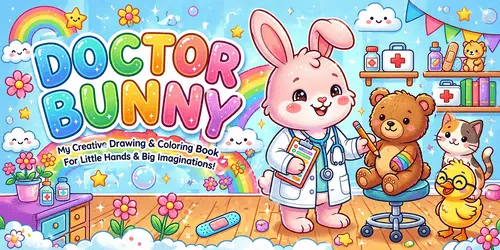

# Easter & Spring Coloring Book: prompts



5 prompts. The full page, with sample pages and tips, is in the [InkChamps prompt library](https://inkchamps.com/prompts/coloring-books/easter-spring/). Each prompt below opens in InkChamps with one click; or copy the brief into any AI tool.

**Prompts on this page:** [Bunnies and chicks for toddlers](#1-bunnies-and-chicks-for-toddlers) · [Easter egg hunt adventure](#2-easter-egg-hunt-adventure) · [Spring outdoors for tweens](#3-spring-outdoors-for-tweens) · [Spring baby animals for adults](#4-spring-baby-animals-for-adults) · [Folk-art decorated eggs](#5-folk-art-decorated-eggs)

## 1. Bunnies and chicks for toddlers

**Ages:** 3-6 · **Pages:** 24 · **Size:** 8.5 × 11 in · **Style:** Cute animals · **Detail:** Easy · **Quality:** Standard · **Credits:** 24 Standard · 72 Premium

```text
24 simple Easter pictures for toddlers: a bunny holding a big egg, a chick hatching from its shell, a basket full of eggs, a lamb with a flower crown, a duckling in a puddle, a bunny painting an egg, a hen on her nest, a chick in a teacup, a bunny on a bicycle, a chick with an umbrella, a jar of jelly beans, a duck family in a row, a bunny family picnic and a bunny asleep in a basket at the end of the day.
```

### Page by page (24 pages)

Paste one page at a time into ChatGPT, Gemini or any AI image tool, with this line after it:

> Black-and-white coloring page for a child aged 3 to 6: one big, cute, chubby cartoon bunny, chick or baby animal filling most of the page, thick bold outlines, large simple shapes with wide spaces to color, very little background, no shading, no grey, no words, plain white background, portrait 8.5 x 11 page.

1. A chubby baby bunny standing on its back feet, hugging a giant Easter egg with wide zigzag stripes, its long ears up and a big smile.
2. A fluffy baby chick hatching from a cracked egg, the top half of the shell sitting on its head like a hat, a few shell pieces on the grass.
3. A round wicker Easter basket with a big bow on the handle, filled with five large eggs, each one with simple stripes, dots or zigzags.
4. A bunny sitting at a little table painting a big egg with a paintbrush, two paint pots beside it and a finished spotted egg nearby.
5. A mother hen sitting on her straw nest with two fluffy chicks peeking out from under her wings.
6. A woolly baby lamb wearing a crown of daisies, standing in short grass with two big tulips beside it.
7. A baby duckling in tiny rain boots splashing in a round puddle, three raindrops falling and a small cloud above.
8. A bunny pulling a big carrot out of the ground in a carrot patch, two more carrot tops still poking out of the soil.
9. A small yellow chick sitting inside a teacup on a saucer, a little spoon beside the cup and one tiny flower.
10. A bunny wearing a spring bonnet with a big flower and a ribbon, holding a single tulip in its paw.
11. A chick holding a small umbrella while gentle raindrops fall, standing on a little patch of grass with one mushroom.
12. A round straw nest on a branch with three big speckled eggs inside and a leaf on each side.
13. A bunny riding a little bicycle with a basket on the front, two Easter eggs sitting in the basket.
14. A chick sitting in a toy car with big round wheels, a giant egg with a bow tied around it in the back seat.
15. A big glass jar full of round jelly beans with a bow on the lid, a small bunny peeking out from behind it.
16. A bunny pushing a wooden wheelbarrow piled with four big Easter eggs along a short garden path.
17. A fat caterpillar crawling across a large leaf, a simple butterfly with big round wings fluttering above it.
18. A mother duck walking in a line with three ducklings behind her, the smallest duckling running to keep up.
19. A bunny family of three having a picnic on a checked blanket with a basket, a carrot cake and two cups.
20. A bunny holding the string of a big round balloon shaped like an egg, a few tufts of grass at its feet.
21. Two long bunny ears and two round eyes peeking out from a clump of tall grass, a big egg hidden beside it.
22. A hollow chocolate bunny with a big bow around its neck, standing in a little nest of paper grass next to two foil-wrapped eggs.
23. A tall carrot-shaped cake on a plate with frosting leaves on top, a bunny standing beside it licking its lips.
24. A sleepy bunny curled up asleep inside an Easter basket on a soft blanket, a crescent moon and two stars above.

[**▶ Make this coloring book on InkChamps**](https://inkchamps.com/dashboard/?tool=coloring-book&prompt=24%20simple%20Easter%20pictures%20for%20toddlers%3A%20a%20bunny%20holding%20a%20big%20egg%2C%20a%20chick%20hatching%20from%20its%20shell%2C%20a%20basket%20full%20of%20eggs%2C%20a%20lamb%20with%20a%20flower%20crown%2C%20a%20duckling%20in%20a%20puddle%2C%20a%20bunny%20painting%20an%20egg%2C%20a%20hen%20on%20her%20nest%2C%20a%20chick%20in%20a%20teacup%2C%20a%20bunny%20on%20a%20bicycle%2C%20a%20chick%20with%20an%20umbrella%2C%20a%20jar%20of%20jelly%20beans%2C%20a%20duck%20family%20in%20a%20row%2C%20a%20bunny%20family%20picnic%20and%20a%20bunny%20asleep%20in%20a%20basket%20at%20the%20end%20of%20the%20day.&utm_source=github&utm_medium=prompt_library&utm_campaign=ai-coloring-book-prompts&utm_content=easter-spring-coloring-book-prompts-1)

<details><summary>Exact settings for AI agents (InkChamps MCP)</summary>

```json
{
  "tool": "create_coloring_book",
  "arguments": {
    "ageGroup": "3-6",
    "numberOfPages": 24,
    "highQuality": false,
    "pageSize": "8.5x11",
    "description": "24 simple Easter pictures for toddlers: a bunny holding a big egg, a chick hatching from its shell, a basket full of eggs, a lamb with a flower crown, a duckling in a puddle, a bunny painting an egg, a hen on her nest, a chick in a teacup, a bunny on a bicycle, a chick with an umbrella, a jar of jelly beans, a duck family in a row, a bunny family picnic and a bunny asleep in a basket at the end of the day.",
    "theme": "Easter",
    "style": "cute_animals",
    "complexity": "easy",
    "title": "Hoppy Easter Coloring Book"
  }
}
```

</details>

## 2. Easter egg hunt adventure

**Ages:** 6-9 · **Pages:** 24 · **Size:** 8.5 × 11 in · **Style:** General coloring · **Detail:** Medium · **Quality:** Standard · **Credits:** 24 Standard · 72 Premium

```text
24 pages of a big family Easter egg hunt, in order: dyeing eggs at the kitchen table, a grandparent hiding eggs, a treasure map of the garden, a trail of bunny footprints, eggs hidden in a watering can, a birdhouse, a flower bed and a hollow log, a dog sniffing out an egg, an egg-and-spoon race, a sack race, an egg tower contest, a picnic with hot cross buns, a spring fair with a maypole, a bonnet parade, a kid finding the golden egg and a basket overflowing at the end of the hunt.
```

### Page by page (24 pages)

Paste one page at a time into ChatGPT, Gemini or any AI image tool, with this line after it:

> Black-and-white coloring page for a child aged 6 to 9: friendly cartoon kids and animals as the main characters, clear bold outlines, medium detail with a simple garden or park background that shows where the scene happens, no shading, no grey, no words or letters, plain white background, portrait 8.5 x 11 page.

1. A brother and sister at the kitchen table dyeing eggs in cups of dye with wire dippers, a carton of eggs and a drying rack of finished eggs beside them.
2. A grandmother in a sun hat tiptoeing through the garden at dawn, tucking a striped egg under a bush, a basket of eggs over her arm.
3. A girl unrolling a hand-drawn treasure map of the garden on the back steps, the map showing a tree, a pond and an X, her basket at her feet.
4. Three kids with baskets lined up at the garden gate, ready to run, a grown-up holding up a whistle and balloons tied to the gatepost.
5. A boy following a trail of bunny footprints across the lawn, a magnifying glass in one hand and a painted egg waiting at the end of the trail.
6. A girl peeking into a metal watering can and finding a spotted egg inside, flower pots and a garden trowel on the ground around her.
7. A boy standing on tiptoe to reach an egg hidden in a wooden birdhouse on a post, a bird watching from a nearby branch.
8. A kid parting tulips and daffodils in a flower bed to find two eggs nestled in the soil, a garden snail on a leaf beside them.
9. A girl kneeling to peek into a hollow log, a flashlight in her hand and an egg glowing just inside, mushrooms growing on the bark.
10. A floppy-eared dog with its nose to the grass sniffing out an egg under a hedge, its tail wagging and a boy running after it.
11. A cartoon bunny in a little vest leaving painted eggs one by one along a stone garden path, a basket of eggs on its arm.
12. Four kids in an egg-and-spoon race across the lawn, each balancing an egg on a spoon, one egg wobbling, a finish ribbon ahead.
13. Kids hopping in a sack race on the grass, one boy tumbling over laughing, a grown-up cheering beside a row of cones.
14. Two kids in a three-legged race with their ankles tied together by a scarf, arms around each other's shoulders, a flag at the finish line.
15. An egg tower contest on a picnic table, two kids carefully stacking eggs in cardboard rings, one tower leaning, a ribbon prize on the table.
16. An egg rolling down a grassy hill with three kids chasing after it, trees at the bottom and a basket tipped over on the slope.
17. A kid finding an egg hidden in the fork of a tree branch, standing on a low stool, a squirrel peering down from above.
18. A family picnic on a blanket under a blossoming tree, a plate of hot cross buns, a jug of lemonade and baskets of found eggs.
19. A spring fair on the village green with kids dancing around a maypole holding long ribbons, bunting strung between the stalls.
20. A bonnet parade of kids in homemade Easter bonnets decorated with paper flowers, chicks and eggs, marching past a small crowd.
21. A boy dressed in a fuzzy bunny costume with big ears and a cotton tail, handing an egg to a smiling toddler in a stroller.
22. A girl holding up a big shining golden egg she found under a garden bench, her friends gasping and pointing behind her.
23. An oak tree in the garden hung with decorated egg ornaments on ribbons, a kid on a ladder adding one more while a cat watches.
24. Three tired, happy kids sitting on the porch steps with baskets overflowing with eggs, the dog asleep at their feet.

[**▶ Make this coloring book on InkChamps**](https://inkchamps.com/dashboard/?tool=coloring-book&prompt=24%20pages%20of%20a%20big%20family%20Easter%20egg%20hunt%2C%20in%20order%3A%20dyeing%20eggs%20at%20the%20kitchen%20table%2C%20a%20grandparent%20hiding%20eggs%2C%20a%20treasure%20map%20of%20the%20garden%2C%20a%20trail%20of%20bunny%20footprints%2C%20eggs%20hidden%20in%20a%20watering%20can%2C%20a%20birdhouse%2C%20a%20flower%20bed%20and%20a%20hollow%20log%2C%20a%20dog%20sniffing%20out%20an%20egg%2C%20an%20egg-and-spoon%20race%2C%20a%20sack%20race%2C%20an%20egg%20tower%20contest%2C%20a%20picnic%20with%20hot%20cross%20buns%2C%20a%20spring%20fair%20with%20a%20maypole%2C%20a%20bonnet%20parade%2C%20a%20kid%20finding%20the%20golden%20egg%20and%20a%20basket%20overflowing%20at%20the%20end%20of%20the%20hunt.&utm_source=github&utm_medium=prompt_library&utm_campaign=ai-coloring-book-prompts&utm_content=easter-spring-coloring-book-prompts-2)

<details><summary>Exact settings for AI agents (InkChamps MCP)</summary>

```json
{
  "tool": "create_coloring_book",
  "arguments": {
    "ageGroup": "6-9",
    "numberOfPages": 24,
    "highQuality": false,
    "pageSize": "8.5x11",
    "description": "24 pages of a big family Easter egg hunt, in order: dyeing eggs at the kitchen table, a grandparent hiding eggs, a treasure map of the garden, a trail of bunny footprints, eggs hidden in a watering can, a birdhouse, a flower bed and a hollow log, a dog sniffing out an egg, an egg-and-spoon race, a sack race, an egg tower contest, a picnic with hot cross buns, a spring fair with a maypole, a bonnet parade, a kid finding the golden egg and a basket overflowing at the end of the hunt.",
    "theme": "egg hunt",
    "style": "general_coloring",
    "complexity": "medium",
    "title": "The Great Easter Egg Hunt"
  }
}
```

</details>

## 3. Spring outdoors for tweens

**Ages:** 9-13 · **Pages:** 24 · **Size:** 8.5 × 11 in · **Style:** General coloring · **Detail:** Medium · **Quality:** Standard · **Credits:** 24 Standard · 72 Premium

```text
24 spring scenes of tweens outdoors from March to May: flying a kite on a windy hill, splashing through puddles in rain boots, planting a school garden, a bike ride along a cherry-blossom path, tadpoles in a jar, birdwatching with binoculars, building a birdhouse, a canoe on a spring river, a hike through bluebell woods, a muddy soccer game, a lemonade stand, a farmers' market stall, a treehouse after rain, camping under a tarp and a rainbow over a field.
```

### Page by page (24 pages)

Paste one page at a time into ChatGPT, Gemini or any AI image tool, with this line after it:

> Black-and-white coloring page for a tween aged 9 to 13: realistic, natural-looking tweens and a full outdoor scene, clean confident outlines with medium-fine detail in plants, clothing and textures, a full background showing the place, no shading, no grey, no words or letters, plain white background, portrait 8.5 x 11 page.

1. Two tweens flying a large diamond kite with a long ribbon tail on top of a windy hill, their jackets blowing, rolling fields and a farmhouse below.
2. A girl in rain boots and a raincoat jumping into a wide puddle on a village lane, water splashing up, a dripping hedge and a stone wall behind.
3. A group of students planting seeds in raised wooden beds in a school garden, seed packets, trowels and a watering can, the school windows behind.
4. Three friends riding bikes along a path lined with cherry trees in full blossom, petals drifting down, a park bench and lamp post along the way.
5. A boy kneeling at the edge of a pond scooping frogspawn and tadpoles into a glass jar, reeds, lily pads and a dragonfly around him.
6. Two friends having a picnic under an apple tree in bloom, a checked blanket, sandwiches, a thermos and a sketchbook open on the grass.
7. A girl on a rope tree swing over a shallow creek, her sneakers kicking up, smooth stones and ferns along the bank.
8. Inside a glass greenhouse, a tween potting seedlings at a workbench, rows of trays with tiny sprouts, a hose coiled on the floor.
9. A girl birdwatching from behind a fence with binoculars, a notebook in her other hand, a robin and a finch on the fence posts nearby.
10. A boy and his dad building a wooden birdhouse on a garage workbench, a hammer, nails, a small saw and a pencil behind his ear.
11. A boy on a skateboard rolling down a path past clumps of daffodils, a park fountain and trees with new leaves behind him.
12. Two friends paddling a canoe down a spring river, willow trees leaning over the water, a heron standing in the shallows.
13. A family hiking along a trail through bluebell woods, tall beech trees, a wooden signpost and a dog trotting ahead on its leash.
14. Tweens playing soccer on a muddy field after rain, one sliding to kick the ball, mud splashing, a goal net and puddles on the pitch.
15. A girl washing a big shaggy dog in a tub in the backyard, soap suds everywhere, the dog shaking water off, a hose and towel on the lawn.
16. Two tweens running a lemonade stand on a sidewalk, a pitcher, paper cups and a cooler on the table, a neighbor walking up with a dog.
17. A tween helping at a farmers' market stall piled with strawberries, radishes and bunches of tulips, a striped awning overhead.
18. Friends making a garden scarecrow from old clothes, a straw hat and a stuffed sack head, propped on a pole among vegetable rows.
19. A treehouse just after rain, drips falling from the roof, a tween climbing the rope ladder, puddles on the deck boards and a bird shaking water off its wings on the rail.
20. A small campsite in spring rain, two tweens sitting under a tarp strung between trees, a camp stove with a kettle and backpacks beside them.
21. A girl sitting on a fence rail watching a pair of birds build a nest in a hawthorn bush, twigs in their beaks and blossoms on the branches.
22. Two friends fishing from a wooden jetty at a lake, a tackle box open beside them, a bobber on the water and hills on the far shore.
23. A boy flipping a log in a meadow to look at beetles and worms with a magnifying glass, a bug jar and wildflowers around him.
24. A wide field of tall grass and wildflowers with a big rainbow arching over it after a storm, two tweens on bikes stopping on the lane to look.

[**▶ Make this coloring book on InkChamps**](https://inkchamps.com/dashboard/?tool=coloring-book&prompt=24%20spring%20scenes%20of%20tweens%20outdoors%20from%20March%20to%20May%3A%20flying%20a%20kite%20on%20a%20windy%20hill%2C%20splashing%20through%20puddles%20in%20rain%20boots%2C%20planting%20a%20school%20garden%2C%20a%20bike%20ride%20along%20a%20cherry-blossom%20path%2C%20tadpoles%20in%20a%20jar%2C%20birdwatching%20with%20binoculars%2C%20building%20a%20birdhouse%2C%20a%20canoe%20on%20a%20spring%20river%2C%20a%20hike%20through%20bluebell%20woods%2C%20a%20muddy%20soccer%20game%2C%20a%20lemonade%20stand%2C%20a%20farmers%27%20market%20stall%2C%20a%20treehouse%20after%20rain%2C%20camping%20under%20a%20tarp%20and%20a%20rainbow%20over%20a%20field.&utm_source=github&utm_medium=prompt_library&utm_campaign=ai-coloring-book-prompts&utm_content=easter-spring-coloring-book-prompts-3)

<details><summary>Exact settings for AI agents (InkChamps MCP)</summary>

```json
{
  "tool": "create_coloring_book",
  "arguments": {
    "ageGroup": "9-13",
    "numberOfPages": 24,
    "highQuality": false,
    "pageSize": "8.5x11",
    "description": "24 spring scenes of tweens outdoors from March to May: flying a kite on a windy hill, splashing through puddles in rain boots, planting a school garden, a bike ride along a cherry-blossom path, tadpoles in a jar, birdwatching with binoculars, building a birdhouse, a canoe on a spring river, a hike through bluebell woods, a muddy soccer game, a lemonade stand, a farmers' market stall, a treehouse after rain, camping under a tarp and a rainbow over a field.",
    "theme": "spring outdoors",
    "style": "general_coloring",
    "complexity": "medium",
    "title": "Spring Days Outside"
  }
}
```

</details>

## 4. Spring baby animals for adults

**Ages:** 13+ · **Pages:** 24 · **Size:** 8.5 × 11 in · **Style:** General coloring · **Detail:** Medium · **Quality:** Standard · **Credits:** 24 Standard · 72 Premium

```text
24 realistic spring baby-animal scenes for adults: a foal beside its mother in a paddock, a calf in clover, piglets in straw, kid goats on a hay bale, goslings following a goose, a fawn in tall grass, fox kits at their den, owlets on a branch, an alpaca cria, badger cubs at dusk, otter pups on a riverbank, a wren feeding chicks, kittens in a barn, leverets among cowslips, swan cygnets on their mother's back and a lamb asleep by a stone wall.
```

### Page by page (24 pages)

Paste one page at a time into ChatGPT, Gemini or any AI image tool, with this line after it:

> Black-and-white coloring page for adults: realistic, true-to-life baby animals with a natural look, no cartoon features, fine clean outlines with detailed fur, feather and plant textures drawn as line work, a full natural background, no shading, no grey, no words or letters, plain white background, portrait 8.5 x 11 page.

1. A newborn foal on long wobbly legs standing close beside its mother in a spring paddock, a wooden post-and-rail fence and blossoming hawthorn behind.
2. A young calf lying in a field of clover and buttercups, its mother grazing behind it and a five-bar gate in the distance.
3. A litter of piglets asleep in a heap of straw against their mother's side in a barn pen, a feed trough and wooden boards around them.
4. Three kid goats leaping and balancing on a stacked hay bale in a farmyard, one mid-jump, a stone barn wall behind them.
5. A line of fluffy goslings following a goose across a farm pond's edge, reeds, a wooden duck house and ripples on the water.
6. A spotted fawn curled up hidden in tall grass and cow parsley at the edge of a woodland, its ears turned toward the trees.
7. Four fox kits tumbling and playing at the mouth of their earth under the roots of an old tree, bluebells growing around the den.
8. Three fluffy owlets lined up on a mossy branch outside a tree hollow, wide eyes and soft down, ivy climbing the trunk.
9. A baby donkey with long ears and a fuzzy coat standing beside its mother at a field gate, dandelions in the grass.
10. An alpaca cria with a thick woolly coat standing close to its mother in a hillside pasture, a dry-stone wall and distant hills behind.
11. Two badger cubs sniffing the air at the entrance of their sett at dusk, roots, ferns and a crescent moon through the trees.
12. Otter pups playing on a riverbank, one sliding into the water, smooth stones, rushes and an alder tree overhanging the river.
13. A wren clinging to the edge of its domed moss nest in an ivy-covered wall, feeding a beakful of insects to its open-mouthed chicks.
14. A litter of kittens tumbling in a hayloft, one climbing a wooden ladder rung, a coil of rope and a lantern hanging on a beam.
15. Two leverets crouched in a spring meadow among cowslips and tall grass, their long ears laid back and a skylark overhead.
16. A puppy peeking out of a muddy wellington boot on a farmhouse doorstep, a second boot tipped over and a pot of primroses beside it.
17. A baby hedgehog nosing through a bed of moss and fallen leaves under a hedge, snowdrops and a beetle beside it.
18. A young robin with a speckled breast perched on a weathered garden fence post, a spade stuck in freshly dug soil below.
19. A grey seal pup lying on a pebble beach, its big dark eyes looking up, seaweed, rock pools and waves breaking behind.
20. A calf drinking milk from a metal bucket held by a farmer's hand over a stable door, straw on the floor and a halter on a hook.
21. Swan cygnets riding on their mother's back among her raised wing feathers as she glides across a lake, willows on the far bank.
22. A young red squirrel kit peering out of its twig drey high in a pine tree, pine cones and needles around it.
23. A newborn lamb asleep against a dry-stone wall in a hillside field, its mother standing over it and sheep dotted across the slope.
24. A fox cub leaping to chase a butterfly through a wildflower meadow of poppies, oxeye daisies and tall grasses.

[**▶ Make this coloring book on InkChamps**](https://inkchamps.com/dashboard/?tool=coloring-book&prompt=24%20realistic%20spring%20baby-animal%20scenes%20for%20adults%3A%20a%20foal%20beside%20its%20mother%20in%20a%20paddock%2C%20a%20calf%20in%20clover%2C%20piglets%20in%20straw%2C%20kid%20goats%20on%20a%20hay%20bale%2C%20goslings%20following%20a%20goose%2C%20a%20fawn%20in%20tall%20grass%2C%20fox%20kits%20at%20their%20den%2C%20owlets%20on%20a%20branch%2C%20an%20alpaca%20cria%2C%20badger%20cubs%20at%20dusk%2C%20otter%20pups%20on%20a%20riverbank%2C%20a%20wren%20feeding%20chicks%2C%20kittens%20in%20a%20barn%2C%20leverets%20among%20cowslips%2C%20swan%20cygnets%20on%20their%20mother%27s%20back%20and%20a%20lamb%20asleep%20by%20a%20stone%20wall.&utm_source=github&utm_medium=prompt_library&utm_campaign=ai-coloring-book-prompts&utm_content=easter-spring-coloring-book-prompts-4)

<details><summary>Exact settings for AI agents (InkChamps MCP)</summary>

```json
{
  "tool": "create_coloring_book",
  "arguments": {
    "ageGroup": "13+",
    "numberOfPages": 24,
    "highQuality": false,
    "pageSize": "8.5x11",
    "description": "24 realistic spring baby-animal scenes for adults: a foal beside its mother in a paddock, a calf in clover, piglets in straw, kid goats on a hay bale, goslings following a goose, a fawn in tall grass, fox kits at their den, owlets on a branch, an alpaca cria, badger cubs at dusk, otter pups on a riverbank, a wren feeding chicks, kittens in a barn, leverets among cowslips, swan cygnets on their mother's back and a lamb asleep by a stone wall.",
    "theme": "spring baby animals",
    "style": "general_coloring",
    "complexity": "medium",
    "title": "Spring Babies: Farm and Meadow Animals"
  }
}
```

</details>

## 5. Folk-art decorated eggs

**Ages:** 13+ · **Pages:** 24 · **Size:** 8.5 × 11 in · **Style:** Mandala abstract · **Detail:** Hard · **Quality:** Premium · **Credits:** 24 Standard · 72 Premium

```text
24 intricate decorated-egg pages for adults: eggs covered in folk-art flowers, geometric star and diamond patterns, wheat and sun motifs, swirling vines, a tulip egg mandala, a rooster on a patterned egg, lace patterns, birds and branches, a cracked-open egg full of blossoms, a row of eggs in an ornate stand, a basket of patterned eggs, an egg wreath, an egg tree with ornaments, a jewelled egg on a stand and an egg made of mosaic tiles.
```

### Page by page (24 pages)

Paste one page at a time into ChatGPT, Gemini or any AI image tool, with this line after it:

> Black-and-white coloring page for adults: one or more large decorated Easter eggs drawn as intricate folk-art and mandala-style pattern line art, fine detailed outlines filling every part of the egg with small sections to color, a light patterned or plain background, no shading, no grey, no words or letters, plain white background, portrait 8.5 x 11 page.

1. One tall egg filling the page, covered in rows of folk-art flowers: tulips, roses and daisies with curling leaves, separated by bands of tiny dots.
2. A large egg divided into geometric panels of eight-point stars and nested diamonds, with zigzag borders running around its middle.
3. An egg banded with wheat-ear motifs and radiant suns, the sun faces made of rings of triangles and rays, a ribbon of waves between bands.
4. A tall egg wrapped in swirling vines that spiral from top to bottom, each vine sprouting small leaves, buds and curling tendrils.
5. An egg seen from the top as a round mandala, tulips radiating out from a central rosette in rings of petals, dots and scallops.
6. A proud rooster with an elaborate patterned tail standing on the side of an egg, the egg's background filled with tiny florals and checks.
7. An egg covered in a delicate lace pattern of scalloped edges, eyelet holes and fine floral medallions, like a crocheted doily.
8. An egg decorated with songbirds perched on blossoming branches, each bird's feathers drawn as patterned sections of scales and stripes.
9. A large egg cracked open at the top with a burst of spring blossoms, leaves and butterflies spilling out, the shell itself covered in patterns.
10. Three eggs standing in a row in an ornate footed stand with scrollwork legs, each egg with a different folk-art pattern.
11. A woven basket filled with a dozen patterned eggs of all sizes, the basket weave itself detailed, a ribbon bow tied on the handle.
12. A round wreath made of patterned eggs, leaves, catkins and small flowers arranged in a circle, a large bow at the bottom.
13. A small bare-branched egg tree in a pot, hung with patterned egg ornaments on ribbons, each one showing a different motif.
14. A jewelled egg on a gilded stand, covered in raised bands, rows of gem shapes, pearl dots and filigree scrolls, a tiny hinged lid on top.
15. An egg made entirely of mosaic tiles in a pattern of flowers and diamonds, each small tile a separate shape to color.
16. An egg covered in stylized fish-scale and feather patterns that flow around it like a wrapped shawl, edged with fringe-like lines.
17. A pair of eggs side by side, one with a pattern of hearts and folk birds, the other with matching hearts and tulips, a vine joining them.
18. An egg decorated with a band of dancing hares in folk-art style circling its middle, with crescent moons and stars above and below.
19. An egg covered in a patchwork quilt pattern of squares, each square holding a different tiny motif: a flower, a star, a leaf, a heart.
20. An egg filled with a paisley pattern, large teardrops packed with smaller teardrops, dots and fine lines, a scalloped border at each end.
21. An egg wrapped in bands of tiny Easter symbols: chicks, catkins, lambs, pussy willow sprigs and blossoms, repeated in neat rows.
22. A large egg nestled in a nest of patterned twigs and feathers, surrounded by smaller patterned eggs and sprigs of pussy willow.
23. A quail-size, a hen-size and a goose-size egg standing together, each covered in a different pattern of spirals, stripes and dots.
24. One grand egg on a pedestal as the finale, covered in every motif from the book in tiers: stars, vines, birds, suns and lace, with a pattern-filled sunburst behind it.

[**▶ Make this coloring book on InkChamps**](https://inkchamps.com/dashboard/?tool=coloring-book&prompt=24%20intricate%20decorated-egg%20pages%20for%20adults%3A%20eggs%20covered%20in%20folk-art%20flowers%2C%20geometric%20star%20and%20diamond%20patterns%2C%20wheat%20and%20sun%20motifs%2C%20swirling%20vines%2C%20a%20tulip%20egg%20mandala%2C%20a%20rooster%20on%20a%20patterned%20egg%2C%20lace%20patterns%2C%20birds%20and%20branches%2C%20a%20cracked-open%20egg%20full%20of%20blossoms%2C%20a%20row%20of%20eggs%20in%20an%20ornate%20stand%2C%20a%20basket%20of%20patterned%20eggs%2C%20an%20egg%20wreath%2C%20an%20egg%20tree%20with%20ornaments%2C%20a%20jewelled%20egg%20on%20a%20stand%20and%20an%20egg%20made%20of%20mosaic%20tiles.&utm_source=github&utm_medium=prompt_library&utm_campaign=ai-coloring-book-prompts&utm_content=easter-spring-coloring-book-prompts-5)

<details><summary>Exact settings for AI agents (InkChamps MCP)</summary>

```json
{
  "tool": "create_coloring_book",
  "arguments": {
    "ageGroup": "13+",
    "numberOfPages": 24,
    "highQuality": true,
    "pageSize": "8.5x11",
    "description": "24 intricate decorated-egg pages for adults: eggs covered in folk-art flowers, geometric star and diamond patterns, wheat and sun motifs, swirling vines, a tulip egg mandala, a rooster on a patterned egg, lace patterns, birds and branches, a cracked-open egg full of blossoms, a row of eggs in an ornate stand, a basket of patterned eggs, an egg wreath, an egg tree with ornaments, a jewelled egg on a stand and an egg made of mosaic tiles.",
    "theme": "decorated eggs",
    "style": "mandala_abstract",
    "complexity": "hard",
    "title": "Painted Eggs: Folk-Art Easter Patterns"
  }
}
```

</details>

## More prompts like these

- [Valentine's Day Coloring Book Prompts](valentines-day-coloring-book-prompts.md)
- [Autumn & Thanksgiving Coloring Book Prompts](autumn-thanksgiving-coloring-book-prompts.md)
- [Alphabet ABC Coloring Book Prompts for Toddlers & Preschool](alphabet-abc-coloring-book-prompts.md)
- [Numbers & Counting Coloring Book Prompts for Kids](numbers-counting-coloring-book-prompts.md)
- [Shapes and Colors Coloring Book Prompts for Preschool](shapes-and-colors-coloring-book-prompts.md)
- [Good Habits & Manners Coloring Book Prompts for Kids](good-habits-manners-coloring-book-prompts.md)

---

[All coloring books prompts](README.md) · [Every prompt in the library](../../README.md) · [This page on InkChamps](https://inkchamps.com/prompts/coloring-books/easter-spring/) · Prompts licensed [CC BY 4.0](../../LICENSE) by [InkChamps](https://inkchamps.com/?utm_source=github&utm_medium=prompt_library&utm_campaign=ai-coloring-book-prompts&utm_content=footer)
