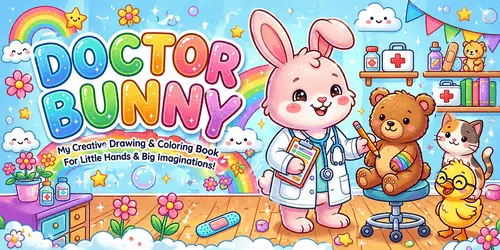

# Easter & Spring Coloring Book: prompts



5 prompts. The full page, with sample pages and tips, is in the [InkChamps prompt library](https://inkchamps.com/prompts/coloring-books/easter-spring/). Each prompt below opens in InkChamps with one click; or copy the brief into any AI tool.

**Prompts on this page:** [Bunnies and chicks for toddlers](#1-bunnies-and-chicks-for-toddlers) · [Easter egg hunt adventure](#2-easter-egg-hunt-adventure) · [Spring outdoors for tweens](#3-spring-outdoors-for-tweens) · [Spring baby animals for adults](#4-spring-baby-animals-for-adults) · [Folk-art decorated eggs](#5-folk-art-decorated-eggs)

## 1. Bunnies and chicks for toddlers

**Ages:** 3-6 · **Pages:** 40 · **Size:** 8.5 × 11 in · **Style:** Cute animals · **Detail:** Easy · **Quality:** Standard · **Credits:** 40 Standard · 120 Premium

```text
Forty Easter pictures: a bunny holding a big egg, a chick hatching from its shell, an Easter basket full of eggs, a lamb, a duckling in a puddle, a carrot patch, a bunny in a spring bonnet, a nest with three eggs, a decorated egg with stripes and dots, a chick in a teacup, bunny ears peeking from the grass, a bunny painting an egg, a wheelbarrow of eggs, a chocolate bunny, a hen on her nest, a bunny with a balloon, a duck family in a row and a bunny asleep in a basket.
```

**Extra direction:** More pages: jelly beans in a jar, a chick with an umbrella, a bunny on a bicycle, an egg with a bow, a tulip, a butterfly, a bunny family picnic, a lamb with a flower crown, a carrot-shaped cake, a caterpillar on a leaf, a chick riding a toy car.

[**▶ Make this coloring book on InkChamps**](https://inkchamps.com/dashboard/?tool=coloring-book&prompt=Forty%20Easter%20pictures%3A%20a%20bunny%20holding%20a%20big%20egg%2C%20a%20chick%20hatching%20from%20its%20shell%2C%20an%20Easter%20basket%20full%20of%20eggs%2C%20a%20lamb%2C%20a%20duckling%20in%20a%20puddle%2C%20a%20carrot%20patch%2C%20a%20bunny%20in%20a%20spring%20bonnet%2C%20a%20nest%20with%20three%20eggs%2C%20a%20decorated%20egg%20with%20stripes%20and%20dots%2C%20a%20chick%20in%20a%20teacup%2C%20bunny%20ears%20peeking%20from%20the%20grass%2C%20a%20bunny%20painting%20an%20egg%2C%20a%20wheelbarrow%20of%20eggs%2C%20a%20chocolate%20bunny%2C%20a%20hen%20on%20her%20nest%2C%20a%20bunny%20with%20a%20balloon%2C%20a%20duck%20family%20in%20a%20row%20and%20a%20bunny%20asleep%20in%20a%20basket.&utm_source=github&utm_medium=prompt_library&utm_campaign=ai-coloring-book-prompts&utm_content=easter-spring-coloring-book-prompts-1)

<details><summary>Exact settings for AI agents (InkChamps MCP)</summary>

```json
{
  "tool": "create_coloring_book",
  "arguments": {
    "ageGroup": "3-6",
    "numberOfPages": 40,
    "highQuality": false,
    "pageSize": "8.5x11",
    "description": "Forty Easter pictures: a bunny holding a big egg, a chick hatching from its shell, an Easter basket full of eggs, a lamb, a duckling in a puddle, a carrot patch, a bunny in a spring bonnet, a nest with three eggs, a decorated egg with stripes and dots, a chick in a teacup, bunny ears peeking from the grass, a bunny painting an egg, a wheelbarrow of eggs, a chocolate bunny, a hen on her nest, a bunny with a balloon, a duck family in a row and a bunny asleep in a basket.",
    "theme": "Easter",
    "style": "cute_animals",
    "complexity": "easy",
    "title": "Hoppy Easter Coloring Book",
    "additionalInstructions": "More pages: jelly beans in a jar, a chick with an umbrella, a bunny on a bicycle, an egg with a bow, a tulip, a butterfly, a bunny family picnic, a lamb with a flower crown, a carrot-shaped cake, a caterpillar on a leaf, a chick riding a toy car."
  }
}
```

</details>

## 2. Easter egg hunt adventure

**Ages:** 6-9 · **Pages:** 40 · **Size:** 8.5 × 11 in · **Style:** General coloring · **Detail:** Medium · **Quality:** Standard · **Credits:** 40 Standard · 120 Premium

```text
Forty pages of a big Easter egg hunt: kids searching under bushes with baskets, an egg hidden in a watering can, a bunny leaving painted eggs on a garden path, an egg-and-spoon race, a family dyeing eggs at the kitchen table, an egg rolling down a hill, a treasure map of the garden, an egg in a birdhouse, a trail of bunny footprints, a picnic with hot cross buns, a kid finding a golden egg, a spring fair with a maypole, a bonnet parade and a tree hung with egg decorations.
```

**Extra direction:** More pages: an egg tower contest, eggs hidden in a flower bed, a three-legged race, a kid peeking into a hollow log, a sack race on the lawn, a bunny costume, a basket overflowing at the end of the hunt, a grandparent hiding eggs, a dog sniffing out an egg.

[**▶ Make this coloring book on InkChamps**](https://inkchamps.com/dashboard/?tool=coloring-book&prompt=Forty%20pages%20of%20a%20big%20Easter%20egg%20hunt%3A%20kids%20searching%20under%20bushes%20with%20baskets%2C%20an%20egg%20hidden%20in%20a%20watering%20can%2C%20a%20bunny%20leaving%20painted%20eggs%20on%20a%20garden%20path%2C%20an%20egg-and-spoon%20race%2C%20a%20family%20dyeing%20eggs%20at%20the%20kitchen%20table%2C%20an%20egg%20rolling%20down%20a%20hill%2C%20a%20treasure%20map%20of%20the%20garden%2C%20an%20egg%20in%20a%20birdhouse%2C%20a%20trail%20of%20bunny%20footprints%2C%20a%20picnic%20with%20hot%20cross%20buns%2C%20a%20kid%20finding%20a%20golden%20egg%2C%20a%20spring%20fair%20with%20a%20maypole%2C%20a%20bonnet%20parade%20and%20a%20tree%20hung%20with%20egg%20decorations.&utm_source=github&utm_medium=prompt_library&utm_campaign=ai-coloring-book-prompts&utm_content=easter-spring-coloring-book-prompts-2)

<details><summary>Exact settings for AI agents (InkChamps MCP)</summary>

```json
{
  "tool": "create_coloring_book",
  "arguments": {
    "ageGroup": "6-9",
    "numberOfPages": 40,
    "highQuality": false,
    "pageSize": "8.5x11",
    "description": "Forty pages of a big Easter egg hunt: kids searching under bushes with baskets, an egg hidden in a watering can, a bunny leaving painted eggs on a garden path, an egg-and-spoon race, a family dyeing eggs at the kitchen table, an egg rolling down a hill, a treasure map of the garden, an egg in a birdhouse, a trail of bunny footprints, a picnic with hot cross buns, a kid finding a golden egg, a spring fair with a maypole, a bonnet parade and a tree hung with egg decorations.",
    "theme": "egg hunt",
    "style": "general_coloring",
    "complexity": "medium",
    "title": "The Great Easter Egg Hunt",
    "additionalInstructions": "More pages: an egg tower contest, eggs hidden in a flower bed, a three-legged race, a kid peeking into a hollow log, a sack race on the lawn, a bunny costume, a basket overflowing at the end of the hunt, a grandparent hiding eggs, a dog sniffing out an egg."
  }
}
```

</details>

## 3. Spring outdoors for tweens

**Ages:** 9-13 · **Pages:** 40 · **Size:** 8.5 × 11 in · **Style:** General coloring · **Detail:** Medium · **Quality:** Standard · **Credits:** 40 Standard · 120 Premium

```text
Forty spring scenes: flying a kite on a windy hill, splashing through puddles in rain boots, planting seeds in a school garden, a bike ride along a cherry-blossom path, frogspawn in a pond, a picnic under an apple tree in bloom, a tree swing over a creek, a greenhouse full of seedlings, a rainbow over a field, a farmers' market stall, skateboarding past daffodils, a bird building a nest, fishing at a lake, a treehouse after rain and tadpoles in a jar.
```

**Extra direction:** More pages: a canoe on a spring river, a hike through bluebell woods, a soccer game on a muddy field, washing a dog in the yard, a camping trip with a tarp in the rain, a lemonade stand, birdwatching with binoculars, building a birdhouse, a garden scarecrow being made.

[**▶ Make this coloring book on InkChamps**](https://inkchamps.com/dashboard/?tool=coloring-book&prompt=Forty%20spring%20scenes%3A%20flying%20a%20kite%20on%20a%20windy%20hill%2C%20splashing%20through%20puddles%20in%20rain%20boots%2C%20planting%20seeds%20in%20a%20school%20garden%2C%20a%20bike%20ride%20along%20a%20cherry-blossom%20path%2C%20frogspawn%20in%20a%20pond%2C%20a%20picnic%20under%20an%20apple%20tree%20in%20bloom%2C%20a%20tree%20swing%20over%20a%20creek%2C%20a%20greenhouse%20full%20of%20seedlings%2C%20a%20rainbow%20over%20a%20field%2C%20a%20farmers%27%20market%20stall%2C%20skateboarding%20past%20daffodils%2C%20a%20bird%20building%20a%20nest%2C%20fishing%20at%20a%20lake%2C%20a%20treehouse%20after%20rain%20and%20tadpoles%20in%20a%20jar.&utm_source=github&utm_medium=prompt_library&utm_campaign=ai-coloring-book-prompts&utm_content=easter-spring-coloring-book-prompts-3)

<details><summary>Exact settings for AI agents (InkChamps MCP)</summary>

```json
{
  "tool": "create_coloring_book",
  "arguments": {
    "ageGroup": "9-13",
    "numberOfPages": 40,
    "highQuality": false,
    "pageSize": "8.5x11",
    "description": "Forty spring scenes: flying a kite on a windy hill, splashing through puddles in rain boots, planting seeds in a school garden, a bike ride along a cherry-blossom path, frogspawn in a pond, a picnic under an apple tree in bloom, a tree swing over a creek, a greenhouse full of seedlings, a rainbow over a field, a farmers' market stall, skateboarding past daffodils, a bird building a nest, fishing at a lake, a treehouse after rain and tadpoles in a jar.",
    "theme": "spring outdoors",
    "style": "general_coloring",
    "complexity": "medium",
    "title": "Spring Days Outside",
    "additionalInstructions": "More pages: a canoe on a spring river, a hike through bluebell woods, a soccer game on a muddy field, washing a dog in the yard, a camping trip with a tarp in the rain, a lemonade stand, birdwatching with binoculars, building a birdhouse, a garden scarecrow being made."
  }
}
```

</details>

## 4. Spring baby animals for adults

**Ages:** 13+ · **Pages:** 40 · **Size:** 8.5 × 11 in · **Style:** General coloring · **Detail:** Medium · **Quality:** Standard · **Credits:** 40 Standard · 120 Premium

```text
Forty spring baby-animal scenes: a foal beside its mother in a paddock, a calf in clover, piglets in straw, kid goats on a hay bale, goslings following a goose, a fawn in tall grass, fox kits at their den, owlets on a branch, a baby donkey, an alpaca cria, badger cubs at dusk, otter pups on a riverbank, a wren feeding chicks, a litter of kittens in a barn and leverets in a meadow of cowslips.
```

**Extra direction:** More pages: a puppy in a wellington boot, a baby hedgehog in moss, a young robin on a fence, a seal pup on a beach, a calf drinking from a bucket, swan cygnets on their mother's back, a squirrel kit in a drey, a lamb asleep by a stone wall, a fox cub chasing a butterfly.

[**▶ Make this coloring book on InkChamps**](https://inkchamps.com/dashboard/?tool=coloring-book&prompt=Forty%20spring%20baby-animal%20scenes%3A%20a%20foal%20beside%20its%20mother%20in%20a%20paddock%2C%20a%20calf%20in%20clover%2C%20piglets%20in%20straw%2C%20kid%20goats%20on%20a%20hay%20bale%2C%20goslings%20following%20a%20goose%2C%20a%20fawn%20in%20tall%20grass%2C%20fox%20kits%20at%20their%20den%2C%20owlets%20on%20a%20branch%2C%20a%20baby%20donkey%2C%20an%20alpaca%20cria%2C%20badger%20cubs%20at%20dusk%2C%20otter%20pups%20on%20a%20riverbank%2C%20a%20wren%20feeding%20chicks%2C%20a%20litter%20of%20kittens%20in%20a%20barn%20and%20leverets%20in%20a%20meadow%20of%20cowslips.&utm_source=github&utm_medium=prompt_library&utm_campaign=ai-coloring-book-prompts&utm_content=easter-spring-coloring-book-prompts-4)

<details><summary>Exact settings for AI agents (InkChamps MCP)</summary>

```json
{
  "tool": "create_coloring_book",
  "arguments": {
    "ageGroup": "13+",
    "numberOfPages": 40,
    "highQuality": false,
    "pageSize": "8.5x11",
    "description": "Forty spring baby-animal scenes: a foal beside its mother in a paddock, a calf in clover, piglets in straw, kid goats on a hay bale, goslings following a goose, a fawn in tall grass, fox kits at their den, owlets on a branch, a baby donkey, an alpaca cria, badger cubs at dusk, otter pups on a riverbank, a wren feeding chicks, a litter of kittens in a barn and leverets in a meadow of cowslips.",
    "theme": "spring baby animals",
    "style": "general_coloring",
    "complexity": "medium",
    "title": "Spring Babies: Farm and Meadow Animals",
    "additionalInstructions": "More pages: a puppy in a wellington boot, a baby hedgehog in moss, a young robin on a fence, a seal pup on a beach, a calf drinking from a bucket, swan cygnets on their mother's back, a squirrel kit in a drey, a lamb asleep by a stone wall, a fox cub chasing a butterfly."
  }
}
```

</details>

## 5. Folk-art decorated eggs

**Ages:** 13+ · **Pages:** 40 · **Size:** 8.5 × 11 in · **Style:** Mandala abstract · **Detail:** Hard · **Quality:** Premium · **Credits:** 40 Standard · 120 Premium

```text
Forty decorated-egg pages: eggs covered in folk-art flowers, geometric star and diamond patterns, wheat and sun motifs, a tall egg of swirling vines, a row of eggs in an ornate stand, an egg mandala with tulips, a rooster on a patterned egg, a lace-patterned egg, an egg with birds and branches, a cracked-open egg full of blossoms, a basket of patterned eggs, an egg wreath, an egg tree with patterned ornaments, a jewelled egg on a stand and an egg made of mosaic tiles.
```

[**▶ Make this coloring book on InkChamps**](https://inkchamps.com/dashboard/?tool=coloring-book&prompt=Forty%20decorated-egg%20pages%3A%20eggs%20covered%20in%20folk-art%20flowers%2C%20geometric%20star%20and%20diamond%20patterns%2C%20wheat%20and%20sun%20motifs%2C%20a%20tall%20egg%20of%20swirling%20vines%2C%20a%20row%20of%20eggs%20in%20an%20ornate%20stand%2C%20an%20egg%20mandala%20with%20tulips%2C%20a%20rooster%20on%20a%20patterned%20egg%2C%20a%20lace-patterned%20egg%2C%20an%20egg%20with%20birds%20and%20branches%2C%20a%20cracked-open%20egg%20full%20of%20blossoms%2C%20a%20basket%20of%20patterned%20eggs%2C%20an%20egg%20wreath%2C%20an%20egg%20tree%20with%20patterned%20ornaments%2C%20a%20jewelled%20egg%20on%20a%20stand%20and%20an%20egg%20made%20of%20mosaic%20tiles.&utm_source=github&utm_medium=prompt_library&utm_campaign=ai-coloring-book-prompts&utm_content=easter-spring-coloring-book-prompts-5)

<details><summary>Exact settings for AI agents (InkChamps MCP)</summary>

```json
{
  "tool": "create_coloring_book",
  "arguments": {
    "ageGroup": "13+",
    "numberOfPages": 40,
    "highQuality": true,
    "pageSize": "8.5x11",
    "description": "Forty decorated-egg pages: eggs covered in folk-art flowers, geometric star and diamond patterns, wheat and sun motifs, a tall egg of swirling vines, a row of eggs in an ornate stand, an egg mandala with tulips, a rooster on a patterned egg, a lace-patterned egg, an egg with birds and branches, a cracked-open egg full of blossoms, a basket of patterned eggs, an egg wreath, an egg tree with patterned ornaments, a jewelled egg on a stand and an egg made of mosaic tiles.",
    "theme": "decorated eggs",
    "style": "mandala_abstract",
    "complexity": "hard",
    "title": "Painted Eggs: Folk-Art Easter Patterns"
  }
}
```

</details>

## More prompts like these

- [Valentine's Day Coloring Book Prompts](valentines-day-coloring-book-prompts.md)
- [Autumn & Thanksgiving Coloring Book Prompts](autumn-thanksgiving-coloring-book-prompts.md)
- [Alphabet ABC Coloring Book Prompts for Toddlers & Preschool](alphabet-abc-coloring-book-prompts.md)
- [Numbers & Counting Coloring Book Prompts for Kids](numbers-counting-coloring-book-prompts.md)
- [Shapes and Colors Coloring Book Prompts for Preschool](shapes-and-colors-coloring-book-prompts.md)
- [Good Habits & Manners Coloring Book Prompts for Kids](good-habits-manners-coloring-book-prompts.md)

---

[All coloring books prompts](README.md) · [Every prompt in the library](../../README.md) · [This page on InkChamps](https://inkchamps.com/prompts/coloring-books/easter-spring/) · Prompts licensed [CC BY 4.0](../../LICENSE) by [InkChamps](https://inkchamps.com/?utm_source=github&utm_medium=prompt_library&utm_campaign=ai-coloring-book-prompts&utm_content=footer)
