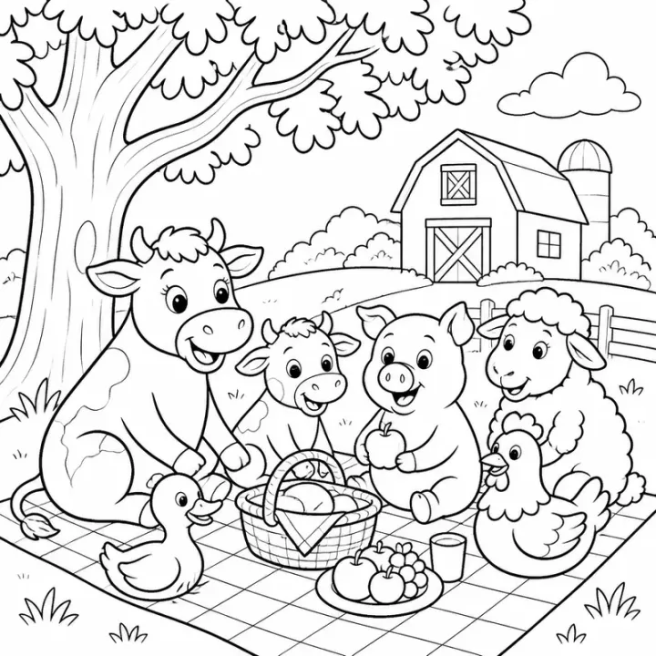

# Farm Animal Coloring Book: prompts



5 prompts. The full page, with sample pages and tips, is in the [InkChamps prompt library](https://inkchamps.com/prompts/coloring-books/farm-animal/). Each prompt below opens in InkChamps with one click; or copy the brief into any AI tool.

**Prompts on this page:** [Baby barnyard animals for toddlers](#1-baby-barnyard-animals-for-toddlers) · [24 farm animals with names](#2-24-farm-animals-with-names) · [Four seasons on the farm](#3-four-seasons-on-the-farm) · [County fair and farm show](#4-county-fair-and-farm-show) · [Farmhouse animals for adults](#5-farmhouse-animals-for-adults)

## 1. Baby barnyard animals for toddlers

**Ages:** 3-6 · **Pages:** 24 · **Size:** 8.5 × 8.5 in · **Style:** Cute animals · **Detail:** Easy · **Quality:** Standard · **Credits:** 24 Standard · 72 Premium

```text
24 pages of baby farm animals, many with their mothers, ending at the red barn: a chick hatching, a hen with her chicks, a piglet in the mud, a lamb in a meadow, a calf with its mother cow, a foal, ducklings following a duck, a goat on a hay bale, a bunny with a carrot, kittens in a hay basket, a puppy at the barn door, a baby alpaca, a gosling, a donkey foal, chicks under a warm lamp, piglets with their mother and a piglet asleep in straw.
```

### Page by page (24 pages)

Paste one page at a time into ChatGPT, Gemini or any AI image tool, with this line after it:

> Black-and-white coloring page for a child aged 3 to 6: one big, cute, chubby cartoon baby farm animal filling most of the page, thick bold outlines, large simple shapes with wide spaces to color, very little background, no shading, no grey, no words, plain white background, square page.

1. A fluffy baby chick hatching from a cracked egg in a straw nest, a piece of shell still on its head like a little hat, a big round sun behind.
2. A plump mother hen sitting in the grass with five round baby chicks around her, one chick peeking out from under her wing.
3. A happy piglet rolling on its back in a big puddle of mud, mud splashes flying up and a little wooden fence behind it.
4. A fluffy baby lamb standing in a meadow with three big daisies and a butterfly landing on its nose.
5. A baby calf standing close beside its mother cow, the mother's head bent down to nuzzle it, a small bell around the calf's neck.
6. A wobbly-legged baby foal standing next to its mother horse in a grassy field, a simple fence and one round tree behind them.
7. Three baby ducklings walking in a line behind their mother duck toward a round pond with two lily pads.
8. A baby goat standing proudly on top of a square hay bale, one front hoof raised, a few pieces of straw on the ground.
9. A chubby baby bunny sitting up and nibbling a big carrot with leafy tops, a little patch of clover at its feet.
10. Two round kittens curled up asleep together in a woven basket full of hay, a ball of yarn beside the basket.
11. A floppy-eared puppy sitting in front of a big barn door, wagging its tail, with a food bowl and a bone beside it.
12. A fuzzy baby alpaca with a puffy head of wool standing beside its mother alpaca, both smiling, a small hill behind.
13. A fluffy baby gosling sitting in tall grass, looking at a ladybug on a blade of grass in front of its beak.
14. A baby donkey with very big ears lying in the straw of its stable, a bucket of water and a horseshoe on the wall.
15. A baby lamb drinking milk from a big baby bottle held by a pair of friendly hands, its tail wiggling.
16. A baby duckling splashing in a rain puddle wearing tiny rain boots, raindrops falling from a cloud above.
17. Four little chicks huddled together under a round warm lamp in a box lined with straw, one chick yawning.
18. A baby goat jumping high in the air with all four hooves off the ground, a little rock and a tuft of grass below.
19. A big mother pig lying on her side in the straw with four little piglets snuggled against her tummy.
20. A mother rabbit and three baby bunnies peeking out of a wooden hutch, a carrot and a lettuce leaf in front of it.
21. A tiny kitten sitting on the big round seat of a tractor, a steering wheel in front of it and a big tractor wheel below.
22. A baby turkey poult with fluffy feathers pecking at seeds on the ground, a small feed scoop tipped over beside it.
23. A sleepy baby piglet curled up asleep in a pile of straw, a crescent moon and two stars shining through the barn window.
24. A big red barn filling the page with its doors open, a baby chick, a piglet, a lamb and a calf standing in the doorway together.

[**▶ Make this coloring book on InkChamps**](https://inkchamps.com/dashboard/?tool=coloring-book&prompt=24%20pages%20of%20baby%20farm%20animals%2C%20many%20with%20their%20mothers%2C%20ending%20at%20the%20red%20barn%3A%20a%20chick%20hatching%2C%20a%20hen%20with%20her%20chicks%2C%20a%20piglet%20in%20the%20mud%2C%20a%20lamb%20in%20a%20meadow%2C%20a%20calf%20with%20its%20mother%20cow%2C%20a%20foal%2C%20ducklings%20following%20a%20duck%2C%20a%20goat%20on%20a%20hay%20bale%2C%20a%20bunny%20with%20a%20carrot%2C%20kittens%20in%20a%20hay%20basket%2C%20a%20puppy%20at%20the%20barn%20door%2C%20a%20baby%20alpaca%2C%20a%20gosling%2C%20a%20donkey%20foal%2C%20chicks%20under%20a%20warm%20lamp%2C%20piglets%20with%20their%20mother%20and%20a%20piglet%20asleep%20in%20straw.&utm_source=github&utm_medium=prompt_library&utm_campaign=ai-coloring-book-prompts&utm_content=farm-animal-coloring-book-prompts-1)

<details><summary>Exact settings for AI agents (InkChamps MCP)</summary>

```json
{
  "tool": "create_coloring_book",
  "arguments": {
    "ageGroup": "3-6",
    "numberOfPages": 24,
    "highQuality": false,
    "pageSize": "8.5x8.5",
    "description": "24 pages of baby farm animals, many with their mothers, ending at the red barn: a chick hatching, a hen with her chicks, a piglet in the mud, a lamb in a meadow, a calf with its mother cow, a foal, ducklings following a duck, a goat on a hay bale, a bunny with a carrot, kittens in a hay basket, a puppy at the barn door, a baby alpaca, a gosling, a donkey foal, chicks under a warm lamp, piglets with their mother and a piglet asleep in straw.",
    "style": "cute_animals",
    "complexity": "easy",
    "theme": "baby farm animals",
    "title": "My First Farm Babies Coloring Book"
  }
}
```

</details>

## 2. 24 farm animals with names

**Ages:** 6-9 · **Pages:** 24 · **Size:** 8.5 × 11 in · **Style:** Cute animals · **Detail:** Easy · **Layout:** One item per page, with its caption · **Quality:** Standard · **Credits:** 24 Standard · 72 Premium

```text
24 farm animals, one per page, each with its name as the caption: Holstein cow, Jersey cow, Highland cow, bull, horse, Clydesdale, Shetland pony, donkey, pig, potbellied pig, sheep, lamb, goat, llama, alpaca, water buffalo, chicken, rooster, silkie chicken, turkey, duck, goose, rabbit and sheepdog, each shown doing something simple on the farm.
```

### Page by page (24 pages)

Paste one page at a time into ChatGPT, Gemini or any AI image tool, with this line after it:

> Black-and-white coloring page for a child aged 6 to 9: one friendly, true-to-life farm animal as the main subject, clear bold outlines, medium detail with a simple farm background, no shading, no grey, the caption in big outlined letters at the bottom is the only words on the page, plain white background, portrait 8.5 x 11 page.

1. A spotted Holstein cow standing in a green pasture chewing grass, a milk pail beside her and a fence behind, with the caption "Holstein cow" in big outlined letters at the bottom.
2. A gentle Jersey cow with big dark eyes and a curved face lying in the grass, a little bird sitting on her back, with the caption "Jersey cow" in big outlined letters at the bottom.
3. A shaggy Highland cow with long curved horns and a fringe of hair over its eyes standing on a hillside with heather, with the caption "Highland cow" in big outlined letters at the bottom.
4. A strong bull with short horns and a nose ring standing in a fenced field, pawing the ground with one hoof, with the caption "Bull" in big outlined letters at the bottom.
5. A tall horse with a flowing mane trotting across a field, a saddle hanging on the fence post behind it, with the caption "Horse" in big outlined letters at the bottom.
6. A huge Clydesdale horse with feathery hair around its hooves pulling a wooden cart loaded with hay bales, with the caption "Clydesdale" in big outlined letters at the bottom.
7. A small, round Shetland pony with a thick mane and fringe standing beside a stable door with a bucket of oats, with the caption "Shetland pony" in big outlined letters at the bottom.
8. A donkey with long ears and a soft muzzle carrying two baskets of apples on its back along a dirt path, with the caption "Donkey" in big outlined letters at the bottom.
9. A round pink pig with a curly tail eating from a wooden trough full of corn and apple cores, with the caption "Pig" in big outlined letters at the bottom.
10. A potbellied pig with a low round belly and little upright ears sniffing a pumpkin in the farmyard, with the caption "Potbellied pig" in big outlined letters at the bottom.
11. A woolly sheep with a thick fluffy fleece standing in a meadow, a few daisies around its hooves, with the caption "Sheep" in big outlined letters at the bottom.
12. A little lamb leaping over a small rock in a grassy field, its tail flicking up, with the caption "Lamb" in big outlined letters at the bottom.
13. A goat with a short beard and small horns standing on a wooden crate, nibbling a leaf from a low tree branch, with the caption "Goat" in big outlined letters at the bottom.
14. A tall llama with long banana-shaped ears and a woolly neck standing beside a stone wall, a woven blanket on its back, with the caption "Llama" in big outlined letters at the bottom.
15. A fluffy alpaca with a puffy topknot of wool and a short face standing next to a little water trough, with the caption "Alpaca" in big outlined letters at the bottom.
16. A water buffalo with wide curved horns wading in a muddy pond up to its knees, reeds growing at the edge, with the caption "Water buffalo" in big outlined letters at the bottom.
17. A plump hen sitting on a nest of eggs in a wooden nesting box, a little feather floating down, with the caption "Chicken" in big outlined letters at the bottom.
18. A proud rooster with a tall comb and long curved tail feathers crowing from the top of a fence post at sunrise, with the caption "Rooster" in big outlined letters at the bottom.
19. A fluffy silkie chicken covered in soft puffy feathers, even on its feet, standing on a small patch of straw, with the caption "Silkie chicken" in big outlined letters at the bottom.
20. A turkey with its tail feathers fanned out wide in a big half circle, strutting across the farmyard, with the caption "Turkey" in big outlined letters at the bottom.
21. A duck with a flat orange bill swimming on a pond, ripples around it and two cattails at the edge, with the caption "Duck" in big outlined letters at the bottom.
22. A white goose with a long neck walking across the farmyard with its wings half open, honking, with the caption "Goose" in big outlined letters at the bottom.
23. A farm rabbit with long upright ears sitting beside a hutch, munching a leaf of lettuce, with the caption "Rabbit" in big outlined letters at the bottom.
24. A black-and-white sheepdog crouched low in the grass, watching a small group of sheep near a gate, with the caption "Sheepdog" in big outlined letters at the bottom.

[**▶ Make this coloring book on InkChamps**](https://inkchamps.com/dashboard/?tool=coloring-book&prompt=24%20farm%20animals%2C%20one%20per%20page%2C%20each%20with%20its%20name%20as%20the%20caption%3A%20Holstein%20cow%2C%20Jersey%20cow%2C%20Highland%20cow%2C%20bull%2C%20horse%2C%20Clydesdale%2C%20Shetland%20pony%2C%20donkey%2C%20pig%2C%20potbellied%20pig%2C%20sheep%2C%20lamb%2C%20goat%2C%20llama%2C%20alpaca%2C%20water%20buffalo%2C%20chicken%2C%20rooster%2C%20silkie%20chicken%2C%20turkey%2C%20duck%2C%20goose%2C%20rabbit%20and%20sheepdog%2C%20each%20shown%20doing%20something%20simple%20on%20the%20farm.&utm_source=github&utm_medium=prompt_library&utm_campaign=ai-coloring-book-prompts&utm_content=farm-animal-coloring-book-prompts-2)

<details><summary>Exact settings for AI agents (InkChamps MCP)</summary>

```json
{
  "tool": "create_coloring_book",
  "arguments": {
    "ageGroup": "6-9",
    "numberOfPages": 24,
    "highQuality": false,
    "pageSize": "8.5x11",
    "description": "24 farm animals, one per page, each with its name as the caption: Holstein cow, Jersey cow, Highland cow, bull, horse, Clydesdale, Shetland pony, donkey, pig, potbellied pig, sheep, lamb, goat, llama, alpaca, water buffalo, chicken, rooster, silkie chicken, turkey, duck, goose, rabbit and sheepdog, each shown doing something simple on the farm.",
    "style": "cute_animals",
    "complexity": "easy",
    "theme": "farm animals and breeds with names",
    "title": "40 Farm Animals Coloring Book",
    "pageCategory": "concept"
  }
}
```

</details>

## 3. Four seasons on the farm

**Ages:** 6-9 · **Pages:** 24 · **Size:** 8.5 × 11 in · **Style:** General coloring · **Detail:** Medium · **Quality:** Standard · **Credits:** 24 Standard · 72 Premium

```text
24 farm scenes through one year, six for each season. Spring: a newborn lamb in the barn, planting with a tractor, a muddy calf in the rain, sheep shearing. Summer: baling hay, milking a cow, picking strawberries, gathering honey, a farm stand. Autumn: a pumpkin patch, apple picking, a corn maze with a scarecrow, a hayride, the harvest. Winter: a snowy barn, feeding horses in the snow, collecting eggs on a frosty morning, a horse-drawn sleigh.
```

### Page by page (24 pages)

Paste one page at a time into ChatGPT, Gemini or any AI image tool, with this line after it:

> Black-and-white coloring page for a child aged 6 to 9: a friendly cartoon farm scene with people and animals, clear bold outlines, medium detail with a simple background that shows the season and the place, no shading, no grey, no words or letters, plain white background, portrait 8.5 x 11 page.

1. Spring: a mother sheep in a straw-filled barn pen licking her newborn lamb, a lantern hanging on a hook and a pitchfork against the wall.
2. Spring: a farmer driving a small tractor pulling a seed planter across a freshly plowed field, birds following behind the rows.
3. Spring: a muddy calf standing in the rain beside a puddle, a farm kid in a raincoat and boots holding an umbrella over it.
4. Spring: a mother duck leading her ducklings across a farm lane to the pond, a farm kid waiting by a gate to let them pass.
5. Spring: a farmer shearing a sheep in the barn with a big pile of wool on the floor and two more sheep waiting in a pen.
6. Spring: a rooster crowing on top of the henhouse as the sun rises over the hills, hens stepping out of the little door below.
7. Summer: a tractor pulling a baler across a hay field, round hay bales dotted across the field and a red barn in the distance.
8. Summer: a farmer sitting on a stool milking a cow in the barn, a metal pail filling with milk and a barn cat watching.
9. Summer: two kids picking strawberries along a row of leafy plants, a basket full of berries between them and a straw hat on the ground.
10. Summer: a beekeeper in a veiled hat lifting a frame of honeycomb from a wooden beehive, bees buzzing and clover in the grass.
11. Summer: a goat balancing on top of a wooden fence, a farm kid laughing below with a bucket of feed, sunflowers growing along the fence.
12. Summer: a farm stand at the end of a lane with baskets of tomatoes, corn and cucumbers, a cash tin on the counter and a dog lying in the shade.
13. Autumn: a pumpkin patch with big round pumpkins on curly vines, a wheelbarrow holding three pumpkins and a kid choosing one.
14. Autumn: a family picking apples in an orchard, a ladder leaning against a tree and bushel baskets of apples on the grass.
15. Autumn: kids finding their way through a tall corn maze, a scarecrow in a patched shirt standing at a turn with two crows on its arms.
16. Autumn: a hayride wagon full of kids sitting on hay bales, pulled by a tractor past a row of autumn trees with falling leaves.
17. Autumn: a combine harvester cutting a golden wheat field, a grain truck alongside it and a tall silo on the horizon.
18. Autumn: a farm family carving pumpkins on the farmhouse porch, a rocking chair, a bowl of pumpkin seeds and corn stalks tied to the post.
19. Autumn: a farm dog herding a flock of sheep through an open gate into a new field, a farmer with a crook walking behind.
20. Winter: a red barn covered in snow, icicles hanging from the roof, a horse looking out of the stable window and a snowman by the door.
21. Winter: a farmer in a thick coat and scarf carrying hay to two horses in a snowy paddock, their breath puffing in the cold air.
22. Winter: a farm kid in a hat and mittens collecting eggs from the henhouse on a frosty morning, a basket of eggs and hens on their roost.
23. Winter: a calf wearing a warm blanket standing in a straw-filled pen, a farm kid giving it a bottle of milk.
24. Winter: a horse pulling a wooden sleigh with a family across a snowy field, the farmhouse behind with a wreath on the door and smoke from the chimney.

[**▶ Make this coloring book on InkChamps**](https://inkchamps.com/dashboard/?tool=coloring-book&prompt=24%20farm%20scenes%20through%20one%20year%2C%20six%20for%20each%20season.%20Spring%3A%20a%20newborn%20lamb%20in%20the%20barn%2C%20planting%20with%20a%20tractor%2C%20a%20muddy%20calf%20in%20the%20rain%2C%20sheep%20shearing.%20Summer%3A%20baling%20hay%2C%20milking%20a%20cow%2C%20picking%20strawberries%2C%20gathering%20honey%2C%20a%20farm%20stand.%20Autumn%3A%20a%20pumpkin%20patch%2C%20apple%20picking%2C%20a%20corn%20maze%20with%20a%20scarecrow%2C%20a%20hayride%2C%20the%20harvest.%20Winter%3A%20a%20snowy%20barn%2C%20feeding%20horses%20in%20the%20snow%2C%20collecting%20eggs%20on%20a%20frosty%20morning%2C%20a%20horse-drawn%20sleigh.&utm_source=github&utm_medium=prompt_library&utm_campaign=ai-coloring-book-prompts&utm_content=farm-animal-coloring-book-prompts-3)

<details><summary>Exact settings for AI agents (InkChamps MCP)</summary>

```json
{
  "tool": "create_coloring_book",
  "arguments": {
    "ageGroup": "6-9",
    "numberOfPages": 24,
    "highQuality": false,
    "pageSize": "8.5x11",
    "description": "24 farm scenes through one year, six for each season. Spring: a newborn lamb in the barn, planting with a tractor, a muddy calf in the rain, sheep shearing. Summer: baling hay, milking a cow, picking strawberries, gathering honey, a farm stand. Autumn: a pumpkin patch, apple picking, a corn maze with a scarecrow, a hayride, the harvest. Winter: a snowy barn, feeding horses in the snow, collecting eggs on a frosty morning, a horse-drawn sleigh.",
    "style": "general_coloring",
    "complexity": "medium",
    "theme": "farm life through the seasons",
    "title": "A Year on the Farm Coloring Book"
  }
}
```

</details>

## 4. County fair and farm show

**Ages:** 9-13 · **Pages:** 24 · **Size:** 8.5 × 11 in · **Style:** General coloring · **Detail:** Medium · **Quality:** Standard · **Credits:** 24 Standard · 72 Premium

```text
24 pages of one day at a country fair and its animals, from arriving with the trailer to the Ferris wheel at sunset: grooming a cow and a sheep, leading a pig into the show ring, a blue ribbon for a goat, the rabbit and poultry barns, a draft horse pull, show jumping, a sheepdog trial, a llama obstacle course, a pig race, a petting zoo, a tractor parade, a giant pumpkin on the scale, a pie contest, a quilt display and a carousel.
```

### Page by page (24 pages)

Paste one page at a time into ChatGPT, Gemini or any AI image tool, with this line after it:

> Black-and-white coloring page for ages 9 to 13: a realistic, detailed fair scene with people and farm animals, fine clean outlines, plenty of detail in the animals, crowds, barns and props with many separate areas to color, a full background, no shading, no grey, no words, letters or numbers on signs, plain white background, portrait 8.5 x 11 page.

1. A farm family unloading a stock trailer at the fairgrounds in the morning, a goat stepping down the ramp and rows of animal barns behind.
2. A kid shampooing a dairy cow in a wash bay, a hose spraying water, a scrub brush in hand and a bucket of soap suds on the concrete.
3. A teen trimming the wool of a sheep standing on a metal grooming stand, electric clippers in hand and a show halter on the sheep.
4. A kid leading a prize pig into the show ring with a show stick and a brush, other pigs and their handlers lined up along the rail.
5. A judge in a cowboy hat pinning a blue ribbon rosette on the collar of a goat, the proud young owner holding the goat's lead.
6. A calf in a rope halter standing square in the dairy show ring, a kid in a white shirt holding the halter and a judge taking notes on a clipboard.
7. A long table in the rabbit barn with fancy rabbits in wire cages, a judge holding a lop-eared rabbit up to check its fur.
8. A poultry barn with rows of cages holding fancy chickens: a frizzle hen, a crested rooster and a bantam, ribbons hanging on some cages.
9. A draft horse pulling contest: two huge horses in harness leaning into a heavy sled of concrete blocks, a teamster walking behind holding the reins.
10. A show jumper horse leaping over a striped rail fence in the horse arena, its rider in a helmet, flowers in boxes at the base of the jump.
11. A sheepdog trial on a grassy field: a border collie guiding three sheep toward a small pen while its handler signals with a crook.
12. A llama obstacle course: a kid leading a llama over a small wooden bridge, cones, a hoop and a tarp laid out on the course ahead.
13. A pig race with four little pigs running around a dirt track toward a finish line, spectators leaning on the fence and cheering.
14. A petting zoo pen with baby goats climbing on a little wooden play structure, a young child holding out a cup of feed.
15. A milking demonstration in a barn: a dairy cow in a stall, a farmer showing kids how milk goes into a pail, a row of kids on hay bales watching.
16. A tractor parade down the fairground road, an old tractor with big back wheels leading, a newer tractor behind and families waving from the side.
17. A giant pumpkin sitting on a big platform scale in the produce barn, a group of kids standing beside it for size and prize vegetables on shelves behind.
18. A pie contest table with a row of lattice-top pies, judges tasting with forks and ribbon rosettes ready beside the plates.
19. A quilt display hall with patterned quilts hanging on wooden racks, a woman pointing at the star pattern on one quilt.
20. A jam and honey stand with shelves of jars, a honeycomb frame in a glass case and a row of tasting spoons on the counter.
21. A duck pond game booth with toy ducks floating in a long water trough, a kid reaching to pick one and prizes hanging on the back wall.
22. A hay bale maze built in the fairground field, kids climbing over and peeking around the bales, a scarecrow standing at the entrance.
23. A carousel with painted horses, a rooster and a pig to ride, lights along its canopy and a kid riding with arms in the air.
24. A Ferris wheel lit up at sunset above the long roofs of the animal barns, a farm family walking to their truck with a ribbon and a sleepy goat.

[**▶ Make this coloring book on InkChamps**](https://inkchamps.com/dashboard/?tool=coloring-book&prompt=24%20pages%20of%20one%20day%20at%20a%20country%20fair%20and%20its%20animals%2C%20from%20arriving%20with%20the%20trailer%20to%20the%20Ferris%20wheel%20at%20sunset%3A%20grooming%20a%20cow%20and%20a%20sheep%2C%20leading%20a%20pig%20into%20the%20show%20ring%2C%20a%20blue%20ribbon%20for%20a%20goat%2C%20the%20rabbit%20and%20poultry%20barns%2C%20a%20draft%20horse%20pull%2C%20show%20jumping%2C%20a%20sheepdog%20trial%2C%20a%20llama%20obstacle%20course%2C%20a%20pig%20race%2C%20a%20petting%20zoo%2C%20a%20tractor%20parade%2C%20a%20giant%20pumpkin%20on%20the%20scale%2C%20a%20pie%20contest%2C%20a%20quilt%20display%20and%20a%20carousel.&utm_source=github&utm_medium=prompt_library&utm_campaign=ai-coloring-book-prompts&utm_content=farm-animal-coloring-book-prompts-4)

<details><summary>Exact settings for AI agents (InkChamps MCP)</summary>

```json
{
  "tool": "create_coloring_book",
  "arguments": {
    "ageGroup": "9-13",
    "numberOfPages": 24,
    "highQuality": false,
    "pageSize": "8.5x11",
    "description": "24 pages of one day at a country fair and its animals, from arriving with the trailer to the Ferris wheel at sunset: grooming a cow and a sheep, leading a pig into the show ring, a blue ribbon for a goat, the rabbit and poultry barns, a draft horse pull, show jumping, a sheepdog trial, a llama obstacle course, a pig race, a petting zoo, a tractor parade, a giant pumpkin on the scale, a pie contest, a quilt display and a carousel.",
    "style": "general_coloring",
    "complexity": "medium",
    "theme": "county fair and livestock show",
    "title": "Blue Ribbon County Fair Coloring Book"
  }
}
```

</details>

## 5. Farmhouse animals for adults

**Ages:** 13+ · **Pages:** 24 · **Size:** 8.5 × 11 in · **Style:** Mandala animal · **Detail:** Hard · **Quality:** Premium · **Credits:** 24 Standard · 72 Premium

```text
24 patterned farm animals for adult colorists, each framed with farmhouse florals: a Highland cow with a flower crown, a rooster among sunflowers, a sheep in a wildflower wreath, a pig with peonies, a horse with a braided mane and roses, a goat in lavender, a hen on a nest among herbs, a donkey with daisies, an alpaca with a pom-pom bridle, a barn owl, a duck family in the reeds, a rooster weathervane, a beehive, a barn cat on a quilt, a red barn in poppies and a farm mandala.
```

### Page by page (24 pages)

Paste one page at a time into ChatGPT, Gemini or any AI image tool, with this line after it:

> Black-and-white adult coloring page: an intricate design with fine, crisp line work, the animal and its flowers filled with mandala, zentangle, paisley and floral patterns, many small areas to color, a balanced composition that fills the page, no shading, no grey, no words, plain white background, portrait 8.5 x 11 page.

1. A Highland cow's head with long curved horns and a shaggy fringe wearing a crown of roses and daisies, its long hair drawn as flowing patterned locks.
2. A proud rooster standing among tall sunflowers, every tail feather filled with a different pattern of scales, swirls and dots.
3. A sheep facing forward inside a round wreath of wildflowers, its wool fleece made of small spirals and tiny florals.
4. A pig sitting among big open peonies and leaves, its body divided into paisley and lacework patterns.
5. A horse's head and neck in side view with a long braided mane woven with roses, the braids filled with fine knot patterns.
6. A goat standing in a lavender field with rows of lavender stems stretching to the horizon, its coat filled with leaf and feather patterns.
7. A hen sitting on a nest of eggs tucked among rosemary, thyme and sage, each egg decorated with a small mandala.
8. A donkey with tall ears wearing a garland of daisies around its neck, its body filled with soft geometric triangles and dots.
9. An alpaca with a pom-pom bridle and tassels standing in front of a woven blanket hung on a fence, both covered in folk patterns.
10. A barn owl perched on a weathered fence post at night, its heart-shaped face and wings filled with fine feather mandalas, a crescent moon behind.
11. A mother duck swimming through tall reeds and cattails with four ducklings behind her, the water drawn as rippling pattern bands.
12. A cow's head in the center of a circular frame of wheat stalks and poppies, the face filled with symmetrical zentangle patterns.
13. A rooster weathervane on top of a barn cupola against a sky of swirling patterned clouds, an arrow and compass points below it.
14. A rabbit sitting in a vegetable patch among cabbages, carrots and pea vines, the leaves and rabbit filled with lace patterns.
15. A beehive skep on a wooden bench surrounded by clover and honeybees, the hive made of patterned bands and the bees with mandala wings.
16. A barn cat curled up asleep on a patchwork quilt, each quilt square a different geometric design and the cat's fur in swirls.
17. A turkey with its tail feathers fanned in a full circle, each feather a band of intricate pattern like a stained-glass window.
18. A mason jar full of wildflowers on a farmhouse table beside a pie and an egg basket, every surface covered in fine patterns.
19. Two horses standing nose to nose over a wooden gate, their manes and coats filled with matching flowing patterns.
20. A red barn in a field of poppies with a windmill beside it, the barn boards, roof and flowers each filled with distinct patterns.
21. A sheepdog sitting beside a shepherd's crook with sheep in the background, its coat made of layered feather and wave patterns.
22. A calf lying in a meadow of dandelions and dandelion seed heads, its patches filled with tiny florals.
23. A goose walking with a ribbon bow tied around its long neck, its wings drawn as layered scallops and lace.
24. A large mandala built from farm motifs: a cow, a pig, a sheep, a hen, a horse and a goat arranged in a ring around a central sunflower.

[**▶ Make this coloring book on InkChamps**](https://inkchamps.com/dashboard/?tool=coloring-book&prompt=24%20patterned%20farm%20animals%20for%20adult%20colorists%2C%20each%20framed%20with%20farmhouse%20florals%3A%20a%20Highland%20cow%20with%20a%20flower%20crown%2C%20a%20rooster%20among%20sunflowers%2C%20a%20sheep%20in%20a%20wildflower%20wreath%2C%20a%20pig%20with%20peonies%2C%20a%20horse%20with%20a%20braided%20mane%20and%20roses%2C%20a%20goat%20in%20lavender%2C%20a%20hen%20on%20a%20nest%20among%20herbs%2C%20a%20donkey%20with%20daisies%2C%20an%20alpaca%20with%20a%20pom-pom%20bridle%2C%20a%20barn%20owl%2C%20a%20duck%20family%20in%20the%20reeds%2C%20a%20rooster%20weathervane%2C%20a%20beehive%2C%20a%20barn%20cat%20on%20a%20quilt%2C%20a%20red%20barn%20in%20poppies%20and%20a%20farm%20mandala.&utm_source=github&utm_medium=prompt_library&utm_campaign=ai-coloring-book-prompts&utm_content=farm-animal-coloring-book-prompts-5)

<details><summary>Exact settings for AI agents (InkChamps MCP)</summary>

```json
{
  "tool": "create_coloring_book",
  "arguments": {
    "ageGroup": "13+",
    "numberOfPages": 24,
    "highQuality": true,
    "pageSize": "8.5x11",
    "description": "24 patterned farm animals for adult colorists, each framed with farmhouse florals: a Highland cow with a flower crown, a rooster among sunflowers, a sheep in a wildflower wreath, a pig with peonies, a horse with a braided mane and roses, a goat in lavender, a hen on a nest among herbs, a donkey with daisies, an alpaca with a pom-pom bridle, a barn owl, a duck family in the reeds, a rooster weathervane, a beehive, a barn cat on a quilt, a red barn in poppies and a farm mandala.",
    "style": "mandala_animal",
    "complexity": "hard",
    "theme": "patterned farm animals and farmhouse florals",
    "title": "Farmhouse Floral Animals: Adult Coloring Book"
  }
}
```

</details>

## More prompts like these

- [Ocean Animal Coloring Book Prompts: Sea Creatures & Coral Reefs](ocean-animal-coloring-book-prompts.md)
- [Unicorn Coloring Book Prompts: Unicorns & Magical Creatures](unicorn-coloring-book-prompts.md)
- [Dragon Coloring Book Prompts for Kids, Teens & Adults](dragon-coloring-book-prompts.md)
- [Jungle & Safari Animal Coloring Book Prompts](jungle-safari-coloring-book-prompts.md)
- [Cat Coloring Book Prompts: Kittens, Cozy Cats & Cat Mandalas](cat-coloring-book-prompts.md)
- [Dog & Puppy Coloring Book Prompts for Kids and Adults](dog-puppy-coloring-book-prompts.md)

---

[All coloring books prompts](README.md) · [Every prompt in the library](../../README.md) · [This page on InkChamps](https://inkchamps.com/prompts/coloring-books/farm-animal/) · Prompts licensed [CC BY 4.0](../../LICENSE) by [InkChamps](https://inkchamps.com/?utm_source=github&utm_medium=prompt_library&utm_campaign=ai-coloring-book-prompts&utm_content=footer)
