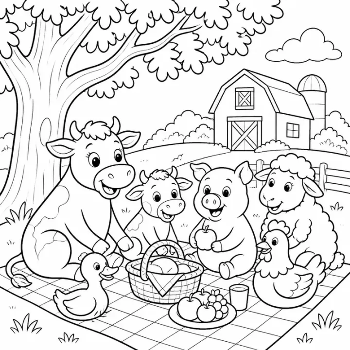

# Farm Animal Coloring Book: prompts



5 prompts. The full page, with sample pages and tips, is in the [InkChamps prompt library](https://inkchamps.com/prompts/coloring-books/farm-animal/). Each prompt below opens in InkChamps with one click; or copy the brief into any AI tool.

**Prompts on this page:** [Baby barnyard animals for toddlers](#1-baby-barnyard-animals-for-toddlers) · [40 farm animals with names](#2-40-farm-animals-with-names) · [Four seasons on the farm](#3-four-seasons-on-the-farm) · [County fair and farm show](#4-county-fair-and-farm-show) · [Farmhouse animals for adults](#5-farmhouse-animals-for-adults)

## 1. Baby barnyard animals for toddlers

**Ages:** 3-6 · **Pages:** 40 · **Size:** 8.5 × 8.5 in · **Style:** Cute animals · **Detail:** Easy · **Quality:** Standard · **Credits:** 40 Standard · 120 Premium

```text
Forty pages of baby farm animals, many with their mothers: a chick hatching from an egg, a mother hen with five chicks, a piglet rolling in mud, a lamb in a meadow, a calf beside its mother cow, a foal with a horse, ducklings following a duck to a pond, a baby goat on a hay bale, a bunny with a carrot, kittens in a hay basket, a puppy by the red barn door, and a cria beside an alpaca.
```

**Extra direction:** More pages: a gosling in the grass, a turkey poult, a donkey foal, a piglet asleep in straw, a lamb drinking from a bottle, a duckling in a puddle, a calf with a bell, chicks under a heat lamp, a baby goat jumping, a mother pig with piglets, a rabbit family in a hutch, a kitten on a tractor seat, a foal in a stable.

[**▶ Make this coloring book on InkChamps**](https://inkchamps.com/dashboard/?tool=coloring-book&prompt=Forty%20pages%20of%20baby%20farm%20animals%2C%20many%20with%20their%20mothers%3A%20a%20chick%20hatching%20from%20an%20egg%2C%20a%20mother%20hen%20with%20five%20chicks%2C%20a%20piglet%20rolling%20in%20mud%2C%20a%20lamb%20in%20a%20meadow%2C%20a%20calf%20beside%20its%20mother%20cow%2C%20a%20foal%20with%20a%20horse%2C%20ducklings%20following%20a%20duck%20to%20a%20pond%2C%20a%20baby%20goat%20on%20a%20hay%20bale%2C%20a%20bunny%20with%20a%20carrot%2C%20kittens%20in%20a%20hay%20basket%2C%20a%20puppy%20by%20the%20red%20barn%20door%2C%20and%20a%20cria%20beside%20an%20alpaca.&utm_source=github&utm_medium=prompt_library&utm_campaign=ai-coloring-book-prompts&utm_content=farm-animal-coloring-book-prompts-1)

<details><summary>Exact settings for AI agents (InkChamps MCP)</summary>

```json
{
  "tool": "create_coloring_book",
  "arguments": {
    "ageGroup": "3-6",
    "numberOfPages": 40,
    "highQuality": false,
    "pageSize": "8.5x8.5",
    "description": "Forty pages of baby farm animals, many with their mothers: a chick hatching from an egg, a mother hen with five chicks, a piglet rolling in mud, a lamb in a meadow, a calf beside its mother cow, a foal with a horse, ducklings following a duck to a pond, a baby goat on a hay bale, a bunny with a carrot, kittens in a hay basket, a puppy by the red barn door, and a cria beside an alpaca.",
    "style": "cute_animals",
    "complexity": "easy",
    "theme": "baby farm animals",
    "title": "My First Farm Babies Coloring Book",
    "additionalInstructions": "More pages: a gosling in the grass, a turkey poult, a donkey foal, a piglet asleep in straw, a lamb drinking from a bottle, a duckling in a puddle, a calf with a bell, chicks under a heat lamp, a baby goat jumping, a mother pig with piglets, a rabbit family in a hutch, a kitten on a tractor seat, a foal in a stable."
  }
}
```

</details>

## 2. 40 farm animals with names

**Ages:** 6-9 · **Pages:** 40 · **Size:** 8.5 × 11 in · **Style:** Cute animals · **Detail:** Easy · **Layout:** One item per page, with its caption · **Quality:** Standard · **Credits:** 40 Standard · 120 Premium

```text
Forty farm animals, one per page with its name: Holstein cow, Jersey cow, Highland cow, bull, ox, horse, Clydesdale, Shetland pony, donkey, mule, pig, potbellied pig, sheep, merino sheep, lamb, goat, Nubian goat, llama, alpaca, water buffalo, yak, chicken, rooster, silkie chicken, chick, turkey, duck, goose, guinea fowl, peacock, quail, pigeon, rabbit, barn cat, sheepdog, honeybee, barn owl, emu, zebu, reindeer.
```

[**▶ Make this coloring book on InkChamps**](https://inkchamps.com/dashboard/?tool=coloring-book&prompt=Forty%20farm%20animals%2C%20one%20per%20page%20with%20its%20name%3A%20Holstein%20cow%2C%20Jersey%20cow%2C%20Highland%20cow%2C%20bull%2C%20ox%2C%20horse%2C%20Clydesdale%2C%20Shetland%20pony%2C%20donkey%2C%20mule%2C%20pig%2C%20potbellied%20pig%2C%20sheep%2C%20merino%20sheep%2C%20lamb%2C%20goat%2C%20Nubian%20goat%2C%20llama%2C%20alpaca%2C%20water%20buffalo%2C%20yak%2C%20chicken%2C%20rooster%2C%20silkie%20chicken%2C%20chick%2C%20turkey%2C%20duck%2C%20goose%2C%20guinea%20fowl%2C%20peacock%2C%20quail%2C%20pigeon%2C%20rabbit%2C%20barn%20cat%2C%20sheepdog%2C%20honeybee%2C%20barn%20owl%2C%20emu%2C%20zebu%2C%20reindeer.&utm_source=github&utm_medium=prompt_library&utm_campaign=ai-coloring-book-prompts&utm_content=farm-animal-coloring-book-prompts-2)

<details><summary>Exact settings for AI agents (InkChamps MCP)</summary>

```json
{
  "tool": "create_coloring_book",
  "arguments": {
    "ageGroup": "6-9",
    "numberOfPages": 40,
    "highQuality": false,
    "pageSize": "8.5x11",
    "description": "Forty farm animals, one per page with its name: Holstein cow, Jersey cow, Highland cow, bull, ox, horse, Clydesdale, Shetland pony, donkey, mule, pig, potbellied pig, sheep, merino sheep, lamb, goat, Nubian goat, llama, alpaca, water buffalo, yak, chicken, rooster, silkie chicken, chick, turkey, duck, goose, guinea fowl, peacock, quail, pigeon, rabbit, barn cat, sheepdog, honeybee, barn owl, emu, zebu, reindeer.",
    "style": "cute_animals",
    "complexity": "easy",
    "theme": "farm animals and breeds with names",
    "title": "40 Farm Animals Coloring Book",
    "pageCategory": "concept"
  }
}
```

</details>

## 3. Four seasons on the farm

**Ages:** 6-9 · **Pages:** 40 · **Size:** 8.5 × 11 in · **Style:** General coloring · **Detail:** Medium · **Quality:** Standard · **Credits:** 40 Standard · 120 Premium

```text
Forty farm scenes through the year. Spring: lambs born in the barn, planting seeds with a tractor, chicks under a heat lamp, a muddy calf in the rain. Summer: baling hay, a cow being milked, picking strawberries, swimming ducks, a goat on a fence. Autumn: a pumpkin patch, apple picking, a corn maze, a scarecrow with crows, a hayride. Winter: a snowy barn, feeding horses in the snow, collecting eggs on a frosty morning.
```

**Extra direction:** More pages: sheep shearing, a vegetable stand, gathering honey from beehives, a farmer fixing a fence, a windmill and water trough, a sunflower field, a tractor in the harvest, a grain silo, carving pumpkins on the porch, a farm dog herding sheep, a rooster crowing at sunrise, a sleigh pulled by a horse, a farmhouse with a wreath, a calf in a blanket, sledding past the barn.

[**▶ Make this coloring book on InkChamps**](https://inkchamps.com/dashboard/?tool=coloring-book&prompt=Forty%20farm%20scenes%20through%20the%20year.%20Spring%3A%20lambs%20born%20in%20the%20barn%2C%20planting%20seeds%20with%20a%20tractor%2C%20chicks%20under%20a%20heat%20lamp%2C%20a%20muddy%20calf%20in%20the%20rain.%20Summer%3A%20baling%20hay%2C%20a%20cow%20being%20milked%2C%20picking%20strawberries%2C%20swimming%20ducks%2C%20a%20goat%20on%20a%20fence.%20Autumn%3A%20a%20pumpkin%20patch%2C%20apple%20picking%2C%20a%20corn%20maze%2C%20a%20scarecrow%20with%20crows%2C%20a%20hayride.%20Winter%3A%20a%20snowy%20barn%2C%20feeding%20horses%20in%20the%20snow%2C%20collecting%20eggs%20on%20a%20frosty%20morning.&utm_source=github&utm_medium=prompt_library&utm_campaign=ai-coloring-book-prompts&utm_content=farm-animal-coloring-book-prompts-3)

<details><summary>Exact settings for AI agents (InkChamps MCP)</summary>

```json
{
  "tool": "create_coloring_book",
  "arguments": {
    "ageGroup": "6-9",
    "numberOfPages": 40,
    "highQuality": false,
    "pageSize": "8.5x11",
    "description": "Forty farm scenes through the year. Spring: lambs born in the barn, planting seeds with a tractor, chicks under a heat lamp, a muddy calf in the rain. Summer: baling hay, a cow being milked, picking strawberries, swimming ducks, a goat on a fence. Autumn: a pumpkin patch, apple picking, a corn maze, a scarecrow with crows, a hayride. Winter: a snowy barn, feeding horses in the snow, collecting eggs on a frosty morning.",
    "style": "general_coloring",
    "complexity": "medium",
    "theme": "farm life through the seasons",
    "title": "A Year on the Farm Coloring Book",
    "additionalInstructions": "More pages: sheep shearing, a vegetable stand, gathering honey from beehives, a farmer fixing a fence, a windmill and water trough, a sunflower field, a tractor in the harvest, a grain silo, carving pumpkins on the porch, a farm dog herding sheep, a rooster crowing at sunrise, a sleigh pulled by a horse, a farmhouse with a wreath, a calf in a blanket, sledding past the barn."
  }
}
```

</details>

## 4. County fair and farm show

**Ages:** 9-13 · **Pages:** 40 · **Size:** 8.5 × 11 in · **Style:** General coloring · **Detail:** Medium · **Quality:** Standard · **Credits:** 40 Standard · 120 Premium

```text
Forty pages of a country fair and its animals: a kid leading a prize pig into the show ring, a judge pinning a blue ribbon on a goat, a sheep being groomed for show, a dairy cow in a wash bay, a horse show jumping a fence, a draft horse pulling contest, a rabbit judging table, a poultry barn with fancy chickens, a sheepdog trial, a pie contest, a giant pumpkin on a scale, and a Ferris wheel above the barns.
```

**Extra direction:** More pages: a petting zoo with goats, a pig race, a llama obstacle course, a tractor parade, a quilt display, a jam and honey stand, a duck pond game, a milking demonstration, a calf in a rope halter, a cowboy on a horse with a flag, a funnel cake stand, a carousel, a hay bale maze, prize-winning vegetables, a farm family loading a trailer at sunset.

[**▶ Make this coloring book on InkChamps**](https://inkchamps.com/dashboard/?tool=coloring-book&prompt=Forty%20pages%20of%20a%20country%20fair%20and%20its%20animals%3A%20a%20kid%20leading%20a%20prize%20pig%20into%20the%20show%20ring%2C%20a%20judge%20pinning%20a%20blue%20ribbon%20on%20a%20goat%2C%20a%20sheep%20being%20groomed%20for%20show%2C%20a%20dairy%20cow%20in%20a%20wash%20bay%2C%20a%20horse%20show%20jumping%20a%20fence%2C%20a%20draft%20horse%20pulling%20contest%2C%20a%20rabbit%20judging%20table%2C%20a%20poultry%20barn%20with%20fancy%20chickens%2C%20a%20sheepdog%20trial%2C%20a%20pie%20contest%2C%20a%20giant%20pumpkin%20on%20a%20scale%2C%20and%20a%20Ferris%20wheel%20above%20the%20barns.&utm_source=github&utm_medium=prompt_library&utm_campaign=ai-coloring-book-prompts&utm_content=farm-animal-coloring-book-prompts-4)

<details><summary>Exact settings for AI agents (InkChamps MCP)</summary>

```json
{
  "tool": "create_coloring_book",
  "arguments": {
    "ageGroup": "9-13",
    "numberOfPages": 40,
    "highQuality": false,
    "pageSize": "8.5x11",
    "description": "Forty pages of a country fair and its animals: a kid leading a prize pig into the show ring, a judge pinning a blue ribbon on a goat, a sheep being groomed for show, a dairy cow in a wash bay, a horse show jumping a fence, a draft horse pulling contest, a rabbit judging table, a poultry barn with fancy chickens, a sheepdog trial, a pie contest, a giant pumpkin on a scale, and a Ferris wheel above the barns.",
    "style": "general_coloring",
    "complexity": "medium",
    "theme": "county fair and livestock show",
    "title": "Blue Ribbon County Fair Coloring Book",
    "additionalInstructions": "More pages: a petting zoo with goats, a pig race, a llama obstacle course, a tractor parade, a quilt display, a jam and honey stand, a duck pond game, a milking demonstration, a calf in a rope halter, a cowboy on a horse with a flag, a funnel cake stand, a carousel, a hay bale maze, prize-winning vegetables, a farm family loading a trailer at sunset."
  }
}
```

</details>

## 5. Farmhouse animals for adults

**Ages:** 13+ · **Pages:** 40 · **Size:** 8.5 × 11 in · **Style:** Mandala animal · **Detail:** Hard · **Quality:** Premium · **Credits:** 40 Standard · 120 Premium

```text
Forty patterned farm animals for adult colorists: a Highland cow with a flower crown, a rooster among sunflowers, a sheep with a wreath of wildflowers, a pig with peonies, a horse with a braided mane and roses, a goat in a lavender field, a hen on a nest of eggs and herbs, a donkey with daisies, an alpaca with a pom-pom bridle, a barn owl on a fence post, and a mother duck with ducklings in reeds.
```

**Extra direction:** More pages: a cow's head framed by wheat, a rooster weathervane, a rabbit in a vegetable patch, a beehive with honeybees and clover, a barn cat on a quilt, a turkey with fanned feathers, a mason jar of flowers on a farm table, a pair of horses at a gate, a red barn in a field of poppies, a sheepdog with a crook, a calf among dandelions, a goose with a ribbon.

[**▶ Make this coloring book on InkChamps**](https://inkchamps.com/dashboard/?tool=coloring-book&prompt=Forty%20patterned%20farm%20animals%20for%20adult%20colorists%3A%20a%20Highland%20cow%20with%20a%20flower%20crown%2C%20a%20rooster%20among%20sunflowers%2C%20a%20sheep%20with%20a%20wreath%20of%20wildflowers%2C%20a%20pig%20with%20peonies%2C%20a%20horse%20with%20a%20braided%20mane%20and%20roses%2C%20a%20goat%20in%20a%20lavender%20field%2C%20a%20hen%20on%20a%20nest%20of%20eggs%20and%20herbs%2C%20a%20donkey%20with%20daisies%2C%20an%20alpaca%20with%20a%20pom-pom%20bridle%2C%20a%20barn%20owl%20on%20a%20fence%20post%2C%20and%20a%20mother%20duck%20with%20ducklings%20in%20reeds.&utm_source=github&utm_medium=prompt_library&utm_campaign=ai-coloring-book-prompts&utm_content=farm-animal-coloring-book-prompts-5)

<details><summary>Exact settings for AI agents (InkChamps MCP)</summary>

```json
{
  "tool": "create_coloring_book",
  "arguments": {
    "ageGroup": "13+",
    "numberOfPages": 40,
    "highQuality": true,
    "pageSize": "8.5x11",
    "description": "Forty patterned farm animals for adult colorists: a Highland cow with a flower crown, a rooster among sunflowers, a sheep with a wreath of wildflowers, a pig with peonies, a horse with a braided mane and roses, a goat in a lavender field, a hen on a nest of eggs and herbs, a donkey with daisies, an alpaca with a pom-pom bridle, a barn owl on a fence post, and a mother duck with ducklings in reeds.",
    "style": "mandala_animal",
    "complexity": "hard",
    "theme": "patterned farm animals and farmhouse florals",
    "title": "Farmhouse Floral Animals: Adult Coloring Book",
    "additionalInstructions": "More pages: a cow's head framed by wheat, a rooster weathervane, a rabbit in a vegetable patch, a beehive with honeybees and clover, a barn cat on a quilt, a turkey with fanned feathers, a mason jar of flowers on a farm table, a pair of horses at a gate, a red barn in a field of poppies, a sheepdog with a crook, a calf among dandelions, a goose with a ribbon."
  }
}
```

</details>

## More prompts like these

- [Ocean Animal Coloring Book Prompts: Sea Creatures & Coral Reefs](ocean-animal-coloring-book-prompts.md)
- [Unicorn Coloring Book Prompts: Unicorns & Magical Creatures](unicorn-coloring-book-prompts.md)
- [Dragon Coloring Book Prompts for Kids, Teens & Adults](dragon-coloring-book-prompts.md)
- [Jungle & Safari Animal Coloring Book Prompts](jungle-safari-coloring-book-prompts.md)
- [Cat Coloring Book Prompts: Kittens, Cozy Cats & Cat Mandalas](cat-coloring-book-prompts.md)
- [Dog & Puppy Coloring Book Prompts for Kids and Adults](dog-puppy-coloring-book-prompts.md)

---

[All coloring books prompts](README.md) · [Every prompt in the library](../../README.md) · [This page on InkChamps](https://inkchamps.com/prompts/coloring-books/farm-animal/) · Prompts licensed [CC BY 4.0](../../LICENSE) by [InkChamps](https://inkchamps.com/?utm_source=github&utm_medium=prompt_library&utm_campaign=ai-coloring-book-prompts&utm_content=footer)
