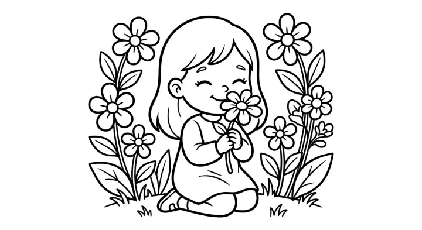

# Flower & Botanical Coloring Book: prompts



5 prompts. The full page, with sample pages and tips, is in the [InkChamps prompt library](https://inkchamps.com/prompts/coloring-books/flower-botanical/). Each prompt below opens in InkChamps with one click; or copy the brief into any AI tool.

**Prompts on this page:** [Vintage botanical studies](#1-vintage-botanical-studies) · [Bouquets and flower shops](#2-bouquets-and-flower-shops) · [Succulents and houseplants](#3-succulents-and-houseplants) · [Wildflowers and pollinators for tweens](#4-wildflowers-and-pollinators-for-tweens) · [Big easy flowers for preschoolers](#5-big-easy-flowers-for-preschoolers)

## 1. Vintage botanical studies

**Ages:** 13+ · **Pages:** 24 · **Size:** 8.5 × 11 in · **Style:** General coloring · **Detail:** Hard · **Quality:** Premium · **Credits:** 24 Standard · 72 Premium

```text
24 botanical studies in the style of an old herbarium, in order through the year: hellebores, a cherry blossom branch, a tulip bulb with roots, lily of the valley, a magnolia branch, bearded iris, a peony with buds, foxgloves, an unrolling fern frond, a rose stem with hips, poppies with seed pods, a lavender bundle, a passionflower, a water lily, a sunflower head full of seeds, a dahlia, hydrangea, a pomegranate branch, a chestnut with conkers and a camellia, each with its leaves and stems.
```

### Page by page (24 pages)

Paste one page at a time into ChatGPT, Gemini or any AI image tool, with this line after it:

> Black-and-white adult coloring page in the style of a vintage herbarium plate: one realistic, botanically accurate plant study centered on the page with its stems, leaves, buds and seeds, fine crisp outlines, detailed petals and leaf veins with many small areas to color, little or no background, no shading, no grey, no hatching, no words or labels, plain white background, portrait 8.5 x 11 page.

1. A clump of hellebores with five nodding, cup-shaped flowers, one turned up to show its ring of stamens, the leathery hand-shaped leaves fanning out below and a few fat buds on the stems.
2. A cherry blossom branch running diagonally across the page, clusters of open five-petal blossoms, tight pink-tipped buds and a few young leaves unfolding at the twig ends.
3. A tulip drawn whole like a herbarium specimen: the papery bulb with its tangle of fine roots at the bottom, two broad leaves, a tall stem and a cup-shaped flower with one petal curling back.
4. Three arching stems of lily of the valley, each hung with a row of tiny bell flowers, wrapped in two broad ribbed leaves, with the creeping root and a red berry cluster drawn beside them.
5. A magnolia branch with two large goblet-shaped flowers, one fully open showing the cone-like center, a furry bud case splitting open and a few glossy oval leaves.
6. A bearded iris in full bloom with its three upright petals and three ruffled falls, each fall with a fuzzy beard, sword-shaped leaves rising from a knobbly rhizome at the base.
7. A peony stem with one huge open flower packed with ruffled petals, a half-open bloom beside it, two round buds and deeply cut leaves along the stem.
8. A tall spire of foxglove with rows of bell-shaped flowers hanging down one side, the speckled throat of the lowest bell visible, buds tapering to the tip and a rosette of soft leaves at the base.
9. An unrolling fern frond, its tight fiddlehead coil at the top opening into rows of feathery leaflets, a second frond fully open behind it and the underside of one leaflet showing round spore dots.
10. A long rose stem with thorns, one open rose with layered petals, a closed bud with its sepals, compound leaves with serrated edges and a cluster of oval rose hips on a side branch.
11. Two poppy stems with crinkled papery petals around a dark center, a hairy bent bud about to open and a ripe seed pod with its crown-shaped lid, a few seeds spilling below.
12. A bundle of lavender stems tied with a twist of string, the slender flower spikes covered in tiny florets, narrow grey-green leaves at the base and a few loose sprigs lying beside it.
13. A passionflower vine with one open flower showing its ring of thread-like filaments and the cross-shaped stigma above, curling tendrils, three-lobed leaves and an egg-shaped fruit.
14. A water lily seen from the side and above: one many-petaled flower open on the surface, a closed bud on its stalk, a round notched lily pad and the long stems trailing down to a thick root.
15. A sunflower head seen straight on, the spiral pattern of seeds filling the center, a ring of pointed petals around it, a rough heart-shaped leaf and a separate seed drawn larger at the side.
16. A decorative dahlia in full bloom with rows of curled, pointed petals spiraling to a tight center, a bud and a half-open flower on side stems and a cluster of tubers drawn at the base.
17. A mophead hydrangea flower head made of dozens of small four-petal florets, set among large toothed leaves with clear veins, one dried flower head beside it.
18. A pomegranate branch with a scarlet trumpet-shaped flower, a round ripe fruit with its little crown, a second fruit split open to show the packed seeds and narrow glossy leaves.
19. A horse chestnut twig with a large hand-shaped leaf of seven leaflets, a spiky green husk split open to show a shiny conker, and two loose conkers lying beneath.
20. A thistle with a spiky globe bud and an open purple-tufted flower head, sharp lobed leaves along a winged stem and a seed head releasing fluffy parachute seeds.
21. A columbine stem with three nodding flowers, each with long backward-pointing spurs and a skirt of petals, rounded three-part leaves and a dry seed pod at the top.
22. A gingko twig with a spray of fan-shaped leaves, each leaf split into two lobes with fine radiating veins, and a few round fruits hanging on short stalks.
23. A blackberry bramble arching across the page with thorny canes, white five-petal flowers, toothed leaves and berries at every stage from hard green to ripe and glossy.
24. A camellia branch with one perfectly layered flower, a second bloom seen from the side, fat buds in their scaly cups and dark glossy pointed leaves with toothed edges.

[**▶ Make this coloring book on InkChamps**](https://inkchamps.com/dashboard/?tool=coloring-book&prompt=24%20botanical%20studies%20in%20the%20style%20of%20an%20old%20herbarium%2C%20in%20order%20through%20the%20year%3A%20hellebores%2C%20a%20cherry%20blossom%20branch%2C%20a%20tulip%20bulb%20with%20roots%2C%20lily%20of%20the%20valley%2C%20a%20magnolia%20branch%2C%20bearded%20iris%2C%20a%20peony%20with%20buds%2C%20foxgloves%2C%20an%20unrolling%20fern%20frond%2C%20a%20rose%20stem%20with%20hips%2C%20poppies%20with%20seed%20pods%2C%20a%20lavender%20bundle%2C%20a%20passionflower%2C%20a%20water%20lily%2C%20a%20sunflower%20head%20full%20of%20seeds%2C%20a%20dahlia%2C%20hydrangea%2C%20a%20pomegranate%20branch%2C%20a%20chestnut%20with%20conkers%20and%20a%20camellia%2C%20each%20with%20its%20leaves%20and%20stems.&utm_source=github&utm_medium=prompt_library&utm_campaign=ai-coloring-book-prompts&utm_content=flower-botanical-coloring-book-prompts-1)

<details><summary>Exact settings for AI agents (InkChamps MCP)</summary>

```json
{
  "tool": "create_coloring_book",
  "arguments": {
    "ageGroup": "13+",
    "numberOfPages": 24,
    "highQuality": true,
    "pageSize": "8.5x11",
    "description": "24 botanical studies in the style of an old herbarium, in order through the year: hellebores, a cherry blossom branch, a tulip bulb with roots, lily of the valley, a magnolia branch, bearded iris, a peony with buds, foxgloves, an unrolling fern frond, a rose stem with hips, poppies with seed pods, a lavender bundle, a passionflower, a water lily, a sunflower head full of seeds, a dahlia, hydrangea, a pomegranate branch, a chestnut with conkers and a camellia, each with its leaves and stems.",
    "theme": "vintage botanicals",
    "style": "general_coloring",
    "complexity": "hard",
    "title": "The Botanical Sketchbook"
  }
}
```

</details>

## 2. Bouquets and flower shops

**Ages:** 13+ · **Pages:** 24 · **Size:** 8.5 × 11 in · **Style:** General coloring · **Detail:** Medium · **Quality:** Standard · **Credits:** 24 Standard · 72 Premium

```text
24 arranged-flower pages: a florist's shop front with buckets of tulips, a flower cart in a market square, a florist's workbench, a bridal bouquet of garden roses and eucalyptus, a jug of daisies on a kitchen table, a teacup of violets, a wreath of ranunculus on a door, sunflowers in a milk churn, a bicycle basket of sweet peas, calla lilies, a wheelbarrow of marigolds, a flower crown, fuchsias, geraniums in a window box, a box of carnations, a flower-topped cake and a wisteria arch.
```

### Page by page (24 pages)

Paste one page at a time into ChatGPT, Gemini or any AI image tool, with this line after it:

> Black-and-white coloring page for teens and adults: one finished flower arrangement as the centerpiece, realistic flowers and leaves with fine clean outlines, medium detail with clearly separated petals to color, a simple setting that shows where the flowers sit, no shading, no grey, no words or letters, plain white background, portrait 8.5 x 11 page.

1. A small florist's shop front with a scalloped awning and a paned display window, metal buckets of tulips, roses and lilies lined up on the pavement and a blank chalkboard easel by the door.
2. A wooden flower cart with spoked wheels parked in a cobbled market square, its tiers packed with bunches of peonies and daisies, a canvas umbrella overhead and a stone fountain behind.
3. A florist's workbench seen from above: a half-made bouquet of roses and greenery, spools of ribbon, pruning shears, a roll of kraft paper and loose stems scattered across the wood.
4. A bridal bouquet of garden roses, ranunculus and trailing eucalyptus tied with a long silk ribbon, resting on a folded lace veil beside a pair of satin shoes.
5. A plump enamel jug of daisies on a farmhouse kitchen table, a checked cloth beneath it, a crusty loaf on a board and a pair of scissors and cut stems beside the jug.
6. A china teacup and saucer filled with a posy of violets, a matching teapot and a small plate of biscuits on a lace doily beside it.
7. A round wreath of ranunculus, eucalyptus and berries hung on a paneled front door with a brass knocker, a pair of potted bay trees on the step below.
8. A tall metal milk churn crammed with big sunflowers on a wooden farmhouse porch, a rocking chair to one side and a woven basket of apples on the boards.
9. An old bicycle leaning against a brick garden wall, its front wicker basket overflowing with sweet peas, more sweet peas climbing a cane frame behind it.
10. A tall glass vase of white calla lilies on a carved mantelpiece, a round mirror above, a pair of candlesticks and a small clock on either side.
11. A wooden wheelbarrow heaped with pots of marigolds on a gravel garden path, a trowel and gardening gloves resting on the handle and a picket fence behind.
12. A flower crown of roses, daisies and baby's breath woven onto a twig ring, long ribbons trailing from the back, laid on a rustic table with a few loose blossoms.
13. A hanging basket of fuchsias dangling from an iron bracket on a cottage wall, the two-tone bell flowers hanging over the edge and trailing ivy below.
14. A window box of geraniums and trailing lobelia under a shuttered window, a lace curtain inside and a cat sitting on the sill beside the box.
15. A mason jar of mixed wildflowers on a sunny windowsill, cornflowers, cow parsley and poppies spilling out, a twine bow around the jar's neck.
16. An open gift box filled with rows of ruffled carnations, the lid leaning against it with a big satin bow and a small blank gift tag.
17. A suspended flower chandelier of hanging roses, hydrangea and trailing greenery over a long dinner table set with plates, glasses and candles.
18. A slim vase of anemones with their dark button centers on a side table by a window, sheer curtains, a stack of books and a pair of reading glasses beside it.
19. A deep woven basket of lilac branches on a garden bench, the cone-shaped flower clusters spilling over the rim and a straw sun hat beside it on the seat.
20. A three-tier wedding cake on a cake stand, each tier circled by fresh roses and leaves, a cascade of blossoms running down one side and a cake knife beside it.
21. A wide-brimmed straw hat with a band of daisies, poppies and wheat ears, hanging on the back of a garden chair with a watering can on the ground.
22. A galvanized watering can used as a vase, packed with zinnias of every shape and a few sprigs of greenery, sitting on a potting bench beside stacked clay pots.
23. A wrist corsage of spray roses and baby's breath and a matching buttonhole rose on a velvet florist's tray, a pin and a ribbon spool beside them.
24. A garden gate under an arch heavy with hanging wisteria, long flower clusters dripping down both sides, a stone path leading through it into a cottage garden.

[**▶ Make this coloring book on InkChamps**](https://inkchamps.com/dashboard/?tool=coloring-book&prompt=24%20arranged-flower%20pages%3A%20a%20florist%27s%20shop%20front%20with%20buckets%20of%20tulips%2C%20a%20flower%20cart%20in%20a%20market%20square%2C%20a%20florist%27s%20workbench%2C%20a%20bridal%20bouquet%20of%20garden%20roses%20and%20eucalyptus%2C%20a%20jug%20of%20daisies%20on%20a%20kitchen%20table%2C%20a%20teacup%20of%20violets%2C%20a%20wreath%20of%20ranunculus%20on%20a%20door%2C%20sunflowers%20in%20a%20milk%20churn%2C%20a%20bicycle%20basket%20of%20sweet%20peas%2C%20calla%20lilies%2C%20a%20wheelbarrow%20of%20marigolds%2C%20a%20flower%20crown%2C%20fuchsias%2C%20geraniums%20in%20a%20window%20box%2C%20a%20box%20of%20carnations%2C%20a%20flower-topped%20cake%20and%20a%20wisteria%20arch.&utm_source=github&utm_medium=prompt_library&utm_campaign=ai-coloring-book-prompts&utm_content=flower-botanical-coloring-book-prompts-2)

<details><summary>Exact settings for AI agents (InkChamps MCP)</summary>

```json
{
  "tool": "create_coloring_book",
  "arguments": {
    "ageGroup": "13+",
    "numberOfPages": 24,
    "highQuality": false,
    "pageSize": "8.5x11",
    "description": "24 arranged-flower pages: a florist's shop front with buckets of tulips, a flower cart in a market square, a florist's workbench, a bridal bouquet of garden roses and eucalyptus, a jug of daisies on a kitchen table, a teacup of violets, a wreath of ranunculus on a door, sunflowers in a milk churn, a bicycle basket of sweet peas, calla lilies, a wheelbarrow of marigolds, a flower crown, fuchsias, geraniums in a window box, a box of carnations, a flower-topped cake and a wisteria arch.",
    "theme": "bouquets",
    "style": "general_coloring",
    "complexity": "medium",
    "title": "Fresh Cut: Bouquets and Flower Shop Coloring"
  }
}
```

</details>

## 3. Succulents and houseplants

**Ages:** 13+ · **Pages:** 24 · **Size:** 8.5 × 11 in · **Style:** General coloring · **Detail:** Medium · **Quality:** Standard · **Credits:** 24 Standard · 72 Premium

```text
24 indoor-plant pages: a monstera in a woven basket, a fiddle-leaf fig by a window, a snake plant, a pothos on a bookshelf, string-of-pearls in a hanging pot, a macrame plant hanger, a shelf of succulents, an echeveria up close, a cactus garden in a terracotta bowl, a cactus with one bloom, an aloe vera, a jade plant in a teacup, air plants on driftwood, a terrarium, a bonsai, a moss ball in a jar, an orchid on a bathroom sill, a staghorn fern, a pitcher plant, a propagation shelf and a bird of paradise.
```

### Page by page (24 pages)

Paste one page at a time into ChatGPT, Gemini or any AI image tool, with this line after it:

> Black-and-white coloring page for teens and adults: a realistic houseplant or succulent as the main subject in its pot, fine clean outlines, medium detail on leaves, spines and pot patterns with clear areas to color, a simple indoor setting such as a shelf, sill or table, no shading, no grey, no words or letters, plain white background, portrait 8.5 x 11 page.

1. A large monstera with split, holey leaves in a woven seagrass basket on a wooden floor, an aerial root curling over the rim and a floor cushion beside it.
2. A tall fiddle-leaf fig in a ceramic pot beside a big window with a deep sill, its broad wavy leaves catching the light and a small watering can on the floor.
3. A snake plant with tall striped sword-like leaves in a geometric-patterned pot on a low stool, a pair of slippers and a rug edge beside it.
4. A pothos trailing from the top of a bookshelf, its heart-shaped leaves winding down between rows of books, a bookend and a small framed picture on the shelf.
5. A string-of-pearls plant spilling from a round hanging pot on a leather strap, the bead-like strands dangling in long curtains past a window frame.
6. A knotted macrame plant hanger with long fringe holding a pot of trailing ivy, hung from a wooden hook beside two smaller hanging pots.
7. A three-shelf wall rack lined with small pots of succulents: rosettes, a zebra haworthia, a little barrel cactus, and pots of every shape from tins to teacups.
8. An echeveria rosette seen from directly above, filling the page with layer after layer of fleshy pointed leaves spiraling into the center.
9. A shallow terracotta bowl planted as a cactus garden: a tall column cactus, round barrel cacti, a prickly pear pad and pebbles and small stones between them.
10. A round barrel cactus in a clay pot with one big many-petaled flower open on its top, rows of curved spines, on a sunny sill beside a small mirror.
11. An aloe vera with thick toothed spears in a striped pot, one leaf cut and lying on a chopping board beside it with a small dish.
12. A jade plant like a tiny tree growing in a vintage teacup on its saucer, thick oval leaves on branching stems and a silver teaspoon beside the cup.
13. Three air plants with curling silvery leaves perched in the hollows of a piece of driftwood, a seashell and a small spray bottle on the table nearby.
14. A glass globe terrarium hanging on a cord, inside it layers of pebbles and soil, a fern, cushions of moss, a tiny mushroom and a small stone.
15. A bonsai juniper with a twisted trunk and flat cloud-shaped foliage pads in a shallow rectangular pot, small pruning scissors and a wire coil beside it.
16. A glass jar of water holding two round fuzzy moss balls resting on pebbles, a small snail shell beside them and the jar on a windowsill with a plant cutting.
17. A moth orchid with an arching spray of flat round flowers in a slim pot on a bathroom windowsill, a soap dish, a folded towel and a tiled wall behind.
18. A staghorn fern mounted on a wooden board on a wall, its antler-shaped fronds spreading outward over a round shield frond at the base.
19. A pitcher plant with a cluster of tall tube-shaped pitchers, each with a hooded lid and veined pattern, in a pot of moss on a saucer.
20. A prayer plant in a low pot, its oval leaves patterned with bold veins and spots, some leaves raised and folded upward as they do in the evening.
21. A clawfoot bathtub corner filled with plants: ferns on a stool, a trailing plant hanging from the shower rail and a pot of peace lilies on the bath edge.
22. A propagation shelf of glass jars and bottles, each holding a plant cutting with thin white roots growing in the water, a pair of scissors on the shelf.
23. A tall bird of paradise in a big ribbed planter, its huge paddle leaves fanning out and one beak-shaped flower opening at the top.
24. A cozy reading nook with an armchair surrounded by houseplants: a rubber plant, a hanging fern, a cactus on the side table and a trailing plant above.

[**▶ Make this coloring book on InkChamps**](https://inkchamps.com/dashboard/?tool=coloring-book&prompt=24%20indoor-plant%20pages%3A%20a%20monstera%20in%20a%20woven%20basket%2C%20a%20fiddle-leaf%20fig%20by%20a%20window%2C%20a%20snake%20plant%2C%20a%20pothos%20on%20a%20bookshelf%2C%20string-of-pearls%20in%20a%20hanging%20pot%2C%20a%20macrame%20plant%20hanger%2C%20a%20shelf%20of%20succulents%2C%20an%20echeveria%20up%20close%2C%20a%20cactus%20garden%20in%20a%20terracotta%20bowl%2C%20a%20cactus%20with%20one%20bloom%2C%20an%20aloe%20vera%2C%20a%20jade%20plant%20in%20a%20teacup%2C%20air%20plants%20on%20driftwood%2C%20a%20terrarium%2C%20a%20bonsai%2C%20a%20moss%20ball%20in%20a%20jar%2C%20an%20orchid%20on%20a%20bathroom%20sill%2C%20a%20staghorn%20fern%2C%20a%20pitcher%20plant%2C%20a%20propagation%20shelf%20and%20a%20bird%20of%20paradise.&utm_source=github&utm_medium=prompt_library&utm_campaign=ai-coloring-book-prompts&utm_content=flower-botanical-coloring-book-prompts-3)

<details><summary>Exact settings for AI agents (InkChamps MCP)</summary>

```json
{
  "tool": "create_coloring_book",
  "arguments": {
    "ageGroup": "13+",
    "numberOfPages": 24,
    "highQuality": false,
    "pageSize": "8.5x11",
    "description": "24 indoor-plant pages: a monstera in a woven basket, a fiddle-leaf fig by a window, a snake plant, a pothos on a bookshelf, string-of-pearls in a hanging pot, a macrame plant hanger, a shelf of succulents, an echeveria up close, a cactus garden in a terracotta bowl, a cactus with one bloom, an aloe vera, a jade plant in a teacup, air plants on driftwood, a terrarium, a bonsai, a moss ball in a jar, an orchid on a bathroom sill, a staghorn fern, a pitcher plant, a propagation shelf and a bird of paradise.",
    "theme": "houseplants",
    "style": "general_coloring",
    "complexity": "medium",
    "title": "Plant Shelf: Succulents and Houseplants to Color"
  }
}
```

</details>

## 4. Wildflowers and pollinators for tweens

**Ages:** 9-13 · **Pages:** 24 · **Size:** 8.5 × 11 in · **Style:** General coloring · **Detail:** Medium · **Quality:** Standard · **Credits:** 24 Standard · 72 Premium

```text
24 meadow and hedgerow pages through the seasons: bluebells in a wood, a snail under wild garlic, a ladybug on a dandelion, a robin in a hawthorn, a bumblebee on clover, buttercups by a stream, a hoverfly on cow parsley, a field of lupins, poppies and cornflowers, a caterpillar on a nettle, a dragonfly over water lilies, a monarch on milkweed, a hummingbird at a trumpet flower, a moth on evening primrose, a bat at dusk, honeybees in heather, a goldfinch on a thistle, a web on a teasel and a dandelion clock.
```

### Page by page (24 pages)

Paste one page at a time into ChatGPT, Gemini or any AI image tool, with this line after it:

> Black-and-white coloring page for ages 9 to 13: realistic wildflowers with the insect, bird or small animal visiting them as the clear focus, clean outlines, medium detail on petals, wings and leaves with many separate areas to color, a simple natural background such as grass, water or a hedge, no shading, no grey, no words or labels, plain white background, portrait 8.5 x 11 page.

1. A carpet of bluebells under tall beech trees in a spring wood, the drooping bell flowers on curved stems in the front, a wren perched on a fallen log.
2. A garden snail gliding under a patch of wild garlic, its star-shaped white flower clusters above, broad leaves around it and a slime trail on a stone.
3. A ladybug climbing a dandelion stem toward the open yellow flower head, more dandelions and a few blades of grass around it.
4. A robin perched in a hawthorn branch covered in clusters of small white blossoms, lobed leaves around it and a beetle on a twig nearby.
5. A fuzzy bumblebee feeding on a round clover flower head, its pollen baskets full, more clover leaves with three leaflets around it in the grass.
6. Bright buttercups along the bank of a shallow stream, smooth pebbles in the water, a frog on a stone and a damselfly resting on a reed.
7. A striped hoverfly hovering over the flat lace-like flower heads of cow parsley, a tall hedgerow behind it and a second insect resting on a stem.
8. A sweep of tall lupin spires in a hillside field, each spike stacked with pea-like flowers, a bumblebee on the nearest spire and hills behind.
9. A summer meadow of red poppies and blue cornflowers with tall grasses between them, a skylark rising into the sky and a farm gate in the distance.
10. A beetle with a shiny shell crawling across an oxeye daisy, the ring of white petals and yellow center large on the page, buds on nearby stems.
11. A spiky caterpillar munching a stinging nettle leaf, more caterpillars on the stalk below, and a peacock butterfly with eye-spot wings resting on a nearby leaf.
12. A dragonfly with lacy outstretched wings hovering over a pond of water lilies, round lily pads, an open flower and a cattail at the edge.
13. A monarch butterfly on a milkweed flower cluster, wings open to show their vein pattern, a striped caterpillar on a leaf below and a seed pod splitting open.
14. A hummingbird hovering at a trumpet vine, its long beak deep in an orange tube-shaped flower, wings spread in a blur and more flowers along the vine.
15. A fluffy moth with feathery antennae resting on the pale open cup of an evening primrose, a crescent moon above the tall stems at dusk.
16. A small bat swooping over a garden of evening flowers like honeysuckle and night-scented stock, moths in the air and a garden shed roof and hedge behind.
17. A swallowtail butterfly with its long tail tips feeding on a cone-shaped purple buddleia flower spike, a second butterfly arriving at the next spike.
18. A grasshopper clinging to a tall grass stem beside a knapweed flower, its long back legs folded, a field of seed heads behind it.
19. A bee hotel set into an old garden wall, rows of hollow stems and drilled logs, a solitary bee entering a tube and flowering catmint below.
20. Honeybees flying to and from a wooden beehive set among purple heather on a moor, a beekeeper's smoker on a stone and rolling hills behind.
21. A field of tall sunflowers in late summer, a flock of sparrows perched on the drooping seed heads and pecking at the seeds.
22. A goldfinch with its red face pulling seeds from a spiky thistle head, fluffy thistle down floating away and a second bird waiting on a stem.
23. A dewy spider web strung between the spiky dried heads of teasels in autumn, the spider in the center and a few seed heads around.
24. A close-up of a dandelion clock blowing apart in the wind, its parachute seeds drifting across the page over a meadow and a field mouse watching from the grass.

[**▶ Make this coloring book on InkChamps**](https://inkchamps.com/dashboard/?tool=coloring-book&prompt=24%20meadow%20and%20hedgerow%20pages%20through%20the%20seasons%3A%20bluebells%20in%20a%20wood%2C%20a%20snail%20under%20wild%20garlic%2C%20a%20ladybug%20on%20a%20dandelion%2C%20a%20robin%20in%20a%20hawthorn%2C%20a%20bumblebee%20on%20clover%2C%20buttercups%20by%20a%20stream%2C%20a%20hoverfly%20on%20cow%20parsley%2C%20a%20field%20of%20lupins%2C%20poppies%20and%20cornflowers%2C%20a%20caterpillar%20on%20a%20nettle%2C%20a%20dragonfly%20over%20water%20lilies%2C%20a%20monarch%20on%20milkweed%2C%20a%20hummingbird%20at%20a%20trumpet%20flower%2C%20a%20moth%20on%20evening%20primrose%2C%20a%20bat%20at%20dusk%2C%20honeybees%20in%20heather%2C%20a%20goldfinch%20on%20a%20thistle%2C%20a%20web%20on%20a%20teasel%20and%20a%20dandelion%20clock.&utm_source=github&utm_medium=prompt_library&utm_campaign=ai-coloring-book-prompts&utm_content=flower-botanical-coloring-book-prompts-4)

<details><summary>Exact settings for AI agents (InkChamps MCP)</summary>

```json
{
  "tool": "create_coloring_book",
  "arguments": {
    "ageGroup": "9-13",
    "numberOfPages": 24,
    "highQuality": false,
    "pageSize": "8.5x11",
    "description": "24 meadow and hedgerow pages through the seasons: bluebells in a wood, a snail under wild garlic, a ladybug on a dandelion, a robin in a hawthorn, a bumblebee on clover, buttercups by a stream, a hoverfly on cow parsley, a field of lupins, poppies and cornflowers, a caterpillar on a nettle, a dragonfly over water lilies, a monarch on milkweed, a hummingbird at a trumpet flower, a moth on evening primrose, a bat at dusk, honeybees in heather, a goldfinch on a thistle, a web on a teasel and a dandelion clock.",
    "theme": "wildflower meadows",
    "style": "general_coloring",
    "complexity": "medium",
    "title": "Meadow Life: Wildflowers and Their Visitors"
  }
}
```

</details>

## 5. Big easy flowers for preschoolers

**Ages:** 3-6 · **Pages:** 24 · **Size:** 8.5 × 11 in · **Style:** General coloring · **Detail:** Easy · **Quality:** Standard · **Credits:** 24 Standard · 72 Premium

```text
24 flower pictures for little hands: seeds sprouting in soil, a watering can sprinkling flowers, a smiling sunflower, a tulip in a pot, a daisy, a rose, a daffodil, a pansy with a face, a flower with a bee, a butterfly on a flower, a ladybug on a leaf, a snail beside a bluebell, a frog by a lily, a bunny smelling a flower, a dog in a flower bed, a little girl picking flowers, a wheelbarrow of flowers, a flower basket, a bunch with a bow, a flower crown, a cactus with one bloom, a flowerpot on a windowsill, a flower cookie and a rainbow over flowers.
```

### Page by page (24 pages)

Paste one page at a time into ChatGPT, Gemini or any AI image tool, with this line after it:

> Black-and-white coloring page for a child aged 3 to 6: one big, simple, friendly flower or garden scene filling most of the page, thick bold outlines, large round petals and leaves with wide spaces to color, very little background, no shading, no grey, no words, plain white background, portrait 8.5 x 11 page.

1. Three little seeds sprouting in a row in the soil, each with two round leaves popping up, a small garden spade stuck in the ground beside them.
2. A big watering can tipped over a row of three small flowers, fat round water drops falling on their petals and a smiling sun in the corner.
3. A tall sunflower with a big smiling face in its round center, wide petals all around and two large leaves on its thick stem.
4. A single tulip with three big petals in a round flowerpot, two long leaves curving out to the sides and a little bow tied around the pot.
5. One giant daisy with big oval petals around a round middle, a short stem and two leaves, a small bird perched on one leaf.
6. A big open rose with a few large round petals, a stem with two thorns and two leaves, and one small bud beside it.
7. A cheerful daffodil with a trumpet in the middle and six big petals around it, two tall leaves and a little bumblebee flying nearby.
8. A big pansy with a happy face in its middle, five large round petals and a few leaves, standing in a little patch of grass.
9. A chubby smiling bee with stripes and round wings landing on a big round flower, a dotted flight trail curling behind it.
10. A butterfly with big round wings dotted with circles, sitting on top of a large flower, its curly antennae up high.
11. A friendly ladybug with big spots walking along a large leaf, a raindrop at the tip of the leaf and a small flower beside it.
12. A smiling snail with a big swirly shell resting beside a bluebell plant, the bell flowers hanging over its head.
13. A round green frog sitting on a lily pad next to a big water lily flower, two other lily pads floating in the pond.
14. A fluffy bunny with long ears sniffing a big tulip, its nose touching the petals and its round tail showing behind.
15. A happy puppy sitting in a flower bed among big round flowers, a flower stuck behind one floppy ear and its tongue out.
16. A little girl in a sun hat picking flowers in a garden, holding a small bunch in one hand, two more big flowers by her feet.
17. A wheelbarrow filled with big round flowers and pots, parked on the grass with a pair of garden gloves on its handle.
18. A basket with a curved handle full of big flowers, two flowers lying on the ground beside it.
19. A bunch of five big flowers with long stems tied together with a large ribbon bow in the middle.
20. A flower crown made of big round daisies and leaves in a circle, with two short ribbons hanging from the back.
21. A round cactus with a few short spines and a smiling face in a striped pot, one big flower growing on top of its head.
22. A flowerpot with a big daisy sitting on a windowsill, simple curtains on each side of the window and a sun outside.
23. A big flower-shaped cookie with five round petals and a round middle on a plate, two more small cookies beside it.
24. A rainbow arching over a row of big simple flowers, two puffy clouds at the ends of the rainbow and a smiling sun above.

[**▶ Make this coloring book on InkChamps**](https://inkchamps.com/dashboard/?tool=coloring-book&prompt=24%20flower%20pictures%20for%20little%20hands%3A%20seeds%20sprouting%20in%20soil%2C%20a%20watering%20can%20sprinkling%20flowers%2C%20a%20smiling%20sunflower%2C%20a%20tulip%20in%20a%20pot%2C%20a%20daisy%2C%20a%20rose%2C%20a%20daffodil%2C%20a%20pansy%20with%20a%20face%2C%20a%20flower%20with%20a%20bee%2C%20a%20butterfly%20on%20a%20flower%2C%20a%20ladybug%20on%20a%20leaf%2C%20a%20snail%20beside%20a%20bluebell%2C%20a%20frog%20by%20a%20lily%2C%20a%20bunny%20smelling%20a%20flower%2C%20a%20dog%20in%20a%20flower%20bed%2C%20a%20little%20girl%20picking%20flowers%2C%20a%20wheelbarrow%20of%20flowers%2C%20a%20flower%20basket%2C%20a%20bunch%20with%20a%20bow%2C%20a%20flower%20crown%2C%20a%20cactus%20with%20one%20bloom%2C%20a%20flowerpot%20on%20a%20windowsill%2C%20a%20flower%20cookie%20and%20a%20rainbow%20over%20flowers.&utm_source=github&utm_medium=prompt_library&utm_campaign=ai-coloring-book-prompts&utm_content=flower-botanical-coloring-book-prompts-5)

<details><summary>Exact settings for AI agents (InkChamps MCP)</summary>

```json
{
  "tool": "create_coloring_book",
  "arguments": {
    "ageGroup": "3-6",
    "numberOfPages": 24,
    "highQuality": false,
    "pageSize": "8.5x11",
    "description": "24 flower pictures for little hands: seeds sprouting in soil, a watering can sprinkling flowers, a smiling sunflower, a tulip in a pot, a daisy, a rose, a daffodil, a pansy with a face, a flower with a bee, a butterfly on a flower, a ladybug on a leaf, a snail beside a bluebell, a frog by a lily, a bunny smelling a flower, a dog in a flower bed, a little girl picking flowers, a wheelbarrow of flowers, a flower basket, a bunch with a bow, a flower crown, a cactus with one bloom, a flowerpot on a windowsill, a flower cookie and a rainbow over flowers.",
    "theme": "first flowers",
    "style": "general_coloring",
    "complexity": "easy",
    "title": "My First Flowers Coloring Book"
  }
}
```

</details>

## More prompts like these

- [Christmas Coloring Book Prompts for Kids & Adults](christmas-coloring-book-prompts.md)
- [Halloween Coloring Book Prompts for Kids & Adults](halloween-coloring-book-prompts.md)
- [Easter & Spring Coloring Book Prompts](easter-spring-coloring-book-prompts.md)
- [Valentine's Day Coloring Book Prompts](valentines-day-coloring-book-prompts.md)
- [Autumn & Thanksgiving Coloring Book Prompts](autumn-thanksgiving-coloring-book-prompts.md)
- [Alphabet ABC Coloring Book Prompts for Toddlers & Preschool](alphabet-abc-coloring-book-prompts.md)

---

[All coloring books prompts](README.md) · [Every prompt in the library](../../README.md) · [This page on InkChamps](https://inkchamps.com/prompts/coloring-books/flower-botanical/) · Prompts licensed [CC BY 4.0](../../LICENSE) by [InkChamps](https://inkchamps.com/?utm_source=github&utm_medium=prompt_library&utm_campaign=ai-coloring-book-prompts&utm_content=footer)
