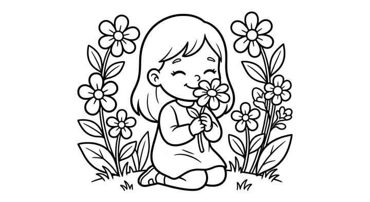

# Flower & Botanical Coloring Book: prompts



5 prompts. The full page, with sample pages and tips, is in the [InkChamps prompt library](https://inkchamps.com/prompts/coloring-books/flower-botanical/). Each prompt below opens in InkChamps with one click; or copy the brief into any AI tool.

**Prompts on this page:** [Vintage botanical studies](#1-vintage-botanical-studies) · [Bouquets and flower shops](#2-bouquets-and-flower-shops) · [Succulents and houseplants](#3-succulents-and-houseplants) · [Wildflowers and pollinators for tweens](#4-wildflowers-and-pollinators-for-tweens) · [Big easy flowers for preschoolers](#5-big-easy-flowers-for-preschoolers)

## 1. Vintage botanical studies

**Ages:** 13+ · **Pages:** 40 · **Size:** 8.5 × 11 in · **Style:** General coloring · **Detail:** Hard · **Quality:** Premium · **Credits:** 40 Standard · 120 Premium

```text
Forty botanical studies in the style of an old herbarium: a peony with buds, a magnolia branch, bearded iris, foxgloves, an unrolling fern frond, lily of the valley, a sunflower head full of seeds, poppies with seed pods, a rose stem with hips, wild orchids, a lavender bundle, a passionflower, an olive sprig, hydrangea, a dahlia, a camellia, hellebores, a clematis vine, a tulip bulb with roots and a cherry blossom branch, each with its leaves and stems.
```

**Extra direction:** More pages: a pomegranate branch with fruit, a thistle, a water lily with its pad, a chestnut leaf with conkers, a columbine, a morning glory, a protea, a gingko twig, a bleeding heart, a quince blossom, a blackberry bramble, a calendula.

[**▶ Make this coloring book on InkChamps**](https://inkchamps.com/dashboard/?tool=coloring-book&prompt=Forty%20botanical%20studies%20in%20the%20style%20of%20an%20old%20herbarium%3A%20a%20peony%20with%20buds%2C%20a%20magnolia%20branch%2C%20bearded%20iris%2C%20foxgloves%2C%20an%20unrolling%20fern%20frond%2C%20lily%20of%20the%20valley%2C%20a%20sunflower%20head%20full%20of%20seeds%2C%20poppies%20with%20seed%20pods%2C%20a%20rose%20stem%20with%20hips%2C%20wild%20orchids%2C%20a%20lavender%20bundle%2C%20a%20passionflower%2C%20an%20olive%20sprig%2C%20hydrangea%2C%20a%20dahlia%2C%20a%20camellia%2C%20hellebores%2C%20a%20clematis%20vine%2C%20a%20tulip%20bulb%20with%20roots%20and%20a%20cherry%20blossom%20branch%2C%20each%20with%20its%20leaves%20and%20stems.&utm_source=github&utm_medium=prompt_library&utm_campaign=ai-coloring-book-prompts&utm_content=flower-botanical-coloring-book-prompts-1)

<details><summary>Exact settings for AI agents (InkChamps MCP)</summary>

```json
{
  "tool": "create_coloring_book",
  "arguments": {
    "ageGroup": "13+",
    "numberOfPages": 40,
    "highQuality": true,
    "pageSize": "8.5x11",
    "description": "Forty botanical studies in the style of an old herbarium: a peony with buds, a magnolia branch, bearded iris, foxgloves, an unrolling fern frond, lily of the valley, a sunflower head full of seeds, poppies with seed pods, a rose stem with hips, wild orchids, a lavender bundle, a passionflower, an olive sprig, hydrangea, a dahlia, a camellia, hellebores, a clematis vine, a tulip bulb with roots and a cherry blossom branch, each with its leaves and stems.",
    "theme": "vintage botanicals",
    "style": "general_coloring",
    "complexity": "hard",
    "title": "The Botanical Sketchbook",
    "additionalInstructions": "More pages: a pomegranate branch with fruit, a thistle, a water lily with its pad, a chestnut leaf with conkers, a columbine, a morning glory, a protea, a gingko twig, a bleeding heart, a quince blossom, a blackberry bramble, a calendula."
  }
}
```

</details>

## 2. Bouquets and flower shops

**Ages:** 13+ · **Pages:** 40 · **Size:** 8.5 × 11 in · **Style:** General coloring · **Detail:** Medium · **Quality:** Standard · **Credits:** 40 Standard · 120 Premium

```text
Forty arranged-flower pages: a bridal bouquet of garden roses and eucalyptus, a jug of daisies on a kitchen table, a flower cart in a market square, buckets of tulips outside a florist, a teacup of violets, a wreath of ranunculus on a door, sunflowers in a milk churn, a bicycle basket of sweet peas, a glass vase of calla lilies, a wheelbarrow of marigolds, a flower crown, a hanging basket of fuchsias, a corsage, a mason jar of wildflowers and a window box of geraniums.
```

**Extra direction:** More pages: a florist's workbench with ribbons, a gift box of carnations, a chandelier of hanging flowers, a vase of anemones by a window, a basket of lilacs, a cake topped with flowers, a straw hat with a flower band, a watering can of zinnias, a doorway arch of wisteria.

[**▶ Make this coloring book on InkChamps**](https://inkchamps.com/dashboard/?tool=coloring-book&prompt=Forty%20arranged-flower%20pages%3A%20a%20bridal%20bouquet%20of%20garden%20roses%20and%20eucalyptus%2C%20a%20jug%20of%20daisies%20on%20a%20kitchen%20table%2C%20a%20flower%20cart%20in%20a%20market%20square%2C%20buckets%20of%20tulips%20outside%20a%20florist%2C%20a%20teacup%20of%20violets%2C%20a%20wreath%20of%20ranunculus%20on%20a%20door%2C%20sunflowers%20in%20a%20milk%20churn%2C%20a%20bicycle%20basket%20of%20sweet%20peas%2C%20a%20glass%20vase%20of%20calla%20lilies%2C%20a%20wheelbarrow%20of%20marigolds%2C%20a%20flower%20crown%2C%20a%20hanging%20basket%20of%20fuchsias%2C%20a%20corsage%2C%20a%20mason%20jar%20of%20wildflowers%20and%20a%20window%20box%20of%20geraniums.&utm_source=github&utm_medium=prompt_library&utm_campaign=ai-coloring-book-prompts&utm_content=flower-botanical-coloring-book-prompts-2)

<details><summary>Exact settings for AI agents (InkChamps MCP)</summary>

```json
{
  "tool": "create_coloring_book",
  "arguments": {
    "ageGroup": "13+",
    "numberOfPages": 40,
    "highQuality": false,
    "pageSize": "8.5x11",
    "description": "Forty arranged-flower pages: a bridal bouquet of garden roses and eucalyptus, a jug of daisies on a kitchen table, a flower cart in a market square, buckets of tulips outside a florist, a teacup of violets, a wreath of ranunculus on a door, sunflowers in a milk churn, a bicycle basket of sweet peas, a glass vase of calla lilies, a wheelbarrow of marigolds, a flower crown, a hanging basket of fuchsias, a corsage, a mason jar of wildflowers and a window box of geraniums.",
    "theme": "bouquets",
    "style": "general_coloring",
    "complexity": "medium",
    "title": "Fresh Cut: Bouquets and Flower Shop Coloring",
    "additionalInstructions": "More pages: a florist's workbench with ribbons, a gift box of carnations, a chandelier of hanging flowers, a vase of anemones by a window, a basket of lilacs, a cake topped with flowers, a straw hat with a flower band, a watering can of zinnias, a doorway arch of wisteria."
  }
}
```

</details>

## 3. Succulents and houseplants

**Ages:** 13+ · **Pages:** 40 · **Size:** 8.5 × 11 in · **Style:** General coloring · **Detail:** Medium · **Quality:** Standard · **Credits:** 40 Standard · 120 Premium

```text
Forty indoor-plant pages: a monstera in a woven basket, a shelf of potted succulents, a cactus garden in a terracotta bowl, string-of-pearls trailing from a hanging pot, a fiddle-leaf fig by a window, an aloe vera, a snake plant, a terrarium in a glass globe, a bonsai, a macramé plant hanger, an echeveria rosette up close, air plants on driftwood, a bench of seedlings, an orchid on a bathroom sill, a pothos on a bookshelf, a moss-ball plant and a bird of paradise in a big pot.
```

**Extra direction:** More pages: a prayer plant, a jade plant in a teacup, a staghorn fern on a wall board, a plant-filled bathtub corner, a cactus with one bloom, a plant swap table, a hanging fern in a bay window, a rubber plant, a pitcher plant, a propagation shelf of cuttings in jars.

[**▶ Make this coloring book on InkChamps**](https://inkchamps.com/dashboard/?tool=coloring-book&prompt=Forty%20indoor-plant%20pages%3A%20a%20monstera%20in%20a%20woven%20basket%2C%20a%20shelf%20of%20potted%20succulents%2C%20a%20cactus%20garden%20in%20a%20terracotta%20bowl%2C%20string-of-pearls%20trailing%20from%20a%20hanging%20pot%2C%20a%20fiddle-leaf%20fig%20by%20a%20window%2C%20an%20aloe%20vera%2C%20a%20snake%20plant%2C%20a%20terrarium%20in%20a%20glass%20globe%2C%20a%20bonsai%2C%20a%20macram%C3%A9%20plant%20hanger%2C%20an%20echeveria%20rosette%20up%20close%2C%20air%20plants%20on%20driftwood%2C%20a%20bench%20of%20seedlings%2C%20an%20orchid%20on%20a%20bathroom%20sill%2C%20a%20pothos%20on%20a%20bookshelf%2C%20a%20moss-ball%20plant%20and%20a%20bird%20of%20paradise%20in%20a%20big%20pot.&utm_source=github&utm_medium=prompt_library&utm_campaign=ai-coloring-book-prompts&utm_content=flower-botanical-coloring-book-prompts-3)

<details><summary>Exact settings for AI agents (InkChamps MCP)</summary>

```json
{
  "tool": "create_coloring_book",
  "arguments": {
    "ageGroup": "13+",
    "numberOfPages": 40,
    "highQuality": false,
    "pageSize": "8.5x11",
    "description": "Forty indoor-plant pages: a monstera in a woven basket, a shelf of potted succulents, a cactus garden in a terracotta bowl, string-of-pearls trailing from a hanging pot, a fiddle-leaf fig by a window, an aloe vera, a snake plant, a terrarium in a glass globe, a bonsai, a macramé plant hanger, an echeveria rosette up close, air plants on driftwood, a bench of seedlings, an orchid on a bathroom sill, a pothos on a bookshelf, a moss-ball plant and a bird of paradise in a big pot.",
    "theme": "houseplants",
    "style": "general_coloring",
    "complexity": "medium",
    "title": "Plant Shelf: Succulents and Houseplants to Color",
    "additionalInstructions": "More pages: a prayer plant, a jade plant in a teacup, a staghorn fern on a wall board, a plant-filled bathtub corner, a cactus with one bloom, a plant swap table, a hanging fern in a bay window, a rubber plant, a pitcher plant, a propagation shelf of cuttings in jars."
  }
}
```

</details>

## 4. Wildflowers and pollinators for tweens

**Ages:** 9-13 · **Pages:** 40 · **Size:** 8.5 × 11 in · **Style:** General coloring · **Detail:** Medium · **Quality:** Standard · **Credits:** 40 Standard · 120 Premium

```text
Forty meadow and hedgerow pages: a bumblebee on clover, a monarch butterfly on milkweed, a hummingbird at a trumpet flower, a meadow of poppies and cornflowers, a ladybug climbing a dandelion, a dragonfly over water lilies, honeybees at a hive among heather, a moth on evening primrose, bluebells in a wood, a field of lupins, a goldfinch on a thistle, a caterpillar on a nettle, buttercups by a stream, a hoverfly on cow parsley and a dandelion clock blowing seeds.
```

**Extra direction:** More pages: a snail under wild garlic, a beetle on a daisy, a swallowtail on a buddleia, a robin in a hawthorn, a bat over evening flowers, a spider web on a teasel, a fritillary in a meadow, a bee hotel in a garden wall, a grasshopper on a stem, a sunflower field with sparrows.

[**▶ Make this coloring book on InkChamps**](https://inkchamps.com/dashboard/?tool=coloring-book&prompt=Forty%20meadow%20and%20hedgerow%20pages%3A%20a%20bumblebee%20on%20clover%2C%20a%20monarch%20butterfly%20on%20milkweed%2C%20a%20hummingbird%20at%20a%20trumpet%20flower%2C%20a%20meadow%20of%20poppies%20and%20cornflowers%2C%20a%20ladybug%20climbing%20a%20dandelion%2C%20a%20dragonfly%20over%20water%20lilies%2C%20honeybees%20at%20a%20hive%20among%20heather%2C%20a%20moth%20on%20evening%20primrose%2C%20bluebells%20in%20a%20wood%2C%20a%20field%20of%20lupins%2C%20a%20goldfinch%20on%20a%20thistle%2C%20a%20caterpillar%20on%20a%20nettle%2C%20buttercups%20by%20a%20stream%2C%20a%20hoverfly%20on%20cow%20parsley%20and%20a%20dandelion%20clock%20blowing%20seeds.&utm_source=github&utm_medium=prompt_library&utm_campaign=ai-coloring-book-prompts&utm_content=flower-botanical-coloring-book-prompts-4)

<details><summary>Exact settings for AI agents (InkChamps MCP)</summary>

```json
{
  "tool": "create_coloring_book",
  "arguments": {
    "ageGroup": "9-13",
    "numberOfPages": 40,
    "highQuality": false,
    "pageSize": "8.5x11",
    "description": "Forty meadow and hedgerow pages: a bumblebee on clover, a monarch butterfly on milkweed, a hummingbird at a trumpet flower, a meadow of poppies and cornflowers, a ladybug climbing a dandelion, a dragonfly over water lilies, honeybees at a hive among heather, a moth on evening primrose, bluebells in a wood, a field of lupins, a goldfinch on a thistle, a caterpillar on a nettle, buttercups by a stream, a hoverfly on cow parsley and a dandelion clock blowing seeds.",
    "theme": "wildflower meadows",
    "style": "general_coloring",
    "complexity": "medium",
    "title": "Meadow Life: Wildflowers and Their Visitors",
    "additionalInstructions": "More pages: a snail under wild garlic, a beetle on a daisy, a swallowtail on a buddleia, a robin in a hawthorn, a bat over evening flowers, a spider web on a teasel, a fritillary in a meadow, a bee hotel in a garden wall, a grasshopper on a stem, a sunflower field with sparrows."
  }
}
```

</details>

## 5. Big easy flowers for preschoolers

**Ages:** 3-6 · **Pages:** 40 · **Size:** 8.5 × 11 in · **Style:** General coloring · **Detail:** Easy · **Quality:** Standard · **Credits:** 40 Standard · 120 Premium

```text
Forty flower pictures for little hands: a smiling sunflower, a tulip in a pot, a daisy, a rose, a flower with a bee, a watering can sprinkling flowers, a ladybug on a leaf, a flower basket, a daffodil, a butterfly on a flower, a bunch of flowers with a bow, a cactus with one bloom, a frog by a lily, a flower crown, seeds sprouting in soil, a flowerpot on a windowsill, a garden gnome among flowers, a rainbow over flowers and a snail beside a bluebell.
```

**Extra direction:** More pages: a pansy with a face, a bunny smelling a flower, a little girl picking flowers, a pumpkin flower, a hummingbird, a bee hive, a flower-shaped cookie, a potted daisy on a step, a dog in a flower bed, a wheelbarrow of flowers.

[**▶ Make this coloring book on InkChamps**](https://inkchamps.com/dashboard/?tool=coloring-book&prompt=Forty%20flower%20pictures%20for%20little%20hands%3A%20a%20smiling%20sunflower%2C%20a%20tulip%20in%20a%20pot%2C%20a%20daisy%2C%20a%20rose%2C%20a%20flower%20with%20a%20bee%2C%20a%20watering%20can%20sprinkling%20flowers%2C%20a%20ladybug%20on%20a%20leaf%2C%20a%20flower%20basket%2C%20a%20daffodil%2C%20a%20butterfly%20on%20a%20flower%2C%20a%20bunch%20of%20flowers%20with%20a%20bow%2C%20a%20cactus%20with%20one%20bloom%2C%20a%20frog%20by%20a%20lily%2C%20a%20flower%20crown%2C%20seeds%20sprouting%20in%20soil%2C%20a%20flowerpot%20on%20a%20windowsill%2C%20a%20garden%20gnome%20among%20flowers%2C%20a%20rainbow%20over%20flowers%20and%20a%20snail%20beside%20a%20bluebell.&utm_source=github&utm_medium=prompt_library&utm_campaign=ai-coloring-book-prompts&utm_content=flower-botanical-coloring-book-prompts-5)

<details><summary>Exact settings for AI agents (InkChamps MCP)</summary>

```json
{
  "tool": "create_coloring_book",
  "arguments": {
    "ageGroup": "3-6",
    "numberOfPages": 40,
    "highQuality": false,
    "pageSize": "8.5x11",
    "description": "Forty flower pictures for little hands: a smiling sunflower, a tulip in a pot, a daisy, a rose, a flower with a bee, a watering can sprinkling flowers, a ladybug on a leaf, a flower basket, a daffodil, a butterfly on a flower, a bunch of flowers with a bow, a cactus with one bloom, a frog by a lily, a flower crown, seeds sprouting in soil, a flowerpot on a windowsill, a garden gnome among flowers, a rainbow over flowers and a snail beside a bluebell.",
    "theme": "first flowers",
    "style": "general_coloring",
    "complexity": "easy",
    "title": "My First Flowers Coloring Book",
    "additionalInstructions": "More pages: a pansy with a face, a bunny smelling a flower, a little girl picking flowers, a pumpkin flower, a hummingbird, a bee hive, a flower-shaped cookie, a potted daisy on a step, a dog in a flower bed, a wheelbarrow of flowers."
  }
}
```

</details>

## More prompts like these

- [Christmas Coloring Book Prompts for Kids & Adults](christmas-coloring-book-prompts.md)
- [Halloween Coloring Book Prompts for Kids & Adults](halloween-coloring-book-prompts.md)
- [Easter & Spring Coloring Book Prompts](easter-spring-coloring-book-prompts.md)
- [Valentine's Day Coloring Book Prompts](valentines-day-coloring-book-prompts.md)
- [Autumn & Thanksgiving Coloring Book Prompts](autumn-thanksgiving-coloring-book-prompts.md)
- [Alphabet ABC Coloring Book Prompts for Toddlers & Preschool](alphabet-abc-coloring-book-prompts.md)

---

[All coloring books prompts](README.md) · [Every prompt in the library](../../README.md) · [This page on InkChamps](https://inkchamps.com/prompts/coloring-books/flower-botanical/) · Prompts licensed [CC BY 4.0](../../LICENSE) by [InkChamps](https://inkchamps.com/?utm_source=github&utm_medium=prompt_library&utm_campaign=ai-coloring-book-prompts&utm_content=footer)
