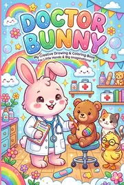

# Good Habits & Manners Coloring Book: prompts



5 prompts. The full page, with sample pages and tips, is in the [InkChamps prompt library](https://inkchamps.com/prompts/coloring-books/good-habits-manners/). Each prompt below opens in InkChamps with one click; or copy the brief into any AI tool.

**Prompts on this page:** [A toddler's day, morning to night](#1-a-toddlers-day-morning-to-night) · [Kind manners with animal friends](#2-kind-manners-with-animal-friends) · [Manners at the table, at school, in town and as a guest](#3-manners-at-the-table-at-school-in-town-and-as-a-guest) · [Healthy and safe habits](#4-healthy-and-safe-habits) · [Responsibility and life skills for tweens](#5-responsibility-and-life-skills-for-tweens)

## 1. A toddler's day, morning to night

**Ages:** 3-6 · **Pages:** 24 · **Size:** 8.5 × 11 in · **Style:** General coloring · **Detail:** Easy · **Layout:** One item per page, with its caption · **Quality:** Standard · **Credits:** 24 Standard · 72 Premium

```text
24 pages of a little one's routine, one habit per page with its caption, a child doing it, from morning to night: waking up and stretching, opening the curtains, washing my face, brushing my teeth, brushing my hair, getting dressed, putting on my shoes, making my bed, eating breakfast, packing my backpack, feeding the goldfish, watering a plant, tidying my toys, playing outside, washing my hands, drinking water, quiet time rest, helping set the table, eating my vegetables, clearing my plate, bath time, reading a bedtime story, a goodnight hug, sleeping in my own bed.
```

### Page by page (24 pages)

Paste one page at a time into ChatGPT, Gemini or any AI image tool, with this line after it:

> Black-and-white coloring page for a child aged 3 to 6: one cheerful cartoon child doing the habit, filling most of the page, thick bold outlines, large simple shapes with wide spaces to color, very little background, no shading, no grey, the caption in big outlined letters at the bottom is the only words on the page, plain white background, portrait 8.5 x 11 page.

1. A little girl with curly pigtails sitting up in bed, stretching both arms high and yawning, a teddy bear on her pillow and a sun peeking through the window with the caption "Waking up and stretching" in big outlined letters at the bottom.
2. A small boy in pajamas pulling open big bedroom curtains, a round smiling sun and two birds outside the window with the caption "Opening the curtains" in big outlined letters at the bottom.
3. A little girl on a step stool at the bathroom sink splashing water on her face, a fluffy towel hanging on a hook beside her with the caption "Washing my face" in big outlined letters at the bottom.
4. A small boy at the bathroom sink brushing his teeth with a big toothbrush, round foam bubbles at his mouth and a toothpaste tube and cup on the counter with the caption "Brushing my teeth" in big outlined letters at the bottom.
5. A girl with long wavy hair brushing it in front of a round mirror, a hair bow and a comb on the little dresser with the caption "Brushing my hair" in big outlined letters at the bottom.
6. A small boy pulling a striped T-shirt over his head, a pair of shorts and socks laid out neatly on his bed with the caption "Getting dressed" in big outlined letters at the bottom.
7. A little girl sitting on the bottom stair pulling on a sneaker with a big easy strap, the other shoe waiting beside her with the caption "Putting on my shoes" in big outlined letters at the bottom.
8. A small boy smoothing the blanket on his bed and putting his pillow on top, a stuffed bunny sitting at the end of the bed with the caption "Making my bed" in big outlined letters at the bottom.
9. A little girl at the kitchen table eating a bowl of cereal with a spoon, a glass of milk and a banana beside her bowl with the caption "Eating breakfast" in big outlined letters at the bottom.
10. A small boy putting a lunch box and a picture book into an open backpack on the floor, a water bottle ready beside it with the caption "Packing my backpack" in big outlined letters at the bottom.
11. A little girl kneeling by a fishbowl and shaking a pinch of food over the water, a round goldfish swimming up to eat with the caption "Feeding the goldfish" in big outlined letters at the bottom.
12. A small boy watering a potted sunflower on the windowsill with a little watering can, drops falling onto the leaves with the caption "Watering a plant" in big outlined letters at the bottom.
13. A little girl dropping toy blocks into a big toy box, a ball and a toy truck still on the rug waiting to go in with the caption "Tidying my toys" in big outlined letters at the bottom.
14. A small boy and a little girl playing in the backyard, one kicking a big ball and the other running, a tree and a swing behind them with the caption "Playing outside" in big outlined letters at the bottom.
15. A small boy at the sink rubbing soapy hands together under the tap, big round soap bubbles floating up and a soap pump beside him with the caption "Washing my hands" in big outlined letters at the bottom.
16. A little girl drinking from a big cup of water with both hands, a water jug on the table beside her with the caption "Drinking water" in big outlined letters at the bottom.
17. A small boy lying on a soft mat with a pillow and a small blanket for quiet time, a stuffed dog tucked under his arm with the caption "Quiet time rest" in big outlined letters at the bottom.
18. A little girl putting a plate, a spoon and a cup at each place on the dinner table, a stack of napkins in her other hand with the caption "Helping set the table" in big outlined letters at the bottom.
19. A small boy holding up a forkful of broccoli and smiling, a plate with carrots and peas in front of him with the caption "Eating my vegetables" in big outlined letters at the bottom.
20. A little girl carrying her empty plate and cup to the kitchen sink with both hands, a dish towel hanging on the cupboard with the caption "Clearing my plate" in big outlined letters at the bottom.
21. A small boy in pajamas standing beside a bubble-filled bathtub holding a folded towel, a rubber duck sitting on the edge of the tub with the caption "Bath time" in big outlined letters at the bottom.
22. A little girl and her grandmother snuggled in an armchair reading a big picture book together, a lamp glowing beside them with the caption "Reading a bedtime story" in big outlined letters at the bottom.
23. A small boy in pajamas giving his dad a big goodnight hug beside the bed, a moon-shaped night-light on the wall with the caption "A goodnight hug" in big outlined letters at the bottom.
24. A little girl fast asleep in her own bed under a patchwork blanket, hugging a teddy bear, a crescent moon and stars at the window with the caption "Sleeping in my own bed" in big outlined letters at the bottom.

[**▶ Make this coloring book on InkChamps**](https://inkchamps.com/dashboard/?tool=coloring-book&prompt=24%20pages%20of%20a%20little%20one%27s%20routine%2C%20one%20habit%20per%20page%20with%20its%20caption%2C%20a%20child%20doing%20it%2C%20from%20morning%20to%20night%3A%20waking%20up%20and%20stretching%2C%20opening%20the%20curtains%2C%20washing%20my%20face%2C%20brushing%20my%20teeth%2C%20brushing%20my%20hair%2C%20getting%20dressed%2C%20putting%20on%20my%20shoes%2C%20making%20my%20bed%2C%20eating%20breakfast%2C%20packing%20my%20backpack%2C%20feeding%20the%20goldfish%2C%20watering%20a%20plant%2C%20tidying%20my%20toys%2C%20playing%20outside%2C%20washing%20my%20hands%2C%20drinking%20water%2C%20quiet%20time%20rest%2C%20helping%20set%20the%20table%2C%20eating%20my%20vegetables%2C%20clearing%20my%20plate%2C%20bath%20time%2C%20reading%20a%20bedtime%20story%2C%20a%20goodnight%20hug%2C%20sleeping%20in%20my%20own%20bed.&utm_source=github&utm_medium=prompt_library&utm_campaign=ai-coloring-book-prompts&utm_content=good-habits-manners-coloring-book-prompts-1)

<details><summary>Exact settings for AI agents (InkChamps MCP)</summary>

```json
{
  "tool": "create_coloring_book",
  "arguments": {
    "ageGroup": "3-6",
    "numberOfPages": 24,
    "highQuality": false,
    "pageSize": "8.5x11",
    "description": "24 pages of a little one's routine, one habit per page with its caption, a child doing it, from morning to night: waking up and stretching, opening the curtains, washing my face, brushing my teeth, brushing my hair, getting dressed, putting on my shoes, making my bed, eating breakfast, packing my backpack, feeding the goldfish, watering a plant, tidying my toys, playing outside, washing my hands, drinking water, quiet time rest, helping set the table, eating my vegetables, clearing my plate, bath time, reading a bedtime story, a goodnight hug, sleeping in my own bed.",
    "style": "general_coloring",
    "complexity": "easy",
    "title": "I Can Do It! My Day",
    "pageCategory": "instructional"
  }
}
```

</details>

## 2. Kind manners with animal friends

**Ages:** 3-6 · **Pages:** 24 · **Size:** 8.5 × 11 in · **Style:** Cute animals · **Detail:** Easy · **Layout:** One item per page, with its caption · **Quality:** Standard · **Credits:** 24 Standard · 72 Premium

```text
24 pages of animal friends showing one kind manner each, a different animal per page, with the manner as the caption: saying please, saying thank you, saying sorry, saying excuse me, saying hello, sharing my toys, sharing a snack, taking turns on the slide, waiting my turn, holding the door, helping a friend up, asking before hugging, being gentle, using kind words, listening to a friend, inviting a friend to play, helping clean up, knocking before I go in, covering my sneeze, saying good game, comforting a sad friend, sharing an umbrella, welcoming a new friend, saying goodbye.
```

### Page by page (24 pages)

Paste one page at a time into ChatGPT, Gemini or any AI image tool, with this line after it:

> Black-and-white coloring page for a child aged 3 to 6: one cute, chubby cartoon animal showing the manner, with at most one animal friend, thick bold outlines, large simple shapes with wide spaces to color, very little background, no shading, no grey, the caption in big outlined letters at the bottom is the only words on the page, plain white background, portrait 8.5 x 11 page.

1. A cute bunny holding out its paw and asking a squirrel for a carrot from a basket, both smiling with the caption "Saying please" in big outlined letters at the bottom.
2. A chubby bear cub hugging a jar of honey that a bee friend has just given it, a little bow on the jar with the caption "Saying thank you" in big outlined letters at the bottom.
3. A puppy with droopy ears handing back a knocked-over sandcastle bucket to a kitten, looking sorry with the caption "Saying sorry" in big outlined letters at the bottom.
4. A little mouse stepping politely around a hedgehog on a narrow garden path, one paw raised with the caption "Saying excuse me" in big outlined letters at the bottom.
5. A fluffy duckling waving a wing at a frog sitting on a lily pad by the pond with the caption "Saying hello" in big outlined letters at the bottom.
6. Two kittens sitting on a rug sharing a box of toy blocks, one passing a block to the other with the caption "Sharing my toys" in big outlined letters at the bottom.
7. A squirrel breaking an acorn cookie in half and giving one piece to a chipmunk on a tree stump with the caption "Sharing a snack" in big outlined letters at the bottom.
8. A piglet waiting at the bottom of a playground slide while a lamb slides down, laughing with the caption "Taking turns on the slide" in big outlined letters at the bottom.
9. Three penguins standing in a neat line at an ice cream cart, the first one getting a cone with the caption "Waiting my turn" in big outlined letters at the bottom.
10. A raccoon holding a front door open for a mother duck and her two ducklings walking in with the caption "Holding the door" in big outlined letters at the bottom.
11. A big gentle elephant using its trunk to help a little zebra up after a tumble on the grass with the caption "Helping a friend up" in big outlined letters at the bottom.
12. A koala with open arms asking a wombat friend if it can give a hug, a eucalyptus tree behind them with the caption "Asking before hugging" in big outlined letters at the bottom.
13. A fox cub holding very still while a ladybug walks on its outstretched paw, flowers all around with the caption "Being gentle" in big outlined letters at the bottom.
14. A wise little owl on a branch telling a sad baby bird kind words, little hearts floating between them with the caption "Using kind words" in big outlined letters at the bottom.
15. A baby deer sitting on a log and listening closely as a rabbit tells it a story, ears turned forward with the caption "Listening to a friend" in big outlined letters at the bottom.
16. A lamb holding a ball and waving over a goat that is standing alone by the fence with the caption "Inviting a friend to play" in big outlined letters at the bottom.
17. A hedgehog sweeping up crumbs after a picnic with a little broom, a basket and a folded blanket beside it with the caption "Helping clean up" in big outlined letters at the bottom.
18. A turtle knocking on the round door of a tree house before going in, a welcome mat at its feet with the caption "Knocking before I go in" in big outlined letters at the bottom.
19. A tall giraffe sneezing into the bend of its leg, a tissue box on a tree stump nearby with the caption "Covering my sneeze" in big outlined letters at the bottom.
20. A lion cub shaking paws with a tiger cub after a game of soccer, a ball between them with the caption "Saying good game" in big outlined letters at the bottom.
21. A monkey with its arm around a crying baby kangaroo, offering it a banana with the caption "Comforting a sad friend" in big outlined letters at the bottom.
22. A frog holding a big leaf umbrella over a snail as raindrops fall around them with the caption "Sharing an umbrella" in big outlined letters at the bottom.
23. A friendly hippo showing a shy new baby crocodile around the classroom, a row of cubbies and a little desk behind them with the caption "Welcoming a new friend" in big outlined letters at the bottom.
24. A little panda waving goodbye from a garden gate to a group of animal friends walking home with the caption "Saying goodbye" in big outlined letters at the bottom.

[**▶ Make this coloring book on InkChamps**](https://inkchamps.com/dashboard/?tool=coloring-book&prompt=24%20pages%20of%20animal%20friends%20showing%20one%20kind%20manner%20each%2C%20a%20different%20animal%20per%20page%2C%20with%20the%20manner%20as%20the%20caption%3A%20saying%20please%2C%20saying%20thank%20you%2C%20saying%20sorry%2C%20saying%20excuse%20me%2C%20saying%20hello%2C%20sharing%20my%20toys%2C%20sharing%20a%20snack%2C%20taking%20turns%20on%20the%20slide%2C%20waiting%20my%20turn%2C%20holding%20the%20door%2C%20helping%20a%20friend%20up%2C%20asking%20before%20hugging%2C%20being%20gentle%2C%20using%20kind%20words%2C%20listening%20to%20a%20friend%2C%20inviting%20a%20friend%20to%20play%2C%20helping%20clean%20up%2C%20knocking%20before%20I%20go%20in%2C%20covering%20my%20sneeze%2C%20saying%20good%20game%2C%20comforting%20a%20sad%20friend%2C%20sharing%20an%20umbrella%2C%20welcoming%20a%20new%20friend%2C%20saying%20goodbye.&utm_source=github&utm_medium=prompt_library&utm_campaign=ai-coloring-book-prompts&utm_content=good-habits-manners-coloring-book-prompts-2)

<details><summary>Exact settings for AI agents (InkChamps MCP)</summary>

```json
{
  "tool": "create_coloring_book",
  "arguments": {
    "ageGroup": "3-6",
    "numberOfPages": 24,
    "highQuality": false,
    "pageSize": "8.5x11",
    "description": "24 pages of animal friends showing one kind manner each, a different animal per page, with the manner as the caption: saying please, saying thank you, saying sorry, saying excuse me, saying hello, sharing my toys, sharing a snack, taking turns on the slide, waiting my turn, holding the door, helping a friend up, asking before hugging, being gentle, using kind words, listening to a friend, inviting a friend to play, helping clean up, knocking before I go in, covering my sneeze, saying good game, comforting a sad friend, sharing an umbrella, welcoming a new friend, saying goodbye.",
    "style": "cute_animals",
    "complexity": "easy",
    "title": "Please and Thank You, Animal Friends",
    "pageCategory": "instructional"
  }
}
```

</details>

## 3. Manners at the table, at school, in town and as a guest

**Ages:** 6-9 · **Pages:** 24 · **Size:** 8.5 × 11 in · **Style:** General coloring · **Detail:** Medium · **Layout:** One item per page, with its caption · **Quality:** Standard · **Credits:** 24 Standard · 72 Premium

```text
24 pages of manners in four settings, six each, one per page with its caption. At the table: napkin on my lap, mouth closed, passing the bread, trying a new food, thanking the cook, clearing my plate. At school: raising my hand, lining up quietly, lending a pencil, group work, walking in the hallway, helping a new classmate. In town: waiting in line, a library whisper, my seat for an elder, cleaning up after my dog, thanking the shopkeeper, letting people off first. As a guest or host: ringing and waiting, greeting the host, gentle with toys, tidying up, a thank-you note, welcoming a guest.
```

### Page by page (24 pages)

Paste one page at a time into ChatGPT, Gemini or any AI image tool, with this line after it:

> Black-and-white coloring page for a child aged 6 to 9: friendly cartoon kids practising the manner in a real place, clear bold outlines, medium detail with a simple background that shows where it happens, no shading, no grey, the caption in big outlined letters at the bottom is the only words on the page, plain white background, portrait 8.5 x 11 page.

1. A boy at a family dinner table spreading a napkin across his lap, plates of pasta and a jug of water on the table with the caption "Napkin on my lap" in big outlined letters at the bottom.
2. A girl eating a sandwich at a picnic table with her lips closed as she chews, a dinner plate and a cup beside her with the caption "Chewing with my mouth closed" in big outlined letters at the bottom.
3. A boy at a family dinner asking his aunt to pass the bread basket, his hand raised politely and a bowl of soup in front of him with the caption "Asking to pass the bread" in big outlined letters at the bottom.
4. A girl bravely tasting a forkful of a new dish at a restaurant, her grandpa cheering beside her and a menu on the table with the caption "Trying a new food" in big outlined letters at the bottom.
5. A boy hugging his mom in the kitchen after dinner, a pot on the stove and empty plates on the counter with the caption "Thanking the cook" in big outlined letters at the bottom.
6. A girl carrying her plate, fork and cup to the kitchen sink after dinner, the family still chatting at the table with the caption "Clearing my plate" in big outlined letters at the bottom.
7. A classroom with kids at their desks, one boy raising his hand high while the teacher points to the board with the caption "Raising my hand" in big outlined letters at the bottom.
8. A line of four kids standing quietly by the classroom door with fingers to their lips, a teacher at the front with the caption "Lining up quietly" in big outlined letters at the bottom.
9. A girl lending a pencil to the boy at the desk next to her, an open notebook and a pencil case between them with the caption "Lending a pencil" in big outlined letters at the bottom.
10. Four kids around a table building a cardboard volcano together, glue, scissors and paint pots spread out with the caption "Working in a group" in big outlined letters at the bottom.
11. Two kids walking calmly down a school hallway past lockers and a bulletin board covered in drawings with the caption "Walking in the hallway" in big outlined letters at the bottom.
12. A girl showing a new classmate with a backpack where to hang his coat, a row of hooks and cubbies behind them with the caption "Helping a new classmate" in big outlined letters at the bottom.
13. A boy and his dad waiting in line at a bakery counter, a display case of rolls and cakes in front of them with the caption "Waiting in line" in big outlined letters at the bottom.
14. A girl in a library whispering to her friend behind a book, tall bookshelves and a reading lamp around them with the caption "Using a library whisper" in big outlined letters at the bottom.
15. A boy on a city bus standing up to give his seat to an older woman with a cane, other passengers holding the rail with the caption "Giving my seat to an elder" in big outlined letters at the bottom.
16. A girl picking up after her dog in the park with a bag, a dog waste bin and a tree beside the path with the caption "Cleaning up after my dog" in big outlined letters at the bottom.
17. A boy at a fruit stall taking a paper bag of apples and thanking the shopkeeper, crates of oranges and pears around them with the caption "Thanking the shopkeeper" in big outlined letters at the bottom.
18. Kids waiting beside the open doors of a train as passengers step off, a platform bench and a big round clock behind them with the caption "Letting people off first" in big outlined letters at the bottom.
19. A girl ringing the doorbell of a friend's house and waiting on the step with a small potted flower as a gift with the caption "Ringing and waiting" in big outlined letters at the bottom.
20. A boy shaking hands with his friend's mother at her front door, the friend waving from the hallway with the caption "Greeting the host" in big outlined letters at the bottom.
21. A girl carefully holding her friend's toy castle with both hands as they play on the bedroom floor with the caption "Gentle with a friend's toys" in big outlined letters at the bottom.
22. Two kids putting board game pieces back into the box before a playdate ends, a coat and a backpack ready by the door with the caption "Tidying before I leave" in big outlined letters at the bottom.
23. A boy at a kitchen table writing a thank-you card with crayons, an envelope and a birthday present he received beside him with the caption "Writing a thank-you note" in big outlined letters at the bottom.
24. A girl opening her front door wide to welcome a friend, a plate of cookies on a little table in the hall with the caption "Welcoming a guest" in big outlined letters at the bottom.

[**▶ Make this coloring book on InkChamps**](https://inkchamps.com/dashboard/?tool=coloring-book&prompt=24%20pages%20of%20manners%20in%20four%20settings%2C%20six%20each%2C%20one%20per%20page%20with%20its%20caption.%20At%20the%20table%3A%20napkin%20on%20my%20lap%2C%20mouth%20closed%2C%20passing%20the%20bread%2C%20trying%20a%20new%20food%2C%20thanking%20the%20cook%2C%20clearing%20my%20plate.%20At%20school%3A%20raising%20my%20hand%2C%20lining%20up%20quietly%2C%20lending%20a%20pencil%2C%20group%20work%2C%20walking%20in%20the%20hallway%2C%20helping%20a%20new%20classmate.%20In%20town%3A%20waiting%20in%20line%2C%20a%20library%20whisper%2C%20my%20seat%20for%20an%20elder%2C%20cleaning%20up%20after%20my%20dog%2C%20thanking%20the%20shopkeeper%2C%20letting%20people%20off%20first.%20As%20a%20guest%20or%20host%3A%20ringing%20and%20waiting%2C%20greeting%20the%20host%2C%20gentle%20with%20toys%2C%20tidying%20up%2C%20a%20thank-you%20note%2C%20welcoming%20a%20guest.&utm_source=github&utm_medium=prompt_library&utm_campaign=ai-coloring-book-prompts&utm_content=good-habits-manners-coloring-book-prompts-3)

<details><summary>Exact settings for AI agents (InkChamps MCP)</summary>

```json
{
  "tool": "create_coloring_book",
  "arguments": {
    "ageGroup": "6-9",
    "numberOfPages": 24,
    "highQuality": false,
    "pageSize": "8.5x11",
    "description": "24 pages of manners in four settings, six each, one per page with its caption. At the table: napkin on my lap, mouth closed, passing the bread, trying a new food, thanking the cook, clearing my plate. At school: raising my hand, lining up quietly, lending a pencil, group work, walking in the hallway, helping a new classmate. In town: waiting in line, a library whisper, my seat for an elder, cleaning up after my dog, thanking the shopkeeper, letting people off first. As a guest or host: ringing and waiting, greeting the host, gentle with toys, tidying up, a thank-you note, welcoming a guest.",
    "style": "general_coloring",
    "complexity": "medium",
    "title": "Manners Everywhere We Go",
    "pageCategory": "instructional"
  }
}
```

</details>

## 4. Healthy and safe habits

**Ages:** 6-9 · **Pages:** 24 · **Size:** 8.5 × 11 in · **Style:** General coloring · **Detail:** Medium · **Layout:** One item per page, with its caption · **Quality:** Standard · **Credits:** 24 Standard · 72 Premium

```text
A 24-page health and safety habits book, one habit per page with its caption, each showing a child doing it. Food: half my plate vegetables, fruit for a snack, breakfast before school, washing fruit, water after sport. Moving: jumping rope, swimming lessons, yoga, dancing, soccer. Rest and checkups: a regular bedtime, a book instead of screens, a screen break, a dentist checkup. Clean: washing hands, using a tissue. Safe: bike helmet, seat belt, stop look and listen, sunscreen and sun hat, life jacket, fire drill, away from the hot stove, telling a grown-up.
```

### Page by page (24 pages)

Paste one page at a time into ChatGPT, Gemini or any AI image tool, with this line after it:

> Black-and-white coloring page for a child aged 6 to 9: a friendly cartoon child doing the habit, clear bold outlines, medium detail with a simple background that shows where it happens, no shading, no grey, the caption in big outlined letters at the bottom is the only words on the page, plain white background, portrait 8.5 x 11 page.

1. A boy at the dinner table with a big plate that is half broccoli, carrots and salad and half rice and chicken with the caption "Half my plate is vegetables" in big outlined letters at the bottom.
2. A girl reaching into a fruit bowl for an apple after school, bananas, grapes and pears piled in the bowl with the caption "Fruit for a snack" in big outlined letters at the bottom.
3. A boy eating oatmeal with berries at the kitchen table before school, his backpack hanging on the chair with the caption "Breakfast before school" in big outlined letters at the bottom.
4. A girl rinsing a bunch of grapes under the kitchen tap in a colander, apples waiting on the counter with the caption "Washing my fruit" in big outlined letters at the bottom.
5. A sweaty boy in a soccer kit drinking from a big water bottle on the side of the field, a ball at his feet with the caption "Water after sport" in big outlined letters at the bottom.
6. A girl jumping rope on a sidewalk, the rope swinging over her head and chalk hopscotch squares behind her with the caption "Jumping rope" in big outlined letters at the bottom.
7. A boy in goggles kicking along a swimming pool lane holding a float board, an instructor walking beside the pool with the caption "Swimming lessons" in big outlined letters at the bottom.
8. A girl doing a tree pose on a yoga mat in a sunny living room, a plant and a water bottle beside the mat with the caption "Stretching with yoga" in big outlined letters at the bottom.
9. Three kids dancing in a circle in a school gym, one holding a ribbon wand and a music player on a bench with the caption "Dancing with friends" in big outlined letters at the bottom.
10. A girl kicking a soccer ball toward a goal in a park while a teammate runs beside her, cones on the grass with the caption "Playing soccer" in big outlined letters at the bottom.
11. A boy climbing into bed at bedtime, a moon-shaped clock on the nightstand and a cozy quilt with the caption "A regular bedtime" in big outlined letters at the bottom.
12. A girl reading a book in bed with a lamp on, a tablet turned off and set on the dresser across the room with the caption "A book instead of screens" in big outlined letters at the bottom.
13. A boy pausing a video game, stretching his arms and looking out the window at a tree, a timer on the table with the caption "Taking a screen break" in big outlined letters at the bottom.
14. A girl in a dentist chair with her mouth open while a smiling dentist checks her teeth with a little mirror with the caption "A dentist checkup" in big outlined letters at the bottom.
15. A boy with muddy hands scrubbing them with soap at the sink after playing outside, his muddy boots by the door with the caption "Washing my hands" in big outlined letters at the bottom.
16. A girl sneezing into a tissue and dropping it into a small trash can, a tissue box on the table with the caption "Using a tissue" in big outlined letters at the bottom.
17. A boy buckling the strap of his bike helmet under his chin, his bike leaning on the garage wall with the caption "Wearing my bike helmet" in big outlined letters at the bottom.
18. A girl in a car booster seat clicking her seat belt into the buckle, a stuffed toy beside her with the caption "Buckling my seat belt" in big outlined letters at the bottom.
19. A boy holding his grandma's hand at the curb, looking both ways before crossing at a zebra crossing with the caption "Stop, look and listen" in big outlined letters at the bottom.
20. A girl at the beach rubbing sunscreen onto her arm, wearing a wide sun hat, a bucket and spade in the sand with the caption "Sunscreen and a sun hat" in big outlined letters at the bottom.
21. A boy wearing a life jacket sitting in a small rowboat with his mom, a paddle and a lake with reeds around them with the caption "A life jacket in the boat" in big outlined letters at the bottom.
22. A line of kids walking calmly out of school during a fire drill, a teacher holding a clipboard and a fire alarm on the wall with the caption "Practising the fire drill" in big outlined letters at the bottom.
23. A girl standing back from a stove with a steaming pot on it while her dad cooks, a little rug marking the safe spot with the caption "Staying away from the hot stove" in big outlined letters at the bottom.
24. A boy running to tell a playground teacher that his friend has fallen and scraped his knee, the slide behind them with the caption "Telling a grown-up" in big outlined letters at the bottom.

[**▶ Make this coloring book on InkChamps**](https://inkchamps.com/dashboard/?tool=coloring-book&prompt=A%2024-page%20health%20and%20safety%20habits%20book%2C%20one%20habit%20per%20page%20with%20its%20caption%2C%20each%20showing%20a%20child%20doing%20it.%20Food%3A%20half%20my%20plate%20vegetables%2C%20fruit%20for%20a%20snack%2C%20breakfast%20before%20school%2C%20washing%20fruit%2C%20water%20after%20sport.%20Moving%3A%20jumping%20rope%2C%20swimming%20lessons%2C%20yoga%2C%20dancing%2C%20soccer.%20Rest%20and%20checkups%3A%20a%20regular%20bedtime%2C%20a%20book%20instead%20of%20screens%2C%20a%20screen%20break%2C%20a%20dentist%20checkup.%20Clean%3A%20washing%20hands%2C%20using%20a%20tissue.%20Safe%3A%20bike%20helmet%2C%20seat%20belt%2C%20stop%20look%20and%20listen%2C%20sunscreen%20and%20sun%20hat%2C%20life%20jacket%2C%20fire%20drill%2C%20away%20from%20the%20hot%20stove%2C%20telling%20a%20grown-up.&utm_source=github&utm_medium=prompt_library&utm_campaign=ai-coloring-book-prompts&utm_content=good-habits-manners-coloring-book-prompts-4)

<details><summary>Exact settings for AI agents (InkChamps MCP)</summary>

```json
{
  "tool": "create_coloring_book",
  "arguments": {
    "ageGroup": "6-9",
    "numberOfPages": 24,
    "highQuality": false,
    "pageSize": "8.5x11",
    "description": "A 24-page health and safety habits book, one habit per page with its caption, each showing a child doing it. Food: half my plate vegetables, fruit for a snack, breakfast before school, washing fruit, water after sport. Moving: jumping rope, swimming lessons, yoga, dancing, soccer. Rest and checkups: a regular bedtime, a book instead of screens, a screen break, a dentist checkup. Clean: washing hands, using a tissue. Safe: bike helmet, seat belt, stop look and listen, sunscreen and sun hat, life jacket, fire drill, away from the hot stove, telling a grown-up.",
    "style": "general_coloring",
    "complexity": "medium",
    "title": "Healthy, Safe and Strong",
    "pageCategory": "instructional"
  }
}
```

</details>

## 5. Responsibility and life skills for tweens

**Ages:** 9-13 · **Pages:** 24 · **Size:** 8.5 × 11 in · **Style:** General coloring · **Detail:** Medium · **Layout:** One item per page, with its caption · **Quality:** Standard · **Credits:** 24 Standard · 72 Premium

```text
A 24-page responsibility book for tweens, one habit per page with its caption, each showing a tween doing it in a real setting. Chores: dishes, laundry, trash, recycling, walking the dog, raking leaves. Kitchen: cooking a simple meal, packing my lunch, a shopping list. Money: saving my allowance, comparing prices, a budget, a food drive. Time and school: a planner, homework, packing my bag the night before, instrument practice. Online: private passwords, kindness online, no phone at dinner. Community: the animal shelter, helping a neighbor, planting a tree, reading with my sibling.
```

### Page by page (24 pages)

Paste one page at a time into ChatGPT, Gemini or any AI image tool, with this line after it:

> Black-and-white coloring page for ages 9 to 13: a realistic tween doing the habit in a real home or community setting, fine clean outlines, detailed objects and setting with many separate areas to color, no shading, no grey, the caption in big outlined letters at the bottom is the only words on the page, plain white background, portrait 8.5 x 11 page.

1. A tween washing dishes at the kitchen sink with rubber gloves, a dish rack of plates and a sponge beside the tap with the caption "Doing the dishes" in big outlined letters at the bottom.
2. A tween on a bed folding a pile of laundry into neat stacks, a laundry basket and a pair of balled socks beside her with the caption "Folding the laundry" in big outlined letters at the bottom.
3. A tween wheeling a trash bin down the driveway to the curb on collection day, a row of houses behind with the caption "Taking out the trash" in big outlined letters at the bottom.
4. A tween sorting bottles, cans and newspapers into three recycling bins in the garage, a crushed can in his hand with the caption "Sorting the recycling" in big outlined letters at the bottom.
5. A tween walking a big shaggy dog on a leash along a leafy sidewalk, a water bottle clipped to her bag with the caption "Walking the dog" in big outlined letters at the bottom.
6. A tween raking autumn leaves into a big pile in the front yard, a wheelbarrow and a bare tree nearby with the caption "Raking the leaves" in big outlined letters at the bottom.
7. A tween stirring a pan of scrambled eggs on the stove, toast in the toaster and an apron tied around his waist with the caption "Cooking a simple meal" in big outlined letters at the bottom.
8. A tween packing a lunch box at the counter with a sandwich, an apple and carrot sticks, a reusable water bottle beside it with the caption "Packing my own lunch" in big outlined letters at the bottom.
9. A tween checking the fridge and writing a shopping list on a notepad stuck to the fridge door with the caption "Writing a shopping list" in big outlined letters at the bottom.
10. A tween dropping coins into a glass jar with a drawing of a bike taped on, a small notebook of savings beside it with the caption "Saving my allowance" in big outlined letters at the bottom.
11. A tween in a grocery aisle holding two boxes of cereal and comparing the price tags on the shelf with the caption "Comparing prices" in big outlined letters at the bottom.
12. A tween at a desk writing in a budget notebook, a calculator, a few coins and a pencil cup on the desk with the caption "Keeping a budget" in big outlined letters at the bottom.
13. A tween placing cans of soup into a big food drive box at a community center, other donated food stacked behind with the caption "Donating to a food drive" in big outlined letters at the bottom.
14. A tween writing homework dates in a weekly planner with colored pens, a wall calendar above the desk with the caption "Using a planner" in big outlined letters at the bottom.
15. A tween doing math homework at a tidy desk with a lamp, textbooks stacked and a backpack hung on the chair with the caption "Homework at my desk" in big outlined letters at the bottom.
16. A tween zipping up a backpack by the front door the night before school, sneakers and a lunch bag lined up beside it with the caption "Packing my bag the night before" in big outlined letters at the bottom.
17. A tween practising violin in a bedroom with a music stand and sheet music, a metronome on the shelf with the caption "Practising my instrument" in big outlined letters at the bottom.
18. A tween covering a laptop screen with one hand while typing a password, a small padlock sticker on the laptop with the caption "Keeping passwords private" in big outlined letters at the bottom.
19. A tween smiling at a phone while typing a kind comment, little hearts and a thumbs-up shape floating from the screen with the caption "Being kind online" in big outlined letters at the bottom.
20. A family dinner with a tween placing a phone face down in a basket on the sideboard before sitting down to eat with the caption "No phone at dinner" in big outlined letters at the bottom.
21. A tween volunteering at an animal shelter, filling a food bowl for a kitten while dogs look out from their pens with the caption "Volunteering at the shelter" in big outlined letters at the bottom.
22. A tween carrying two heavy grocery bags up the front steps for an elderly neighbor holding the door with the caption "Helping a neighbor" in big outlined letters at the bottom.
23. A tween kneeling in a park and planting a small tree sapling with a shovel, a watering can beside the hole with the caption "Planting a tree" in big outlined letters at the bottom.
24. A tween on a couch reading a picture book aloud to a younger sibling who is pointing at the pictures with the caption "Reading with my sibling" in big outlined letters at the bottom.

[**▶ Make this coloring book on InkChamps**](https://inkchamps.com/dashboard/?tool=coloring-book&prompt=A%2024-page%20responsibility%20book%20for%20tweens%2C%20one%20habit%20per%20page%20with%20its%20caption%2C%20each%20showing%20a%20tween%20doing%20it%20in%20a%20real%20setting.%20Chores%3A%20dishes%2C%20laundry%2C%20trash%2C%20recycling%2C%20walking%20the%20dog%2C%20raking%20leaves.%20Kitchen%3A%20cooking%20a%20simple%20meal%2C%20packing%20my%20lunch%2C%20a%20shopping%20list.%20Money%3A%20saving%20my%20allowance%2C%20comparing%20prices%2C%20a%20budget%2C%20a%20food%20drive.%20Time%20and%20school%3A%20a%20planner%2C%20homework%2C%20packing%20my%20bag%20the%20night%20before%2C%20instrument%20practice.%20Online%3A%20private%20passwords%2C%20kindness%20online%2C%20no%20phone%20at%20dinner.%20Community%3A%20the%20animal%20shelter%2C%20helping%20a%20neighbor%2C%20planting%20a%20tree%2C%20reading%20with%20my%20sibling.&utm_source=github&utm_medium=prompt_library&utm_campaign=ai-coloring-book-prompts&utm_content=good-habits-manners-coloring-book-prompts-5)

<details><summary>Exact settings for AI agents (InkChamps MCP)</summary>

```json
{
  "tool": "create_coloring_book",
  "arguments": {
    "ageGroup": "9-13",
    "numberOfPages": 24,
    "highQuality": false,
    "pageSize": "8.5x11",
    "description": "A 24-page responsibility book for tweens, one habit per page with its caption, each showing a tween doing it in a real setting. Chores: dishes, laundry, trash, recycling, walking the dog, raking leaves. Kitchen: cooking a simple meal, packing my lunch, a shopping list. Money: saving my allowance, comparing prices, a budget, a food drive. Time and school: a planner, homework, packing my bag the night before, instrument practice. Online: private passwords, kindness online, no phone at dinner. Community: the animal shelter, helping a neighbor, planting a tree, reading with my sibling.",
    "style": "general_coloring",
    "complexity": "medium",
    "title": "Growing Up Responsible",
    "pageCategory": "instructional"
  }
}
```

</details>

## More prompts like these

- [Feelings & Emotions Coloring Book Prompts for Kids](feelings-emotions-coloring-book-prompts.md)
- [Greek Mythology Coloring Book Prompts](greek-mythology-coloring-book-prompts.md)
- [Bible Story Coloring Book Prompts for Kids & Adults](bible-story-coloring-book-prompts.md)
- [Dinosaur Coloring Book Prompts for Kids & KDP](dinosaur-coloring-book-prompts.md)
- [Farm Animal Coloring Book Prompts: Cute Barnyard Pages](farm-animal-coloring-book-prompts.md)
- [Ocean Animal Coloring Book Prompts: Sea Creatures & Coral Reefs](ocean-animal-coloring-book-prompts.md)

---

[All coloring books prompts](README.md) · [Every prompt in the library](../../README.md) · [This page on InkChamps](https://inkchamps.com/prompts/coloring-books/good-habits-manners/) · Prompts licensed [CC BY 4.0](../../LICENSE) by [InkChamps](https://inkchamps.com/?utm_source=github&utm_medium=prompt_library&utm_campaign=ai-coloring-book-prompts&utm_content=footer)
