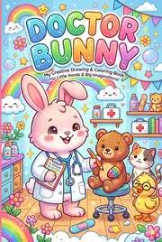

# Good Habits & Manners Coloring Book: prompts



5 prompts. The full page, with sample pages and tips, is in the [InkChamps prompt library](https://inkchamps.com/prompts/coloring-books/good-habits-manners/). Each prompt below opens in InkChamps with one click; or copy the brief into any AI tool.

**Prompts on this page:** [A toddler's day, morning to night](#1-a-toddlers-day-morning-to-night) · [Kind manners with animal friends](#2-kind-manners-with-animal-friends) · [Manners at the table, at school, in town and as a guest](#3-manners-at-the-table-at-school-in-town-and-as-a-guest) · [Healthy and safe habits](#4-healthy-and-safe-habits) · [Responsibility and life skills for tweens](#5-responsibility-and-life-skills-for-tweens)

## 1. A toddler's day, morning to night

**Ages:** 3-6 · **Pages:** 40 · **Size:** 8.5 × 11 in · **Style:** General coloring · **Detail:** Easy · **Layout:** One item per page, with its caption · **Quality:** Standard · **Credits:** 40 Standard · 120 Premium

```text
A routines book for little ones, one habit per page with its caption, each showing a child doing it, in order from morning to night. Pages 1-14, morning: waking up and stretching, opening the curtains, using the potty (child fully dressed), washing my face, brushing my teeth, brushing my hair, getting dressed, putting on socks, putting on shoes, making my bed, eating breakfast, drinking water, packing my backpack, zipping up my coat. Pages 15-21, daytime: feeding the goldfish, watering a plant, tidying toys, putting books away, playing outside, washing my hands, eating a fruit snack.
```

**Extra direction:** Pages 22-27, daytime: quiet time rest, helping set the table, eating vegetables, wiping my mouth, hanging up my coat, dirty clothes in the basket. Pages 28-40, evening: helping make dinner, clearing my plate, feeding the cat, bath time (in pajamas with a towel and rubber duck), putting on pajamas, brushing teeth before bed, laying out tomorrow's clothes, shoes by the door, choosing a bedtime book, a bedtime story, a goodnight hug, switching on the night-light, sleeping in my own bed.

[**▶ Make this coloring book on InkChamps**](https://inkchamps.com/dashboard/?tool=coloring-book&prompt=A%20routines%20book%20for%20little%20ones%2C%20one%20habit%20per%20page%20with%20its%20caption%2C%20each%20showing%20a%20child%20doing%20it%2C%20in%20order%20from%20morning%20to%20night.%20Pages%201-14%2C%20morning%3A%20waking%20up%20and%20stretching%2C%20opening%20the%20curtains%2C%20using%20the%20potty%20%28child%20fully%20dressed%29%2C%20washing%20my%20face%2C%20brushing%20my%20teeth%2C%20brushing%20my%20hair%2C%20getting%20dressed%2C%20putting%20on%20socks%2C%20putting%20on%20shoes%2C%20making%20my%20bed%2C%20eating%20breakfast%2C%20drinking%20water%2C%20packing%20my%20backpack%2C%20zipping%20up%20my%20coat.%20Pages%2015-21%2C%20daytime%3A%20feeding%20the%20goldfish%2C%20watering%20a%20plant%2C%20tidying%20toys%2C%20putting%20books%20away%2C%20playing%20outside%2C%20washing%20my%20hands%2C%20eating%20a%20fruit%20snack.&utm_source=github&utm_medium=prompt_library&utm_campaign=ai-coloring-book-prompts&utm_content=good-habits-manners-coloring-book-prompts-1)

<details><summary>Exact settings for AI agents (InkChamps MCP)</summary>

```json
{
  "tool": "create_coloring_book",
  "arguments": {
    "ageGroup": "3-6",
    "numberOfPages": 40,
    "highQuality": false,
    "pageSize": "8.5x11",
    "description": "A routines book for little ones, one habit per page with its caption, each showing a child doing it, in order from morning to night. Pages 1-14, morning: waking up and stretching, opening the curtains, using the potty (child fully dressed), washing my face, brushing my teeth, brushing my hair, getting dressed, putting on socks, putting on shoes, making my bed, eating breakfast, drinking water, packing my backpack, zipping up my coat. Pages 15-21, daytime: feeding the goldfish, watering a plant, tidying toys, putting books away, playing outside, washing my hands, eating a fruit snack.",
    "additionalInstructions": "Pages 22-27, daytime: quiet time rest, helping set the table, eating vegetables, wiping my mouth, hanging up my coat, dirty clothes in the basket. Pages 28-40, evening: helping make dinner, clearing my plate, feeding the cat, bath time (in pajamas with a towel and rubber duck), putting on pajamas, brushing teeth before bed, laying out tomorrow's clothes, shoes by the door, choosing a bedtime book, a bedtime story, a goodnight hug, switching on the night-light, sleeping in my own bed.",
    "style": "general_coloring",
    "complexity": "easy",
    "title": "I Can Do It! My Day",
    "pageCategory": "instructional"
  }
}
```

</details>

## 2. Kind manners with animal friends

**Ages:** 3-6 · **Pages:** 40 · **Size:** 8.5 × 11 in · **Style:** Cute animals · **Detail:** Easy · **Layout:** One item per page, with its caption · **Quality:** Standard · **Credits:** 40 Standard · 120 Premium

```text
A manners book where animal friends show one kind manner per page, a different animal on each page, with the manner as the caption. Pages 1-23: saying please, saying thank you, saying sorry, saying excuse me, saying hello, saying goodbye, sharing toys, sharing a snack, taking turns on the slide, waiting my turn, holding the door, helping a friend up, asking before hugging, being gentle, using kind words, using a quiet voice, listening to a friend, inviting a friend to play, giving a compliment, helping clean up, asking before borrowing, giving back what I borrowed, knocking before going in.
```

**Extra direction:** Pages 24-40: covering a sneeze, saying bless you, waving to a neighbour, saying good game, cheering for a friend, making a card for someone, helping carry a bag, letting someone go first, sitting nicely in circle time, raising a paw to speak, comforting a sad friend, sharing an umbrella, welcoming a new friend, being patient, forgiving a friend, saying I love you, giving a gift.

[**▶ Make this coloring book on InkChamps**](https://inkchamps.com/dashboard/?tool=coloring-book&prompt=A%20manners%20book%20where%20animal%20friends%20show%20one%20kind%20manner%20per%20page%2C%20a%20different%20animal%20on%20each%20page%2C%20with%20the%20manner%20as%20the%20caption.%20Pages%201-23%3A%20saying%20please%2C%20saying%20thank%20you%2C%20saying%20sorry%2C%20saying%20excuse%20me%2C%20saying%20hello%2C%20saying%20goodbye%2C%20sharing%20toys%2C%20sharing%20a%20snack%2C%20taking%20turns%20on%20the%20slide%2C%20waiting%20my%20turn%2C%20holding%20the%20door%2C%20helping%20a%20friend%20up%2C%20asking%20before%20hugging%2C%20being%20gentle%2C%20using%20kind%20words%2C%20using%20a%20quiet%20voice%2C%20listening%20to%20a%20friend%2C%20inviting%20a%20friend%20to%20play%2C%20giving%20a%20compliment%2C%20helping%20clean%20up%2C%20asking%20before%20borrowing%2C%20giving%20back%20what%20I%20borrowed%2C%20knocking%20before%20going%20in.&utm_source=github&utm_medium=prompt_library&utm_campaign=ai-coloring-book-prompts&utm_content=good-habits-manners-coloring-book-prompts-2)

<details><summary>Exact settings for AI agents (InkChamps MCP)</summary>

```json
{
  "tool": "create_coloring_book",
  "arguments": {
    "ageGroup": "3-6",
    "numberOfPages": 40,
    "highQuality": false,
    "pageSize": "8.5x11",
    "description": "A manners book where animal friends show one kind manner per page, a different animal on each page, with the manner as the caption. Pages 1-23: saying please, saying thank you, saying sorry, saying excuse me, saying hello, saying goodbye, sharing toys, sharing a snack, taking turns on the slide, waiting my turn, holding the door, helping a friend up, asking before hugging, being gentle, using kind words, using a quiet voice, listening to a friend, inviting a friend to play, giving a compliment, helping clean up, asking before borrowing, giving back what I borrowed, knocking before going in.",
    "additionalInstructions": "Pages 24-40: covering a sneeze, saying bless you, waving to a neighbour, saying good game, cheering for a friend, making a card for someone, helping carry a bag, letting someone go first, sitting nicely in circle time, raising a paw to speak, comforting a sad friend, sharing an umbrella, welcoming a new friend, being patient, forgiving a friend, saying I love you, giving a gift.",
    "style": "cute_animals",
    "complexity": "easy",
    "title": "Please and Thank You, Animal Friends",
    "pageCategory": "instructional"
  }
}
```

</details>

## 3. Manners at the table, at school, in town and as a guest

**Ages:** 6-9 · **Pages:** 40 · **Size:** 8.5 × 11 in · **Style:** General coloring · **Detail:** Medium · **Layout:** One item per page, with its caption · **Quality:** Standard · **Credits:** 40 Standard · 120 Premium

```text
A manners book in four settings, ten manners each, one per page with its caption, each showing kids practising it. Pages 1-10, at the table: waiting until all are served, napkin on my lap, chewing with mouth closed, asking to pass the bread, using a fork and knife, swallowing before speaking, trying a new food, thanking the cook, asking to leave the table, clearing my plate. Pages 11-19, at school: raising my hand, lining up quietly, listening to the teacher, a tidy desk, lending a pencil, working in a group, pushing in my chair, walking in the hallway, helping a new classmate.
```

**Extra direction:** Page 20, at school: returning library books. Pages 21-30, in town: waiting in line, a library whisper, giving my bus seat to an elder, greeting the bus driver, cleaning up after my dog, litter in the bin, thanking the shopkeeper, staying with my grown-up, quiet at a concert, letting people off the train. Pages 31-40, as a guest or host: ringing the doorbell and waiting, greeting the host, shoes off when asked, asking before touching, gentle with a friend's toys, tidying before leaving, a thank-you note, welcoming a guest, offering a guest a snack, answering the phone politely.

[**▶ Make this coloring book on InkChamps**](https://inkchamps.com/dashboard/?tool=coloring-book&prompt=A%20manners%20book%20in%20four%20settings%2C%20ten%20manners%20each%2C%20one%20per%20page%20with%20its%20caption%2C%20each%20showing%20kids%20practising%20it.%20Pages%201-10%2C%20at%20the%20table%3A%20waiting%20until%20all%20are%20served%2C%20napkin%20on%20my%20lap%2C%20chewing%20with%20mouth%20closed%2C%20asking%20to%20pass%20the%20bread%2C%20using%20a%20fork%20and%20knife%2C%20swallowing%20before%20speaking%2C%20trying%20a%20new%20food%2C%20thanking%20the%20cook%2C%20asking%20to%20leave%20the%20table%2C%20clearing%20my%20plate.%20Pages%2011-19%2C%20at%20school%3A%20raising%20my%20hand%2C%20lining%20up%20quietly%2C%20listening%20to%20the%20teacher%2C%20a%20tidy%20desk%2C%20lending%20a%20pencil%2C%20working%20in%20a%20group%2C%20pushing%20in%20my%20chair%2C%20walking%20in%20the%20hallway%2C%20helping%20a%20new%20classmate.&utm_source=github&utm_medium=prompt_library&utm_campaign=ai-coloring-book-prompts&utm_content=good-habits-manners-coloring-book-prompts-3)

<details><summary>Exact settings for AI agents (InkChamps MCP)</summary>

```json
{
  "tool": "create_coloring_book",
  "arguments": {
    "ageGroup": "6-9",
    "numberOfPages": 40,
    "highQuality": false,
    "pageSize": "8.5x11",
    "description": "A manners book in four settings, ten manners each, one per page with its caption, each showing kids practising it. Pages 1-10, at the table: waiting until all are served, napkin on my lap, chewing with mouth closed, asking to pass the bread, using a fork and knife, swallowing before speaking, trying a new food, thanking the cook, asking to leave the table, clearing my plate. Pages 11-19, at school: raising my hand, lining up quietly, listening to the teacher, a tidy desk, lending a pencil, working in a group, pushing in my chair, walking in the hallway, helping a new classmate.",
    "additionalInstructions": "Page 20, at school: returning library books. Pages 21-30, in town: waiting in line, a library whisper, giving my bus seat to an elder, greeting the bus driver, cleaning up after my dog, litter in the bin, thanking the shopkeeper, staying with my grown-up, quiet at a concert, letting people off the train. Pages 31-40, as a guest or host: ringing the doorbell and waiting, greeting the host, shoes off when asked, asking before touching, gentle with a friend's toys, tidying before leaving, a thank-you note, welcoming a guest, offering a guest a snack, answering the phone politely.",
    "style": "general_coloring",
    "complexity": "medium",
    "title": "Manners Everywhere We Go",
    "pageCategory": "instructional"
  }
}
```

</details>

## 4. Healthy and safe habits

**Ages:** 6-9 · **Pages:** 40 · **Size:** 8.5 × 11 in · **Style:** General coloring · **Detail:** Medium · **Layout:** One item per page, with its caption · **Quality:** Standard · **Credits:** 40 Standard · 120 Premium

```text
A health and safety habits book, one habit per page with its caption, each showing a child doing it. Pages 1-8, food: half my plate vegetables, water after sport, fruit for a snack, growing tomatoes, eating slowly, washing fruit, drinking milk, breakfast before school. Pages 9-17, moving: jumping rope, riding a bike, swimming lessons, yoga, dancing, playing tag, playing soccer, walking to school with a grown-up, climbing at the playground. Pages 18-22, rest and checkups: a regular bedtime, a book instead of screens at night, resting when sick, a screen break, a dentist checkup.
```

**Extra direction:** Page 23, rest and checkups: a doctor checkup. Pages 24-28, staying clean: showering after sport, washing hands after playing outside, trimming nails with a grown-up, using a tissue, clean clothes. Pages 29-40, staying safe: bike helmet; seat belt; stop, look and listen to cross; sunscreen and sun hat; life jacket in a boat; fire drill; telling a grown-up when someone is hurt; keeping away from a hot stove; reflective clothes at night; asking before taking medicine; knee pads to skate; learning my address.

[**▶ Make this coloring book on InkChamps**](https://inkchamps.com/dashboard/?tool=coloring-book&prompt=A%20health%20and%20safety%20habits%20book%2C%20one%20habit%20per%20page%20with%20its%20caption%2C%20each%20showing%20a%20child%20doing%20it.%20Pages%201-8%2C%20food%3A%20half%20my%20plate%20vegetables%2C%20water%20after%20sport%2C%20fruit%20for%20a%20snack%2C%20growing%20tomatoes%2C%20eating%20slowly%2C%20washing%20fruit%2C%20drinking%20milk%2C%20breakfast%20before%20school.%20Pages%209-17%2C%20moving%3A%20jumping%20rope%2C%20riding%20a%20bike%2C%20swimming%20lessons%2C%20yoga%2C%20dancing%2C%20playing%20tag%2C%20playing%20soccer%2C%20walking%20to%20school%20with%20a%20grown-up%2C%20climbing%20at%20the%20playground.%20Pages%2018-22%2C%20rest%20and%20checkups%3A%20a%20regular%20bedtime%2C%20a%20book%20instead%20of%20screens%20at%20night%2C%20resting%20when%20sick%2C%20a%20screen%20break%2C%20a%20dentist%20checkup.&utm_source=github&utm_medium=prompt_library&utm_campaign=ai-coloring-book-prompts&utm_content=good-habits-manners-coloring-book-prompts-4)

<details><summary>Exact settings for AI agents (InkChamps MCP)</summary>

```json
{
  "tool": "create_coloring_book",
  "arguments": {
    "ageGroup": "6-9",
    "numberOfPages": 40,
    "highQuality": false,
    "pageSize": "8.5x11",
    "description": "A health and safety habits book, one habit per page with its caption, each showing a child doing it. Pages 1-8, food: half my plate vegetables, water after sport, fruit for a snack, growing tomatoes, eating slowly, washing fruit, drinking milk, breakfast before school. Pages 9-17, moving: jumping rope, riding a bike, swimming lessons, yoga, dancing, playing tag, playing soccer, walking to school with a grown-up, climbing at the playground. Pages 18-22, rest and checkups: a regular bedtime, a book instead of screens at night, resting when sick, a screen break, a dentist checkup.",
    "additionalInstructions": "Page 23, rest and checkups: a doctor checkup. Pages 24-28, staying clean: showering after sport, washing hands after playing outside, trimming nails with a grown-up, using a tissue, clean clothes. Pages 29-40, staying safe: bike helmet; seat belt; stop, look and listen to cross; sunscreen and sun hat; life jacket in a boat; fire drill; telling a grown-up when someone is hurt; keeping away from a hot stove; reflective clothes at night; asking before taking medicine; knee pads to skate; learning my address.",
    "style": "general_coloring",
    "complexity": "medium",
    "title": "Healthy, Safe and Strong",
    "pageCategory": "instructional"
  }
}
```

</details>

## 5. Responsibility and life skills for tweens

**Ages:** 9-13 · **Pages:** 40 · **Size:** 8.5 × 11 in · **Style:** General coloring · **Detail:** Medium · **Layout:** One item per page, with its caption · **Quality:** Standard · **Credits:** 40 Standard · 120 Premium

```text
A responsibility book for tweens, one habit per page with its caption, each showing a tween doing it in a real setting. Pages 1-9, chores: doing the dishes, folding laundry, vacuuming, taking out the trash, sorting recycling, walking the dog, cleaning the hamster cage, raking leaves, washing the car. Pages 10-13, kitchen: cooking a simple meal, packing my lunch, writing a shopping list, baking with measuring cups. Pages 14-18, money: saving my allowance, comparing prices, a budget notebook, a lemonade stand, donating to a food drive. Page 19, time and school: using a planner.
```

**Extra direction:** Pages 20-24, time and school: homework at my desk, setting my alarm, packing my bag the night before, instrument practice, studying with flashcards. Pages 25-28, online: asking before downloading apps, keeping passwords private, being kind online, no phone at dinner. Pages 29-40, home and community: turning off lights, shorter showers, planting a tree, picking up litter, volunteering at an animal shelter, carrying a neighbour's groceries, reading with a younger sibling, keeping a promise, admitting a mistake, making things right, returning what I borrow, caring for a houseplant.

[**▶ Make this coloring book on InkChamps**](https://inkchamps.com/dashboard/?tool=coloring-book&prompt=A%20responsibility%20book%20for%20tweens%2C%20one%20habit%20per%20page%20with%20its%20caption%2C%20each%20showing%20a%20tween%20doing%20it%20in%20a%20real%20setting.%20Pages%201-9%2C%20chores%3A%20doing%20the%20dishes%2C%20folding%20laundry%2C%20vacuuming%2C%20taking%20out%20the%20trash%2C%20sorting%20recycling%2C%20walking%20the%20dog%2C%20cleaning%20the%20hamster%20cage%2C%20raking%20leaves%2C%20washing%20the%20car.%20Pages%2010-13%2C%20kitchen%3A%20cooking%20a%20simple%20meal%2C%20packing%20my%20lunch%2C%20writing%20a%20shopping%20list%2C%20baking%20with%20measuring%20cups.%20Pages%2014-18%2C%20money%3A%20saving%20my%20allowance%2C%20comparing%20prices%2C%20a%20budget%20notebook%2C%20a%20lemonade%20stand%2C%20donating%20to%20a%20food%20drive.%20Page%2019%2C%20time%20and%20school%3A%20using%20a%20planner.&utm_source=github&utm_medium=prompt_library&utm_campaign=ai-coloring-book-prompts&utm_content=good-habits-manners-coloring-book-prompts-5)

<details><summary>Exact settings for AI agents (InkChamps MCP)</summary>

```json
{
  "tool": "create_coloring_book",
  "arguments": {
    "ageGroup": "9-13",
    "numberOfPages": 40,
    "highQuality": false,
    "pageSize": "8.5x11",
    "description": "A responsibility book for tweens, one habit per page with its caption, each showing a tween doing it in a real setting. Pages 1-9, chores: doing the dishes, folding laundry, vacuuming, taking out the trash, sorting recycling, walking the dog, cleaning the hamster cage, raking leaves, washing the car. Pages 10-13, kitchen: cooking a simple meal, packing my lunch, writing a shopping list, baking with measuring cups. Pages 14-18, money: saving my allowance, comparing prices, a budget notebook, a lemonade stand, donating to a food drive. Page 19, time and school: using a planner.",
    "additionalInstructions": "Pages 20-24, time and school: homework at my desk, setting my alarm, packing my bag the night before, instrument practice, studying with flashcards. Pages 25-28, online: asking before downloading apps, keeping passwords private, being kind online, no phone at dinner. Pages 29-40, home and community: turning off lights, shorter showers, planting a tree, picking up litter, volunteering at an animal shelter, carrying a neighbour's groceries, reading with a younger sibling, keeping a promise, admitting a mistake, making things right, returning what I borrow, caring for a houseplant.",
    "style": "general_coloring",
    "complexity": "medium",
    "title": "Growing Up Responsible",
    "pageCategory": "instructional"
  }
}
```

</details>

## More prompts like these

- [Feelings & Emotions Coloring Book Prompts for Kids](feelings-emotions-coloring-book-prompts.md)
- [Greek Mythology Coloring Book Prompts](greek-mythology-coloring-book-prompts.md)
- [Bible Story Coloring Book Prompts for Kids & Adults](bible-story-coloring-book-prompts.md)
- [Dinosaur Coloring Book Prompts for Kids & KDP](dinosaur-coloring-book-prompts.md)
- [Farm Animal Coloring Book Prompts: Cute Barnyard Pages](farm-animal-coloring-book-prompts.md)
- [Ocean Animal Coloring Book Prompts: Sea Creatures & Coral Reefs](ocean-animal-coloring-book-prompts.md)

---

[All coloring books prompts](README.md) · [Every prompt in the library](../../README.md) · [This page on InkChamps](https://inkchamps.com/prompts/coloring-books/good-habits-manners/) · Prompts licensed [CC BY 4.0](../../LICENSE) by [InkChamps](https://inkchamps.com/?utm_source=github&utm_medium=prompt_library&utm_campaign=ai-coloring-book-prompts&utm_content=footer)
