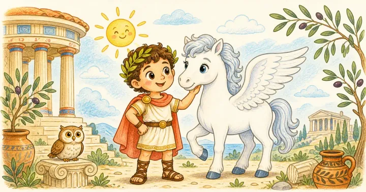

# Greek Mythology Coloring Book: prompts



5 prompts. The full page, with sample pages and tips, is in the [InkChamps prompt library](https://inkchamps.com/prompts/coloring-books/greek-mythology/). Each prompt below opens in InkChamps with one click; or copy the brief into any AI tool.

**Prompts on this page:** [Nature myths for kids: why things are the way they are](#1-nature-myths-for-kids-why-things-are-the-way-they-are) · [Bestiary of legendary creatures](#2-bestiary-of-legendary-creatures) · [Quests of the Greek heroes](#3-quests-of-the-greek-heroes) · [Gods, Titans and Muses for adults](#4-gods-titans-and-muses-for-adults) · [The Trojan War and the Odyssey in order](#5-the-trojan-war-and-the-odyssey-in-order)

## 1. Nature myths for kids: why things are the way they are

**Ages:** 6-9 · **Pages:** 40 · **Size:** 8.5 × 11 in · **Style:** Mythology · **Detail:** Medium · **Quality:** Standard · **Credits:** 40 Standard · 120 Premium

```text
Twenty Greek nature myths for kids, two pages each, the start of the story then its ending. Pages 1-28: Prometheus bringing fire to people; Pandora's jar with Hope inside; Persephone, Demeter and the seasons; Arachne's weaving contest with Athena; Echo calling in the mountains; Narcissus and the flower by the pool; Daphne becoming a laurel tree; Phaethon driving the sun chariot; King Midas and his golden touch; Baucis and Philemon's jug that never empties; Athena's olive tree for Athens; Callisto and the Great Bear stars; Alcyone and the halcyon birds; Hyacinth's flower.
```

**Extra direction:** Pages 29-40: Arion saved by a dolphin, Pan and the reed pipes, Icarus and Daedalus with feathered wings, Selene driving the moon across the sky, Eos opening the gates of dawn, Hermes making the first lyre from a tortoise shell.

[**▶ Make this coloring book on InkChamps**](https://inkchamps.com/dashboard/?tool=coloring-book&prompt=Twenty%20Greek%20nature%20myths%20for%20kids%2C%20two%20pages%20each%2C%20the%20start%20of%20the%20story%20then%20its%20ending.%20Pages%201-28%3A%20Prometheus%20bringing%20fire%20to%20people%3B%20Pandora%27s%20jar%20with%20Hope%20inside%3B%20Persephone%2C%20Demeter%20and%20the%20seasons%3B%20Arachne%27s%20weaving%20contest%20with%20Athena%3B%20Echo%20calling%20in%20the%20mountains%3B%20Narcissus%20and%20the%20flower%20by%20the%20pool%3B%20Daphne%20becoming%20a%20laurel%20tree%3B%20Phaethon%20driving%20the%20sun%20chariot%3B%20King%20Midas%20and%20his%20golden%20touch%3B%20Baucis%20and%20Philemon%27s%20jug%20that%20never%20empties%3B%20Athena%27s%20olive%20tree%20for%20Athens%3B%20Callisto%20and%20the%20Great%20Bear%20stars%3B%20Alcyone%20and%20the%20halcyon%20birds%3B%20Hyacinth%27s%20flower.&utm_source=github&utm_medium=prompt_library&utm_campaign=ai-coloring-book-prompts&utm_content=greek-mythology-coloring-book-prompts-1)

<details><summary>Exact settings for AI agents (InkChamps MCP)</summary>

```json
{
  "tool": "create_coloring_book",
  "arguments": {
    "ageGroup": "6-9",
    "numberOfPages": 40,
    "highQuality": false,
    "pageSize": "8.5x11",
    "description": "Twenty Greek nature myths for kids, two pages each, the start of the story then its ending. Pages 1-28: Prometheus bringing fire to people; Pandora's jar with Hope inside; Persephone, Demeter and the seasons; Arachne's weaving contest with Athena; Echo calling in the mountains; Narcissus and the flower by the pool; Daphne becoming a laurel tree; Phaethon driving the sun chariot; King Midas and his golden touch; Baucis and Philemon's jug that never empties; Athena's olive tree for Athens; Callisto and the Great Bear stars; Alcyone and the halcyon birds; Hyacinth's flower.",
    "additionalInstructions": "Pages 29-40: Arion saved by a dolphin, Pan and the reed pipes, Icarus and Daedalus with feathered wings, Selene driving the moon across the sky, Eos opening the gates of dawn, Hermes making the first lyre from a tortoise shell.",
    "style": "mythology",
    "complexity": "medium",
    "title": "Why the Seasons Change and Other Greek Myths"
  }
}
```

</details>

## 2. Bestiary of legendary creatures

**Ages:** 9-13 · **Pages:** 40 · **Size:** 8.5 × 11 in · **Style:** Mythology · **Detail:** Medium · **Quality:** Standard · **Credits:** 40 Standard · 120 Premium

```text
A bestiary of forty legendary creatures from Greek myth, one per page, each in its home. Pages 1-27: a centaur in a forest, a satyr with pan pipes, a dryad in an oak, a naiad in a river, a nereid riding a dolphin, Triton with his conch, Pegasus, a hippocamp, a griffin, the Sphinx outside Thebes, the Chimera, Cerberus at the underworld gates, Medusa, the Minotaur, Typhon, Echidna, the Python of Delphi, Ladon round the golden apple tree, Cetus the sea monster, Scylla, Charybdis, the Sirens, a harpy, a cyclops by his cave, Talos guarding Crete, Argus with a hundred eyes, a hundred-handed giant.
```

**Extra direction:** Pages 28-40: a phoenix, Orthrus the two-headed dog, the Calydonian boar, the Teumessian fox, Laelaps the hound, the golden-fleeced ram, the bronze bulls of Colchis, the Caucasian eagle, Arion the swift horse, the Cretan bull, the sun's winged horses, the two-headed serpent Amphisbaena, an ichthyocentaur.

[**▶ Make this coloring book on InkChamps**](https://inkchamps.com/dashboard/?tool=coloring-book&prompt=A%20bestiary%20of%20forty%20legendary%20creatures%20from%20Greek%20myth%2C%20one%20per%20page%2C%20each%20in%20its%20home.%20Pages%201-27%3A%20a%20centaur%20in%20a%20forest%2C%20a%20satyr%20with%20pan%20pipes%2C%20a%20dryad%20in%20an%20oak%2C%20a%20naiad%20in%20a%20river%2C%20a%20nereid%20riding%20a%20dolphin%2C%20Triton%20with%20his%20conch%2C%20Pegasus%2C%20a%20hippocamp%2C%20a%20griffin%2C%20the%20Sphinx%20outside%20Thebes%2C%20the%20Chimera%2C%20Cerberus%20at%20the%20underworld%20gates%2C%20Medusa%2C%20the%20Minotaur%2C%20Typhon%2C%20Echidna%2C%20the%20Python%20of%20Delphi%2C%20Ladon%20round%20the%20golden%20apple%20tree%2C%20Cetus%20the%20sea%20monster%2C%20Scylla%2C%20Charybdis%2C%20the%20Sirens%2C%20a%20harpy%2C%20a%20cyclops%20by%20his%20cave%2C%20Talos%20guarding%20Crete%2C%20Argus%20with%20a%20hundred%20eyes%2C%20a%20hundred-handed%20giant.&utm_source=github&utm_medium=prompt_library&utm_campaign=ai-coloring-book-prompts&utm_content=greek-mythology-coloring-book-prompts-2)

<details><summary>Exact settings for AI agents (InkChamps MCP)</summary>

```json
{
  "tool": "create_coloring_book",
  "arguments": {
    "ageGroup": "9-13",
    "numberOfPages": 40,
    "highQuality": false,
    "pageSize": "8.5x11",
    "description": "A bestiary of forty legendary creatures from Greek myth, one per page, each in its home. Pages 1-27: a centaur in a forest, a satyr with pan pipes, a dryad in an oak, a naiad in a river, a nereid riding a dolphin, Triton with his conch, Pegasus, a hippocamp, a griffin, the Sphinx outside Thebes, the Chimera, Cerberus at the underworld gates, Medusa, the Minotaur, Typhon, Echidna, the Python of Delphi, Ladon round the golden apple tree, Cetus the sea monster, Scylla, Charybdis, the Sirens, a harpy, a cyclops by his cave, Talos guarding Crete, Argus with a hundred eyes, a hundred-handed giant.",
    "additionalInstructions": "Pages 28-40: a phoenix, Orthrus the two-headed dog, the Calydonian boar, the Teumessian fox, Laelaps the hound, the golden-fleeced ram, the bronze bulls of Colchis, the Caucasian eagle, Arion the swift horse, the Cretan bull, the sun's winged horses, the two-headed serpent Amphisbaena, an ichthyocentaur.",
    "style": "mythology",
    "complexity": "medium",
    "title": "Beasts of Greek Myth"
  }
}
```

</details>

## 3. Quests of the Greek heroes

**Ages:** 9-13 · **Pages:** 40 · **Size:** 8.5 × 11 in · **Style:** Mythology · **Detail:** Medium · **Quality:** Standard · **Credits:** 40 Standard · 120 Premium

```text
The great Greek hero quests, one scene per page, in story order. Pages 1-12, Hercules' twelve labors: Nemean lion, hydra, golden hind, Erymanthian boar, Augean stables, Stymphalian birds, Cretan bull, mares of Diomedes, Hippolyta's belt, Geryon's cattle, apples of the Hesperides, Cerberus. Pages 13-17, Perseus: winged sandals, the Graeae's one eye, mirrored shield and Medusa, flight over the sea, rescuing Andromeda. Pages 18-21, Theseus: finding his father's sword, Ariadne's thread, the Minotaur's labyrinth, black sails home. Pages 22-23, Jason: one sandal at Pelias' court, building the Argo.
```

**Extra direction:** Pages 24-29, Jason: setting sail, chasing the harpies, the clashing rocks, yoking the bronze bulls, the sleeping dragon, home with the fleece. Pages 30-31, Atalanta: the Calydonian boar hunt, the golden apple race. Pages 32-33, Orpheus: charming animals with his lyre, leading Eurydice out. Pages 34-36, Psyche: sorting seeds with ants, gathering golden wool, the box from the underworld. Pages 37-38, Bellerophon: riding Pegasus, facing the Chimera. Pages 39-40, more heroes: Hercules holding up the sky, Cadmus sowing the dragon's teeth.

[**▶ Make this coloring book on InkChamps**](https://inkchamps.com/dashboard/?tool=coloring-book&prompt=The%20great%20Greek%20hero%20quests%2C%20one%20scene%20per%20page%2C%20in%20story%20order.%20Pages%201-12%2C%20Hercules%27%20twelve%20labors%3A%20Nemean%20lion%2C%20hydra%2C%20golden%20hind%2C%20Erymanthian%20boar%2C%20Augean%20stables%2C%20Stymphalian%20birds%2C%20Cretan%20bull%2C%20mares%20of%20Diomedes%2C%20Hippolyta%27s%20belt%2C%20Geryon%27s%20cattle%2C%20apples%20of%20the%20Hesperides%2C%20Cerberus.%20Pages%2013-17%2C%20Perseus%3A%20winged%20sandals%2C%20the%20Graeae%27s%20one%20eye%2C%20mirrored%20shield%20and%20Medusa%2C%20flight%20over%20the%20sea%2C%20rescuing%20Andromeda.%20Pages%2018-21%2C%20Theseus%3A%20finding%20his%20father%27s%20sword%2C%20Ariadne%27s%20thread%2C%20the%20Minotaur%27s%20labyrinth%2C%20black%20sails%20home.%20Pages%2022-23%2C%20Jason%3A%20one%20sandal%20at%20Pelias%27%20court%2C%20building%20the%20Argo.&utm_source=github&utm_medium=prompt_library&utm_campaign=ai-coloring-book-prompts&utm_content=greek-mythology-coloring-book-prompts-3)

<details><summary>Exact settings for AI agents (InkChamps MCP)</summary>

```json
{
  "tool": "create_coloring_book",
  "arguments": {
    "ageGroup": "9-13",
    "numberOfPages": 40,
    "highQuality": false,
    "pageSize": "8.5x11",
    "description": "The great Greek hero quests, one scene per page, in story order. Pages 1-12, Hercules' twelve labors: Nemean lion, hydra, golden hind, Erymanthian boar, Augean stables, Stymphalian birds, Cretan bull, mares of Diomedes, Hippolyta's belt, Geryon's cattle, apples of the Hesperides, Cerberus. Pages 13-17, Perseus: winged sandals, the Graeae's one eye, mirrored shield and Medusa, flight over the sea, rescuing Andromeda. Pages 18-21, Theseus: finding his father's sword, Ariadne's thread, the Minotaur's labyrinth, black sails home. Pages 22-23, Jason: one sandal at Pelias' court, building the Argo.",
    "additionalInstructions": "Pages 24-29, Jason: setting sail, chasing the harpies, the clashing rocks, yoking the bronze bulls, the sleeping dragon, home with the fleece. Pages 30-31, Atalanta: the Calydonian boar hunt, the golden apple race. Pages 32-33, Orpheus: charming animals with his lyre, leading Eurydice out. Pages 34-36, Psyche: sorting seeds with ants, gathering golden wool, the box from the underworld. Pages 37-38, Bellerophon: riding Pegasus, facing the Chimera. Pages 39-40, more heroes: Hercules holding up the sky, Cadmus sowing the dragon's teeth.",
    "style": "mythology",
    "complexity": "medium",
    "title": "Quests of the Greek Heroes"
  }
}
```

</details>

## 4. Gods, Titans and Muses for adults

**Ages:** 13+ · **Pages:** 40 · **Size:** 8.5 × 11 in · **Style:** Mythology · **Detail:** Hard · **Quality:** Premium · **Credits:** 40 Standard · 120 Premium

```text
Forty portraits of Greek gods, Titans and Muses, one per page, each with their symbols and setting. Pages 1-13, Olympians: Zeus with eagle and thunderbolt, Hera with a peacock, Poseidon with trident, Demeter with wheat, Athena with owl and shield, Apollo with lyre, Artemis with bow and deer, Ares in a crested helmet, Aphrodite with doves, Hephaestus at his forge, Hermes in winged sandals, Dionysus with grapevines, Hestia at the hearth. Pages 14-19, other gods: Hades on his throne; Persephone with a pomegranate; Hecate with torches; Eros with his bow; Nike, winged victory; Iris on a rainbow.
```

**Extra direction:** Pages 20-23, other gods: Pan with pipes, Helios in the sun chariot, Selene with the moon, Eos at dawn. Pages 24-30, Titans and first gods: Gaia; Uranus, the starry sky; Kronos with a sickle; Rhea; Atlas holding the sky; Themis with scales; Mnemosyne. Page 31, the Fates: the three Fates spinning thread. Pages 32-40, the nine Muses: Calliope with a tablet, Clio with a scroll, Erato with a lyre, Euterpe with a flute, Melpomene with a tragic mask, Polyhymnia veiled, Terpsichore dancing, Thalia with a comic mask, Urania with a star globe.

[**▶ Make this coloring book on InkChamps**](https://inkchamps.com/dashboard/?tool=coloring-book&prompt=Forty%20portraits%20of%20Greek%20gods%2C%20Titans%20and%20Muses%2C%20one%20per%20page%2C%20each%20with%20their%20symbols%20and%20setting.%20Pages%201-13%2C%20Olympians%3A%20Zeus%20with%20eagle%20and%20thunderbolt%2C%20Hera%20with%20a%20peacock%2C%20Poseidon%20with%20trident%2C%20Demeter%20with%20wheat%2C%20Athena%20with%20owl%20and%20shield%2C%20Apollo%20with%20lyre%2C%20Artemis%20with%20bow%20and%20deer%2C%20Ares%20in%20a%20crested%20helmet%2C%20Aphrodite%20with%20doves%2C%20Hephaestus%20at%20his%20forge%2C%20Hermes%20in%20winged%20sandals%2C%20Dionysus%20with%20grapevines%2C%20Hestia%20at%20the%20hearth.%20Pages%2014-19%2C%20other%20gods%3A%20Hades%20on%20his%20throne%3B%20Persephone%20with%20a%20pomegranate%3B%20Hecate%20with%20torches%3B%20Eros%20with%20his%20bow%3B%20Nike%2C%20winged%20victory%3B%20Iris%20on%20a%20rainbow.&utm_source=github&utm_medium=prompt_library&utm_campaign=ai-coloring-book-prompts&utm_content=greek-mythology-coloring-book-prompts-4)

<details><summary>Exact settings for AI agents (InkChamps MCP)</summary>

```json
{
  "tool": "create_coloring_book",
  "arguments": {
    "ageGroup": "13+",
    "numberOfPages": 40,
    "highQuality": true,
    "pageSize": "8.5x11",
    "description": "Forty portraits of Greek gods, Titans and Muses, one per page, each with their symbols and setting. Pages 1-13, Olympians: Zeus with eagle and thunderbolt, Hera with a peacock, Poseidon with trident, Demeter with wheat, Athena with owl and shield, Apollo with lyre, Artemis with bow and deer, Ares in a crested helmet, Aphrodite with doves, Hephaestus at his forge, Hermes in winged sandals, Dionysus with grapevines, Hestia at the hearth. Pages 14-19, other gods: Hades on his throne; Persephone with a pomegranate; Hecate with torches; Eros with his bow; Nike, winged victory; Iris on a rainbow.",
    "additionalInstructions": "Pages 20-23, other gods: Pan with pipes, Helios in the sun chariot, Selene with the moon, Eos at dawn. Pages 24-30, Titans and first gods: Gaia; Uranus, the starry sky; Kronos with a sickle; Rhea; Atlas holding the sky; Themis with scales; Mnemosyne. Page 31, the Fates: the three Fates spinning thread. Pages 32-40, the nine Muses: Calliope with a tablet, Clio with a scroll, Erato with a lyre, Euterpe with a flute, Melpomene with a tragic mask, Polyhymnia veiled, Terpsichore dancing, Thalia with a comic mask, Urania with a star globe.",
    "style": "mythology",
    "complexity": "hard",
    "title": "Gods of Olympus: A Mythology Coloring Book"
  }
}
```

</details>

## 5. The Trojan War and the Odyssey in order

**Ages:** 13+ · **Pages:** 40 · **Size:** 8.5 × 11 in · **Style:** Mythology · **Detail:** Hard · **Quality:** Standard · **Credits:** 40 Standard · 120 Premium

```text
The Trojan War and the voyage of Odysseus in forty scenes, one per page, in story order. Pages 1-15, the Trojan War: the golden apple, the judgment of Paris, Helen sailing to Troy, Odysseus plowing with salt, Achilles found on Skyros, a thousand ships, Achilles in his tent, Hephaestus forging Achilles' shield, Hector's farewell, Achilles and Hector face to face, Priam asking for his son, building the wooden horse, the horse rolled into Troy, soldiers climbing out at night, Aeneas carrying his father out. Pages 16-18, the Odyssey: setting sail for home, the lotus-eaters, the cyclops' cave.
```

**Extra direction:** Pages 19-40, the Odyssey: escaping under the sheep, Aeolus' bag of winds, the Laestrygonian giants, Circe's palace, Hermes and the moly herb, the underworld, tied to the mast past the Sirens, Scylla and Charybdis, the cattle of Helios, Calypso's island, building a raft, Poseidon's storm, Nausicaa on the beach, the Phaeacian court, Telemachus searching for his father, Athena disguising Odysseus as a beggar, Argos the faithful dog, Penelope at her loom, the contest of the bow, reunited with Penelope, the olive-tree bed, Laertes in his orchard.

[**▶ Make this coloring book on InkChamps**](https://inkchamps.com/dashboard/?tool=coloring-book&prompt=The%20Trojan%20War%20and%20the%20voyage%20of%20Odysseus%20in%20forty%20scenes%2C%20one%20per%20page%2C%20in%20story%20order.%20Pages%201-15%2C%20the%20Trojan%20War%3A%20the%20golden%20apple%2C%20the%20judgment%20of%20Paris%2C%20Helen%20sailing%20to%20Troy%2C%20Odysseus%20plowing%20with%20salt%2C%20Achilles%20found%20on%20Skyros%2C%20a%20thousand%20ships%2C%20Achilles%20in%20his%20tent%2C%20Hephaestus%20forging%20Achilles%27%20shield%2C%20Hector%27s%20farewell%2C%20Achilles%20and%20Hector%20face%20to%20face%2C%20Priam%20asking%20for%20his%20son%2C%20building%20the%20wooden%20horse%2C%20the%20horse%20rolled%20into%20Troy%2C%20soldiers%20climbing%20out%20at%20night%2C%20Aeneas%20carrying%20his%20father%20out.%20Pages%2016-18%2C%20the%20Odyssey%3A%20setting%20sail%20for%20home%2C%20the%20lotus-eaters%2C%20the%20cyclops%27%20cave.&utm_source=github&utm_medium=prompt_library&utm_campaign=ai-coloring-book-prompts&utm_content=greek-mythology-coloring-book-prompts-5)

<details><summary>Exact settings for AI agents (InkChamps MCP)</summary>

```json
{
  "tool": "create_coloring_book",
  "arguments": {
    "ageGroup": "13+",
    "numberOfPages": 40,
    "highQuality": false,
    "pageSize": "8.5x11",
    "description": "The Trojan War and the voyage of Odysseus in forty scenes, one per page, in story order. Pages 1-15, the Trojan War: the golden apple, the judgment of Paris, Helen sailing to Troy, Odysseus plowing with salt, Achilles found on Skyros, a thousand ships, Achilles in his tent, Hephaestus forging Achilles' shield, Hector's farewell, Achilles and Hector face to face, Priam asking for his son, building the wooden horse, the horse rolled into Troy, soldiers climbing out at night, Aeneas carrying his father out. Pages 16-18, the Odyssey: setting sail for home, the lotus-eaters, the cyclops' cave.",
    "additionalInstructions": "Pages 19-40, the Odyssey: escaping under the sheep, Aeolus' bag of winds, the Laestrygonian giants, Circe's palace, Hermes and the moly herb, the underworld, tied to the mast past the Sirens, Scylla and Charybdis, the cattle of Helios, Calypso's island, building a raft, Poseidon's storm, Nausicaa on the beach, the Phaeacian court, Telemachus searching for his father, Athena disguising Odysseus as a beggar, Argos the faithful dog, Penelope at her loom, the contest of the bow, reunited with Penelope, the olive-tree bed, Laertes in his orchard.",
    "style": "mythology",
    "complexity": "hard",
    "title": "From Troy to Ithaca"
  }
}
```

</details>

## More prompts like these

- [Bible Story Coloring Book Prompts for Kids & Adults](bible-story-coloring-book-prompts.md)
- [Dinosaur Coloring Book Prompts for Kids & KDP](dinosaur-coloring-book-prompts.md)
- [Farm Animal Coloring Book Prompts: Cute Barnyard Pages](farm-animal-coloring-book-prompts.md)
- [Ocean Animal Coloring Book Prompts: Sea Creatures & Coral Reefs](ocean-animal-coloring-book-prompts.md)
- [Unicorn Coloring Book Prompts: Unicorns & Magical Creatures](unicorn-coloring-book-prompts.md)
- [Dragon Coloring Book Prompts for Kids, Teens & Adults](dragon-coloring-book-prompts.md)

---

[All coloring books prompts](README.md) · [Every prompt in the library](../../README.md) · [This page on InkChamps](https://inkchamps.com/prompts/coloring-books/greek-mythology/) · Prompts licensed [CC BY 4.0](../../LICENSE) by [InkChamps](https://inkchamps.com/?utm_source=github&utm_medium=prompt_library&utm_campaign=ai-coloring-book-prompts&utm_content=footer)
