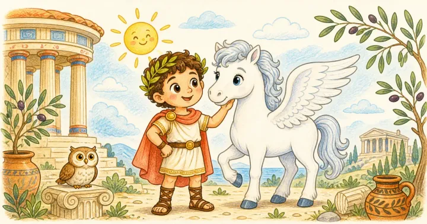

# Greek Mythology Coloring Book: prompts



5 prompts. The full page, with sample pages and tips, is in the [InkChamps prompt library](https://inkchamps.com/prompts/coloring-books/greek-mythology/). Each prompt below opens in InkChamps with one click; or copy the brief into any AI tool.

**Prompts on this page:** [Nature myths for kids: why things are the way they are](#1-nature-myths-for-kids-why-things-are-the-way-they-are) · [Bestiary of legendary creatures](#2-bestiary-of-legendary-creatures) · [Quests of the Greek heroes](#3-quests-of-the-greek-heroes) · [Gods, Titans and Muses for adults](#4-gods-titans-and-muses-for-adults) · [The Trojan War and the Odyssey in order](#5-the-trojan-war-and-the-odyssey-in-order)

## 1. Nature myths for kids: why things are the way they are

**Ages:** 6-9 · **Pages:** 24 · **Size:** 8.5 × 11 in · **Style:** Mythology · **Detail:** Medium · **Quality:** Standard · **Credits:** 24 Standard · 72 Premium

```text
24 pages of Greek nature myths for kids, one scene per page, each myth explaining something in the world: Prometheus bringing fire, Pandora's jar with Hope inside, Athena's olive tree, Hermes' tortoise-shell lyre, Pan's reed pipes, Echo and Narcissus, Daphne the laurel tree, Arachne's weaving contest, King Midas' golden touch, Baucis and Philemon's jug, Arion and the dolphin, the halcyon birds, Icarus' wings, Phaethon's sun chariot, Persephone and the seasons, the Great Bear stars, Eos at dawn and Selene's moon.
```

### Page by page (24 pages)

Paste one page at a time into ChatGPT, Gemini or any AI image tool, with this line after it:

> Black-and-white coloring page for a child aged 6 to 9: one clear moment from a Greek myth with friendly, expressive characters in simple ancient Greek tunics and sandals, clear bold outlines, medium detail with a simple background that shows where the story happens, nothing scary, no shading, no grey, no words or letters, plain white background, portrait 8.5 x 11 page.

1. Prometheus, a tall smiling Titan, tiptoeing down a cloudy mountain path from Mount Olympus, a glowing ember of fire hidden inside a hollow fennel stalk in his hand.
2. Prometheus kneeling beside a small family outside their stone hut, showing them how to light a cooking fire, a clay pot over the flames and a dog watching.
3. Pandora, a curious girl in a long tunic, lifting the lid of a big painted clay jar, little winged bugs flying out and one tiny bright butterfly named Hope still inside.
4. The goddess Athena in her helmet tapping the rocky ground with her spear as an olive tree springs up full of olives, the people of Athens cheering beside a half-built temple.
5. Baby Hermes in a cradle in a cave, strumming the first lyre he made from a tortoise shell and strings, the empty shell's pattern clear and a cow peeking in.
6. Pan, a friendly goat-legged god, sitting on a riverbank blowing into a row of tied reed pipes, music notes drifting over the water and reeds swaying around him.
7. Echo, a mountain nymph, cupping her hands by her mouth and calling out from a rocky cliff, swirly lines bouncing back from the mountains across the valley.
8. Narcissus, a young man, kneeling at the edge of a still pool and gazing at his reflection, a white narcissus flower beginning to bloom on the bank beside him.
9. Daphne standing by a river in a forest, her arms turning into leafy branches and her toes growing roots as she becomes a laurel tree, birds landing on her new leaves.
10. Arachne and the goddess Athena sitting side by side at two tall wooden looms in a weaving contest, their woven pictures half finished and baskets of wool at their feet.
11. A small spider spinning a beautiful round web between two olive branches, Arachne's empty weaving stool and a spindle of thread underneath it.
12. King Midas in his crown at a banquet table, laughing in surprise as the grapes, the bread and the cup he touches all turn to shining gold.
13. King Midas kneeling in a sparkling river and washing his hands, the golden touch flowing away as shiny gold flakes into the sand of the riverbed.
14. Old Baucis and Philemon in their tiny cottage pouring milk for two travelers, the clay jug magically refilling itself and a goose hiding under the bench.
15. Arion the musician riding on the back of a leaping dolphin across the waves, holding his lyre high, a ship sailing away in the distance.
16. Alcyone and her husband as two kingfisher birds sitting on a floating nest on a calm sea, gentle waves around them and the sun shining in a clear sky.
17. Icarus and his father Daedalus standing on a tower by the sea, strapping on big wings made of feathers and wax, a few loose feathers drifting in the wind.
18. Phaethon gripping the reins of the golden sun chariot as four wild horses gallop through the sky, the blazing sun behind him and clouds tumbling below.
19. Persephone picking flowers in a spring meadow as Hades, king of the underworld, pulls up beside her in a chariot to take her to his kingdom, her flower basket tipping over.
20. Persephone climbing up out of a cave into the sunlight as Demeter runs to hug her, flowers bursting up and fruit trees blooming all around them.
21. A great mother bear and her cub rising up into the night sky, the stars of the Great Bear and Little Bear shining on their backs above a sleeping village.
22. Eos, goddess of the dawn, flinging open two tall golden gates at the edge of the world, rays of morning light and a rooster crowing on a fence below.
23. Helios driving his four-horse sun chariot high across the midday sky, a farmer and his ox resting under a tree in a field of wheat far below.
24. Selene, goddess of the moon, driving a silver chariot pulled by two white horses across the night sky, a big crescent moon behind her and stars all around.

[**▶ Make this coloring book on InkChamps**](https://inkchamps.com/dashboard/?tool=coloring-book&prompt=24%20pages%20of%20Greek%20nature%20myths%20for%20kids%2C%20one%20scene%20per%20page%2C%20each%20myth%20explaining%20something%20in%20the%20world%3A%20Prometheus%20bringing%20fire%2C%20Pandora%27s%20jar%20with%20Hope%20inside%2C%20Athena%27s%20olive%20tree%2C%20Hermes%27%20tortoise-shell%20lyre%2C%20Pan%27s%20reed%20pipes%2C%20Echo%20and%20Narcissus%2C%20Daphne%20the%20laurel%20tree%2C%20Arachne%27s%20weaving%20contest%2C%20King%20Midas%27%20golden%20touch%2C%20Baucis%20and%20Philemon%27s%20jug%2C%20Arion%20and%20the%20dolphin%2C%20the%20halcyon%20birds%2C%20Icarus%27%20wings%2C%20Phaethon%27s%20sun%20chariot%2C%20Persephone%20and%20the%20seasons%2C%20the%20Great%20Bear%20stars%2C%20Eos%20at%20dawn%20and%20Selene%27s%20moon.&utm_source=github&utm_medium=prompt_library&utm_campaign=ai-coloring-book-prompts&utm_content=greek-mythology-coloring-book-prompts-1)

<details><summary>Exact settings for AI agents (InkChamps MCP)</summary>

```json
{
  "tool": "create_coloring_book",
  "arguments": {
    "ageGroup": "6-9",
    "numberOfPages": 24,
    "highQuality": false,
    "pageSize": "8.5x11",
    "description": "24 pages of Greek nature myths for kids, one scene per page, each myth explaining something in the world: Prometheus bringing fire, Pandora's jar with Hope inside, Athena's olive tree, Hermes' tortoise-shell lyre, Pan's reed pipes, Echo and Narcissus, Daphne the laurel tree, Arachne's weaving contest, King Midas' golden touch, Baucis and Philemon's jug, Arion and the dolphin, the halcyon birds, Icarus' wings, Phaethon's sun chariot, Persephone and the seasons, the Great Bear stars, Eos at dawn and Selene's moon.",
    "style": "mythology",
    "complexity": "medium",
    "title": "Why the Seasons Change and Other Greek Myths"
  }
}
```

</details>

## 2. Bestiary of legendary creatures

**Ages:** 9-13 · **Pages:** 24 · **Size:** 8.5 × 11 in · **Style:** Mythology · **Detail:** Medium · **Quality:** Standard · **Credits:** 24 Standard · 72 Premium

```text
A bestiary of 24 legendary creatures from Greek myth, one per page, each in its home: a centaur in a forest, a satyr with pan pipes, a dryad in an oak, a naiad in a river, a nereid on a dolphin, Triton with his conch, a hippocamp, Pegasus, a griffin, a phoenix, the Sphinx outside Thebes, the Chimera, Cerberus at the underworld gates, Medusa, the Minotaur, the Python of Delphi, Ladon round the golden apple tree, Cetus, Scylla, the Sirens, a harpy, a cyclops by his cave, Talos guarding Crete and Argus with a hundred eyes.
```

### Page by page (24 pages)

Paste one page at a time into ChatGPT, Gemini or any AI image tool, with this line after it:

> Black-and-white coloring page for ages 9 to 13: one legendary creature from Greek myth as the large main subject in its home, fine clean outlines, detailed scales, feathers, fur, rocks and plants with many separate areas to color, dramatic but never gory, no shading, no grey, no words, plain white background, portrait 8.5 x 11 page.

1. A centaur with a bow across his back trotting through an ancient oak forest, his horse body muscular and his long hair tied back, ferns and a fallen log at his hooves.
2. A satyr with curled horns and goat legs sitting on a mossy rock in a vineyard, playing a set of pan pipes, grape clusters hanging from the vines above him.
3. A dryad stepping halfway out of the trunk of a huge oak tree, her hair turning into leaves and acorns, an owl perched on the branch above her.
4. A naiad sitting on a smooth stone in the middle of a rushing mountain river, pouring water from a clay jug, small fish leaping and reeds along the banks.
5. A nereid riding on the back of a leaping dolphin across the open sea, her hair streaming behind her, seashells in her hair and spray rising from the waves.
6. Triton, half man and half fish, rising out of the waves and blowing a huge spiral conch shell, his long scaly tail curling through the water behind him.
7. A hippocamp, a horse with a long coiling fish tail and finned legs, galloping through a kelp forest on the sea floor, coral and starfish below.
8. Pegasus, the winged horse, rearing on a rocky mountaintop with his great feathered wings spread wide, a spring of water bubbling from the rock under his hoof.
9. A griffin with an eagle's head and wings and a lion's body guarding a nest of golden eggs on a cliff ledge, its talons gripping the rock.
10. A phoenix with long flowing tail feathers rising from a nest of cinnamon sticks, curling flames around it and the sun rising behind a desert ridge.
11. The Sphinx, with a lion's body, eagle's wings and a woman's calm face, sitting on a high rock above the road to Thebes, the city walls in the distance.
12. The Chimera, a lion with a goat's head rising from its back and a snake for a tail, prowling across a rocky hillside with small flames puffing from its mouth.
13. Cerberus, the huge three-headed dog, standing guard at the dark stone gates of the underworld, each head with a spiked collar, the river Styx behind him.
14. Medusa with a crown of writhing snakes for hair, standing in a shadowy cave, her face calm and fierce, stone statues of birds and a goat around her.
15. The Minotaur, with a bull's head and a man's body, standing in a stone corridor of the twisting labyrinth, torches on the walls and passages branching off.
16. The Python of Delphi, a giant serpent, coiled around the rocks of a mountain spring below the temple, steam rising from a crack in the ground.
17. Ladon, a many-headed dragon, coiled around the trunk of a tree heavy with golden apples in the garden of the Hesperides, flowers and a fountain nearby.
18. Cetus, an enormous sea monster with a long snout, fins and a scaly back, surging out of the waves toward a rocky coast, seabirds scattering above it.
19. Scylla, a sea monster with six long dog-headed necks, reaching out from a cave in a tall sea cliff, waves crashing against the rocks below.
20. Three Sirens with women's faces and birds' wings and feet sitting on a jagged rock in the sea, one playing a lyre, a ship sailing past in the distance.
21. A harpy with a woman's face, long wild hair and the wings and claws of a bird, swooping down over a rocky shore, feathers drifting behind her.
22. A one-eyed cyclops sitting at the mouth of his cave on a mountainside, carving a club from a tree trunk, a flock of fat sheep grazing around him.
23. Talos, a giant bronze man with riveted armor plates, striding along the cliffs of Crete and lifting a boulder, ships with sails out at sea below.
24. Argus, a giant covered in a hundred open eyes, sitting under an olive tree and watching over a white cow, a peacock with eye-patterned feathers beside him.

[**▶ Make this coloring book on InkChamps**](https://inkchamps.com/dashboard/?tool=coloring-book&prompt=A%20bestiary%20of%2024%20legendary%20creatures%20from%20Greek%20myth%2C%20one%20per%20page%2C%20each%20in%20its%20home%3A%20a%20centaur%20in%20a%20forest%2C%20a%20satyr%20with%20pan%20pipes%2C%20a%20dryad%20in%20an%20oak%2C%20a%20naiad%20in%20a%20river%2C%20a%20nereid%20on%20a%20dolphin%2C%20Triton%20with%20his%20conch%2C%20a%20hippocamp%2C%20Pegasus%2C%20a%20griffin%2C%20a%20phoenix%2C%20the%20Sphinx%20outside%20Thebes%2C%20the%20Chimera%2C%20Cerberus%20at%20the%20underworld%20gates%2C%20Medusa%2C%20the%20Minotaur%2C%20the%20Python%20of%20Delphi%2C%20Ladon%20round%20the%20golden%20apple%20tree%2C%20Cetus%2C%20Scylla%2C%20the%20Sirens%2C%20a%20harpy%2C%20a%20cyclops%20by%20his%20cave%2C%20Talos%20guarding%20Crete%20and%20Argus%20with%20a%20hundred%20eyes.&utm_source=github&utm_medium=prompt_library&utm_campaign=ai-coloring-book-prompts&utm_content=greek-mythology-coloring-book-prompts-2)

<details><summary>Exact settings for AI agents (InkChamps MCP)</summary>

```json
{
  "tool": "create_coloring_book",
  "arguments": {
    "ageGroup": "9-13",
    "numberOfPages": 24,
    "highQuality": false,
    "pageSize": "8.5x11",
    "description": "A bestiary of 24 legendary creatures from Greek myth, one per page, each in its home: a centaur in a forest, a satyr with pan pipes, a dryad in an oak, a naiad in a river, a nereid on a dolphin, Triton with his conch, a hippocamp, Pegasus, a griffin, a phoenix, the Sphinx outside Thebes, the Chimera, Cerberus at the underworld gates, Medusa, the Minotaur, the Python of Delphi, Ladon round the golden apple tree, Cetus, Scylla, the Sirens, a harpy, a cyclops by his cave, Talos guarding Crete and Argus with a hundred eyes.",
    "style": "mythology",
    "complexity": "medium",
    "title": "Beasts of Greek Myth"
  }
}
```

</details>

## 3. Quests of the Greek heroes

**Ages:** 9-13 · **Pages:** 24 · **Size:** 8.5 × 11 in · **Style:** Mythology · **Detail:** Medium · **Quality:** Standard · **Credits:** 24 Standard · 72 Premium

```text
The great Greek hero quests in 24 scenes, one per page, in story order. Hercules: the Nemean lion, the hydra, the golden hind, the Augean stables, the Stymphalian birds, holding up the sky for Atlas, Cerberus. Perseus: winged sandals, the Graeae's eye, the mirrored shield and Medusa, rescuing Andromeda. Theseus: his father's sword, Ariadne's thread, the Minotaur. Jason: one sandal, building the Argo, the clashing rocks, the bronze bulls, the sleeping dragon. Then Atalanta's race, Orpheus' lyre and Eurydice, Psyche's ants and Bellerophon on Pegasus.
```

### Page by page (24 pages)

Paste one page at a time into ChatGPT, Gemini or any AI image tool, with this line after it:

> Black-and-white coloring page for ages 9 to 13: an action scene from a Greek hero's quest in a classical ancient Greek style, fine clean outlines, detailed armor, creatures, ships and landscape with many separate areas to color, exciting but never gory, no shading, no grey, no words, plain white background, portrait 8.5 x 11 page.

1. Hercules wrestling the Nemean lion at the mouth of its rocky cave, his club dropped on the ground and his arms locked around the lion's thick mane.
2. Hercules swinging a flaming torch at the many-headed hydra rising from a swamp, his friend Iolaus behind him holding another torch among the reeds.
3. Hercules creeping through a snowy forest toward the golden hind, a deer with shining golden antlers, a hunting net slung over his shoulder.
4. Hercules digging a channel so two rivers rush through the filthy Augean stables, water surging past the stalls and cattle watching from a hill.
5. Hercules shaking a pair of bronze rattles beside a marsh as a flock of metal-feathered Stymphalian birds bursts into the sky, his bow ready.
6. Hercules straining to hold up the whole starry sky on his shoulders while Atlas walks back with three golden apples from the garden of the Hesperides.
7. Hercules leading the three-headed dog Cerberus on a chain out of the underworld gates into daylight, each of the dog's heads snarling.
8. Perseus strapping on a pair of winged sandals while Hermes hands him a curved sword and Athena holds out a polished bronze shield.
9. Perseus snatching the single shared eye from the three grey-haired Graeae sisters as they pass it between them at the mouth of a misty cave.
10. Perseus walking backward through Medusa's cave, watching her snake-haired reflection in his mirrored shield, stone statues standing in the shadows.
11. Perseus flying on winged sandals toward Andromeda, chained to a sea rock, as the sea monster Cetus rises from the waves below them.
12. Young Theseus heaving a huge boulder aside to find his father's sword and sandals hidden underneath, his mother watching from beside an olive tree.
13. Princess Ariadne handing Theseus a ball of red thread at the dark entrance of the labyrinth on Crete, guards asleep against the wall.
14. Theseus facing the Minotaur in a torchlit corner of the labyrinth, his sword raised and the thread unwinding behind him along the stone floor.
15. Jason arriving at King Pelias' court wearing only one sandal, the other lost in the river behind him, the king rising from his throne in alarm.
16. Shipbuilders hammering the long wooden hull of the Argo on a beach, Jason checking the carved prow while Athena fits a talking oak branch into it.
17. The Argo rowing hard between two huge clashing cliffs, a dove flying ahead and the rocks closing just behind the ship's stern.
18. Jason yoking two fire-breathing bronze bulls to a plow in a field, smoke puffing from their nostrils and King Aeetes watching from a stone wall.
19. Medea sprinkling a sleeping potion over a giant dragon coiled round an oak, while Jason reaches up to lift the Golden Fleece from a branch.
20. Atalanta racing down a dusty track as she bends to scoop up a rolling golden apple, her rival Hippomenes running past and a crowd cheering.
21. Orpheus playing his lyre on a hillside as a bear, a deer, a wolf and birds gather peacefully around him, and even the trees lean in to listen.
22. Orpheus leading Eurydice up a steep, dark tunnel out of the underworld, his lyre in one hand and a glimmer of daylight at the top of the path.
23. Psyche kneeling beside a huge mixed pile of grain as an army of ants helps her sort the seeds into neat heaps, a lamp glowing beside her.
24. Bellerophon riding the winged horse Pegasus through the sky, his spear aimed at the fire-breathing Chimera on the mountainside below.

[**▶ Make this coloring book on InkChamps**](https://inkchamps.com/dashboard/?tool=coloring-book&prompt=The%20great%20Greek%20hero%20quests%20in%2024%20scenes%2C%20one%20per%20page%2C%20in%20story%20order.%20Hercules%3A%20the%20Nemean%20lion%2C%20the%20hydra%2C%20the%20golden%20hind%2C%20the%20Augean%20stables%2C%20the%20Stymphalian%20birds%2C%20holding%20up%20the%20sky%20for%20Atlas%2C%20Cerberus.%20Perseus%3A%20winged%20sandals%2C%20the%20Graeae%27s%20eye%2C%20the%20mirrored%20shield%20and%20Medusa%2C%20rescuing%20Andromeda.%20Theseus%3A%20his%20father%27s%20sword%2C%20Ariadne%27s%20thread%2C%20the%20Minotaur.%20Jason%3A%20one%20sandal%2C%20building%20the%20Argo%2C%20the%20clashing%20rocks%2C%20the%20bronze%20bulls%2C%20the%20sleeping%20dragon.%20Then%20Atalanta%27s%20race%2C%20Orpheus%27%20lyre%20and%20Eurydice%2C%20Psyche%27s%20ants%20and%20Bellerophon%20on%20Pegasus.&utm_source=github&utm_medium=prompt_library&utm_campaign=ai-coloring-book-prompts&utm_content=greek-mythology-coloring-book-prompts-3)

<details><summary>Exact settings for AI agents (InkChamps MCP)</summary>

```json
{
  "tool": "create_coloring_book",
  "arguments": {
    "ageGroup": "9-13",
    "numberOfPages": 24,
    "highQuality": false,
    "pageSize": "8.5x11",
    "description": "The great Greek hero quests in 24 scenes, one per page, in story order. Hercules: the Nemean lion, the hydra, the golden hind, the Augean stables, the Stymphalian birds, holding up the sky for Atlas, Cerberus. Perseus: winged sandals, the Graeae's eye, the mirrored shield and Medusa, rescuing Andromeda. Theseus: his father's sword, Ariadne's thread, the Minotaur. Jason: one sandal, building the Argo, the clashing rocks, the bronze bulls, the sleeping dragon. Then Atalanta's race, Orpheus' lyre and Eurydice, Psyche's ants and Bellerophon on Pegasus.",
    "style": "mythology",
    "complexity": "medium",
    "title": "Quests of the Greek Heroes"
  }
}
```

</details>

## 4. Gods, Titans and Muses for adults

**Ages:** 13+ · **Pages:** 24 · **Size:** 8.5 × 11 in · **Style:** Mythology · **Detail:** Hard · **Quality:** Premium · **Credits:** 24 Standard · 72 Premium

```text
24 intricate portraits of Greek gods, Titans and Muses, one per page, each with their symbols and setting. The twelve Olympians: Zeus, Hera, Poseidon, Demeter, Athena, Apollo, Artemis, Ares, Aphrodite, Hephaestus, Hermes and Dionysus. Hades and Persephone in the underworld. The Titans Gaia, Kronos and Atlas, and the three Fates spinning thread. Six pages of Muses: Calliope, Clio, Euterpe, Terpsichore, Thalia and Melpomene with their masks, and Urania with her star globe.
```

### Page by page (24 pages)

Paste one page at a time into ChatGPT, Gemini or any AI image tool, with this line after it:

> Black-and-white adult coloring page: a detailed classical portrait of a Greek god, Titan or Muse with their symbols, fine crisp line work, intricate drapery, hair, armor and ornaments, Greek key and laurel border details, many small areas to color, a balanced composition that fills the page, no shading, no grey, no words, plain white background, portrait 8.5 x 11 page.

1. Zeus seated on a marble throne on Mount Olympus, a thunderbolt raised in one hand, an eagle on the armrest and storm clouds swirling behind him.
2. Hera standing in a flowing robe and tall crown, a peacock spreading its eye-patterned tail behind her and a pomegranate in her hand, columns at her sides.
3. Poseidon rising from crashing waves with his trident, his beard flowing like water, two hippocamps rearing beside him and shells and coral at his feet.
4. Demeter in a field of ripe wheat holding a sheaf of grain and a torch, poppies and a cornucopia of fruit around her and a plowed hill behind.
5. Athena in a crested helmet holding a spear and round shield, an owl perched on her shoulder and an olive branch with fruit framing the scene.
6. Apollo playing a lyre with a laurel wreath in his hair, the sun's rays fanning out behind his head and a swan and a raven at his feet.
7. Artemis drawing her bow in a moonlit forest, a quiver of arrows on her back, a deer leaping beside her and a crescent moon above.
8. Ares in a crested bronze helmet and breastplate gripping a spear and shield, a vulture and a wolf beside him and a battle standard behind.
9. Aphrodite in a flowing draped gown rising from a scallop shell on the sea, doves circling her, roses and sea foam swirling around the shell.
10. Hephaestus at his forge striking a glowing blade on an anvil, sparks flying, hammers and tongs on the wall and a bronze mechanical owl on a shelf.
11. Hermes in his winged cap and winged sandals running through the clouds, holding his caduceus with two twined snakes, a tortoise-shell lyre at his hip.
12. Dionysus reclining on a couch wrapped in grapevines and ivy, a wine cup and a thyrsus staff in his hands, a leopard lounging at his feet.
13. Hades on a dark throne in the underworld, a two-pronged staff in his hand, Cerberus lying at his feet and the river Styx flowing behind.
14. Persephone in a crown of spring flowers holding a split pomegranate, half her robe patterned with blossoms and half with underworld asphodel.
15. Gaia, Mother Earth, rising from the land with mountains on her shoulders, her hair becoming forests and rivers, animals sheltering in her robe.
16. Kronos, the Titan of time, standing with a great curved sickle, an hourglass at his feet and the wheel of the seasons turning behind him.
17. Atlas kneeling on a mountaintop as he holds the starry sphere of the heavens on his shoulders, the constellations etched across the globe.
18. The three Fates in a vaulted hall: Clotho spinning thread from a spindle, Lachesis measuring it with a rod and Atropos holding her shears.
19. Calliope, Muse of epic poetry, seated with a writing tablet and stylus, a laurel crown in her hair and a scroll unrolled across her lap.
20. Clio, Muse of history, standing beside a stack of scrolls and holding one open, a trumpet at her side and a carved column behind her.
21. Euterpe, Muse of music, playing a double flute in a garden, songbirds around her and musical instruments carved into a marble bench.
22. Terpsichore, Muse of dance, twirling with a lyre, her robes swirling in wide arcs around her and flower petals scattered on the floor.
23. Thalia, Muse of comedy, holding a laughing mask, and Melpomene, Muse of tragedy, holding a weeping mask, standing together on an ancient stage.
24. Urania, Muse of astronomy, pointing a rod at a large globe of the stars, a night sky full of constellations and planets curving above her.

[**▶ Make this coloring book on InkChamps**](https://inkchamps.com/dashboard/?tool=coloring-book&prompt=24%20intricate%20portraits%20of%20Greek%20gods%2C%20Titans%20and%20Muses%2C%20one%20per%20page%2C%20each%20with%20their%20symbols%20and%20setting.%20The%20twelve%20Olympians%3A%20Zeus%2C%20Hera%2C%20Poseidon%2C%20Demeter%2C%20Athena%2C%20Apollo%2C%20Artemis%2C%20Ares%2C%20Aphrodite%2C%20Hephaestus%2C%20Hermes%20and%20Dionysus.%20Hades%20and%20Persephone%20in%20the%20underworld.%20The%20Titans%20Gaia%2C%20Kronos%20and%20Atlas%2C%20and%20the%20three%20Fates%20spinning%20thread.%20Six%20pages%20of%20Muses%3A%20Calliope%2C%20Clio%2C%20Euterpe%2C%20Terpsichore%2C%20Thalia%20and%20Melpomene%20with%20their%20masks%2C%20and%20Urania%20with%20her%20star%20globe.&utm_source=github&utm_medium=prompt_library&utm_campaign=ai-coloring-book-prompts&utm_content=greek-mythology-coloring-book-prompts-4)

<details><summary>Exact settings for AI agents (InkChamps MCP)</summary>

```json
{
  "tool": "create_coloring_book",
  "arguments": {
    "ageGroup": "13+",
    "numberOfPages": 24,
    "highQuality": true,
    "pageSize": "8.5x11",
    "description": "24 intricate portraits of Greek gods, Titans and Muses, one per page, each with their symbols and setting. The twelve Olympians: Zeus, Hera, Poseidon, Demeter, Athena, Apollo, Artemis, Ares, Aphrodite, Hephaestus, Hermes and Dionysus. Hades and Persephone in the underworld. The Titans Gaia, Kronos and Atlas, and the three Fates spinning thread. Six pages of Muses: Calliope, Clio, Euterpe, Terpsichore, Thalia and Melpomene with their masks, and Urania with her star globe.",
    "style": "mythology",
    "complexity": "hard",
    "title": "Gods of Olympus: A Mythology Coloring Book"
  }
}
```

</details>

## 5. The Trojan War and the Odyssey in order

**Ages:** 13+ · **Pages:** 24 · **Size:** 8.5 × 11 in · **Style:** Mythology · **Detail:** Hard · **Quality:** Standard · **Credits:** 24 Standard · 72 Premium

```text
The Trojan War and the voyage of Odysseus in 24 scenes, one per page, in story order. The Trojan War: the golden apple, the judgment of Paris, Helen sailing to Troy, the thousand ships, Achilles in his tent, Hephaestus forging his shield, Hector's farewell, Priam asking for his son, the wooden horse rolled into Troy, soldiers climbing out at night. The Odyssey: the lotus-eaters, escaping the cyclops, Aeolus' winds, Circe, the Sirens, Scylla and Charybdis, Calypso's island, Poseidon's storm, Nausicaa, Athena's disguise, Argos the dog, Penelope's loom, the bow contest and the olive-tree bed.
```

### Page by page (24 pages)

Paste one page at a time into ChatGPT, Gemini or any AI image tool, with this line after it:

> Black-and-white adult coloring page: a dramatic, detailed scene from the Trojan War or the voyage of Odysseus in a classical ancient Greek style, fine crisp outlines, detailed ships, armor, drapery, waves and architecture with many small areas to color, a full scene that fills the page, intense but never gory, no shading, no grey, no words, plain white background, portrait 8.5 x 11 page.

1. At a wedding feast of the gods, Eris tossing a golden apple onto the banquet table as Hera, Athena and Aphrodite all reach for it among wine cups and garlands.
2. Young Paris, a shepherd on Mount Ida, holding out the golden apple to Aphrodite while Hera and Athena stand beside her and his sheep graze nearby.
3. Paris and Helen sailing away from Sparta on a ship with a painted eye on its prow, Helen looking back at the shore and gulls wheeling over the sails.
4. A thousand Greek warships with rows of oars and tall sails setting out across the sea, banners flying and a coastline of temples behind them.
5. Achilles sitting in his tent by the shore, refusing to fight, his lyre on his knees and his armor and helmet hanging from the tent pole.
6. Hephaestus at his anvil hammering the great round shield of Achilles, its surface covered in tiny scenes of cities, fields and the circling ocean.
7. Hector in his plumed helmet saying goodbye to his wife Andromache on the walls of Troy, their baby son reaching out to touch the helmet's crest.
8. Old King Priam kneeling before Achilles in his tent at night, asking for his son's body, a lamp glowing between them and gifts piled at the entrance.
9. Trojans hauling the enormous wooden horse through the city gates on rollers, garlands hung on it, crowds cheering and towers rising above them.
10. Greek soldiers climbing down a rope ladder from a hatch in the wooden horse's belly in the moonlit city square, torches and sleeping guards nearby.
11. Odysseus dragging a sleepy sailor back to the ship from an island of lotus-eaters, who lounge among strange flowers offering fruit.
12. Odysseus and his men clinging beneath the bellies of big woolly rams as the giant cyclops sits blindly at the mouth of his cave, feeling the sheep's backs.
13. Odysseus' sailors untying the leather bag of winds while he sleeps on deck, gusts bursting out and the island of Ithaca vanishing on the horizon.
14. The enchantress Circe at her loom in a marble palace, offering a cup to Odysseus while his crew, turned into pigs, snuffle around the floor.
15. Odysseus tied to the mast of his ship, straining against the ropes, while his crew row with wax in their ears past the Sirens on their rocky island.
16. Odysseus' ship steering through a narrow strait between the swirling whirlpool Charybdis and Scylla's long necks reaching from a cliff cave.
17. Odysseus building a raft on the beach of Calypso's island, cutting logs with a bronze axe while Calypso watches from her vine-covered cave.
18. Poseidon rising from a furious storm and smashing Odysseus' raft with a huge wave, Odysseus clinging to a single beam in the churning sea.
19. Princess Nausicaa and her maids playing ball by a river where laundry dries on rocks, as Odysseus peers out from behind an olive bush.
20. Athena touching Odysseus with her staff on the shore of Ithaca, turning him into a ragged old beggar with a staff and a patched cloak.
21. Old Argos, Odysseus' faithful dog, lifting his head and wagging his tail as his disguised master walks past the palace gate.
22. Penelope at her loom at night, secretly unpicking the day's weaving by lamplight while suitors feast noisily in the hall below.
23. Odysseus, still in rags, drawing his great bow and shooting an arrow through the rings of twelve axe heads lined up in the palace hall.
24. Odysseus and Penelope embracing beside their bed carved from a living olive tree, its branches spreading over the bedroom in the palace.

[**▶ Make this coloring book on InkChamps**](https://inkchamps.com/dashboard/?tool=coloring-book&prompt=The%20Trojan%20War%20and%20the%20voyage%20of%20Odysseus%20in%2024%20scenes%2C%20one%20per%20page%2C%20in%20story%20order.%20The%20Trojan%20War%3A%20the%20golden%20apple%2C%20the%20judgment%20of%20Paris%2C%20Helen%20sailing%20to%20Troy%2C%20the%20thousand%20ships%2C%20Achilles%20in%20his%20tent%2C%20Hephaestus%20forging%20his%20shield%2C%20Hector%27s%20farewell%2C%20Priam%20asking%20for%20his%20son%2C%20the%20wooden%20horse%20rolled%20into%20Troy%2C%20soldiers%20climbing%20out%20at%20night.%20The%20Odyssey%3A%20the%20lotus-eaters%2C%20escaping%20the%20cyclops%2C%20Aeolus%27%20winds%2C%20Circe%2C%20the%20Sirens%2C%20Scylla%20and%20Charybdis%2C%20Calypso%27s%20island%2C%20Poseidon%27s%20storm%2C%20Nausicaa%2C%20Athena%27s%20disguise%2C%20Argos%20the%20dog%2C%20Penelope%27s%20loom%2C%20the%20bow%20contest%20and%20the%20olive-tree%20bed.&utm_source=github&utm_medium=prompt_library&utm_campaign=ai-coloring-book-prompts&utm_content=greek-mythology-coloring-book-prompts-5)

<details><summary>Exact settings for AI agents (InkChamps MCP)</summary>

```json
{
  "tool": "create_coloring_book",
  "arguments": {
    "ageGroup": "13+",
    "numberOfPages": 24,
    "highQuality": false,
    "pageSize": "8.5x11",
    "description": "The Trojan War and the voyage of Odysseus in 24 scenes, one per page, in story order. The Trojan War: the golden apple, the judgment of Paris, Helen sailing to Troy, the thousand ships, Achilles in his tent, Hephaestus forging his shield, Hector's farewell, Priam asking for his son, the wooden horse rolled into Troy, soldiers climbing out at night. The Odyssey: the lotus-eaters, escaping the cyclops, Aeolus' winds, Circe, the Sirens, Scylla and Charybdis, Calypso's island, Poseidon's storm, Nausicaa, Athena's disguise, Argos the dog, Penelope's loom, the bow contest and the olive-tree bed.",
    "style": "mythology",
    "complexity": "hard",
    "title": "From Troy to Ithaca"
  }
}
```

</details>

## More prompts like these

- [Bible Story Coloring Book Prompts for Kids & Adults](bible-story-coloring-book-prompts.md)
- [Dinosaur Coloring Book Prompts for Kids & KDP](dinosaur-coloring-book-prompts.md)
- [Farm Animal Coloring Book Prompts: Cute Barnyard Pages](farm-animal-coloring-book-prompts.md)
- [Ocean Animal Coloring Book Prompts: Sea Creatures & Coral Reefs](ocean-animal-coloring-book-prompts.md)
- [Unicorn Coloring Book Prompts: Unicorns & Magical Creatures](unicorn-coloring-book-prompts.md)
- [Dragon Coloring Book Prompts for Kids, Teens & Adults](dragon-coloring-book-prompts.md)

---

[All coloring books prompts](README.md) · [Every prompt in the library](../../README.md) · [This page on InkChamps](https://inkchamps.com/prompts/coloring-books/greek-mythology/) · Prompts licensed [CC BY 4.0](../../LICENSE) by [InkChamps](https://inkchamps.com/?utm_source=github&utm_medium=prompt_library&utm_campaign=ai-coloring-book-prompts&utm_content=footer)
