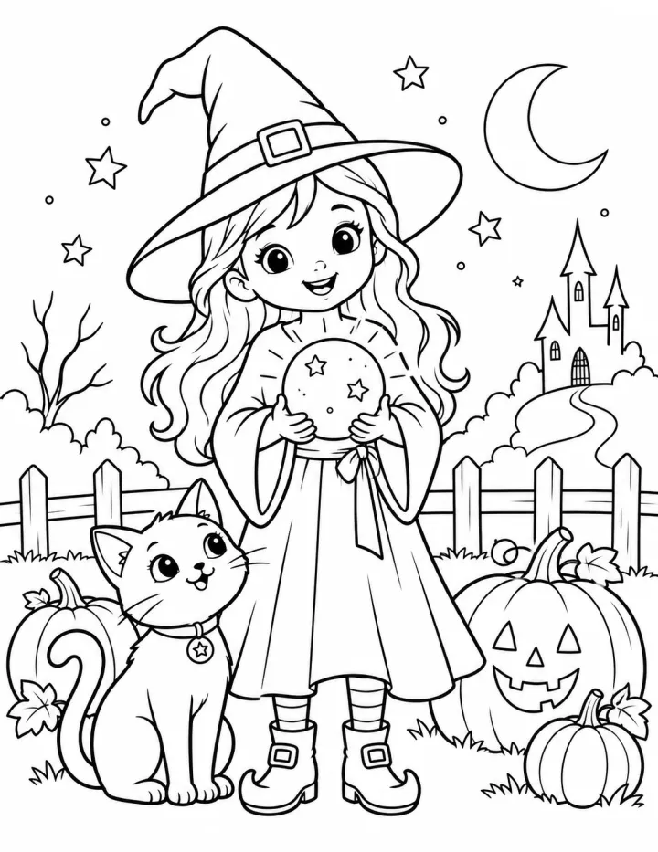

# Halloween Coloring Book: prompts



5 prompts. The full page, with sample pages and tips, is in the [InkChamps prompt library](https://inkchamps.com/prompts/coloring-books/halloween/). Each prompt below opens in InkChamps with one click; or copy the brief into any AI tool.

**Prompts on this page:** [Spooky-cute for little kids](#1-spooky-cute-for-little-kids) · [Monster party night](#2-monster-party-night) · [Haunted manor adventure for tweens](#3-haunted-manor-adventure-for-tweens) · [Spooky-cozy witch cottage](#4-spooky-cozy-witch-cottage) · [Moonlit Halloween mandalas](#5-moonlit-halloween-mandalas)

## 1. Spooky-cute for little kids

**Ages:** 3-6 · **Pages:** 24 · **Size:** 8.5 × 11 in · **Style:** General coloring · **Detail:** Easy · **Quality:** Standard · **Credits:** 24 Standard · 72 Premium

```text
24 friendly Halloween pictures for little kids, one big smiling subject per page: a jack-o'-lantern, a little ghost with a lollipop, a black cat in a witch hat, a happy bat, a candy bucket full of treats, an owl on a crescent moon, a one-tooth monster, a pumpkin patch, a waving scarecrow, a spider with a heart web, a mummy cat, a kid in a dinosaur costume, a mouse in a pumpkin house, a dancing skeleton, a puppy in a pumpkin costume and a sleepy moon to end the night.
```

### Page by page (24 pages)

Paste one page at a time into ChatGPT, Gemini or any AI image tool, with this line after it:

> Black-and-white coloring page for a child aged 3 to 6: one big, friendly, smiling Halloween subject filling most of the page, thick bold outlines, large simple shapes with wide spaces to color, very little background, nothing scary, no shading, no grey, no words, plain white background, portrait 8.5 x 11 page.

1. A big smiling jack-o'-lantern with triangle eyes and a wide toothy grin sitting on a round doormat, a curly vine and one leaf on its stem.
2. A little round ghost floating in the air and holding a big swirly lollipop with both hands, two small stars beside it.
3. A black cat wearing a tall pointy witch hat, sitting on top of a pumpkin with its curly tail wrapped around it.
4. A happy bat with its wings spread wide and a big smile, flying in front of a round full moon over a little rooftop with a chimney.
5. A pumpkin-shaped trick-or-treat bucket overflowing with wrapped sweets, two lollipops and a candy corn on the ground beside it.
6. A wide-eyed owl perched on a smiling crescent moon, holding a tiny pumpkin in its feet, a puffy cloud and two simple stars around it.
7. A friendly furry monster with one big eye and one big tooth waving hello, a little pumpkin at its feet.
8. A pumpkin patch with three round pumpkins of different sizes on a curly vine, a short wooden fence behind them.
9. A smiling scarecrow in a patched straw hat waving from its pole, a friendly crow sitting on its arm.
10. A smiling spider with eight bendy legs spinning a heart-shaped web between two twigs, a little leaf caught in one corner.
11. A cat wrapped up like a mummy in loose bandages, one ear and its whiskers poking out, giggling beside a small pumpkin.
12. A small child in a dinosaur costume with a spiky tail, holding out a trick-or-treat bag at a front door with a pumpkin on the step.
13. A little ghost sitting on a rope swing hanging from a tree branch, a few big leaves falling around it.
14. A mouse peeking out of the round window of a pumpkin house with a little arched door and a crooked chimney.
15. A smiling skeleton in a bow tie dancing with both arms up, one knee lifted and a few music notes around it.
16. A puppy in a pumpkin costume with a leaf hat, wagging its tail beside a candy bag, a bone-shaped treat at its paws.
17. A big round pot on three little legs bubbling over, round bubbles popping out of the top and a wooden spoon sticking out.
18. A witch's broom with a bow tied around its straw bristles, leaning on a pumpkin, a little bat sitting on the handle.
19. A friendly bunny dressed as a vampire in a little cape with two tiny fangs, holding a carrot and smiling.
20. A smiling toad wearing a tiny crown, sitting on top of a big spotted mushroom, a ladybug crawling up the stem.
21. A kid in a sheet ghost costume pulling a little wagon full of pumpkins along a path, a small cat trotting behind.
22. A big cupcake with swirly frosting and a small bat decoration on top, sprinkles scattered on the plate.
23. A child dressed as a robot with a boxy head and a springy antenna, carrying a lantern along a garden path.
24. A sleepy smiling crescent moon over a little house with a jack-o'-lantern on the step, three big stars in the sky.

[**▶ Make this coloring book on InkChamps**](https://inkchamps.com/dashboard/?tool=coloring-book&prompt=24%20friendly%20Halloween%20pictures%20for%20little%20kids%2C%20one%20big%20smiling%20subject%20per%20page%3A%20a%20jack-o%27-lantern%2C%20a%20little%20ghost%20with%20a%20lollipop%2C%20a%20black%20cat%20in%20a%20witch%20hat%2C%20a%20happy%20bat%2C%20a%20candy%20bucket%20full%20of%20treats%2C%20an%20owl%20on%20a%20crescent%20moon%2C%20a%20one-tooth%20monster%2C%20a%20pumpkin%20patch%2C%20a%20waving%20scarecrow%2C%20a%20spider%20with%20a%20heart%20web%2C%20a%20mummy%20cat%2C%20a%20kid%20in%20a%20dinosaur%20costume%2C%20a%20mouse%20in%20a%20pumpkin%20house%2C%20a%20dancing%20skeleton%2C%20a%20puppy%20in%20a%20pumpkin%20costume%20and%20a%20sleepy%20moon%20to%20end%20the%20night.&utm_source=github&utm_medium=prompt_library&utm_campaign=ai-coloring-book-prompts&utm_content=halloween-coloring-book-prompts-1)

<details><summary>Exact settings for AI agents (InkChamps MCP)</summary>

```json
{
  "tool": "create_coloring_book",
  "arguments": {
    "ageGroup": "3-6",
    "numberOfPages": 24,
    "highQuality": false,
    "pageSize": "8.5x11",
    "description": "24 friendly Halloween pictures for little kids, one big smiling subject per page: a jack-o'-lantern, a little ghost with a lollipop, a black cat in a witch hat, a happy bat, a candy bucket full of treats, an owl on a crescent moon, a one-tooth monster, a pumpkin patch, a waving scarecrow, a spider with a heart web, a mummy cat, a kid in a dinosaur costume, a mouse in a pumpkin house, a dancing skeleton, a puppy in a pumpkin costume and a sleepy moon to end the night.",
    "theme": "Halloween",
    "style": "general_coloring",
    "complexity": "easy",
    "title": "Spooky Cute Halloween"
  }
}
```

</details>

## 2. Monster party night

**Ages:** 6-9 · **Pages:** 24 · **Size:** 8.5 × 11 in · **Style:** General coloring · **Detail:** Medium · **Quality:** Standard · **Credits:** 24 Standard · 72 Premium

```text
24 pages of friendly monsters on Halloween night, from trick-or-treating to falling asleep after the party: kids trick-or-treating down a lit street, a goblin handing out candy, a werewolf DJ, a skeleton band, a vampire bobbing for apples, a mummy tangled in streamers, a costume contest, pumpkin bowling, a swamp creature baking cupcakes, a bat pinata, a ghost limbo line, a dragon roasting marshmallows, a haunted hayride, hide and seek in a corn maze and monsters sleeping after the party.
```

### Page by page (24 pages)

Paste one page at a time into ChatGPT, Gemini or any AI image tool, with this line after it:

> Black-and-white coloring page for a child aged 6 to 9: friendly, silly cartoon monsters with big smiles, nothing scary or gory, clear bold outlines, medium detail with a simple background that shows where the party scene happens, no shading, no grey, no words or letters, plain white background, portrait 8.5 x 11 page.

1. Three kids dressed as a little witch, a robot and a sheet ghost trick-or-treating down a street lined with jack-o'-lanterns, a full moon over the rooftops.
2. A goblin in a cozy cardigan handing out candy from a big bowl at his front door to a line of small monsters holding out their bags.
3. A costume parade at school: kids marching in a line dressed as a pirate, a bumblebee and a dragon, paper bats hanging from the ceiling.
4. A stitched-up monster with bolts in his neck carving a grinning pumpkin at a kitchen table, a pile of seeds and a scooping spoon on a tray.
5. A crooked old party house strung with paper lanterns, a friendly vampire at the open door welcoming a mummy and a yeti up the steps.
6. A werewolf DJ in big headphones spinning records at a turntable, two speakers beside him and a disco ball above the dance floor.
7. A skeleton band on a small stage, one skeleton on drums, one strumming a guitar and one blowing a trumpet, music notes in the air.
8. A vampire in a long cape bobbing for apples in a wooden tub of water, apples floating and water splashing over the sides.
9. A laughing mummy tangled in party streamers and balloon strings, a pointy party hat on its head and balloons bobbing above it.
10. A monster costume contest: a cyclops dressed as a banana, a ghost dressed as a pirate and a werewolf in a tutu on a little stage, a judge holding up a ribbon.
11. A swamp creature rolling a round pumpkin down a hallway at ten gourds set up like bowling pins, two gourds tumbling over.
12. A cyclops photographer holding a big camera to its one eye, taking a group photo of grinning monsters squeezed onto a sofa.
13. A swamp creature in an apron piping frosting spiderwebs onto a tray of cupcakes, an oven and a mixing bowl behind it.
14. A yeti eating a giant cloud of cotton candy at a snack table with a punch bowl, a plate of cookies and a bowl of popcorn.
15. Two little monsters at a slime-making table stirring bowls of goo with spoons, jars of glitter and a long stretch of slime between their hands.
16. A bat-shaped pinata hanging from a tree branch, a blindfolded little werewolf swinging a stick and candy tumbling out of it.
17. A ghost limbo line: three ghosts bending backward one after another under a stick held up by two skeletons.
18. A small dragon roasting marshmallows with its own tiny flame at a campfire, monsters holding long sticks all around the fire.
19. A haunted hayride: a wagon piled with hay bales pulled by a tractor driven by a scarecrow, monsters waving from the back under a big moon.
20. Monsters playing hide and seek in a corn maze, a little ghost peeking around a corner of tall cornstalks while a mummy counts with its eyes covered.
21. A ghost family of a mom, a dad and a baby ghost having a moonlit picnic in a pumpkin patch on a checked blanket with a basket and sandwiches.
22. A witch girl and her cat flying on a broom across a big full moon, bats flying beside them as she waves to the party below.
23. Two little monsters sitting on a rug swapping candy from their trick-or-treat bags, small piles of sweets and wrappers between them.
24. Monsters fast asleep after the party, piled on a big couch and the floor with party hats askew, streamers hanging and a yawning bat on the lamp.

[**▶ Make this coloring book on InkChamps**](https://inkchamps.com/dashboard/?tool=coloring-book&prompt=24%20pages%20of%20friendly%20monsters%20on%20Halloween%20night%2C%20from%20trick-or-treating%20to%20falling%20asleep%20after%20the%20party%3A%20kids%20trick-or-treating%20down%20a%20lit%20street%2C%20a%20goblin%20handing%20out%20candy%2C%20a%20werewolf%20DJ%2C%20a%20skeleton%20band%2C%20a%20vampire%20bobbing%20for%20apples%2C%20a%20mummy%20tangled%20in%20streamers%2C%20a%20costume%20contest%2C%20pumpkin%20bowling%2C%20a%20swamp%20creature%20baking%20cupcakes%2C%20a%20bat%20pinata%2C%20a%20ghost%20limbo%20line%2C%20a%20dragon%20roasting%20marshmallows%2C%20a%20haunted%20hayride%2C%20hide%20and%20seek%20in%20a%20corn%20maze%20and%20monsters%20sleeping%20after%20the%20party.&utm_source=github&utm_medium=prompt_library&utm_campaign=ai-coloring-book-prompts&utm_content=halloween-coloring-book-prompts-2)

<details><summary>Exact settings for AI agents (InkChamps MCP)</summary>

```json
{
  "tool": "create_coloring_book",
  "arguments": {
    "ageGroup": "6-9",
    "numberOfPages": 24,
    "highQuality": false,
    "pageSize": "8.5x11",
    "description": "24 pages of friendly monsters on Halloween night, from trick-or-treating to falling asleep after the party: kids trick-or-treating down a lit street, a goblin handing out candy, a werewolf DJ, a skeleton band, a vampire bobbing for apples, a mummy tangled in streamers, a costume contest, pumpkin bowling, a swamp creature baking cupcakes, a bat pinata, a ghost limbo line, a dragon roasting marshmallows, a haunted hayride, hide and seek in a corn maze and monsters sleeping after the party.",
    "theme": "monster party",
    "style": "general_coloring",
    "complexity": "medium",
    "title": "Monster Bash: A Halloween Party Coloring Book"
  }
}
```

</details>

## 3. Haunted manor adventure for tweens

**Ages:** 9-13 · **Pages:** 24 · **Size:** 8.5 × 11 in · **Style:** General coloring · **Detail:** Hard · **Quality:** Standard · **Credits:** 24 Standard · 72 Premium

```text
24 pages exploring a haunted manor room by room, from the front gates at midnight to sunrise: creaky gates and an overgrown drive, a grand hallway, a gallery of moving portraits, a ghostly ballroom, a dusty library with floating books, a secret passage behind a bookcase, a kitchen where pots stir themselves, a ghost butler serving tea, an attic of cobwebbed trunks, a mirror maze, a clock tower full of bats, a gargoyle on the roof, a crypt lit by lanterns, a garden hedge maze and a ghost ship in the bay below.
```

### Page by page (24 pages)

Paste one page at a time into ChatGPT, Gemini or any AI image tool, with this line after it:

> Black-and-white coloring page for ages 9 to 13: a detailed, atmospheric haunted-manor scene, spooky but never gory or frightening, fine clean outlines, lots of architectural detail, furniture, cobwebs and textures with many separate areas to color, a full background, no shading, no grey, no words, plain white background, portrait 8.5 x 11 page.

1. Rusty iron gates creaking open onto an overgrown drive, twisted oak trees on both sides and the manor's pointed turrets rising against a full moon.
2. The front of the manor: crumbling stone steps up to a great oak door with an iron knocker, a carriage lantern, ivy over the windows and bats around the chimneys.
3. A grand entrance hall with a checkered marble floor, a sweeping double staircase and a huge chandelier draped in cobwebs.
4. A long portrait gallery where people in ornate gilded frames lean out of their paintings to watch, a suit of armour standing at the far end.
5. A ghostly ballroom with see-through couples in old-fashioned gowns and tailcoats waltzing under a chandelier, tall arched windows behind them.
6. A music room where a ghost cat walks across the keys of a grand piano, sheet music fluttering off the stand and a candelabra on the lid.
7. A dusty library with books floating off the shelves, a tall ladder on a rail, a globe on a stand and a wingback armchair by the fireplace.
8. A bookcase swung open on a hidden hinge to show a narrow stone staircase spiraling down, a candlestick left on the top step.
9. A great old kitchen where pots stir themselves on an iron stove, a ladle floating in the air, copper pans on hooks and strings of garlic.
10. A friendly ghost butler in a tailcoat serving tea on a silver tray in a drawing room, a velvet sofa and a tall clock in the corner.
11. A bedroom with a canopy bed and heavy curtains, a rocking chair rocking all by itself by the window and a wardrobe door slightly open.
12. A round observatory under a glass dome, a brass telescope pointed at the stars, rolled star maps and a desk of old instruments.
13. A spiral staircase winding up toward the attic, a lantern hanging on the landing and small portraits along the curved stone wall.
14. An attic full of cobwebbed trunks, a dressmaker's dummy, an old rocking horse and a round window with the moon shining through.
15. A tween explorer with a flashlight standing in a mirror maze, their reflection repeated in a dozen tall mirrors with carved frames.
16. Inside the clock tower: huge brass gears and a swinging pendulum, bats hanging from the beams and the back of the giant clock face.
17. A grinning stone gargoyle on the rooftop among tall chimneys, a weathervane spinning in a storm and lightning splitting the clouds.
18. A stone dungeon with dozens of rusty keys hanging on hooks, a heavy wooden door with iron bands and a lantern on a chain.
19. A crypt beneath the chapel lit by hanging lanterns, stone arches, carved stone tombs wrapped in ivy and a curious owl on a ledge.
20. The carriage house: an old carriage with tall spoked wheels, a see-through ghost horse waiting in harness and hay bales stacked by the wall.
21. A garden hedge maze seen from above, stone statues at the corners, a fountain at its center and a ghost with a lantern wandering the paths.
22. A ghostly garden party on the back lawn: ghosts in old-fashioned clothes around a long table of tiered cakes and teacups, paper lanterns in the trees.
23. A ghost ship with tattered sails drifting in the bay below the cliffs, waves breaking on the rocks and the manor's lit windows high above.
24. The manor at sunrise seen from the hill, friendly ghosts waving from every window, a winding path down the slope and the sun coming up behind the turrets.

[**▶ Make this coloring book on InkChamps**](https://inkchamps.com/dashboard/?tool=coloring-book&prompt=24%20pages%20exploring%20a%20haunted%20manor%20room%20by%20room%2C%20from%20the%20front%20gates%20at%20midnight%20to%20sunrise%3A%20creaky%20gates%20and%20an%20overgrown%20drive%2C%20a%20grand%20hallway%2C%20a%20gallery%20of%20moving%20portraits%2C%20a%20ghostly%20ballroom%2C%20a%20dusty%20library%20with%20floating%20books%2C%20a%20secret%20passage%20behind%20a%20bookcase%2C%20a%20kitchen%20where%20pots%20stir%20themselves%2C%20a%20ghost%20butler%20serving%20tea%2C%20an%20attic%20of%20cobwebbed%20trunks%2C%20a%20mirror%20maze%2C%20a%20clock%20tower%20full%20of%20bats%2C%20a%20gargoyle%20on%20the%20roof%2C%20a%20crypt%20lit%20by%20lanterns%2C%20a%20garden%20hedge%20maze%20and%20a%20ghost%20ship%20in%20the%20bay%20below.&utm_source=github&utm_medium=prompt_library&utm_campaign=ai-coloring-book-prompts&utm_content=halloween-coloring-book-prompts-3)

<details><summary>Exact settings for AI agents (InkChamps MCP)</summary>

```json
{
  "tool": "create_coloring_book",
  "arguments": {
    "ageGroup": "9-13",
    "numberOfPages": 24,
    "highQuality": false,
    "pageSize": "8.5x11",
    "description": "24 pages exploring a haunted manor room by room, from the front gates at midnight to sunrise: creaky gates and an overgrown drive, a grand hallway, a gallery of moving portraits, a ghostly ballroom, a dusty library with floating books, a secret passage behind a bookcase, a kitchen where pots stir themselves, a ghost butler serving tea, an attic of cobwebbed trunks, a mirror maze, a clock tower full of bats, a gargoyle on the roof, a crypt lit by lanterns, a garden hedge maze and a ghost ship in the bay below.",
    "theme": "haunted manor",
    "style": "general_coloring",
    "complexity": "hard",
    "title": "The Haunted Manor"
  }
}
```

</details>

## 4. Spooky-cozy witch cottage

**Ages:** 13+ · **Pages:** 24 · **Size:** 8.5 × 11 in · **Style:** General coloring · **Detail:** Medium · **Quality:** Standard · **Credits:** 24 Standard · 72 Premium

```text
24 spooky-cozy pages for adults, a day and night in a witch's cottage in the woods: the cottage and its pumpkin porch, a toad on the doorstep, an apothecary shelf of potion bottles, a black cat on a stack of spell books, candles and crystals on a mantel, a cauldron over the hearth, herbs drying from a beam, pumpkin soup on the stove, a reading chair with a pumpkin latte, a crystal ball on lace, a candlelit bathtub, a cat asleep in a cauldron, an herb garden at night, a mushroom ring and a witch's market stall.
```

### Page by page (24 pages)

Paste one page at a time into ChatGPT, Gemini or any AI image tool, with this line after it:

> Black-and-white coloring page for adults: a spooky-cozy, witchy autumn scene that feels warm and inviting rather than scary, clean confident outlines, medium-to-high detail with textures in wood, fabric, leaves and glass, a full indoor or garden background, no shading, no grey, no words or labels, plain white background, portrait 8.5 x 11 page.

1. A witch's cottage deep in the woods with a crooked thatched roof, smoke curling from the chimney, a round lit window and pumpkins lining the stone path.
2. The cottage porch: a broom leaning by the door, carved pumpkins on the steps, a hanging lantern and a wreath of dried autumn leaves.
3. A plump toad sitting on the mossy doorstep beside a pair of muddy boots and a basket of acorns and pinecones.
4. An apothecary shelf crowded with potion bottles of every shape, corked jars of dried flowers, a mortar and pestle and bundles of herbs hanging above.
5. A black cat curled on a tall stack of old leather spell books beside a dripping candle, a quill pen and a pair of round spectacles.
6. A fireplace mantel lined with tapered candles dripping wax, amethyst crystal clusters, a raven figurine and a moon-phase garland draped across.
7. A cast-iron cauldron bubbling over the hearth fire, a long wooden ladle, a kettle on a hook and a basket of split logs.
8. A potion-making table with glass flasks, a brass scale, a bundle of lavender and an open book of hand-drawn plant sketches.
9. A drying rack hanging from a ceiling beam, bundles of lavender, rosemary and roses tied with twine, scissors and a basket of cuttings below.
10. A pot of pumpkin soup simmering on an old iron stove, a wooden spoon resting on the rim, a loaf of bread on a board and a jar of honey.
11. A deep reading chair by the fire with a knitted blanket, a pumpkin latte in a big mug, an open book and a pair of slippers.
12. A crystal ball on a clawed stand on a lace tablecloth, a deck of patterned cards fanned out, a candle and a teacup of tea leaves.
13. A round teapot in a knitted tea cozy brewing herbal tea on a windowsill, two cups, a sugar bowl and a plate of shortbread.
14. A pointed witch's hat and a long hooded cloak hanging on hooks by the door, a broom and an umbrella standing in a tall basket.
15. A rainy window with a broom propped outside, raindrops running down the panes and a cat asleep on the sill beside a candle.
16. A clawfoot bathtub surrounded by candles, rose petals floating on the water, a stack of folded towels and a trailing plant above.
17. A cat fast asleep in a small cauldron lined with a cushion, a ball of yarn and a knitting basket beside it.
18. A cozy bed with a raven-patterned quilt, a moon-phase garland over the headboard and a nightstand with a candle and a book.
19. An herb garden at night with raised beds of sage and thyme, lanterns glowing on posts, a watering can and the full moon over the fence.
20. A mushroom ring in the forest, toadstools of different sizes in a perfect circle, ferns, fallen leaves and fireflies around it.
21. A witch's market stall under a striped awning, its table covered with jars of jam, candles, crystals and bundles of herbs.
22. A wheelbarrow full of pumpkins and gourds by the garden fence, a scarecrow in a witch hat and a crow perched on the gate.
23. A small glass greenhouse full of strange plants: a hanging pitcher plant, a pot of moonflowers and vines curling up the panes.
24. The cottage seen from above the treetops on a moonlit night, an owl on a branch in the foreground and stars scattered across the sky.

[**▶ Make this coloring book on InkChamps**](https://inkchamps.com/dashboard/?tool=coloring-book&prompt=24%20spooky-cozy%20pages%20for%20adults%2C%20a%20day%20and%20night%20in%20a%20witch%27s%20cottage%20in%20the%20woods%3A%20the%20cottage%20and%20its%20pumpkin%20porch%2C%20a%20toad%20on%20the%20doorstep%2C%20an%20apothecary%20shelf%20of%20potion%20bottles%2C%20a%20black%20cat%20on%20a%20stack%20of%20spell%20books%2C%20candles%20and%20crystals%20on%20a%20mantel%2C%20a%20cauldron%20over%20the%20hearth%2C%20herbs%20drying%20from%20a%20beam%2C%20pumpkin%20soup%20on%20the%20stove%2C%20a%20reading%20chair%20with%20a%20pumpkin%20latte%2C%20a%20crystal%20ball%20on%20lace%2C%20a%20candlelit%20bathtub%2C%20a%20cat%20asleep%20in%20a%20cauldron%2C%20an%20herb%20garden%20at%20night%2C%20a%20mushroom%20ring%20and%20a%20witch%27s%20market%20stall.&utm_source=github&utm_medium=prompt_library&utm_campaign=ai-coloring-book-prompts&utm_content=halloween-coloring-book-prompts-4)

<details><summary>Exact settings for AI agents (InkChamps MCP)</summary>

```json
{
  "tool": "create_coloring_book",
  "arguments": {
    "ageGroup": "13+",
    "numberOfPages": 24,
    "highQuality": false,
    "pageSize": "8.5x11",
    "description": "24 spooky-cozy pages for adults, a day and night in a witch's cottage in the woods: the cottage and its pumpkin porch, a toad on the doorstep, an apothecary shelf of potion bottles, a black cat on a stack of spell books, candles and crystals on a mantel, a cauldron over the hearth, herbs drying from a beam, pumpkin soup on the stove, a reading chair with a pumpkin latte, a crystal ball on lace, a candlelit bathtub, a cat asleep in a cauldron, an herb garden at night, a mushroom ring and a witch's market stall.",
    "theme": "spooky cozy",
    "style": "general_coloring",
    "complexity": "medium",
    "title": "Spooky Cozy: A Witchy Coloring Book"
  }
}
```

</details>

## 5. Moonlit Halloween mandalas

**Ages:** 13+ · **Pages:** 24 · **Size:** 8.5 × 11 in · **Style:** Mandala abstract · **Detail:** Hard · **Quality:** Premium · **Credits:** 24 Standard · 72 Premium

```text
24 Halloween pattern pages for adults: a jack-o'-lantern filled with filigree, a bat-wing mandala, a spiderweb mandala with dewdrops, a patterned owl in a bare tree, a full-moon mandala with howling wolves, a raven with patterned feathers, a gothic rose window, a moth with ornate wings, a candle in a pierced lantern, a cauldron of swirling patterns, a haunted house inside a mandala ring, a pumpkin-and-leaf wreath, a patterned black cat with a key and a skull wreathed in roses.
```

### Page by page (24 pages)

Paste one page at a time into ChatGPT, Gemini or any AI image tool, with this line after it:

> Black-and-white adult coloring page: an intricate Halloween mandala or pattern design with fine, crisp line work, every shape filled with filigree, zentangle or geometric patterns, many small areas to color, a balanced composition that fills the page, no solid black areas, no shading, no grey, no words, plain white background, portrait 8.5 x 11 page.

1. A large jack-o'-lantern whose whole surface is filled with lacy filigree swirls, its carved eyes and grin framed by scalloped borders and a curling vine on top.
2. A round bat-wing mandala with a small bat at the center, its outspread wings repeated outward in rings of scallops, dots and pointed petals.
3. A spiderweb mandala with dewdrops strung along every thread and a small patterned spider resting at the hub.
4. An owl with paisley-patterned feathers perched in a bare tree whose branches curl into spirals, a crescent moon behind it.
5. A full-moon mandala filled with geometric rings, three wolves outlined and patterned in front of it, howling from a rocky ridge.
6. A raven with each feather filled with a different pattern, perched on a curled gothic iron fence post wrapped in ivy.
7. A gothic rose window seen straight on, pointed arches, trefoils and petals radiating from a central circle in layered rings.
8. A moth with ornate wings of eye spots, lace bands and tiny diamonds, framed by open moonflowers and trailing vines.
9. A candle inside a tall pierced-metal lantern, the lantern's panels cut in star and crescent patterns, a curl of smoke above.
10. A cauldron on three clawed feet, its belly covered in swirls, its steam rising in curling paisley ribbons that fill the top of the page.
11. A haunted house with turrets and arched windows set inside a mandala ring of bats, crescent moons and tiny pumpkins.
12. A round wreath of maple and oak leaves, acorns and small pumpkins, every leaf veined with fine geometric patterns.
13. A seated cat whose body is filled with zentangle patterns, an ornate skeleton key hanging from its collar, a few stars around it.
14. A skull decorated with petal and dot patterns, wreathed in full-blown roses and curling leaves, small moths resting on the petals.
15. A tall pointed witch hat, its band patterned with stars and moons and its wide brim a ring of mandala petals.
16. A crescent moon with a calm face in profile, filled with filigree, stars of different sizes hanging below it on fine threads.
17. Three potion bottles of different shapes standing together, each glass body filled with swirls, stripes and diamonds, with ornate stoppers.
18. A scarecrow's head made from a stitched sack, covered in patterned patches and stitches, a crow perched on the brim of its patterned hat.
19. A crystal ball on a clawed stand, the glass filled with a mandala of stars and moon phases, lace patterns on the base.
20. A gothic arched doorway framed by carved vines, a moth-shaped door knocker in the center and patterned pumpkins on either side.
21. A coiled serpent with patterned scales wrapped around a tall candlestick, small roses and ivy leaves twining around its base.
22. A moon-phase mandala: the eight phases of the moon arranged in a ring around a central star, layered borders of dots and arches between them.
23. A bat hanging upside down from a branch of autumn leaves, its folded wings filled with fine geometric patterns.
24. A harvest still life of pumpkins, squash and toadstools heaped together, each one covered in a different pattern.

[**▶ Make this coloring book on InkChamps**](https://inkchamps.com/dashboard/?tool=coloring-book&prompt=24%20Halloween%20pattern%20pages%20for%20adults%3A%20a%20jack-o%27-lantern%20filled%20with%20filigree%2C%20a%20bat-wing%20mandala%2C%20a%20spiderweb%20mandala%20with%20dewdrops%2C%20a%20patterned%20owl%20in%20a%20bare%20tree%2C%20a%20full-moon%20mandala%20with%20howling%20wolves%2C%20a%20raven%20with%20patterned%20feathers%2C%20a%20gothic%20rose%20window%2C%20a%20moth%20with%20ornate%20wings%2C%20a%20candle%20in%20a%20pierced%20lantern%2C%20a%20cauldron%20of%20swirling%20patterns%2C%20a%20haunted%20house%20inside%20a%20mandala%20ring%2C%20a%20pumpkin-and-leaf%20wreath%2C%20a%20patterned%20black%20cat%20with%20a%20key%20and%20a%20skull%20wreathed%20in%20roses.&utm_source=github&utm_medium=prompt_library&utm_campaign=ai-coloring-book-prompts&utm_content=halloween-coloring-book-prompts-5)

<details><summary>Exact settings for AI agents (InkChamps MCP)</summary>

```json
{
  "tool": "create_coloring_book",
  "arguments": {
    "ageGroup": "13+",
    "numberOfPages": 24,
    "highQuality": true,
    "pageSize": "8.5x11",
    "description": "24 Halloween pattern pages for adults: a jack-o'-lantern filled with filigree, a bat-wing mandala, a spiderweb mandala with dewdrops, a patterned owl in a bare tree, a full-moon mandala with howling wolves, a raven with patterned feathers, a gothic rose window, a moth with ornate wings, a candle in a pierced lantern, a cauldron of swirling patterns, a haunted house inside a mandala ring, a pumpkin-and-leaf wreath, a patterned black cat with a key and a skull wreathed in roses.",
    "theme": "Halloween mandalas",
    "style": "mandala_abstract",
    "complexity": "hard",
    "title": "Midnight Patterns: Halloween Mandalas"
  }
}
```

</details>

## More prompts like these

- [Easter & Spring Coloring Book Prompts](easter-spring-coloring-book-prompts.md)
- [Valentine's Day Coloring Book Prompts](valentines-day-coloring-book-prompts.md)
- [Autumn & Thanksgiving Coloring Book Prompts](autumn-thanksgiving-coloring-book-prompts.md)
- [Alphabet ABC Coloring Book Prompts for Toddlers & Preschool](alphabet-abc-coloring-book-prompts.md)
- [Numbers & Counting Coloring Book Prompts for Kids](numbers-counting-coloring-book-prompts.md)
- [Shapes and Colors Coloring Book Prompts for Preschool](shapes-and-colors-coloring-book-prompts.md)

---

[All coloring books prompts](README.md) · [Every prompt in the library](../../README.md) · [This page on InkChamps](https://inkchamps.com/prompts/coloring-books/halloween/) · Prompts licensed [CC BY 4.0](../../LICENSE) by [InkChamps](https://inkchamps.com/?utm_source=github&utm_medium=prompt_library&utm_campaign=ai-coloring-book-prompts&utm_content=footer)
