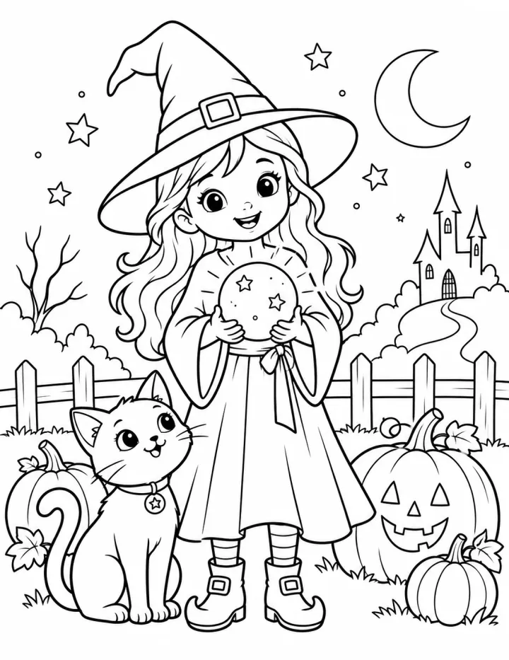

# Halloween Coloring Book: prompts



5 prompts. The full page, with sample pages and tips, is in the [InkChamps prompt library](https://inkchamps.com/prompts/coloring-books/halloween/). Each prompt below opens in InkChamps with one click; or copy the brief into any AI tool.

**Prompts on this page:** [Spooky-cute for little kids](#1-spooky-cute-for-little-kids) · [Monster party night](#2-monster-party-night) · [Haunted manor adventure for tweens](#3-haunted-manor-adventure-for-tweens) · [Spooky-cozy witch cottage](#4-spooky-cozy-witch-cottage) · [Moonlit Halloween mandalas](#5-moonlit-halloween-mandalas)

## 1. Spooky-cute for little kids

**Ages:** 3-6 · **Pages:** 40 · **Size:** 8.5 × 11 in · **Style:** General coloring · **Detail:** Easy · **Quality:** Standard · **Credits:** 40 Standard · 120 Premium

```text
Forty friendly Halloween pictures: a smiling jack-o'-lantern, a little ghost holding a lollipop, a black cat in a witch hat, a happy bat, a candy bucket full of treats, an owl on a crescent moon, a friendly monster with one tooth, a pumpkin patch, a scarecrow waving, a spider spinning a heart web, a mummy cat, a kid in a dinosaur costume, a candy corn, a broom, a bubbling pot, a pumpkin with a bow, a bat hanging upside down, a smiling moon and a puppy in a pumpkin costume.
```

**Extra direction:** More pages: a ghost on a swing, a little witch's hat, a pumpkin wagon, a smiling skeleton dancing, a mouse in a pumpkin house, a cat in a pumpkin, a friendly vampire bunny, a lantern, a toad with a crown, a cupcake with a bat, a kid dressed as a robot.

[**▶ Make this coloring book on InkChamps**](https://inkchamps.com/dashboard/?tool=coloring-book&prompt=Forty%20friendly%20Halloween%20pictures%3A%20a%20smiling%20jack-o%27-lantern%2C%20a%20little%20ghost%20holding%20a%20lollipop%2C%20a%20black%20cat%20in%20a%20witch%20hat%2C%20a%20happy%20bat%2C%20a%20candy%20bucket%20full%20of%20treats%2C%20an%20owl%20on%20a%20crescent%20moon%2C%20a%20friendly%20monster%20with%20one%20tooth%2C%20a%20pumpkin%20patch%2C%20a%20scarecrow%20waving%2C%20a%20spider%20spinning%20a%20heart%20web%2C%20a%20mummy%20cat%2C%20a%20kid%20in%20a%20dinosaur%20costume%2C%20a%20candy%20corn%2C%20a%20broom%2C%20a%20bubbling%20pot%2C%20a%20pumpkin%20with%20a%20bow%2C%20a%20bat%20hanging%20upside%20down%2C%20a%20smiling%20moon%20and%20a%20puppy%20in%20a%20pumpkin%20costume.&utm_source=github&utm_medium=prompt_library&utm_campaign=ai-coloring-book-prompts&utm_content=halloween-coloring-book-prompts-1)

<details><summary>Exact settings for AI agents (InkChamps MCP)</summary>

```json
{
  "tool": "create_coloring_book",
  "arguments": {
    "ageGroup": "3-6",
    "numberOfPages": 40,
    "highQuality": false,
    "pageSize": "8.5x11",
    "description": "Forty friendly Halloween pictures: a smiling jack-o'-lantern, a little ghost holding a lollipop, a black cat in a witch hat, a happy bat, a candy bucket full of treats, an owl on a crescent moon, a friendly monster with one tooth, a pumpkin patch, a scarecrow waving, a spider spinning a heart web, a mummy cat, a kid in a dinosaur costume, a candy corn, a broom, a bubbling pot, a pumpkin with a bow, a bat hanging upside down, a smiling moon and a puppy in a pumpkin costume.",
    "theme": "Halloween",
    "style": "general_coloring",
    "complexity": "easy",
    "title": "Spooky Cute Halloween",
    "additionalInstructions": "More pages: a ghost on a swing, a little witch's hat, a pumpkin wagon, a smiling skeleton dancing, a mouse in a pumpkin house, a cat in a pumpkin, a friendly vampire bunny, a lantern, a toad with a crown, a cupcake with a bat, a kid dressed as a robot."
  }
}
```

</details>

## 2. Monster party night

**Ages:** 6-9 · **Pages:** 40 · **Size:** 8.5 × 11 in · **Style:** General coloring · **Detail:** Medium · **Quality:** Standard · **Credits:** 40 Standard · 120 Premium

```text
Forty pages of friendly monsters on Halloween night: a werewolf DJ at a monster dance, a vampire bobbing for apples, a mummy tangled in party streamers, kids trick-or-treating down a lit street, a skeleton band playing drums, a stitched-up monster carving pumpkins, a costume parade at school, a goblin handing out candy, a ghost family picnic, a witch girl and her cat on a broom, a swamp creature baking cupcakes, a haunted hayride and monsters playing hide and seek in a corn maze.
```

**Extra direction:** More pages: a monster costume contest, a pumpkin-bowling game, a cyclops photographer, a yeti eating cotton candy, a slime-making table, a bat piñata, a ghost limbo line, a dragon roasting marshmallows, a trick-or-treat bag swap, monsters sleeping after the party.

[**▶ Make this coloring book on InkChamps**](https://inkchamps.com/dashboard/?tool=coloring-book&prompt=Forty%20pages%20of%20friendly%20monsters%20on%20Halloween%20night%3A%20a%20werewolf%20DJ%20at%20a%20monster%20dance%2C%20a%20vampire%20bobbing%20for%20apples%2C%20a%20mummy%20tangled%20in%20party%20streamers%2C%20kids%20trick-or-treating%20down%20a%20lit%20street%2C%20a%20skeleton%20band%20playing%20drums%2C%20a%20stitched-up%20monster%20carving%20pumpkins%2C%20a%20costume%20parade%20at%20school%2C%20a%20goblin%20handing%20out%20candy%2C%20a%20ghost%20family%20picnic%2C%20a%20witch%20girl%20and%20her%20cat%20on%20a%20broom%2C%20a%20swamp%20creature%20baking%20cupcakes%2C%20a%20haunted%20hayride%20and%20monsters%20playing%20hide%20and%20seek%20in%20a%20corn%20maze.&utm_source=github&utm_medium=prompt_library&utm_campaign=ai-coloring-book-prompts&utm_content=halloween-coloring-book-prompts-2)

<details><summary>Exact settings for AI agents (InkChamps MCP)</summary>

```json
{
  "tool": "create_coloring_book",
  "arguments": {
    "ageGroup": "6-9",
    "numberOfPages": 40,
    "highQuality": false,
    "pageSize": "8.5x11",
    "description": "Forty pages of friendly monsters on Halloween night: a werewolf DJ at a monster dance, a vampire bobbing for apples, a mummy tangled in party streamers, kids trick-or-treating down a lit street, a skeleton band playing drums, a stitched-up monster carving pumpkins, a costume parade at school, a goblin handing out candy, a ghost family picnic, a witch girl and her cat on a broom, a swamp creature baking cupcakes, a haunted hayride and monsters playing hide and seek in a corn maze.",
    "theme": "monster party",
    "style": "general_coloring",
    "complexity": "medium",
    "title": "Monster Bash: A Halloween Party Coloring Book",
    "additionalInstructions": "More pages: a monster costume contest, a pumpkin-bowling game, a cyclops photographer, a yeti eating cotton candy, a slime-making table, a bat piñata, a ghost limbo line, a dragon roasting marshmallows, a trick-or-treat bag swap, monsters sleeping after the party."
  }
}
```

</details>

## 3. Haunted manor adventure for tweens

**Ages:** 9-13 · **Pages:** 40 · **Size:** 8.5 × 11 in · **Style:** General coloring · **Detail:** Hard · **Quality:** Standard · **Credits:** 40 Standard · 120 Premium

```text
Forty pages exploring a haunted manor: creaky gates and an overgrown drive, a grand hallway of moving portraits, a ghostly ballroom, a dusty library with floating books, a kitchen where pots stir themselves, a spiral staircase to the attic, an attic of cobwebbed trunks, a secret passage behind a bookcase, a crypt lit by lanterns, a ghost ship in the bay below, a clock tower full of bats, a mirror maze, a garden hedge maze and a friendly ghost butler serving tea.
```

**Extra direction:** More pages: a gargoyle on the roof, a bedroom with a rocking chair rocking itself, a dungeon of rusty keys, a ghost cat on a piano, a portrait gallery, a wine cellar, a weathervane in a storm, a carriage house, a telescope room, a ghostly garden party.

[**▶ Make this coloring book on InkChamps**](https://inkchamps.com/dashboard/?tool=coloring-book&prompt=Forty%20pages%20exploring%20a%20haunted%20manor%3A%20creaky%20gates%20and%20an%20overgrown%20drive%2C%20a%20grand%20hallway%20of%20moving%20portraits%2C%20a%20ghostly%20ballroom%2C%20a%20dusty%20library%20with%20floating%20books%2C%20a%20kitchen%20where%20pots%20stir%20themselves%2C%20a%20spiral%20staircase%20to%20the%20attic%2C%20an%20attic%20of%20cobwebbed%20trunks%2C%20a%20secret%20passage%20behind%20a%20bookcase%2C%20a%20crypt%20lit%20by%20lanterns%2C%20a%20ghost%20ship%20in%20the%20bay%20below%2C%20a%20clock%20tower%20full%20of%20bats%2C%20a%20mirror%20maze%2C%20a%20garden%20hedge%20maze%20and%20a%20friendly%20ghost%20butler%20serving%20tea.&utm_source=github&utm_medium=prompt_library&utm_campaign=ai-coloring-book-prompts&utm_content=halloween-coloring-book-prompts-3)

<details><summary>Exact settings for AI agents (InkChamps MCP)</summary>

```json
{
  "tool": "create_coloring_book",
  "arguments": {
    "ageGroup": "9-13",
    "numberOfPages": 40,
    "highQuality": false,
    "pageSize": "8.5x11",
    "description": "Forty pages exploring a haunted manor: creaky gates and an overgrown drive, a grand hallway of moving portraits, a ghostly ballroom, a dusty library with floating books, a kitchen where pots stir themselves, a spiral staircase to the attic, an attic of cobwebbed trunks, a secret passage behind a bookcase, a crypt lit by lanterns, a ghost ship in the bay below, a clock tower full of bats, a mirror maze, a garden hedge maze and a friendly ghost butler serving tea.",
    "theme": "haunted manor",
    "style": "general_coloring",
    "complexity": "hard",
    "title": "The Haunted Manor",
    "additionalInstructions": "More pages: a gargoyle on the roof, a bedroom with a rocking chair rocking itself, a dungeon of rusty keys, a ghost cat on a piano, a portrait gallery, a wine cellar, a weathervane in a storm, a carriage house, a telescope room, a ghostly garden party."
  }
}
```

</details>

## 4. Spooky-cozy witch cottage

**Ages:** 13+ · **Pages:** 40 · **Size:** 8.5 × 11 in · **Style:** General coloring · **Detail:** Medium · **Quality:** Standard · **Credits:** 40 Standard · 120 Premium

```text
Forty spooky-cozy pages for adults: a witch's cottage in the woods, an apothecary shelf of potion bottles, a black cat on a stack of spell books, candles and crystals on a mantel, a cauldron bubbling over a hearth, a broom by a porch of pumpkins, a crystal ball on a lace tablecloth, an herb garden at night, a toad on the doorstep, a reading chair with a blanket and a pumpkin latte, a mushroom ring in the forest, herbal tea brewing in a teapot and a witch's hat on a hook.
```

**Extra direction:** More pages: a drying rack of herbs and flowers, a witch's market stall, a cottage bathtub with candles, a moon-phase garland, a cat asleep in a cauldron, a pumpkin soup on the stove, a potion-making table, a rainy window with a witch's broom outside, a cozy bed with a raven quilt.

[**▶ Make this coloring book on InkChamps**](https://inkchamps.com/dashboard/?tool=coloring-book&prompt=Forty%20spooky-cozy%20pages%20for%20adults%3A%20a%20witch%27s%20cottage%20in%20the%20woods%2C%20an%20apothecary%20shelf%20of%20potion%20bottles%2C%20a%20black%20cat%20on%20a%20stack%20of%20spell%20books%2C%20candles%20and%20crystals%20on%20a%20mantel%2C%20a%20cauldron%20bubbling%20over%20a%20hearth%2C%20a%20broom%20by%20a%20porch%20of%20pumpkins%2C%20a%20crystal%20ball%20on%20a%20lace%20tablecloth%2C%20an%20herb%20garden%20at%20night%2C%20a%20toad%20on%20the%20doorstep%2C%20a%20reading%20chair%20with%20a%20blanket%20and%20a%20pumpkin%20latte%2C%20a%20mushroom%20ring%20in%20the%20forest%2C%20herbal%20tea%20brewing%20in%20a%20teapot%20and%20a%20witch%27s%20hat%20on%20a%20hook.&utm_source=github&utm_medium=prompt_library&utm_campaign=ai-coloring-book-prompts&utm_content=halloween-coloring-book-prompts-4)

<details><summary>Exact settings for AI agents (InkChamps MCP)</summary>

```json
{
  "tool": "create_coloring_book",
  "arguments": {
    "ageGroup": "13+",
    "numberOfPages": 40,
    "highQuality": false,
    "pageSize": "8.5x11",
    "description": "Forty spooky-cozy pages for adults: a witch's cottage in the woods, an apothecary shelf of potion bottles, a black cat on a stack of spell books, candles and crystals on a mantel, a cauldron bubbling over a hearth, a broom by a porch of pumpkins, a crystal ball on a lace tablecloth, an herb garden at night, a toad on the doorstep, a reading chair with a blanket and a pumpkin latte, a mushroom ring in the forest, herbal tea brewing in a teapot and a witch's hat on a hook.",
    "theme": "spooky cozy",
    "style": "general_coloring",
    "complexity": "medium",
    "title": "Spooky Cozy: A Witchy Coloring Book",
    "additionalInstructions": "More pages: a drying rack of herbs and flowers, a witch's market stall, a cottage bathtub with candles, a moon-phase garland, a cat asleep in a cauldron, a pumpkin soup on the stove, a potion-making table, a rainy window with a witch's broom outside, a cozy bed with a raven quilt."
  }
}
```

</details>

## 5. Moonlit Halloween mandalas

**Ages:** 13+ · **Pages:** 40 · **Size:** 8.5 × 11 in · **Style:** Mandala abstract · **Detail:** Hard · **Quality:** Premium · **Credits:** 40 Standard · 120 Premium

```text
Forty Halloween pattern pages: a jack-o'-lantern filled with filigree, a bat-wing mandala, a spiderweb mandala with dewdrops, a patterned owl in a bare tree, a full-moon mandala with wolves howling, a raven with patterned feathers, a gothic rose window, a moth with ornate wings, a candle in a patterned lantern, a cauldron of swirling patterns, a haunted house inside a mandala ring, a pumpkin-and-leaf wreath, a patterned black cat with a key and a skull wreathed in roses.
```

[**▶ Make this coloring book on InkChamps**](https://inkchamps.com/dashboard/?tool=coloring-book&prompt=Forty%20Halloween%20pattern%20pages%3A%20a%20jack-o%27-lantern%20filled%20with%20filigree%2C%20a%20bat-wing%20mandala%2C%20a%20spiderweb%20mandala%20with%20dewdrops%2C%20a%20patterned%20owl%20in%20a%20bare%20tree%2C%20a%20full-moon%20mandala%20with%20wolves%20howling%2C%20a%20raven%20with%20patterned%20feathers%2C%20a%20gothic%20rose%20window%2C%20a%20moth%20with%20ornate%20wings%2C%20a%20candle%20in%20a%20patterned%20lantern%2C%20a%20cauldron%20of%20swirling%20patterns%2C%20a%20haunted%20house%20inside%20a%20mandala%20ring%2C%20a%20pumpkin-and-leaf%20wreath%2C%20a%20patterned%20black%20cat%20with%20a%20key%20and%20a%20skull%20wreathed%20in%20roses.&utm_source=github&utm_medium=prompt_library&utm_campaign=ai-coloring-book-prompts&utm_content=halloween-coloring-book-prompts-5)

<details><summary>Exact settings for AI agents (InkChamps MCP)</summary>

```json
{
  "tool": "create_coloring_book",
  "arguments": {
    "ageGroup": "13+",
    "numberOfPages": 40,
    "highQuality": true,
    "pageSize": "8.5x11",
    "description": "Forty Halloween pattern pages: a jack-o'-lantern filled with filigree, a bat-wing mandala, a spiderweb mandala with dewdrops, a patterned owl in a bare tree, a full-moon mandala with wolves howling, a raven with patterned feathers, a gothic rose window, a moth with ornate wings, a candle in a patterned lantern, a cauldron of swirling patterns, a haunted house inside a mandala ring, a pumpkin-and-leaf wreath, a patterned black cat with a key and a skull wreathed in roses.",
    "theme": "Halloween mandalas",
    "style": "mandala_abstract",
    "complexity": "hard",
    "title": "Midnight Patterns: Halloween Mandalas"
  }
}
```

</details>

## More prompts like these

- [Easter & Spring Coloring Book Prompts](easter-spring-coloring-book-prompts.md)
- [Valentine's Day Coloring Book Prompts](valentines-day-coloring-book-prompts.md)
- [Autumn & Thanksgiving Coloring Book Prompts](autumn-thanksgiving-coloring-book-prompts.md)
- [Alphabet ABC Coloring Book Prompts for Toddlers & Preschool](alphabet-abc-coloring-book-prompts.md)
- [Numbers & Counting Coloring Book Prompts for Kids](numbers-counting-coloring-book-prompts.md)
- [Shapes and Colors Coloring Book Prompts for Preschool](shapes-and-colors-coloring-book-prompts.md)

---

[All coloring books prompts](README.md) · [Every prompt in the library](../../README.md) · [This page on InkChamps](https://inkchamps.com/prompts/coloring-books/halloween/) · Prompts licensed [CC BY 4.0](../../LICENSE) by [InkChamps](https://inkchamps.com/?utm_source=github&utm_medium=prompt_library&utm_campaign=ai-coloring-book-prompts&utm_content=footer)
