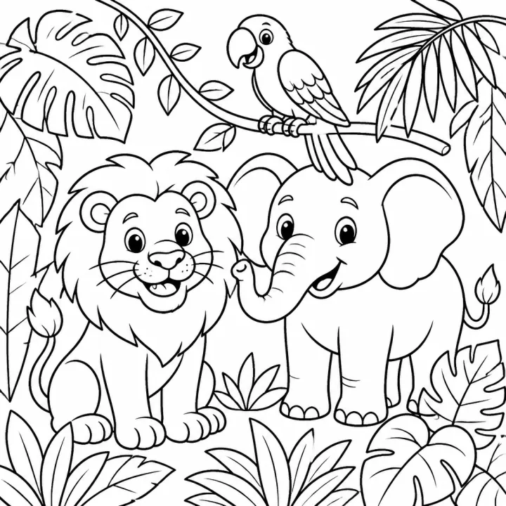

# Jungle & Safari Animal Coloring Book: prompts



5 prompts. The full page, with sample pages and tips, is in the [InkChamps prompt library](https://inkchamps.com/prompts/coloring-books/jungle-safari/). Each prompt below opens in InkChamps with one click; or copy the brief into any AI tool.

**Prompts on this page:** [Baby safari animals with mom](#1-baby-safari-animals-with-mom) · [Jungle explorer adventure](#2-jungle-explorer-adventure) · [Rainforest animals layer by layer](#3-rainforest-animals-layer-by-layer) · [Savanna wildlife and the great migration](#4-savanna-wildlife-and-the-great-migration) · [Safari animal mandalas for adults](#5-safari-animal-mandalas-for-adults)

## 1. Baby safari animals with mom

**Ages:** 3-6 · **Pages:** 40 · **Size:** 8.5 × 8.5 in · **Style:** Cute animals · **Detail:** Easy · **Quality:** Standard · **Credits:** 40 Standard · 120 Premium

```text
Forty pages of baby wild animals, many with their mothers: a lion cub with its mother, an elephant calf holding its mother's tail, a baby giraffe, a zebra foal, a baby hippo in the water, a rhino calf, a tiger cub in the grass, a baby monkey on its mother's back, a baby gorilla, a cheetah cub, a baby sloth on a branch, a toucan chick, a meerkat pup, and a baby flamingo.
```

**Extra direction:** More pages: a baby panda, a koala joey, a baby orangutan, a baby crocodile hatching, a lemur baby, a warthog piglet, a baby ostrich, a baby leopard in a tree, a hippo calf yawning, a baby kangaroo in a pouch, an elephant calf splashing, a giraffe calf with a bird on its neck, a baby chimp with a banana, a mother lion licking her cub.

[**▶ Make this coloring book on InkChamps**](https://inkchamps.com/dashboard/?tool=coloring-book&prompt=Forty%20pages%20of%20baby%20wild%20animals%2C%20many%20with%20their%20mothers%3A%20a%20lion%20cub%20with%20its%20mother%2C%20an%20elephant%20calf%20holding%20its%20mother%27s%20tail%2C%20a%20baby%20giraffe%2C%20a%20zebra%20foal%2C%20a%20baby%20hippo%20in%20the%20water%2C%20a%20rhino%20calf%2C%20a%20tiger%20cub%20in%20the%20grass%2C%20a%20baby%20monkey%20on%20its%20mother%27s%20back%2C%20a%20baby%20gorilla%2C%20a%20cheetah%20cub%2C%20a%20baby%20sloth%20on%20a%20branch%2C%20a%20toucan%20chick%2C%20a%20meerkat%20pup%2C%20and%20a%20baby%20flamingo.&utm_source=github&utm_medium=prompt_library&utm_campaign=ai-coloring-book-prompts&utm_content=jungle-safari-coloring-book-prompts-1)

<details><summary>Exact settings for AI agents (InkChamps MCP)</summary>

```json
{
  "tool": "create_coloring_book",
  "arguments": {
    "ageGroup": "3-6",
    "numberOfPages": 40,
    "highQuality": false,
    "pageSize": "8.5x8.5",
    "description": "Forty pages of baby wild animals, many with their mothers: a lion cub with its mother, an elephant calf holding its mother's tail, a baby giraffe, a zebra foal, a baby hippo in the water, a rhino calf, a tiger cub in the grass, a baby monkey on its mother's back, a baby gorilla, a cheetah cub, a baby sloth on a branch, a toucan chick, a meerkat pup, and a baby flamingo.",
    "style": "cute_animals",
    "complexity": "easy",
    "theme": "baby jungle and safari animals",
    "title": "Baby Safari Animals Coloring Book",
    "additionalInstructions": "More pages: a baby panda, a koala joey, a baby orangutan, a baby crocodile hatching, a lemur baby, a warthog piglet, a baby ostrich, a baby leopard in a tree, a hippo calf yawning, a baby kangaroo in a pouch, an elephant calf splashing, a giraffe calf with a bird on its neck, a baby chimp with a banana, a mother lion licking her cub."
  }
}
```

</details>

## 2. Jungle explorer adventure

**Ages:** 6-9 · **Pages:** 40 · **Size:** 8.5 × 11 in · **Style:** Jungle adventure · **Detail:** Medium · **Quality:** Standard · **Credits:** 40 Standard · 120 Premium

```text
Forty pages of kids exploring the jungle: packing a backpack with binoculars and a compass, a jeep on a muddy track, a canoe on a jungle river, a rope bridge over a gorge, a tree house camp, a hidden temple in vines, a waterfall swim, spotting a jaguar through binoculars, a parrot landing on a hat, crossing stepping stones past a crocodile, a campfire at night, and a hot air balloon over the treetops.
```

**Extra direction:** More pages: a jungle map, a monkey stealing a banana from the tent, a giant leaf as an umbrella, a butterfly garden, tracking footprints in mud, a vine swing, an explorer sketching a tapir, a night walk with flashlights and frogs, a river boat with a capybara, a tree with a hornbill, a cave of bats, a jungle market, a ranger station, fixing a flat tyre, a sunset over the canopy, going home with photos.

[**▶ Make this coloring book on InkChamps**](https://inkchamps.com/dashboard/?tool=coloring-book&prompt=Forty%20pages%20of%20kids%20exploring%20the%20jungle%3A%20packing%20a%20backpack%20with%20binoculars%20and%20a%20compass%2C%20a%20jeep%20on%20a%20muddy%20track%2C%20a%20canoe%20on%20a%20jungle%20river%2C%20a%20rope%20bridge%20over%20a%20gorge%2C%20a%20tree%20house%20camp%2C%20a%20hidden%20temple%20in%20vines%2C%20a%20waterfall%20swim%2C%20spotting%20a%20jaguar%20through%20binoculars%2C%20a%20parrot%20landing%20on%20a%20hat%2C%20crossing%20stepping%20stones%20past%20a%20crocodile%2C%20a%20campfire%20at%20night%2C%20and%20a%20hot%20air%20balloon%20over%20the%20treetops.&utm_source=github&utm_medium=prompt_library&utm_campaign=ai-coloring-book-prompts&utm_content=jungle-safari-coloring-book-prompts-2)

<details><summary>Exact settings for AI agents (InkChamps MCP)</summary>

```json
{
  "tool": "create_coloring_book",
  "arguments": {
    "ageGroup": "6-9",
    "numberOfPages": 40,
    "highQuality": false,
    "pageSize": "8.5x11",
    "description": "Forty pages of kids exploring the jungle: packing a backpack with binoculars and a compass, a jeep on a muddy track, a canoe on a jungle river, a rope bridge over a gorge, a tree house camp, a hidden temple in vines, a waterfall swim, spotting a jaguar through binoculars, a parrot landing on a hat, crossing stepping stones past a crocodile, a campfire at night, and a hot air balloon over the treetops.",
    "style": "jungle_adventure",
    "complexity": "medium",
    "theme": "kids exploring the jungle",
    "title": "Jungle Explorers Coloring Book",
    "additionalInstructions": "More pages: a jungle map, a monkey stealing a banana from the tent, a giant leaf as an umbrella, a butterfly garden, tracking footprints in mud, a vine swing, an explorer sketching a tapir, a night walk with flashlights and frogs, a river boat with a capybara, a tree with a hornbill, a cave of bats, a jungle market, a ranger station, fixing a flat tyre, a sunset over the canopy, going home with photos."
  }
}
```

</details>

## 3. Rainforest animals layer by layer

**Ages:** 9-13 · **Pages:** 40 · **Size:** 8.5 × 11 in · **Style:** Jungle adventure · **Detail:** Hard · **Quality:** Standard · **Credits:** 40 Standard · 120 Premium

```text
Forty rainforest pages from treetops to river: in the emergent layer, a harpy eagle and a blue morpho butterfly; in the canopy, a toucan, scarlet macaws, a howler monkey, a three-toed sloth, a tree python; in the understory, a jaguar on a branch, a poison dart frog, a red-eyed tree frog, a chameleon; on the forest floor, leafcutter ants, a tapir, an okapi, a giant anteater; in the river, an anaconda, a caiman, a pink river dolphin and a capybara.
```

**Extra direction:** More pages: an orangutan, a gorilla family, a gibbon swinging, a hornbill, a tarsier, a clouded leopard, a pangolin, a Goliath birdeater spider, a glass frog, a hummingbird at a heliconia flower, an orchid with an orchid mantis, a rafflesia flower, an Amazon river cross-section, a strangler fig, a buttress root forest, a rainforest at night.

[**▶ Make this coloring book on InkChamps**](https://inkchamps.com/dashboard/?tool=coloring-book&prompt=Forty%20rainforest%20pages%20from%20treetops%20to%20river%3A%20in%20the%20emergent%20layer%2C%20a%20harpy%20eagle%20and%20a%20blue%20morpho%20butterfly%3B%20in%20the%20canopy%2C%20a%20toucan%2C%20scarlet%20macaws%2C%20a%20howler%20monkey%2C%20a%20three-toed%20sloth%2C%20a%20tree%20python%3B%20in%20the%20understory%2C%20a%20jaguar%20on%20a%20branch%2C%20a%20poison%20dart%20frog%2C%20a%20red-eyed%20tree%20frog%2C%20a%20chameleon%3B%20on%20the%20forest%20floor%2C%20leafcutter%20ants%2C%20a%20tapir%2C%20an%20okapi%2C%20a%20giant%20anteater%3B%20in%20the%20river%2C%20an%20anaconda%2C%20a%20caiman%2C%20a%20pink%20river%20dolphin%20and%20a%20capybara.&utm_source=github&utm_medium=prompt_library&utm_campaign=ai-coloring-book-prompts&utm_content=jungle-safari-coloring-book-prompts-3)

<details><summary>Exact settings for AI agents (InkChamps MCP)</summary>

```json
{
  "tool": "create_coloring_book",
  "arguments": {
    "ageGroup": "9-13",
    "numberOfPages": 40,
    "highQuality": false,
    "pageSize": "8.5x11",
    "description": "Forty rainforest pages from treetops to river: in the emergent layer, a harpy eagle and a blue morpho butterfly; in the canopy, a toucan, scarlet macaws, a howler monkey, a three-toed sloth, a tree python; in the understory, a jaguar on a branch, a poison dart frog, a red-eyed tree frog, a chameleon; on the forest floor, leafcutter ants, a tapir, an okapi, a giant anteater; in the river, an anaconda, a caiman, a pink river dolphin and a capybara.",
    "style": "jungle_adventure",
    "complexity": "hard",
    "theme": "rainforest animals by layer",
    "title": "Rainforest Layers Coloring Book",
    "additionalInstructions": "More pages: an orangutan, a gorilla family, a gibbon swinging, a hornbill, a tarsier, a clouded leopard, a pangolin, a Goliath birdeater spider, a glass frog, a hummingbird at a heliconia flower, an orchid with an orchid mantis, a rafflesia flower, an Amazon river cross-section, a strangler fig, a buttress root forest, a rainforest at night."
  }
}
```

</details>

## 4. Savanna wildlife and the great migration

**Ages:** 9-13 · **Pages:** 40 · **Size:** 8.5 × 11 in · **Style:** General coloring · **Detail:** Hard · **Quality:** Standard · **Credits:** 40 Standard · 120 Premium

```text
Forty savanna scenes: a wildebeest herd crossing a river with crocodiles, zebras at a watering hole, a cheetah sprinting after a gazelle, a lion pride resting on a rock, elephants at a mud bath, giraffes browsing an acacia, a rhino with oxpeckers, a meerkat lookout, a leopard in a sausage tree, a hippo yawning, an ostrich running, a warthog family, hyenas, vultures on a dead tree, and a baobab at sunset.
```

**Extra direction:** More pages: a herd of buffalo, a secretary bird stomping a snake, an African wild dog pack, a kudu with spiral horns, a Maasai giraffe and calf, a lilac-breasted roller, a dung beetle with its ball, a termite mound, an eland, a serval in tall grass, a flamingo lake, a hot air balloon over the plains, a ranger jeep at dawn, a lightning storm over the savanna, Kilimanjaro behind an elephant herd.

[**▶ Make this coloring book on InkChamps**](https://inkchamps.com/dashboard/?tool=coloring-book&prompt=Forty%20savanna%20scenes%3A%20a%20wildebeest%20herd%20crossing%20a%20river%20with%20crocodiles%2C%20zebras%20at%20a%20watering%20hole%2C%20a%20cheetah%20sprinting%20after%20a%20gazelle%2C%20a%20lion%20pride%20resting%20on%20a%20rock%2C%20elephants%20at%20a%20mud%20bath%2C%20giraffes%20browsing%20an%20acacia%2C%20a%20rhino%20with%20oxpeckers%2C%20a%20meerkat%20lookout%2C%20a%20leopard%20in%20a%20sausage%20tree%2C%20a%20hippo%20yawning%2C%20an%20ostrich%20running%2C%20a%20warthog%20family%2C%20hyenas%2C%20vultures%20on%20a%20dead%20tree%2C%20and%20a%20baobab%20at%20sunset.&utm_source=github&utm_medium=prompt_library&utm_campaign=ai-coloring-book-prompts&utm_content=jungle-safari-coloring-book-prompts-4)

<details><summary>Exact settings for AI agents (InkChamps MCP)</summary>

```json
{
  "tool": "create_coloring_book",
  "arguments": {
    "ageGroup": "9-13",
    "numberOfPages": 40,
    "highQuality": false,
    "pageSize": "8.5x11",
    "description": "Forty savanna scenes: a wildebeest herd crossing a river with crocodiles, zebras at a watering hole, a cheetah sprinting after a gazelle, a lion pride resting on a rock, elephants at a mud bath, giraffes browsing an acacia, a rhino with oxpeckers, a meerkat lookout, a leopard in a sausage tree, a hippo yawning, an ostrich running, a warthog family, hyenas, vultures on a dead tree, and a baobab at sunset.",
    "style": "general_coloring",
    "complexity": "hard",
    "theme": "African savanna wildlife",
    "title": "Savanna Safari Coloring Book",
    "additionalInstructions": "More pages: a herd of buffalo, a secretary bird stomping a snake, an African wild dog pack, a kudu with spiral horns, a Maasai giraffe and calf, a lilac-breasted roller, a dung beetle with its ball, a termite mound, an eland, a serval in tall grass, a flamingo lake, a hot air balloon over the plains, a ranger jeep at dawn, a lightning storm over the savanna, Kilimanjaro behind an elephant herd."
  }
}
```

</details>

## 5. Safari animal mandalas for adults

**Ages:** 13+ · **Pages:** 40 · **Size:** 8.5 × 11 in · **Style:** Mandala animal · **Detail:** Hard · **Quality:** Premium · **Credits:** 40 Standard · 120 Premium

```text
Forty patterned safari and jungle animals for adult colorists: an elephant head with a mandala on its ears, a lion with a mane of leaves and flowers, a giraffe with geometric spots, a zebra with swirling stripes, a cheetah lying on a branch, a rhino with swirl patterns, a tiger among monstera leaves, a gorilla portrait, a leopard face, a flamingo pair forming a heart, and a hippo in a lotus pond.
```

**Extra direction:** More pages: a toucan on a flowering branch, a chameleon on a vine, a crocodile with scale patterns, a meerkat family, an orangutan in ferns, a snow-white egret, a jaguar by a waterfall, a gazelle leaping, an elephant and calf, a lion and lioness, a baobab tree with stars, an acacia sunset, a parrot pair, a sloth hanging from a flowered branch, a peacock in palm leaves.

[**▶ Make this coloring book on InkChamps**](https://inkchamps.com/dashboard/?tool=coloring-book&prompt=Forty%20patterned%20safari%20and%20jungle%20animals%20for%20adult%20colorists%3A%20an%20elephant%20head%20with%20a%20mandala%20on%20its%20ears%2C%20a%20lion%20with%20a%20mane%20of%20leaves%20and%20flowers%2C%20a%20giraffe%20with%20geometric%20spots%2C%20a%20zebra%20with%20swirling%20stripes%2C%20a%20cheetah%20lying%20on%20a%20branch%2C%20a%20rhino%20with%20swirl%20patterns%2C%20a%20tiger%20among%20monstera%20leaves%2C%20a%20gorilla%20portrait%2C%20a%20leopard%20face%2C%20a%20flamingo%20pair%20forming%20a%20heart%2C%20and%20a%20hippo%20in%20a%20lotus%20pond.&utm_source=github&utm_medium=prompt_library&utm_campaign=ai-coloring-book-prompts&utm_content=jungle-safari-coloring-book-prompts-5)

<details><summary>Exact settings for AI agents (InkChamps MCP)</summary>

```json
{
  "tool": "create_coloring_book",
  "arguments": {
    "ageGroup": "13+",
    "numberOfPages": 40,
    "highQuality": true,
    "pageSize": "8.5x11",
    "description": "Forty patterned safari and jungle animals for adult colorists: an elephant head with a mandala on its ears, a lion with a mane of leaves and flowers, a giraffe with geometric spots, a zebra with swirling stripes, a cheetah lying on a branch, a rhino with swirl patterns, a tiger among monstera leaves, a gorilla portrait, a leopard face, a flamingo pair forming a heart, and a hippo in a lotus pond.",
    "style": "mandala_animal",
    "complexity": "hard",
    "theme": "safari animal mandalas",
    "title": "Safari Mandalas: Adult Coloring Book",
    "additionalInstructions": "More pages: a toucan on a flowering branch, a chameleon on a vine, a crocodile with scale patterns, a meerkat family, an orangutan in ferns, a snow-white egret, a jaguar by a waterfall, a gazelle leaping, an elephant and calf, a lion and lioness, a baobab tree with stars, an acacia sunset, a parrot pair, a sloth hanging from a flowered branch, a peacock in palm leaves."
  }
}
```

</details>

## More prompts like these

- [Cat Coloring Book Prompts: Kittens, Cozy Cats & Cat Mandalas](cat-coloring-book-prompts.md)
- [Dog & Puppy Coloring Book Prompts for Kids and Adults](dog-puppy-coloring-book-prompts.md)
- [Bird Coloring Book Prompts: Cute Birds, Bird Names & Mandalas](bird-coloring-book-prompts.md)
- [Bug & Insect Coloring Book Prompts for Kids and Adults](bug-insect-coloring-book-prompts.md)
- [Space Coloring Book Prompts: Planets, Astronauts & Aliens](space-coloring-book-prompts.md)
- [Vehicle Coloring Book Prompts: Trucks, Diggers, Trains & Cars](vehicle-coloring-book-prompts.md)

---

[All coloring books prompts](README.md) · [Every prompt in the library](../../README.md) · [This page on InkChamps](https://inkchamps.com/prompts/coloring-books/jungle-safari/) · Prompts licensed [CC BY 4.0](../../LICENSE) by [InkChamps](https://inkchamps.com/?utm_source=github&utm_medium=prompt_library&utm_campaign=ai-coloring-book-prompts&utm_content=footer)
