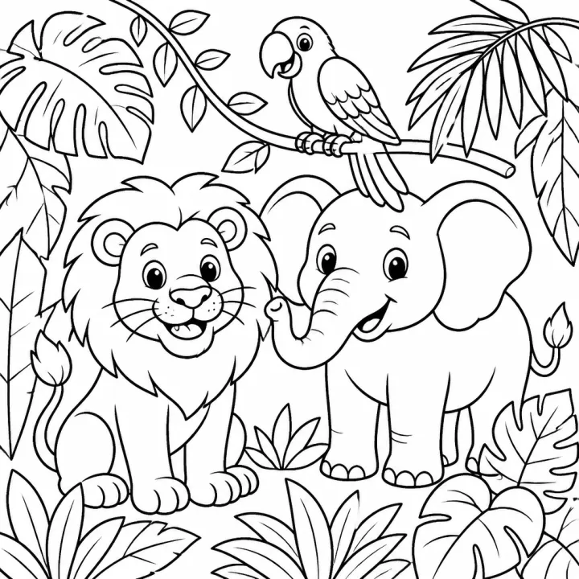

# Jungle & Safari Animal Coloring Book: prompts



5 prompts. The full page, with sample pages and tips, is in the [InkChamps prompt library](https://inkchamps.com/prompts/coloring-books/jungle-safari/). Each prompt below opens in InkChamps with one click; or copy the brief into any AI tool.

**Prompts on this page:** [Baby safari animals with mom](#1-baby-safari-animals-with-mom) · [Jungle explorer adventure](#2-jungle-explorer-adventure) · [Rainforest animals layer by layer](#3-rainforest-animals-layer-by-layer) · [Savanna wildlife and the great migration](#4-savanna-wildlife-and-the-great-migration) · [Safari animal mandalas for adults](#5-safari-animal-mandalas-for-adults)

## 1. Baby safari animals with mom

**Ages:** 3-6 · **Pages:** 24 · **Size:** 8.5 × 8.5 in · **Style:** Cute animals · **Detail:** Easy · **Quality:** Standard · **Credits:** 24 Standard · 72 Premium

```text
24 pages of chubby baby jungle and safari animals, most of them with their mothers: a lion cub snuggled by its mother, an elephant calf holding its mother's tail, a baby giraffe, a zebra foal, a baby hippo in the water, a rhino calf, a tiger cub in the grass, a baby monkey on its mother's back, a baby gorilla, a cheetah cub, a baby sloth, a toucan chick, meerkat pups, a baby flamingo, a crocodile hatching and a baby chimp with a banana.
```

### Page by page (24 pages)

Paste one page at a time into ChatGPT, Gemini or any AI image tool, with this line after it:

> Black-and-white coloring page for a child aged 3 to 6: one big, cute, chubby cartoon baby animal (with its mother where named) filling most of the page, thick bold outlines, large simple shapes with wide spaces to color, very little background, no shading, no grey, no words, plain white background, square page.

1. A fluffy lion cub curled up asleep between its mother's big front paws, the mother lion resting her chin gently on top of its head, a few tufts of grass around them.
2. A mother lion licking her cub's head with her big tongue while the cub squeezes its eyes shut and giggles, a flat rock behind them.
3. A baby elephant walking behind its mother, holding the end of her tail with its little trunk, both with big floppy ears and round feet.
4. A baby elephant splashing in a shallow pond, spraying water up from its trunk in a big arc, round droplets falling all around it.
5. A baby giraffe standing on wobbly long legs beside its tall mother, a little bird perched on its neck and an acacia tree beside them.
6. A striped zebra foal lying in the grass with its head on its mother's leg, its short fuzzy mane sticking straight up.
7. A round baby hippo floating in the water on its mother's back, only their ears, eyes and noses above the surface, two lily pads beside them.
8. A baby hippo opening its mouth in a huge yawn on a muddy riverbank, its tiny teeth showing and a butterfly landing on its nose.
9. A chubby rhino calf nuzzling its mother's side, both with little horns, a small bird sitting on the mother's back.
10. A stripy tiger cub peeking out of tall grass with its paws in front, its mother's big striped tail curling beside it.
11. A baby monkey riding on its mother's back and hugging her neck as she climbs a thick jungle vine, two big leaves beside them.
12. A baby gorilla sitting in its mother's lap, holding a leaf over its head like a hat, a fern behind them.
13. A spotted cheetah cub with a fluffy back tumbling over its mother's tail as she lies on a low mound, paws in the air.
14. A baby sloth hanging upside down from a branch, hugging its mother's tummy, both smiling with sleepy eyes.
15. A little toucan chick sitting in a round tree hole, its big beak poking out, its mother perched on the branch above with a berry.
16. Three meerkat pups standing up in a row beside their mother at the edge of a sandy burrow, all looking the same way.
17. A fluffy baby flamingo standing on one leg next to its tall mother in shallow water, copying her pose.
18. A baby crocodile hatching from a round egg on a sandy nest, its little head and front feet poking out of the cracked shell, its mother watching gently.
19. A baby chimpanzee sitting on a log holding a big banana with both hands, peel hanging down, its mother sitting beside it.
20. A baby orangutan with fuzzy hair hanging from one long arm on a branch, its mother holding its other hand.
21. A ring-tailed lemur baby clinging to its mother's back, their two striped tails curling up in matching spirals.
22. A spotted baby leopard napping along a thick tree branch, legs dangling down on each side, a few leaves around it.
23. A warthog piglet trotting behind its mother with its thin tail straight up in the air like a little flag, small stones on the path.
24. A baby elephant fast asleep lying against its mother's legs under a big round moon, a few simple stars in the sky.

[**▶ Make this coloring book on InkChamps**](https://inkchamps.com/dashboard/?tool=coloring-book&prompt=24%20pages%20of%20chubby%20baby%20jungle%20and%20safari%20animals%2C%20most%20of%20them%20with%20their%20mothers%3A%20a%20lion%20cub%20snuggled%20by%20its%20mother%2C%20an%20elephant%20calf%20holding%20its%20mother%27s%20tail%2C%20a%20baby%20giraffe%2C%20a%20zebra%20foal%2C%20a%20baby%20hippo%20in%20the%20water%2C%20a%20rhino%20calf%2C%20a%20tiger%20cub%20in%20the%20grass%2C%20a%20baby%20monkey%20on%20its%20mother%27s%20back%2C%20a%20baby%20gorilla%2C%20a%20cheetah%20cub%2C%20a%20baby%20sloth%2C%20a%20toucan%20chick%2C%20meerkat%20pups%2C%20a%20baby%20flamingo%2C%20a%20crocodile%20hatching%20and%20a%20baby%20chimp%20with%20a%20banana.&utm_source=github&utm_medium=prompt_library&utm_campaign=ai-coloring-book-prompts&utm_content=jungle-safari-coloring-book-prompts-1)

<details><summary>Exact settings for AI agents (InkChamps MCP)</summary>

```json
{
  "tool": "create_coloring_book",
  "arguments": {
    "ageGroup": "3-6",
    "numberOfPages": 24,
    "highQuality": false,
    "pageSize": "8.5x8.5",
    "description": "24 pages of chubby baby jungle and safari animals, most of them with their mothers: a lion cub snuggled by its mother, an elephant calf holding its mother's tail, a baby giraffe, a zebra foal, a baby hippo in the water, a rhino calf, a tiger cub in the grass, a baby monkey on its mother's back, a baby gorilla, a cheetah cub, a baby sloth, a toucan chick, meerkat pups, a baby flamingo, a crocodile hatching and a baby chimp with a banana.",
    "style": "cute_animals",
    "complexity": "easy",
    "theme": "baby jungle and safari animals",
    "title": "Baby Safari Animals Coloring Book"
  }
}
```

</details>

## 2. Jungle explorer adventure

**Ages:** 6-9 · **Pages:** 24 · **Size:** 8.5 × 11 in · **Style:** Jungle adventure · **Detail:** Medium · **Quality:** Standard · **Credits:** 24 Standard · 72 Premium

```text
24 pages that follow two kids on a jungle trip from start to finish: packing a backpack with binoculars and a compass, a jeep on a muddy track, a canoe on a jungle river, a rope bridge over a gorge, a tree house camp, a hidden stone temple in vines, a waterfall swim, spotting a jaguar through binoculars, a parrot landing on a hat, a vine swing, a night walk with flashlights, a hot air balloon over the treetops and going home with photos.
```

### Page by page (24 pages)

Paste one page at a time into ChatGPT, Gemini or any AI image tool, with this line after it:

> Black-and-white coloring page for a child aged 6 to 9: friendly cartoon kid explorers and jungle animals, clear bold outlines, medium detail with a simple jungle background that shows where the scene happens, no shading, no grey, no words or letters, plain white background, portrait 8.5 x 11 page.

1. Two kid explorers in sun hats packing a big backpack on a bedroom floor: binoculars, a compass, a water bottle, a flashlight and a rolled-up map.
2. The kids kneeling over a big treasure-style jungle map spread on the ground, pointing at a river, a waterfall and a temple drawn on it, a compass holding down one corner.
3. An open-top jeep bouncing along a muddy jungle track, the kids waving from the back seat, big leaves brushing the sides and mud splashing from the wheels.
4. One kid kneeling to fix a flat tyre on the jeep with a wrench while the other holds the spare wheel, a curious monkey watching from a branch.
5. The two kids paddling a canoe down a wide jungle river, a capybara resting on the bank and a heron standing in the reeds.
6. A kid explorer walking carefully across a swaying rope bridge over a deep gorge, holding both rope rails, a river far below.
7. A tree house camp high in a giant tree, with a rope ladder, a little roof made of palm leaves and a hammock strung beside it.
8. A cheeky monkey sneaking out of a tent flap holding a stolen banana, a kid explorer in pajamas chasing after it with a surprised face.
9. The kids kneeling by a muddy trail, one measuring a big paw print with a ruler, the other comparing it to a picture in a notebook.
10. A kid explorer lying in the grass looking through binoculars at a spotted jaguar resting on a far tree branch.
11. A bright parrot landing on a kid explorer's sun hat, its wings still spread, the kid looking up with a big grin.
12. A kid explorer swinging across a stream on a thick jungle vine, legs kicking, the friend cheering from a mossy rock.
13. The kids holding a giant leaf over their heads as an umbrella while heavy rain pours down around them.
14. A kid explorer hopping across stepping stones in a river while a sleepy crocodile floats nearby with only its eyes above the water.
15. A hidden stone temple covered in twisting vines and roots, with wide steps up to a dark doorway and the kids peeking around a tree.
16. The kids splashing in a pool at the bottom of a tall waterfall, rocks around the edge and ferns growing from the cliff.
17. A kid explorer sitting on a log sketching a tapir in a notebook as it munches leaves at the edge of the clearing.
18. A butterfly garden in a sunny clearing, dozens of big butterflies around tall flowers, one landing on a kid's outstretched finger.
19. The kids peering into a rocky cave with a flashlight, a row of bats hanging upside down from the ceiling.
20. A friendly park ranger at a small wooden ranger station showing the kids a big feather, a radio and binoculars on the table.
21. A night walk: the kids shining flashlights on a branch where two tree frogs sit, with fireflies and a round moon above.
22. The kids sitting by a small campfire outside their tent, toasting bananas on sticks, an owl watching from a branch.
23. A hot air balloon floating over the jungle treetops at sunrise, the two kids waving from the basket as a hornbill flies past.
24. The kids back home on the sofa looking through a photo album of their trip, the backpack and sun hats on the floor beside them.

[**▶ Make this coloring book on InkChamps**](https://inkchamps.com/dashboard/?tool=coloring-book&prompt=24%20pages%20that%20follow%20two%20kids%20on%20a%20jungle%20trip%20from%20start%20to%20finish%3A%20packing%20a%20backpack%20with%20binoculars%20and%20a%20compass%2C%20a%20jeep%20on%20a%20muddy%20track%2C%20a%20canoe%20on%20a%20jungle%20river%2C%20a%20rope%20bridge%20over%20a%20gorge%2C%20a%20tree%20house%20camp%2C%20a%20hidden%20stone%20temple%20in%20vines%2C%20a%20waterfall%20swim%2C%20spotting%20a%20jaguar%20through%20binoculars%2C%20a%20parrot%20landing%20on%20a%20hat%2C%20a%20vine%20swing%2C%20a%20night%20walk%20with%20flashlights%2C%20a%20hot%20air%20balloon%20over%20the%20treetops%20and%20going%20home%20with%20photos.&utm_source=github&utm_medium=prompt_library&utm_campaign=ai-coloring-book-prompts&utm_content=jungle-safari-coloring-book-prompts-2)

<details><summary>Exact settings for AI agents (InkChamps MCP)</summary>

```json
{
  "tool": "create_coloring_book",
  "arguments": {
    "ageGroup": "6-9",
    "numberOfPages": 24,
    "highQuality": false,
    "pageSize": "8.5x11",
    "description": "24 pages that follow two kids on a jungle trip from start to finish: packing a backpack with binoculars and a compass, a jeep on a muddy track, a canoe on a jungle river, a rope bridge over a gorge, a tree house camp, a hidden stone temple in vines, a waterfall swim, spotting a jaguar through binoculars, a parrot landing on a hat, a vine swing, a night walk with flashlights, a hot air balloon over the treetops and going home with photos.",
    "style": "jungle_adventure",
    "complexity": "medium",
    "theme": "kids exploring the jungle",
    "title": "Jungle Explorers Coloring Book"
  }
}
```

</details>

## 3. Rainforest animals layer by layer

**Ages:** 9-13 · **Pages:** 24 · **Size:** 8.5 × 11 in · **Style:** Jungle adventure · **Detail:** Hard · **Quality:** Standard · **Credits:** 24 Standard · 72 Premium

```text
24 realistic rainforest pages from the treetops down to the river: in the emergent layer, a harpy eagle and a blue morpho butterfly; in the canopy, a toucan, scarlet macaws, a howler monkey, a three-toed sloth and a gibbon; in the understory, a jaguar, a poison dart frog, a red-eyed tree frog and a chameleon; on the forest floor, leafcutter ants, a tapir, an okapi and a giant anteater; in the river, an anaconda, a caiman, a pink river dolphin and a capybara.
```

### Page by page (24 pages)

Paste one page at a time into ChatGPT, Gemini or any AI image tool, with this line after it:

> Black-and-white coloring page for ages 9 to 13: a realistic, true-to-life rainforest animal in its real habitat, fine clean outlines, detailed fur, feathers, scales, leaves and vines with many separate areas to color, no shading, no grey, no words or labels, plain white background, portrait 8.5 x 11 page.

1. Emergent layer: a harpy eagle perched on the top branch of a giant tree that rises above the forest, its crest feathers raised, the canopy spread out below like a sea of leaves.
2. Emergent layer: a blue morpho butterfly with wide open wings gliding above the treetops, a second one resting on a leaf, sunlight rays behind them.
3. Emergent layer: a pair of scarlet macaws flying side by side over the treetops, long tail feathers streaming, a kapok tree crown below.
4. Canopy: a toucan sitting on a mossy branch holding a red berry in the tip of its huge beak, bromeliads growing along the bark.
5. Canopy: a howler monkey calling with its mouth wide open, gripping the branch with its tail, two more monkeys in the leaves behind.
6. Canopy: a three-toed sloth hanging from a branch by its long curved claws, a baby on its chest and moss in its shaggy fur.
7. Canopy: a gibbon swinging arm over arm between two branches, its long arms fully stretched, vines hanging below.
8. Canopy: an emerald tree python coiled in neat loops over a branch, its head resting in the middle of the coils.
9. Canopy: a rhinoceros hornbill with its curved casque landing at a tree hole, a fig in its beak and its wings half open.
10. Canopy: an orangutan mother sitting in a nest of bent branches, her baby clinging to her side, holding a large leaf.
11. Understory: a jaguar lying along a thick low branch with one paw hanging down, its rosette spots clear, lianas twisting around the trunk.
12. Understory: a red-eyed tree frog clinging to a broad leaf with its sticky toes, big round eyes, droplets on the leaf.
13. Understory: three tiny poison dart frogs on a fallen log among mushrooms, one with a tadpole riding on its back.
14. Understory: a chameleon on a twig reaching with its long curled tongue toward a cricket, one eye turned forward and one back.
15. Understory: a hummingbird hovering at a hanging heliconia flower, its wings spread and its long beak inside a bloom.
16. Understory: an orchid mantis hiding on a pink orchid flower, its petal-shaped legs matching the blossom around it.
17. Forest floor: a line of leafcutter ants carrying cut leaf pieces over roots and twigs toward their nest hole.
18. Forest floor: a Malayan tapir walking through ferns, its short trunk-like snout sniffing the air, a striped baby beside it.
19. Forest floor: an okapi with striped legs stretching its long neck to pull leaves from a bush, buttress roots behind it.
20. Forest floor: a giant anteater with its long snout pushed into a termite mound, its bushy tail fanned out behind.
21. Forest floor: a strangler fig wrapping its roots around an old tree trunk, a pangolin curled at its base.
22. River: a green anaconda swimming through still water among floating leaves, its patterned body curving in an S shape.
23. River: a caiman resting at the water's edge with only its eyes and nostrils above the surface, a capybara family grazing on the bank.
24. River: an underwater and above-water view of a river, a pink river dolphin swimming below and a kingfisher on a branch above.

[**▶ Make this coloring book on InkChamps**](https://inkchamps.com/dashboard/?tool=coloring-book&prompt=24%20realistic%20rainforest%20pages%20from%20the%20treetops%20down%20to%20the%20river%3A%20in%20the%20emergent%20layer%2C%20a%20harpy%20eagle%20and%20a%20blue%20morpho%20butterfly%3B%20in%20the%20canopy%2C%20a%20toucan%2C%20scarlet%20macaws%2C%20a%20howler%20monkey%2C%20a%20three-toed%20sloth%20and%20a%20gibbon%3B%20in%20the%20understory%2C%20a%20jaguar%2C%20a%20poison%20dart%20frog%2C%20a%20red-eyed%20tree%20frog%20and%20a%20chameleon%3B%20on%20the%20forest%20floor%2C%20leafcutter%20ants%2C%20a%20tapir%2C%20an%20okapi%20and%20a%20giant%20anteater%3B%20in%20the%20river%2C%20an%20anaconda%2C%20a%20caiman%2C%20a%20pink%20river%20dolphin%20and%20a%20capybara.&utm_source=github&utm_medium=prompt_library&utm_campaign=ai-coloring-book-prompts&utm_content=jungle-safari-coloring-book-prompts-3)

<details><summary>Exact settings for AI agents (InkChamps MCP)</summary>

```json
{
  "tool": "create_coloring_book",
  "arguments": {
    "ageGroup": "9-13",
    "numberOfPages": 24,
    "highQuality": false,
    "pageSize": "8.5x11",
    "description": "24 realistic rainforest pages from the treetops down to the river: in the emergent layer, a harpy eagle and a blue morpho butterfly; in the canopy, a toucan, scarlet macaws, a howler monkey, a three-toed sloth and a gibbon; in the understory, a jaguar, a poison dart frog, a red-eyed tree frog and a chameleon; on the forest floor, leafcutter ants, a tapir, an okapi and a giant anteater; in the river, an anaconda, a caiman, a pink river dolphin and a capybara.",
    "style": "jungle_adventure",
    "complexity": "hard",
    "theme": "rainforest animals by layer",
    "title": "Rainforest Layers Coloring Book"
  }
}
```

</details>

## 4. Savanna wildlife and the great migration

**Ages:** 9-13 · **Pages:** 24 · **Size:** 8.5 × 11 in · **Style:** General coloring · **Detail:** Hard · **Quality:** Standard · **Credits:** 24 Standard · 72 Premium

```text
24 realistic African savanna scenes: a wildebeest herd crossing a river, zebras at a watering hole, a cheetah sprinting across the plain, a lion pride resting on a rock, elephants at a mud bath, giraffes browsing an acacia, a rhino with oxpeckers, a meerkat lookout, a leopard in a tree, a hippo yawning, an ostrich running, a warthog family, a kudu, a dung beetle, a flamingo lake, a hot air balloon over the plains, a storm and elephants below a snow-capped mountain.
```

### Page by page (24 pages)

Paste one page at a time into ChatGPT, Gemini or any AI image tool, with this line after it:

> Black-and-white coloring page for ages 9 to 13: a realistic, true-to-life savanna animal scene, fine clean outlines, detailed fur, horns, grass, trees and landscape with many separate areas to color, no shading, no grey, no words or labels, plain white background, portrait 8.5 x 11 page.

1. A long line of wildebeest leaping down a steep riverbank into a fast river, splashes flying, the herd stretching back across the plain.
2. Wildebeest swimming across a brown river while two crocodiles watch from the water and more of the herd waits on the far bank.
3. A herd of zebras drinking side by side at a watering hole, their striped reflections in the water and an impala at the edge.
4. A cheetah at full sprint across short grass, its body stretched long, all four paws off the ground and its tail out for balance.
5. A lion pride resting on a large flat rock in the afternoon, a male with a thick mane, two lionesses and three cubs playing.
6. An elephant family at a mud bath, one throwing mud over its back with its trunk and a calf rolling on its side.
7. Two giraffes stretching their necks to browse the top of a flat-topped acacia tree, one wrapping its long tongue around a branch.
8. A white rhino grazing on short grass with two oxpecker birds riding on its back and one perched on its horn.
9. A meerkat standing tall on top of a termite mound as the lookout while its family digs and sunbathes below.
10. A leopard resting in the fork of a sausage tree, its long tail hanging down and the tree's big seed pods dangling from the branches.
11. A hippo yawning wide in a muddy river, showing its huge tusks, two more hippos with just their backs above water.
12. An ostrich running across dry grassland with long powerful strides, its wings half open and dust kicked up behind it.
13. A warthog family trotting in a line toward their burrow, tails straight up, the mother's curved tusks showing.
14. A Cape buffalo herd standing shoulder to shoulder in tall grass, heavy curved horns and egrets walking at their feet.
15. A secretary bird striding through the grass with its crest feathers raised, about to stamp on a snake.
16. A greater kudu with long spiral horns standing alert among thorny bushes, its ears turned forward and white stripes along its side.
17. A dung beetle rolling a ball of dung many times its size across cracked earth, seen up close with tiny grass blades around it.
18. A towering termite mound with a mongoose peeking from a hole at the bottom and a lilac-breasted roller perched on top.
19. A serval crouched in tall golden grass with its huge ears turned forward, about to pounce, seed heads bending around it.
20. Hundreds of flamingos wading in a shallow soda lake, some feeding with heads upside down and a few taking off.
21. A hot air balloon drifting low over the plains at dawn, a herd of zebras and wildebeest grazing far below.
22. A safari jeep with a ranger and visitors stopped beside a family of giraffes crossing the dirt road in front of it.
23. A lightning storm over the savanna, bolts striking the horizon, a lone acacia tree and a herd of antelope running beneath dark clouds.
24. An elephant herd walking in a line across the plain with a tall snow-capped mountain behind and a baobab tree in the foreground.

[**▶ Make this coloring book on InkChamps**](https://inkchamps.com/dashboard/?tool=coloring-book&prompt=24%20realistic%20African%20savanna%20scenes%3A%20a%20wildebeest%20herd%20crossing%20a%20river%2C%20zebras%20at%20a%20watering%20hole%2C%20a%20cheetah%20sprinting%20across%20the%20plain%2C%20a%20lion%20pride%20resting%20on%20a%20rock%2C%20elephants%20at%20a%20mud%20bath%2C%20giraffes%20browsing%20an%20acacia%2C%20a%20rhino%20with%20oxpeckers%2C%20a%20meerkat%20lookout%2C%20a%20leopard%20in%20a%20tree%2C%20a%20hippo%20yawning%2C%20an%20ostrich%20running%2C%20a%20warthog%20family%2C%20a%20kudu%2C%20a%20dung%20beetle%2C%20a%20flamingo%20lake%2C%20a%20hot%20air%20balloon%20over%20the%20plains%2C%20a%20storm%20and%20elephants%20below%20a%20snow-capped%20mountain.&utm_source=github&utm_medium=prompt_library&utm_campaign=ai-coloring-book-prompts&utm_content=jungle-safari-coloring-book-prompts-4)

<details><summary>Exact settings for AI agents (InkChamps MCP)</summary>

```json
{
  "tool": "create_coloring_book",
  "arguments": {
    "ageGroup": "9-13",
    "numberOfPages": 24,
    "highQuality": false,
    "pageSize": "8.5x11",
    "description": "24 realistic African savanna scenes: a wildebeest herd crossing a river, zebras at a watering hole, a cheetah sprinting across the plain, a lion pride resting on a rock, elephants at a mud bath, giraffes browsing an acacia, a rhino with oxpeckers, a meerkat lookout, a leopard in a tree, a hippo yawning, an ostrich running, a warthog family, a kudu, a dung beetle, a flamingo lake, a hot air balloon over the plains, a storm and elephants below a snow-capped mountain.",
    "style": "general_coloring",
    "complexity": "hard",
    "theme": "African savanna wildlife",
    "title": "Savanna Safari Coloring Book"
  }
}
```

</details>

## 5. Safari animal mandalas for adults

**Ages:** 13+ · **Pages:** 24 · **Size:** 8.5 × 11 in · **Style:** Mandala animal · **Detail:** Hard · **Quality:** Premium · **Credits:** 24 Standard · 72 Premium

```text
24 intricate patterned safari and jungle animals for adult colorists: an elephant head with mandala ears, a lion with a mane of leaves and flowers, a giraffe with geometric spots, a zebra with swirling stripes, a cheetah on a branch, a rhino with swirl patterns, a tiger among monstera leaves, a gorilla portrait, a flamingo pair forming a heart, a hippo in a lotus pond, a toucan, a chameleon, a crocodile, a peacock, a baobab under the stars and a full-page safari mandala.
```

### Page by page (24 pages)

Paste one page at a time into ChatGPT, Gemini or any AI image tool, with this line after it:

> Black-and-white adult coloring page: an intricate design with fine, crisp line work, every shape filled with mandala, zentangle, paisley or geometric patterns, many small areas to color, a balanced composition that fills the page, no shading, no grey, no words, plain white background, portrait 8.5 x 11 page.

1. A front-facing elephant head whose wide ears are each a large round mandala, the trunk curving down in rings of tiny patterns.
2. A lion portrait with a mane made of layered leaves, petals and small flowers, the face filled with fine geometric lines.
3. A giraffe standing in side view, its spots replaced by tiled geometric shapes, a crescent moon behind its head.
4. A zebra whose stripes become flowing swirls and waves, standing among tall patterned grass blades.
5. A cheetah lying along a curving branch, each spot a small mandala, leaves hanging from the branch in zentangle patterns.
6. A rhino in side view covered in spiral and swirl patterns, its horn filled with fine stacked chevrons.
7. A tiger walking through monstera and palm leaves, its stripes filled with tiny paisley shapes and the leaves full of veins.
8. A gorilla portrait with a calm, thoughtful face, the fur built from layered feather-like patterns and a ring of ferns around it.
9. A leopard face filling the page, each rosette a different miniature pattern, with whiskers ending in tiny dots.
10. Two flamingos facing each other, their curved necks forming a heart, their feathers filled with scallop and petal patterns.
11. A hippo half submerged in a lotus pond, lotus flowers and lily pads around it all decorated with mandala details.
12. A toucan on a flowering branch, its huge beak divided into bands of geometric patterns and blossoms around it.
13. A chameleon curled on a spiral vine, its body covered in tiny scale-shaped tiles and its tail rolled into a perfect spiral.
14. A crocodile in side view stretched along the page, its back made of rows of patterned scales over rippling water lines.
15. A meerkat family of three standing in a row, each body filled with a different pattern, a sunburst behind them.
16. An orangutan resting among large ferns, its long hair drawn in flowing paisley strands.
17. A jaguar crouching on a rock beside a waterfall, the falling water made of patterned ribbons and the spots filled with lace.
18. A gazelle mid-leap with its legs tucked, its body filled with flowing feathered patterns and stars scattered around it.
19. A mother elephant and calf walking trunk to tail, both covered in matching mandala and paisley patterns.
20. A lion and lioness resting their heads together, their manes and faces filled with interlocking floral patterns.
21. A peacock perched among palm leaves with its tail fanned wide, every eye feather a small mandala.
22. A sloth hanging from a flowering branch, its fur made of soft wavy lines and the blossoms full of tiny petals.
23. A baobab tree under a starry sky, the trunk and branches filled with zentangle patterns and a patterned moon above.
24. A full-page round safari mandala with rings of elephants, giraffes, lions and acacia trees repeating around a central sun.

[**▶ Make this coloring book on InkChamps**](https://inkchamps.com/dashboard/?tool=coloring-book&prompt=24%20intricate%20patterned%20safari%20and%20jungle%20animals%20for%20adult%20colorists%3A%20an%20elephant%20head%20with%20mandala%20ears%2C%20a%20lion%20with%20a%20mane%20of%20leaves%20and%20flowers%2C%20a%20giraffe%20with%20geometric%20spots%2C%20a%20zebra%20with%20swirling%20stripes%2C%20a%20cheetah%20on%20a%20branch%2C%20a%20rhino%20with%20swirl%20patterns%2C%20a%20tiger%20among%20monstera%20leaves%2C%20a%20gorilla%20portrait%2C%20a%20flamingo%20pair%20forming%20a%20heart%2C%20a%20hippo%20in%20a%20lotus%20pond%2C%20a%20toucan%2C%20a%20chameleon%2C%20a%20crocodile%2C%20a%20peacock%2C%20a%20baobab%20under%20the%20stars%20and%20a%20full-page%20safari%20mandala.&utm_source=github&utm_medium=prompt_library&utm_campaign=ai-coloring-book-prompts&utm_content=jungle-safari-coloring-book-prompts-5)

<details><summary>Exact settings for AI agents (InkChamps MCP)</summary>

```json
{
  "tool": "create_coloring_book",
  "arguments": {
    "ageGroup": "13+",
    "numberOfPages": 24,
    "highQuality": true,
    "pageSize": "8.5x11",
    "description": "24 intricate patterned safari and jungle animals for adult colorists: an elephant head with mandala ears, a lion with a mane of leaves and flowers, a giraffe with geometric spots, a zebra with swirling stripes, a cheetah on a branch, a rhino with swirl patterns, a tiger among monstera leaves, a gorilla portrait, a flamingo pair forming a heart, a hippo in a lotus pond, a toucan, a chameleon, a crocodile, a peacock, a baobab under the stars and a full-page safari mandala.",
    "style": "mandala_animal",
    "complexity": "hard",
    "theme": "safari animal mandalas",
    "title": "Safari Mandalas: Adult Coloring Book"
  }
}
```

</details>

## More prompts like these

- [Cat Coloring Book Prompts: Kittens, Cozy Cats & Cat Mandalas](cat-coloring-book-prompts.md)
- [Dog & Puppy Coloring Book Prompts for Kids and Adults](dog-puppy-coloring-book-prompts.md)
- [Bird Coloring Book Prompts: Cute Birds, Bird Names & Mandalas](bird-coloring-book-prompts.md)
- [Bug & Insect Coloring Book Prompts for Kids and Adults](bug-insect-coloring-book-prompts.md)
- [Space Coloring Book Prompts: Planets, Astronauts & Aliens](space-coloring-book-prompts.md)
- [Vehicle Coloring Book Prompts: Trucks, Diggers, Trains & Cars](vehicle-coloring-book-prompts.md)

---

[All coloring books prompts](README.md) · [Every prompt in the library](../../README.md) · [This page on InkChamps](https://inkchamps.com/prompts/coloring-books/jungle-safari/) · Prompts licensed [CC BY 4.0](../../LICENSE) by [InkChamps](https://inkchamps.com/?utm_source=github&utm_medium=prompt_library&utm_campaign=ai-coloring-book-prompts&utm_content=footer)
