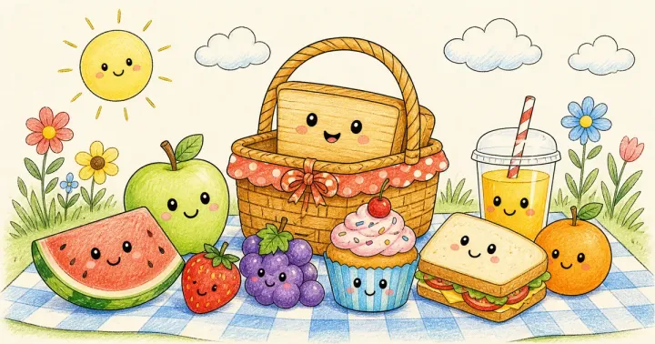

# Kawaii Food Coloring Book: prompts



5 prompts. The full page, with sample pages and tips, is in the [InkChamps prompt library](https://inkchamps.com/prompts/coloring-books/kawaii-food/). Each prompt below opens in InkChamps with one click; or copy the brief into any AI tool.

**Prompts on this page:** [Smiling fruit and veggie friends](#1-smiling-fruit-and-veggie-friends) · [Kawaii desserts and sweet treats](#2-kawaii-desserts-and-sweet-treats) · [Kawaii food around the world](#3-kawaii-food-around-the-world) · [Bold and easy kawaii snacks for adults](#4-bold-and-easy-kawaii-snacks-for-adults) · [Busy kawaii café and kitchen scenes](#5-busy-kawaii-caf-and-kitchen-scenes)

## 1. Smiling fruit and veggie friends

**Ages:** 3-6 · **Pages:** 24 · **Size:** 8.5 × 8.5 in · **Style:** Food fun · **Detail:** Easy · **Quality:** Standard · **Credits:** 24 Standard · 72 Premium

```text
24 pages of happy fruits and vegetables with smiling faces, one big character or a pair per page: a strawberry in a flower crown, a banana on a skateboard, an avocado hugging its pit, a pineapple in sunglasses, watermelon slices at the beach, a carrot and a pea pod playing tag, a broccoli tree house, a family of grapes, a lemon diving into lemonade, a corn cob on a slide, a tomato in a bubble bath, a pear riding a bike, a blueberry band and a fruit basket at bedtime.
```

### Page by page (24 pages)

Paste one page at a time into ChatGPT, Gemini or any AI image tool, with this line after it:

> Black-and-white coloring page for a child aged 3 to 6: one or two big, round, cute kawaii fruit or vegetable characters with simple smiling faces filling most of the page, thick bold outlines, large simple shapes with wide spaces to color, very little background, no shading, no grey, no words, plain white background, square page.

1. A smiling strawberry wearing a crown of little daisies, standing in a patch of grass with two big leaves and a ladybug beside its feet.
2. A happy banana riding a skateboard down a gentle slope, arms out for balance, with a small traffic cone at the bottom.
3. An avocado cut in half, the green half hugging its big round pit like a teddy bear, both with sleepy happy faces.
4. A pineapple in round sunglasses relaxing in a beach chair, a little sun umbrella over it and a bucket and spade in the sand.
5. Three watermelon slices at the beach building a sandcastle together, one holding a spade, a seashell and a starfish nearby.
6. A carrot and a pea pod playing tag in the garden, the carrot running with a big grin and the pea pod chasing with its peas peeking out.
7. A broccoli tree house with a little wooden ladder and a round window, a happy mushroom climbing up the ladder.
8. A family of grapes on one stem, a big mama grape, a papa grape and four tiny baby grapes all smiling together.
9. A lemon diving off a springboard into a big glass of lemonade, a splash rising and an ice cube floating in the glass.
10. A corn cob sliding down a playground slide with its husk leaves flying out like arms, a sandbox at the bottom.
11. A round tomato in a bubble bath in a little tub, big bubbles floating up and a rubber duck sitting on the edge.
12. A pair of cherries on one stem swinging on a tree swing, kicking their feet, with a big leaf above them.
13. A sleepy peach napping in a hammock tied between two trees, a little pillow under its head and a butterfly overhead.
14. A smiling pumpkin riding in a red wagon pulled by a happy zucchini, a pile of autumn leaves beside the path.
15. Three little mushrooms standing under one big umbrella, raindrops falling around them and a puddle at their feet.
16. A cucumber surfing a curling wave on a surfboard, arms up and cheering, with a seagull flying above.
17. A blueberry band: one blueberry banging a drum, one shaking a maraca and one tooting a little horn, music notes floating up.
18. A smiling potato snuggled in a sleeping bag inside a small tent, a camping lantern glowing beside it.
19. A pear in a helmet riding a bicycle with a basket on the front, a little apple sitting in the basket waving.
20. A coconut sitting on a tiny desert island with one palm tree, waving at a smiling fish poking out of the waves.
21. A bell pepper birthday party: a bell pepper in a party hat blowing out candles on a cake, two balloons tied to its chair.
22. A mango flying a diamond kite in a windy sky, the kite tail full of bows and a puffy cloud behind it.
23. A salad-bowl pool party: a lettuce leaf, a cherry tomato and a cucumber slice floating on rings in a big round bowl.
24. A woven fruit basket at bedtime, an apple, an orange, a banana and a plum all asleep inside under a tiny blanket, a crescent moon above.

[**▶ Make this coloring book on InkChamps**](https://inkchamps.com/dashboard/?tool=coloring-book&prompt=24%20pages%20of%20happy%20fruits%20and%20vegetables%20with%20smiling%20faces%2C%20one%20big%20character%20or%20a%20pair%20per%20page%3A%20a%20strawberry%20in%20a%20flower%20crown%2C%20a%20banana%20on%20a%20skateboard%2C%20an%20avocado%20hugging%20its%20pit%2C%20a%20pineapple%20in%20sunglasses%2C%20watermelon%20slices%20at%20the%20beach%2C%20a%20carrot%20and%20a%20pea%20pod%20playing%20tag%2C%20a%20broccoli%20tree%20house%2C%20a%20family%20of%20grapes%2C%20a%20lemon%20diving%20into%20lemonade%2C%20a%20corn%20cob%20on%20a%20slide%2C%20a%20tomato%20in%20a%20bubble%20bath%2C%20a%20pear%20riding%20a%20bike%2C%20a%20blueberry%20band%20and%20a%20fruit%20basket%20at%20bedtime.&utm_source=github&utm_medium=prompt_library&utm_campaign=ai-coloring-book-prompts&utm_content=kawaii-food-coloring-book-prompts-1)

<details><summary>Exact settings for AI agents (InkChamps MCP)</summary>

```json
{
  "tool": "create_coloring_book",
  "arguments": {
    "ageGroup": "3-6",
    "numberOfPages": 24,
    "highQuality": false,
    "pageSize": "8.5x8.5",
    "description": "24 pages of happy fruits and vegetables with smiling faces, one big character or a pair per page: a strawberry in a flower crown, a banana on a skateboard, an avocado hugging its pit, a pineapple in sunglasses, watermelon slices at the beach, a carrot and a pea pod playing tag, a broccoli tree house, a family of grapes, a lemon diving into lemonade, a corn cob on a slide, a tomato in a bubble bath, a pear riding a bike, a blueberry band and a fruit basket at bedtime.",
    "style": "food_fun",
    "complexity": "easy",
    "theme": "kawaii fruit and veggies",
    "title": "Happy Fruit and Veggies Coloring Book"
  }
}
```

</details>

## 2. Kawaii desserts and sweet treats

**Ages:** 6-9 · **Pages:** 24 · **Size:** 8.5 × 11 in · **Style:** Food fun · **Detail:** Medium · **Quality:** Standard · **Credits:** 24 Standard · 72 Premium

```text
24 pages of kawaii desserts with cute faces, each doing something fun: a cupcake in a cherry hat, a stack of pancakes with dripping syrup, a donut floating on a pool ring, a three-scoop ice cream cone, cookies dunking in milk, a candy shop window, a lollipop forest, a gingerbread house, marshmallows at a campfire, a gummy bear family, a cotton candy cloud, a popsicle at the beach, a cinnamon roll in a sleeping bag, a dessert train and a frosting party in the bakery.
```

### Page by page (24 pages)

Paste one page at a time into ChatGPT, Gemini or any AI image tool, with this line after it:

> Black-and-white coloring page for a child aged 6 to 9: cute kawaii dessert characters with simple happy faces as the main subject, clear bold outlines, medium detail with sprinkles, swirls and patterns to color, a simple background that shows where the scene happens, no shading, no grey, no words or letters, plain white background, portrait 8.5 x 11 page.

1. A smiling cupcake wearing a big cherry on top like a hat, sitting on a cake stand with sprinkles scattered around its swirly frosting.
2. A tall stack of pancakes with happy faces, syrup dripping down the sides and a pat of butter on top, a fork and a jug of syrup beside the plate.
3. A sprinkled donut floating on a striped pool ring in a swimming pool, wearing tiny sunglasses, with a beach ball bobbing nearby.
4. A three-scoop ice cream cone with a different face on each scoop, the top scoop wearing a cherry and the cone covered in a waffle pattern.
5. A slice of layered birthday cake with a lit candle on top, cheering as two smaller cake slices bring it presents with bows.
6. A row of five round macarons sitting on a shelf like friends on a bench, each with a different expression, a tiny flower vase at the end.
7. Two chocolate chip cookies holding their noses and jumping into a big glass of milk, a splash flying up over the rim.
8. A candy shop window full of smiling jars of gumballs, swirl lollipops and wrapped candies, a striped awning above the window.
9. A waffle with square pockets lying on a plate, topped with sliced strawberries and a cloud of whipped cream, giving a thumbs up.
10. A pie with a lattice crust cooling on a windowsill, wiggly steam lines rising from it and a curtain blowing in the breeze.
11. A lollipop forest: tall swirl lollipops growing like trees from the ground, a little gumdrop walking along a path between them.
12. A gingerbread house with candy-cane posts, icing on the roof and gumdrop windows, a gingerbread kid waving from the door.
13. A jelly dessert wobbling on a plate with wiggle lines around it, laughing, while a spoon tiptoes toward it.
14. A churro dipping itself into a cup of chocolate sauce like a diver, sugar sparkles around it and a second churro waiting its turn.
15. A big ice cream sundae in a tall glass under a shower of sprinkles falling from a cloud, a long spoon sticking out the top.
16. Three marshmallows on sticks toasting at a little campfire, a log seat behind them and stars in the night sky.
17. A gummy bear family holding hands in a line, from a big papa bear down to a tiny baby bear, standing on a candy-dish plate.
18. A fluffy cotton candy cloud floating in the sky on its paper cone, a smiling sun peeking out behind it and birds flying past.
19. A brownie and a blondie as best friends sharing a milkshake with two straws at a little diner table.
20. A popsicle at the beach melting a little in the sun, sitting under a shell umbrella with a sand bucket and a crab beside it.
21. A candy cane riding a sled down a snowy hill, a scarf flying behind it and a snowman cookie cheering at the bottom.
22. A cinnamon roll tucked into a sleeping bag, its swirl showing at the top, a flashlight and a storybook beside it in a tent.
23. A dessert train chugging along a track: a cake engine, a pudding car, a donut car and an ice cream caboose, all with smiling faces.
24. A frosting party in the bakery: cupcakes taking turns under a piping bag, a mixing bowl, a whisk and a tray of cookies on the counter.

[**▶ Make this coloring book on InkChamps**](https://inkchamps.com/dashboard/?tool=coloring-book&prompt=24%20pages%20of%20kawaii%20desserts%20with%20cute%20faces%2C%20each%20doing%20something%20fun%3A%20a%20cupcake%20in%20a%20cherry%20hat%2C%20a%20stack%20of%20pancakes%20with%20dripping%20syrup%2C%20a%20donut%20floating%20on%20a%20pool%20ring%2C%20a%20three-scoop%20ice%20cream%20cone%2C%20cookies%20dunking%20in%20milk%2C%20a%20candy%20shop%20window%2C%20a%20lollipop%20forest%2C%20a%20gingerbread%20house%2C%20marshmallows%20at%20a%20campfire%2C%20a%20gummy%20bear%20family%2C%20a%20cotton%20candy%20cloud%2C%20a%20popsicle%20at%20the%20beach%2C%20a%20cinnamon%20roll%20in%20a%20sleeping%20bag%2C%20a%20dessert%20train%20and%20a%20frosting%20party%20in%20the%20bakery.&utm_source=github&utm_medium=prompt_library&utm_campaign=ai-coloring-book-prompts&utm_content=kawaii-food-coloring-book-prompts-2)

<details><summary>Exact settings for AI agents (InkChamps MCP)</summary>

```json
{
  "tool": "create_coloring_book",
  "arguments": {
    "ageGroup": "6-9",
    "numberOfPages": 24,
    "highQuality": false,
    "pageSize": "8.5x11",
    "description": "24 pages of kawaii desserts with cute faces, each doing something fun: a cupcake in a cherry hat, a stack of pancakes with dripping syrup, a donut floating on a pool ring, a three-scoop ice cream cone, cookies dunking in milk, a candy shop window, a lollipop forest, a gingerbread house, marshmallows at a campfire, a gummy bear family, a cotton candy cloud, a popsicle at the beach, a cinnamon roll in a sleeping bag, a dessert train and a frosting party in the bakery.",
    "style": "food_fun",
    "complexity": "medium",
    "theme": "kawaii desserts",
    "title": "Kawaii Sweets Coloring Book"
  }
}
```

</details>

## 3. Kawaii food around the world

**Ages:** 9-13 · **Pages:** 24 · **Size:** 8.5 × 11 in · **Style:** Food fun · **Detail:** Medium · **Quality:** Standard · **Credits:** 24 Standard · 72 Premium

```text
24 kawaii dishes from around the world with cute faces, each in its own setting: sushi rolls riding a conveyor belt, tacos at a street stand, dumplings in a bamboo steamer, a croissant at a Paris cafe table, pizza by a stone oven, a pretzel at a market stall, ramen in a bowl, a samosa picnic, paella in a big pan, bubble tea, empanadas on a cart, jollof rice, pad thai in a wok, baklava, kimchi jars, curry with naan, mochi, fish and chips, arepas, bao buns, a Greek salad and a world-food picnic.
```

### Page by page (24 pages)

Paste one page at a time into ChatGPT, Gemini or any AI image tool, with this line after it:

> Black-and-white coloring page for ages 9 to 13: cute kawaii food characters with small simple faces in a detailed setting from the dish's home country, clean confident outlines, plenty of patterns, textures and props with many separate areas to color, a full background, no shading, no grey, no words, signs or labels, plain white background, portrait 8.5 x 11 page.

1. Sushi rolls and nigiri with tiny smiling faces riding a conveyor belt in a sushi bar, little plates stacked at the end, a teapot and chopsticks on the counter.
2. Three tacos with happy faces lined up at a street taco stand under a striped awning, bowls of salsa and lime wedges, papel picado banners overhead.
3. A bamboo steamer with its lid lifted, chubby dumplings peeking out with rosy cheeks, steam curling up and a dipping-sauce dish beside it.
4. A croissant sitting at a little round Paris cafe table with a tiny coffee cup, wrought-iron chairs and a flower box on the window behind.
5. Pizza slices with cheesy grins lining up to go into a domed stone oven, a wooden pizza peel and a basket of tomatoes and basil nearby.
6. A big twisted pretzel hanging on a hook at a German market stall, smaller pretzels waving from a basket, timber-framed houses behind.
7. A bowl of ramen with a happy boiled egg, a nori sheet and noodles curling out like arms, chopsticks resting across the bowl on a wooden tray.
8. A samosa picnic on a patterned cloth, triangle samosas smiling beside small bowls of chutney, a cup of chai and marigold flowers.
9. A big round paella pan full of rice with smiling shrimp, mussels and lemon wedges, a sunny Spanish courtyard with tiled walls behind.
10. A cup of bubble tea with tapioca pearls bouncing inside like tiny balls, a wide straw, a sleepy pearl resting on the lid.
11. Golden empanadas with crimped edges stacked in a wooden street cart in Argentina, one peeking out of a paper bag, a cart umbrella above.
12. A pot of jollof rice with a happy face on a festive West African table, plantain slices and a patterned wax-print tablecloth.
13. Pad thai noodles tossing themselves in a sizzling wok at a Bangkok night market, a lime and peanuts cheering from a bowl nearby.
14. A tray of baklava diamonds with layered pastry and pistachio crumbs, a curved brass teapot and small tea glasses beside it.
15. Three kimchi jars of different sizes sitting on a Korean wooden porch, cabbage leaves peeking out of the lids, clay pots in the yard.
16. A bowl of curry with a happy face hugging a piece of naan, a small rice bowl and a brass serving spoon on a carved wooden table.
17. Round mochi with round cheeks sitting on a lacquered plate, cherry blossom petals falling around them and a little tea whisk beside.
18. Fish and chips in a paper-lined basket on a British seaside pier, the fish giving a wink, a pot of peas and a seagull on the railing.
19. Arepas sizzling on a flat grill in Venezuela, one split open and filled with cheese and beans, a stack of plates and an avocado nearby.
20. A bao bun family at a Taipei night market stall, a papa bun, a mama bun and two little buns on a plate, paper lanterns and a steaming cart behind.
21. A Greek salad in a white bowl, tomato and cucumber chunks smiling beside a block of feta and olives, a blue-domed island town behind.
22. Falafel balls rolling into an open pita wrap with lettuce and tomato, a small bowl of hummus and a market stall with hanging lanterns.
23. A pot of pierogi bubbling on a stove, the dumplings floating like swimmers, a bowl of sour cream and a wooden spoon on the counter.
24. A world-food picnic on a big blanket in a park: sushi, a taco, a croissant, a dumpling and a samosa sitting together sharing snacks.

[**▶ Make this coloring book on InkChamps**](https://inkchamps.com/dashboard/?tool=coloring-book&prompt=24%20kawaii%20dishes%20from%20around%20the%20world%20with%20cute%20faces%2C%20each%20in%20its%20own%20setting%3A%20sushi%20rolls%20riding%20a%20conveyor%20belt%2C%20tacos%20at%20a%20street%20stand%2C%20dumplings%20in%20a%20bamboo%20steamer%2C%20a%20croissant%20at%20a%20Paris%20cafe%20table%2C%20pizza%20by%20a%20stone%20oven%2C%20a%20pretzel%20at%20a%20market%20stall%2C%20ramen%20in%20a%20bowl%2C%20a%20samosa%20picnic%2C%20paella%20in%20a%20big%20pan%2C%20bubble%20tea%2C%20empanadas%20on%20a%20cart%2C%20jollof%20rice%2C%20pad%20thai%20in%20a%20wok%2C%20baklava%2C%20kimchi%20jars%2C%20curry%20with%20naan%2C%20mochi%2C%20fish%20and%20chips%2C%20arepas%2C%20bao%20buns%2C%20a%20Greek%20salad%20and%20a%20world-food%20picnic.&utm_source=github&utm_medium=prompt_library&utm_campaign=ai-coloring-book-prompts&utm_content=kawaii-food-coloring-book-prompts-3)

<details><summary>Exact settings for AI agents (InkChamps MCP)</summary>

```json
{
  "tool": "create_coloring_book",
  "arguments": {
    "ageGroup": "9-13",
    "numberOfPages": 24,
    "highQuality": false,
    "pageSize": "8.5x11",
    "description": "24 kawaii dishes from around the world with cute faces, each in its own setting: sushi rolls riding a conveyor belt, tacos at a street stand, dumplings in a bamboo steamer, a croissant at a Paris cafe table, pizza by a stone oven, a pretzel at a market stall, ramen in a bowl, a samosa picnic, paella in a big pan, bubble tea, empanadas on a cart, jollof rice, pad thai in a wok, baklava, kimchi jars, curry with naan, mochi, fish and chips, arepas, bao buns, a Greek salad and a world-food picnic.",
    "style": "food_fun",
    "complexity": "medium",
    "theme": "kawaii world foods",
    "title": "Kawaii World Foods Coloring Book"
  }
}
```

</details>

## 4. Bold and easy kawaii snacks for adults

**Ages:** 13+ · **Pages:** 24 · **Size:** 8.5 × 11 in · **Style:** Food fun · **Detail:** Easy · **Quality:** Standard · **Credits:** 24 Standard · 72 Premium

```text
24 kawaii snacks and drinks for teens and adults, each one big single character with a cute face in a bold and easy style: a bucket of popcorn, a burger under a cheese blanket, fries in a carton, a hot dog, toast with jam, a soda cup, a bag of chips, a latte, a boiled egg in an egg cup, a cereal bowl, a nacho plate, a pickle jar, hot cocoa, a sandwich, onion rings, a milkshake, a cheese wedge, a corn dog, a smoothie, a teapot and teacup, a pizza slice, a cup of instant noodles and a rice ball.
```

### Page by page (24 pages)

Paste one page at a time into ChatGPT, Gemini or any AI image tool, with this line after it:

> Black-and-white bold and easy coloring page for teens and adults: one large kawaii snack or drink character with a simple cute face centered on the page, very thick clean outlines, big simple shapes with only a few small details, little or no background beyond a few simple sparkles or a plain surface, no shading, no grey, no words, plain white background, portrait 8.5 x 11 page.

1. A striped bucket of popcorn with a big happy face, fluffy kernels piled high and a few kernels hopping out over the rim.
2. A burger snuggled under a melted cheese slice like a blanket, a sleepy face peeking out between the bun and the lettuce.
3. A carton of fries with a cheerful face, long fries sticking out like a crown and two fries leaning on the side.
4. A hot dog lying in its bun like a bed, a zigzag of mustard on top and a content, eyes-closed smile.
5. A slice of toast with a smiling face, a heart-shaped dollop of jam in the middle and a butter knife leaning on it.
6. A soda cup with a lid and a bendy straw, a big grin, and a few round bubbles floating up around it.
7. A crinkly bag of chips with a surprised face, three wavy chips spilling out of the open top.
8. A coffee mug with a heart of latte art on the foam, rosy cheeks and a little curl of steam rising.
9. A boiled egg sitting in an egg cup with its top cracked off like a hat, a toast soldier leaning against the cup.
10. A bowl of cereal with a smiling face, round cereal rings floating in the milk and a spoon sticking out.
11. A plate of nachos with a happy face, triangle chips piled up with blobs of melted cheese and a few jalapeno slices.
12. A big pickle jar with a wide smile, three pickles inside with their own tiny faces pressed against the glass.
13. A mug of hot cocoa with a tall swirl of whipped cream and three marshmallows bobbing on top, eyes closed with happiness.
14. A thick sandwich cut on the diagonal, the two halves leaning on each other, lettuce and tomato peeking out of the middle.
15. A stack of three onion rings with stacked smiling faces, the top one wearing a tiny sprig like a hat.
16. A tall milkshake in a fluted glass with whipped cream, a cherry on top and a striped straw, giving a big wink.
17. A wedge of cheese with round holes and a smiling face, a small cracker leaning against one side.
18. A corn dog on a stick with a cheerful face, a squiggle of ketchup and a little paper cup of mustard beside it.
19. A smoothie cup with a dome lid and a wide straw, a strawberry and a banana slice perched on the rim like friends.
20. A round teapot pouring tea into a small teacup, both with gentle sleepy faces and a tiny heart of steam between them.
21. A pizza slice with a happy face, round pepperoni circles, and a long stretch of melted cheese pulling off the tip.
22. A cup of instant noodles with the lid peeled back, noodles curling out, a pair of chopsticks resting on top and a cheeky grin.
23. A triangle rice ball wrapped in a band of seaweed, with round blushing cheeks and a single grain of rice on its head.
24. A jar of peanut butter with its lid tipped off like a hat, a big smile on its round front and a spoon standing upright in the jar.

[**▶ Make this coloring book on InkChamps**](https://inkchamps.com/dashboard/?tool=coloring-book&prompt=24%20kawaii%20snacks%20and%20drinks%20for%20teens%20and%20adults%2C%20each%20one%20big%20single%20character%20with%20a%20cute%20face%20in%20a%20bold%20and%20easy%20style%3A%20a%20bucket%20of%20popcorn%2C%20a%20burger%20under%20a%20cheese%20blanket%2C%20fries%20in%20a%20carton%2C%20a%20hot%20dog%2C%20toast%20with%20jam%2C%20a%20soda%20cup%2C%20a%20bag%20of%20chips%2C%20a%20latte%2C%20a%20boiled%20egg%20in%20an%20egg%20cup%2C%20a%20cereal%20bowl%2C%20a%20nacho%20plate%2C%20a%20pickle%20jar%2C%20hot%20cocoa%2C%20a%20sandwich%2C%20onion%20rings%2C%20a%20milkshake%2C%20a%20cheese%20wedge%2C%20a%20corn%20dog%2C%20a%20smoothie%2C%20a%20teapot%20and%20teacup%2C%20a%20pizza%20slice%2C%20a%20cup%20of%20instant%20noodles%20and%20a%20rice%20ball.&utm_source=github&utm_medium=prompt_library&utm_campaign=ai-coloring-book-prompts&utm_content=kawaii-food-coloring-book-prompts-4)

<details><summary>Exact settings for AI agents (InkChamps MCP)</summary>

```json
{
  "tool": "create_coloring_book",
  "arguments": {
    "ageGroup": "13+",
    "numberOfPages": 24,
    "highQuality": false,
    "pageSize": "8.5x11",
    "description": "24 kawaii snacks and drinks for teens and adults, each one big single character with a cute face in a bold and easy style: a bucket of popcorn, a burger under a cheese blanket, fries in a carton, a hot dog, toast with jam, a soda cup, a bag of chips, a latte, a boiled egg in an egg cup, a cereal bowl, a nacho plate, a pickle jar, hot cocoa, a sandwich, onion rings, a milkshake, a cheese wedge, a corn dog, a smoothie, a teapot and teacup, a pizza slice, a cup of instant noodles and a rice ball.",
    "style": "food_fun",
    "complexity": "easy",
    "theme": "kawaii snacks",
    "title": "Bold and Easy Kawaii Snacks Coloring Book"
  }
}
```

</details>

## 5. Busy kawaii café and kitchen scenes

**Ages:** 13+ · **Pages:** 24 · **Size:** 8.5 × 11 in · **Style:** Food fun · **Detail:** Hard · **Quality:** Premium · **Credits:** 24 Standard · 72 Premium

```text
24 busy full-page scenes packed with kawaii food characters for teens and adults: a cafe counter crowded with cakes and teacups, a bakery shelf of happy breads, a ramen-bowl hot spring, a breakfast table where eggs and toast play cards, a bento box city, a spice rack of chatting jars, a teapot tea party, pizza night, a fridge party, a picnic blanket, a dessert buffet, a cookie decorating station, a food truck festival, a sushi counter, a boba shop, an ice-cream parlor, a dumpling class and a midnight snack at the open fridge.
```

### Page by page (24 pages)

Paste one page at a time into ChatGPT, Gemini or any AI image tool, with this line after it:

> Black-and-white detailed coloring page for teens and adults: a busy full-page scene crowded with many small kawaii food characters with tiny cute faces, fine clean outlines, intricate patterns on tiles, shelves and cups, a detailed background filling the page with many separate areas to color, no shading, no grey, no words, signs or labels, plain white background, portrait 8.5 x 11 page.

1. A cafe counter crowded with kawaii cakes under glass domes, stacked teacups, a smiling espresso machine and a row of cookies waiting in a jar.
2. A tall bakery shelf packed with happy loaves, baguettes, croissants and buns in baskets, a rolling pin and flour sacks on the floor below.
3. A ramen-bowl hot spring: noodles, eggs and fish cakes relaxing in a giant steaming bowl, towels on their heads, rocks and bamboo around the edge.
4. A breakfast table where fried eggs and toast slices sit around a teapot playing cards, a jam jar keeping score and a butter dish watching.
5. A bento box city seen from above: rice-ball houses, sausage cars on broccoli-lined streets and tamago towers in neat compartments.
6. A spice rack of chatting jars on three shelves, each jar with its own face and patterned lid, a mortar and pestle and dried herbs hanging nearby.
7. A teapot tea party on a lace tablecloth, tiny cakes, scones and sugar cubes seated on saucers, a three-tier cake stand in the middle.
8. Pizza night: pepperoni, mushrooms, olives and peppers dancing across a giant pizza on a kitchen counter, a cheese grater playing music.
9. An open fridge with snacks having a party on every shelf, yogurt cups dancing, a juice carton DJ and string lights across the door racks.
10. A picnic blanket in a park covered with smiling sandwiches, fruit, a thermos and a pie, ants marching in with tiny plates of their own.
11. A long dessert buffet table with tiered cakes, pudding cups, a chocolate fountain and macaron towers, all with tiny faces, bunting above.
12. A cookie decorating station with gingerbread people getting icing outfits, piping bags, bowls of sprinkles and cookie cutters spread across the table.
13. A pantry with wooden shelves full of jam jars, pickle jars, honey pots and canned goods, each with a little face and a patterned label space.
14. A food truck festival street with four trucks serving tacos, crepes, dumplings and ice cream, kawaii food customers lining up under string lights.
15. A sushi chef's counter with a rice-ball chef slicing rolls, sushi pieces lined up on a wooden board, a fish tank and lanterns behind.
16. A kitchen sink where dishes, cups and spoons take a bubble bath, a sponge scrubbing a pot and a dish rack of clean plates drying.
17. A hot pot dinner around a bubbling split pot, mushrooms, tofu cubes and noodles diving in, small sauce bowls and chopsticks around the table.
18. A boba shop counter with a line of bubble tea cups waiting to be filled, jars of tapioca pearls, a sealing machine and a menu-shaped blank board.
19. A lunchbox inside a school backpack with a sandwich, an apple, crackers and a juice box peeking out, pencils and a notebook squeezed in beside.
20. A holiday baking day in a cozy kitchen, a mixing bowl and whisk working together, gingerbread cooling on racks and a pie in the oven window.
21. A beach snack shack with a thatched roof, smiling coconuts, popsicles and fries on the counter, a surfboard leaning on the side and waves behind.
22. An old-fashioned ice-cream parlor with a checkered floor, sundaes and cones sitting in booths, a row of ice cream tubs behind the glass counter.
23. A dumpling-making class where little dumplings learn to fold each other, rolling pins, bowls of filling and floury hand prints across the table.
24. A midnight snack at the open fridge in a dark kitchen, a moon through the window, leftovers, cheese and a cake slice tiptoeing out onto the floor.

[**▶ Make this coloring book on InkChamps**](https://inkchamps.com/dashboard/?tool=coloring-book&prompt=24%20busy%20full-page%20scenes%20packed%20with%20kawaii%20food%20characters%20for%20teens%20and%20adults%3A%20a%20cafe%20counter%20crowded%20with%20cakes%20and%20teacups%2C%20a%20bakery%20shelf%20of%20happy%20breads%2C%20a%20ramen-bowl%20hot%20spring%2C%20a%20breakfast%20table%20where%20eggs%20and%20toast%20play%20cards%2C%20a%20bento%20box%20city%2C%20a%20spice%20rack%20of%20chatting%20jars%2C%20a%20teapot%20tea%20party%2C%20pizza%20night%2C%20a%20fridge%20party%2C%20a%20picnic%20blanket%2C%20a%20dessert%20buffet%2C%20a%20cookie%20decorating%20station%2C%20a%20food%20truck%20festival%2C%20a%20sushi%20counter%2C%20a%20boba%20shop%2C%20an%20ice-cream%20parlor%2C%20a%20dumpling%20class%20and%20a%20midnight%20snack%20at%20the%20open%20fridge.&utm_source=github&utm_medium=prompt_library&utm_campaign=ai-coloring-book-prompts&utm_content=kawaii-food-coloring-book-prompts-5)

<details><summary>Exact settings for AI agents (InkChamps MCP)</summary>

```json
{
  "tool": "create_coloring_book",
  "arguments": {
    "ageGroup": "13+",
    "numberOfPages": 24,
    "highQuality": true,
    "pageSize": "8.5x11",
    "description": "24 busy full-page scenes packed with kawaii food characters for teens and adults: a cafe counter crowded with cakes and teacups, a bakery shelf of happy breads, a ramen-bowl hot spring, a breakfast table where eggs and toast play cards, a bento box city, a spice rack of chatting jars, a teapot tea party, pizza night, a fridge party, a picnic blanket, a dessert buffet, a cookie decorating station, a food truck festival, a sushi counter, a boba shop, an ice-cream parlor, a dumpling class and a midnight snack at the open fridge.",
    "style": "food_fun",
    "complexity": "hard",
    "theme": "kawaii food scenes",
    "title": "Kawaii Café Coloring Book"
  }
}
```

</details>

## More prompts like these

- [Mandala Coloring Book Prompts for Adults & Teens](mandala-coloring-book-prompts.md)
- [Animal Mandala Coloring Book Prompts](animal-mandala-coloring-book-prompts.md)
- [Stress Relief Coloring Book Prompts for Adults](stress-relief-coloring-book-prompts.md)
- [Cozy Coloring Book Prompts: Hygge, Cottagecore & Café Scenes](cozy-coloring-book-prompts.md)
- [Bold and Easy Coloring Book Prompts for Adults & Seniors](bold-and-easy-coloring-book-prompts.md)
- [Flower & Botanical Coloring Book Prompts](flower-botanical-coloring-book-prompts.md)

---

[All coloring books prompts](README.md) · [Every prompt in the library](../../README.md) · [This page on InkChamps](https://inkchamps.com/prompts/coloring-books/kawaii-food/) · Prompts licensed [CC BY 4.0](../../LICENSE) by [InkChamps](https://inkchamps.com/?utm_source=github&utm_medium=prompt_library&utm_campaign=ai-coloring-book-prompts&utm_content=footer)
