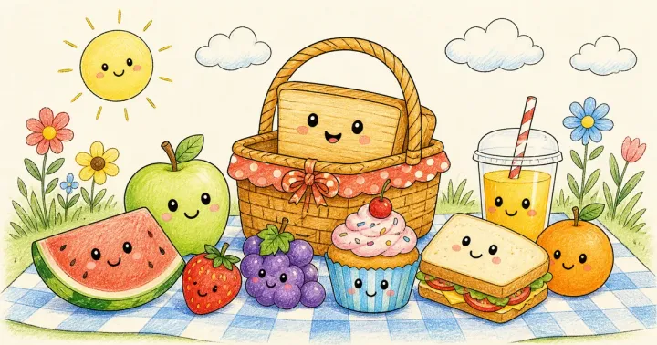

# Kawaii Food Coloring Book: prompts



5 prompts. The full page, with sample pages and tips, is in the [InkChamps prompt library](https://inkchamps.com/prompts/coloring-books/kawaii-food/). Each prompt below opens in InkChamps with one click; or copy the brief into any AI tool.

**Prompts on this page:** [Smiling fruit and veggie friends](#1-smiling-fruit-and-veggie-friends) · [Kawaii desserts and sweet treats](#2-kawaii-desserts-and-sweet-treats) · [Kawaii food around the world](#3-kawaii-food-around-the-world) · [Bold and easy kawaii snacks for adults](#4-bold-and-easy-kawaii-snacks-for-adults) · [Busy kawaii café and kitchen scenes](#5-busy-kawaii-caf-and-kitchen-scenes)

## 1. Smiling fruit and veggie friends

**Ages:** 3-6 · **Pages:** 40 · **Size:** 8.5 × 8.5 in · **Style:** Food fun · **Detail:** Easy · **Quality:** Standard · **Credits:** 40 Standard · 120 Premium

```text
Forty pages of happy fruits and vegetables with smiling faces: a strawberry in a flower crown, a banana on a skateboard, an avocado hugging its pit, a pineapple in sunglasses, watermelon slices at the beach, a carrot and a pea pod playing tag, a broccoli tree house, an apple and an orange holding hands, a family of grapes, and a lemon diving into lemonade.
```

**Extra direction:** More pages: a corn cob on a slide, a tomato in a bubble bath, a cherry pair on a swing, a peach napping, a pumpkin in a wagon, a kiwi hugging a plum, mushrooms under umbrellas, a cucumber surfing, a blueberry band, a potato in a sleeping bag, an eggplant dancing, a pear riding a bike, a coconut on an island, a radish in a garden bed, a bell pepper birthday party, a mango kite, a salad-bowl pool party, and a fruit basket at bedtime.

[**▶ Make this coloring book on InkChamps**](https://inkchamps.com/dashboard/?tool=coloring-book&prompt=Forty%20pages%20of%20happy%20fruits%20and%20vegetables%20with%20smiling%20faces%3A%20a%20strawberry%20in%20a%20flower%20crown%2C%20a%20banana%20on%20a%20skateboard%2C%20an%20avocado%20hugging%20its%20pit%2C%20a%20pineapple%20in%20sunglasses%2C%20watermelon%20slices%20at%20the%20beach%2C%20a%20carrot%20and%20a%20pea%20pod%20playing%20tag%2C%20a%20broccoli%20tree%20house%2C%20an%20apple%20and%20an%20orange%20holding%20hands%2C%20a%20family%20of%20grapes%2C%20and%20a%20lemon%20diving%20into%20lemonade.&utm_source=github&utm_medium=prompt_library&utm_campaign=ai-coloring-book-prompts&utm_content=kawaii-food-coloring-book-prompts-1)

<details><summary>Exact settings for AI agents (InkChamps MCP)</summary>

```json
{
  "tool": "create_coloring_book",
  "arguments": {
    "ageGroup": "3-6",
    "numberOfPages": 40,
    "highQuality": false,
    "pageSize": "8.5x8.5",
    "description": "Forty pages of happy fruits and vegetables with smiling faces: a strawberry in a flower crown, a banana on a skateboard, an avocado hugging its pit, a pineapple in sunglasses, watermelon slices at the beach, a carrot and a pea pod playing tag, a broccoli tree house, an apple and an orange holding hands, a family of grapes, and a lemon diving into lemonade.",
    "style": "food_fun",
    "complexity": "easy",
    "theme": "kawaii fruit and veggies",
    "title": "Happy Fruit and Veggies Coloring Book",
    "additionalInstructions": "More pages: a corn cob on a slide, a tomato in a bubble bath, a cherry pair on a swing, a peach napping, a pumpkin in a wagon, a kiwi hugging a plum, mushrooms under umbrellas, a cucumber surfing, a blueberry band, a potato in a sleeping bag, an eggplant dancing, a pear riding a bike, a coconut on an island, a radish in a garden bed, a bell pepper birthday party, a mango kite, a salad-bowl pool party, and a fruit basket at bedtime."
  }
}
```

</details>

## 2. Kawaii desserts and sweet treats

**Ages:** 6-9 · **Pages:** 40 · **Size:** 8.5 × 11 in · **Style:** Food fun · **Detail:** Medium · **Quality:** Standard · **Credits:** 40 Standard · 120 Premium

```text
Forty pages of kawaii desserts with cute faces: a cupcake in a cherry hat, a stack of pancakes with dripping syrup, a donut floating on a pool ring, a three-scoop ice cream cone, a slice of birthday cake, macarons in a row, cookies dunking in milk, a candy shop window, a waffle topped with strawberries, and a pie cooling on a windowsill.
```

**Extra direction:** More pages: a lollipop forest, a gingerbread house, a jelly wobbling on a plate, a churro dipping in chocolate, a cake pop bouquet, a sundae under a sprinkle shower, marshmallows at a campfire, a gummy bear family, a cotton candy cloud, a brownie and a blondie as best friends, a popsicle in the sun, a candy cane sled, a cheesecake on a swing, a chocolate bar boat, a pudding in a teacup, a cinnamon roll in a sleeping bag, a dessert train, and a frosting party in the bakery.

[**▶ Make this coloring book on InkChamps**](https://inkchamps.com/dashboard/?tool=coloring-book&prompt=Forty%20pages%20of%20kawaii%20desserts%20with%20cute%20faces%3A%20a%20cupcake%20in%20a%20cherry%20hat%2C%20a%20stack%20of%20pancakes%20with%20dripping%20syrup%2C%20a%20donut%20floating%20on%20a%20pool%20ring%2C%20a%20three-scoop%20ice%20cream%20cone%2C%20a%20slice%20of%20birthday%20cake%2C%20macarons%20in%20a%20row%2C%20cookies%20dunking%20in%20milk%2C%20a%20candy%20shop%20window%2C%20a%20waffle%20topped%20with%20strawberries%2C%20and%20a%20pie%20cooling%20on%20a%20windowsill.&utm_source=github&utm_medium=prompt_library&utm_campaign=ai-coloring-book-prompts&utm_content=kawaii-food-coloring-book-prompts-2)

<details><summary>Exact settings for AI agents (InkChamps MCP)</summary>

```json
{
  "tool": "create_coloring_book",
  "arguments": {
    "ageGroup": "6-9",
    "numberOfPages": 40,
    "highQuality": false,
    "pageSize": "8.5x11",
    "description": "Forty pages of kawaii desserts with cute faces: a cupcake in a cherry hat, a stack of pancakes with dripping syrup, a donut floating on a pool ring, a three-scoop ice cream cone, a slice of birthday cake, macarons in a row, cookies dunking in milk, a candy shop window, a waffle topped with strawberries, and a pie cooling on a windowsill.",
    "style": "food_fun",
    "complexity": "medium",
    "theme": "kawaii desserts",
    "title": "Kawaii Sweets Coloring Book",
    "additionalInstructions": "More pages: a lollipop forest, a gingerbread house, a jelly wobbling on a plate, a churro dipping in chocolate, a cake pop bouquet, a sundae under a sprinkle shower, marshmallows at a campfire, a gummy bear family, a cotton candy cloud, a brownie and a blondie as best friends, a popsicle in the sun, a candy cane sled, a cheesecake on a swing, a chocolate bar boat, a pudding in a teacup, a cinnamon roll in a sleeping bag, a dessert train, and a frosting party in the bakery."
  }
}
```

</details>

## 3. Kawaii food around the world

**Ages:** 9-13 · **Pages:** 40 · **Size:** 8.5 × 11 in · **Style:** Food fun · **Detail:** Medium · **Quality:** Standard · **Credits:** 40 Standard · 120 Premium

```text
Forty kawaii dishes from around the world with cute faces, each in its own setting: sushi rolls riding a conveyor belt, tacos at a street stand, dumplings in a bamboo steamer, a croissant at a Paris café table, pizza slices by a stone oven, a pretzel at a market stall, ramen noodles in a bowl, a samosa picnic with chutney, paella in a big pan, and a bubble tea full of tapioca pearls.
```

**Extra direction:** More pages: empanadas on a cart, a bagel with cream cheese, pierogi in a pot, a falafel wrap, jollof rice on a festive table, pad thai in a wok, a tray of baklava, a crêpe on a griddle, kimchi jars, spring rolls, a curry bowl with naan, mochi on a plate, a fish and chips basket, a kebab skewer, arepas on a grill, a bao bun family, a Greek salad, and a world-food picnic with every dish together.

[**▶ Make this coloring book on InkChamps**](https://inkchamps.com/dashboard/?tool=coloring-book&prompt=Forty%20kawaii%20dishes%20from%20around%20the%20world%20with%20cute%20faces%2C%20each%20in%20its%20own%20setting%3A%20sushi%20rolls%20riding%20a%20conveyor%20belt%2C%20tacos%20at%20a%20street%20stand%2C%20dumplings%20in%20a%20bamboo%20steamer%2C%20a%20croissant%20at%20a%20Paris%20caf%C3%A9%20table%2C%20pizza%20slices%20by%20a%20stone%20oven%2C%20a%20pretzel%20at%20a%20market%20stall%2C%20ramen%20noodles%20in%20a%20bowl%2C%20a%20samosa%20picnic%20with%20chutney%2C%20paella%20in%20a%20big%20pan%2C%20and%20a%20bubble%20tea%20full%20of%20tapioca%20pearls.&utm_source=github&utm_medium=prompt_library&utm_campaign=ai-coloring-book-prompts&utm_content=kawaii-food-coloring-book-prompts-3)

<details><summary>Exact settings for AI agents (InkChamps MCP)</summary>

```json
{
  "tool": "create_coloring_book",
  "arguments": {
    "ageGroup": "9-13",
    "numberOfPages": 40,
    "highQuality": false,
    "pageSize": "8.5x11",
    "description": "Forty kawaii dishes from around the world with cute faces, each in its own setting: sushi rolls riding a conveyor belt, tacos at a street stand, dumplings in a bamboo steamer, a croissant at a Paris café table, pizza slices by a stone oven, a pretzel at a market stall, ramen noodles in a bowl, a samosa picnic with chutney, paella in a big pan, and a bubble tea full of tapioca pearls.",
    "style": "food_fun",
    "complexity": "medium",
    "theme": "kawaii world foods",
    "title": "Kawaii World Foods Coloring Book",
    "additionalInstructions": "More pages: empanadas on a cart, a bagel with cream cheese, pierogi in a pot, a falafel wrap, jollof rice on a festive table, pad thai in a wok, a tray of baklava, a crêpe on a griddle, kimchi jars, spring rolls, a curry bowl with naan, mochi on a plate, a fish and chips basket, a kebab skewer, arepas on a grill, a bao bun family, a Greek salad, and a world-food picnic with every dish together."
  }
}
```

</details>

## 4. Bold and easy kawaii snacks for adults

**Ages:** 13+ · **Pages:** 40 · **Size:** 8.5 × 11 in · **Style:** Food fun · **Detail:** Easy · **Quality:** Standard · **Credits:** 40 Standard · 120 Premium

```text
Forty kawaii snacks and drinks, each a single character with a cute face: a bucket of popcorn, a burger under a cheese blanket, fries in a carton, a hot dog in a bun, toast with jam, a soda cup with a straw, a bag of chips, a coffee mug with latte art, a boiled egg in an egg cup, and a bowl of cereal.
```

**Extra direction:** More pages: a nacho plate, a pickle jar, a bundle of pretzel sticks, hot cocoa with marshmallows, a sandwich, onion rings, a milkshake, a cheese wedge, a corn dog, a tub of yogurt, a smoothie, a peanut butter jar, a box of crackers, a teapot and teacup, a pizza slice, salt and pepper shakers, a ketchup bottle, a chocolate milk carton, a cup of instant noodles, and a rice ball.

[**▶ Make this coloring book on InkChamps**](https://inkchamps.com/dashboard/?tool=coloring-book&prompt=Forty%20kawaii%20snacks%20and%20drinks%2C%20each%20a%20single%20character%20with%20a%20cute%20face%3A%20a%20bucket%20of%20popcorn%2C%20a%20burger%20under%20a%20cheese%20blanket%2C%20fries%20in%20a%20carton%2C%20a%20hot%20dog%20in%20a%20bun%2C%20toast%20with%20jam%2C%20a%20soda%20cup%20with%20a%20straw%2C%20a%20bag%20of%20chips%2C%20a%20coffee%20mug%20with%20latte%20art%2C%20a%20boiled%20egg%20in%20an%20egg%20cup%2C%20and%20a%20bowl%20of%20cereal.&utm_source=github&utm_medium=prompt_library&utm_campaign=ai-coloring-book-prompts&utm_content=kawaii-food-coloring-book-prompts-4)

<details><summary>Exact settings for AI agents (InkChamps MCP)</summary>

```json
{
  "tool": "create_coloring_book",
  "arguments": {
    "ageGroup": "13+",
    "numberOfPages": 40,
    "highQuality": false,
    "pageSize": "8.5x11",
    "description": "Forty kawaii snacks and drinks, each a single character with a cute face: a bucket of popcorn, a burger under a cheese blanket, fries in a carton, a hot dog in a bun, toast with jam, a soda cup with a straw, a bag of chips, a coffee mug with latte art, a boiled egg in an egg cup, and a bowl of cereal.",
    "style": "food_fun",
    "complexity": "easy",
    "theme": "kawaii snacks",
    "title": "Bold and Easy Kawaii Snacks Coloring Book",
    "additionalInstructions": "More pages: a nacho plate, a pickle jar, a bundle of pretzel sticks, hot cocoa with marshmallows, a sandwich, onion rings, a milkshake, a cheese wedge, a corn dog, a tub of yogurt, a smoothie, a peanut butter jar, a box of crackers, a teapot and teacup, a pizza slice, salt and pepper shakers, a ketchup bottle, a chocolate milk carton, a cup of instant noodles, and a rice ball."
  }
}
```

</details>

## 5. Busy kawaii café and kitchen scenes

**Ages:** 13+ · **Pages:** 40 · **Size:** 8.5 × 11 in · **Style:** Food fun · **Detail:** Hard · **Quality:** Premium · **Credits:** 40 Standard · 120 Premium

```text
Forty busy scenes packed with kawaii food characters: a café counter crowded with cakes and teacups, a bakery shelf of happy breads and croissants, a ramen-bowl hot spring where noodles relax, a breakfast table where eggs and toast play cards, a bento box city, a spice rack of chatting jars, a teapot tea party with tiny cakes, pizza night with dancing toppings, a fridge full of snacks having a party, and a picnic blanket of sandwiches and fruit.
```

**Extra direction:** More pages: a dessert buffet, a cookie decorating station, a pantry of jam and pickle jars, a food truck festival, a sushi chef's counter, a kitchen sink where dishes take a bath, a hot pot dinner, a cereal aisle, a lunchbox in a school backpack, a birthday party table, a holiday baking day, a boba shop with a line of drinks, a beach snack shack, an ice-cream parlor, a dumpling-making class, and a midnight snack at the open fridge.

[**▶ Make this coloring book on InkChamps**](https://inkchamps.com/dashboard/?tool=coloring-book&prompt=Forty%20busy%20scenes%20packed%20with%20kawaii%20food%20characters%3A%20a%20caf%C3%A9%20counter%20crowded%20with%20cakes%20and%20teacups%2C%20a%20bakery%20shelf%20of%20happy%20breads%20and%20croissants%2C%20a%20ramen-bowl%20hot%20spring%20where%20noodles%20relax%2C%20a%20breakfast%20table%20where%20eggs%20and%20toast%20play%20cards%2C%20a%20bento%20box%20city%2C%20a%20spice%20rack%20of%20chatting%20jars%2C%20a%20teapot%20tea%20party%20with%20tiny%20cakes%2C%20pizza%20night%20with%20dancing%20toppings%2C%20a%20fridge%20full%20of%20snacks%20having%20a%20party%2C%20and%20a%20picnic%20blanket%20of%20sandwiches%20and%20fruit.&utm_source=github&utm_medium=prompt_library&utm_campaign=ai-coloring-book-prompts&utm_content=kawaii-food-coloring-book-prompts-5)

<details><summary>Exact settings for AI agents (InkChamps MCP)</summary>

```json
{
  "tool": "create_coloring_book",
  "arguments": {
    "ageGroup": "13+",
    "numberOfPages": 40,
    "highQuality": true,
    "pageSize": "8.5x11",
    "description": "Forty busy scenes packed with kawaii food characters: a café counter crowded with cakes and teacups, a bakery shelf of happy breads and croissants, a ramen-bowl hot spring where noodles relax, a breakfast table where eggs and toast play cards, a bento box city, a spice rack of chatting jars, a teapot tea party with tiny cakes, pizza night with dancing toppings, a fridge full of snacks having a party, and a picnic blanket of sandwiches and fruit.",
    "style": "food_fun",
    "complexity": "hard",
    "theme": "kawaii food scenes",
    "title": "Kawaii Café Coloring Book",
    "additionalInstructions": "More pages: a dessert buffet, a cookie decorating station, a pantry of jam and pickle jars, a food truck festival, a sushi chef's counter, a kitchen sink where dishes take a bath, a hot pot dinner, a cereal aisle, a lunchbox in a school backpack, a birthday party table, a holiday baking day, a boba shop with a line of drinks, a beach snack shack, an ice-cream parlor, a dumpling-making class, and a midnight snack at the open fridge."
  }
}
```

</details>

## More prompts like these

- [Mandala Coloring Book Prompts for Adults & Teens](mandala-coloring-book-prompts.md)
- [Animal Mandala Coloring Book Prompts](animal-mandala-coloring-book-prompts.md)
- [Stress Relief Coloring Book Prompts for Adults](stress-relief-coloring-book-prompts.md)
- [Cozy Coloring Book Prompts: Hygge, Cottagecore & Café Scenes](cozy-coloring-book-prompts.md)
- [Bold and Easy Coloring Book Prompts for Adults & Seniors](bold-and-easy-coloring-book-prompts.md)
- [Flower & Botanical Coloring Book Prompts](flower-botanical-coloring-book-prompts.md)

---

[All coloring books prompts](README.md) · [Every prompt in the library](../../README.md) · [This page on InkChamps](https://inkchamps.com/prompts/coloring-books/kawaii-food/) · Prompts licensed [CC BY 4.0](../../LICENSE) by [InkChamps](https://inkchamps.com/?utm_source=github&utm_medium=prompt_library&utm_campaign=ai-coloring-book-prompts&utm_content=footer)
