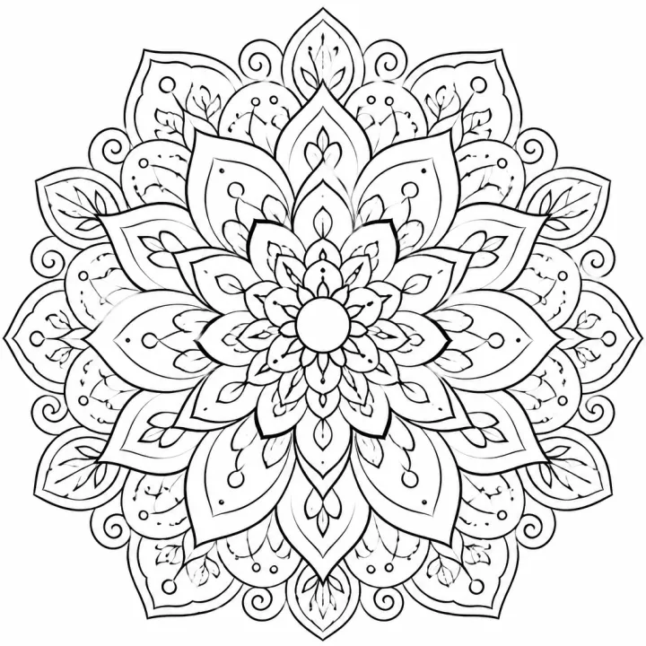

# Mandala Coloring Book: prompts



5 prompts. The full page, with sample pages and tips, is in the [InkChamps prompt library](https://inkchamps.com/prompts/coloring-books/mandala/). Each prompt below opens in InkChamps with one click; or copy the brief into any AI tool.

**Prompts on this page:** [First mandalas for kids](#1-first-mandalas-for-kids) · [Celestial boho mandalas for tweens](#2-celestial-boho-mandalas-for-tweens) · [Bold and easy mandalas for beginners](#3-bold-and-easy-mandalas-for-beginners) · [Flower and botanical mandalas](#4-flower-and-botanical-mandalas) · [Intricate geometric and world-pattern mandalas](#5-intricate-geometric-and-world-pattern-mandalas)

## 1. First mandalas for kids

**Ages:** 6-9 · **Pages:** 40 · **Size:** 8.5 × 8.5 in · **Style:** Mandala abstract · **Detail:** Easy · **Quality:** Standard · **Credits:** 40 Standard · 120 Premium

```text
Forty round mandalas built from things kids love: a ring of hearts, a sun with wavy rays, a flower with big petals, a rainbow circle, a star mandala, a ring of ice cream cones, a butterfly-wing rosette, a pizza-slice wheel, a circle of leaves, a snowflake, a ring of balloons, and a moon surrounded by stars.
```

**Extra direction:** More pages: a ring of cupcakes, a donut mandala, a circle of fish, a ring of raindrops, a lollipop swirl, a ring of paw prints, a ring of dinosaur footprints, a ring of crowns, a strawberry mandala, a circle of planets, a ring of music notes, a pinwheel, a ring of holding hands, a ring of soccer balls, a rocket-ship wheel, a ring of bees and flowers, a ring of birthday candles, a turtle-shell circle, a ring of rainbows and clouds, and a ring of kites.

[**▶ Make this coloring book on InkChamps**](https://inkchamps.com/dashboard/?tool=coloring-book&prompt=Forty%20round%20mandalas%20built%20from%20things%20kids%20love%3A%20a%20ring%20of%20hearts%2C%20a%20sun%20with%20wavy%20rays%2C%20a%20flower%20with%20big%20petals%2C%20a%20rainbow%20circle%2C%20a%20star%20mandala%2C%20a%20ring%20of%20ice%20cream%20cones%2C%20a%20butterfly-wing%20rosette%2C%20a%20pizza-slice%20wheel%2C%20a%20circle%20of%20leaves%2C%20a%20snowflake%2C%20a%20ring%20of%20balloons%2C%20and%20a%20moon%20surrounded%20by%20stars.&utm_source=github&utm_medium=prompt_library&utm_campaign=ai-coloring-book-prompts&utm_content=mandala-coloring-book-prompts-1)

<details><summary>Exact settings for AI agents (InkChamps MCP)</summary>

```json
{
  "tool": "create_coloring_book",
  "arguments": {
    "ageGroup": "6-9",
    "numberOfPages": 40,
    "highQuality": false,
    "pageSize": "8.5x8.5",
    "description": "Forty round mandalas built from things kids love: a ring of hearts, a sun with wavy rays, a flower with big petals, a rainbow circle, a star mandala, a ring of ice cream cones, a butterfly-wing rosette, a pizza-slice wheel, a circle of leaves, a snowflake, a ring of balloons, and a moon surrounded by stars.",
    "style": "mandala_abstract",
    "complexity": "easy",
    "theme": "mandalas for kids",
    "title": "My First Mandalas Coloring Book",
    "additionalInstructions": "More pages: a ring of cupcakes, a donut mandala, a circle of fish, a ring of raindrops, a lollipop swirl, a ring of paw prints, a ring of dinosaur footprints, a ring of crowns, a strawberry mandala, a circle of planets, a ring of music notes, a pinwheel, a ring of holding hands, a ring of soccer balls, a rocket-ship wheel, a ring of bees and flowers, a ring of birthday candles, a turtle-shell circle, a ring of rainbows and clouds, and a ring of kites."
  }
}
```

</details>

## 2. Celestial boho mandalas for tweens

**Ages:** 9-13 · **Pages:** 40 · **Size:** 8.5 × 8.5 in · **Style:** Mandala abstract · **Detail:** Medium · **Quality:** Standard · **Credits:** 40 Standard · 120 Premium

```text
Forty boho celestial mandalas: crescent moons inside rings of stars, moon-phase circles, suns with patterned faces, crystals and gemstones in a circle, feathers and beads hanging from round hoops, constellation wheels, mushroom and fern rings, planets wrapped in orbit swirls, and a lotus under a crescent moon.
```

**Extra direction:** More pages: a ring of shooting stars, a sleeping moon in a cloud wreath, a crystal ball on a stand ringed with stars, a sun and moon sharing one circle, a wheel of the twelve zodiac symbols, a butterfly with moon-phase wings, a snake circling a moon, a ring of candles, a cat curled around a crescent, a comet spiral, a hot-air balloon in a star wreath, a moth with a moon on its back, an eclipse rosette, a sunflower sun, a ring of hanging plants and stars, and a night-sky window frame.

[**▶ Make this coloring book on InkChamps**](https://inkchamps.com/dashboard/?tool=coloring-book&prompt=Forty%20boho%20celestial%20mandalas%3A%20crescent%20moons%20inside%20rings%20of%20stars%2C%20moon-phase%20circles%2C%20suns%20with%20patterned%20faces%2C%20crystals%20and%20gemstones%20in%20a%20circle%2C%20feathers%20and%20beads%20hanging%20from%20round%20hoops%2C%20constellation%20wheels%2C%20mushroom%20and%20fern%20rings%2C%20planets%20wrapped%20in%20orbit%20swirls%2C%20and%20a%20lotus%20under%20a%20crescent%20moon.&utm_source=github&utm_medium=prompt_library&utm_campaign=ai-coloring-book-prompts&utm_content=mandala-coloring-book-prompts-2)

<details><summary>Exact settings for AI agents (InkChamps MCP)</summary>

```json
{
  "tool": "create_coloring_book",
  "arguments": {
    "ageGroup": "9-13",
    "numberOfPages": 40,
    "highQuality": false,
    "pageSize": "8.5x8.5",
    "description": "Forty boho celestial mandalas: crescent moons inside rings of stars, moon-phase circles, suns with patterned faces, crystals and gemstones in a circle, feathers and beads hanging from round hoops, constellation wheels, mushroom and fern rings, planets wrapped in orbit swirls, and a lotus under a crescent moon.",
    "style": "mandala_abstract",
    "complexity": "medium",
    "theme": "celestial boho mandalas",
    "title": "Celestial Boho Mandalas",
    "additionalInstructions": "More pages: a ring of shooting stars, a sleeping moon in a cloud wreath, a crystal ball on a stand ringed with stars, a sun and moon sharing one circle, a wheel of the twelve zodiac symbols, a butterfly with moon-phase wings, a snake circling a moon, a ring of candles, a cat curled around a crescent, a comet spiral, a hot-air balloon in a star wreath, a moth with a moon on its back, an eclipse rosette, a sunflower sun, a ring of hanging plants and stars, and a night-sky window frame."
  }
}
```

</details>

## 3. Bold and easy mandalas for beginners

**Ages:** 13+ · **Pages:** 40 · **Size:** 8.5 × 8.5 in · **Style:** Mandala abstract · **Detail:** Easy · **Quality:** Standard · **Credits:** 40 Standard · 120 Premium

```text
Forty round mandalas made from everyday motifs: a citrus slice, a kiwi slice, a pomegranate cross-section, a seashell spiral, a sand dollar, a peacock-feather fan, a ring of teardrops, a honeycomb circle, a quilt-block circle, a rose window, a ring of teacups, a pinwheel of fish, a ring of cherries, and a ring of coffee beans.
```

**Extra direction:** More pages: a pinecone seen from above, a ring of paisleys, a ring of feathers, a ring of birds, a ring of mushrooms, a sun-and-cloud circle, a cabbage-leaf rosette, a ring of mittens, a ring of old keys, a lattice-top pie, a starfish ring, a ring of hot-air balloons, a lemon wreath, a circle of buttons, a plate of cookies, a ring of sailboats, a lace doily, a ring of leaves and berries, a clock face, and a ring of candles.

[**▶ Make this coloring book on InkChamps**](https://inkchamps.com/dashboard/?tool=coloring-book&prompt=Forty%20round%20mandalas%20made%20from%20everyday%20motifs%3A%20a%20citrus%20slice%2C%20a%20kiwi%20slice%2C%20a%20pomegranate%20cross-section%2C%20a%20seashell%20spiral%2C%20a%20sand%20dollar%2C%20a%20peacock-feather%20fan%2C%20a%20ring%20of%20teardrops%2C%20a%20honeycomb%20circle%2C%20a%20quilt-block%20circle%2C%20a%20rose%20window%2C%20a%20ring%20of%20teacups%2C%20a%20pinwheel%20of%20fish%2C%20a%20ring%20of%20cherries%2C%20and%20a%20ring%20of%20coffee%20beans.&utm_source=github&utm_medium=prompt_library&utm_campaign=ai-coloring-book-prompts&utm_content=mandala-coloring-book-prompts-3)

<details><summary>Exact settings for AI agents (InkChamps MCP)</summary>

```json
{
  "tool": "create_coloring_book",
  "arguments": {
    "ageGroup": "13+",
    "numberOfPages": 40,
    "highQuality": false,
    "pageSize": "8.5x8.5",
    "description": "Forty round mandalas made from everyday motifs: a citrus slice, a kiwi slice, a pomegranate cross-section, a seashell spiral, a sand dollar, a peacock-feather fan, a ring of teardrops, a honeycomb circle, a quilt-block circle, a rose window, a ring of teacups, a pinwheel of fish, a ring of cherries, and a ring of coffee beans.",
    "style": "mandala_abstract",
    "complexity": "easy",
    "theme": "bold and easy mandalas",
    "title": "Bold and Easy Mandalas",
    "additionalInstructions": "More pages: a pinecone seen from above, a ring of paisleys, a ring of feathers, a ring of birds, a ring of mushrooms, a sun-and-cloud circle, a cabbage-leaf rosette, a ring of mittens, a ring of old keys, a lattice-top pie, a starfish ring, a ring of hot-air balloons, a lemon wreath, a circle of buttons, a plate of cookies, a ring of sailboats, a lace doily, a ring of leaves and berries, a clock face, and a ring of candles."
  }
}
```

</details>

## 4. Flower and botanical mandalas

**Ages:** 13+ · **Pages:** 40 · **Size:** 8.5 × 8.5 in · **Style:** Mandala abstract · **Detail:** Medium · **Quality:** Standard · **Credits:** 40 Standard · 120 Premium

```text
Forty mandalas grown from flowers and plants: a rose seen from above, a lotus opening, a sunflower head, a dahlia, a peony, a daisy-chain ring, a hibiscus, a cherry-blossom wreath, a lavender ring, a fern spiral, a succulent rosette, a ring of tulips, a magnolia, and a wildflower meadow circle.
```

**Extra direction:** More pages: a poppy, a camellia, a passionflower, a water lily on lily pads, a chrysanthemum, an orchid ring, a cactus flower, a cosmos, a protea, a ring of rosemary, thyme and mint, an ivy wreath, strawberries and blossoms, a monstera-leaf circle, acorns and oak leaves, a dandelion clock, a wisteria hoop, a marigold, a holly and berry wreath, a lily-of-the-valley ring, and a bouquet circle.

[**▶ Make this coloring book on InkChamps**](https://inkchamps.com/dashboard/?tool=coloring-book&prompt=Forty%20mandalas%20grown%20from%20flowers%20and%20plants%3A%20a%20rose%20seen%20from%20above%2C%20a%20lotus%20opening%2C%20a%20sunflower%20head%2C%20a%20dahlia%2C%20a%20peony%2C%20a%20daisy-chain%20ring%2C%20a%20hibiscus%2C%20a%20cherry-blossom%20wreath%2C%20a%20lavender%20ring%2C%20a%20fern%20spiral%2C%20a%20succulent%20rosette%2C%20a%20ring%20of%20tulips%2C%20a%20magnolia%2C%20and%20a%20wildflower%20meadow%20circle.&utm_source=github&utm_medium=prompt_library&utm_campaign=ai-coloring-book-prompts&utm_content=mandala-coloring-book-prompts-4)

<details><summary>Exact settings for AI agents (InkChamps MCP)</summary>

```json
{
  "tool": "create_coloring_book",
  "arguments": {
    "ageGroup": "13+",
    "numberOfPages": 40,
    "highQuality": false,
    "pageSize": "8.5x8.5",
    "description": "Forty mandalas grown from flowers and plants: a rose seen from above, a lotus opening, a sunflower head, a dahlia, a peony, a daisy-chain ring, a hibiscus, a cherry-blossom wreath, a lavender ring, a fern spiral, a succulent rosette, a ring of tulips, a magnolia, and a wildflower meadow circle.",
    "style": "mandala_abstract",
    "complexity": "medium",
    "theme": "flower mandalas",
    "title": "Garden Mandalas: Flowers and Leaves in the Round",
    "additionalInstructions": "More pages: a poppy, a camellia, a passionflower, a water lily on lily pads, a chrysanthemum, an orchid ring, a cactus flower, a cosmos, a protea, a ring of rosemary, thyme and mint, an ivy wreath, strawberries and blossoms, a monstera-leaf circle, acorns and oak leaves, a dandelion clock, a wisteria hoop, a marigold, a holly and berry wreath, a lily-of-the-valley ring, and a bouquet circle."
  }
}
```

</details>

## 5. Intricate geometric and world-pattern mandalas

**Ages:** 13+ · **Pages:** 40 · **Size:** 8.5 × 8.5 in · **Style:** Mandala abstract · **Detail:** Hard · **Quality:** Premium · **Credits:** 40 Standard · 120 Premium

```text
Forty geometric mandalas, each on a different pattern tradition: lotus petals around an eight-pointed star, interlocking star polygons, Moroccan zellige tile rosettes, Celtic knot rings, Persian paisley borders, Japanese wave circles, a Gothic rose window, Islamic star lattices, a honeycomb hexagon field, a Flower of Life grid, lace filigree, and a sunburst of nested triangles.
```

**Extra direction:** More pages: an Art Deco fan rosette, a Byzantine mosaic medallion, a pysanka-style egg pattern, a Scandinavian snowflake star, a ring of spirals, a talavera tile circle, a rangoli-style lotus, a Greek key ring, an Iznik carnation tile, a twelve-ring scalloped rosette, a compass rose, a stained-glass dome ceiling, a woven basket circle, a Bauhaus circle-and-square grid, a crystal lattice, a chainmail ring, a Seed of Life, a sun disc of stepped triangles, and a twenty-four-petal rosette.

[**▶ Make this coloring book on InkChamps**](https://inkchamps.com/dashboard/?tool=coloring-book&prompt=Forty%20geometric%20mandalas%2C%20each%20on%20a%20different%20pattern%20tradition%3A%20lotus%20petals%20around%20an%20eight-pointed%20star%2C%20interlocking%20star%20polygons%2C%20Moroccan%20zellige%20tile%20rosettes%2C%20Celtic%20knot%20rings%2C%20Persian%20paisley%20borders%2C%20Japanese%20wave%20circles%2C%20a%20Gothic%20rose%20window%2C%20Islamic%20star%20lattices%2C%20a%20honeycomb%20hexagon%20field%2C%20a%20Flower%20of%20Life%20grid%2C%20lace%20filigree%2C%20and%20a%20sunburst%20of%20nested%20triangles.&utm_source=github&utm_medium=prompt_library&utm_campaign=ai-coloring-book-prompts&utm_content=mandala-coloring-book-prompts-5)

<details><summary>Exact settings for AI agents (InkChamps MCP)</summary>

```json
{
  "tool": "create_coloring_book",
  "arguments": {
    "ageGroup": "13+",
    "numberOfPages": 40,
    "highQuality": true,
    "pageSize": "8.5x8.5",
    "description": "Forty geometric mandalas, each on a different pattern tradition: lotus petals around an eight-pointed star, interlocking star polygons, Moroccan zellige tile rosettes, Celtic knot rings, Persian paisley borders, Japanese wave circles, a Gothic rose window, Islamic star lattices, a honeycomb hexagon field, a Flower of Life grid, lace filigree, and a sunburst of nested triangles.",
    "style": "mandala_abstract",
    "complexity": "hard",
    "theme": "geometric mandalas",
    "title": "Mandala Meditations: 40 Geometric Designs",
    "additionalInstructions": "More pages: an Art Deco fan rosette, a Byzantine mosaic medallion, a pysanka-style egg pattern, a Scandinavian snowflake star, a ring of spirals, a talavera tile circle, a rangoli-style lotus, a Greek key ring, an Iznik carnation tile, a twelve-ring scalloped rosette, a compass rose, a stained-glass dome ceiling, a woven basket circle, a Bauhaus circle-and-square grid, a crystal lattice, a chainmail ring, a Seed of Life, a sun disc of stepped triangles, and a twenty-four-petal rosette."
  }
}
```

</details>

## More prompts like these

- [Animal Mandala Coloring Book Prompts](animal-mandala-coloring-book-prompts.md)
- [Stress Relief Coloring Book Prompts for Adults](stress-relief-coloring-book-prompts.md)
- [Cozy Coloring Book Prompts: Hygge, Cottagecore & Café Scenes](cozy-coloring-book-prompts.md)
- [Bold and Easy Coloring Book Prompts for Adults & Seniors](bold-and-easy-coloring-book-prompts.md)
- [Flower & Botanical Coloring Book Prompts](flower-botanical-coloring-book-prompts.md)
- [Christmas Coloring Book Prompts for Kids & Adults](christmas-coloring-book-prompts.md)

---

[All coloring books prompts](README.md) · [Every prompt in the library](../../README.md) · [This page on InkChamps](https://inkchamps.com/prompts/coloring-books/mandala/) · Prompts licensed [CC BY 4.0](../../LICENSE) by [InkChamps](https://inkchamps.com/?utm_source=github&utm_medium=prompt_library&utm_campaign=ai-coloring-book-prompts&utm_content=footer)
