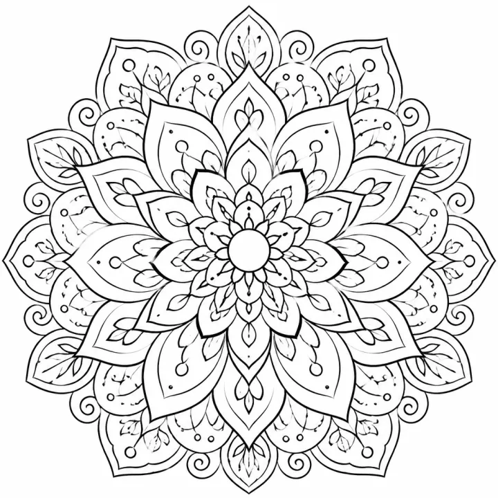

# Mandala Coloring Book: prompts



5 prompts. The full page, with sample pages and tips, is in the [InkChamps prompt library](https://inkchamps.com/prompts/coloring-books/mandala/). Each prompt below opens in InkChamps with one click; or copy the brief into any AI tool.

**Prompts on this page:** [First mandalas for kids](#1-first-mandalas-for-kids) · [Celestial boho mandalas for tweens](#2-celestial-boho-mandalas-for-tweens) · [Bold and easy mandalas for beginners](#3-bold-and-easy-mandalas-for-beginners) · [Flower and botanical mandalas](#4-flower-and-botanical-mandalas) · [Intricate geometric and world-pattern mandalas](#5-intricate-geometric-and-world-pattern-mandalas)

## 1. First mandalas for kids

**Ages:** 6-9 · **Pages:** 24 · **Size:** 8.5 × 8.5 in · **Style:** Mandala abstract · **Detail:** Easy · **Quality:** Standard · **Credits:** 24 Standard · 72 Premium

```text
24 round mandalas built from things kids love, one on each page: a ring of hearts, a sun with wavy rays, a big flower, a rainbow circle, a star, a ring of ice cream cones, a butterfly-wing rosette, a pizza wheel, a snowflake, a ring of balloons, a moon and stars, cupcakes, a donut, fish, paw prints, dinosaur footprints, crowns, planets, rockets, bees and flowers, a turtle shell and a ring of friends holding hands.
```

### Page by page (24 pages)

Paste one page at a time into ChatGPT, Gemini or any AI image tool, with this line after it:

> Black-and-white coloring page for a child aged 6 to 9: one big round, symmetrical mandala centered on the page, thick bold outlines, large simple shapes with wide spaces to color, only two or three rings, no background, no shading, no grey, no words, plain white background, square page.

1. A round mandala with one big heart in the center, ringed by eight smaller hearts pointing outward like flower petals, and a scalloped border of little round bumps around the edge.
2. A sun mandala: a round smiling sun face in the middle, wavy rays spreading out all around it, and a ring of small circles tucked between the rays.
3. A big flower mandala seen from above, with a round button center, eight large rounded petals, and a second ring of pointed petals peeking out behind them.
4. A rainbow circle mandala: wide curved bands forming a full ring around a small fluffy cloud in the center, with little stars dotted around the outside.
5. A star mandala with a big five-pointed star in the middle, a circle of smaller stars around it, and a zigzag ring like a crown on the outer edge.
6. A ring of eight ice cream cones with their points meeting in the middle, each with two round scoops and a cherry on top, and a circle of sprinkle dots at the center.
7. A butterfly-wing rosette: four butterflies whose wings touch to make one round flower shape, with big spots and simple swirls on every wing.
8. A pizza wheel mandala: a round pizza cut into eight slices, with pepperoni circles, mushroom slices and olive rings placed the same way on every slice.
9. A circle of leaves: twelve oval leaves with clear center veins pointing out from a round acorn in the middle, and a ring of small round berries around them.
10. A big six-armed snowflake mandala with a hexagon in the center, each arm ending in a heart-shaped tip with two little side branches.
11. A ring of balloons: eight round balloons with curly strings all tied to one bow in the center, inside a dotted circle.
12. A night mandala: a sleepy crescent moon in the middle, a ring of big five-pointed stars around it, and a border of puffy cloud bumps.
13. A ring of cupcakes: six cupcakes with swirly frosting and a candle on top standing around a round plate with a cherry in the center.
14. A donut mandala: one giant donut seen from above, its dripping icing making a wavy ring, sprinkles in a neat repeating pattern and a little star in the hole.
15. A circle of fish: eight round little fish swimming nose to tail around a big bubble in the center, with wavy water lines and seashells on the outer ring.
16. A ring of paw prints: big paw prints and little bone shapes taking turns around a round puppy face in the center, all inside a scalloped circle.
17. A dinosaur footprint mandala: three-toed footprints walking in a circle around a cracked dinosaur egg in the middle, with a ring of fern leaves at the edge.
18. A ring of six royal crowns with round jewels on their points, circling a big diamond-shaped gem in the center.
19. A strawberry mandala: a big strawberry in the middle with its seed pattern, ringed by smaller strawberries with leafy tops and small five-petal blossoms.
20. A space mandala: a ringed planet in the center, smaller planets and moons in a circle around it, and tiny stars sprinkled between them.
21. A rocket wheel: four small rockets pointing outward from a round porthole window in the center, puffs of smoke between them and a ring of stars outside.
22. A garden mandala: round striped bees and five-petal flowers taking turns around a honeycomb hexagon in the center.
23. A turtle-shell mandala: a big turtle seen from above, its round shell made of large hexagon shapes around one center hexagon, its head, legs and tail poking out evenly.
24. A friendship ring: eight simple children holding hands in a circle around a big heart in the center, with a ring of little flowers at their feet.

[**▶ Make this coloring book on InkChamps**](https://inkchamps.com/dashboard/?tool=coloring-book&prompt=24%20round%20mandalas%20built%20from%20things%20kids%20love%2C%20one%20on%20each%20page%3A%20a%20ring%20of%20hearts%2C%20a%20sun%20with%20wavy%20rays%2C%20a%20big%20flower%2C%20a%20rainbow%20circle%2C%20a%20star%2C%20a%20ring%20of%20ice%20cream%20cones%2C%20a%20butterfly-wing%20rosette%2C%20a%20pizza%20wheel%2C%20a%20snowflake%2C%20a%20ring%20of%20balloons%2C%20a%20moon%20and%20stars%2C%20cupcakes%2C%20a%20donut%2C%20fish%2C%20paw%20prints%2C%20dinosaur%20footprints%2C%20crowns%2C%20planets%2C%20rockets%2C%20bees%20and%20flowers%2C%20a%20turtle%20shell%20and%20a%20ring%20of%20friends%20holding%20hands.&utm_source=github&utm_medium=prompt_library&utm_campaign=ai-coloring-book-prompts&utm_content=mandala-coloring-book-prompts-1)

<details><summary>Exact settings for AI agents (InkChamps MCP)</summary>

```json
{
  "tool": "create_coloring_book",
  "arguments": {
    "ageGroup": "6-9",
    "numberOfPages": 24,
    "highQuality": false,
    "pageSize": "8.5x8.5",
    "description": "24 round mandalas built from things kids love, one on each page: a ring of hearts, a sun with wavy rays, a big flower, a rainbow circle, a star, a ring of ice cream cones, a butterfly-wing rosette, a pizza wheel, a snowflake, a ring of balloons, a moon and stars, cupcakes, a donut, fish, paw prints, dinosaur footprints, crowns, planets, rockets, bees and flowers, a turtle shell and a ring of friends holding hands.",
    "style": "mandala_abstract",
    "complexity": "easy",
    "theme": "mandalas for kids",
    "title": "My First Mandalas Coloring Book"
  }
}
```

</details>

## 2. Celestial boho mandalas for tweens

**Ages:** 9-13 · **Pages:** 24 · **Size:** 8.5 × 8.5 in · **Style:** Mandala abstract · **Detail:** Medium · **Quality:** Standard · **Credits:** 24 Standard · 72 Premium

```text
24 boho celestial mandalas, one on each page: a crescent moon in rings of stars, a moon-phase circle, a sun with a patterned face, a ring of crystals, a feather-and-bead hoop, a constellation wheel, a mushroom and fern ring, a planet in orbit swirls, a lotus under the moon, shooting stars, a sleeping moon, a crystal ball, a zodiac wheel, a snake around the moon, a cat in a crescent, a moth, an eclipse and a night-sky window.
```

### Page by page (24 pages)

Paste one page at a time into ChatGPT, Gemini or any AI image tool, with this line after it:

> Black-and-white coloring page for ages 9 to 13: one round, symmetrical boho celestial mandala centered on the page, clean medium-weight outlines, medium detail with patterned rings and many separate areas to color, no background scene, no shading, no grey, no words or letters, plain white background, square page.

1. A crescent moon in the center, nested inside two rings of tiny stars, with a lace scallop border and short strands of beads hanging from the bottom edge.
2. A moon-phase circle: eight moon phases from new to full arranged in a ring around a small sun, linked by dotted orbit lines and an outer ring of leaves.
3. A sun with a calm patterned face, its long rays taking turns straight and wavy, each ray filled with dots, small triangles and tiny swirls.
4. A ring of crystals and gemstones: pointed quartz crystals and cut gems standing around a round geode center, small sparkle stars between them.
5. A round woven hoop with a star-shaped web inside, three patterned feathers and bead strings hanging from the bottom, and a crescent moon at the top.
6. A constellation wheel: eight segments around a central compass star, each segment holding a different dot-to-dot star pattern, ringed by tiny stars.
7. A mushroom and fern ring: spotted toadstools and curling fern fronds taking turns around a small crescent moon, with an outer band of tiny leaves.
8. A planet wrapped in swirling orbit lines, small moons and stars caught in the swirls, and an outer ring of dotted triangles.
9. A lotus flower opening under a crescent moon, its layered petals filled with stripes and dots, framed by a circle of five-pointed stars.
10. A ring of shooting stars all swirling the same way around a round full moon, their long tails filled with stripes and dots.
11. A sleeping crescent moon with closed eyes and long lashes, resting in a round wreath of puffy patterned clouds and tiny stars.
12. A crystal ball on a carved stand with a swirl of stars inside it, ringed by a circle of little moons and sparkles.
13. A sun and moon sharing one circle: a sun face on the left half and a crescent moon on the right, their rays and stars meeting in a wavy line down the middle.
14. A wheel of the twelve zodiac symbols, each in its own rounded box around a central star, with a band of tiny dots and moons around the outside.
15. A butterfly in the center of a round vine frame, its wings filled with moon phases, small stars and dotted borders.
16. A long snake curled in a full circle around a crescent moon, its scales made of tiny diamonds, small stars scattered inside the ring.
17. A ring of tall candles with soft flames standing around a round moon, wax drips on each candle and small stars between them.
18. A cat curled asleep inside a crescent moon, its tail wrapped around the moon's tip, surrounded by a ring of stars and little planets.
19. A comet spiral: a bright comet at the center with its tail spiraling outward across the page, stars and dots tucked into every curve.
20. A hot-air balloon with a canopy patterned in moons and stars, floating in the middle of a round wreath of stars and small clouds.
21. A moth with a full moon on its back and fringed wings filled with geometric patterns, set inside a ring of crescent moons.
22. An eclipse rosette: a round moon disc covering the sun at the center, a halo of pointed rays and two rings of petal shapes spreading out around it.
23. A sunflower sun: a sunflower whose center is a smiling sun face, two rows of petals around it and a band of small stars and leaves outside.
24. A round night-sky window with a patterned arched frame, potted plants hanging from knotted cords on each side, and a crescent moon and stars through the glass.

[**▶ Make this coloring book on InkChamps**](https://inkchamps.com/dashboard/?tool=coloring-book&prompt=24%20boho%20celestial%20mandalas%2C%20one%20on%20each%20page%3A%20a%20crescent%20moon%20in%20rings%20of%20stars%2C%20a%20moon-phase%20circle%2C%20a%20sun%20with%20a%20patterned%20face%2C%20a%20ring%20of%20crystals%2C%20a%20feather-and-bead%20hoop%2C%20a%20constellation%20wheel%2C%20a%20mushroom%20and%20fern%20ring%2C%20a%20planet%20in%20orbit%20swirls%2C%20a%20lotus%20under%20the%20moon%2C%20shooting%20stars%2C%20a%20sleeping%20moon%2C%20a%20crystal%20ball%2C%20a%20zodiac%20wheel%2C%20a%20snake%20around%20the%20moon%2C%20a%20cat%20in%20a%20crescent%2C%20a%20moth%2C%20an%20eclipse%20and%20a%20night-sky%20window.&utm_source=github&utm_medium=prompt_library&utm_campaign=ai-coloring-book-prompts&utm_content=mandala-coloring-book-prompts-2)

<details><summary>Exact settings for AI agents (InkChamps MCP)</summary>

```json
{
  "tool": "create_coloring_book",
  "arguments": {
    "ageGroup": "9-13",
    "numberOfPages": 24,
    "highQuality": false,
    "pageSize": "8.5x8.5",
    "description": "24 boho celestial mandalas, one on each page: a crescent moon in rings of stars, a moon-phase circle, a sun with a patterned face, a ring of crystals, a feather-and-bead hoop, a constellation wheel, a mushroom and fern ring, a planet in orbit swirls, a lotus under the moon, shooting stars, a sleeping moon, a crystal ball, a zodiac wheel, a snake around the moon, a cat in a crescent, a moth, an eclipse and a night-sky window.",
    "style": "mandala_abstract",
    "complexity": "medium",
    "theme": "celestial boho mandalas",
    "title": "Celestial Boho Mandalas"
  }
}
```

</details>

## 3. Bold and easy mandalas for beginners

**Ages:** 13+ · **Pages:** 24 · **Size:** 8.5 × 8.5 in · **Style:** Mandala abstract · **Detail:** Easy · **Quality:** Standard · **Credits:** 24 Standard · 72 Premium

```text
24 bold, easy round mandalas made from everyday motifs, one on each page: an orange slice, a kiwi slice, a pomegranate, a seashell spiral, a sand dollar, a peacock-feather fan, teardrops, a honeycomb, a quilt block, a rose window, teacups, a pinwheel of fish, cherries, coffee beans, a pinecone, paisleys, songbirds, mushrooms, a cabbage rosette, mittens, old keys, a lattice pie, hot-air balloons and a lace doily.
```

### Page by page (24 pages)

Paste one page at a time into ChatGPT, Gemini or any AI image tool, with this line after it:

> Black-and-white coloring page for teens and adults who are new to coloring: one round, symmetrical mandala centered on the page, bold thick outlines, large open shapes with only a little fine detail, easy to finish in one sitting, no background, no shading, no grey, no words, plain white background, square page.

1. A citrus slice mandala: an orange cut across, its segments forming a ring of wedges around a small star center, the rind a thick band with a scalloped edge.
2. A kiwi slice mandala: a pale round core, a ring of small teardrop seeds, fine lines fanning out to a thick fuzzy skin band at the edge.
3. A pomegranate cross-section: clusters of round seeds packed into sections around a crown-shaped center, set inside a ring of pointed leaves.
4. A seashell spiral mandala: a large spiral shell at the center, its chambers getting bigger as they curl outward, ringed by small scallop shells.
5. A sand dollar with its five-petal star pattern in the center, ringed by small clam shells and a band of wavy water lines.
6. A peacock-feather fan: eight peacock feathers spreading out in a full circle, each feather's eye a large simple oval inside an oval.
7. A ring of teardrops: three rings of big teardrop shapes, the points facing in and out by turns, around a plain round center.
8. A honeycomb circle: large hexagons filling a round frame, with one bee sitting on the center cell.
9. A quilt-block circle: a round patchwork star made of big triangle and square patches, with a stitched-line border around the edge.
10. A rose window: a round window with twelve arched panes around a flower in the center, thick frames between the panes.
11. A ring of teacups: six teacups on saucers seen from the side, circling a round teapot lid seen from above, with steam curls between the cups.
12. A pinwheel of fish: eight simple fish swimming in a spiral toward the center, each with big round scales and a fan-shaped tail.
13. A ring of cherries: pairs of cherries on joined stems around a center flower, with a leaf between each pair.
14. A ring of coffee beans: large coffee beans in two rings around a round coffee cup seen from above, a heart drawn in its foam.
15. A pinecone seen from directly above: thick overlapping scales spiraling out from a small center, getting larger toward the edge.
16. A ring of paisleys: eight big paisley shapes curling the same way around a round flower, each with one simple inner line.
17. A ring of birds: eight small songbirds facing the same way, wingtips touching, around a round nest holding three eggs.
18. A ring of mushrooms: spotted toadstools standing in a circle around a center flower, short grass tufts between them.
19. A cabbage-leaf rosette: large curving leaves layered in rings with clear thick veins, like a cabbage seen from above.
20. A ring of mittens: eight mittens with simple stripes and snowflakes, their cuffs pointing to a big snowflake in the center.
21. A ring of old keys: eight large old-fashioned keys with fancy loops at the top, all pointing inward to a round keyhole plate.
22. A lattice-top pie seen from above: woven pastry strips, a crimped edge all the way around and round cherries peeking through the gaps.
23. A ring of hot-air balloons: six balloons with striped canopies and woven baskets floating around a round sun in the middle.
24. A lace doily: a big round doily with a scalloped edge and three rings of large flower and petal cut-outs.

[**▶ Make this coloring book on InkChamps**](https://inkchamps.com/dashboard/?tool=coloring-book&prompt=24%20bold%2C%20easy%20round%20mandalas%20made%20from%20everyday%20motifs%2C%20one%20on%20each%20page%3A%20an%20orange%20slice%2C%20a%20kiwi%20slice%2C%20a%20pomegranate%2C%20a%20seashell%20spiral%2C%20a%20sand%20dollar%2C%20a%20peacock-feather%20fan%2C%20teardrops%2C%20a%20honeycomb%2C%20a%20quilt%20block%2C%20a%20rose%20window%2C%20teacups%2C%20a%20pinwheel%20of%20fish%2C%20cherries%2C%20coffee%20beans%2C%20a%20pinecone%2C%20paisleys%2C%20songbirds%2C%20mushrooms%2C%20a%20cabbage%20rosette%2C%20mittens%2C%20old%20keys%2C%20a%20lattice%20pie%2C%20hot-air%20balloons%20and%20a%20lace%20doily.&utm_source=github&utm_medium=prompt_library&utm_campaign=ai-coloring-book-prompts&utm_content=mandala-coloring-book-prompts-3)

<details><summary>Exact settings for AI agents (InkChamps MCP)</summary>

```json
{
  "tool": "create_coloring_book",
  "arguments": {
    "ageGroup": "13+",
    "numberOfPages": 24,
    "highQuality": false,
    "pageSize": "8.5x8.5",
    "description": "24 bold, easy round mandalas made from everyday motifs, one on each page: an orange slice, a kiwi slice, a pomegranate, a seashell spiral, a sand dollar, a peacock-feather fan, teardrops, a honeycomb, a quilt block, a rose window, teacups, a pinwheel of fish, cherries, coffee beans, a pinecone, paisleys, songbirds, mushrooms, a cabbage rosette, mittens, old keys, a lattice pie, hot-air balloons and a lace doily.",
    "style": "mandala_abstract",
    "complexity": "easy",
    "theme": "bold and easy mandalas",
    "title": "Bold and Easy Mandalas"
  }
}
```

</details>

## 4. Flower and botanical mandalas

**Ages:** 13+ · **Pages:** 24 · **Size:** 8.5 × 8.5 in · **Style:** Mandala abstract · **Detail:** Medium · **Quality:** Standard · **Credits:** 24 Standard · 72 Premium

```text
24 mandalas grown from flowers and plants, one on each page: a rose seen from above, a lotus, a sunflower head, a dahlia, a peony, a daisy chain, a hibiscus, a cherry-blossom wreath, lavender, a fern spiral, a succulent rosette, tulips, a magnolia, a water lily, a poppy, a passionflower, a chrysanthemum, a ring of herbs, monstera leaves, acorns and oak leaves, a dandelion clock, wisteria, holly and berries, and a bouquet wreath.
```

### Page by page (24 pages)

Paste one page at a time into ChatGPT, Gemini or any AI image tool, with this line after it:

> Black-and-white adult coloring page: one round, symmetrical botanical mandala centered on the page, built from petals, leaves and stems, clean fine-to-medium outlines, medium detail with plenty of separate areas to color, no background, no shading, no grey, no words, plain white background, square page.

1. A rose seen from directly above, its petals spiraling out in tight layers from a small bud center, a ring of rose leaves with toothed edges around it.
2. A lotus opening: three layers of pointed petals around a round seed-pod center, floating on rings of rippling water lines.
3. A sunflower head: a seed center in a spiral pattern of tiny diamonds, two rows of long petals and an outer ring of big heart-shaped leaves.
4. A dahlia mandala: dozens of tightly curled, tube-shaped petals in neat rings, getting larger from the center out to the edge.
5. A peony in full bloom seen from above, ruffled petals in loose layers around a cluster of stamens, with buds and leaves around the rim.
6. A daisy-chain ring: small daisies linked stem to stem in a circle around one big daisy in the center, little buds tucked between them.
7. A hibiscus with five wide petals marked with fine vein lines and a long curved stamen, ringed by glossy leaves and closed buds.
8. A cherry-blossom wreath: thin branches bent into a circle, five-petal blossoms and buds along them and one large blossom in the center.
9. A lavender ring: stalks of lavender pointing outward from a ribbon bow in the center, with two small bees among the flowers.
10. A fern spiral: unfurling fern fronds curling in a spiral around a small center, each frond lined with tiny leaflets.
11. A succulent rosette: plump pointed leaves layered in rings around a tight center, like a succulent seen from above.
12. A ring of twelve tulips with long leaves, their stems meeting at a round flower in the center.
13. A magnolia: large cupped petals opening around a cone-shaped center, set on a ring of long oval leaves and fuzzy buds.
14. A water lily open in the center, round notched lily pads in a ring around it, a dragonfly resting on one pad.
15. A poppy with crinkled petals around a crown-topped seed pod, ringed by more seed pods, buds and feathery leaves.
16. A passionflower: ten flat petals, a fringed crown of thin filaments and a raised center, with curling tendrils around the rim.
17. A chrysanthemum: hundreds of narrow petals packed in rings around a small center, each ring slightly longer than the last.
18. A ring of herbs: sprigs of rosemary, thyme and mint taking turns around a small bundle of herbs tied with twine in the center.
19. A monstera-leaf circle: big split leaves with holes arranged in a ring, their stems meeting at a small flower in the center.
20. Acorns and oak leaves: lobed oak leaves in a circle with clusters of acorns in caps between them, around a cut tree-ring center.
21. A dandelion clock: a round seed head of fine fluffy seeds, a few seeds floating away, inside a ring of toothed dandelion leaves.
22. A wisteria hoop: a round hoop with long clusters of wisteria flowers hanging down from it and small leaves along the top.
23. A holly and berry wreath: spiky holly leaves and clusters of round berries forming a full circle, with a pine cone at the center.
24. A bouquet circle: roses, daisies, tulips and sprigs of tiny flowers arranged in a round wreath, with a ribbon bow at the bottom.

[**▶ Make this coloring book on InkChamps**](https://inkchamps.com/dashboard/?tool=coloring-book&prompt=24%20mandalas%20grown%20from%20flowers%20and%20plants%2C%20one%20on%20each%20page%3A%20a%20rose%20seen%20from%20above%2C%20a%20lotus%2C%20a%20sunflower%20head%2C%20a%20dahlia%2C%20a%20peony%2C%20a%20daisy%20chain%2C%20a%20hibiscus%2C%20a%20cherry-blossom%20wreath%2C%20lavender%2C%20a%20fern%20spiral%2C%20a%20succulent%20rosette%2C%20tulips%2C%20a%20magnolia%2C%20a%20water%20lily%2C%20a%20poppy%2C%20a%20passionflower%2C%20a%20chrysanthemum%2C%20a%20ring%20of%20herbs%2C%20monstera%20leaves%2C%20acorns%20and%20oak%20leaves%2C%20a%20dandelion%20clock%2C%20wisteria%2C%20holly%20and%20berries%2C%20and%20a%20bouquet%20wreath.&utm_source=github&utm_medium=prompt_library&utm_campaign=ai-coloring-book-prompts&utm_content=mandala-coloring-book-prompts-4)

<details><summary>Exact settings for AI agents (InkChamps MCP)</summary>

```json
{
  "tool": "create_coloring_book",
  "arguments": {
    "ageGroup": "13+",
    "numberOfPages": 24,
    "highQuality": false,
    "pageSize": "8.5x8.5",
    "description": "24 mandalas grown from flowers and plants, one on each page: a rose seen from above, a lotus, a sunflower head, a dahlia, a peony, a daisy chain, a hibiscus, a cherry-blossom wreath, lavender, a fern spiral, a succulent rosette, tulips, a magnolia, a water lily, a poppy, a passionflower, a chrysanthemum, a ring of herbs, monstera leaves, acorns and oak leaves, a dandelion clock, wisteria, holly and berries, and a bouquet wreath.",
    "style": "mandala_abstract",
    "complexity": "medium",
    "theme": "flower mandalas",
    "title": "Garden Mandalas: Flowers and Leaves in the Round"
  }
}
```

</details>

## 5. Intricate geometric and world-pattern mandalas

**Ages:** 13+ · **Pages:** 24 · **Size:** 8.5 × 8.5 in · **Style:** Mandala abstract · **Detail:** Hard · **Quality:** Premium · **Credits:** 24 Standard · 72 Premium

```text
24 intricate geometric mandalas, each on a different pattern tradition: lotus petals around an eight-pointed star, interlocking star polygons, a zellige tile rosette, a Celtic knot ring, Persian paisley bands, Japanese wave circles, a Gothic rose window, an Islamic star lattice, a honeycomb field, a Flower of Life grid, lace filigree, nested triangles, an Art Deco fan, a Byzantine mosaic, talavera tiles, a rangoli lotus, a Greek key ring, a compass rose and a twenty-four-petal rosette.
```

### Page by page (24 pages)

Paste one page at a time into ChatGPT, Gemini or any AI image tool, with this line after it:

> Black-and-white adult coloring page for experienced colorists: one intricate, perfectly symmetrical mandala filling the square page almost edge to edge, fine crisp lines, dense detail with hundreds of small areas to color, no background, no shading, no grey, no words, plain white background, square page.

1. Rings of lotus petals around an eight-pointed star, every petal filled with tiny scales, dots and fine stripes, a beaded band at the outer edge.
2. Interlocking star polygons: a six-pointed, an eight-pointed and a twelve-pointed star woven over and under each other inside nested circles.
3. A tile rosette in the style of Moroccan zellige: a sixteen-point star at the center, surrounded by interlocking small star and kite-shaped tile pieces.
4. A Celtic knot ring: one endless interlaced band looping around a triple-spiral center, with a second knotwork ring at the outer edge.
5. A central medallion ringed by bands of Persian-style paisley, each paisley filled with tiny flowers, vines and dotted borders.
6. Japanese wave circles: overlapping scalloped wave arcs in rings, a swirling whirlpool at the center and curling foam tips along the outer edge.
7. A Gothic rose window: stone tracery of pointed arches and quatrefoils radiating from a six-petal center, each pane split into small sections.
8. An Islamic star lattice: a twelve-point star at the center, interlaced strapwork spreading out into rings of smaller stars and polygons.
9. A honeycomb hexagon field inside a circle, every hexagon holding a different tiny pattern: dots, stripes, spirals and small stars.
10. A Flower of Life grid: overlapping circles forming petal shapes, framed by two outer rings of fine linework and a band of small triangles.
11. Lace filigree: delicate scrolls, tiny loops and open flower motifs in rings, with a scalloped lace edge all the way around.
12. A sunburst of nested triangles: rings of sharp triangles pointing outward, each triangle split into smaller triangles, around a small circle.
13. An Art Deco fan rosette: stepped fan shapes and sunray lines radiating from the center, edged with chevrons and small arcs.
14. A Byzantine mosaic medallion: a cross-shaped center made of tiny square tiles, ringed by bands of mosaic vines, birds and rosettes.
15. A round medallion in pysanka-style bands: wheat ears, eight-point stars, zigzag ribbons and little triangles in neat rings.
16. A Scandinavian snowflake star: an eight-pointed knitted-style star with small diamonds and crosses, ringed by bands of tiny hearts and pine trees.
17. A talavera tile circle: bold scrolling flowers, curling leaves and dotted borders around a central star.
18. A rangoli-style lotus: a many-petaled lotus at the center with dotted outlines, ringed by peacock-feather loops and teardrop petals.
19. A Greek key ring: bands of meander pattern circling a central rosette, with fine bead and egg-and-dart borders between the bands.
20. An Iznik carnation tile medallion: fan-shaped carnations, tulips and saz leaves curving around a central rosette.
21. A compass rose mandala: a thirty-two-point star with layered points, rings of fine degree marks and a ring of rope border.
22. A stained-glass dome ceiling seen from below: curved ribs meeting at a round center, each panel split into tiny glass pieces with leaded lines.
23. A Bauhaus circle-and-square grid: circles, half circles and squares fitted together in a rotating pattern around a center point.
24. A twenty-four-petal rosette: several rings of twenty-four petals, each ring filled with a different pattern of scales, dots or lace, around a tiny eight-petal flower.

[**▶ Make this coloring book on InkChamps**](https://inkchamps.com/dashboard/?tool=coloring-book&prompt=24%20intricate%20geometric%20mandalas%2C%20each%20on%20a%20different%20pattern%20tradition%3A%20lotus%20petals%20around%20an%20eight-pointed%20star%2C%20interlocking%20star%20polygons%2C%20a%20zellige%20tile%20rosette%2C%20a%20Celtic%20knot%20ring%2C%20Persian%20paisley%20bands%2C%20Japanese%20wave%20circles%2C%20a%20Gothic%20rose%20window%2C%20an%20Islamic%20star%20lattice%2C%20a%20honeycomb%20field%2C%20a%20Flower%20of%20Life%20grid%2C%20lace%20filigree%2C%20nested%20triangles%2C%20an%20Art%20Deco%20fan%2C%20a%20Byzantine%20mosaic%2C%20talavera%20tiles%2C%20a%20rangoli%20lotus%2C%20a%20Greek%20key%20ring%2C%20a%20compass%20rose%20and%20a%20twenty-four-petal%20rosette.&utm_source=github&utm_medium=prompt_library&utm_campaign=ai-coloring-book-prompts&utm_content=mandala-coloring-book-prompts-5)

<details><summary>Exact settings for AI agents (InkChamps MCP)</summary>

```json
{
  "tool": "create_coloring_book",
  "arguments": {
    "ageGroup": "13+",
    "numberOfPages": 24,
    "highQuality": true,
    "pageSize": "8.5x8.5",
    "description": "24 intricate geometric mandalas, each on a different pattern tradition: lotus petals around an eight-pointed star, interlocking star polygons, a zellige tile rosette, a Celtic knot ring, Persian paisley bands, Japanese wave circles, a Gothic rose window, an Islamic star lattice, a honeycomb field, a Flower of Life grid, lace filigree, nested triangles, an Art Deco fan, a Byzantine mosaic, talavera tiles, a rangoli lotus, a Greek key ring, a compass rose and a twenty-four-petal rosette.",
    "style": "mandala_abstract",
    "complexity": "hard",
    "theme": "geometric mandalas",
    "title": "Mandala Meditations: 40 Geometric Designs"
  }
}
```

</details>

## More prompts like these

- [Animal Mandala Coloring Book Prompts](animal-mandala-coloring-book-prompts.md)
- [Stress Relief Coloring Book Prompts for Adults](stress-relief-coloring-book-prompts.md)
- [Cozy Coloring Book Prompts: Hygge, Cottagecore & Café Scenes](cozy-coloring-book-prompts.md)
- [Bold and Easy Coloring Book Prompts for Adults & Seniors](bold-and-easy-coloring-book-prompts.md)
- [Flower & Botanical Coloring Book Prompts](flower-botanical-coloring-book-prompts.md)
- [Christmas Coloring Book Prompts for Kids & Adults](christmas-coloring-book-prompts.md)

---

[All coloring books prompts](README.md) · [Every prompt in the library](../../README.md) · [This page on InkChamps](https://inkchamps.com/prompts/coloring-books/mandala/) · Prompts licensed [CC BY 4.0](../../LICENSE) by [InkChamps](https://inkchamps.com/?utm_source=github&utm_medium=prompt_library&utm_campaign=ai-coloring-book-prompts&utm_content=footer)
