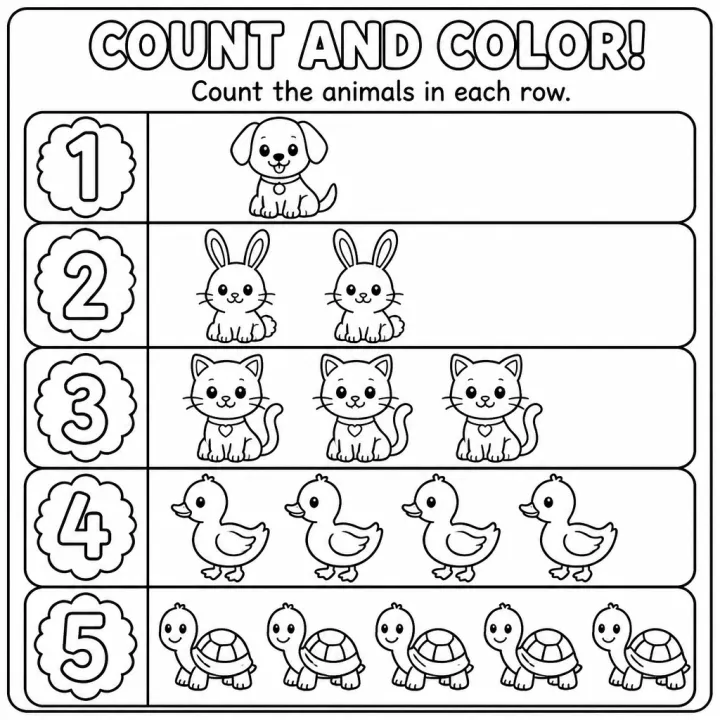

# Numbers & Counting Coloring Book: prompts



5 prompts. The full page, with sample pages and tips, is in the [InkChamps prompt library](https://inkchamps.com/prompts/coloring-books/numbers-counting/). Each prompt below opens in InkChamps with one click; or copy the brief into any AI tool.

**Prompts on this page:** [Count to 8 three ways](#1-count-to-8-three-ways) · [Numbers 1 to 20, numeral page and counting page](#2-numbers-1-to-20-numeral-page-and-counting-page) · [Make ten, doubles and teen numbers](#3-make-ten-doubles-and-teen-numbers) · [Count 1 to 40 under the sea](#4-count-1-to-40-under-the-sea) · [Times tables 2, 3, 4 and 5 as equal groups](#5-times-tables-2-3-4-and-5-as-equal-groups)

## 1. Count to 8 three ways

**Ages:** 3-6 · **Pages:** 24 · **Size:** 8.5 × 11 in · **Style:** General coloring · **Detail:** Easy · **Layout:** One item per page, with its caption · **Quality:** Standard · **Credits:** 24 Standard · 72 Premium

```text
A first counting book: the numbers 1 to 8 three times, one number per page with exactly that many things to count and the number as the caption. Pages 1-8, on the farm: 1 cow, 2 pigs, 3 sheep, 4 hens, 5 chicks, 6 ducks, 7 bunnies, 8 kittens. Pages 9-16, garden bugs: 1 snail, 2 caterpillars, 3 bees, 4 ladybugs, 5 butterflies, 6 ants, 7 worms, 8 dragonflies. Pages 17-24, the toy box: 1 teddy bear, 2 drums, 3 balls, 4 blocks, 5 toy cars, 6 rubber ducks, 7 crayons, 8 balloons.
```

### Page by page (24 pages)

Paste one page at a time into ChatGPT, Gemini or any AI image tool, with this line after it:

> Black-and-white coloring line art for a child aged 3 to 6: the things to count drawn big, simple and well spaced so each one is easy to count, thick bold outlines, large shapes with wide spaces to color, very little background, no shading, no grey, the caption at the bottom is the only words on the page, plain white background, portrait 8.5 x 11 page.

1. Exactly 1 big friendly cow standing in a grassy meadow beside a wooden fence, a bell on her collar and a daisy in her mouth, with the caption "1" in a big outlined number at the bottom.
2. Exactly 2 round pigs splashing side by side in one muddy puddle next to a barn door, a tipped-over bucket beside them, with the caption "2" in a big outlined number at the bottom.
3. Exactly 3 fluffy sheep standing in a row on a gentle grassy hill, curly wool and little hooves, a farm gate behind them, with the caption "3" in a big outlined number at the bottom.
4. Exactly 4 hens, each sitting on its own straw nest in a row inside a little wooden henhouse, a feed scoop on the floor, with the caption "4" in a big outlined number at the bottom.
5. Exactly 5 fuzzy little chicks pecking at the ground in a farmyard around one round water dish, a fence post at the side, with the caption "5" in a big outlined number at the bottom.
6. Exactly 6 ducks swimming in a line across a farm pond, a few lily pads and tall cattails at the edge of the water, with the caption "6" in a big outlined number at the bottom.
7. Exactly 7 bunnies with tall ears hopping through a carrot patch, leafy carrot tops in the soil and a wheelbarrow at the side, with the caption "7" in a big outlined number at the bottom.
8. Exactly 8 kittens tumbling on the floor of a hay barn, playing with one big ball of yarn next to a hay bale, with the caption "8" in a big outlined number at the bottom.
9. Exactly 1 big smiling snail sliding along a large garden leaf, a swirly shell on its back and one raindrop on the leaf, with the caption "1" in a big outlined number at the bottom.
10. Exactly 2 chubby caterpillars munching on the same big leaf, little round bite holes along its edge, with the caption "2" in a big outlined number at the bottom.
11. Exactly 3 bees with striped bodies buzzing around one tall sunflower, its big round middle facing the sun, with the caption "3" in a big outlined number at the bottom.
12. Exactly 4 spotted ladybugs, each sitting on its own large round leaf of a garden plant, with the caption "4" in a big outlined number at the bottom.
13. Exactly 5 butterflies with patterned wings fluttering over a flower bed of tulips, with the caption "5" in a big outlined number at the bottom.
14. Exactly 6 ants marching in a line toward a small anthill, each one carrying a tiny leaf over its head, with the caption "6" in a big outlined number at the bottom.
15. Exactly 7 wiggly worms poking out of the soil in a vegetable patch, a garden spade stuck in the ground beside them, with the caption "7" in a big outlined number at the bottom.
16. Exactly 8 dragonflies with long thin wings hovering over a garden pond, reeds at the edge and one lily pad on the water, with the caption "8" in a big outlined number at the bottom.
17. Exactly 1 big teddy bear with a bow tie sitting on the lid of an open wooden toy box, with the caption "1" in a big outlined number at the bottom.
18. Exactly 2 toy drums with drumsticks resting on top, side by side on a round playroom rug, with the caption "2" in a big outlined number at the bottom.
19. Exactly 3 bouncy balls of different sizes, one striped, one spotted and one plain, bouncing across the playroom floor, with the caption "3" in a big outlined number at the bottom.
20. Exactly 4 toy blocks stacked in a tower, each with a simple star, heart, moon or circle on its side, with the caption "4" in a big outlined number at the bottom.
21. Exactly 5 toy cars lined up one behind the other on a play road mat with a dashed middle line, with the caption "5" in a big outlined number at the bottom.
22. Exactly 6 rubber ducks floating in a bathtub full of water, a tap at one end and a sponge on the edge, with the caption "6" in a big outlined number at the bottom.
23. Exactly 7 chunky crayons spread out in a row on a table next to an open crayon box and a sheet of paper, with the caption "7" in a big outlined number at the bottom.
24. Exactly 8 round balloons on long strings tied to the handle of a toy box, a party hat sitting on its lid, with the caption "8" in a big outlined number at the bottom.

[**▶ Make this coloring book on InkChamps**](https://inkchamps.com/dashboard/?tool=coloring-book&prompt=A%20first%20counting%20book%3A%20the%20numbers%201%20to%208%20three%20times%2C%20one%20number%20per%20page%20with%20exactly%20that%20many%20things%20to%20count%20and%20the%20number%20as%20the%20caption.%20Pages%201-8%2C%20on%20the%20farm%3A%201%20cow%2C%202%20pigs%2C%203%20sheep%2C%204%20hens%2C%205%20chicks%2C%206%20ducks%2C%207%20bunnies%2C%208%20kittens.%20Pages%209-16%2C%20garden%20bugs%3A%201%20snail%2C%202%20caterpillars%2C%203%20bees%2C%204%20ladybugs%2C%205%20butterflies%2C%206%20ants%2C%207%20worms%2C%208%20dragonflies.%20Pages%2017-24%2C%20the%20toy%20box%3A%201%20teddy%20bear%2C%202%20drums%2C%203%20balls%2C%204%20blocks%2C%205%20toy%20cars%2C%206%20rubber%20ducks%2C%207%20crayons%2C%208%20balloons.&utm_source=github&utm_medium=prompt_library&utm_campaign=ai-coloring-book-prompts&utm_content=numbers-counting-coloring-book-prompts-1)

<details><summary>Exact settings for AI agents (InkChamps MCP)</summary>

```json
{
  "tool": "create_coloring_book",
  "arguments": {
    "ageGroup": "3-6",
    "numberOfPages": 24,
    "highQuality": false,
    "pageSize": "8.5x11",
    "description": "A first counting book: the numbers 1 to 8 three times, one number per page with exactly that many things to count and the number as the caption. Pages 1-8, on the farm: 1 cow, 2 pigs, 3 sheep, 4 hens, 5 chicks, 6 ducks, 7 bunnies, 8 kittens. Pages 9-16, garden bugs: 1 snail, 2 caterpillars, 3 bees, 4 ladybugs, 5 butterflies, 6 ants, 7 worms, 8 dragonflies. Pages 17-24, the toy box: 1 teddy bear, 2 drums, 3 balls, 4 blocks, 5 toy cars, 6 rubber ducks, 7 crayons, 8 balloons.",
    "style": "general_coloring",
    "complexity": "easy",
    "title": "Count to 10, Four Ways!",
    "pageCategory": "concept"
  }
}
```

</details>

## 2. Numbers 1 to 20, numeral page and counting page

**Ages:** 3-6 · **Pages:** 24 · **Size:** 8.5 × 11 in · **Style:** General coloring · **Detail:** Easy · **Layout:** One item per page, with its caption · **Quality:** Standard · **Credits:** 24 Standard · 72 Premium

```text
A numbers book with two pages for each number, in order: first the big numeral with its number word, then a page with exactly that many things to count and the number as the caption. Pages 1-20, pairs of pages for 1 to 10: 1 rocket, 2 rain boots, 3 kites, 4 trucks, 5 umbrellas, 6 snowmen, 7 hot air balloons, 8 train carriages, 9 hats, 10 pencils. Pages 21-24, pairs of pages for two big numbers: 15 bubbles and 20 marbles.
```

### Page by page (24 pages)

Paste one page at a time into ChatGPT, Gemini or any AI image tool, with this line after it:

> Black-and-white coloring line art for a child aged 3 to 6: either one giant friendly numeral or a set of things drawn big and well spaced so each is easy to count, thick bold outlines, large simple shapes with wide spaces to color, very little background, no shading, no grey, the caption at the bottom is the only words on the page, plain white background, portrait 8.5 x 11 page.

1. A giant outlined numeral 1 filling the middle of the page, with a happy face and a little rocket zooming past its top, with the caption "one" in big outlined letters at the bottom.
2. Exactly 1 big rocket blasting off from a launch pad, round puffs of smoke below it and one round window on its side, with the caption "1" in a big outlined number at the bottom.
3. A giant outlined numeral 2 with a smiling face, standing in a puddle while a few raindrops fall around it, with the caption "two" in big outlined letters at the bottom.
4. Exactly 2 rain boots standing side by side on a doormat, one covered in polka dots and one in stripes, with the caption "2" in a big outlined number at the bottom.
5. A giant outlined numeral 3 with a happy face, holding the string of a small kite blowing in the breeze, with the caption "three" in big outlined letters at the bottom.
6. Exactly 3 diamond kites with bow tails flying high in a windy sky, their strings running down to the grass, with the caption "3" in a big outlined number at the bottom.
7. A giant outlined numeral 4 with a smiling face, wearing a builder's hard hat, a small road cone beside it, with the caption "four" in big outlined letters at the bottom.
8. Exactly 4 toy dump trucks in a row on a dirt road, each one carrying a full load of sand, with the caption "4" in a big outlined number at the bottom.
9. A giant outlined numeral 5 covered in big polka dots, sheltering under one little umbrella, with the caption "five" in big outlined letters at the bottom.
10. Exactly 5 open umbrellas in a row, each with a different pattern: stripes, dots, hearts, stars and zigzags, with the caption "5" in a big outlined number at the bottom.
11. A giant outlined numeral 6 with a happy face, wearing a woolly bobble hat and a long scarf in the snow, with the caption "six" in big outlined letters at the bottom.
12. Exactly 6 snowmen standing in a snowy yard, each with a carrot nose, a hat and a scarf, with the caption "6" in a big outlined number at the bottom.
13. A giant outlined numeral 7 with a smiling face, floating in the sky among a few puffy clouds, with the caption "seven" in big outlined letters at the bottom.
14. Exactly 7 hot air balloons with striped balloons and little baskets floating over rolling hills, with the caption "7" in a big outlined number at the bottom.
15. A giant outlined numeral 8 with a happy face, a toy train track looping around both of its circles, with the caption "eight" in big outlined letters at the bottom.
16. A little steam engine pulling exactly 8 train carriages in a long line along a curvy track through the fields, with the caption "8" in a big outlined number at the bottom.
17. A giant outlined numeral 9 with a smiling face, wearing a tall party hat with a pom-pom on top, with the caption "nine" in big outlined letters at the bottom.
18. Exactly 9 hats on a row of hooks and a shelf: a sun hat, a top hat, a bobble hat, a baseball cap, a chef hat, a party hat, a straw hat, a rain hat and a crown, with the caption "9" in a big outlined number at the bottom.
19. A giant outlined numeral 10, the 1 and the 0 smiling and holding hands, a pencil tucked behind the 1 like an ear, with the caption "ten" in big outlined letters at the bottom.
20. Exactly 10 sharpened pencils standing side by side in two neat rows of five, points up, with the caption "10" in a big outlined number at the bottom.
21. A giant outlined numeral 15 with a happy face on each digit, a bubble wand leaning against the 5, with the caption "fifteen" in big outlined letters at the bottom.
22. Exactly 15 round soap bubbles of different sizes floating up from a bubble wand held by a small hand, with the caption "15" in a big outlined number at the bottom.
23. A giant outlined numeral 20, the 2 and the 0 both smiling, two marbles rolling at their feet, with the caption "twenty" in big outlined letters at the bottom.
24. Exactly 20 marbles, each with a swirl inside, laid out in four rows of five on a play mat, with the caption "20" in a big outlined number at the bottom.

[**▶ Make this coloring book on InkChamps**](https://inkchamps.com/dashboard/?tool=coloring-book&prompt=A%20numbers%20book%20with%20two%20pages%20for%20each%20number%2C%20in%20order%3A%20first%20the%20big%20numeral%20with%20its%20number%20word%2C%20then%20a%20page%20with%20exactly%20that%20many%20things%20to%20count%20and%20the%20number%20as%20the%20caption.%20Pages%201-20%2C%20pairs%20of%20pages%20for%201%20to%2010%3A%201%20rocket%2C%202%20rain%20boots%2C%203%20kites%2C%204%20trucks%2C%205%20umbrellas%2C%206%20snowmen%2C%207%20hot%20air%20balloons%2C%208%20train%20carriages%2C%209%20hats%2C%2010%20pencils.%20Pages%2021-24%2C%20pairs%20of%20pages%20for%20two%20big%20numbers%3A%2015%20bubbles%20and%2020%20marbles.&utm_source=github&utm_medium=prompt_library&utm_campaign=ai-coloring-book-prompts&utm_content=numbers-counting-coloring-book-prompts-2)

<details><summary>Exact settings for AI agents (InkChamps MCP)</summary>

```json
{
  "tool": "create_coloring_book",
  "arguments": {
    "ageGroup": "3-6",
    "numberOfPages": 24,
    "highQuality": false,
    "pageSize": "8.5x11",
    "description": "A numbers book with two pages for each number, in order: first the big numeral with its number word, then a page with exactly that many things to count and the number as the caption. Pages 1-20, pairs of pages for 1 to 10: 1 rocket, 2 rain boots, 3 kites, 4 trucks, 5 umbrellas, 6 snowmen, 7 hot air balloons, 8 train carriages, 9 hats, 10 pencils. Pages 21-24, pairs of pages for two big numbers: 15 bubbles and 20 marbles.",
    "style": "general_coloring",
    "complexity": "easy",
    "title": "My Big Book of Numbers 1 to 20",
    "pageCategory": "concept"
  }
}
```

</details>

## 3. Make ten, doubles and teen numbers

**Ages:** 3-6 · **Pages:** 24 · **Size:** 8.5 × 11 in · **Style:** General coloring · **Detail:** Easy · **Layout:** One item per page, with its caption · **Quality:** Standard · **Credits:** 24 Standard · 72 Premium

```text
A picture math book, one number fact per page with the fact as its caption and the objects to count. Pages 1-6, ways to make 10, ladybugs on two leaves: 0+10, 1+9, 2+8, 3+7, 4+6, 5+5. Pages 7-11, doubles, cookies on two plates: 1+1, 2+2, 3+3, 4+4, 5+5. Pages 12-15, take away from 10, balloons floating off: 10-1, 10-2, 10-3, 10-4. Pages 16-24, teen numbers, a full egg carton of 10 plus loose eggs: 10+1 up to 10+9.
```

### Page by page (24 pages)

Paste one page at a time into ChatGPT, Gemini or any AI image tool, with this line after it:

> Black-and-white coloring line art for a child aged 3 to 6: the objects in each group drawn big and clearly apart so every one can be counted, thick bold outlines, large simple shapes with wide spaces to color, a little simple background, no shading, no grey, the number fact caption at the bottom is the only words on the page, plain white background, portrait 8.5 x 11 page.

1. Two big leaves side by side on one stem, the left leaf empty and 10 ladybugs on the right leaf, a garden stem between them, with the caption "0 + 10 = 10" in big outlined numbers at the bottom.
2. Two big leaves side by side on one stem, 1 ladybug on the left leaf and 9 on the right leaf, a dewdrop hanging from the tip of one leaf, with the caption "1 + 9 = 10" in big outlined numbers at the bottom.
3. Two big leaves side by side on one stem, 2 ladybugs on the left leaf and 8 on the right leaf, a small snail watching from the stem, with the caption "2 + 8 = 10" in big outlined numbers at the bottom.
4. Two big leaves side by side on one stem, 3 ladybugs on the left leaf and 7 on the right leaf, a flower bud at the top of the stem, with the caption "3 + 7 = 10" in big outlined numbers at the bottom.
5. Two big leaves side by side on one stem, 4 ladybugs on the left leaf and 6 on the right leaf, a smiling sun peeking over the top, with the caption "4 + 6 = 10" in big outlined numbers at the bottom.
6. Two big leaves side by side on one stem, 5 ladybugs on each leaf, the two leaves exactly the same size, a little worm curled at the bottom of the stem, with the caption "5 + 5 = 10" in big outlined numbers at the bottom.
7. Two round plates on a kitchen table with 1 cookie on each plate, a glass of milk between them, with the caption "1 + 1 = 2" in big outlined numbers at the bottom.
8. Two round plates with 2 chocolate chip cookies on each, a cookie jar with a lid on the table behind, with the caption "2 + 2 = 4" in big outlined numbers at the bottom.
9. Two round plates with 3 star-shaped cookies on each, a rolling pin lying beside them, with the caption "3 + 3 = 6" in big outlined numbers at the bottom.
10. Two round plates with 4 heart-shaped cookies on each, an oven mitt hanging on a hook above, with the caption "4 + 4 = 8" in big outlined numbers at the bottom.
11. Two round plates with 5 round cookies on each, a teddy bear sitting at the table waiting for a snack, with the caption "5 + 5 = 10" in big outlined numbers at the bottom.
12. A bear cub holding the strings of 9 balloons while 1 balloon floats away into the sky above a park, with the caption "10 - 1 = 9" in big outlined numbers at the bottom.
13. A bunny holding 8 balloons on strings while 2 balloons drift up and away over a garden fence, with the caption "10 - 2 = 8" in big outlined numbers at the bottom.
14. A puppy holding 7 balloons in its mouth by their strings while 3 balloons float up past a tall tree, with the caption "10 - 3 = 7" in big outlined numbers at the bottom.
15. A little elephant holding 6 balloons with its trunk while 4 balloons float off toward the clouds, with the caption "10 - 4 = 6" in big outlined numbers at the bottom.
16. A full egg carton holding 10 eggs in two rows of five, with 1 loose egg beside it on a kitchen counter, a hen peeking in through the window, with the caption "10 + 1 = 11" in big outlined numbers at the bottom.
17. A full egg carton holding 10 eggs in two rows of five, with 2 loose eggs in a small bowl next to it, a mixing spoon on the counter, with the caption "10 + 2 = 12" in big outlined numbers at the bottom.
18. A full egg carton holding 10 eggs in two rows of five, with 3 loose eggs in a little basket beside it, a whisk lying next to the basket, with the caption "10 + 3 = 13" in big outlined numbers at the bottom.
19. A full egg carton holding 10 eggs in two rows of five, with 4 loose eggs in a row on a checked tablecloth beside it, with the caption "10 + 4 = 14" in big outlined numbers at the bottom.
20. A full egg carton holding 10 eggs in two rows of five, with 5 loose eggs in a row beside it, a frying pan on the stove behind, with the caption "10 + 5 = 15" in big outlined numbers at the bottom.
21. A full egg carton holding 10 eggs in two rows of five, with 6 loose eggs beside it, one of them cracked open with a fluffy chick peeking out, with the caption "10 + 6 = 16" in big outlined numbers at the bottom.
22. A full egg carton holding 10 eggs in two rows of five, with 7 loose eggs beside it in a curvy line, a small chef hat lying on the counter, with the caption "10 + 7 = 17" in big outlined numbers at the bottom.
23. A full egg carton holding 10 eggs in two rows of five, with 8 loose eggs beside it in two rows of four, a farmer's egg basket on the floor, with the caption "10 + 8 = 18" in big outlined numbers at the bottom.
24. A full egg carton holding 10 eggs in two rows of five, with 9 loose eggs beside it in a row of five and a row of four, a proud hen standing next to them, with the caption "10 + 9 = 19" in big outlined numbers at the bottom.

[**▶ Make this coloring book on InkChamps**](https://inkchamps.com/dashboard/?tool=coloring-book&prompt=A%20picture%20math%20book%2C%20one%20number%20fact%20per%20page%20with%20the%20fact%20as%20its%20caption%20and%20the%20objects%20to%20count.%20Pages%201-6%2C%20ways%20to%20make%2010%2C%20ladybugs%20on%20two%20leaves%3A%200%2B10%2C%201%2B9%2C%202%2B8%2C%203%2B7%2C%204%2B6%2C%205%2B5.%20Pages%207-11%2C%20doubles%2C%20cookies%20on%20two%20plates%3A%201%2B1%2C%202%2B2%2C%203%2B3%2C%204%2B4%2C%205%2B5.%20Pages%2012-15%2C%20take%20away%20from%2010%2C%20balloons%20floating%20off%3A%2010-1%2C%2010-2%2C%2010-3%2C%2010-4.%20Pages%2016-24%2C%20teen%20numbers%2C%20a%20full%20egg%20carton%20of%2010%20plus%20loose%20eggs%3A%2010%2B1%20up%20to%2010%2B9.&utm_source=github&utm_medium=prompt_library&utm_campaign=ai-coloring-book-prompts&utm_content=numbers-counting-coloring-book-prompts-3)

<details><summary>Exact settings for AI agents (InkChamps MCP)</summary>

```json
{
  "tool": "create_coloring_book",
  "arguments": {
    "ageGroup": "3-6",
    "numberOfPages": 24,
    "highQuality": false,
    "pageSize": "8.5x11",
    "description": "A picture math book, one number fact per page with the fact as its caption and the objects to count. Pages 1-6, ways to make 10, ladybugs on two leaves: 0+10, 1+9, 2+8, 3+7, 4+6, 5+5. Pages 7-11, doubles, cookies on two plates: 1+1, 2+2, 3+3, 4+4, 5+5. Pages 12-15, take away from 10, balloons floating off: 10-1, 10-2, 10-3, 10-4. Pages 16-24, teen numbers, a full egg carton of 10 plus loose eggs: 10+1 up to 10+9.",
    "style": "general_coloring",
    "complexity": "easy",
    "title": "Kindergarten Math in Pictures",
    "pageCategory": "concept"
  }
}
```

</details>

## 4. Count 1 to 40 under the sea

**Ages:** 6-9 · **Pages:** 24 · **Size:** 8.5 × 11 in · **Style:** General coloring · **Detail:** Medium · **Layout:** One item per page, with its caption · **Quality:** Standard · **Credits:** 24 Standard · 72 Premium

```text
An ocean counting book from 1 to 40, one number per page with exactly that many sea things to count and the number as the caption. Pages 1-20 count by ones: 1 whale, 2 dolphins, 3 sea turtles, 4 octopuses, 5 starfish, 6 seahorses, 7 crabs, 8 jellyfish, 9 pufferfish, 10 seashells, 11 sea urchins, 12 sand dollars, 13 shrimp, 14 angelfish, 15 clams, 16 sea snails, 17 squid, 18 hermit crabs, 19 sea anemones, 20 pearls. Pages 21-24 count by fives: 25 scallop shells, 30 tiny fish, 35 pebbles, 40 silver fish.
```

### Page by page (24 pages)

Paste one page at a time into ChatGPT, Gemini or any AI image tool, with this line after it:

> Black-and-white coloring line art for a child aged 6 to 9: the sea creatures or things to count drawn clearly separate so each one can be counted, clear bold outlines, medium detail, a simple underwater or beach background, no shading, no grey, the caption at the bottom is the only words on the page, plain white background, portrait 8.5 x 11 page.

1. Exactly 1 huge friendly whale swimming through the open sea, a spout of water rising from its blowhole, with the caption "1" in a big outlined number at the bottom.
2. Exactly 2 dolphins leaping out of a curling wave side by side, a small sailboat on the horizon, with the caption "2" in a big outlined number at the bottom.
3. Exactly 3 sea turtles with patterned shells gliding over a coral reef, seaweed swaying below them, with the caption "3" in a big outlined number at the bottom.
4. Exactly 4 octopuses sitting on rocks on the sea floor, their arms curling, one of them waving hello, with the caption "4" in a big outlined number at the bottom.
5. Exactly 5 starfish lying on the sandy sea floor among strands of seaweed, each with a different pattern of dots, with the caption "5" in a big outlined number at the bottom.
6. Exactly 6 seahorses with their tails curled around tall strands of seagrass, with the caption "6" in a big outlined number at the bottom.
7. Exactly 7 crabs with claws raised scuttling across the wet sand at the water's edge, a sandcastle behind them, with the caption "7" in a big outlined number at the bottom.
8. Exactly 8 jellyfish with long wavy tentacles drifting through deep water, rays of sunlight shining down from above, with the caption "8" in a big outlined number at the bottom.
9. Exactly 9 pufferfish puffed up round and spiky, swimming around an old sunken anchor on the sea floor, with the caption "9" in a big outlined number at the bottom.
10. Exactly 10 seashells, spiral, fan and cone shapes, laid out in two rows of five on the wet sand beside a bucket, with the caption "10" in a big outlined number at the bottom.
11. Exactly 11 spiky sea urchins clinging to the rocks of a tide pool, a ribbon of seaweed floating above them, with the caption "11" in a big outlined number at the bottom.
12. Exactly 12 sand dollars, each with a flower pattern on top, lying on the sand in three rows of four, with the caption "12" in a big outlined number at the bottom.
13. Exactly 13 shrimp with long feelers swimming in a curvy line past a big round rock, with the caption "13" in a big outlined number at the bottom.
14. Exactly 14 angelfish with tall striped fins swimming around a tall coral tower, with the caption "14" in a big outlined number at the bottom.
15. Exactly 15 clams with wavy-edged shells sitting half open on the sea floor in three rows of five, with the caption "15" in a big outlined number at the bottom.
16. Exactly 16 sea snails with swirly shells crawling up a large rock covered in seaweed, with the caption "16" in a big outlined number at the bottom.
17. Exactly 17 squid swimming upward together through the open ocean, their arms trailing behind them, with the caption "17" in a big outlined number at the bottom.
18. Exactly 18 little hermit crabs, each in a different shell, walking across the sand toward the water, with the caption "18" in a big outlined number at the bottom.
19. Exactly 19 sea anemones with wavy tentacles growing on a rocky reef wall, spread out so each one stands alone, with the caption "19" in a big outlined number at the bottom.
20. Exactly 20 round pearls laid out in four rows of five inside an open treasure chest on the sea floor, with the caption "20" in a big outlined number at the bottom.
21. Exactly 25 scallop shells laid out on the sand in five rows of five, a small spade stuck in the sand beside them, with the caption "25" in a big outlined number at the bottom.
22. Exactly 30 tiny fish in a school swimming in three neat rows of ten past a tall kelp forest, with the caption "30" in a big outlined number at the bottom.
23. Exactly 35 smooth round pebbles at the bottom of a tide pool, sorted into seven little groups of five, with the caption "35" in a big outlined number at the bottom.
24. Exactly 40 silver fish in one big school swimming in four rows of ten, a whale's tail just showing at the edge of the page, with the caption "40" in a big outlined number at the bottom.

[**▶ Make this coloring book on InkChamps**](https://inkchamps.com/dashboard/?tool=coloring-book&prompt=An%20ocean%20counting%20book%20from%201%20to%2040%2C%20one%20number%20per%20page%20with%20exactly%20that%20many%20sea%20things%20to%20count%20and%20the%20number%20as%20the%20caption.%20Pages%201-20%20count%20by%20ones%3A%201%20whale%2C%202%20dolphins%2C%203%20sea%20turtles%2C%204%20octopuses%2C%205%20starfish%2C%206%20seahorses%2C%207%20crabs%2C%208%20jellyfish%2C%209%20pufferfish%2C%2010%20seashells%2C%2011%20sea%20urchins%2C%2012%20sand%20dollars%2C%2013%20shrimp%2C%2014%20angelfish%2C%2015%20clams%2C%2016%20sea%20snails%2C%2017%20squid%2C%2018%20hermit%20crabs%2C%2019%20sea%20anemones%2C%2020%20pearls.%20Pages%2021-24%20count%20by%20fives%3A%2025%20scallop%20shells%2C%2030%20tiny%20fish%2C%2035%20pebbles%2C%2040%20silver%20fish.&utm_source=github&utm_medium=prompt_library&utm_campaign=ai-coloring-book-prompts&utm_content=numbers-counting-coloring-book-prompts-4)

<details><summary>Exact settings for AI agents (InkChamps MCP)</summary>

```json
{
  "tool": "create_coloring_book",
  "arguments": {
    "ageGroup": "6-9",
    "numberOfPages": 24,
    "highQuality": false,
    "pageSize": "8.5x11",
    "description": "An ocean counting book from 1 to 40, one number per page with exactly that many sea things to count and the number as the caption. Pages 1-20 count by ones: 1 whale, 2 dolphins, 3 sea turtles, 4 octopuses, 5 starfish, 6 seahorses, 7 crabs, 8 jellyfish, 9 pufferfish, 10 seashells, 11 sea urchins, 12 sand dollars, 13 shrimp, 14 angelfish, 15 clams, 16 sea snails, 17 squid, 18 hermit crabs, 19 sea anemones, 20 pearls. Pages 21-24 count by fives: 25 scallop shells, 30 tiny fish, 35 pebbles, 40 silver fish.",
    "style": "general_coloring",
    "complexity": "medium",
    "title": "Ocean Count: 1 to 40",
    "pageCategory": "concept"
  }
}
```

</details>

## 5. Times tables 2, 3, 4 and 5 as equal groups

**Ages:** 6-9 · **Pages:** 24 · **Size:** 8.5 × 11 in · **Style:** General coloring · **Detail:** Medium · **Layout:** One item per page, with its caption · **Quality:** Standard · **Credits:** 24 Standard · 72 Premium

```text
A times tables book, one fact per page with the fact as its caption and that many equal groups to count. Pages 1-6, the 2s, pairs of rain boots: 2x2, 2x3, 2x4, 2x5, 2x6, 2x10. Pages 7-12, the 3s, three-leaf clovers: 3x2, 3x3, 3x4, 3x5, 3x6, 3x10. Pages 13-18, the 4s, four-wheeled wagons: 4x2, 4x3, 4x4, 4x5, 4x6, 4x10. Pages 19-24, the 5s, five-petal flowers: 5x2, 5x3, 5x4, 5x5, 5x6, 5x10.
```

### Page by page (24 pages)

Paste one page at a time into ChatGPT, Gemini or any AI image tool, with this line after it:

> Black-and-white coloring line art for a child aged 6 to 9: the equal groups drawn clearly apart so each group and each thing in it can be counted, clear bold outlines, medium detail, a light simple background, no shading, no grey, the times-table caption at the bottom is the only words on the page, plain white background, portrait 8.5 x 11 page.

1. Exactly 2 pairs of rain boots standing on a doormat by a front door, an umbrella leaning on the wall, with the caption "2 x 2 = 4" in big outlined numbers at the bottom.
2. Exactly 3 pairs of rain boots lined up on a porch step, each pair with its own pattern of dots, stripes or stars, with the caption "2 x 3 = 6" in big outlined numbers at the bottom.
3. Exactly 4 pairs of rain boots set out in a school cloakroom, one pair under each coat hook, with the caption "2 x 4 = 8" in big outlined numbers at the bottom.
4. Exactly 5 pairs of rain boots standing in a row beside a big puddle, a frog sitting at the puddle's edge, with the caption "2 x 5 = 10" in big outlined numbers at the bottom.
5. Exactly 6 pairs of rain boots on a two-shelf shoe rack, three pairs on each shelf, with the caption "2 x 6 = 12" in big outlined numbers at the bottom.
6. Exactly 10 pairs of rain boots in two rows of five pairs outside a classroom door, with the caption "2 x 10 = 20" in big outlined numbers at the bottom.
7. Exactly 2 three-leaf clovers growing apart in a grassy patch, a ladybug resting on one leaf, with the caption "3 x 2 = 6" in big outlined numbers at the bottom.
8. Exactly 3 three-leaf clovers in a little flower pot on a sunny windowsill, with the caption "3 x 3 = 9" in big outlined numbers at the bottom.
9. Exactly 4 three-leaf clovers growing in a row along a garden path of stepping stones, with the caption "3 x 4 = 12" in big outlined numbers at the bottom.
10. Exactly 5 three-leaf clovers spread across a meadow, a bunny nibbling the grass beside them, with the caption "3 x 5 = 15" in big outlined numbers at the bottom.
11. Exactly 6 three-leaf clovers in two rows of three in a garden bed, a watering can at the side, with the caption "3 x 6 = 18" in big outlined numbers at the bottom.
12. Exactly 10 three-leaf clovers in two rows of five on a hillside, a kite flying in the sky above, with the caption "3 x 10 = 30" in big outlined numbers at the bottom.
13. Exactly 2 four-wheeled toy wagons parked side by side on a sidewalk, each with a long pull handle, with the caption "4 x 2 = 8" in big outlined numbers at the bottom.
14. Exactly 3 four-wheeled wagons in a line, each carrying a pumpkin, on a path past a farm stand, with the caption "4 x 3 = 12" in big outlined numbers at the bottom.
15. Exactly 4 four-wheeled wagons hitched together like a little train, pulled along a park path, with the caption "4 x 4 = 16" in big outlined numbers at the bottom.
16. Exactly 5 four-wheeled wagons parked in a row outside a garden center, each holding one potted plant, with the caption "4 x 5 = 20" in big outlined numbers at the bottom.
17. Exactly 6 four-wheeled wagons in two rows of three at a picnic ground, a picnic basket in the first one, with the caption "4 x 6 = 24" in big outlined numbers at the bottom.
18. Exactly 10 four-wheeled wagons in two rows of five lined up for a wagon parade, little flags on their handles, with the caption "4 x 10 = 40" in big outlined numbers at the bottom.
19. Exactly 2 five-petal flowers growing in two round clay pots on a back step, with the caption "5 x 2 = 10" in big outlined numbers at the bottom.
20. Exactly 3 five-petal flowers standing in a tall vase on a kitchen table, with the caption "5 x 3 = 15" in big outlined numbers at the bottom.
21. Exactly 4 five-petal flowers in a window box below a cottage window, with the caption "5 x 4 = 20" in big outlined numbers at the bottom.
22. Exactly 5 five-petal flowers growing in a row along a picket fence, a bee visiting the last one, with the caption "5 x 5 = 25" in big outlined numbers at the bottom.
23. Exactly 6 five-petal flowers in two rows of three in a raised garden bed, a trowel at its corner, with the caption "5 x 6 = 30" in big outlined numbers at the bottom.
24. Exactly 10 five-petal flowers in two rows of five in a meadow, a butterfly resting on the grass nearby, with the caption "5 x 10 = 50" in big outlined numbers at the bottom.

[**▶ Make this coloring book on InkChamps**](https://inkchamps.com/dashboard/?tool=coloring-book&prompt=A%20times%20tables%20book%2C%20one%20fact%20per%20page%20with%20the%20fact%20as%20its%20caption%20and%20that%20many%20equal%20groups%20to%20count.%20Pages%201-6%2C%20the%202s%2C%20pairs%20of%20rain%20boots%3A%202x2%2C%202x3%2C%202x4%2C%202x5%2C%202x6%2C%202x10.%20Pages%207-12%2C%20the%203s%2C%20three-leaf%20clovers%3A%203x2%2C%203x3%2C%203x4%2C%203x5%2C%203x6%2C%203x10.%20Pages%2013-18%2C%20the%204s%2C%20four-wheeled%20wagons%3A%204x2%2C%204x3%2C%204x4%2C%204x5%2C%204x6%2C%204x10.%20Pages%2019-24%2C%20the%205s%2C%20five-petal%20flowers%3A%205x2%2C%205x3%2C%205x4%2C%205x5%2C%205x6%2C%205x10.&utm_source=github&utm_medium=prompt_library&utm_campaign=ai-coloring-book-prompts&utm_content=numbers-counting-coloring-book-prompts-5)

<details><summary>Exact settings for AI agents (InkChamps MCP)</summary>

```json
{
  "tool": "create_coloring_book",
  "arguments": {
    "ageGroup": "6-9",
    "numberOfPages": 24,
    "highQuality": false,
    "pageSize": "8.5x11",
    "description": "A times tables book, one fact per page with the fact as its caption and that many equal groups to count. Pages 1-6, the 2s, pairs of rain boots: 2x2, 2x3, 2x4, 2x5, 2x6, 2x10. Pages 7-12, the 3s, three-leaf clovers: 3x2, 3x3, 3x4, 3x5, 3x6, 3x10. Pages 13-18, the 4s, four-wheeled wagons: 4x2, 4x3, 4x4, 4x5, 4x6, 4x10. Pages 19-24, the 5s, five-petal flowers: 5x2, 5x3, 5x4, 5x5, 5x6, 5x10.",
    "style": "general_coloring",
    "complexity": "medium",
    "title": "Times Tables in Pictures",
    "pageCategory": "concept"
  }
}
```

</details>

## More prompts like these

- [Shapes and Colors Coloring Book Prompts for Preschool](shapes-and-colors-coloring-book-prompts.md)
- [Good Habits & Manners Coloring Book Prompts for Kids](good-habits-manners-coloring-book-prompts.md)
- [Feelings & Emotions Coloring Book Prompts for Kids](feelings-emotions-coloring-book-prompts.md)
- [Greek Mythology Coloring Book Prompts](greek-mythology-coloring-book-prompts.md)
- [Bible Story Coloring Book Prompts for Kids & Adults](bible-story-coloring-book-prompts.md)
- [Dinosaur Coloring Book Prompts for Kids & KDP](dinosaur-coloring-book-prompts.md)

---

[All coloring books prompts](README.md) · [Every prompt in the library](../../README.md) · [This page on InkChamps](https://inkchamps.com/prompts/coloring-books/numbers-counting/) · Prompts licensed [CC BY 4.0](../../LICENSE) by [InkChamps](https://inkchamps.com/?utm_source=github&utm_medium=prompt_library&utm_campaign=ai-coloring-book-prompts&utm_content=footer)
